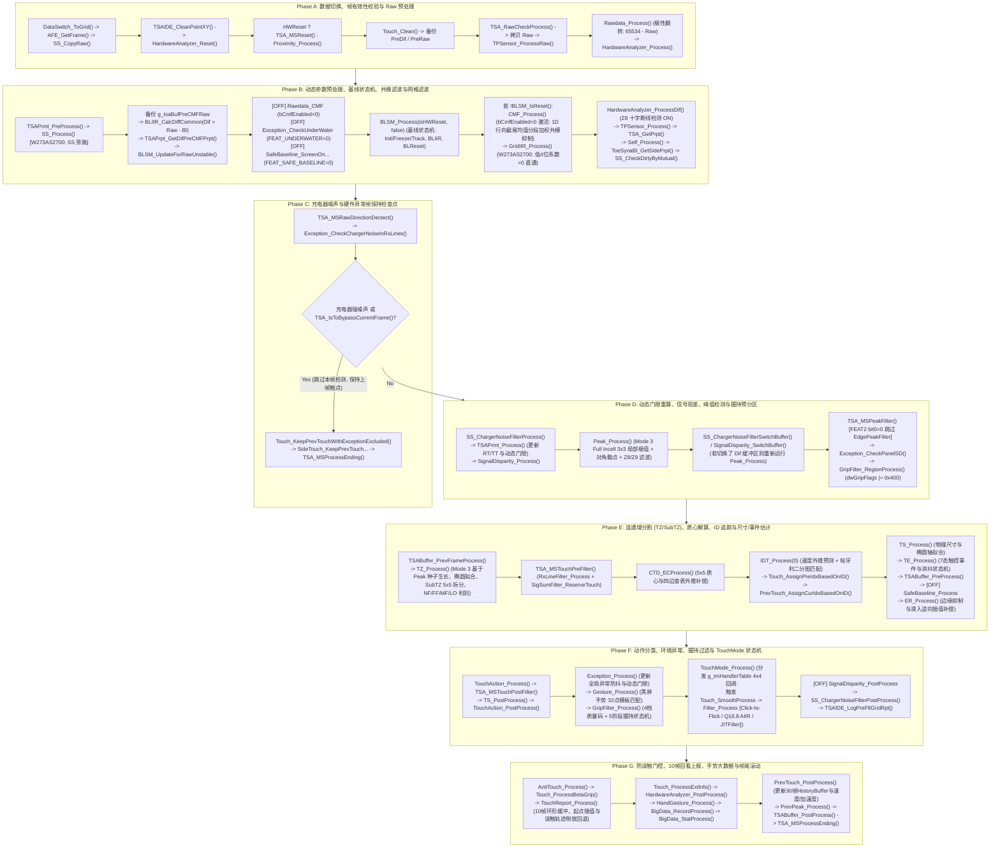

# `TSACore.dll` 手指触控计算管线全量逆向工程分析报告

> [!IMPORTANT]
> **分析范围与覆盖率声明**
> - **目标二进制**：`TSACore.dll`（ImageBase `0x6ba40000`，编译器 `MinGW-W64 GCC 4.9.3 x86_64-posix-seh -O0`，内嵌分支标识 `"TL_develop_gaokun"`，安全库 `"Huawei Secure C V100R001C01SPC010B002"`）。
> - **入口函数**：`TSA_Processing` (`@ 0x6ba9a443`)，核心互容/自容手指管线为 `TSA_MSProcess` (`@ 0x6ba90e43`)。按要求已排除主动手写笔主干 `TSA_ASAProcess` (`@ 0x6badf1f9`) 子树，但完整保留并分析了手指管线调用的手写笔防误触协同模块 `TSA_StylusAftProcess` (`@ 0x6bb22b1c`) 及相关 `ASA_*` 状态查询接口。
> - **100% 子函数覆盖（共 2,613 个子函数 + 238 个初始化函数）**：通过指令级调用图遍历与 `.rdata` 函数指针表（`g_tmHandlerTable @ 0x6bb52a40`）追踪，共提取出 **2,531 个直接调用子函数**、**82 个间接回调子树函数** 以及 **238 个 `*Init*` 初始化函数**。
> - **本机配置表绑定**：结合 `/tsaprmt-table-reader` 从 `TSAPrmt.dll` 导出的本机 `W273AS2700`（`GaokunHimaxCSOT`）预设表（`g_tsaPrmtFlash`、`g_tsaPrmtFlashCmfPca`、`g_tsaPrmtFlashPosture`），对所有模块开关、分支门控及算法阈值进行了实参解码与逐一标注。

---

## 0. 全量交付物与 6 卷逐函数详单索引

所有从 `TSACore.dll` 反编译还原的 **118 个 `.c` 源码文件**、**7 份二进制符号/反射/参数交叉引用元数据** 以及 **6 卷全函数逆向手册（合计约 1.1 MB，无遗漏覆盖全部 2,613 个函数）** 已同步整理至项目目录 [EGoTouchService/Solvers/TouchSolver/raw](file:///d:/source/repos/EGoTouchRev/EGoTouchService/Solvers/TouchSolver/raw)：

| 卷号 | 详细分析报告文件（Artifact 路径 / 项目 `raw/docs` 路径） | 覆盖模块文件数 | 覆盖子函数数 | 核心内容范围 |
| :--- | :--- | :---: | :---: | :--- |
| **第 1 卷** | [Part1_Architecture_Prmt_TopLevel.md](file:///C:/Users/detach/.gemini/antigravity/brain/a514db2d-f64e-4810-abac-e13023994cb7/Part1_Architecture_Prmt_TopLevel.md)<br>([raw/docs/Part1](file:///d:/source/repos/EGoTouchRev/EGoTouchService/Solvers/TouchSolver/raw/docs/Part1_Architecture_Prmt_TopLevel.md)) | 19 个 `.c` + `_INIT_ALL.c` | 491 | 五层参数体系 (`TSAPrmt`/`Const`/`Dyn`/`RT`/`TT`/`Ram`)、顶层调度 (`TSA`/`TSAMS`)、全局状态与零拷贝缓冲切换 (`TSAStatic`/`TSABuffer`/`TSAPrpt`/`DataSwitch`)、折叠屏几何裁剪 (`TSAFold`)、模拟前端 (`AFE`)、事件与日志工具 (`EventAnalyzer`/`TSALog`/`TSAIDE`/`StrPrintf`/`SWTimer`) |
| **第 2 卷** | [Part2_Raw_SS_Baseline_CMF_Filter.md](file:///C:/Users/detach/.gemini/antigravity/brain/a514db2d-f64e-4810-abac-e13023994cb7/Part2_Raw_SS_Baseline_CMF_Filter.md)<br>([raw/docs/Part2](file:///d:/source/repos/EGoTouchRev/EGoTouchService/Solvers/TouchSolver/raw/docs/Part2_Raw_SS_Baseline_CMF_Filter.md)) | 29 个 `.c` | 407 | Raw 极性翻转与拓扑补偿 (`Rawdata`/`TPSensor`/`NotchCorrect`/`NotchProtect`)、硬件故障与坏道分析 (`HardwareAnalyzer`/`BadChannel`/`BaliSensorBroken`/`PressureDrift`)、自容管线 (`SS`/`Self`/`ToeSyna`/`ToeSynaBl`)、基线状态机与复位 (`BLSM`/`BLIIR`/`BLReset`/`BLRecal`/`BaselineQueue`/`SafeBaseline`)、共模滤波与 PCA (`CMF`/`CMFRemap`/`Matrix`)、网格与行线滤波 (`GridIIR`/`IIR`/`AIIR`/`AdaptiveIIR`/`RxLineFilter`/`SigSumFilter`) |
| **第 3 卷** | [Part3_Exception_Peak_TZ_Misc.md](file:///C:/Users/detach/.gemini/antigravity/brain/a514db2d-f64e-4810-abac-e13023994cb7/Part3_Exception_Peak_TZ_Misc.md)<br>([raw/docs/Part3](file:///d:/source/repos/EGoTouchRev/EGoTouchService/Solvers/TouchSolver/raw/docs/Part3_Exception_Peak_TZ_Misc.md)) | 15 个 `.c` | 505 | 环境与噪声异常状态机 (`Exception`/`FIException`/`HIException`/`RFNoise`/`SignalDisparity`)、局部峰值搜索与跨帧匹配 (`Peak`/`PrevPeak`/`EdgePeakFilter`)、连通域分割与二阶矩椭圆拟合 (`TZ`/`SubTZ`/`TouchZone`/`Image`)、定点数学与 UI 热区工具库 (`MISC`/`TSAMath`/`_CASE_COLLISIONS`) |
| **第 4 卷** | [Part4_CTD_IDT_TS_TE_Touch_Filter.md](file:///C:/Users/detach/.gemini/antigravity/brain/a514db2d-f64e-4810-abac-e13023994cb7/Part4_CTD_IDT_TS_TE_Touch_Filter.md)<br>([raw/docs/Part4](file:///d:/source/repos/EGoTouchRev/EGoTouchService/Solvers/TouchSolver/raw/docs/Part4_CTD_IDT_TS_TE_Touch_Filter.md)) | 20 个 `.c` | 337 | 5×5 加权质心与边缘外推补偿 (`CTD`/`ER`/`HotZoneAdjust`/`PosnSpecial`/`PolynomialRegression`)、多目标匈牙利匹配与轨迹外推 (`IDT`/`MtLsm`/`MtLst`/`MtDiff`)、触控尺寸与事件消抖状态机 (`TS`/`TE`/`DB`/`TouchThold`)、触点生命周期管理 (`Touch`/`PrevTouch`/`TouchAction`)、坐标平滑滤波 (`Filter`) 与触控模式状态机回调子树 (`TouchMode`/`_RDATA_CALLBACKS`/`_TM_CALLBACK_SUBTREE`) |
| **第 5 卷** | [Part5_Grip_Gesture_Proximity_Report.md](file:///C:/Users/detach/.gemini/antigravity/brain/a514db2d-f64e-4810-abac-e13023994cb7/Part5_Grip_Gesture_Proximity_Report.md)<br>([raw/docs/Part5](file:///d:/source/repos/EGoTouchRev/EGoTouchService/Solvers/TouchSolver/raw/docs/Part5_Grip_Gesture_Proximity_Report.md)) | 13 个 `.c` | 353 | 四大功能区与五阶段边缘握持抑制 (`GripFilter`)、32 点重采样黑屏唤醒手势 (`Gesture`)、慢速基线左右手握姿估计 (`HandGesture`/`Posture`/`Sensor*`/`AccQueue`)、接近感应 (`Proximity`)、防误触门控与 10 帧历史回退上报 (`AntiTouch`/`TouchReport`)、大数据异常切片采集 (`BigData`) |
| **第 6 卷** | [Part6_SideTouch_StylusAft_TSAOut_AFT.md](file:///C:/Users/detach/.gemini/antigravity/brain/a514db2d-f64e-4810-abac-e13023994cb7/Part6_SideTouch_StylusAft_TSAOut_AFT.md)<br>([raw/docs/Part6](file:///d:/source/repos/EGoTouchRev/EGoTouchService/Solvers/TouchSolver/raw/docs/Part6_SideTouch_StylusAft_TSAOut_AFT.md)) | 15 个 `.c` | 414 | 曲屏侧边触控与虚拟音量键 (`SideTouch`/`SideBaseline`/`SideGesture`/`VirtualKey`/`SHBVolumeData`)、大鱼际 Sobel 梯度检测 (`Thenar`)、手写笔防手掌误触扇形区与撤回机制 (`StylusAft`/`ASA`/`HPP3`)、屏下指纹黎曼积分与最终坐标输出 (`UDFPEvent`/`TSAOut`)、皮套模式 (`SmartCover`)、边缘防误触 (`AFT`)、二阶贝塞尔双倍报点插值 (`DoubleReport`) |

**配套底层元数据文件**（位于 [EGoTouchService/Solvers/TouchSolver/raw/_metadata/](file:///d:/source/repos/EGoTouchRev/EGoTouchService/Solvers/TouchSolver/raw/_metadata)）：
- [w273as2700_tables_dump.txt](file:///d:/source/repos/EGoTouchRev/EGoTouchService/Solvers/TouchSolver/raw/_metadata/w273as2700_tables_dump.txt)：`W273AS2700` (`GaokunHimaxCSOT`) 导出的二进制表完整多类型解码与运行时虚拟地址映射。
- [w273as2700_prmt_xrefs.txt](file:///d:/source/repos/EGoTouchRev/EGoTouchService/Solvers/TouchSolver/raw/_metadata/w273as2700_prmt_xrefs.txt)：`TSACore.dll` 指令直接引用的全部 1,207 个参数地址、偏移、`W273AS2700` 实参值与引用函数列表。
- [prmt_reflection_tables.txt](file:///d:/source/repos/EGoTouchRev/EGoTouchService/Solvers/TouchSolver/raw/_metadata/prmt_reflection_tables.txt)：`TsaRTPrmtStructFmt` (`0x6bb4fcc0`, 16 项) 与 `TsaTTPrmtStructFmt` (`0x6bb50b00`, 67 项) 反射表转储。
- [call_tree.txt](file:///d:/source/repos/EGoTouchRev/EGoTouchService/Solvers/TouchSolver/raw/_metadata/call_tree.txt)：从 `TSA_Processing` 出发的完整调用图邻接表与函数指针引用表。
- [bss_symbols.txt](file:///d:/source/repos/EGoTouchRev/EGoTouchService/Solvers/TouchSolver/raw/_metadata/bss_symbols.txt) / [rdata_strings.txt](file:///d:/source/repos/EGoTouchRev/EGoTouchService/Solvers/TouchSolver/raw/_metadata/rdata_strings.txt) / [rdata_func_ptrs.txt](file:///d:/source/repos/EGoTouchRev/EGoTouchService/Solvers/TouchSolver/raw/_metadata/rdata_func_ptrs.txt)：全局 `.bss` 变量地址表、`.rdata` 字符串常量与回调表。

---

## 1. 顶层管线架构与全流程调用时序 (`TSA_Processing` & `TSA_MSProcess`)

### 1.1 顶层帧入口 `TSA_Processing` (`@ 0x6ba9a443`)

见 [TSA.c](file:///d:/source/repos/EGoTouchRev/EGoTouchService/Solvers/TouchSolver/raw/TSA.c#L1-L112)。每帧输入签名为：
```c
void TSA_Processing(short *pMutualRawData, uint dwCtrlFlags, void *pFrameBuffer);
```
其中 `pMutualRawData` 为互容原始二维采样数组（`W273AS2700` 上为 $60 \times 40 = 2400$ 个 `int16_t`），`dwCtrlFlags` 为帧控制位掩码，`pFrameBuffer` 指向驱动传入的扩展帧结构（含时间戳、自容行数据、AFE 状态与主动笔帧指针）。

```mermaid
flowchart TD
    Entry["TSA_Processing(pMutualRawData, dwCtrlFlags, pFrameBuffer)<br/>@ 0x6ba9a443"] --> FoldIn["TSAFold_InputProcess<br/>(W273AS2700: numRegions=1, 不裁剪)"]
    FoldIn --> CheckAuto{"dwCtrlFlags & 0x100000<br/>(AFE AutoCheck?)"}
    CheckAuto -- "Yes" --> AutoCheck["AFE_AutoCheckProcessInternal<br/>-> TSAStatic_PostProcess"]
    CheckAuto -- "No" --> ProxWake["Proximity_FilterExtraWakeup<br/>-> AFE_PreProcess<br/>-> TSAStatic_GetMSTimeStamp<br/>-> TSAStatic_UpdateCtrlFlags<br/>-> TSAStatic_PreProcess<br/>-> BLSM_PreProcess"]
    ProxWake --> CheckNeg{"(int)dwSystemFlags < 0 ?<br/>(bit 31 旁路帧)"}
    CheckNeg -- "Yes" --> SafeBLBuf["SafeBaseline_SetBuf<br/>-> TSAStatic_PostProcess"]
    CheckNeg -- "No" --> LogIn["TSALog_Frame -> TSAIDE_Reset -> TSALog_Input<br/>(若 HWReset 则 EventAnalyzer_Init)"]
    LogIn --> CheckSkipMS{"dwSystemFlags & 0x200<br/>(FLAG_SKIP_MS_PROCESS)?"}
    CheckSkipMS -- "No (正常手指帧)" --> MSProc["TSA_MSProcess(pMutualRawData)<br/>@ 0x6ba90e43 (核心互容/自容手指管线)"]
    CheckSkipMS -- "Yes" --> PostMS
    MSProc --> PostMS["后置多模态与边缘模块:<br/>1. Proximity_TouchPostProcess (OFF)<br/>2. SideTouch_Process (OFF)<br/>3. Thenar_ProcessInfoByDif (OFF)<br/>4. SHBVolumeData_Process (OFF)"]
    PostMS --> ASA{"dwFeatureFlags & 0x10000<br/>(FEAT_ASA_ENABLED = 1)"}
    ASA -- "ON" --> ASAProc["[手写笔管线 - 本报告跳过]<br/>TSA_ASAProcess(dwCtrlFlags)"]
    ASAProc --> StylusAft{"FEAT_ASA_ENABLED (1) &&<br/>FEAT_STYLUS_AFT (1) &&<br/>!(dwStylusAftGateFlags & 4)"}
    StylusAft -- "ON (W273AS2700 激活!)" --> StylusAftProc["TSA_StylusAftProcess @ 0x6bb22b1c<br/>(基于笔位置/倾角扇形区抑制或撤回手掌触点)"]
    StylusAftProc --> OutPost["TSAOut_PostProcess @ 0x6bb35877<br/>(UDFPEvent[OFF] -> 触点过滤 -> 2560x1600 坐标映射 -> ReportExtInfo)"]
    OutPost --> DMD["TSA_SetDMDType @ 0x6ba9d881<br/>(HardwareAnalyzer 异常码转 DMD 掩码)"]
    DMD --> OptionalExt["可选后置模块 (W273AS2700 均 OFF):<br/>- SmartCover_Process (FEAT_SMART_COVER=0)<br/>- AFT_Process (FEAT_AFT_ENABLED=0)"]
    OptionalExt --> Finalize["收尾与输出重映射:<br/>TSAStatic_PostProcess<br/>-> DoubleReport_Process (OFF)<br/>-> TSALog_Output -> nFrameCounter++<br/>-> AFE_Process (跳频/变采样率状态机)<br/>-> TSAFold_OutputProcess<br/>-> TSA_PitchSizeRemapProcess"]
```



---

### 1.2 互容手指核心管线 `TSA_MSProcess` (`@ 0x6ba90e43`) 七阶段拆解

见 [TSA.c](file:///d:/source/repos/EGoTouchRev/EGoTouchService/Solvers/TouchSolver/raw/TSA.c#L123-L384)。`TSA_MSProcess` 在 `W273AS2700` 上的完整执行流可分为 **7 个顺序阶段（Phase A ~ Phase G）**：



---

## 2. 配置表控制体系与本机 `W273AS2700` (`GaokunHimaxCSOT`) 实参总表

### 2.1 五层配置表内存布局与寻址规则

在 `TSAPrmt_FlashPrmtLoadProject` (`@ 0x6bb3b759`，见 [_INIT_ALL.c](file:///d:/source/repos/EGoTouchRev/EGoTouchService/Solvers/TouchSolver/raw/_INIT_ALL.c)) 中，`TSACore.dll` 从 `TSAPrmt.dll` 导出的机型配置表加载 4 张静态表，并在 `.bss` 中维护 5 个派生/动态参数区：

| 参数表符号 | `TSACore.dll` 虚拟地址 | 大小 | 对应 `TSAPrmt.dll` 导出表 / 初始化函数 | 反编译代码中的寻址换算规则 |
| :--- | :--- | :--- | :--- | :--- |
| **`g_tsaPrmtFlash`** | `0x6bca8a00 .. 0x6bcaa28f` | `0x1890` (6,288 B) | `g_tsaPrmtFlashGaokunHimaxCSOT` | Ghidra 中 `TSAFlashPrmt` 结构体大小定义为 `0x840` (2112 B)：<br>• `_refptr_g_tsaPrmtFlash[N].field_0xM` $\implies$ **`flash_offset = N * 0x840 + 0xM`**<br>• `_refptr_g_tsaPrmtFlash[1].pDim1PitchMap + X` $\implies$ **`flash_offset = 0x840 + 0xa0 + X = 0x8e0 + X`**<br>• `DAT_6bca9xxx` / `DAT_6bcaaxxx` $\implies$ **`flash_offset = addr - 0x6bca8a00`** |
| **`g_tsaPrmtFlashCmfPca`** | `0x6bcaa2c0 .. 0x6bcab5eb` | `0x132c` (4,908 B) | `g_tsaPrmtFlashCmfPcaGaokunHimaxCSOT` | **`cmfpca_offset = addr - 0x6bcaa2c0`**（`W273AS2700` 全表为 `0`） |
| **`g_tsaPrmtFlashAsa`** | `0x6bca7bc0 .. 0x6bca89ff` | `0x0e40` (3,648 B) | `g_tsaPrmtFlashAsaGaokunHimaxCSOT` | **`asa_offset = addr - 0x6bca7bc0`** |
| **`g_tsaPrmtFlashPosture`** | `*(void**)0x6bbbf510` | `0x3eb20` (256,800 B) | `g_tsaPrmtFlashPostureGaokunHimaxCSOT` | 堆内存指针存于 `0x6bbbf510`，供 `Posture.c` 决策树与 LDA 判别器读取 |
| **`g_tsaPrmtFlashConst`** | `0x6bcab600 .. 0x6bcab663` | `0x0064` (100 B) | `TSAConstPrmt_Init @ 0x6bb3bb00` | 启动或切换折叠态时由 `g_tsaPrmtFlash` 预计算的定点常数 |
| **`g_tsaPrmtDynamic`** | `0x6bcab680 .. 0x6bcab71f` | `0x00a0` (160 B) | `TSADynPrmt_Init @ 0x6bb3c6f2`<br>`TSADynPrmt_PreProcess`<br>`TSADynPrmt_Process` | 每帧根据噪声等级、充电器状态、温度、TouchMode 动态调整的实时阈值表 |
| **`g_tsaPrmtRam`** | `0x6bcab720 .. 0x6bcab77f` | `0x0060` (96 B) | `TouchThold_Init @ 0x6bb3ad39` | 运行时自适应信号倍率暂存区（如 `+0x04` 初始为 `64`） |
| **`g_tsaRTPrmt`** | `0x6bcab780 .. 0x6bcab8ff` | `0x0180` (384 B) | `TSARTPrmt_Init @ 0x6bb3cf56` | 16 项运行时参数（每项 `0x18` 字节，含 `cur/def/max/min/desc`），反射表位于 `0x6bb4fcc0` |
| **`g_tsaTTPrmt`** | `0x6bcaba80 .. 0x6bcac487` | `0x0a08` (2,568 B) | `TSATTPrmt_Init @ 0x6bb3d2ee` | 67 项调优参数（每项 `0x18` 字节），反射表位于 `0x6bb50b00` |

---

### 2.2 `W273AS2700` 模块总开关矩阵（哪些模块激活，哪些模块关闭/旁路？）

在 `TSAStatic_InitSysModuleEveryTime` (`@ 0x6baa15c6`) 中：
- `dwFeatureFlags` = `flash[+0x50] (0x00000101) | flash[+0x54] (0x01090020)` = **`0x01090121`**
- `dwFeatureFlags2` = `flash[+0x58] (0x00000120) | flash[+0x5c] (0x00000120)` = **`0x00000120`**

结合 `g_tsaPrmtFlash` 中的独立字节开关，本机 `W273AS2700` 上各算法模块的启停状态如下表所示：

| 管线阶段 / 子系统 | 控制开关位置 (`flash` 偏移或标志位) | `W273AS2700` 实参值 | 本机运行状态 | 实际行为说明 |
| :--- | :--- | :--- | :---: | :--- |
| **折叠屏区域裁剪 (`TSAFold`)** | `flash+0x17cc` (`bSupported`)<br>`flash+0x17d0` (`numRegions`) | `bSupported = 1`<br>`numRegions = 1` (`60×40`) | **直通 (No-Cut)** | 单区域占满全屏 `60×40` (`2560×1600`)，`TSAFold_IsRegionCut()` 恒为 `0`，不发生通道裁剪 |
| **自容信号处理 (`SS` / `Self`)** | `flash+0x0608` $\to$ `Dynamic[0x24]` | `0` | **旁路 (OFF)** | Himax CSOT TDDI 仅使用互容帧，`SS_IsRawValid()` / `SS_IsDim1Valid()` 恒返回 `0` |
| **异形屏/挖孔补偿 (`NotchCorrect`)** | `flash+0x09e4` (`numNotch`)<br>`flash+0x094c` (`numOffset`) | `0` | **旁路 (OFF)** | 标准矩形屏，无刘海/挖孔区域，不执行通道插值或缩放 |
| **Raw 极性翻转与归一化 (`Rawdata_Process`)** | `flash+0x05fc` (`32767`)<br>`flash+0x0600` (`35767`) | `const+0x38 = -16383`<br>`const+0x3c = 65534` | **激活 (ON)** | 执行极性翻转：$\text{NormRaw}[i] = 65534 - \text{Raw}[i]$，使手指按下产生正向 Diff |
| **前置 Raw 共模滤波 (`Rawdata_CMF`)** | `flash+0x080d` (`bCmfEnabled`) | `0` | **跳过 (OFF)** | 跳过 `BLSM` 之前的 `Rawdata_CMF`，改为在 `BLSM_Process` 之后执行 `CMF_Process` |
| **水下检测 (`Exception_CheckUnderWater`)** | `dwFeatureFlags & 0x800` | `0` | **关闭 (OFF)** | 跳过水下电容骤降检测 |
| **安全基线 (`SafeBaseline_*`)** | `dwFeatureFlags & 0x100000` | `0` | **关闭 (OFF)** | 跳过手持亮屏安全基线与 `SafeBaseline_Process`，仅使用 `BaselineQueue` |
| **基线状态机与脏基线重置 (`BLSM` / `BLIIR` / `BLReset`)** | `flash+0x0069..0x006b` | `1, 1, 1` | **激活 (ON)** | 使用 `g_tsaBufPreCMFRaw` 更新基线，启用 5 态脏基线监控及 Type 1/2/3 负向漂移重置 |
| **后置共模滤波 (`CMF_Process`)** | `flash+0x080d == 0`<br>`flash+0x0810` (`dwCmfMethodNormal`) | `bCmfEnabled = 0`<br>`Method = 0` | **激活 (ON)** | 2D PCA 因 `CmfPca` 表全 `0` 旁路；激活 **1D Dim1（行向）截尾均值分段线性加权共模滤波** |
| **互容网格时域滤波 (`GridIIR_Process`)** | `flash+0x08f8` (`0xe0` 低 4 位) | `0xe0 & 0x0f = 0` | **直通 (Weight=0)** | 低 4 位权重为 `0`，互容 Diff 矩阵不叠加历史帧残影，保持 120Hz 零延迟响应 |
| **硬件断线检测 (`HardwareAnalyzer` / `BadChannel`)** | `flash+0x165c` (`DifBroken`)<br>`flash+0x1650` (`RawBroken`) | `DifBroken = 1`<br>`RawBroken = 0` | **Dif 激活 (ON)** | 启用 Diff 域 Z8 十字断线（Type 5）与单/双通道跳变检测；Raw 域断线检测关闭 |
| **峰值检测模式 (`Peak_Process`)** | `flash+0x0034` (`sensorArch`) | `3` (**Full Incell**) | **Mode 3 激活** | 运行 `Peak_TraversalMode3` + 对角鞍点检验 + `Peak_FilterForMode3` (`Z1/Z8/Z9` 滤波) |
| **边缘伪峰抑制 (`EdgePeakFilter_WorkAround`)** | `dwFeatureFlags2 & 0x01` | `0` | **关闭 (OFF)** | `TSA_MSPeakFilter` 中不执行额外边缘 $5/8$ 削峰 |
| **连通域分割模式 (`TZ_Process` / `SubTZ`)** | `flash+0x0828` (`bTzTraversalMode`)<br>`flash+0x0829` (`bSubTzEnabled`) | `Mode = 3`<br>`SubTZ = 1` | **Mode 3 激活** | 从 Peak 种子出发 8 邻域生长，支持多峰 $5\times 5$ `SubTZ` 距离倒数加权拆分与二阶矩椭圆拟合 |
| **環境异常状态机 (`FIException` vs `HIException`)** | `flash+0x0034` (`sensorArch`) | `3` (**Full Incell**) | **`FIException` 激活** | 走 Full Incell 异常分支（正负峰伴生、负坑基线异常、水滴检测），不走 `HIException` |
| **Rx 列传导噪声与信号和过滤 (`RxLineFilter` / `SigSumFilter`)** | `flash+0x08a4` (`80%`)<br>`flash+0x08a8` (`2400`) | 阈值均有效 (`+0x8b4=0`) | **激活 (ON)** | 滤除整列 $\ge 80\%$ 噪点的 Rx 干扰列及信号和过小的悬浮假点 |
| **质心与边缘补偿 (`CTD` / `ER` / `IDT` / `TS` / `TE`)** | 核心必经管线 | 见 2.3 节参数表 | **全部激活 (ON)** | 5×5 加权质心、四边查表外推、匈牙利匹配、椭圆主次轴拟合、7 态事件机全部运行 |
| **边缘握持抑制 (`GripFilter_RegionProcess` & `Process`)** | `flash+0x08c4` (`deviceType=2`)<br>`dwFeatureFlags & 0x01000000` | `WindowsPad = 1`<br>`dwGripFlags = 0` | **激活 (ON)** | 维护 `Ex/Co/Mu/Hv` 四大握持区，执行 4 档质量评估与 5 阶段延迟放行/拉回状态机 |
| **触控模式状态机与坐标平滑 (`TouchMode` / `Filter`)** | `dwFeatureFlags & 0x01` (`Glove=1`) | 4×4 状态跳转表 | **激活 (ON)** | 驱动 `Normal/Glove` 模式切换，并在回调中执行 `Filter_Process`（Click-to-Flick、Q16.8 AIIR、JITFilter） |
| **接近光 (`Proximity_*`)** | `flash+0x1660` (`proxEnable`) | `0` | **关闭 (OFF)** | 平板无通话贴脸息屏需求，直接返回 |
| **曲屏侧边触控与虚拟音量键 (`SideTouch_*` / `VirtualKey`)** | `dwFeatureFlags & 0x8000`<br>`flash+0x16a4` | `0` | **关闭 (OFF)** | 平板无瀑布屏侧边通道，直接返回 |
| **大鱼际差分识别 (`Thenar_ProcessInfoByDif`)** | `flash+0x0019` / 内部开关 | 旁路 | **关闭 (OFF)** | 仅在特定曲屏手机启用 |
| **手写笔防手掌误触 (`TSA_StylusAftProcess`)** | `dwFeatureFlags & 0x10100` | `FEAT_ASA (1) & FEAT_STYLUS_AFT (1)` | **激活 (ON)** | **重点！** 当手写笔在位或刚抬起时，计算笔尖倾角双圆扇形区，抑制 (`0x40`) 或撤回 (`0x80`) 手掌误触点 |
| **屏下指纹 (`UDFPEvent_Process`)** | `flash+0x1740` (`bUdfpEnabled`) | `0` | **关闭 (OFF)** | 平板无屏下光学指纹，直接返回 |
| **最终坐标转换与输出 (`TSAOut_PostProcess`)** | 核心必经管线 | `2560 × 1600` | **激活 (ON)** | 剔除被 `GripFilter`/`AntiTouch`/`StylusAft` 抑制的点，将内部 Q8 坐标映射至 `2560×1600` |
| **皮套模式 (`SmartCover_Process`)** | `dwFeatureFlags & 0x02` | `0` | **关闭 (OFF)** | 跳过 |
| **独立边缘防误触 (`AFT_Process`)** | `dwFeatureFlags & 0x200000`<br>`flash+0x0060` (`0`) | `0` | **关闭 (OFF)** | 跳过 `AFT_Process`，由 `GripFilter` + `AntiTouch` + `StylusAft` 承担防误触 |
| **双倍报点插值 (`DoubleReport_Process`)** | `flash+0x088c..0x088d` | `0, 0` | **关闭 (OFF)** | 默认不插值虚构中间帧 |
| **非均匀间距重映射 (`TSA_PitchSizeRemapProcess`)** | `flash+0x009c..0x59f` | 全 `0` | **直通 (Identity)** | 因 `dim1PitchMap` / `dim2PitchMap` 全为 `0`，映射后尺寸保持不变 |

---

### 2.3 `TSAConstPrmt_Init` (`@ 0x6bb3bb00`) 预计算定点常量推导表

在初始化阶段，`TSAConstPrmt_Init` 根据 `W273AS2700` 的 `g_tsaPrmtFlash` 计算出 `g_tsaPrmtFlashConst` (`0x6bcab600 .. 0x6bcab663`)，供后续所有模块高频读取：

| `Const` 地址 (偏移) | 类型 | 计算公式（基于 `g_tsaPrmtFlash`） | `W273AS2700` 实算值 | 用途与引用模块 |
| :--- | :---: | :--- | :---: | :--- |
| `0x6bcab600` (`+0x00`) | `u8` | `max(bCols, bRows) = max(60, 40)` | **`60`** (`0x3c`) | Rx 通道数（长边通道数） |
| `0x6bcab601` (`+0x01`) | `u8` | `min(bCols, bRows) = min(60, 40)` | **`40`** (`0x28`) | Tx 通道数（短边通道数） |
| `0x6bcab602` (`+0x02`) | `u16` | `(bCols << 8) - 1 = (60 << 8) - 1` | **`15359`** (`0x3bff`) | Dim1 内部 Q8 网格坐标上限 (`[0 .. 15359]`) |
| `0x6bcab604` (`+0x04`) | `u16` | `(bRows << 8) - 1 = (40 << 8) - 1` | **`10239`** (`0x27ff`) | Dim2 内部 Q8 网格坐标上限 (`[0 .. 10239]`) |
| `0x6bcab606` (`+0x06`) | `u16` | `(15359 * 4) / 69` (`dim1Pitch=69`) | **`890`** (`0x037a`) | Dim1 全屏物理毫米数（Q2 定点，约 $222.5\text{ mm}$） |
| `0x6bcab608` (`+0x08`) | `u16` | `(10239 * 4) / 66` (`dim2Pitch=66`) | **`620`** (`0x026c`) | Dim2 全屏物理毫米数（Q2 定点，约 $155.0\text{ mm}$） |
| `0x6bcab60a` (`+0x0a`) | `u8` | `(4096 / 69 + 1) >> 1` | **`30`** (`0x1e`) | Dim1 每毫米对应的网格缩放因子 |
| `0x6bcab60b` (`+0x0b`) | `u8` | `(4096 / 66 + 1) >> 1` | **`31`** (`0x1f`) | Dim2 每毫米对应的网格缩放因子 |
| `0x6bcab60c` (`+0x0c`) | `u16` | `(bCols << 10) - 1` | **`61439`** (`0xefff`) | Dim1 Q10 高精度坐标上限 |
| `0x6bcab60e` (`+0x0e`) | `u16` | `(bRows << 10) - 1` | **`40959`** (`0x9fff`) | Dim2 Q10 高精度坐标上限 |
| `0x6bcab638` (`+0x38`) | `i32` | `((rawRefHigh - rawRefLow) * 16384) / htiRef`<br>`= ((32767 - 35767) * 16384) / 3000` | **`-16384`** (`-0x4000`) | `Rawdata_NormalizeGridUnit` 归一化斜率（恰为 $-1.0$ 的 Q14 定点，触发快速分支） |
| `0x6bcab63c` (`+0x3c`) | `i32` | `((rawRefHigh * const_0x38) >> 13) + 32767` | **`65534`** (`0xfffe`) | `Rawdata_NormalizeGridUnit` 极性翻转偏置：$\text{NormRaw} = 65534 - \text{Raw}$ |
| `0x6bcab640..0x44` | `u16[3]` | `Filter` 3 档距离自适应 IIR 斜率预计算 | **`250, 292, 62`** | `Filter_GetCoefBasedOnDistance` 线性插值斜率 |
| `0x6bcab646..0x48` | `u16[2]` | `jitVelCfg * 30` / `jitVelCfg * 31` | **`1500, 186`** | `JITFilter` 与速度门限换算值 |

---

## 3. 核心算法阶段深度解析（数学模型、状态机与关键结构体）

### 3.1 原始数据归一化、基线状态机与 1D 共模滤波（Phase A & Phase B）

详细逐函数分析见 **[第 2 卷：Part2_Raw_SS_Baseline_CMF_Filter.md](file:///C:/Users/detach/.gemini/antigravity/brain/a514db2d-f64e-4810-abac-e13023994cb7/Part2_Raw_SS_Baseline_CMF_Filter.md)**。

1. **Raw 极性翻转与双路备份 (`Rawdata_Process @ 0x6ba69f48`)**：
   - 传感器原始采样值在无触摸时约为 `32767` (`flash+0x5fc`)，手指按压使互容耦合电容减小、读数向 `35767` (`flash+0x600`) 增大。
   - 因为 `const+0x38 = -16384`（即 $-2^{14}$），`Rawdata_NormalizeGridUnit` (`@ 0x6ba69d6e`) 走快速减法分支：
     $$\text{g\_tsaBufRaw}[r, c] = \text{clip}_{[-32768, 32767]}\left(65534 - \text{pMutualRawData}[r, c]\right)$$
   - 归一化后，紧接着将 `g_tsaBufRaw` 完整备份至 `g_tsaBufPreCMFRaw`。**设计原因**：后续 `CMF_Process` 会在差分矩阵中扣除行向共模均值，若用经过 CMF 的信号更新基线，高信噪比手指同行两侧的负向共模凹陷（CMF Shadow）会被慢速吸收入基线，导致手指抬起后同行出现正向鬼点；因此 `BLIIR_DoUpdate` 在 `flash+0x0069 == 1` 时强制使用未经 CMF 的 `g_tsaBufPreCMFRaw` 更新基线。

2. **基线状态机 (`BLSM_Process @ 0x6ba4b2c4` & `BLIIR` & `BLReset`)**：
   - **初始差分计算 (`BLIIR_CalcDiffCommon @ 0x6ba4528b`)**：
     $$\text{g\_tsaBufDif}[i] = \text{g\_tsaBufRaw}[i] - \text{g\_tsaBufBl}[i], \quad i \in [0, 2399]$$
   - **3 大主状态与子状态机**：
     - `State 0 (BLSM_INIT)`：刚开机、睡眠唤醒或硬件复位后的首帧，直接令 `g_tsaBufBl = g_tsaBufRaw`，并将该帧推入 `BaselineQueue` 作为历史候选基线。
     - `State 1 (BLSM_FREEZE)`：当屏幕上存在有效触控 (`nTouchCount > 0`)、峰值超限 (`nSPeakPositive > BLThold`) 或检测到帧间剧烈跳变 (`Raw2RawDif` 超标) 时，冻结基线更新，防止手指信号被基线吞噬。
     - `State 2 (BLSM_TRACK)`：无触摸平稳状态下执行一阶定点 IIR 慢速跟踪 (`BLIIR_DoUpdate @ 0x6ba454b2`)，维护 `g_tsaBufBlFloat`（余数累加器）以消除定点截断死区。
   - **5 态脏基线监控与异常基线重置 (`BLReset.c`, 51 个函数)**：
     - 当手指按压在未完全稳定的基线上或因水滴/手掌擦拭导致基线反向漂移时，网格会出现**大面积负向差分坑（Negative Peak）**或**正负伴生峰（Positive-Negative Coupled Peaks）**。
     - `BLReset_CheckAbnormalBaseline` 每帧并行运行三类检测器：
       - **Type 1 (`BLReset_IsAbnormalBaselineType1`)**：检测正峰值与深负峰值伴生粘连；
       - **Type 2 (`BLReset_IsAbnormalBaselineType2`)**：检测连通负向区域面积与积分超限；
       - **Type 3 (`BLReset_IsAbnormalBaselineType3`)**：检测四边边缘行/列平均负向偏移。
     - 一旦持续时间超过 `wBlDebounceTimeMs` (`2000 ms` 或快速重置门限)，触发 `Baseline_Reset`，根据模式从 `BaselineQueue` 回滚历史干净基线或用当前 `Raw` 强制重置。

3. **1D 行向截尾均值分段加权共模滤波 (`CMF_Process @ 0x6ba4cb7b`)**：
   - 在 `W273AS2700` 上，`bCmfEnabled = 0` (`flash+0x080d`) 且 `dwCmfMethodNormal = 0` (`flash+0x0810`)，`CMF_Process` 在 `BLSM_Process` 之后运行，实际调用 `CMF_ProcessDim(0, wCmfThold, wCmfDiffThold)`（常规模式下门限为 `600, 150`；充电器插入时切换为 `15000, 200`）：
   - **第一步（行向截尾共模噪声估计 `CMF_GetCommonModeNoiseDim1`）**：对每一行 $c \in [0, 59]$（含 40 个节点），剔除最大的 8 个值和最小的 8 个值（防止真实手指正峰或基线负坑拉偏均值），取中间 24 个节点的算术平均值作为该行的共模噪声 $N_{\text{cm}}[c]$。
   - **第二步（邻域二阶差分与分段线性权重计算 `CMF_CalcFilterWeight`）**：对每个节点 $(c, r)$，计算其幅度与邻域差分距离 $d(c,r)$，按分段线性函数计算共模扣除权重 $W(c,r) \in [0, 16]$：
     $$W(c, r) = \begin{cases} 16, & |d(c, r)| \le 150 \\ \left\lfloor \dfrac{16 \times (600 - |d(c, r)|)}{600 - 150} \right\rfloor, & 150 < |d(c, r)| < 600 \\ 0, & |d(c, r)| \ge 600 \end{cases}$$
   - **第三步（加权共模扣除）**：
     $$\text{Dif}_{\text{after}}[c, r] = \text{Dif}_{\text{before}}[c, r] - \frac{W(c, r) \cdot N_{\text{cm}}[c]}{16}$$
     这样小幅度的全行共模干扰（$|d| \le 150$）被 100% 扣除，而真实手指中心区域（$|d| \ge 600$）权重为 0，手指峰值能量完全不受损失！

---

### 3.2 局部峰值搜索与连通域分割（Phase D & Phase E 前半段）

详细逐函数分析见 **[第 3 卷：Part3_Exception_Peak_TZ_Misc.md](file:///C:/Users/detach/.gemini/antigravity/brain/a514db2d-f64e-4810-abac-e13023994cb7/Part3_Exception_Peak_TZ_Misc.md)**。

1. **Mode 3 局部峰值提取 (`Peak_Process @ 0x6ba680cf`)**：
   - `W273AS2700` 配置 `dwPeakProcessingMode = 3` (`flash+0x0034`)，调用 `Peak_TraversalMode3` (`@ 0x6ba676c1`)：
     - 遍历 $60 \times 40$ 网格，寻找大于峰值检测初筛门限（常规 `wPeakMinThold = 220` 的一半即 `110`）且满足 **8 邻域非严格局部极大值**（左上四邻域严格大于，右下四邻域大于等于，消除平顶双峰重复提取）的候选点。
     - **对角鞍点双峰保护 (`Peak_IsPeakDiagonal @ 0x6ba66fb6`)**：当两个相邻手指呈 $45^\circ$ 对角紧挨时，检查两对角邻点是否高于鞍点一定比例，防止次高峰被误判为非极值而吞并。
     - **`Peak_FilterForMode3` (`@ 0x6ba67a29`)**：计算每个候选峰的 $3\times 3$ 邻域正信号总和 `Z9`、去中心 8 邻域和 `Z8` 及中心比值，滤除孤立单像素尖峰噪点，并按信号强度降序排列存入全局峰值表 `g_pPeaks`（上限 32 个峰值，每项 20 字节）。

2. **连通域生长、SubTZ 拆分与二阶矩椭圆拟合 (`TZ_Process @ 0x6ba8d2f4` & `SubTZ.c`)**：
   - **Mode 3 基于 Peak 种子的连通域生长 (`TZ_PeakBasedProcess @ 0x6ba8cf9e`)**：
     - 以 `g_pPeaks` 中的有效峰值为种子，执行 8 邻域 BFS/DFS 漫水填充，将 `Dif > TzThold` 的相连节点聚合成连通域 `TouchZone`（每个单元占 `0x370` = 880 字节）。
   - **多峰连通域 `SubTZ` $5\times 5$ 距离倒数加权拆分 (`SubTZ.c`, 16 个函数)**：
     - 若同一个连通域内包含多个局部峰值（如双指并拢捏合或手掌边缘粘连手指），围绕每个峰值建立 $5\times 5$ 的 `SubTZ` 窗口。
     - 对于被多个峰值 $5\times 5$ 窗口同时覆盖的重叠网格节点，`SubTZ_CalculateCenterForAll` (`@ 0x6ba77382`) 按节点到各峰值的欧氏距离倒数分摊节点信号能量，防止双指靠拢时质心相互吸引跳变。
   - **二阶中心矩协方差矩阵椭圆拟合 (`TZ_GetAxisInternal @ 0x6ba80929`)**：
     - 对连通域内节点计算信号加权质心 $(\bar{x}, \bar{y})$ 及二阶中心矩 $\mu_{20}, \mu_{02}, \mu_{11}$，构造 $2\times 2$ 协方差矩阵并求解特征值 $\lambda_1, \lambda_2$ 与主轴倾角 $\theta = \frac{1}{2}\text{atan2}(2\mu_{11}, \mu_{20}-\mu_{02})$，得到物理长轴 `majorAxis`、短轴 `minorAxis`、椭圆率 `ellipseRate` 与面积。
   - **四分类判别树 (`NF` 正常手指 / `FF` 粗大拇指 / `MF` 多指粘连 / `LO` 大面积手掌或水滴)**：
     - 结合椭圆长轴（`> loSizeInMM = 30 mm`）、面积、轮廓凹凸度（4× 双三次插值 `TZ_BiCubicInter` + Moore 等高线追踪 `TZ_FindContourDot`）以及边缘接触宽度（`edgeWidthThreshold = 300`），将每个 `TouchZone` 或 `SubTZ` 分类并调用 `TZ_RegisterTouch` 注册到当前帧触点表 `g_pTouches`。

---

### 3.3 质心边缘补偿、匈牙利 ID 追踪、事件状态机与坐标平滑滤波（Phase E 后半段 & Phase F）

详细逐函数分析见 **[第 4 卷：Part4_CTD_IDT_TS_TE_Touch_Filter.md](file:///C:/Users/detach/.gemini/antigravity/brain/a514db2d-f64e-4810-abac-e13023994cb7/Part4_CTD_IDT_TS_TE_Touch_Filter.md)**。

1. **5×5 加权质心与四边查表外推补偿 (`CTD_ECProcess @ 0x6ba526f2` & `ER_Process @ 0x6ba597b7`)**：
   - **基础质心 (`CTD_RawCalculate @ 0x6ba50bf1`)**：在峰值 $5\times 5$ 邻域（大物体或异形区退化为全连通域）内扣除局部底噪门限后计算 Q8 精度（每通道 256 子像素）信号加权质心：
     $$X_{\text{Q8}} = 256 \cdot c_{\text{peak}} + \left\lfloor \frac{256 \sum_{(c,r)\in \Omega} (c - c_{\text{peak}}) \cdot \max(0, \text{Dif}[c,r] - T_{\text{base}})}{\sum_{(c,r)\in \Omega} \max(0, \text{Dif}[c,r] - T_{\text{base}})} \right\rfloor$$
   - **边缘截断补偿 (`CTD_EdgeCompensation @ 0x6ba523ac`)**：当手指位于最外圈或次外圈通道时，由于面板外侧无电极，质心会向内偏置。`CTD` 根据外侧与内侧通道能量比查表外推，并乘以四边修正系数（`W273AS2700` 上左右边 `224/128 = 1.75`，上下边 `96/128 = 0.75`）。
   - **边缘滑入历史逆向插值 (`ER_MoveInCorrection @ 0x6ba59277`)**：手指从屏幕外边缘滑入时，前几帧被边缘死区拦截，一旦突破边缘进入屏幕，`ER_MoveInCorrection` 利用最近 3 帧速度向 `HistoryBuffer` 逆向插值补齐起点，消除从屏幕边缘内滑手势（如返回手势）的顿挫感。

2. **多帧速度外推预测与匈牙利二分图最优匹配 (`IDT_Process @ 0x6ba6256a` & `MtLsm.c`)**：
   - **轨迹预测 (`IDT_PredictPosCalculate @ 0x6ba612db`)**：根据上一帧活跃触点 `PrevTouch` 的历史帧数（1 帧零阶保持、2 帧线性外推、$\ge 3$ 帧带加速度阻尼的二阶/最小二乘速度外推）计算本帧预测位置 $(\hat{X}_i, \hat{Y}_i)$。
   - **代价矩阵与匈牙利算法 (`IDT_FindMatchTouches @ 0x6ba61c77`)**：构造上一帧触点 $i$（预测位置）与当前帧触点 $j$（实测位置）的欧氏距离代价矩阵 $D_{ij}$，在搜索半径限制（`idtMaxSearchDist = 5` 通道间距，快速移动时动态放宽）与加速度校验 (`IDT_AccCheck`, `accThold = 16`) 约束下，通过增广路与消圈迭代求解全局最小距离和匹配，继承跨帧 `touchId (0..9)`。

3. **TouchMode 4×4 状态机与 Q16.8 带余数自适应坐标滤波 (`TouchMode_Process @ 0x6ba7ac29` & `Filter_Process @ 0x6ba5eb91`)**：
   - `TouchMode_Process` 通过 `.rdata` 中的函数指针表 `g_tmHandlerTable` (`0x6bb52a40`) 调度 `Normal(0)` / `Glove(1)` 等模式转换，并在 `TouchMode_DefaultToNormal` / `TouchMode_NormalToNormal` 中调用 **`Touch_SmoothProcess` (`@ 0x6ba76315`) $\to$ `Filter_Process` (`@ 0x6ba5eb91`)**：
     1. **Click-Hold 原地冻结与 Click-to-Flick 平滑过渡 (`Filter_ReportClickToFlickProcessUnit @ 0x6ba5e6c3`)**：手指刚按下未超过 `clickDuration` (`200 ms`) 且位移小于 `clickSuppressDistance` (`60` 单位 $\approx 1.5\text{ mm}$) 时锁死报点坐标（使定点点击零抖动）；一旦手指突破抑制半径转为滑动（Flick），记录锁死点与真实点的初始偏移向量 $(\Delta X_0, \Delta Y_0)$，并在随后的滑动过程中按滑动距离比例线性衰减该偏移，彻底消除突破死区瞬间的坐标阶跃跳变！
     2. **三档位距离自适应 IIR (`Filter_FirstOrderIIRFilterUnit @ 0x6ba5dc5e`)**：根据本帧原始坐标与上一帧滤波后坐标的距离 $d$，分三档（普通、微动精细、快速滑动，参数位于 `flash+0x088e..0x089f`）线性插值计算滤波权重 $w \in [w_{\min}, w_{\max}] \subset [1, 256]$，并施加相邻帧权重变化斜率限制 $|w_t - w_{t-1}| \le 1$。
     3. **Q16.8 带 8 位小数余数累加的一阶 IIR 公式**：
        为避免整数除法截断导致慢速微动时坐标卡死（台阶效应），在 `PrevTouchUnit+0x46e` 维护 8 位小数余数 $R_{t-1} \in [0, 255]$：
        $$Y_t^{\text{Q8}} = \frac{w \cdot (256 \cdot X_t) + (256 - w) \cdot (256 \cdot Y_{t-1} + R_{t-1})}{256}, \quad Y_t = \lfloor Y_t^{\text{Q8}} / 256 \rfloor, \quad R_t = Y_t^{\text{Q8}} \bmod 256$$
     4. **80ms 折返检测与线性预测混合 (`Filter_LinearPredictionProcessUnit @ 0x6ba5e132`)** 及 **`JITFilter` 迟滞死区 (`Filter_RestrainJitterProcessUnit @ 0x6ba5e9a3`)**。

---

### 3.4 边缘握持抑制、防误触门控、手写笔防手掌与 10 帧回看上报（Phase F 后半段 & Phase G & Post-MS）

详细逐函数分析见 **[第 5 卷：Part5_Grip_Gesture_Proximity_Report.md](file:///C:/Users/detach/.gemini/antigravity/brain/a514db2d-f64e-4810-abac-e13023994cb7/Part5_Grip_Gesture_Proximity_Report.md)** 与 **[第 6 卷：Part6_SideTouch_StylusAft_TSAOut_AFT.md](file:///C:/Users/detach/.gemini/antigravity/brain/a514db2d-f64e-4810-abac-e13023994cb7/Part6_SideTouch_StylusAft_TSAOut_AFT.md)**。

1. **四大握持分区与五阶段握持状态机 (`GripFilter.c`, 150 个函数)**：
   - **空间分区 (`GripFilter_RegionProcess @ 0x6baaf6b0`)**：根据屏幕旋转方向 (`0°/90°/180°/270°`) 与设备类型（`W273AS2700` 为大屏平板 `deviceType = 2`，且 `FEAT_WINDOWS_PAD = 1`），在屏幕四角与四边维护 4 类矩形区域：`Ex`（排除区）、`Co`（核心边界区）、`Mu`（多指伴随握持区）、`Hv`（重度握持挤压区）。
   - **五阶段状态机 (`GripFilter_Process @ 0x6bab06ab`)**：
     - 对每个触点综合评估 `TempGrip`、`AbsGrip`、`AbsNotGrip`、`SafeTouch`、`FastMove`、`MultiGrip` 等 10 项空间与形态特征，输出质量码 $Q \in \{0, 1, 2, 3\}$，驱动 `Stage 0..4` 状态转移：
       - `Stage 1`：硬性握持抑制（置位 `gripFlags |= 1`），不对外上报；
       - `Stage 2`：疑似边缘握持挂起观察（置位 `gripFlags |= 4`），暂缓上报；若后续手指滑出边缘区（`FastMove` / `SafeTouch`），转入 `Stage 3/4` 解封并由 `TouchReport` 补齐起点轨迹；
       - **事后拉回 (`BackToGrip`)**：若某个已放行点后续与边缘手掌连通域发生合并，立即拉回 `Stage 1` 并置位 `gripFlags |= 2`，通知下游发送 `Cancel/LiftOff` 撤回该触点。

2. **10 帧历史回看环形缓冲与轨迹倒放回退 (`AntiTouch.c` & `TouchReport.c`)**：
   - `TouchReport_Process` (`@ 0x6ba7ba01`) 维护一个深度为 **10 帧** 的历史触控快照环形缓冲区 (`g_touchReportHistory @ 0x6bc12ec0`, 大小 `0x5eb8` 字节)：
     - 当触点从 `GripFilter Stage 2` 观察期解封放行时，`TouchReport_UpdateStartReportPoint` 从历史缓冲中提取按下首帧的真实起点向当前位置插值，防止边缘滑入时丢失前几帧起点；
     - 当已上报触点被 `AntiTouch_Process` 或 `GripFilter` 事后判定为误触（`bGoBackReport = 1`）时，`TouchReport_GoBackOneStep` / `TouchReport_GoBackMultiStep` 沿着历史轨迹逆序回退坐标并最终消隐，避免屏幕上残留误触点击或划痕。

3. **手写笔协同防手掌误触 (`TSA_StylusAftProcess @ 0x6bb22b1c` & `StylusAft.c`)**：
   - 在 `W273AS2700` 上，`FEAT_ASA_ENABLED (0x10000)` 与 `FEAT_STYLUS_AFT (0x100)` **均默认开启**！
   - 每帧在 `TSA_ASAProcess` 之后，`TSA_StylusAftProcess` 读取当前或最近一次手写笔的屏幕坐标 `(g_lastStylusX, g_lastStylusY)` 与笔身倾角 `(g_lastTiltX, g_lastTiltY)`，对所有手指触点运行 `StylusAft_PostProcessUnit` (`@ 0x6bb2275f`)：
     - 根据笔身倾角朝向构造手掌落点**双圆交集扇形敏感区 (`StylusAft_InFanArea @ 0x6bb21899`)**；
     - 结合触点椭圆长轴、椭圆率与笔尖距离计算 4 级手掌置信度 (`StylusAft_GetPalmLevel`)，并执行同帧邻域传染 (`CurrentDomainJudge`) 与跨帧手掌残留记忆 (`PostDomainJudge`)；
     - 若判定为写字时的手掌支撑点：未报点直接置位 `suppressFlags |= 0x40` 拦截；已报点置位 `suppressFlags |= 0x80`（Withdraw 撤回），由 `TSAOut` 立即终止报点。

4. **最终触点过滤与 Q16.16 屏幕坐标映射 (`TSAOut_PostProcess @ 0x6bb35877`)**：
   - 遍历 `g_pTouches`，剔除满足以下任一抑制条件 (`TSAOut_TouchIsFilteredOut @ 0x6bb35483`) 的触点：
     - 未处于有效报点事件态 (`(teState & 0x08) == 0`)；
     - 被 `GripFilter` 抑制 (`(gripFlags & 0x05) != 0`)；
     - 被 `AntiTouch` 抑制 (`bAntiTouchSuppress != 0`)；
     - 被 `StylusAft` 抑制或撤回 (`(stylusAftFlags & 0x40) != 0`)。
   - 对通过过滤的触点，`TSAOut_Dim1Pos` (`@ 0x6bb35107`) 与 `TSAOut_Dim2Pos` (`@ 0x6bb3521b`) 将内部 Q8 网格坐标 $(X_{\text{Q8}} \in [0, 15359], Y_{\text{Q8}} \in [0, 10239])$ 转换为 `W273AS2700` 逻辑屏幕像素坐标 $(X_{\text{px}} \in [0, 2559], Y_{\text{px}} \in [0, 1599])$：
     $$S_1 = \left\lfloor \frac{(2560 - 1) \times 65536}{15359} \right\rfloor = 10923, \quad X_{\text{px}} = \text{clip}_{[0, 2559]}\left( \left\lfloor \frac{X_{\text{Q8}} \times 10923}{65536} \right\rfloor \right)$$
     $$S_2 = \left\lfloor \frac{(1600 - 1) \times 65536}{10239} \right\rfloor = 10240, \quad Y_{\text{px}} = \text{clip}_{[0, 1599]}\left( \left\lfloor \frac{Y_{\text{Q8}} \times 10240}{65536} \right\rfloor \right)$$

---

## 4. 核心全局数据结构内存布局速查

在 `EGoTouchService/Solvers/TouchSolver/raw` 中重建 C++ 源码时，以下几个核心全局结构体贯穿整个管线（完整逐字段偏移表已收录于第 1、3、4 卷）：

| 全局指针 / 数组符号 | `.bss` 地址 | 单元素大小 / 总大小 | 核心字段偏移速查 |
| :--- | :--- | :--- | :--- |
| **`g_tsaStatic`**<br>(`*_refptr_g_tsaStaticPtr`) | `0x6bc9ef40`<br>(结构体本体) | `0x2f0` (752 B) | `+0x00` `pFrameBufferPtr` \| `+0x78` `llMsTimestamp` \| `+0x88` `nFrameCounter` \| `+0x8c` `dwProcessingState` (`1`=TSA, `2`=MS, `4`=ASA) \| `+0xb8` `dwFeatureFlags` (`0x01090121`) \| `+0xbc` `dwFeatureFlagsMasked` \| `+0xc0` `dwFeatureFlags2` (`0x00000120`) \| `+0xc4` `dwSystemFlags` \| `+0x138` `nDmdType` |
| **`g_tsaPrpt`**<br>(`_refptr_g_tsaPrpt`) | `0x6bc9f240` | `0x8d0` (2,256 B) | `+0x00` `maxRaw` \| `+0x02` `minRaw` \| `+0x84` `nSPeakPositive` (全屏最大正差分) \| `+0x86` `nSPeakNegative` (全屏最大负差分) \| `+0x16c` 备份区 \| `+0x284` 噪声帧计数 |
| **`g_peaks`**<br>(`*_refptr_g_peaksPtr`) | `0x6bc04720` | 头部 `0x20` B +<br>32 × `0x14` (20 B) = `0x2a0` B | **Header**: `+0x00` `num` (u8)<br>**PeakUnit (`0x14` B)**: `+0x00` `dim1`(u8, col) \| `+0x01` `dim2`(u8, row) \| `+0x02` `preIdx`(u8) \| `+0x03` `flags`(u8) \| `+0x04` `sig`(i16) \| `+0x06` `z9`(i16) \| `+0x08` `z8`(i16) \| `+0x0c` `id`(u8) |
| **`g_touchZones`**<br>(连通域数组) | `0x6bc19fa0` | 头部 +<br>单元 `0x370` (880 B) | 包含连通域节点位图、包围盒 (`minDim1/maxDim1/minDim2/maxDim2`)、包含的 Peak 索引列表、信号总和 `sigSum`、二阶矩主次轴 `majorAxis/minorAxis`、椭圆率 `ellipseRate`、分类标签 (`NF/FF/MF/LO`) 及内部 `SubTZ` 数组（每项 `0x48` = 72 B） |
| **`g_touches`**<br>(`*_refptr_g_touchesPtr`) | `0x6bc0fc20` | 头部 `0x140` B +<br>20 × `0x168` (360 B) = `0x1d60` B | **Header (`0x140` B)**: `+0x00` `num`(u8) \| `+0x01` `rptNum`(u8)<br>**TouchUnit (`0x168` B, 基址 `hdr + 0x140 + idx * 0x168`)**:<br>• `+0x00` (`hdr+0x140`): `touchId` (u8, `0..9`) \| `+0x01`: `preIdx` (u8)<br>• `+0x04` (`hdr+0x144`): `rawDim1Pos` (u16, Q8) \| `+0x06`: `rawDim2Pos` (u16, Q8)<br>• `+0x08` (`hdr+0x148`): `fltDim1Pos` (u16, Q8 滤波后坐标) \| `+0x0a`: `fltDim2Pos` (u16, Q8)<br>• `+0x10` (`hdr+0x150`): `peakSig` (i16) \| `+0x14`: `sigSum` (i32)<br>• `+0x30` (`hdr+0x170`): `majorAxis` (u16) \| `+0x32`: `minorAxis` (u16) \| `+0x34`: `ellipseRate` (u16) \| `+0x36`: `orientation` (i16)<br>• `+0xb8` (`hdr+0x1f8`): `teState` (u32, `0x01`=Down, `0x02`=Move, `0x04`=Hold, `0x08`=ReportValid, `0x10`=LiftOff)<br>• `+0xc8` (`hdr+0x208`): `suppressFlags` / `stylusAftFlags` (`0x40`=Suppress, `0x80`=Withdraw)<br>• `+0xdc` (`hdr+0x21c`): `gripFlags` (`0x01`=Stage1抑制, `0x02`=BackToGrip, `0x04`=Stage2挂起) |
| **`g_prevTouches`**<br>(`*_refptr_g_prevTouchesPtr`) | `0x6bc05060` | 头部 `0x140` B +<br>20 × `0x478` (1144 B) = `0x5aa0` B | **PrevTouchUnit (`0x478` B)**:<br>• `+0x000..0x143`: 上一帧 `TouchUnit` 核心镜像区<br>• `+0x144`: 30 帧 `HistoryBuffer` 环形轨迹缓冲<br>• `+0x390`: 16 槽 `HistoryQueue` 毫秒时间戳轨迹队列<br>• `+0x430..0x477`: 跨帧速度/加速度、Click-to-Flick 初始偏移向量、AIIR 上一帧权重与 **Q16.8 余数 (`+0x46e`, `+0x46f`)** |

---

## 5. 在 `EGoTouchService/Solvers/TouchSolver/raw` 中使用 `clang++` 重建原版源码指南

目前 [EGoTouchService/Solvers/TouchSolver/raw](file:///d:/source/repos/EGoTouchRev/EGoTouchService/Solvers/TouchSolver/raw) 下已就绪全部 **118 个反编译 `.c` 文件**、`_metadata/` 符号与参数表以及 `docs/` 下的 6 卷全函数文档。在开展 `clang++ -O3` 重建时，建议遵循以下步骤：

1. **修复现有手写 `TouchSolver` 与原版 `TSACore.dll` 的关键算法差异**：
   对比项目中现有的 [TouchPipeline.h](file:///d:/source/repos/EGoTouchRev/EGoTouchService/Solvers/TouchSolver/TouchPipeline.h) 与本次逆向出的原版实现，原版之所以跟踪稳、点击准、抗共模干扰强，核心在于以下几个此前简化版缺失的关键环节：
   - **基线更新源隔离**：原版用 `g_tsaBufPreCMFRaw`（CMF 前的归一化 Raw）更新 `BLIIR`，而非 CMF 后的 Diff，彻底避免了手指同行两侧的 CMF 负向阴影污染基线；
   - **Mode 3 对角鞍点保护 + `SubTZ` 5×5 距离倒数分摊**：双指并拢或手掌靠近时，原版通过 `Peak_IsPeakDiagonal` 和 `SubTZ_CalculateCenterForAll` 防止双峰合并和质心互吸；
   - **Click-to-Flick 偏移渐消 + Q16.8 带余数累加器的一阶 AIIR (`Filter.c`)**：原版在 `PrevTouchUnit+0x46e` 保存 8 位 IIR 余数，并在突破点击死区转为滑动时渐消锁死偏移，兼顾了“慢速微动不卡格”与“点击转滑动不跳点”；
   - **10 帧回看环形缓冲 (`TouchReport.c`) + 手写笔倾角双圆扇形防误触 (`StylusAft.c`)**：支持观察期触点解封时的首帧起点补齐，以及误触点事后多步轨迹回退。
2. **全局状态与参数表零拷贝映射**：
   - 可直接将 [w273as2700_tables_dump.txt](file:///d:/source/repos/EGoTouchRev/EGoTouchService/Solvers/TouchSolver/raw/_metadata/w273as2700_tables_dump.txt) 或 `/tsaprmt-table-reader` 中的 `g_tsaPrmtFlashGaokunHimaxCSOT.bin` (`6288` B) 作为 `alignas(64) uint8_t g_tsaPrmtFlash[0x1890]` 静态数组编译进 C++ 工程；
   - 利用 [bss_symbols.txt](file:///d:/source/repos/EGoTouchRev/EGoTouchService/Solvers/TouchSolver/raw/_metadata/bss_symbols.txt) 将 `0x6bb80000 .. 0x6bcc9be0` 的全局状态块统一声明在一个 `TSACoreContext` 结构体或平坦字节池中，通过宏定义将 `_refptr_*` 和 `DAT_6bc*` 直接映射到结构体成员或固定偏移，即可在不改动算法逻辑的前提下用 `clang++ -O3 -march=native -flto` 直接编译全部模块。
