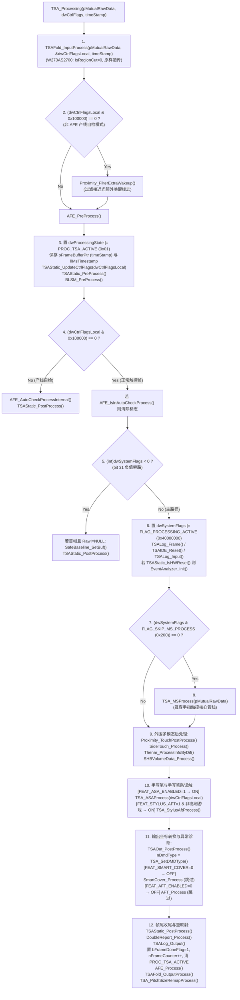

# 第 1 部分：顶层架构、`TSAPrmt` 参数系统与外围基础设施深度逆向分析

本章节对 `TSACore.dll`（镜像基址 `0x6ba40000`，分支标识 `"TL_develop_gaokun"`）的 **参数管理系统 (`TSAPrmt*`)**、**顶层帧处理与互容主干管线 (`TSA.c`, `TSAMS.c`)**、**全局静态状态与多模态数据切换 (`TSAStatic.c`, `TSABuffer.c`, `TSAPrpt.c`, `DataSwitch.c`, `TSAFold.c`)** 以及 **AFE 扫描控制与日志/调试基础设施 (`AFE.c`, `EventAnalyzer.c`, `TSALog.c`, `TSAIDE.c`, `StrPrintf.c`, `SWTimer.c`)** 进行 100% 覆盖率的逆向工程剖析，并精确绑定华为 MatePad Pro 13.2 (`W273AS2700` / `GaokunHimaxCSOT`) 硬件配置参数与真实运行分支。

---

## 1.1 `TSAPrmt` 参数系统架构与 `W273AS2700` (`GaokunHimaxCSOT`) 参数全集解析

### 1.1.1 参数系统内存架构与五大参数域

`TSACore.dll` 的参数子系统采用 **五级分层架构**，在初始化阶段（`TSA_LoadConfig` -> `TSAPrmt_LoadProject` -> `TSAPrmt_ReInit`）将外部 `TSAPrmt.dll` 导出的机型预设表加载至 DLL 内部 `.bss`/`.data` 段，并在每帧运行过程中动态派生和同步参数：

| 参数域全局变量 | 内存地址范围 | 字节大小 | 结构说明与作用 |
| :--- | :--- | :--- | :--- |
| `g_tsaPrmtFlash` | `0x6bca8a00 .. 0x6bcaa28f` | `0x1890` (6288 B) | 核心 Flash 预设参数表。Ghidra 中定义的 `TSAFlashPrmt` 结构体步长为 `0x840` (2112 B)，因此 `_refptr_g_tsaPrmtFlash[0]` 对应 `+0x000..+0x83f`，`[1]` 对应 `+0x840..+0x107f`（其中 `&[1].pDim1PitchMap` 位于 `[1]+0xa0` = `flash+0x8e0`），`[2]` 对应 `+0x1080..+0x188f`。 |
| `g_tsaPrmtFlashCmfPca` | `0x6bcaa2c0 .. 0x6bcab5eb` | `0x132c` (4908 B) | CMF 2D PCA 降噪系数矩阵表。在 `W273AS2700` 上首字节 `num_components = 0`，全表 4908 字节均为 `0x00`。 |
| `g_tsaPrmtFlashConst` | `0x6bcab600 .. 0x6bcab663` | `0x64` (100 B) | 由 `TSAConstPrmt_Init` 根据 `g_tsaPrmtFlash` 预计算的定点缩放因子、Q8 坐标边界、滤波器斜率及硬件检测门限。 |
| `g_tsaPrmtRamConst` | `0x6bcab664 .. 0x6bcab67f` | `0x1c` (28 B) | 预留的 RAM 常量区（当前未写入）。 |
| `g_tsaPrmtDynamic` | `0x6bcab680 .. 0x6bcab71f` | `0xa0` (160 B) | 每帧动态计算的工作阈值表（Peak/TouchDown 门限、基线更新步长、CMF 门限、水下门限、特征使能掩码等）。 |
| `g_tsaPrmtRam` | `0x6bcab720 .. 0x6bcab77f` | `0x60` (96 B) | 运行时暂存区（如 `+0x04` 存放动态计算的信号倍率，由 `TouchThold_Init` 初始化为 `64`）。 |
| `g_tsaRTPrmt` | `0x6bcab780 .. 0x6bcab8ff` | `0x180` (384 B) | **16 项运行时参数 (Run-Time Parameters)**，每项占 `0x18` (24 B)：`+0x00` `curVal`(i32)、`+0x04` `defVal`(i32)、`+0x08` `maxVal`(i32)、`+0x0c` `minVal`(i32)、`+0x10` `descPtr`(char*)。备份表 `g_tsaRTPrmtDefault` 位于 `0x6bcab900 .. 0x6bcaba7f`。反射描述符 `TsaRTPrmtStruct` 位于 `0x6bb4fcc0`。 |
| `g_tsaTTPrmt` | `0x6bcaba80 .. 0x6bcac487` | `0xa08` (2568 B) | **67 项调优参数 (Tune-Time Parameters)**，每项同样占 `0x18` (24 B)。反射描述符 `TsaTTPrmtStruct` 位于 `0x6bb50b00`，支持通过 `TSA_SetTTPrmt` 按名称字符串动态修改并通过 `TSATTPrmt_Process` 写回 `g_tsaPrmtFlash`。 |
| `g_tsaFoldWholePrmt` | `0x6bca36e0 .. 0x6bca374f` | `0x70` (112 B) | 折叠屏全屏原始物理/逻辑几何参数快照区（由 `TSAFold_PrmtSaveWhole` 保存）。 |

---

### 1.1.2 `W273AS2700` (`GaokunHimaxCSOT`) 核心 Flash 参数完整映射表

以下为从 `TSAPrmt.dll` 导出表提取并经交叉引用验证的 `W273AS2700` 预设参数完整明细：

#### (1) 基础面板几何、架构与系统门限 (`flash+0x0000 .. +0x083f`，即 `_refptr_g_tsaPrmtFlash[0]`)

| Flash 偏移 | Ghidra 符号 / 内部字段名 | 数据类型 | `W273AS2700` 数值 (Dec / Hex) | 物理意义与使用函数 |
| :--- | :--- | :--- | :--- | :--- |
| `+0x0000` | `szProjectName[24]` | `char[24]` | `"W273AS2700"` | 项目代号字符串（`TSAPrmt_GetProjectName`） |
| `+0x0018` | `field_0x18` (`bDim1IsX`) | `u8` | `1` (`0x01`) | 维度1与X轴对应标志；当 `bCmfForceDim1Pass == field_0x18` (`1 == 1`) 时，Dim1 对应 X 轴（长边 60 通道 -> 2560 像素），Dim2 对应 Y 轴（短边 40 通道 -> 1600 像素） |
| `+0x0019` | `bCmfForceDim1Pass` | `u8` | `1` (`0x01`) | 通道方向与 CMF 主方向标志（`1` 表示 Dim1 为 Rx 方向，`bCols=60` 为 Rx，`bRows=40` 为 Tx） |
| `+0x001a` | `field_0x1a` (`bSideEdgeMapMode`) | `u8` | `0` (`0x00`) | 边缘方向重映射模式（`TSA_SideToDimEdge` / `TSA_DimEdgeToSide`） |
| `+0x001b` | `dim1Pitch` | `u8` | `69` (`0x45`) | Dim1 传感器通道物理间距（Q4 定点毫米，即 $69 / 16 = 4.3125\text{ mm}$） |
| `+0x001c` | `dim2Pitch` | `u8` | `66` (`0x42`) | Dim2 传感器通道物理间距（Q4 定点毫米，即 $66 / 16 = 4.125\text{ mm}$） |
| `+0x001d` | `bCols` (`dim1Len`) | `u8` | `60` (`0x3c`) | Dim1 有效互容通道数（列数 = 60） |
| `+0x001e` | `bRows` (`dim2Len`) | `u8` | `40` (`0x28`) | Dim2 有效互容通道数（行数 = 40） |
| `+0x001f` | `maxCols` | `u8` | `60` (`0x3c`) | 最大物理列数（= 60） |
| `+0x0020` | `maxRows` | `u8` | `40` (`0x28`) | 最大物理行数（= 40） |
| `+0x0028` | `coreRegion` | `u32` | `0x80000000` | 核心触控区配置掩码 |
| `+0x002c` | `wBufElementCount` (`sensorNum`) | `u16` | `2400` (`0x0960`) | 互容网格节点总数 $60 \times 40 = 2400$ |
| `+0x002e` | `longAxisLen` | `u16` | `2640` (`0x0a50`) | 面板物理尺寸参数 1 (`40 * 66 = 2640`) |
| `+0x0030` | `shortAxisLen` | `u16` | `4140` (`0x102c`) | 面板物理尺寸参数 2 (`60 * 69 = 4140`) |
| `+0x0034` | `dwPeakProcessingMode` (`sensorArch`) | `i32` | `3` (`0x00000003`) | 传感器架构类型：`3` = **Full Incell (TDDI)**，决定 Peak_Process 走 Mode 3 分支、Exception 走 FIException 分支 |
| `+0x0038` | `field_0x38` (`baseStepUnit`) | `u16` | `100` (`0x0064`) | 基线更新基础步长系数 (`TSADynPrmt_GetBL` 中 `5 * 100 * 40 = 20000`) |
| `+0x003a` | `field_0x3a` (`idleTimeoutOffset`) | `u16` | `60` (`0x003c`) | AFE 进入 IDLE 超时附加偏移量 (ms) (`TSAStatic_IsAFEEnterIdleTimeout`) |
| `+0x003c` | `field_0x3c` (`dbEnterIDLE`) | `u16` | `3000` (`0x0bb8`) | 进入 IDLE 模式的当前去抖等待时间 (3000 ms) |
| `+0x003e` | `field_0x3e` (`dbEnterIDLEGame`) | `u16` | `10000` (`0x2710`) | 游戏场景下进入 IDLE 模式的去抖时间 (10000 ms) |
| `+0x0040` | `field_0x40` (`dbEnterIDLENormal`) | `u16` | `3000` (`0x0bb8`) | 常规场景下进入 IDLE 模式的默认去抖时间 (3000 ms) |
| `+0x0042` | `field_0x42` (`dbEnterIDLETyping`) | `u16` | `600` (`0x0258`) | 打字场景下进入 IDLE 模式的去抖时间 (600 ms) |
| `+0x0046` | `field_0x46` (`wakeupHoldTimeToIdle`) | `u16` | `4167` (`0x1047`) | 亮屏唤醒后禁止进入 IDLE 的保持时间 (4167 ms，`TSAMS_IsOKToEnterIDLEMode`) |
| `+0x0048` | `wSignalNegSaturation` | `i16` | `-32768` (`0x8000`) | 负向信号饱和度下限 (`BLSM_CheckUpdateAfterReset`) |
| `+0x004a` | `wBlResetTimeoutMs` | `u16` | `8000` (`0x1f40`) | 基线复位超时阈值 (8000 ms) |
| `+0x004c` | `wBlDebounceTimeMs` | `u16` | `2000` (`0x07d0`) | 基线复位去抖时间 (2000 ms，`BLReset_InDebounce`) |
| `+0x0050` | `dwFeatureFlagsBase1` | `u32` | `0x00000101` | 特性标志基准字 1 (`TSAStatic_InitSysModuleEveryTime`) |
| `+0x0054` | `dwFeatureFlagsBase1_or` | `u32` | `0x01090020` | 特性标志或掩码 1；合并后 `dwFeatureFlags = 0x01090121` |
| `+0x0058` | `dwFeatureFlagsBase2` | `u32` | `0x00000120` | 特性标志基准字 2 |
| `+0x005c` | `dwFeatureFlagsBase2_or` | `u32` | `0x00000120` | 特性标志或掩码 2；合并后 `dwFeatureFlags2 = 0x00000120` |
| `+0x0060` | `dwAftModeFeatureMask` (`scenarioAntiTouch`) | `u32` | `0` (`0x00000000`) | 防误触 (AFT) 场景启用掩码（`0` = 禁用） |
| `+0x0064` | `scenarioProximity` | `u32` | `0` (`0x00000000`) | 接近光 (Proximity) 场景启用掩码（`0` = 禁用） |
| `+0x0068..0x6b` | `bRecalCfg[4]` | `u8[4]` | `0, 1, 1, 1` | 硬件重校准与基线跟踪控制字节 |
| `+0x0076..0x8e` | `udfpAreaConfig` | `u16[]` | `447, 2024, 632, 2208...` | 屏下指纹 (UDFP) 区域像素坐标与门限参数（在 `W273AS2700` 上因 `+0x1740=0` 未启用） |
| `+0x0090..0x93` | `activeColStart/End, activeRowStart/End` | `u8[4]` | `0, 59, 0, 39` | 当前激活区域通道起止索引 `[0..59]`, `[0..39]` |
| `+0x0094..0x9b` | `activeDim1PixStart/End, activeDim2PixStart/End` | `u16[4]` | `0, 2559, 0, 1599` | 当前激活区域像素起止范围 `[0..2559]`, `[0..1599]` |
| `+0x009c..0x59f` | `dim1PitchMap[640]`, `dim2PitchMap[640]` | `u8[]` | 全 `0` | 非均匀传感器间距映射表（全 `0` 表示均匀间距） |
| `+0x05a0` | `resScale` | `u16` | `1` (`0x0001`) | 分辨率缩放倍率 |
| `+0x05a2..0x5a5` | `dim1ResOffset`, `dim2ResOffset` | `i16[2]` | `0, 0` | 坐标输出偏移量 (`TSAOut_Dim1Pos`, `TSAOut_Dim2Pos`) |
| `+0x05a6` | `dim1Res` (`xRes`) | `u16` | `2560` (`0x0a00`) | Dim1 逻辑输出分辨率（2560 像素） |
| `+0x05a8` | `dim2Res` (`yRes`) | `u16` | `1600` (`0x0640`) | Dim2 逻辑输出分辨率（1600 像素） |
| `+0x05aa` | `dim1PhyRes` | `u16` | `2560` (`0x0a00`) | Dim1 物理分辨率（2560 像素） |
| `+0x05ac` | `dim2PhyRes` | `u16` | `1600` (`0x0640`) | Dim2 物理分辨率（1600 像素） |
| `+0x05ae..0x5b1` | `dim1ClipLow/High`, `dim2ClipLow/High` | `i8[4]` | `0, 0, 0, 0` | 四边坐标裁剪像素数 |
| `+0x05b4` | `wPeakFilterReferenceThreshold` (`htiRef`) | `i16` | `3000` (`0x0bb8`) | 理想手指标准信号量 (HTI = 3000)，用于 Rawdata 归一化与噪声比例计算 |
| `+0x05b6` | `wPeakMode3ThresholdMax` (`fingerThold`) | `i16` | `600` (`0x0258`) | 手指触控信号阈值 (600) |
| `+0x05b8` | `field_0x5b8` (`idleTouchTholdRef`) | `i16` | `3000` (`0x0bb8`) | IDLE 模式触摸唤醒参考值 (`TSA_GetMutualTouchTholdInIDLEMode` 计算 `(600*3000/3000)>>1 = 300`) |
| `+0x05ba` | `sigRatioToDirectReport` | `u8` | `48` (`0x30`) | 直接上报触控点的信号比例系数 (Q4 定点，即 $48 / 16 = 3.0$ 倍 TouchDown 阈值) |
| `+0x05d0` | `field_0x5d0` | `u8` | `48` (`0x30`) | 初始直接上报信号比例备份 (`TSADynPrmt_Init`) |
| `+0x05d8` | `gloveHTI` | `i16` | `1000` (`0x03e8`) | 手套模式参考信号量 (1000) |
| `+0x05da` | `gloveThold` | `i16` | `220` (`0x00dc`) | 手套模式触控信号阈值 (220) |
| `+0x05dc..0x5fb` | `touchTholdInitBlock[32]` | `u8[32]` | `[0x5e4]=180, [0x5e6]=180, [0x5e8]=100, [0x5ea]=130, [0x5ec]=450, [0x5f4]=150, [0x5f6]=130, [0x5fa]=1` | 拷贝至 `g_tsaPrmtDynamic+0x04..+0x23` 的初始动态阈值块 |
| `+0x05fc` | `rawRefHigh` | `i32` | `32767` (`0x00007fff`) | 原始互容数据无触摸基准值 (32767) |
| `+0x0600` | `rawRefLow` | `i32` | `35767` (`0x00008bb7`) | 原始互容数据满量程触摸参考值 ($32767 + 3000 = 35767$，差值恰为 `+3000`) |
| `+0x0608..0x61f` | `ssPrmtBlock[24]` | `u8[24]` | `[0x609]=2, [0x60a]=3, [0x610]=300, [0x612]=600, [0x618]=100, [0x61a]=300` | 自容 (SS) 参数块，拷贝至 `g_tsaPrmtDynamic+0x24..+0x3b`（注意 `+0x608 = 0`，故 `Dynamic[0x24] = 0`，SS 旁路关闭） |
| `+0x0620` | `cmfNormalThold` (`wCmfThold1`, `wCmfDiffThold1`) | `u16[2]` | `600, 150` (`0x0258, 0x0096`) | 常规状态下 CMF 共模滤波信号门限 (600) 与二阶差分门限 (150) |
| `+0x0624` | `cmfNormalExtra` | `u16` | `0` (`0x0000`) | 常规状态附加 CMF 参数 |
| `+0x0626` | `cmfSigThold` (`wCmfChargerThold`) | `u16` | `15000` (`0x3a98`) | 充电器噪声 (`dwSystemFlags & 0x40000`) 下 CMF 信号门限 (15000) |
| `+0x0628` | `cmfSigDiffThold` (`wCmfChargerDiffThold`) | `u16` | `200` (`0x00c8`) | 充电器噪声下 CMF 二阶差分门限 (200) |
| `+0x062c..0x67b` | `txSlotTable[80]` | `u8[80]` | 全 `0` | Tx 通道分时扫描槽位映射表 |
| `+0x067c..0x6cb` | `rxSlotTable[80]` | `u8[80]` | 全 `0` | Rx 通道分时扫描槽位映射表 |
| `+0x06cc` | `numRxCombine` | `u8` | `1` (`0x01`) | Rx 通道合并数 (`CMFRemap_Init`) |
| `+0x080d` | `bCmfEnabled` | `u8` | `0` (`0x00`) | Raw 域前置 CMF 开关（`0` = 跳过 `Rawdata_CMF`，在 `BLSM_Process` 之后执行 `CMF_Process`） |
| `+0x080e` | `bDoubleIC` | `u8` | `0` (`0x00`) | 双 IC 拼接标志（`0` = 单 IC 架构，`CMFRemap_Init`） |
| `+0x0810` | `dwCmfMethodNormal` | `i32` | `0` (`0x00000000`) | 常规模式下的 CMF 滤波方法枚举 (`0` = 1D 中值/均值共模降噪) |
| `+0x0814` | `dwCmfMethodSmartCover` | `i32` | `2` (`0x00000002`) | 皮套模式下的 CMF 滤波方法枚举 (`2`) |
| `+0x0818` | `bCmfExtraPass` | `u8` | `1` (`0x01`) | CMF 附加通道滤波使能 |
| `+0x081a` | `wPeakMode3MergeDist` | `u16` | `100` (`0x0064`) | Peak Mode 3 峰值合并阈值 (`Peak_FilterOutPeakMode3`) |
| `+0x081c` | `wPeakMinThold` | `u16` | `220` (`0x00dc`) | 峰值检测最低门限 (`Peak_GetThreshold`) |
| `+0x081e` | `sigMult` | `u8` | `64` (`0x40`) | 连通域 (TZ) 能量积分当前倍率 |
| `+0x081f` | `sigMultNormal` | `u8` | `64` (`0x40`) | 常规状态下 TZ 能量积分倍率 |
| `+0x0820` | `sigMultSD` | `u8` | `64` (`0x40`) | 信号视差 (Signal Disparity) 状态下 TZ 能量积分倍率 |
| `+0x0821..0x835` | `tzMorphologyParams` | `u8[]` | `[0x821]=96, [0x823]=90, [0x825]=96, [0x828]=3, [0x829]=1, [0x82a]=50...` | TZ 连通域搜索、膨胀腐蚀与大物体判定参数 |
| `+0x0836` | `loSizeInMM` | `u8` | `30` (`0x1e`) | 大物体 (Large Object) 判定尺寸阈值 (30 mm) |
| `+0x0838` | `edgeWidthThreshold` | `u16` | `300` (`0x012c`) | 边缘大物体宽度阈值 (300) |
| `+0x083c` | `dwGripFlags` | `u32` | `0` (`0x00000000`) | 握持/TZ 运行时状态与配置标志字 |

#### (2) 质心边缘修正、跟踪滤波与抗干扰参数 (`flash+0x0840 .. +0x107f`，即 `_refptr_g_tsaPrmtFlash[1]`)

| Flash 偏移 (`[1]+偏移`) | Ghidra 符号 / 内部字段名 | 数据类型 | `W273AS2700` 数值 | 物理意义与使用函数 |
| :--- | :--- | :--- | :--- | :--- |
| `+0x0840` (`[1]+0x00`) | `ctdLeftEdgeCfg` | `u8[17]` | `[+0]=1, [+1]=7, [+4]=224, [+16]=0` | 左边缘质心修正参数（`leftEdgeCorrectionRatio = 224`） |
| `+0x0851` (`[1]+0x11`) | `ctdRightEdgeCfg` | `u8[17]` | `[+0]=1, [+1]=7, [+4]=224, [+16]=0` | 右边缘质心修正参数（`rightEdgeCorrectionRatio = 224`） |
| `+0x0862` (`[1]+0x22`) | `ctdTopEdgeCfg` | `u8[17]` | `[+0]=1, [+1]=7, [+4]=96, [+16]=0` | 上边缘质心修正参数（`topEdgeCorrectionRatio = 96`） |
| `+0x0873` (`[1]+0x33`) | `ctdBottomEdgeCfg` | `u8[17]` | `[+0]=1, [+1]=7, [+4]=96, [+16]=0` | 下边缘质心修正参数（`bottomEdgeCorrectionRatio = 96`） |
| `+0x0888` (`[1]+0x48`) | `idtMaxSearchDist` | `u16` | `5` (`0x0005`) | IDT 触控点跨帧匹配搜索半径 (`IDT_PopulateDistanceMap`) |
| `+0x088a` (`[1]+0x4a`) | `accThold` | `u16` | `16` (`0x0010`) | IDT 运动加速度门限 (`IDT_AccCheck`) |
| `+0x088e..0x89f` (`[1]+0x4e..0x5f`) | `filterDistCoefCfg[3][6]` | `u16/u8` | 见 1.1.5 节推导 | 3 组距离自适应 IIR 滤波最小距离、最大距离、最大最小权重 (`Filter_GetCoefBasedOnDistance`) |
| `+0x08a0..0x8a1` (`[1]+0x60..0x61`) | `jitVelCfg[2]` | `u8[2]` | `50, 6` (`0x32, 0x06`) | 抖动抑制与速度门限基准 (`TSAConstPrmt_Init`) |
| `+0x08a4..0x8b4` (`[1]+0x64..0x74`) | `rxLineAndSigSumCfg` | `u8/u16` | `[0x8a4]=80, [0x8a5]=2, [0x8a8]=2400, [0x8ac]=1600, [0x8b0]=7000, [0x8b4]=0` | `RxLineFilter_Process` 与 `SigSumFilter_Process` 参数（注意 `+0x8b4 = 0`，`SigSumFilter_ReserveTouch(0)`） |
| `+0x08b8..0x8f7` (`[1]+0x78..0xb7`) | `gripFilterCfg` | `struct` | `[0x8b8]=10, [0x8b9]=3, [0x8ba]=200, [0x8bc]=120, [0x8be]=400, [0x8c4]=2` | 握持抑制 (`GripFilter_*`) 区域、椭圆率与死区配置 |
| `+0x08f8` (`[1].pDim1PitchMap+0x18`) | `gridIirWeight` | `u8` | `224` (`0xe0`) | `GridIIR_Process` 帧间 IIR 滤波系数 ($224/256 = 0.875$) |
| `+0x08f9..0x94b` (`[1].pDim1PitchMap+0x19..0x6b`) | `dynInitBlock2[83]` | `u8[83]` | 拷贝至 `Dynamic+0x60..0xb2` | 包含 `clickDuration=20` (`+0x904`)、`clickSuppressDistance=60` (`+0x906`)、`maxClickSuppressDistance=60` (`+0x907`)、`flickDistance=50` (`+0x908`)、`menuAccessPixelToEdge=60` (`+0x909`)、信噪比自适应门限 (`+0x90c=100, 150, 200, 6000, 20`)、手套进入距离 `distToEnterGloveMode=15` (`+0x920`)、边缘触达 `ER_Init` (`+0x924..0x938`)、湿手/充电器噪声百分比 `chargerNoiseTholdToHTIPercentage=10` (`+0x940`)、`chargerHoldTime=5000` (`+0x942`) |
| `+0x094c..0xa85` (`[1].pDim1PitchMap+0x6c..`) | `tpSensorAndNotchCfg` | `struct` | `numOffset=0` (`+0x94c`), `numNotch=0` (`+0x9e4`), `numScale=0` (`+0xa0d`) | 异形屏/挖孔屏 (`NotchCorrect`) 与传感器偏移缩放补偿表（`W273AS2700` 为规则矩形屏，全部数量为 `0`） |

#### (3) 硬件分析、接近光、侧边触控与折叠屏参数 (`flash+0x1080 .. +0x188f`，即 `_refptr_g_tsaPrmtFlash[2]`)

| Flash 偏移 (`[2]+偏移`) | Ghidra 符号 / 内部字段名 | 数据类型 | `W273AS2700` 数值 | 物理意义与使用函数 |
| :--- | :--- | :--- | :--- | :--- |
| `+0x1650..0x165c` (`[2]+0x5d0..0x5dc`) | `hwAnalyzerLimits` | `i16[6], u8` | `0, 0, 0, 0, 0, 0, 1` | 硬件异常检测 Raw 上下限与 Delta 门限 (`TSAConstPrmt_Init`) |
| `+0x1660..0x169b` (`[2]+0x5e0..0x61b`) | `proximityCfg` | `struct` | `proxFuncEnable=0` (`+0x1660`), `proxRawThold=250` (`+0x1664`), `proxHoverDiffThold=187` (`+0x1668`) | 接近光检测参数（`proxFuncEnable = 0` 关闭） |
| `+0x169e` (`[2]+0x61e`) | `maxScanRateNormal` | `u16` | `120` (`0x0078`) | 常规场景最大扫描率 (120 Hz，`TSA_ScenarioProcess`) |
| `+0x16a0` (`[2]+0x620`) | `maxScanRateGame` | `u16` | `120` (`0x0078`) | 游戏场景最大扫描率 (120 Hz，`TSA_ScenarioGamePrmtSetting`) |
| `+0x16a4..0x173f` (`[2]+0x624..0x6bf`) | `sideTouchCfg` | `struct` | `sideTouchFuncEnable=0` (`+0x16a4`), `volumeFuncConfig=0` (`+0x1720`) | 曲屏侧边虚拟音量键/肩键配置（平板无侧边曲屏，`sideTouchFuncEnable = 0`） |
| `+0x1740` (`[2]+0x6c0`) | `bUdfpEnabled` | `u8` | `0` (`0x00`) | 屏下指纹事件使能 (`UDFPEvent_IsEnabled` 返回 `0`) |
| `+0x1744..0x1748` (`[2]+0x6c4..0x6c8`) | `sensorEnabled`, `sensorRate` | `u32, u16` | `0, 0` | 加速度计姿态传感器使能与采样率 (`0` = 禁用) |
| `+0x17cc..0x17e3` (`[2]+0x74c..0x763`) | `tsaFoldCfg` | `struct` | `bSupported=1` (`+0x17cc`), `numRegions=1` (`+0x17d0`), `region[0]={cols:60, rows:40, colOfst:0, rowOfst:0, xRes:2560, yRes:1600}` | 折叠屏多区域映射表：`W273AS2700` 配置为单区域全屏 (`60x40`, `2560x1600`)，因此 `TSAFold_IsRegionCut()` 恒返回 `false` |

---

### 1.1.3 核心标志位 (`dwFeatureFlags`, `dwFeatureFlags2`, `dwSystemFlags`) 与 `W273AS2700` 分支门控

在 `TSAStatic_InitSysModuleEveryTime` (`@ 0x6baa15c6`) 中，系统将 Flash 中的特性掩码加载到 `(*_refptr_g_tsaStaticPtr)`：
1. **`dwFeatureFlags`** (`TSAStatic+0xb8`)：
   $$\text{dwFeatureFlags} = \text{flash}[+0x50] \mid \text{flash}[+0x54] = \text{0x00000101} \mid \text{0x01090020} = \mathbf{0x01090121}$$
   并且保存受保护的静态子集：
   $$\text{dwFeatureFlagsMasked} = \text{dwFeatureFlags} \ \& \ \text{0x4813} = \mathbf{0x00000001}$$
2. **`dwFeatureFlags2`** (`TSAStatic+0xc0`)：
   $$\text{dwFeatureFlags2} = \text{flash}[+0x58] \mid \text{flash}[+0x5c] = \text{0x00000120} \mid \text{0x00000120} = \mathbf{0x00000120}$$

下表列出所有特性标志位及其在 `W273AS2700` 上的精确开关状态：

| 标志字段 | 位掩码 (Hex) | 符号名 / 内部含义 | `W273AS2700` 状态 | 控制的管线分支与函数 |
| :--- | :--- | :--- | :--- | :--- |
| `dwFeatureFlags` | `0x00000001` (bit 0) | `FEAT_GLOVE_MODE` (手套模式) | **1 (ON)** | 允许 `TouchMode_Process`、`TSA_EnableGloveFeature` 进入手套模式门限调整 |
| `dwFeatureFlags` | `0x00000002` (bit 1) | `FEAT_SMART_COVER` (皮套模式) | **0 (OFF)** | 跳过 `TSA_Processing` 中的 `SmartCover_Process()` |
| `dwFeatureFlags` | `0x00000004` (bit 2) | `FEAT_CHARGER_bit2` | **0 (OFF)** | 外部特性位 2 |
| `dwFeatureFlags` | `0x00000010` (bit 4) | `FEAT_KNUCKLE` (指关节) | **0 (OFF)** | 指关节手势识别关闭 |
| `dwFeatureFlags` | `0x00000020` (bit 5) | `FEAT_GAME_MODE_BASE` | **1 (ON)** | 基础触摸增强位 |
| `dwFeatureFlags` | `0x00000100` (bit 8) | `FEAT_STYLUS_AFT` (手写笔防误触) | **1 (ON)** | **开启**！当 `FEAT_ASA_ENABLED` 同时为 1 且非高刷游戏模式时，在 `TSA_Processing` 中执行 `TSA_StylusAftProcess()` |
| `dwFeatureFlags` | `0x00000800` (bit 11) | `FEAT_UNDERWATER_DETECT` | **0 (OFF)** | 跳过 `TSA_MSProcess` 中的 `Exception_CheckUnderWater()` |
| `dwFeatureFlags` | `0x00004000` (bit 14) | `FEAT_PROXIMITY` (接近光) | **0 (OFF)** | 接近光功能关闭 (`scenarioProximity = 0`) |
| `dwFeatureFlags` | `0x00008000` (bit 15) | `FEAT_SIDE_TOUCH` (侧边曲屏) | **0 (OFF)** | 跳过曲屏侧边特殊区块合并与 Side IDLE 逻辑 |
| `dwFeatureFlags` | `0x00010000` (bit 16) | `FEAT_ASA_ENABLED` (主动笔 ASA) | **1 (ON)** | **开启**！在 `TSA_Processing` 中执行 `TSA_ASAProcess()`，并在 IDLE 判定中启用手写笔 3s 延迟 (`TSA_DelayToIdleModeHPPx`) |
| `dwFeatureFlags` | `0x00080000` (bit 19) | `FEAT_SIGNAL_DISPARITY_BIT19` | **1 (ON)** | 启用信号视差检测基础支持 |
| `dwFeatureFlags` | `0x00100000` (bit 20) | `FEAT_SAFE_BASELINE` | **0 (OFF)** | 跳过 `SafeBaseline_ScreenOnWithPhoneHeldInHandProcess()` 和 `SafeBaseline_Process()` |
| `dwFeatureFlags` | `0x00200000` (bit 21) | `FEAT_AFT_ENABLED` | **0 (OFF)** | 跳过 `AFT_Process()`，`TSA_RptTouch*` 直接从 `g_touchesPtr` 读取而非 `g_aftOutSortInfo` |
| `dwFeatureFlags` | `0x00400000` (bit 22) | `FEAT_SIGNAL_DISPARITY_POST` | **0 (OFF)** | 跳过 `SignalDisparity_PostProcess()` |
| `dwFeatureFlags` | `0x00800000` (bit 23) | `FEAT_PAD_FEATURE` (Android 平板) | **0 (OFF)** | `TSA_IsPadFeatureEnabled()` 返回 `0` |
| `dwFeatureFlags` | `0x01000000` (bit 24) | `FEAT_WINDOWS_PAD` (Windows/鸿蒙大屏平板) | **1 (ON)** | **开启**！`TSA_IsWindowsPadFeatureEnabled()` 返回 `1`，启用大屏平板专属握持抑制与多指手势规则 |
| `dwFeatureFlags2` | `0x00000001` (bit 0) | `FEAT2_EDGE_PEAK_WORKAROUND` | **0 (OFF)** | `TSA_MSPeakFilter()` 中跳过 `EdgePeakFilter_WorkAround()` |
| `dwFeatureFlags2` | `0x00000020` (bit 5) | `FEAT2_BIT5` | **1 (ON)** | 辅助滤波特性位 5 |
| `dwFeatureFlags2` | `0x00000100` (bit 8) | `FEAT2_COUPLING_NOISE_EST` | **1 (ON)** | `TSAStatic_IsCouplingNoiseEstimateNeeded()` 返回 `1`，启用耦合噪声估计 |

此外，每帧传入 `TSA_Processing(pMutualRawData, dwCtrlFlags, pFrameBuffer)` 的 32 位控制标志 `dwCtrlFlags` 由 `TSAStatic_UpdateCtrlFlags` (`@ 0x6baa21cb`) 存入 `TSAStatic->dwSystemFlags` (`+0xc4`)：
- `bit 0..2` (`0x01 | 0x02 | 0x04`)：硬件复位/初始化标志（`TSAStatic_IsHWReset` 检查 `dwSystemFlags & 7`）。
- `bit 3` (`0x08`)：保留噪声状态标志。
- `bit 9` (`0x200`, `FLAG_SKIP_MS_PROCESS`)：跳过互容管线 `TSA_MSProcess`（仅跑手写笔/外围）。
- `bit 16` (`0x10000`, `FLAG_USE_DIF_BUF_PATH`)：外部直接输入差分数据 (`Dif`) 而非原始数据 (`Raw`)，置位时跳过内部 `BLIIR_CalcDiffCommon`、`BLSM_Process`、`CMF_Process` 和 `GridIIR_Process`。正常运行时为 `0`。
- `bit 17` (`0x20000`)：大显示噪声标志 (`TSAStatic_IsLargeDisplayNoise`)。
- `bit 18` (`0x40000`)：充电器插入标志 (`TSAStatic_IsChargerPluggedNoDebounce`)。
- `bit 19` (`0x80000`)：禁用手套模式标志。
- `bit 20` (`0x100000`)：AFE 产线自检模式 (`AFE_AutoCheckProcessInternal`)。
- `bit 22` (`0x400000`)：通话/灭屏模式标志 (`TSAStatic_PhoneCallModeDebounce`)。
- `bit 23` (`0x800000`)：锁屏场景标志 (`TSA_IsScreenLockScenario`)。
- `bit 30` (`0x40000000`, `FLAG_PROCESSING_ACTIVE`)：首次进入正常处理帧时置位。
- `bit 31` (`0x80000000`)：负值旁路标志（若置位则仅更新 `SafeBaseline_SetBuf` 并退出）。

---

### 1.1.4 `TSAPrmt.c` 全部函数深度解析 (6 个函数 + `_INIT_ALL.c` 中的 2 个初始化函数)

#### 1. `TSAPrmt_Init` (`@ 0x6bb3b90d`，位于 `_INIT_ALL.c`)
- **调用者**：`TSA_InitSysModuleOnce` (`@ 0x6ba9abe0`)
- **被调函数**：`TSAPrmt_LoadProject`、`TSAPrmt_ReInit`
- **算法逻辑**：
  1. 调用 `TSAPrmt_LoadProject("DFLT000000")` 加载内置默认项目参数作为兜底。
  2. 调用 `TSAPrmt_ReInit()` 初始化所有派生参数表（TT、RT、Const、Ram、Dynamic）。

#### 2. `TSAPrmt_LoadProject` (`@ 0x6bb3b93a`，位于 `_INIT_ALL.c`)
- **调用者**：`TSAPrmt_Init` (`@ 0x6bb3b90d`)
- **被调函数**：`strcmp`、`memcpy_s`、`StrPrintf_Process`、`HardwareAnalyzer_SetSoftException`
- **算法逻辑**：
  1. 在内置项目表 `g_projectList` 中按名称匹配 `param_1`（如 `"DFLT000000"`）。
  2. 匹配成功后，将对应的 `0x1890` 字节 Flash 参数拷贝到 `_refptr_g_tsaPrmtFlash`，并将 `0x132c` 字节 PCA 参数拷贝到 `_refptr_g_tsaPrmtFlashCmfPca`。
  3. 实际机型配置在随后的 `TSA_LoadConfig` (`@ 0x6ba9ee15`) 中直接覆盖 `_refptr_g_tsaPrmtFlash`（`0x1890` B）与 `_refptr_g_tsaPrmtFlashCmfPca`（`0x132c` B），再调用 `TSAPrmt_ReInit()`。

#### 3. `TSAPrmt_PreProcess` (`@ 0x6bb3bab7`，位于 `TSAPrmt.c`)
- **调用者**：`TSA_MSProcess` (`@ 0x6ba90e43`)，在 `BLSM_Process` 和 `CMF_Process` 之前调用。
- **被调函数**：`TSADynPrmt_PreProcess` (`@ 0x6bb3d1e7`)
- **算法逻辑**：直接转发调用 `TSADynPrmt_PreProcess()`，用于在执行 `CMF_Process` 之前根据充电器状态 (`dwSystemFlags & 0x40000`) 提前更新动态 CMF 门限 (`Dynamic+0x3c..0x41`)。

#### 4. `TSAPrmt_Process` (`@ 0x6bb3bacb`，位于 `TSAPrmt.c`)
- **调用者**：`TSA_MSProcess` (`@ 0x6ba90e43`)，在 `SS_ChargerNoiseFilterProcess` 之后、`SignalDisparity_Process` 与 `Peak_Process` 之前调用。
- **被调函数**：
  1. `TSATTPrmt_Process` (`@ 0x6bb41b54`)
  2. `TSARTPrmt_Process` (`@ 0x6bb3d933`)
  3. `TSAConstPrmt_Process` (`@ 0x6bb3c698`)
  4. `TSARamPrmt_Process` (`@ 0x6bb3d206`)
  5. `TSADynPrmt_Process` (`@ 0x6bb3d12d`)
  6. `TSAPrmt_Validate` (`@ 0x6bb3b9ec`)
- **算法逻辑**：严格按顺序执行五级参数的帧内同步：先将调优参数 (`TTPrmt`) 刷入 `Flash`，再根据当前场景 (`TSA_ScenarioProcess`) 计算运行时参数 (`RTPrmt`) 并写回 `Flash` 和 `Dynamic`，接着更新 `Const`/`Ram`/`Dynamic`（计算本帧 `Peak` 门限和基线更新步长），最后校验行列数合法性。

#### 5. `TSAPrmt_GetProjectName` (`@ 0x6bb3b9df`，位于 `TSAPrmt.c`)
- **调用者**：`TSA_GetPrmtName`、`TSA_MSRawDirectionDectect`、`TSALog_Touch`、`TSAConstPrmt_Init`
- **算法逻辑**：直接返回 `_refptr_g_tsaPrmtFlash` 的首地址（偏移 `+0x00` 处的 24 字节 ASCII 字符串），在 `W273AS2700` 上返回 `"W273AS2700"`。

#### 6. `TSAPrmt_Validate` (`@ 0x6bb3b9ec`，位于 `TSAPrmt.c`)
- **调用者**：`TSAPrmt_Process`、`TSAPrmt_Reset`
- **被调函数**：`StrPrintf_Process`、`HardwareAnalyzer_SetSoftException`
- **算法逻辑**：执行三项硬性边界断言：
  1. `bCols <= 0x50` (80)：`W273AS2700` 为 `60 <= 80`，通过。
  2. `bRows <= 0x50` (80)：`W273AS2700` 为 `40 <= 80`，通过。
  3. `wBufElementCount <= 0x1324` (4900)：`W273AS2700` 为 `2400 <= 4900`，通过。
  若任一越界，输出断言日志并调用 `HardwareAnalyzer_SetSoftException()` 置软异常位。

#### 7. `TSAPrmt_ReInit` (`@ 0x6bb3b8e5`，位于 `TSAPrmt.c`)
- **调用者**：`TSAPrmt_Init`、`TSA_LoadConfig`、`TSA_LoadConfigByPrmt`
- **被调函数**：`TSATTPrmt_Init`、`TSARTPrmt_Init`、`TSAConstPrmt_Init`、`TSARamPrmt_Init`、`TSAPrmt_Reset`
- **算法逻辑**：当新配置表载入后，重新初始化 `TTPrmt`、`RTPrmt`、`FlashConst`、`RamPrmt`，并调用 `TSAPrmt_Reset()` 初始化 `Dynamic` 参数并校验。

#### 8. `TSAPrmt_Reset` (`@ 0x6bb3b740`，位于 `TSAPrmt.c`)
- **调用者**：`TSAPrmt_ReInit`、`TSA_MSInitCommon`、`TSAFold_PrmtProcess`
- **被调函数**：`TSADynPrmt_Init`、`TSAPrmt_Validate`
- **算法逻辑**：重置 `g_tsaPrmtDynamic` 为 Flash 默认值并校验参数合法性。

---

### 1.1.5 `TSAConstPrmt.c` 全部函数与派生常量数学公式推导 (2 个函数)

#### 1. `TSAConstPrmt_Init` (`@ 0x6bb3bb00`)
- **调用者**：`TSAPrmt_ReInit`、`TSA_MSRawDirectionDectect`、`TSAFold_PrmtProcess`、`TSA_SetHighResScale`、`TSA_SetDim1Res`、`TSA_SetDim2Res`
- **被调函数**：`TSAPrmt_GetProjectName`、`strncmp`、`StrPrintf_Process`、`HardwareAnalyzer_SetSoftException`
- **算法逻辑与 `W273AS2700` 精确数值推导**：
  该函数根据 `g_tsaPrmtFlash` 计算 `g_tsaPrmtFlashConst` (`0x6bcab600 .. 0x6bcab663`) 的全部字段：

| `g_tsaPrmtFlashConst` 偏移 | 符号地址 | 类型 | 计算公式 | `W273AS2700` 代入计算与结果 | 用途 |
| :--- | :--- | :--- | :--- | :--- | :--- |
| `+0x20` | `DAT_6bcab620` | `u16` | `bCols << 8` | $60 \times 256 = \mathbf{15360}$ (`0x3c00`) | 全面板 Dim1 内部 Q8 坐标上限 |
| `+0x22` | `DAT_6bcab622` | `u16` | `bRows << 8` | $40 \times 256 = \mathbf{10240}$ (`0x2800`) | 全面板 Dim2 内部 Q8 坐标上限 |
| `+0x28` | `DAT_6bcab628` | `u8` | `activeColEnd - activeColStart + 1` | $59 - 0 + 1 = \mathbf{60}$ | 激活区列数 |
| `+0x29` | `DAT_6bcab629` | `u8` | `activeRowEnd - activeRowStart + 1` | $39 - 0 + 1 = \mathbf{40}$ | 激活区行数 |
| `+0x2a` | `DAT_6bcab62a` | `u16` | `activeColStart << 8` | $0 \times 256 = \mathbf{0}$ | 激活区 Dim1 Q8 起点 |
| `+0x2c` | `DAT_6bcab62c` | `u16` | `(activeColEnd + 1) << 8` | $(59 + 1) \times 256 = \mathbf{15360}$ (`0x3c00`) | 激活区 Dim1 Q8 终点 |
| `+0x2e` | `DAT_6bcab62e` | `u16` | `activeRowStart << 8` | $0 \times 256 = \mathbf{0}$ | 激活区 Dim2 Q8 起点 |
| `+0x30` | `DAT_6bcab630` | `u16` | `(activeRowEnd + 1) << 8` | $(39 + 1) \times 256 = \mathbf{10240}$ (`0x2800`) | 激活区 Dim2 Q8 终点 |
| `+0x32` | `DAT_6bcab632` | `u16` | `activeDim1PixEnd - activeDim1PixStart + 1` | $2559 - 0 + 1 = \mathbf{2560}$ | 激活区 Dim1 像素宽度 |
| `+0x34` | `DAT_6bcab634` | `u16` | `activeDim2PixEnd - activeDim2PixStart + 1` | $1599 - 0 + 1 = \mathbf{1600}$ | 激活区 Dim2 像素高度 |
| `+0x24` | `DAT_6bcab624` | `u8` | `bCmfForceDim1Pass ? bCols : bRows` | $\mathbf{60}$ | Rx 通道数 (`bCmfForceDim1Pass=1`) |
| `+0x25` | `DAT_6bcab625` | `u8` | `bCmfForceDim1Pass ? bRows : bCols` | $\mathbf{40}$ | Tx 通道数 (`bCmfForceDim1Pass=1`) |
| `+0x26` | `DAT_6bcab626` | `u8` | `max(txSlotTable[0..Tx-1]) + 1` | $0 + 1 = \mathbf{1}$ | Tx 扫描槽位数 |
| `+0x04` | `DAT_6bcab604` | `i32` | `((dim1ClipHigh + dim1Res + dim1ClipLow) << 16) / (bCols << 8)` | $(2560 \times 65536) / 15360 = \mathbf{10922}$ (`0x2aaa`) | Dim1 内部 Q8 坐标转屏幕像素的 Q16 乘法因子 (`TSAOut_Dim1Pos`) |
| `+0x08` | `DAT_6bcab608` | `i32` | `((dim2ClipHigh + dim2Res + dim2ClipLow) << 16) / (bRows << 8)` | $(1600 \times 65536) / 10240 = \mathbf{10240}$ (`0x2800`) | Dim2 内部 Q8 坐标转屏幕像素的 Q16 乘法因子 (`TSAOut_Dim2Pos`) |
| `+0x0c` | `DAT_6bcab60c` | `u16` | `((wMax[0] - wMin[0]) << 8) / ((dMax[0] - dMin[0]) * 0x1000 / dim1Pitch)` | `flash+0x88e..0x893`: `dMin=0, dMax=384, wMin=0, wMax=32` -> $(32 \times 256) / (384 \times 4096 / 69) = 8192 / 22794 = \mathbf{0}$ | 跟踪滤波器第 0 组距离斜率 (`Filter_GetCoefBasedOnDistance`) |
| `+0x0e` | `DAT_6bcab60e` | `u16` | `((wMax[1] - wMin[1]) << 8) / ((dMax[1] - dMin[1]) * 0x1000 / dim1Pitch)` | `flash+0x894..0x899`: `dMin=0, dMax=512, wMin=0, wMax=12` -> $3072 / 30392 = \mathbf{0}$ | 跟踪滤波器第 1 组距离斜率 |
| `+0x10` | `DAT_6bcab610` | `u16` | `((wMax[2] - wMin[2]) << 8) / ((dMax[2] - dMin[2]) * 0x1000 / dim1Pitch)` | `flash+0x89a..0x89f`: `dMin=0, dMax=512, wMin=8, wMax=32` -> $6144 / 30392 = \mathbf{0}$ | 跟踪滤波器第 2 组距离斜率 |
| `+0x12` | `DAT_6bcab612` | `u16` | `(flash[1].field_0x60 * 0x100) / dim1Pitch` | $(50 \times 256) / 69 = \mathbf{185}$ (`0x00b9`) | 抖动抑制基础速度阈值 |
| `+0x14` | `DAT_6bcab614` | `u16` | `((flash[1].field_0x60 * 0x100) / dim1Pitch) * 3` | $185 \times 3 = \mathbf{555}$ (`0x022b`) | 3 倍速度阈值 |
| `+0x16` | `DAT_6bcab616` | `u16` | `(flash[1].field_0x60 * 0x500) / dim1Pitch` | $(50 \times 1280) / 69 = \mathbf{927}$ (`0x039f`) | 5 倍速度阈值 |
| `+0x18` | `DAT_6bcab618` | `u16` | `(flash[1].field_0x61 * 0x100) / dim1Pitch` | $(6 \times 256) / 69 = \mathbf{22}$ (`0x0016`) | 最小抖动位移阈值 |
| `+0x1a` | `DAT_6bcab61a` | `u16` | `0x1000 / dim1Pitch + 1` | $4096 / 69 + 1 = 59 + 1 = \mathbf{60}$ (`0x003c`) | $1\text{ mm}$ 对应的内部 Q8 传感器单位数 ($256 / 4.3125 \approx 59.36 \to 60$) |
| `+0x1e` | `DAT_6bcab61e` | `u16` | `0x32400 / dim1Pitch / dim1Pitch` | $205824 / 69 / 69 = \mathbf{43}$ (`0x002b`) | 面积归一化系数 |
| `+0x1c` | `DAT_6bcab61c` | `u16` | `0x10000 / (0x1000 / dim1Pitch + 1)` | $65536 / 60 = \mathbf{1092}$ (`0x0444`) | 内部 Q8 传感器单位转毫米 (mm) 的 Q16 乘法系数 |
| `+0x00` | `g_tsaPrmtFlashConst` | `u32` | `0x100000 / ((htiRef * DAT_6bcab61e * (flash+0x8f9)^2) >> 10)` | `htiRef=3000`, `DAT_6bcab61e=43`, `flash+0x8f9=7`: 分母 $= (3000 \times 43 \times 49) \gg 10 = 6321000 \gg 10 = 6172$，结果 $= 1048576 / 6172 = \mathbf{169}$ (`0x00a9`) | 压力/面积信号归一化常数 |
| `+0x38` | `DAT_6bcab638` | `i32` | `(htiRef << 10) / (rawRefLow - rawRefHigh)` | $(3000 \times 1024) / (35767 - 32767) = 3072000 / 3000 = \mathbf{1024}$ (`0x0400`) | `Rawdata_Normalize` Q10 线性缩放系数（`1024 >> 10 = 1.0`，即无需缩放） |
| `+0x3c` | `DAT_6bcab63c` | `i32` | `0x7fff - ((rawRefHigh * DAT_6bcab638) >> 10)` | $32767 - ((32767 \times 1024) \gg 10) = \mathbf{0}$ | `Rawdata_Normalize` 线性偏置项（`0`） |
| `+0x5a..0x60` | `DAT_6bcab65a..60` | `i16[4]` | 由 `flash[2]+0x5d0..0x5da` 经 `DAT_6bcab638/3c` 折算 | 因 `flash+0x1650..0x165a` 全为 `0`，计算结果为 `+0x5a=0, +0x5c=0, +0x5e=0, +0x60=0` | `HardwareAnalyzer` Raw 断线检测上下限 |

#### 2. `TSAConstPrmt_Process` (`@ 0x6bb3c698`)
- **调用者**：`TSAPrmt_Process`
- **算法逻辑**：空函数（`return;`），因为常量参数仅在配置加载、屏幕折叠状态切换或分辨率変更时重算，不在常规帧内重复计算。

---

### 1.1.6 `TSADynPrmt.c` 全部函数与动态阈值表 (`g_tsaPrmtDynamic`) 深度解析 (18 个函数)

`g_tsaPrmtDynamic` (`0x6bcab680 .. 0x6bcab71f`) 的关键字段布局如下：
- `+0x00` (`u16`)：当前 HTI 参考阈值（`3000`）
- `+0x04..+0x23` (`u8[32]`)：从 `flash+0x5dc..0x5fb` 拷贝并每帧更新的信号门限区：
  - `+0x06` (`u16`)：SideTouch 附加阈值
  - `+0x08` (`i16`)：**主峰值检测阈值 (`wPeakThold`)**（常规手指模式下为 `fingerThold * 56 / 80 = 600 * 56 / 80 = 420`）
  - `+0x0a` (`i16`)：低峰值阈值 (`wLowPeakThold`)（手套/过渡态下为 `220 * 56 / 80 = 154` 或 `420`）
  - `+0x0c` (`i16`)：**主触控按下阈值 (`wTouchDownThold`)**（常规手指模式下为 `600`）
  - `+0x0e` (`i16`)：低触控按下阈值 (`wLowTouchDownThold`)（`220` 或 `600`）
  - `+0x10` (`i32`)：**直接上报能量门限 (`nDirectReportSigThold`)** = `(Dynamic[0x1c] * Dynamic+0x0c) >> 4` = `(48 * 600) >> 4 = 1800`
  - `+0x14` (`i32`)：次级直接上报门限 1 = `(Dynamic[0x1c] * g_tsaPrpt[1].field_0x1c) >> 4`
  - `+0x18` (`i32`)：次级直接上报门限 2 = `(Dynamic[0x1c] * g_tsaPrpt[1].field_0x1e) >> 4`
  - `+0x1c` (`u8`)：`sigRatioToDirectReport`（默认 `48`，游戏模式下降为 `16`）
  - `+0x20` (`u16`)：水下检测高阈值 (`(3000 / 2) * 3 = 4500`)
  - `+0x22` (`u16`)：水下检测低阈值 (`3000 / 2 = 1500`)
- `+0x24..+0x3b` (`u8[24]`)：从 `flash+0x608..0x61f` 拷贝的自容 (SS) 参数区（`+0x24 = 0`，`+0x2c = 200`，`+0x2e = 600`）
- `+0x3c..+0x41` (`u16[3]`)：当前帧 CMF 共模滤波门限（正常时为 `600, 150, 0`；充电器插入时为 `15000, 200, 0`）
- `+0x42..+0x5f`：基线更新 (`BLSM` / `BLIIR`) 动态门限与步长参数：
  - `+0x42` (`i16`)：正负向基线更新锁定门限 (`wBaselineThold`，通常等于 `g_tsaPrpt[1].field_0x1c / 2`)
  - `+0x44` (`i16`)：次级基线门限
  - `+0x46`, `+0x48` (`i16[2]`)：触摸前噪声门限 (`NoiseTholdBfrTch`)
  - `+0x4a`, `+0x4c` (`i16[2]`)：触摸后单步更新上限 (`param_1 - 1`, `param_2 - 1`)
  - `+0x4e..+0x52` (`u8[5]`)：触摸前后基线 IIR 步长 (`+0x4e=1`, `+0x4f`, `+0x50`, `+0x51=1`, `+0x52`)
  - `+0x54` (`u16`)：`0x198` (408)
  - `+0x56`, `+0x57` (`u8[2]`)：`flash->field_0x38 >> 1` (`50`), `flash->field_0x38` (`100`)
  - `+0x58`, `+0x5a` (`u16[2]`)：基线弛豫时间常数（初始化为 `2000`，帧内 `TSADynPrmt_GetBL` 更新为 `5 * 100 * 40 = 20000`）
  - `+0x5c`, `+0x5e` (`i16[2]`)：基线跳变上下界 (`+3000`, `-3000`)
- `+0x60..+0xb2` (`u8[83]`)：从 `flash+0x8f9..0x94b` 拷贝的动态跟踪、点击抑制与手套参数区（其中 `+0x80` bit 2 为手套特性允许位）。

下面逐一解析 `TSADynPrmt.c` 中的全部 **18 个函数**：

#### 1. `TSADynPrmt_PreProcess` (`@ 0x6bb3d1e7`)
- **调用者**：`TSAPrmt_PreProcess`
- **被调函数**：`TSADynPrmt_GetCMFCoef`
- **算法逻辑**：直接调用 `TSADynPrmt_GetCMFCoef()`，在 CMF 模块运行前更新共模滤波门限。

#### 2. `TSADynPrmt_Process` (`@ 0x6bb3d12d`)
- **调用者**：`TSAPrmt_Process`
- **被调函数**：`TSADynPrmt_CoreProcess`、`TSADynPrmt_SideProcess`
- **算法逻辑**：
  检查 `(*_refptr_g_tsaStaticPtr)->dwProcessingState & 0x10`（当前是否处于 `SideTouch` 处理阶段）：
  - 若为 `0`（常规互容主网格阶段）：调用 `TSADynPrmt_CoreProcess()`。
  - 若非 `0`（侧边触控阶段）：根据 `TSAStatic->field_0x6`（灵敏度档位 `0, 1, 2`）对 `flash[2].field_0x634` (`600`) 按 `[100%, 80%, 120%]` 缩放（若 `flash[2].field_0x69c != 0` 则固定 `100%`），传入 `TSADynPrmt_SideProcess()`。

#### 3. `TSADynPrmt_GetCMFCoef` (`@ 0x6bb3d0af`)
- **调用者**：`TSADynPrmt_PreProcess`
- **被调函数**：`memcpy_s`、`StrPrintf_Process`、`HardwareAnalyzer_SetSoftException`
- **算法逻辑**：
  检查 `(*_refptr_g_tsaStaticPtr)->dwSystemFlags & 0x40000`（充电器插入标志）：
  - 若未插入充电器 (`== 0`)：将 `flash+0x620` 处的 6 字节（`[600, 150, 0]`）拷贝到 `g_tsaPrmtDynamic + 0x3c`。
  - 若已插入充电器 (`!= 0`)：将 `flash+0x626` 处的 6 字节（`[15000, 200, 0]`）拷贝到 `g_tsaPrmtDynamic + 0x3c`，大幅放宽 CMF 保护门限以强力滤除充电器共模横纹噪声。

#### 4. `TSADynPrmt_SideProcess` (`@ 0x6bb3cf6e`)
- **调用者**：`TSADynPrmt_Process`
- **算法逻辑**：为侧边触控设置 `g_tsaPrmtDynamic` 门限：`Dynamic+0x08 = (param_1 * 3) / 4`、`Dynamic+0x0c = param_1`、`Dynamic+0x10 = Dynamic+0x14 = Dynamic+0x18 = ((Dynamic[0x1c] >> 4) * param_1) / 2`、`Dynamic+0x06 = flash[2].field_0x63a` (`44`)。

#### 5. `TSADynPrmt_CoreProcess` (`@ 0x6bb3d114`)
- **调用者**：`TSADynPrmt_Process`
- **被调函数**：`TSADynPrmt_GetSig`、`TSADynPrmt_GetBL`
- **算法逻辑**：依次调用 `TSADynPrmt_GetSig()`（更新信号与峰值阈值）和 `TSADynPrmt_GetBL()`（更新基线跟踪参数）。

#### 6. `TSADynPrmt_Init` (`@ 0x6bb3c6f2`)
- **调用者**：`TSAPrmt_Reset`
- **被调函数**：`memcpy_s`、`TouchThold_Init`、`TSADynPrmt_GetUnderWaterThold`、`TSADynPrmt_SSInit`
- **算法逻辑**：
  1. 将 `flash+0x5d8` (`gloveHTI=1000`) 存入 `Dynamic+0x00`，`flash+0x5d0` (`48`) 存入 `flash+0x5ba`。
  2. 执行三次 `memcpy_s`：
     - `flash+0x5dc .. +0x5fb` (32 B) -> `Dynamic+0x04 .. +0x23`
     - `flash+0x8f9 .. +0x94b` (83 B) -> `Dynamic+0x60 .. +0xb2`
     - `flash+0x608 .. +0x625` (30 B) -> `Dynamic+0x24 .. +0x41`
  3. 设置 `Dynamic+0x58 = 2000`、`Dynamic+0x5a = 2000`。
  4. 调用 `TouchThold_Init()`、`TSADynPrmt_GetUnderWaterThold()`、`TSADynPrmt_SSInit()`。

#### 7. `TSADynPrmt_GetBL` (`@ 0x6bb3cb4f`)
- **调用者**：`TSADynPrmt_CoreProcess`
- **被调函数**：`TSA_IsOutOfWaterDetected`、`SignalDisparity_GetState`、`TSADynPrmt_UpdateNoiseTholdBfrTch`、`TSADynPrmt_UpdateBfrTch`、`TSADynPrmt_UpdateStepAftTch`
- **算法逻辑**：
  1. 若检测到出水事件 (`TSA_IsOutOfWaterDetected() != 0`)，将 `Dynamic+0x42` 和 `+0x44` 设为 `wPeakFilterReferenceThreshold / 2 = 1500`。
  2. 否则，读取 `sVar3 = g_tsaPrpt[1].field_0x1c`（当前低触摸门限）与 `sVar4 = g_tsaPrpt[1].field_0x18`（当前主触摸门限）：
     - 若处于皮套模式 (`dwFeatureFlags & 2`) 或信号视差激活 (`SignalDisparity_GetState() != 0`) 且未处于手套模式 (`g_tsaPrpt[1].field_0x2c != 1`) 且无出水/水下标志：将 `sVar3` 和 `sVar4` 强制设为 `gloveThold` (`220`)。
     - 令 `Dynamic+0x44 = sVar4 / 2`，`Dynamic+0x42 = sVar3 / 2`。
  3. 若侧边触控启用 (`(*(uint *)(Dynamic + 0x24) & 0x30000) != 0`)，用 `flash[2].field_0x634 / 2` 钳位上限。
  4. 调用 `TSADynPrmt_UpdateNoiseTholdBfrTch(Dynamic+0x42, Dynamic+0x44)`、`TSADynPrmt_UpdateBfrTch(...)`、`TSADynPrmt_UpdateStepAftTch(...)`。
  5. 设置 `Dynamic+0x5a = Dynamic+0x58 = (flash->field_0x38 * 5) * 40 = 20000`，以及 `Dynamic+0x5c = 3000`、`Dynamic+0x5e = -3000`。

#### 8. `TSADynPrmt_GetSig` (`@ 0x6bb3d07d`)
- **调用者**：`TSADynPrmt_CoreProcess`
- **被调函数**：`TSADynPrmt_GetHTI`、`TSADynPrmt_GetLTI`、`TSADynPrmt_GetMFLTI`、`TSADynPrmt_GetPkThold`、`TSADynPrmt_GetTZThold`、`TSADynPrmt_GetUnderWaterThold`
- **算法逻辑**：依次调用上述 6 个子函数（其中仅 `GetPkThold` 和 `GetUnderWaterThold` 有实际计算，其余 4 个为空函数）。

#### 9. `TSADynPrmt_SSInit` (`@ 0x6bb3c6a0`)
- **调用者**：`TSADynPrmt_Init`
- **算法逻辑**：设置自容门限 `*(u16 *)(Dynamic + 0x2e) = wPeakMode3ThresholdMax` (`600`)，`*(u16 *)(Dynamic + 0x2c) = wPeakMode3ThresholdMax / 3` (`200`)。

#### 10. `TSADynPrmt_GetUnderWaterThold` (`@ 0x6bb3d023`)
- **调用者**：`TSADynPrmt_Init`、`TSADynPrmt_GetSig`
- **算法逻辑**：计算水下检测高低阈值：`*(u16 *)(Dynamic + 0x20) = (wPeakFilterReferenceThreshold / 2) * 3` (`4500`)，`*(u16 *)(Dynamic + 0x22) = wPeakFilterReferenceThreshold / 2` (`1500`)。

#### 11. `TSADynPrmt_UpdateNoiseTholdBfrTch` (`@ 0x6bb3c849`)
- **调用者**：`TSADynPrmt_GetBL`
- **被调函数**：`TouchThold_ToeUseSpecialThold`
- **算法逻辑**：若 `TouchThold_ToeUseSpecialThold()` 返回非 0，则 `Dynamic+0x46 = (param_1 * 2) / 3`、`Dynamic+0x48 = (param_2 * 2) / 3`；否则 `Dynamic+0x46 = param_1 / 2`、`Dynamic+0x48 = param_2 / 2`。

#### 12. `TSADynPrmt_UpdateBfrTch` (`@ 0x6bb3c960`)
- **调用者**：`TSADynPrmt_GetBL`
- **算法逻辑**：计算触摸前基线更新步长：`Dynamic[0x4f] = clamp(param_1 >> 8, 1, 255)`，`Dynamic[0x50] = clamp(param_2 >> 8, 1, 255)`，`Dynamic[0x4e] = 1`，`*(u16 *)(Dynamic + 0x54) = 0x198` (408)。

#### 13. `TSADynPrmt_UpdateStepAftTch` (`@ 0x6bb3ca49`)
- **调用者**：`TSADynPrmt_GetBL`
- **算法逻辑**：计算触摸后基线更新步长：`*(i16 *)(Dynamic + 0x4a) = param_1 - 1`，`*(i16 *)(Dynamic + 0x4c) = param_2 - 1`，`Dynamic[0x52] = clamp(param_1 >> 6, 1, 255)`，`Dynamic[0x51] = 1`，`Dynamic[0x56] = flash->field_0x38 >> 1` (`50`)，`Dynamic[0x57] = flash->field_0x38` (`100`)。

#### 14. `TSADynPrmt_GetHTI` (`@ 0x6bb3cd7f`)
- **调用者**：`TSADynPrmt_GetSig`
- **算法逻辑**：空函数 (`return;`)。

#### 15. `TSADynPrmt_GetLTI` (`@ 0x6bb3cd85`)
- **调用者**：`TSADynPrmt_GetSig`
- **算法逻辑**：空函数 (`return;`)。

#### 16. `TSADynPrmt_GetMFLTI` (`@ 0x6bb3cd8b`)
- **调用者**：`TSADynPrmt_GetSig`
- **算法逻辑**：空函数 (`return;`)。

#### 17. `TSADynPrmt_GetPkThold` (`@ 0x6bb3cd91`)
- **调用者**：`TSADynPrmt_GetSig`
- **被调函数**：`TouchThold_Process`
- **算法逻辑**：
  1. 计算峰值基础门限：
     - `fingerPeak = (wPeakMode3ThresholdMax * 56) / 80` = $(600 \times 56) / 80 = \mathbf{420}$。
     - `glovePeak = (gloveThold * 56) / 80` = $(220 \times 56) / 80 = \mathbf{154}$。
     - 调用 `TouchThold_Process(420, 154, &g_tsaPrpt[1].field_0x14, &g_tsaPrpt[1].field_0x16)`，根据当前触摸模式（普通/手套/噪声）输出实际峰值门限。
  2. 计算 TouchDown 按下门限：
     - 调用 `TouchThold_Process(600, 220, &g_tsaPrpt[1].field_0x18, &g_tsaPrpt[1].field_0x1c)`。
     - 设置 `g_tsaPrpt[1].field_0x1a = g_tsaPrpt[1].field_0x18`，`g_tsaPrpt[1].field_0x1e = g_tsaPrpt[1].field_0x1c`。
  3. 同步至 `g_tsaPrmtDynamic`：
     - `Dynamic+0x00` (`u16`) = `wPeakFilterReferenceThreshold` (`3000`)
     - `Dynamic+0x08` (`u16`) = `g_tsaPrpt[1].field_0x14` (`420`)
     - `Dynamic+0x0a` (`u16`) = `g_tsaPrpt[1].field_0x16` (`420` 或 `154`)
     - `Dynamic+0x0c` (`u16`) = `g_tsaPrpt[1].field_0x18` (`600`)
     - `Dynamic+0x0e` (`u16`) = `g_tsaPrpt[1].field_0x1a` (`600`)
     - `Dynamic+0x1c` (`u8`) = `flash->field_0x5ba` (`sigRatioToDirectReport`，常规 `48`，游戏 `16`)
     - `Dynamic+0x10` (`i32`) = `(Dynamic[0x1c] * Dynamic+0x0c) >> 4`（常规 $3 \times 600 = \mathbf{1800}$；游戏 $1 \times 600 = \mathbf{600}$）
     - `Dynamic+0x14` (`i32`) = `(Dynamic[0x1c] * g_tsaPrpt[1].field_0x1c) >> 4`
     - `Dynamic+0x18` (`i32`) = `(Dynamic[0x1c] * g_tsaPrpt[1].field_0x1e) >> 4`

#### 18. `TSADynPrmt_GetTZThold` (`@ 0x6bb3d018`)
- **调用者**：`TSADynPrmt_GetSig`
- **算法逻辑**：空函数 (`return;`)。

---

### 1.1.7 `TSARTPrmt.c` 全部函数与 16 项运行时参数对照表 (9 个函数)

#### (1) 16 项运行时参数 (`g_tsaRTPrmt` @ `0x6bcab780`) 完整映射表

| 索引 | 键名 (`0x6bb4fc40[i]`) | 结构体偏移 | `W273AS2700` 默认值 | `[Min, Max]` 范围 | 写回目标地址 (`TSARTPrmt_Process`) |
| :--- | :--- | :--- | :--- | :--- | :--- |
| 0 | `"fingerThold"` | `+0x000` | `600` | `[100, 3000]` | `flash+0x5b6` (`wPeakMode3ThresholdMax`) |
| 1 | `"clickSuppressDistance"` | `+0x018` | `60` | `[0, 255]` | `flash+0x906` (`[1].pDim1PitchMap+0x26`) |
| 2 | `"maxClickSuppressDistance"` | `+0x030` | `60` | `[0, 255]` | `flash+0x907` (`[1].pDim1PitchMap+0x27`) |
| 3 | `"sigMult"` | `+0x048` | `64` | `[1, 255]` | `flash+0x81e` (`field_0x81e`) |
| 4 | `"sigMultNormal"` | `+0x060` | `64` | `[1, 255]` | `flash+0x81f` (`field_0x81f`) |
| 5 | `"sigMultSD"` | `+0x078` | `64` | `[1, 255]` | `flash+0x820` (`field_0x820`) |
| 6 | `"accThold"` | `+0x090` | `16` | `[1, 200]` | `flash+0x88a` (`[1].field_0x4a`) |
| 7 | `"dbEnterIDLE"` | `+0x0a8` | `3000` | `[100, 20000]` | `flash+0x03c` (`field_0x3c`) |
| 8 | `"sigRatioToDirectReport"` | `+0x0c0` | `48` | `[1, 255]` | `flash+0x5ba` (`field_0x5ba`) |
| 9 | `"distToEnterGloveMode"` | `+0x0d8` | `15` | `[0, 1000]` | `Dynamic+0x86` (`g_tsaPrmtDynamic + 0x86`) |
| 10 | `"clickDuration"` | `+0x0f0` | `20` | `[1, 255]` | `flash+0x904` (`[1].pDim1PitchMap+0x24`) |
| 11 | `"volumeActiveAreaStart"` | `+0x108` | `190` | `[0, 3000]` | `flash+0x16c4` (`[2].field_0x644`) |
| 12 | `"volumeActiveAreaEnd"` | `+0x120` | `1010` | `[0, 3000]` | `flash+0x16c6` (`[2].field_0x646`) |
| 13 | `"volumeGreenAreaStart"` | `+0x138` | `190` | `[0, 3000]` | `flash+0x16c8` (`[2].field_0x648`) |
| 14 | `"volumeGreenAreaEnd"` | `+0x150` | `1010` | `[0, 3000]` | `flash+0x16ca` (`[2].field_0x64a`) |
| 15 | `"volumeSideEnabled"` | `+0x168` | `3` | `[0, 3]` | `flash+0x16cc` (`[2].field_0x64c`) |

#### (2) `TSARTPrmt.c` 全部 9 个函数解析

1. **`TSARTPrmt_Process` (`@ 0x6bb3d933`)**：
   - **调用者**：`TSAPrmt_Process`
   - **被调函数**：`TSARTPrmt_Reset`、`TSA_ScenarioProcess`、`TSARTPrmt_GetAddrOfIndexedKey`、`StrPrintf_Process`、`HardwareAnalyzer_SetSoftException`
   - **算法逻辑**：先调用 `TSARTPrmt_Reset()` 从 `Flash` 同步基准值到 `g_tsaRTPrmt`，再调用 `TSA_ScenarioProcess()` 根据当前场景（打字/游戏/旋转/手套）通过 `TSARTPrmt_SetKeyValue` 修改 `g_tsaRTPrmt` 中的对应项，最后遍历 16 个键，通过 `TSARTPrmt_GetAddrOfIndexedKey` 取出 `.curVal` 并写回上表所示的 `g_tsaPrmtFlash` / `g_tsaPrmtDynamic` 字段。
2. **`TSARTPrmt_Reset` (`@ 0x6bb3d8fe`)**：
   - **调用者**：`TSARTPrmt_Process`
   - **被调函数**：`TSARTPrmt_SyncWithTTPrmt`
   - **算法逻辑**：调用 `TSARTPrmt_SyncWithTTPrmt()` 更新 `g_tsaRTPrmtDefault`，再将 `g_tsaRTPrmtDefault` 全量 (`0x30` 个 `u64` = `0x180` B) 拷贝到 `g_tsaRTPrmt`。
3. **`TSARTPrmt_Init` (`@ 0x6bb3d3e0`)**：
   - **调用者**：`TSAPrmt_ReInit`
   - **算法逻辑**：初始化 `g_tsaRTPrmtDefault` 全部 16 个条目的默认值、最大值、最小值与描述字符串指针，并整块拷贝到 `g_tsaRTPrmt`。
4. **`TSARTPrmt_SetKeyValue` (`@ 0x6bb3de92`)**：
   - **调用者**：`TSA_ScenarioProcess`、`TSA_ScenarioTypingPrmtSetting`、`TSA_ScenarioGamePrmtSetting`、`TSA_ScenarioNormalRateGamePrmtSetting`、`TSA_SideTouchPrmtSetting`、`TSA_SetVolumeSideEnabledScreenRotate90or270`
   - **被调函数**：`TSARTPrmt_SetKeyValueWithReturn`
   - **算法逻辑**：直接调用 `TSARTPrmt_SetKeyValueWithReturn(param_1, param_2)` 并忽略返回值。
5. **`TSARTPrmt_SyncWithTTPrmt` (`@ 0x6bb3d210`)**：
   - **调用者**：`TSARTPrmt_Reset`
   - **算法逻辑**：将 `g_tsaPrmtFlash` 中与 16 项 RT 参数对应的字段当前值读取到 `g_tsaRTPrmtDefault[0..15].curVal`，从而保证通过 `TTPrmt` 修改的基准值不会在 `TSARTPrmt_Reset` 时丢失。
6. **`TSARTPrmt_SetKeyValueWithReturn` (`@ 0x6bb3dde9`)**：
   - **调用者**：`TSARTPrmt_SetKeyValue`
   - **被调函数**：`TSARTPrmt_GetKeyIndex`、`TSARTPrmt_GetAddrOfIndexedKey`、`TSARTPrmt_CopyMember`
   - **算法逻辑**：调用 `TSARTPrmt_GetKeyIndex(key)` 查找索引 `i`；若找到 (`i < 16`)，取出条目地址 `entry`，将输入值 `val` 钳位在 `[entry->minVal, entry->maxVal]` 之间，调用 `TSARTPrmt_CopyMember` 写入 `entry->curVal`，返回 `0`（未找到返回 `1`）。
7. **`TSARTPrmt_CopyMember` (`@ 0x6bb3dd22`)**：
   - **调用者**：`TSARTPrmt_SetKeyValueWithReturn`
   - **算法逻辑**：执行 `*param_2 = *param_1`（32 位整型赋值）。
8. **`TSARTPrmt_GetKeyIndex` (`@ 0x6bb3dd3c`)**：
   - **调用者**：`TSARTPrmt_SetKeyValueWithReturn`
   - **被调函数**：`strcmp`
   - **算法逻辑**：遍历 `TsaRTPrmtStruct` 描述符 (`0x6bb4fcc0`) 中的 16 个字段名指针 (`0x6bb4fc40[0..15]`)，用 `strcmp` 匹配键名并返回下标 `0..15`（未命中返回 `0xff`）。
9. **`TSARTPrmt_GetAddrOfIndexedKey` (`@ 0x6bb3ddbf`)**：
   - **调用者**：`TSARTPrmt_Process`、`TSARTPrmt_SetKeyValueWithReturn`
   - **算法逻辑**：若 `param_1 < 16`，返回 `&g_tsaRTPrmt + *(int *)(0x6bb4fcc8 + param_1 * 4)`（即 `&g_tsaRTPrmt + param_1 * 0x18`）；否则返回 `0`。

---

### 1.1.8 `TSATTPrmt.c` 全部函数与 67 项调优参数解析 (15 个函数)

`g_tsaTTPrmt` (`0x6bcaba80 .. 0x6bcac487`) 包含 67 个 `0x18` 字节条目，由外部调试接口 `TSA_SetTTPrmt` (`@ 0x6ba9eb11`) 按名称修改，并在每帧 `TSATTPrmt_Process` 中同步到 `g_tsaPrmtFlash`。

#### `TSATTPrmt.c` 全部 15 个函数解析

1. **`TSATTPrmt_Process` (`@ 0x6bb41b54`)**：
   - **调用者**：`TSAPrmt_Process`
   - **被调函数**：依次调用以下 13 个 `TSATTPrmt_UpdataFlashPrmt*` / `UpdateFlashPrmt*` 子函数，将 67 项调优参数的 `.curVal` 写回 `g_tsaPrmtFlash`。
2. **`TSATTPrmt_UpdataFlashPrmtSig` (`@ 0x6bb40ec5`)**：
   - 更新信号门限：`gloveThold` (`flash+0x5da` = `220`)、`fingerThold` (`flash+0x5b6` = `600`)、`gloveHTI` (`flash+0x5d8` = `1000`)。
3. **`TSATTPrmt_UpdataFlashPrmtTm` (`@ 0x6bb40f18`)**：
   - 更新触摸模式参数：`gloveFilterSides` (`flash+0x91c` = `1`)、`distToEnterGloveMode` (`flash+0x920` = `15`)。
4. **`TSATTPrmt_UpdataFlashPrmtTa` (`@ 0x6bb40f51`)**：
   - 更新 TouchAction 参数：`clickDuration` (`flash+0x904` = `20`)、`clickSuppressDistance` (`flash+0x906` = `60`)、`maxClickSuppressDistance` (`flash+0x907` = `60`)、`flickDistance` (`flash+0x908` = `50`)、`menuAccessPixelToEdge` (`flash+0x909` = `60`)。
5. **`TSATTPrmt_UpdataFlashPrmtSys` (`@ 0x6bb40fe1`)**：
   - 更新系统架构参数：`sensorArch` (`flash+0x34` = `3`)、`scenarioAntiTouch` (`flash+0x60` = `0`)、`scenarioProximity` (`flash+0x64` = `0`)。
6. **`TSATTPrmt_UpdataFlashPrmtTz` (`@ 0x6bb41032`)**：
   - 更新连通域参数：`sigMultNormal` (`flash+0x81f` = `64`)、`sigMultSD` (`flash+0x820` = `64`)、`loSizeInMM` (`flash+0x836` = `30`)、`edgeWidthThreshold` (`flash+0x838` = `300`)。
7. **`TSATTPrmt_UpdataFlashPrmtIdt` (`@ 0x6bb410a6`)**：
   - 更新 ID 跟踪参数：`accThold` (`flash+0x88a` = `16`)。
8. **`TSATTPrmt_UpdataFlashPrmtCmf` (`@ 0x6bb410c9`)**：
   - 更新 CMF 参数：`cmfSigThold` (`flash+0x626` = `15000`)、`cmfSigDiffThold` (`flash+0x628` = `200`)。
9. **`TSATTPrmt_UpdataFlashPrmtHiException` (`@ 0x6bb41109`)**：
   - 更新充电器噪声参数：`chargerNoiseTholdToHTIPercentage` (`flash+0x940` = `10`)、`chargerHoldTime` (`flash+0x942` = `5000`)。
10. **`TSATTPrmt_UpdataFlashPrmtCtd` (`@ 0x6bb41149`)**：
    - 更新四边质心边缘修正比例：当 `bCmfForceDim1Pass == field_0x18` (`1 == 1`) 时，`topEdgeCorrectionRatio` (`96`) -> `[1].field_0x26` (`+0x866`)，`bottomEdgeCorrectionRatio` (`96`) -> `[1].field_0x37` (`+0x877`)，`leftEdgeCorrectionRatio` (`224`) -> `[1].field_0x4` (`+0x844`)，`rightEdgeCorrectionRatio` (`224`) -> `[1].field_0x15` (`+0x855`)；若二者不等则横纵互换。
11. **`TSATTPrmt_UpdataFlashPrmtProx` (`@ 0x6bb4124b`)**：
    - 更新 13 项接近光参数（`proxFuncEnable`、`proxRawThold`、`proxHoverDiffThold`、`proxTouchDiffThold`、`proxHoverMinCnt`、`proxBaselineUpdateInterval`、`proxBaselineUpdateStep`、`proxDefaultScanRate`、`proxTargetScanRate`、`proxDefaultDetectRate`、`proxTargetDetectRate`、`proxHoverValidRowNum`、`proxScreenOffTimeout`）至 `flash+0x1660..0x1690`。
12. **`TSATTPrmt_UpdataFlashPrmtSideTouch` (`@ 0x6bb413bd`)**：
    - 更新 47 项侧边触控与虚拟音量键参数至 `flash+0x16a4..0x173d`。
13. **`TSATTPrmt_UpdataFlashPrmtSensorData` (`@ 0x6bb41aa0`)**：
    - 更新姿态传感器参数：`sensorEnabled` (`flash+0x1744` = `0`)、`sensorRate` (`flash+0x1748` = `0`)。
14. **`TSATTPrmt_UpdateFlashPrmtDisplay` (`@ 0x6bb41ade`)**：
    - 更新显示裁剪参数：`dim1ClipLow` (`+0x5ae` = `0`)、`dim1ClipHigh` (`+0x5af` = `0`)、`dim2ClipLow` (`+0x5b0` = `0`)、`dim2ClipHigh` (`+0x5b1` = `0`)。
15. **`TSATTPrmt_Init` (`@ 0x6bb3df90`)**：
    - **调用者**：`TSAPrmt_ReInit`
    - **算法逻辑**：从 `g_tsaPrmtFlash` 读取全部 67 项调优参数的初始值，连同各自硬编码的 `[minVal, maxVal]` 及描述字符串初始化 `g_tsaTTPrmt` (`0x6bcaba80 .. 0x6bcac487`)。

---

### 1.1.9 `TSARamPrmt.c` 全部函数解析 (2 个函数)

1. **`TSARamPrmt_Init` (`@ 0x6bb3d200`)**：
   - **调用者**：`TSAPrmt_ReInit`
   - **算法逻辑**：空函数 (`return;`)。注：`g_tsaPrmtRam` 的实际初始化在 `TouchThold_Init` 中完成（将 `g_tsaPrmtRam+0x04` 设为 `flash->field_0x81e = 64`）。
2. **`TSARamPrmt_Process` (`@ 0x6bb3d206`)**：
   - **调用者**：`TSAPrmt_Process`
   - **算法逻辑**：空函数 (`return;`)。

---

## 1.2 顶层主控管线 (`TSA_Processing` & `TSA_MSProcess`) 架构与 `TSA.c` / `TSAMS.c` 全函数解析

### 1.2.1 `TSA_Processing` (`@ 0x6ba9a443`) 顶层帧调度执行流与状态机

`TSA_Processing(short *pMutualRawData, uint dwCtrlFlags, void *pFrameBuffer)` 是 `TSACore.dll` 每帧触控算法的总入口（其中第 3 个参数 `pFrameBuffer` 在 `TSAStatic->pFrameBufferPtr` 中实际上存放 64 位微秒/毫秒级帧时间戳 `timeStamp`）。其完整执行时序如下：

在 `W273AS2700` 上的分支激活性总结：
- **始终激活**：`TSAFold_InputProcess`（无裁剪直通）、`Proximity_FilterExtraWakeup`、`AFE_PreProcess`、`TSAStatic_PreProcess`、`BLSM_PreProcess`、`TSA_MSProcess`、`Proximity_TouchPostProcess`（内部因 `proxFuncEnable=0` 快速返回）、`SideTouch_Process`（内部因 `sideTouchFuncEnable=0` 快速返回）、`Thenar_ProcessInfoByDif`、`SHBVolumeData_Process`、`TSA_ASAProcess`（`FEAT_ASA_ENABLED = 0x10000` 为 1）、`TSA_StylusAftProcess`（`FEAT_STYLUS_AFT = 0x100` 为 1，只要非高刷游戏场景即执行）、`TSAOut_PostProcess`、`TSA_SetDMDType`、`TSAStatic_PostProcess`、`DoubleReport_Process`、`TSALog_Output`、`AFE_Process`、`TSAFold_OutputProcess`、`TSA_PitchSizeRemapProcess`。
- **静态关闭 (`dwFeatureFlags` 为 0)**：`SmartCover_Process` (`0x02`=0)、`AFT_Process` (`0x200000`=0)。

---

### 1.2.2 `TSA_MSProcess` (`@ 0x6ba90e43`) 互容手指触控管线 6 大阶段详解

`TSA_MSProcess(short *pMutualRawData)` 是手指触控计算的绝对核心，全流程分为 6 个阶段：

1. **阶段 0：数据多路复用切换与空指针/自容校验 (`0x6ba90e76 .. 0x6ba91029`)**
   - 置位 `dwProcessingState |= PROC_MS_ACTIVE` (`0x01` / 内部状态标志)。
   - 调用 `DataSwitch_ToGrid()` 将全局工作集指针（`_refptr_g_tsaBufRaw`、`_refptr_g_tsaBufDif`、`_refptr_g_tsaBufBl`、`_refptr_g_touchesPtr`、`_refptr_g_peaksPtr` 等）切换到互容主网格。
   - 调用 `AFE_GetFrame()` 获取当前 AFE 帧描述符，调用 `SS_CopyRaw(afeFrame->pSelfRaw, bRows + bCols = 100)` 拷贝 100 通道自容原始数据。
   - 若 `pMutualRawData == NULL`（纯自容/手写笔帧，或 `Dynamic[0x24] != 0` 且 `SS_IsRawValid() == 0`）：若硬件复位则调用 `TSA_MSReset()`，若自容有效且 AFE 帧含自容标志 (`*(uint *)(*(longlong *)(afeFrame+0x40)+0x1c) & 0x10`) 则调用 `SS_Process()`，随后调用 `TSA_MSProcessEnding()` 直接退出。
   - 正常互容帧下：调用 `TSAIDE_CleanPointXY()`、`HardwareAnalyzer_Reset()`；若 `TSAStatic_IsHWReset() != 0` 则调用 `TSA_MSReset()`，否则若未旁路 (`TSA_IsToBypassCurrentFrame() == 0`) 则调用 `Proximity_Process()`。
   - 调用 `Touch_Clean()` 清空当前帧触控列表 `g_touchesPtr`，将上一帧 `g_tsaBufDif` 备份至 `g_tsaBufPreDif`（`2400 * 2 = 4800` B），将上一帧 `g_tsaBufRaw` 备份至 `g_tsaBufPreRaw`。
   - 将输入指针 `pMutualRawData` 存入 `g_tsaUnnormalizedRawBuf`，调用 `TSA_RawCheckProcess()` 检测连续 10 帧原始数据完全不变的死锁冻结故障。
   - 检查 `dwSystemFlags & FLAG_USE_DIF_BUF_PATH (0x10000)`：正常情况下为 `0`，将 `pMutualRawData` (`4800` B) 拷贝至 `g_tsaBufRaw` 并调用 `TPSensor_ProcessRaw()`（传感器级偏移补偿）；随后调用 `Rawdata_Process()`（归一化：`DAT_6bcab638 = 1024`、`DAT_6bcab63c = 0`）与 `HardwareAnalyzer_Process()`。
   - 若 `TSA_IsToBypassCurrentFrame() != 0`（硬件断线/異常旁路）：调用 `Touch_KeepPrevTouchWithExceptionExcluded()`、`SideTouch_KeepPrevTouchWithExceptionExcluded()`、`BLIIR_CalcDiffCommon()`、`TSAPrpt_GetDifPreCMFPrpt()`，并用 `g_tsaBufPreDif` 覆盖 `g_tsaBufDifGrid` 后退出。

2. **阶段 1：信号处理层 —— 差分计算、基线状态机、共模滤波与网格 IIR (`0x6ba9102b .. 0x6ba9115b`)**
   - 调用 `TSAPrmt_PreProcess()` 更新 CMF 动态门限（`600/150` 或充电器下的 `15000/200`）。
   - 调用 `SS_Process()` 处理自容信号。
   - 将当前归一化后的 `g_tsaBufRaw` 备份至 `g_tsaBufPreCMFRaw` (`4800` B)。
   - 在常规 Raw 路径下 (`FLAG_USE_DIF_BUF_PATH == 0`)：
     1. `BLIIR_CalcDiffCommon(g_tsaBufDif, g_tsaBufRaw, g_tsaBufBl)`：计算初始差分信号 $\text{Dif}[i] = \text{Raw}[i] - \text{Bl}[i]$。
     2. `TSAPrpt_GetDifPreCMFPrpt()`：统计 CMF 前的最大正峰值并存入 `g_tsaPrpt[1].field_0x12`。
     3. `BLSM_UpdateForRawUnstable()`：检测原始信号跳变并标记基线不稳定状态。
     4. 将 `g_tsaBufSelf` (`0x1b80` B) 备份至 `g_tsaBufSelfForBlRst`。
     5. 检查 `bCmfEnabled` (`flash+0x80d`)：在 `W273AS2700` 上为 **`0`**，跳过 `Rawdata_CMF()`。
     6. 检查 `FEAT_UNDERWATER_DETECT` (`0x800`) 与 `FEAT_SAFE_BASELINE` (`0x100000`)：在 `W273AS2700` 上均为 **`0`**，跳过 `Exception_CheckUnderWater()` 和 `SafeBaseline_ScreenOnWithPhoneHeldInHandProcess()`。
     7. 调用 `BLSM_Process(isHWReset, false)`：驱动基线状态机与基线 IIR 更新。
     8. 若本帧基线未发生强制复位 (`BLSM_IsReset() == 0`)：
        - 因 `bCmfEnabled == 0`，在此处调用 **`CMF_Process()`** 执行 1D/2D 共模噪声滤除（将结果写回 `g_tsaBufDif` 并备份到 `g_tsaBufAftCMFDif`）。
        - 调用 **`GridIIR_Process()`** 对 `g_tsaBufDif` 执行帧间时域 IIR 平滑（权重 `flash+0x8f8 = 224/256`）。
   - 调用 `HardwareAnalyzer_ProcessDif()`、`TPSensor_Process()`（空间缩放与挖孔补偿）。
   - 调用 **`TSA_GetPrpt(g_tsaBufRaw, g_tsaBufBl)`** 统计全屏及 7 大分区（内部、左右内外边缘、四角、上下边缘）的 Raw/Dif 极值与均值，并将 `g_tsaPrpt->nSPeakPositive` 起的 `0xc0` 字节拷贝到 `g_tsaPrpt->field_0x16c`。
   - 调用 `Self_Process()`、`ToeSynaBl_GetSidePrpt()`、`SS_CheckDirtyByMutual()`。

3. **阶段 2：充电器横纹噪声拦截检查点 (`0x6ba9115d .. 0x6ba911b6`)**
   - 调用 `TSA_MSRawDirectionDectect()`（仅针对 `"DFLT000000"` 默认工程自动翻转 Raw 极性，`W273AS2700` 不触发）。
   - 调用 `Exception_CheckChargerNoiseInRxLines()` 检测 Rx 通道是否被严重充电器共模噪声淹没。
   - 若上一帧触控数不等于 `0x100` 且 `Exception_IsChargerNoiseDetected() != 0`，或 `TSA_IsToBypassCurrentFrame() != 0`：置 `bKeepPreviousTouches = true`，调用 `Touch_KeepPrevTouchWithExceptionExcluded()` 冻结保持上一帧触控点，跳过后续峰值搜索与跟踪并直接退出。

4. **阶段 3：峰值检测 (`Peak_Process`) 与双缓冲重检 (`0x6ba911b8 .. 0x6ba91227`)**
   - 调用 `SS_ChargerNoiseFilterProcess()`。
   - 调用 **`TSAPrmt_Process()`**：同步 TT/RT/Const/Ram/Dynamic 参数（更新本帧 `wPeakThold = 420`、`wTouchDownThold = 600`、`nDirectReportSigThold = 1800`）。
   - 调用 `SignalDisparity_Process()`。
   - **第 1 次调用 `Peak_Process()`**：在当前 `g_tsaBufDif` 上搜索 2D 局部极大值峰值（`dwPeakProcessingMode = 3` 即 Full Incell 模式），并将结果备份至 `g_peaksBeforeSwitchDifBuffer` (`0x1a0` = 416 B)。
   - 调用 `SS_ChargerNoiseFilterSwitchBuffer()` 与 `SignalDisparity_SwitchBuffer()`：若任一模块切换了 `g_tsaBufDif` 指向的滤波后差分缓冲区 (`bDifBufferSwitched == true`)，则**第 2 次调用 `Peak_Process()`** 在新缓冲区上重新提取峰值！
   - 调用 `TSA_MSPeakFilter()`（`dwFeatureFlags2 & 1 == 0`，不执行 `EdgePeakFilter_WorkAround`）、`Exception_CheckPanelSD()`。
   - 临时置位 `dwGripFlags |= 0x400`，调用 `GripFilter_RegionProcess()` 更新握持抑制区域。

5. **阶段 4：连通域分割 (`TZ`)、质心计算 (`CTD`)、ID 关联 (`IDT`) 与形状/边缘估计 (`TS`/`TE`/`ER`) (`0x6ba91229 .. 0x6ba91281`)**
   - 调用 `TSABuffer_PrevFrameProcess()` 将上一帧的 `TzID` 和 `GripStage` 网格切换为 `PreTzID` 和 `PreGripStage`。
   - 调用 **`TZ_Process()`** 围绕峰值生长 Touch Zone 连通域，随后清除 `dwGripFlags` 的 `0x400` 位。
   - 调用 `TSA_MSTouchPreFilter()`（依次调用 `RxLineFilter_Process()` 和 `SigSumFilter_ReserveTouch(0)`）。
   - 调用 **`CTD_ECProcess()`**：计算每个触控连通域的亚像素质心坐标 (`Q8` 格式) 并执行四边边缘修正（左右修正率 `224`，上下修正率 `96`）。
   - 调用 **`IDT_Process(0)`**：基于匈牙利算法/距离代价矩阵将当前帧触控点与上一帧触控点关联分配 Tracking ID (`1..10`)。
   - 调用 `Touch_AssignPreIdxBasedOnID()` 与 `PrevTouch_AssignCurIdxBasedOnID()` 建立双向索引映射。
   - 调用 **`TS_Process()`**（Touch Shape：基于二阶矩张量特征值分解计算主副轴长 `AxisMajor`/`AxisMinor` 与方向角 `Angle`）、**`TE_Process()`**（Touch Edge 边缘跟踪修正）、`TSABuffer_PreProcess()`（更新 `TzID`、`TimeRpt`、`GripTime`、`GripStage` 历史网格）。
   - `FEAT_SAFE_BASELINE` 为 0，跳过 `SafeBaseline_Process()`。
   - 调用 **`ER_Process()`**（Edge Reach：边缘触达坐标拉伸补偿）。

6. **阶段 5：动作分类、坐标时域滤波、握持抑制与上报终结 (`0x6ba91283 .. 0x6ba912ec`)**
   - 调用 **`TouchAction_Process()`**（判定 Click/Move/Flick 状态，控制移动死区） -> `TSA_MSTouchPostFilter()`（空函数） -> `TS_PostProcess()`（主副轴与角度 IIR 平滑） -> **`TouchAction_PostProcess()`**（内部调用 **`Filter_Process()`** 对触控坐标执行自适应 IIR/卡尔曼抖动滤除与曲线预测）。
   - 调用 `Exception_Process()` -> `Gesture_Process()` -> **`GripFilter_Process()`**（边缘握持多级状态机抑制） -> `TouchMode_Process()`（手套/普通模式切换） -> `SS_ChargerNoiseFilterPostProcess()` -> `TSAIDE_LogPreFltGridRpt()`。
   - 调用 `AntiTouch_Process()` -> `Touch_ProcessBetaGrip()` -> **`TouchReport_Process()`**（最终决定每个触控点的上报状态与槽位） -> `Touch_ProcessExtInfo()` -> `HardwareAnalyzer_PostProcess()` -> `HandGesture_Process()` -> `BigData_RecordProcess()` -> `BigData_StatProcess()` -> `PrevTouch_PostProcess()` -> `PrevPeak_Process()` -> `TSABuffer_PostProcess()` -> `TSA_MSProcessEnding()`。

---

### 1.2.3 `TSA.c` 全部 132 个函数（及 `_INIT_ALL.c` 中的 `TSA_*` 导出函数）完整解析

为便于查阅，按功能模块将 `TSA.c` 中的全部 **132 个函数**（以及归入 `_INIT_ALL.c` 的 92 个初始化/导出包装函数，总计 224 个 `TSA_*` 函数）逐一列出其地址、调用链与算法逻辑：

#### A. 核心管线调度与模块初始化函数 (10 个函数)
1. **`TSA_Processing` (`@ 0x6ba9a443`)**：顶层帧入口，见 1.2.1 节完整剖析。
2. **`TSA_MSProcess` (`@ 0x6ba90e43`)**：互容手指触控主干管线，见 1.2.2 节完整剖析。
3. **`TSA_MSInitCommon` (`@ 0x6ba90830`)**：
   - **调用者**：`TSA_MSReset` (`param_1=0`)、`TSA_MSInit` (`param_1=1`，位于 `_INIT_ALL.c` `@ 0x6ba90ad8`)。
   - **算法逻辑**：按严格顺序调用 40 个子模块初始化函数：`TSAPrmt_Reset` -> `PrevTouch_Init` -> `Touch_Init` -> `TSABuffer_Init` -> `PrevPeak_Init` -> `TSAStatic_Init` -> `BLSM_Init(param_1)` -> `CMF_Init(param_1)` -> `TPSensor_Init` -> `TZ_Init` -> `CTD_ECInit` -> `TSAPrpt_Init` -> `TE_Init` -> `IDT_Init` -> `ER_Init` -> `TS_Init` -> `TouchReport_Init` -> `TouchAction_Init` -> `TouchMode_Init` -> `Exception_Init` -> `RxLineFilter_Init` -> `SafeBaseline_Init(param_1)` -> `AntiTouch_Init` -> `HardwareAnalyzer_Init` -> `SignalDisparity_Init` -> `TSA_GridDataInit` -> `Gesture_Init` -> `GripFilter_Init` -> `SensorData_Init` -> `BadChannel_Init` -> `BaliSensorBroken_Init` -> `Proximity_Init` -> `SensorGesture_Init` -> `SideTouch_Init` -> `SHBVolumeData_Init` -> `HandGesture_Init(param_1)` ->（若 `param_1 != 0` 调用 `BLReset_FlagDisableBaselineUpdateInit()`）-> `Thenar_Init` -> `BigData_Init` -> `DoubleReport_Init`。
4. **`TSA_MSReset` (`@ 0x6ba90b16`)**：
   - **调用者**：`TSA_MSProcess`、`AFE_AutoCheckProcessInternal`、`TSA_Reset`
   - **算法逻辑**：在硬件复位时保存 `dwFeatureFlagsMasked`、根据 `dwSystemFlags & 8 / 4 / 1 / 5` 选择性保留噪声计数 (`field_0x29c`, `wField_0x120`)、重校准计数 (`bRecalFrameCount`, `bRecalBoundaryHitCount`) 及唤醒时间戳 (`field_0x80`)，然后调用 `TSA_MSInitCommon(0)` 和 `SS_Reset()`，最后恢复上述状态并将 `qwBaselineResetReferenceTime` 清零。
5. **`TSA_MSPeakFilter` (`@ 0x6ba90dbd`)**：
   - **调用者**：`TSA_MSProcess`
   - **算法逻辑**：若 `dwFeatureFlags2 & 1` 非 0，调用 `EdgePeakFilter_WorkAround()`（`W273AS2700` 上 bit 0 为 0，不执行）。
6. **`TSA_MSTouchPreFilter` (`@ 0x6ba90de8`)**：
   - **调用者**：`TSA_MSProcess`
   - **算法逻辑**：调用 `RxLineFilter_Process()` 滤除 Rx 通道异常条纹伪影，再调用 `SigSumFilter_ReserveTouch(_refptr_g_tsaPrmtFlash[1].field_0x74)`（`W273AS2700` 上参数为 `0`）。
7. **`TSA_MSTouchPostFilter` (`@ 0x6ba90e14`)**：
   - **调用者**：`TSA_MSProcess`
   - **算法逻辑**：空函数 (`return;`)。
8. **`TSA_MSProcessEnding` (`@ 0x6ba90e1a`)**：
   - **调用者**：`TSA_MSProcess`（全部 4 条退出分支）
   - **算法逻辑**：清除 `(*_refptr_g_tsaStaticPtr)->dwProcessingState` 的 `PROC_MS_ACTIVE` 位 (`~0x01`)。
9. **`TSA_MSRawDirectionDectect` (`@ 0x6ba90a3d`)**：
   - **调用者**：`TSA_MSProcess`
   - **算法逻辑**：仅当工程名为 `"DFLT000000"` 且首次检测到 `|nSPeak| > 1000` 时，若负峰小于 `-1000` 则自动反转 `rawRefLow` (`flash+0x600`) 并重算 `TSAConstPrmt_Init()`。`W273AS2700` 工程名为 `"W273AS2700"`，直接跳过。
10. **`TSA_IsInProcess` (`@ 0x6ba9f7d7`)**：
    - **调用者**：`TSA_Processing`
    - **算法逻辑**：返回 `(*_refptr_g_tsaStaticPtr)->bFrameDoneFlag`（指示是否已处理过至少一帧）。

#### B. 网格分区统计 (`TSA_GetPrpt`) 与 7 区块拓扑划分函数 (6 个函数)
11. **`TSA_InitBlockIdx` (`@ 0x6baa0b82`)**：
    - **调用者**：`TSA_InitInternalModuleEveryTime` (`_INIT_ALL.c`)、`TSAFold_LogicRegionPrmtProcess`
    - **算法逻辑**：将 `bCols × bRows` ($60 \times 40 = 2400$) 网格的每个节点在 `g_tsaBlockIdx[2400]` 中标记为 `0..6` 共 **7 个空间区块**：
      - **Block 0**：中心内部区域（行 `1..38`，列 `2..57`）。
      - **Block 1**：最外侧左右两列（列 `0` 和列 `bCols-1 = 59`，所有行 `0..39`）。
      - **Block 2**：次外侧左右两列除去上下顶角（行 `1..38` 的列 `1` 和列 `bCols-2 = 58`）。
      - **Block 3**：上边缘次外侧两角点（行 `0` 的列 `1` 和列 `58`）。
      - **Block 4**：下边缘次外侧两角点（行 `bRows-1 = 39` 的列 `1` 和列 `58`）。
      - **Block 5**：上边缘中间段（行 `0` 的列 `2..57`）。
      - **Block 6**：下边缘中间段（行 `39` 的列 `2..57`）。
12. **`TSA_InitBlockPrpt` (`@ 0x6baa0ac9`)**：
    - **调用者**：`TSA_GetDifPrpt`
    - **算法逻辑**：初始化 `g_tsaDifBlockPrpt[0..6]`（每个区块结构体占 `0x1c` = 28 B），将最大正值初值设为 `-32768` (`0x8000`)、最小负值初值设为 `32767` (`0x7fff`)，其余计数与累加和清零。
13. **`TSA_GetDifPrptCommon` (`@ 0x6baa1035`)**：
    - **调用者**：`TSA_GetDifPrpt`
    - **算法逻辑**：单次遍历 `g_tsaBufDif` 的 $60 \times 40 = 2400$ 个节点，按 `g_tsaBlockIdx[idx]` 所属区块 (`0..6`) 分别统计：
      - 区块最大正值及其 `(col, row)` 坐标；
      - 区块最小负值及其 `(col, row)` 坐标；
      - 超过正向噪声门限 `DAT_6bc4a910` 的节点信号总和与个数；
      - 低于负向噪声门限 `-DAT_6bc4a910` 的节点信号总和与个数；
      - 绝对值 `|dif| > 100` 的节点计数 (`+0x14`)。
14. **`TSA_CombineBlock` (`@ 0x6baa0da1`)**：
    - **调用者**：`TSA_GetDifPrpt`
    - **算法逻辑**：根据位掩码 `param_2`（`bit 0..6` 对应 Block `0..6`）将选中区块的极值、坐标、正负超限能量和与节点数合并写入目标 32 字节统计结构 `param_1[0..3]`。
15. **`TSA_GetDifPrpt` (`@ 0x6baa121d`)**：
    - **调用者**：`TSA_GetPrpt`
    - **算法逻辑**：
      1. 调用 `TSA_InitBlockPrpt()` 和 `TSA_GetDifPrptCommon()`。
      2. 调用 `TSA_CombineBlock(0x6bc4a700, 0x05)`：合并 Block 0 + Block 2（内部核心区）。
      3. 调用 `TSA_CombineBlock(0x6bc4a6e0, 0x7f)`：合并全部 Block 0..6（全屏统计，写入 `g_tsaPrpt->nSPeakPositive` 等主字段）。
      4. 调用 `TSA_CombineBlock(0x6bc4a720, 0x01)`：单独提取 Block 0（纯中心区）。
      5. 将全屏统计备份至 `g_tsaPrpt` 偏移 `+256..+287`。
      6. 调用 `TSA_CombineBlock(0x6bc4a780, 0x02)`（若 `FEAT_SIDE_TOUCH` 开启则为 `0x1e`）：提取最外侧边缘区统计。
16. **`TSA_GetRawPrpt` (`@ 0x6baa08ab`)**：
    - **调用者**：`TSA_GetPrpt`
    - **算法逻辑**：遍历 `pRawGrid` 与 `pBaselineGrid` ($60 \times 40$)，统计全屏 Raw 最大值 `wBoundaryPositive`、最小值 `wBoundaryNegative` 及其坐标，以及内部区域 ($(60-2) \times (40-2) = 2204$ 个节点) 的 Raw 均值、Baseline 均值与内部极值，写入 `g_tsaPrpt`。
17. **`TSA_GetPrpt` (`@ 0x6baa1353`)**：
    - **调用者**：`TSA_MSProcess`
    - **算法逻辑**：若非外部 Dif 模式 (`FLAG_USE_DIF_BUF_PATH == 0`) 则调用 `TSA_GetRawPrpt(pRawGrid, pBaselineGrid)`，随后调用 `TSA_GetDifPrpt()`。
18. **`TSA_GetMinSigPrpt` (`@ 0x6baa07dc`)**：
    - **调用者**：基线与异常检测模块
    - **算法逻辑**：返回全屏最小负向差分值 `g_tsaPrpt.nSPeakNegative`（若开启 `FEAT_SIDE_TOUCH` 则返回内部核心区最小负峰 `g_tsaPrpt._226_2_`）。

#### C. 原始数据冻结检测与硬件異常 DMD 映射函数 (7 个函数)
19. **`TSA_RawCheckProcess` (`@ 0x6bafcb0b`)**：
    - **调用者**：`TSA_MSProcess`
    - **算法逻辑**：调用 `TSA_RawCheckFrozen()`，若 `TSA_RawIsFrozen() != 0` 且日志开启，打印 `TSA_RawCheckGetExceptionDescription()`。
20. **`TSA_RawCheckFrozen` (`@ 0x6bafca3c`)**：
    - **调用者**：`TSA_RawCheckProcess`
    - **算法逻辑**：逐点比对当前未归一化输入 `g_tsaUnnormalizedRawBuf` 与上一帧 `g_tsaBufPreUnnormalizedRaw`（共 `2400` 点）。若 2400 点完全相等，则 `g_rawDidNotChange++`；当连续 10 帧 (`g_rawDidNotChange > 9`) 完全不变时，置 `g_rawIsFrozen = 1`；一旦有任何一点变化，立即清零 `g_rawDidNotChange = 0` 和 `g_rawIsFrozen = 0`。
21. **`TSA_RawIsFrozen` (`@ 0x6bafca30`)**：返回 `g_rawIsFrozen`。
22. **`TSA_RawCheckGetExceptionDescription` (`@ 0x6bafcafe`)**：返回静态告警字符串 `"\nThe input raw date did not change. Please check input!\n"`。
23. **`TSA_IsToBypassCurrentFrame` (`@ 0x6ba9f720`)**：直接调用 `HardwareAnalyzer_IsToBypassCurrentFrame()`。
24. **`TSA_SetDMDType` (`@ 0x6ba9d881`)**：
    - **调用者**：`TSA_Processing`
    - **算法逻辑**：调用 `HardwareAnalyzer_GetDetectedException()` 获取硬件异常枚举码 (`1..0x1f`)，若有异常则调用 `HardwareAnalyzer_GenerateExceptionDescription()` 并通过 switch 表映射为位掩码 `local_c`；若无硬件异常 (`local_c == 0`)，则调用 `BigData_ReportProcess()`，若 `BigData_IsReportReady() != 0` 则置 `local_c = 0x10`（大数据上报就绪）。最终写入 `TSAStatic->nField_0x138` 并返回。
25. **`TSA_GetDMDType` (`@ 0x6ba9da17`)**：返回 `(*_refptr_g_tsaStaticPtr)->nField_0x138`。
26. **`TSA_GetExceptionDescription` (`@ 0x6ba9e284`)** & **`TSA_GetMSExceptionDescription` (`@ 0x6ba99bca`)**：若 `TSA_GetDMDType() == 0x10` 则调用 `BigData_GetReport()`，否则调用 `HardwareAnalyzer_GetExceptionDescription()`。

#### D. 场景识别 (`Scenario`) 与运行时参数动态调优函数 (19 个函数)
27. **`TSA_ScenarioProcess` (`@ 0x6ba904ed`)**：
    - **调用者**：`TSARTPrmt_Process`
    - **算法逻辑**：
      1. 调用 `AFE_SetMaxScanRate(flash[2].field_0x61e = 120)` 设置默认最大扫描率 120Hz。
      2. 调用 `TSA_AppTypeToScenario()` 将外部设置的 App 类型映射为内部场景标志 `dwStylusAftGateFlags`。
      3. 默认设置 `dbEnterIDLE = flash->field_0x40 (3000 ms)`。
      4. 根据 `TSA_GetScenarioInternal()` 的返回值分支：
         - `4`（高刷游戏场景）：调用 `TSA_ScenarioGamePrmtSetting()`。
         - `0x40`（普通帧率游戏场景）：调用 `TSA_ScenarioNormalRateGamePrmtSetting()`。
         - `2`（打字场景）：调用 `TSA_ScenarioTypingPrmtSetting()`。
         - 其它：若 `UDFPEvent_IsEnabled() != 0` 则设 `dbEnterIDLE = 2000`。
      5. 调用 `TSA_UpdateReportRate()`。
      6. 手套模式动态门控：若 `(dwSystemFlags & 0x80000) == 0` 且充电器去抖计数 `wField_0x122 < 5`，且 (`dwStylusAftGateFlags & 8 != 0` 或项目名前缀为 `"HIMA"`)，则更新 `distToEnterGloveMode = 15` 并按触控点数调用 `TSA_EnableGloveFeature()`；否则（`W273AS2700` 项目名为 `"W273AS2700"`，非 `"HIMA"`，当 `dwStylusAftGateFlags & 8 == 0` 时走此分支）调用 `TSAStatic_RestoreExtFeatures(1)` 恢复外部手套开关状态。
      7. 调用 `TSA_UpdateSysScenario()` 和 `TSA_SideTouchPrmtSetting()`。
28. **`TSA_AppTypeToScenario` (`@ 0x6ba90318`)**：
    - 当 `TSAStatic->field_0x150 != 0`（外部下发了 AppType）时，保留 `dwStylusAftGateFlags & 2`（键盘打字位），并根据 `*(int *)&TSAStatic->field_0x160` 置位：
      - `4` -> `|= 0x100`
      - `8` -> `|= 0x80`（视频场景 `TSA_IsVideoScenario`）
      - `9` -> `|= 0x04`（高刷游戏场景 `TSA_IsHighRateGameScenario`）
      - `999` -> `|= 0x20`
      - 其它 -> `|= 0x01`
29. **`TSA_GetScenarioInternal` (`@ 0x6ba8fd76`)**：按优先级返回 `dwStylusAftGateFlags` 中的激活场景：打字 (`2`) > 高刷游戏 (`4`) > `0x10` > 普通游戏 (`0x40`) > 默认 (`1`)。
30. **`TSA_ScenarioTypingPrmtSetting` (`@ 0x6ba8ff4d`)**：打字场景下将 `dbEnterIDLE` 设为 `600 ms` (`flash+0x42`)；若无异常 (`PrevTouch_IsAnyExceptionDetected() == 0`)，将 `sigMult` 和 `sigMultSD` 设为 `sigMultNormal` (`64`)，并将 `accThold` 减半 (`16 >> 1 = 8`) 以提升快速敲击响应。
31. **`TSA_ScenarioGamePrmtSetting` (`@ 0x6ba8ffe1`)**：高刷游戏场景下将 `sigRatioToDirectReport` 降至 `16`（1.0 倍阈值即刻上报，消除首帧延迟）、`dbEnterIDLE` 设为 `10000 ms` (`flash+0x3e`)、同步 `Dynamic` 中的点击抑制参数，并调用 `AFE_SetMaxScanRate(flash[2].field_0x620 = 120)`。
32. **`TSA_ScenarioNormalRateGamePrmtSetting` (`@ 0x6ba90092`)**：除不修改 `AFE_SetMaxScanRate` 外，其余与 `TSA_ScenarioGamePrmtSetting` 完全相同。
33. **`TSA_UpdateReportRate` (`@ 0x6ba9044e`)**：若 `field_0x150 != 0`，根据 `field_0x15c` 设置最大扫描率（`0` -> `120Hz`；`1..6` -> `field_0x15c * 60Hz`；`>=7` -> `360Hz`）。
34. **`TSA_UpdateSysScenario` (`@ 0x6ba8fc9b`)**：根据锁屏/通话/接近光状态设置 `TSAStatic->dwAftRuntimeModeMask`：锁屏通话 (`4`)、仅通话 (`2`)、仅锁屏 (`1`)、可能接近光 (`8`)。
35. **`TSA_SideTouchPrmtSetting` (`@ 0x6ba90223`)** & **`TSA_SetVolumeSideEnabledScreenRotate90or270` (`@ 0x6ba9012b`)**：横屏旋转 90°/270° (`nField_0x264 == 1 || 3`) 时更新虚拟音量键激活区。
36. **`TSA_EnableGloveFeature` (`@ 0x6ba9eacd`)**：若 `Dynamic[0x80] & 4` 非 0，则置位 `dwFeatureFlags |= 1`。
37. **`TSA_IsTypingScenario` (`@ 0x6ba8fe17`)**：返回 `(dwStylusAftGateFlags & 2) != 0`。
38. **`TSA_IsTypingScenarioPrev` (`@ 0x6ba8fe35`)**：返回 `(TSAStatic->dwField_0x158 & 2) != 0`。
39. **`TSA_IsJustEnterTypingScenario` (`@ 0x6ba8fe53`)**：当前帧处于打字场景且上一帧不在打字场景时返回 `1`。
40. **`TSA_IsHighRateGameScenario` (`@ 0x6ba8feab`)**：非打字场景且 `(dwStylusAftGateFlags & 4) != 0` 时返回 `true`。
41. **`TSA_IsNormalRateGameScenario` (`@ 0x6ba8fee1`)**：非打字场景且 `(dwStylusAftGateFlags & 0x40) != 0` 时返回 `true`。
42. **`TSA_IsGameScenario` (`@ 0x6ba8fe7f`)**：`TSA_IsHighRateGameScenario() || TSA_IsNormalRateGameScenario()`。
43. **`TSA_IsVideoScenario` (`@ 0x6ba8fdf7`)**：返回 `(dwStylusAftGateFlags & 0x80) != 0`。
44. **`TSA_IsPhoneCallScenario` (`@ 0x6ba8fb38`)**：`(dwSystemFlags & 0x400000) != 0 && (dwSystemFlags & 0x800000) == 0`。
45. **`TSA_IsScreenLockScenario` (`@ 0x6ba8fb7c`)**：`(dwSystemFlags & 0x400000) == 0 && (dwSystemFlags & 0x800000) != 0`（且接近光未阻塞）。
46. **`TSA_IsScreenLockPhoneCallScenario` (`@ 0x6ba8fbfd`)**：`(dwSystemFlags & 0xc00000) == 0xc00000`。
47. **`TSA_IsPossibleProximity` (`@ 0x6ba8fc41`)**：开启 `FEAT_PROXIMITY (0x4000)` 且非通话、非锁屏时返回 `true`。

#### E. IDLE 低功耗模式仲裁与 AFE 扫描率/频率查询函数 (8 个函数)
48. **`TSA_UpdateIDLEModeInternally` (`@ 0x6ba9e458`)**：
    - **调用者**：`TSAStatic_UpdateIDLEModeOutput`（每帧在 `TSAStatic_PostProcess` 中调用）。
    - **算法逻辑**：综合 6 项条件判断是否允许进入 IDLE 模式，并将阻塞原因按位记录到 `TSAStatic->field_0x9c` (`activeReason`)：
      1. `TSAMS_IsOKToEnterIDLEMode() == 0` -> 阻塞，置 `0x400`；
      2. `TSAStatic_DoesAFERequireToExitIDLEMode() != 0` -> 阻塞，置 `0x800`；
      3. `Proximity_IsToExitIDLE() != 0` -> 阻塞，置 `0x1000`；
      4. `TSAStatic_IsAFEEnterIdleTimeout() != 0` -> 阻塞，置 `0x2000`；
      5. 若 `FEAT_ASA_ENABLED` 开启（`W273AS2700` 开启）且 `TSA_DelayToIdleModeHPPx() != 0` -> 阻塞，置 `0x4000000`（手写笔离开后保持 3 秒不进 IDLE）；
      6. 若以上均允许 (`local_9 == true`)，检查去抖计时器 `TSAStatic->field_0x38`：首次满足时记录当前时间戳并置 `0x4000`；在未满 `flash->field_0x3c` (`dbEnterIDLE = 3000 ms`) 前置 `0x8000` 并返回 `false`；持续满足超过 `3000 ms` 后返回 `true`！
49. **`TSA_UpdateSideIDLEModeInternally` (`@ 0x6ba9e663`)**：侧边触控 IDLE 仲裁（`W273AS2700` 无侧边触控）。
50. **`TSA_IsOKToEnterIDLEMode` (`@ 0x6ba9e755`)**：若处于手写笔模式 (`TSA_InStylusMode()`) 返回 `0`；若处于 AFE 自检返回 `AFE_AutoCheckToEnterIDLE()`；否则返回 `TSAStatic_IsOKToEnterIDLEMode()`。
51. **`TSA_IsOKToEnterSideIDLEMode` (`@ 0x6ba9e742`)**：转发调用 `TSAStatic_IsOKToEnterSideIDLEMode()`。
52. **`TSA_IsGripOKToIDLE` (`@ 0x6ba9e650`)**：转发调用 `GripFilter_IsOKToEnterIDLE()`。
53. **`TSA_DelayToIdleModeHPPx` (`@ 0x6ba9e3c6`)**：当 `TSA_InStylusMode() != 0` 时记录 `g_lastStylusTimeStamp` 并置 `g_flagOKtoDelay3sToIdle = 1`；在随后的 `2999 ms` 内持续返回 `1` 阻止系统进入 IDLE。
54. **`TSA_GetAFEScanFreqIndex` (`@ 0x6ba9f998`)** & **`TSA_GetAFEScanRateIndex` (`@ 0x6ba9fa2d`)**：外部查询下一帧目标扫描频率/扫描率索引；若处于手写笔模式 (`TSA_InStylusMode()`) 则返回 `1`（保持不变），否则分别调用 `AFE_GetNextScanFreqIndex` / `AFE_GetNextScanRateIndex`。

#### F. 手写笔 (`ASA` / `StylusAft`) 桥接与后处理函数 (11 个函数)
55. **`TSA_StylusAftProcess` (`@ 0x6bb22b1c`)**：
    - **调用者**：`TSA_Processing`（在 `TSA_ASAProcess` 之后调用）。
    - **算法逻辑**：
      1. 检查 `TSA_ASAAFEStatus() & 0x10` 且 `ASA_GetRptInRange() != 0` 时更新 `g_lastStylusTimeStamp`。
      2. 若筆尖存在压力 (`TSA_RptASAPressure() != 0`)，读取手写笔坐标并按 `TSA_GetDim1Res() / TSA_GetASADim1Res()` 折算到触控屏幕像素坐标系，存入 `g_lastStylusX`、`g_lastStylusY`、`g_lastTiltX`、`g_lastTiltY`。
      3. 遍历当前所有互容手指触控点 (`0 .. nTouchCount-1`)，对未标记忽略位 (`(touch->flags_0x21c & 0x20) == 0`) 的触控点调用 `StylusAft_PostProcessUnit(i)` 执行手写笔伴随手掌/手指防误触抑制。
56. **`TSA_ReloadASAPrmtByScanState` (`@ 0x6bb26d3f`)**：
    - **调用者**：`TSAFold_PrmtProcess`、`TSA_InitInternalModuleEveryTime`
    - **算法逻辑**：当 `FEAT_ASA_ENABLED` 开启时，从 `flash[2].field_0x750 + state * 0x14` (`flash+0x17d0`) 读取当前折叠态的行列数 (`60, 40`)、偏移 (`0, 0`)、分辨率 (`2560, 1600`) 及裁剪参数，乘以 `ASA_GetDim1PhyRes() / TSA_GetDim1PhyRes()` 倍率后同步给 `ASA_Set*` 系列函数并调用 `ASA_Reset()`。
57. **`TSA_InStylusMode` (`@ 0x6ba9c771`)**：当 `FEAT_ASA_ENABLED` 开启且 (`ASA_IsEnterStylusHPP2()` 或 `ASA_IsEnterStylusHPP3()`) 为真时返回 `1`。
58. **`TSA_ASAAFEStatus` (`@ 0x6ba9c607`)**：从 `AFE_GetFrame()->pStylusFrame (+0x40)` 偏移 `+0x1c` 读取手写笔 AFE 状态字。
59. **`TSA_GetASADim1Res` (`@ 0x6ba9d3e0`)** & **`TSA_GetASADim2Res` (`@ 0x6ba9d41c`)**：返回 `ASA_GetDim1Res()` / `ASA_GetDim2Res()`。
60. **`TSA_GetASAFrameBypass` (`@ 0x6ba9d37a`)**：返回 `ASA_GetFrameBypass()`。
61. **`TSA_RptASAXPos` (`@ 0x6ba9c84f`)**、**`TSA_RptASAYPos` (`@ 0x6ba9c882`)**、**`TSA_RptASAXTilt` (`@ 0x6ba9cae5`)**、**`TSA_RptASAYTilt` (`@ 0x6ba9cb18`)**、**`TSA_RptASAPressure` (`@ 0x6ba9cb4b`)**：转发调用 `ASA_GetRpt*` 获取手写笔输出报告。

#### G. 几何坐标转换、间距重映射与触控报告读取函数 (36 个函数)
62. **`TSA_PitchSizeRemapProcess` (`@ 0x6bb0611c`)**：
    - **调用者**：`TSA_Processing`（每帧最末尾调用）。
    - **算法逻辑**：遍历所有上报触控点 `0 .. nTouchCount-1`，对每个点的最终输出坐标 `(xPos @ +0x170, yPos @ +0x172)` 调用 `SensorPitchSizeMapDim1(xPos, 0x100)` 与 `SensorPitchSizeMapDim2(yPos, 0x100)` 进行非均匀传感器物理间距折算。在 `W273AS2700` 上因 `dim1PitchMap` / `dim2PitchMap` (`flash+0x9c..0x59f`) 全为 `0`，这两个映射函数直接原值返回 `xPos` 和 `yPos`。
63. **`TSA_SetXPos` (`@ 0x6ba6a355`)**：将外部像素坐标通过 `TSAOut_RevertDim1Pos`（或 `Dim2Pos`）反算写回触控槽位 `+0x170`/`+0x172`。
64. **`TSA_GetDimEdge` (`@ 0x6ba8f6f3`)**：计算内部 Q8 坐标 `(param_1, param_2)` 距离激活区四条边界 (`FlashConst+0x2a..0x30`) 的最近距离，返回最近边界掩码：`1` (Dim1Low/左)、`2` (Dim1High/右)、`4` (Dim2Low/上)、`8` (Dim2High/下)。
65. **`TSA_SideToDimEdge` (`@ 0x6ba8f560`)** & **`TSA_DimEdgeToSide` (`@ 0x6ba8f5e5`)**：在屏幕物理四边 (`1, 2, 4, 8`) 与内部维度边界之间转换（`W273AS2700` 上 `field_0x1a = 0`，故 `1<->4`、`2<->8` 互换）。
66. **`TSA_SideToEdge` (`@ 0x6ba8f66a`)**：将边掩码 (`4, 8, 1, 2`) 转为方向下标 (`2, 3, 0, 1`)。
67. **`TSA_GetSide` (`@ 0x6ba8f7f7`)** & **`TSA_GetTouchSide` (`@ 0x6ba8f82b`)**：获取指定坐标或指定触控点所在的最近屏幕边缘。
68. **`TSA_GetRatio` (`@ 0x6ba8f953`)**：通用安全比例计算 `(param_1 * param_3) / param_2`（若 `param_2 == 0` 返回 `0`）。
69. **`TSA_GetDim1Length` (`@ 0x6ba9addb`)** & **`TSA_GetDim2Length` (`@ 0x6ba9adec`)** & **`TSA_GetYLength` (`@ 0x6ba9ae31`)**：返回 `bCols` (`60`) / `bRows` (`40`)。
70. **`TSA_GetDim1Res` (`@ 0x6ba9aecf`)**、**`TSA_GetDim2Res` (`@ 0x6ba9aee3`)**、**`TSA_GetDim1PhyRes` (`@ 0x6ba9aea7`)**、**`TSA_GetXRes` (`@ 0x6ba9aef7`)**、**`TSA_GetYRes` (`@ 0x6ba9af2b`)**：返回逻辑/物理分辨率（`XRes = 2560`、`YRes = 1600`）。
71. **`TSA_RptTouchNum` (`@ 0x6ba9b09c`)**：返回最终上报触控点数（`W273AS2700` 上 `FEAT_AFT_ENABLED == 0`，直接返回 `**(byte **)_refptr_g_touchesPtr`）。
72. **`TSA_RptLONum` (`@ 0x6ba9b0eb`)**：返回大物体 (Large Object) 计数 `*(u8 *)(*g_touchesPtr + 3)`。
73. **`TSA_RptTouchID` (`@ 0x6ba9b256`)**：返回第 `i` 个触控点的 Tracking ID (`touch[i].id - 1`，范围 `0..9`)。
74. **`TSA_RptTouchHand` (`@ 0x6ba9b2f1`)**：返回左右手识别结果（`touch[i].field_0x1e4` bit 2 -> `1`，bit 3 -> `2`，否则 `0`）。
75. **`TSA_RptTouchXPos` (`@ 0x6ba9b428`)** & **`TSA_RptTouchYPos` (`@ 0x6ba9b482`)**：调用 `TSAOut_RptXPos(i)` / `TSAOut_RptYPos(i)` 返回第 `i` 个触控点的最终像素坐标。
76. **`TSA_RptTouchPressure` (`@ 0x6ba9bc34`)**：返回第 `i` 个触控点的压力/信号量 `touch[i].wPressure` (`+0x15c`)。
77. **`TSA_RptTouchAxisMajor` (`@ 0x6ba9bca2`)**、**`TSA_RptTouchAxisMajorExtend` (`@ 0x6ba9bd2d`)**、**`TSA_RptTouchAxisMinor` (`@ 0x6ba9be32`)**、**`TSA_RptTouchAxisAngle` (`@ 0x6ba9bef5`)**：将触控点椭圆主轴 (`+0x188`)、副轴 (`+0x18a`) 经 `TS_MMToPixel` 和 `TSAOut_Axis` 转为像素单位输出，将角度 (`+0x192`) 经 `TSAOut_Angle` 输出；`AxisMajorExtend` 还在高位 bit 27 / bit 29 附带防水/特殊状态标志。
78. **`TSA_RptTouchAge` (`@ 0x6ba9bfc2`)**：返回触控点存活帧数 `touch[i].wAge` (`+0x156`)。
79. **`TSA_RptTouchDim1Center` (`@ 0x6ba9b98a`)**、**`TSA_RptTouchDim2Center` (`@ 0x6ba9b9bd`)**、**`TSA_RptTouchXCenter` (`@ 0x6ba9b9f0`)**、**`TSA_RptTouchYCenter` (`@ 0x6ba9ba35`)**、**`TSA_CoreTouchDim1Center` (`@ 0x6ba8f893`)**、**`TSA_CoreTouchDim2Center` (`@ 0x6ba8f8c3`)**、**`TSA_SideTouchDim1Center` (`@ 0x6ba8f8f3`)**、**`TSA_SideTouchDim2Center` (`@ 0x6ba8f923`)**、**`TSA_RptTouchYGripCtd` (`@ 0x6ba9b8a3`)**：读取触控点的整数通道中心坐标 (`wDim1Pos >> 8` @ `+0x162`, `wDim2Pos >> 8` @ `+0x164`) 或握持质心 (`+0x196`/`+0x197`)。
80. **`TSA_RptVitualKeyEventNum` (`@ 0x6ba9fc37`)**、**`TSA_RptVirtualKeyCode` (`@ 0x6ba9fc4a`)**、**`TSA_RptVirtualKeyAction` (`@ 0x6ba9fc68`)**：虚拟按键事件查询包装函数。

#### H. 状态/版本/阈值查询函数 (22 个函数)
81. **`TSA_GetMajorVersion` (`@ 0x6ba9ab60`)**、**`TSA_GetMinorVersion` (`@ 0x6ba9ab6b`)**、**`TSA_GetPatchVersion` (`@ 0x6ba9ab76`)**：均返回 `0`。
82. **`TSA_GetBranchName` (`@ 0x6ba9e8f7`)**：返回 `"TL_develop_gaokun"`。
83. **`TSA_GetPrmtName` (`@ 0x6ba9e911`)**：调用 `TSAPrmt_GetProjectName()` 返回 `"W273AS2700"`。
84. **`TSA_IsWindowsPadFeatureEnabled` (`@ 0x6ba9ef4b`)**：检查 `dwFeatureFlags & 0x1000000`（`W273AS2700` 返回 `1`）。
85. **`TSA_IsPadFeatureEnabled` (`@ 0x6ba9eece`)**：检查 `dwFeatureFlags & 0x800000`（`W273AS2700` 返回 `0`）。
86. **`TSA_GetMutualTouchTholdInIDLEMode` (`@ 0x6ba9e880`)** & **`TSA_GetIDLETouchThold` (`@ 0x6ba9e86d`)**：计算 `(wPeakMode3ThresholdMax * flash->field_0x5b8) / 3000`，当 `dwPeakProcessingMode == 3` 时右移 1 位，在 `W273AS2700` 上返回 `(600 * 3000 / 3000) >> 1 = 300`。
87. **`TSA_GetTouchMode` (`@ 0x6ba9e924`)**、**`TSA_GetTouchThold` (`@ 0x6ba9e95d`)**、**`TSA_GetBaselineThold` (`@ 0x6ba9e970`)**：分别返回当前触摸模式 (`g_tsaPrpt[1].field_0x2c`)、触摸门限 (`g_tsaPrpt[1].field_0x18`)、基线门限 (`Dynamic+0x42`)。
88. **`TSA_GetException` (`@ 0x6ba9ea62`)**、**`TSA_DetectedNoiseLevel` (`@ 0x6ba9d789`)**、**`TSA_IsUnderWaterDetected` (`@ 0x6ba9d7e5`)**、**`TSA_IsOutOfWaterDetected` (`@ 0x6ba9d7fd`)**、**`TSA_IsPossibleUnderWater` (`@ 0x6baa082b`)**：读取 `*g_touchesPtr + 0x20` 异常标志字或判断负信号节点数是否超过 $7/8$ 面板节点数 (`2100`)。
89. **`TSA_GetMutualRawMax` (`@ 0x6ba9ea75`)**、**`TSA_GetMutualRawMin` (`@ 0x6ba9ea8c`)**、**`TSA_GetMutualDifMax` (`@ 0x6ba9eaa3`)**、**`TSA_GetMutualDifMin` (`@ 0x6ba9eab8`)**、**`TSA_GetMaxCMFNoiseValue` (`@ 0x6ba9e207`)**：从 `g_tsaPrpt` 读取当前帧 Raw/Dif/CMF 极值。
90. **`TSA_GetState` (`@ 0x6ba9f659`)**、**`TSA_GetEvent` (`@ 0x6ba9f66f`)**、**`TSA_IsProximityDetected` (`@ 0x6ba9fbec`)**、**`TSA_GetThenarSide` (`@ 0x6ba9fb12`)**、**`TSA_GetSensorData` (`@ 0x6ba8f9be`)**、**`TSA_GetEnabledSensor` (`@ 0x6baa008c`)**、**`TSA_IsHangingPosture` (`@ 0x6ba9f7ee`)**、**`TSA_GetPosture` (`@ 0x6ba9f801`)**、**`TSA_IsVolumePressDown` (`@ 0x6ba9fdb7`)**、**`TSA_IsVolumeControlEnabled` (`@ 0x6ba9fdf0`)**、**`TSA_IsMotorControlEnabled` (`@ 0x6ba9fe03`)**、**`TSA_GetExposedDataState` (`@ 0x6ba9fe16`)**：外部状态查询接口。

#### I. IDE 调试网格注册表初始化函数 (`TSA_GridDataInit` 及 64 个子函数)
91. **`TSA_GridDataInit` (`@ 0x6ba98f53`)**：
    - **调用者**：`TSA_MSInitCommon`
    - **算法逻辑**：循环 `local_c = 0 .. 0x5a` (共 91 个槽位)，调用以下 63 个初始化函数将内部所有 2D/1D 缓冲区的首地址、名称字符串、元素字节宽度 (`1` 或 `2` B)、无符号标志 (`0` 或 `1`) 以及关联的自容/手写笔行数据指针注册到全局调试表 `g_ideGridData[91]`（每项占 `0x88` = 136 B，基址 `0x6bc44f40`）：
      - `0`: `TSA_GridDataPreUnifiedRawInit` (`@ 0x6ba91ad6`, `"PreUnifiedRaw"`, `g_tsaBufPreUnifiedRaw`)
      - `1`: `TSA_GridDataPreRawInit` (`@ 0x6ba91967`, `"PreRaw"`, `g_tsaBufPreRaw`)
      - `2`: `TSA_GridDataRawInit` (`@ 0x6ba917bb`, `"Raw"`, `g_tsaBufRaw`)
      - `3`: `TSA_GridDataPreUnifiedDifInit` (`@ 0x6ba91fad`, `"PreUnifiedDiff"`, `g_tsaBufPreUnifiedDif`)
      - `4`: `TSA_GridDataPreHWRawInit` (`@ 0x6ba92120`, `"PreHWRaw"`, `g_tsaBufPreHWRaw`)
      - `5`: `TSA_GridDataRaw2RawDiffInit` (`@ 0x6ba92292`, `"Raw2RawDiff"`, `g_tsaBufRaw2rawDif`)
      - `6`: `TSA_GridDataRaw2RawDiff2Init` (`@ 0x6ba9257e`, `"Raw2RawDiff2"`, `g_tsaBufRaw2rawDif2`)
      - `7`: `TSA_GridDataRaw2RawDiff3Init` (`@ 0x6ba926f4`, `"Raw2RawDiff3"`, `g_tsaBufRaw2rawDif3`)
      - `8`: `TSA_GridDataRaw2RawDiffCmfInit` (`@ 0x6ba92408`, `"Raw2RawDiffAftCMF"`, `g_tsaBufRaw2rawDifAftCMF`)
      - `9`: `TSA_GridDataPreCMFDiffInit` (`@ 0x6ba9286a`, `"PreCMFDiff"`, `g_tsaBufPreCMFDif`)
      - `10`: `TSA_GridDataAftSSCMFDiffInit` (`@ 0x6ba92a1e`, `"AftSSCMFDiff"`, `g_tsaBufAftSSCMFDif`)
      - `11`: `TSA_GridDataAftSSChargerNFilterDiffInit` (`@ 0x6ba92bcc`, `"AftSSChargerNFilterDiff"`, `g_tsaBufSSChargerNFilterDif`)
      - `12`: `TSA_GridDataAftPcaFilterDifInit` (`@ 0x6ba93421`, `"AftPcaFilterDif"`, `g_tsaBufAftPcaFilterDif`)
      - `13`: `TSA_GridDataAftCMFDiffInit` (`@ 0x6ba92f26`, `"AftCMFDiff"`, `g_tsaBufAftCMFDif`)
      - `14`: `TSA_GridDataCommonModeNoiseInit` (`@ 0x6ba92d7a`, `"CommonModeNoise"`, `g_tsaBufCommonModeNoise`)
      - `15`: `TSA_GridDataCmfDraftNeighborDistanceInit` (`@ 0x6ba930cf`, `"CMFDraftNeighborDistance"`, `g_tsaBufCmfDraftNeighborDistance`)
      - `16`: `TSA_GridDataCmfDraftWeightInit` (`@ 0x6ba93773`, `"CMFDraftWeight"`, `g_tsaBufCmfDraftWeight`)
      - `17`: `TSA_GridDataCmfNeighborDistanceInit` (`@ 0x6ba93278`, `"CMFNeighborDistance"`, `g_tsaBufCmfNeighborDistance`)
      - `18`: `TSA_GridDataCmfWeightInit` (`@ 0x6ba935ca`, `"CMFWeight"`, `g_tsaBufCmfWeight`)
      - `19`: `TSA_GridDataAftDim1CMFDiffInit` (`@ 0x6ba9391c`, `"AftDim1CMFDiff"`, `g_tsaBufAftDim1CMFDif`)
      - `20`: `TSA_GridDataOneOrderDiffRxInit` (`@ 0x6ba93ac5`, `"OneOrderDiffRx"`, `g_tsaBufOneOrderDiffRx`)
      - `21`: `TSA_GridDataTwoOrderDiffRxInit` (`@ 0x6ba93c6e`, `"TwoOrderDiffRx"`, `g_tsaBufTwoOrderDiffRx`)
      - `22`: `TSA_GridDataGridIIRDifInit` (`@ 0x6ba940f5`, `"GridIIRDif"`, `g_tsaBufGridIIRDif`)
      - `23`: `TSA_GridDataPreNotchCorrectDiffInit` (`@ 0x6ba93e17`, `"PreNotchCorrectDiff"`, `g_tsaBufPreNotchCorrectDif`)
      - `24`: `TSA_GridDataAftNotchCorrectDiffInit` (`@ 0x6ba93f86`, `"AftNotchCorrectDiff"`, `g_tsaBufAftNotchCorrectDif`)
      - `25`: `TSA_GridDataPreDiffInit` (`@ 0x6ba91c7f`, `"PreDiff"`, `g_tsaBufPreDif`)
      - `26`: `TSA_GridDataDiffInit` (`@ 0x6ba91df5`, `"DIFF"`, `g_tsaBufDif`)
      - `27`: `TSA_GridDataSDInit` (`@ 0x6ba942a1`, `"SD"`, `g_tsaBufSd`)
      - `28`: `TSA_GridDataBaselineInit` (`@ 0x6ba94451`, `"Baseline"`, `g_tsaBufBl`)
      - `29`: `TSA_GridDataNormalBaselineInit` (`@ 0x6ba945fd`, `"NormalBaseline"`, `g_tsaBufBlNormal`)
      - `30`: `TSA_GridDataCMFRemapInit` (`@ 0x6ba9476f`, `"CMFRemap"`, `g_tsaBufCMFRemap`)
      - `31`: `TSA_GridDataCMFRemapBackInit` (`@ 0x6ba948de`, `"CMFRemapBack"`, `g_tsaBufCMFRemapBack`)
      - `32`: `TSA_GridDataTZFlagInit` (`@ 0x6ba94a4d`, `"TZFlag"`, `g_tsaBufTzGrid`)
      - `33`: `TSA_GridDataTZIDInit` (`@ 0x6ba96b0e`, `"tzID"`, `g_tsaBufTzID`)
      - `34`: `TSA_GridDataTZZoneInit` (`@ 0x6ba96c7d`, `"TzZone"`, `g_tsaBufTzZone`)
      - `35`: `TSA_GridDataSubTZInit` (`@ 0x6ba96dec`, `"subTZ"`, `g_tsaBufSubTZ`)
      - `36`: `TSA_GridDataGripStageInit` (`@ 0x6ba970ca`, `"gripStage"`, `g_tsaBufGripStage`)
      - `37`: `TSA_GridDataGripTimeInit` (`@ 0x6ba97239`, `"gripTime"`, `g_tsaBufGripTime`)
      - `38`: `TSA_GridDataGripTimeOffInit` (`@ 0x6ba973a8`, `"gripTimeOff"`, `g_tsaBufGripTimeOff`)
      - `39`: `TSA_GridDataGripRegionInit` (`@ 0x6ba96f5b`, `"GripRegion"`, `g_tsaBufGripRegion`)
      - `40`: `TSA_GridDataDistanceMapInit` (`@ 0x6ba94bb8`, `"DistanceMap"`, `TZ_GetDistanceMapPtr()`)
      - `41`: `TSA_GridDataAfterDilateInit` (`@ 0x6ba94d21`, `"AfterDilate"`, `g_tsaFlagAfterDilate`)
      - `42`: `TSA_GridDataAfterErodeInit` (`@ 0x6ba94e89`, `"AfterErode"`, `g_tsaFlagAfterErode`)
      - `43`: `TSA_GridDataProxDifInit` (`@ 0x6ba94ff1`, `"ProxDif"`, `g_tsaBufProxDif`)
      - `44`: `TSA_GridDataProxIIRRawInit` (`@ 0x6ba9519f`, `"ProxIIRRaw"`, `g_tsaBufProxIIRRaw`)
      - `45`: `TSA_GridDataProxZnDifInit` (`@ 0x6ba9534d`, `"ProxZnDif"`, `g_tsaBufProxZnDif`)
      - `46`: `TSA_GridDataProxBaselineInit` (`@ 0x6ba954fb`, `"ProxBaseline"`, `g_tsaBufProxBL`)
      - `47`: `TSA_GridDataProxTZInit` (`@ 0x6ba956a5`, `"ProxTZ"`, `g_tsaBufTzProx`)
      - `48`: `TSA_GridDataSideTZInit` (`@ 0x6ba95848`, `"SideTZ"`, `g_tsaBufTzSide`)
      - `49`: `TSA_GridDataSideTouchInit` (`@ 0x6ba959b3`, `"SideTouch"`, `g_tsaBufSideTouch`)
      - `50`: `TSA_GridDataSafeBaselineInit` (`@ 0x6ba95b26`, `"SafeBaseline"`, `SafeBaseline_GetLatestBuf()`)
      - `51`: `TSA_GridDataDifSafeBL2RawInit` (`@ 0x6ba95c96`, `"DifSafeBL2Raw"`, `SafeBaseline_GetSafeBL2RawDif()`)
      - `52`: `TSA_GridDataDifSafeBL2BLInit` (`@ 0x6ba95f7e`, `"DifSafeBL2BL"`, `SafeBaseline_GetSafeBL2BLDif()`)
      - `53`: `TSA_GridDataDifSafeBL2RawCMFInit` (`@ 0x6ba95e0a`, `"DifSafeBL2RawCMF"`, `SafeBaseline_GetSafeBL2RawDifCMF()`)
      - `54`: `TSA_GridDataDifSafeBL2BLCMFInit` (`@ 0x6ba960f2`, `"DifSafeBL2BLCMF"`, `SafeBaseline_GetSafeBL2BLDifCMF()`)
      - `55`: `TSA_GridDataTouchOnTimeInit` (`@ 0x6ba96552`, `"TouchOnTime"`, `g_tsaBufTimeDown`)
      - `56`: `TSA_GridDataTouchRptTimeInit` (`@ 0x6ba966c1`, `"TouchRptTime"`, `g_tsaBufTimeRpt`)
      - `57`: `TSA_GridDataMaxSigDownInit` (`@ 0x6ba96266`, `"MaxSigDown"`, `g_tsaBufMaxSigDown`)
      - `58`: `TSA_GridDataTouchOffTimeInit` (`@ 0x6ba96830`, `"TouchOffTime"`, `g_tsaBufTimeOff`)
      - `59`: `TSA_GridDataMinSigOffInit` (`@ 0x6ba963dc`, `"MinSigOff"`, `g_tsaBufMinSigOff`)
      - `60`: `TSA_GridDataSilentTouchNumInit` (`@ 0x6ba9699f`, `"SilentTouchNum"`, `g_tsaBufSilentTouchNum`)
      - `61`: `TSA_GridDataHandGestureBaselineInit` (`@ 0x6ba97517`, `"HandGestureBaseline"`, `HandGesture_GetHandGestureBL()`)
      - `62`: `TSA_GridDataHandGestureDifInit` (`@ 0x6ba97687`, `"HandGestureDif"`, `HandGesture_GetHandGestureDif()`)
      - `63`: `TSA_GridDataHandGestureAreaInit` (`@ 0x6ba97966`, `"HandArea"`, `g_tsaBufAreaHand`)
      - `64`: `TSA_GridDataHandGestureTZInit` (`@ 0x6ba977fb`, `"HandTZ"`, `g_tsaBufTzHand`)
      - `65`: `TSA_GridDataHandGestureTZPrevInit` (`@ 0x6ba97ad1`, `"HandTZPrev"`, `g_tsaBufTzPrevHand`)
      - `66`: `TSA_GridDataHandGestureTimeInit` (`@ 0x6ba97c3c`, `"HandTime"`, `g_tsaBufTimeHand`)
      - `67`: `TSA_GridDatatzAgeInit` (`@ 0x6ba97da7`, `"tzAge(In ms)"`, `g_tsaBufTzAge`)
      - `68`: `TSA_GridDatatzOriTx1` (`@ 0x6ba97f1d`, `"oriTX1"`, `ASA_GetOriDataToShowTX1Ptr()`)
      - `69`: `TSA_GridDatatzOriTx2` (`@ 0x6ba98098`, `"oriTX2"`, `ASA_GetOriDataToShowTX2Ptr()`)
      - `70`: `TSA_GridDataPeakFlagTx1` (`@ 0x6ba98213`, `"peakTX1"`, `ASA_GetPeakFlagToShowTX1Ptr()`)
      - `71`: `TSA_GridDataPeakFlagTx2` (`@ 0x6ba9838e`, `"peakTX2"`, `ASA_GetPeakFlagToShowTX2Ptr()`)
      - `72`: `TSA_GridNopressTable` (`@ 0x6ba98509`, `"NoPressTable"`, `ASA_GetGridNopressTablePtr()`)
      - `73`: `TSA_GridNopressTableShortTerm` (`@ 0x6ba98681`, `"NoPressTableShortTerm"`, `ASA_GetGridNopressTableShortTermPtr()`)
      - `74`: `TSA_GridNopressTableTx2` (`@ 0x6ba987f9`, `"NoPressTableTx2"`, `ASA_GetGridNopressTableTx2Ptr()`)
      - `75`: `TSA_GridNopressTableTx2ShortTerm` (`@ 0x6ba98971`, `"NoPressTableTx2ShortTerm"`, `ASA_GetGridNopressTableShortTermTx2Ptr()`)
      - `76`: `TSA_GridNopressSafeTable` (`@ 0x6ba98ae9`, `"NoPressSafeTable"`, `ASA_GetGridNopressSafeTablePtr()`)
      - `77..90`: 调用 `TSA_GridTiedGridUpdate` (`@ 0x6ba98c61`) 注册 14 个 ASA 手写笔 TiedGrid 缓冲区（`"TiedGridHandDim1/2"`, `"TiedGridOriTx1/2Dim1/2"`, `"TiedGridTraceDenoiseTx1/2Dim1/2"`, `"TiedGridPalmDenoiseTx1/2Dim1/2"`）。
      - `default`: `TSA_GridDataUnknownInit` (`@ 0x6ba98ddd`, `"Unknown"`, `g_tsaBufDif`)。

#### J. `_INIT_ALL.c` 中的 `TSA_*` 系统级初始化与配置加载函数补充
- **`TSA_Init` (`@ 0x6ba9ad5c`)**：顶层总初始化入口！若 `g_tsaInitOnce == 0`，调用 `TSA_InitSysModuleOnce()` 并置 `g_tsaInitOnce = 1`；每次调用均执行 `TSA_InitSysModuleEveryTime()`、`TSA_InitInternalModuleEveryTime()`、`TSA_InitExtModuleEveryTime()`。
- **`TSA_InitSysModuleOnce` (`@ 0x6ba9abe0`)**：一次性初始化 `TSALog_Init`、`TSAIDE_Init`、`TSAStatic_InitSysModuleOnce`、`TSAPrmt_Init`、`ASA_InitSysModuleOnce`、`SWTimer_Init`。
- **`TSA_InitSysModuleEveryTime` (`@ 0x6ba9ac32`)**：调用 `TSAFold_Init`、`TSAStatic_InitSysModuleEveryTime`、`ASA_InitSysModuleEveryTime`。
- **`TSA_InitInternalModuleEveryTime` (`@ 0x6ba9ac53`)**：调用 `TSA_MSInit` (`@ 0x6ba90ad8`)、`SS_Init`、`TSAOut_Init`、`EventAnalyzer_Init`、`TSA_InitBlockIdx`、`AFE_Init`、`SensorPitchSizeMapInit`、`ASA_InitInternalModuleEveryTime`、`TSA_ReloadASAPrmtByScanState(0)`、`StylusAft_Init`、`TSAStatic_InitInternalModuleEveryTime`。
- **`TSA_LoadConfig` (`@ 0x6ba9ee15`)**：接收外部传入的 `pFlashPrmt`、`flashSize` (`0x1890`)、`pPcaPrmt`、`pcaSize` (`0x132c`)，用 `memcpy_s` 拷入 `_refptr_g_tsaPrmtFlash` 与 `_refptr_g_tsaPrmtFlashCmfPca`，随后调用 `TSAPrmt_ReInit()` 和 `TSA_Init()` 完成整机参数激活。

---

### 1.2.4 `TSAMS.c` 全部 5 个函数深度解析

1. **`TSAMS_IsOKToEnterIDLEMode` (`@ 0x6ba99ad6`)**：
   - **调用者**：`TSA_UpdateIDLEModeInternally` (`@ 0x6ba9e458`)
   - **被调函数**：`TSAMS_IsReadyForIDLEMode`
   - **算法逻辑**：
     1. 调用 `TSAMS_IsReadyForIDLEMode()` 检查互容管线是否空闲就绪；若未就绪 (`== 0`)，置位 `TSAStatic->field_0x9c |= 0x10000` 并返回 `0`。
     2. 若已就绪，检查当前帧时间戳 `pFrameBufferPtr` 是否早于亮屏唤醒时间戳 `*(u64 *)&TSAStatic->field_0x80 + flash->field_0x46`（在 `W273AS2700` 上 `flash+0x46 = 4167 ms`）。若未满 `4167 ms`，置位 `TSAStatic->field_0x9c |= 0x2000000` 并返回 `0`（防止刚亮屏就立即回落 IDLE）；满 `4167 ms` 后返回 `1`。
2. **`TSAMS_IsReadyForIDLEMode` (`@ 0x6ba9998b`)**：
   - **调用者**：`TSAMS_IsOKToEnterIDLEMode`、`TSAStatic_DoesAFERequireToExitIDLEMode`
   - **被调函数**：`TSA_IsGripOKToIDLE`、`BLSM_IsOKToIDLE`、`HardwareAnalyzer_IsNotOKToEnterIDLEMode`、`BLReset_InDebounce`、`TouchThold_IsSwitching`
   - **算法逻辑**：依次检查 7 项互容内部状态，任一不满足则置位 `field_0x9c` 对应原因位并返回 `false`：
     1. `TSA_IsGripOKToIDLE() == 0` -> 置 `0x20000`；
     2. 当前触摸模式 `g_tsaPrpt[1].field_0x2c != 0`（非普通手指模式，如处于手套模式）-> 置 `0x40000`；
     3. `BLSM_IsOKToIDLE() == 0`（基线尚未稳定）-> 置 `0x80000`；
     4. `(*(uint *)(*g_touchesPtr + 0x20) & 0xfeffff) != 0`（存在除 bit 16 以外的异常或活跃触摸标志）-> 置 `0x100000`；
     5. `HardwareAnalyzer_IsNotOKToEnterIDLEMode() != 0` -> 置 `0x200000`；
     6. `BLReset_InDebounce() != 0`（基线复位后 2000ms 去抖期内）-> 置 `0x400000`；
     7. `TouchThold_IsSwitching() != 0`（触摸阈值正在切换中）-> 返回 `false`。
3. **`TSAMS_GetTouchMode` (`@ 0x6ba998f4`)**：
   - **调用者**：`TSA_GetTouchMode`
   - **算法逻辑**：当 `g_tsaPrpt != NULL` 时返回 `*(u32 *)&g_tsaPrpt[1].field_0x2c`（`0`=Normal, `1`=Glove, `2`=Transition），否则返回 `0xffffffff`。
4. **`TSAMS_GetTouchThold` (`@ 0x6ba9992b`)**：
   - **调用者**：`TSA_GetTouchThold`
   - **算法逻辑**：当 `g_tsaPrpt != NULL` 时返回 `*(u16 *)&g_tsaPrpt[1].field_0x18`（当前 TouchDown 门限，常规为 `600`），否则返回 `0xffff`。
5. **`TSAMS_GetSelfDifPtr` (`@ 0x6ba9166f`)**：
   - **调用者**：`TSA_GridData*Init` 系列函数
   - **算法逻辑**：返回自容差分缓冲区首地址 `_refptr_g_tsaBufSelf`。

---

## 1.3 全局静态状态 (`TSAStatic.c`)、缓冲区管理 (`TSABuffer.c`, `TSAPrpt.c`, `DataSwitch.c`) 与折叠屏重映射 (`TSAFold.c`) 全函数解析

### 1.3.1 `TSAStatic.c` 全部 44 个函数与 `TSAStatic` 结构体深度解析

`*_refptr_g_tsaStaticPtr` 指向全局状态结构 `g_tsaStatic` (`0x6bca8480`)，贯穿整个 `TSACore.dll` 的生命周期。其核心字段映射如下：
- `+0x000` (`char[100]`): `szLogName` 日志文件名前缀
- `+0x064` (`u32`): `nFrameCounter` 全局帧计数器
- `+0x068` (`u64`): `pFrameBufferPtr` 当前帧时间戳 (`timeStamp`)
- `+0x070` (`u64`): `llPrevFrameTimestamp` 上一帧时间戳
- `+0x078` (`u64`): `llMsTimestamp` 转换后的毫秒级时间戳
- `+0x080` (`u64`): 亮屏/复位唤醒基准时间戳 (`wakeupTimeStamp`)
- `+0x088` (`u64`): `qwBaselineResetReferenceTime` 基线复位参考时间
- `+0x090` (`u64`): 通话模式去抖起始时间戳
- `+0x098` (`u8`): `bFrameDoneFlag` 帧完成标志
- `+0x099`, `+0x09a` (`u8[2]`): `bIsOKToEnterIDLEMode`, `bIsOKToEnterIDLEModePrev`
- `+0x09b` (`u8`): `bIsOKToEnterSideIDLEMode`
- `+0x09c` (`u32`): `activeReason` 阻止进入 IDLE 模式的原因位掩码
- `+0x0a0`, `+0x0a1` (`u8[2]`): `bSafeDiffFlag` 安全差分校验标志
- `+0x0a2..0x0a8` (`u16/u8`): HTI 动态滤波器的采样缓冲、计数与当前 HTI 均值
- `+0x0b0`, `+0x0b1` (`u8[2]`): `bRecalFrameCount`, `bRecalBoundaryHitCount`
- `+0x0b4` (`u32`): `dwProcessingState` 当前管线运行阶段标志（`0x01`=MS, `0x04`=Prox, `0x08`=Hand, `0x10`=Side）
- `+0x0b8`, `+0x0bc` (`u32[2]`): `dwFeatureFlags`, `dwFeatureFlagsMasked`（`W273AS2700` 上为 `0x01090121` 与 `0x00000001`）
- `+0x0c0` (`u32`): `dwFeatureFlags2`（`W273AS2700` 上为 `0x00000120`）
- `+0x0c4` (`u32`): `dwSystemFlags` 当前帧控制标志 (`dwCtrlFlags`)
- `+0x0c8` (`u32`): `dwPrevSystemFlags` 上一帧控制标志
- `+0x0d8`, `+0x0dc` (`u32[2]`): 当前帧与上一帧 AFE Frame `dwFlags`
- `+0x0e0` (`u64`): 进入 IDLE 模式的时间戳
- `+0x0e8` (`u64`): AFE 退出 IDLE 模式的时间戳
- `+0x110`, `+0x118` (`u64[2]`): 充电器插入/拔出去抖计时器
- `+0x120`, `+0x122` (`u16[2]`): 充电器去抖状态与拔出计数
- `+0x124`, `+0x128` (`u32[2]`): `dwAftModeFeatureMask`, `dwAftRuntimeModeMask`
- `+0x138` (`i32`): `nField_0x138` (`dmdType`)
- `+0x154`, `+0x158` (`u32[2]`): `dwStylusAftGateFlags`（当前帧场景标志）与上一帧场景标志
- `+0x264` (`i32`): 屏幕旋转方向 (`0`=0°, `1`=90°, `2`=180°, `3`=270°)
- `+0x27c`, `+0x280` (`u32[2]`): `state` 与 `event` 输出字

下面逐一解析 `TSAStatic.c` 中的全部 **44 个函数**（另加 `_INIT_ALL.c` 中的 `TSAStatic_InitSysModuleOnce @ 0x6baa1560`）：

1. **`TSAStatic_PreProcess` (`@ 0x6baa1bb0`)**：
   - **调用者**：`TSA_Processing`
   - **被调函数**：`AFE_GetFrame`、`TSAStatic_IsHWReset`、`TSAStatic_IsScreenRotated`、`Touch_MarkNotDoEdgeCorrection`、`TSAStatic_SafeDiffCheck`、`TSAStatic_PhoneCallModeDebounce`、`SensorData_Process`、`EventAnalyzer_Process`、`UDFP_PreProcess`
   - **算法逻辑**：
     1. 若 `AFE_GetFrame() != NULL`，读取 `afeFrame->dwFlags` 存入 `TSAStatic->field_0xd8`。
     2. 若 `TSAStatic_IsHWReset() != 0`，记录唤醒时间戳 `field_0x80 = pFrameBufferPtr`，清空 `bIsOKToEnterIDLEMode = 0`、`bIsOKToEnterSideIDLEMode = 0`、`field_0xe0 = 0`、`field_0xf0 = 0`、`field_0x90 = 0xffffffffffffffff`。
     3. 若 `TSAStatic_IsAFEJustEnterIDLEMode() != 0`，记录 `field_0xe0 = pFrameBufferPtr`。
     4. 若 `TSAStatic_IsAFEJustExitIDLEMode() != 0`，记录 `field_0xe8 = pFrameBufferPtr`。
     5. 若 `TSAStatic_IsScreenRotated() != 0`，调用 `Touch_MarkNotDoEdgeCorrection()` 标记旋转帧不做边缘修正。
     6. 调用 `TSAStatic_SafeDiffCheck()`、`TSAStatic_PhoneCallModeDebounce()`。
     7. 将 `field_0x9c` (`activeReason`)、`nField_0x138` (`dmdType`)、`field_0x27c` (`state`)、`nField_0x280` (`event`) 清零。
     8. 调用 `SensorData_Process()`、`EventAnalyzer_Process()`、`UDFP_PreProcess()`。
2. **`TSAStatic_PostProcess` (`@ 0x6baa1f51`)**：
   - **调用者**：`TSA_Processing`
   - **被调函数**：`TSAStatic_UpdateIDLEModeOutput`、`TSAStatic_UpdateSideIDLEModeOutput`、`TSAStatic_HTIUpdate`、`TSAStatic_ProcessAftTouchEvent`、`UDFPEvent_Process`、`SensorGesture_Process`
   - **算法逻辑**：
     1. 将当前帧的时间戳、控制标志、场景标志、旋转角度、AFE 标志分别备份至 `Prev` 字段（`llPrevFrameTimestamp`、`dwPrevSystemFlags`、`dwField_0x158`、`nField_0x268`、`field_0xdc`）。
     2. 调用 `TSAStatic_UpdateIDLEModeOutput()` 和 `TSAStatic_UpdateSideIDLEModeOutput()` 更新 IDLE 许可标志。
     3. 调用 `TSAStatic_HTIUpdate()` 动态平滑 HTI。
     4. 若 `bIsOKToEnterIDLEMode != 0`，置位 `field_0x27c |= 1`。
     5. 调用 `TSAStatic_ProcessAftTouchEvent()`、`UDFPEvent_Process()`、`SensorGesture_Process()`。
3. **`TSAStatic_UpdateCtrlFlags` (`@ 0x6baa21cb`)**：
   - **调用者**：`TSA_Processing`、`AFE_AutoCheckProcessInternal`
   - **被调函数**：`TSAStatic_IsChargerPlugged`
   - **算法逻辑**：将输入控制字 `param_1` 的低 30 位与原 `dwSystemFlags` 的 bit 30 (`0x40000000`) 合并写入 `dwSystemFlags`，然后调用 `TSAStatic_IsChargerPlugged()` 执行充电器插入/拔出 1000ms 去抖：若去抖后确认充电器在位则置 `dwSystemFlags |= 0x40000`，否则清零 `~0x40000`。
4. **`TSAStatic_IsHWReset` (`@ 0x6baa2345`)**：检查 `(dwSystemFlags & 7) != 0 || bFrameDoneFlag == 0`（首帧或 bit 0..2 置位时返回真）。
5. **`TSAStatic_IsHWResetPrev` (`@ 0x6baa2373`)**：检查 `(dwPrevSystemFlags & 7) != 0`。
6. **`TSAStatic_GetMSTimeStamp` (`@ 0x6baa2d60`)** & **`TSAStatic_GetCurrTimeStamp` (`@ 0x6baa2cfe`)**：
   - 检查 `dwSystemFlags & 0x2000`（微秒时间戳标志）：若置位则返回 `(u64)pFrameBufferPtr / 1000`，否则直接返回 `(u64)pFrameBufferPtr`。
7. **`TSAStatic_IsProximityEnabled` (`@ 0x6baa2c95`)**：检查 `(dwFeatureFlags & 0x4000) != 0 && (dwAftRuntimeModeMask & flash->scenarioProximity) != 0`（`W273AS2700` 返回 `false`）。
8. **`TSAStatic_IsAFTModeEnabled` (`@ 0x6baa2cda`)**：检查 `(dwAftRuntimeModeMask & dwAftModeFeatureMask) != 0`（`W273AS2700` 返回 `false`）。
9. **`TSAStatic_IsAllFreqNoisy` (`@ 0x6baa2590`)**：
   - 若 `AFE_IsManualFreqHopping()` 为真则调用 `AFE_IsAllFreqNoisy()`；否则检查 `(dwSystemFlags & 0x40000) != 0 && (field_0xd8 & 8) != 0`。
10. **`TSAStatic_IsAllFreqBecomeNoisy` (`@ 0x6baa260a`)**：当前帧 `TSAStatic_IsAllFreqNoisy()` 为真且上一帧 `(field_0xdc & 8) == 0` 时返回 `1`。
11. **`TSAStatic_IsFreqShiftDone` (`@ 0x6baa23cd`)**：若手动跳频则调用 `AFE_IsFreqShiftDone()`，否则检查 `((field_0xd8 ^ field_0xdc) & 4) != 0 && (field_0xd8 & 4) != 0`。
12. **`TSAStatic_UpdateIDLEModeOutput` (`@ 0x6baa2aa7`)**：保存上一帧 `bIsOKToEnterIDLEMode` 到 `field_0x9a`，调用 `TSA_UpdateIDLEModeInternally()` 更新 `bIsOKToEnterIDLEMode` (`field_0x99`)；若刚变为真 (`TSAStatic_IsJustOKToEnterIDLEMode() != 0`)，记录时间戳 `field_0xe0 = pFrameBufferPtr`。
13. **`TSAStatic_UpdateSideIDLEModeOutput` (`@ 0x6baa2b5a`)**：保存 `field_0x9b` 到 `field_0x9c_byte`，调用 `TSA_UpdateSideIDLEModeInternally()` 更新 `bIsOKToEnterSideIDLEMode`。
14. **`TSAStatic_PhoneCallModeDebounce` (`@ 0x6baa20fe`)**：当 `dwSystemFlags & 0x400000` 置位时启动 1000ms 去抖计时器 (`field_0x90`)，未满 1000ms 前清除 `dwSystemFlags` 的 `0x400000` 位。
15. **`TSAStatic_IsSafeBaselineApplied` (`@ 0x6baa30f3`)**：检查 `(*(u32 *)(*g_touchesPtr + 0x20) & 0x200000) != 0`。
16. **`TSAStatic_IsCouplingNoiseEstimateApplied` (`@ 0x6baa312c`)**：检查 `(*(u32 *)(*g_touchesPtr + 0x20) & 0x400000) != 0`。
17. **`TSAStatic_IsCouplingNoiseEstimateNeeded` (`@ 0x6ba5b769`)**：检查 `(dwFeatureFlags2 & 0x100) != 0`（`W273AS2700` 上 `dwFeatureFlags2 = 0x120`，返回 `true`！）。
18. **`TSAStatic_IsSignalReverted` (`@ 0x6baa2c81`)**：返回 `TSAStatic->field_0xa0`。
19. **`TSAStatic_ProcessAftTouchEvent` (`@ 0x6baa316a`)**：收集 `*g_touchesPtr + 0x1c`、双击手势 (`0x02`)、传感器手势 (`0x4000`)、皮套状态 (`0x1000` / `0x2000`) 合并写入 `nField_0x280` (`event`)。
20. **`TSAStatic_IsAFEJustExitIDLEMode` (`@ 0x6baa265a`)**：`((field_0xd8 ^ field_0xdc) & 1) != 0 && (field_0xd8 & 1) == 0`。
21. **`TSAStatic_IsAFEJustEnterIDLEMode` (`@ 0x6baa26ce`)**：`((field_0xd8 ^ field_0xdc) & 1) != 0 && (field_0xd8 & 1) != 0`。
22. **`TSAStatic_IsAFEJustExitSideIDLEMode` (`@ 0x6baa2694`)**：`((field_0xd8 ^ field_0xdc) & 0x8000) != 0 && (field_0xd8 & 0x8000) == 0`。
23. **`TSAStatic_IsAFEEnterIdleTimeout` (`@ 0x6baa2742`)**：若已允许进 IDLE (`field_0x99 != 0`) 但 AFE 尚未进 IDLE (`!AFE_IsInIDLEMode()`)，且距离允许进 IDLE 的时间 `pFrameBufferPtr - field_0xe0 > flash->field_0x3c + flash->field_0x3a` ($3000 + 60 = 3060\text{ ms}$)，则判定 AFE 进 IDLE 超时，重置 `field_0xe0 = pFrameBufferPtr` 并返回 `1`。
24. **`TSAStatic_DoesAFERequireToExitIDLEMode` (`@ 0x6baa28bc`)**：当 AFE 刚退出 IDLE，或 (`AFE_IsInIDLEMode()` 且 (`AFE_GetGesture() == 1` 或 `AFE_IsTouchDetected()` 或 `!TSAMS_IsReadyForIDLEMode()`)) 时返回 `1`。
25. **`TSAStatic_IsAFEEnterSideIdleTimeout` (`@ 0x6baa27ff`)** & **`TSAStatic_DoesAFERequireToExitSideIDLEMode` (`@ 0x6baa298f`)**：侧边 IDLE 超时与退出判断。
26. **`TSAStatic_IsOKToEnterIDLEMode` (`@ 0x6baa2a96`)**：返回 `TSAStatic->field_0x99`。
27. **`TSAStatic_IsOKToEnterSideIDLEMode` (`@ 0x6baa2b49`)**：返回 `TSAStatic->field_0x9b`。
28. **`TSAStatic_IsJustOKToEnterIDLEMode` (`@ 0x6baa2a22`)**：`field_0x99 != 0 && field_0x9a == 0`。
29. **`TSAStatic_IsJustOKToEnterSideIDLEMode` (`@ 0x6baa2a5c`)**：`field_0x9b != 0 && field_0x9c_prev == 0`。
30. **`TSAStatic_IsChargerPluggedNoDebounce` (`@ 0x6baa24b0`)**：直接检查 `(dwSystemFlags & 0x40000) != 0`。
31. **`TSAStatic_IsChargerPlugged` (`@ 0x6baa2434`)**：对 `dwSystemFlags & 0x40000` 执行 `1000 ms` 双向去抖滤波，更新 `wField_0x120`（去抖后充电器状态）与 `wField_0x122`（拔出次数计数）。
32. **`TSAStatic_IsLargeDisplayNoise` (`@ 0x6baa24f9`)**：检查 `(dwSystemFlags & 0x20000) != 0`。
33. **`TSAStatic_SafeDiffCheck` (`@ 0x6baa1de6`)**：在基线未稳定且无触摸上报时，若最小负向信号 `nSPeakNegative < -fingerThold` (`-600`)，置 `field_0xa0 = 1`；当满足安全回落条件时清零 `field_0xa0`。
34. **`TSAStatic_HTIUpdate` (`@ 0x6baa3091`)** & **`TSAStatic_HTIFilter` (`@ 0x6baa2f56`)**：当单指普通触摸且最大信号在 `[2250, 3750]`（`wPeakFilterReferenceThreshold * 3/4 .. 5/4`）之间时，收集 5 个样本去掉最大最小值后求均值，按 `(oldHTI * 15 + avg) >> 4` 动态微调 `field_0xa2` (`currHTI`)。
35. **`TSAStatic_Init` (`@ 0x6baa1a42`)**：重置 `TSAStatic` 中的帧计数与动态标志，将 `currHTI` (`field_0xa2`) 设为 `wPeakFilterReferenceThreshold` (`3000`)。
36. **`TSAStatic_InitSysModuleOnce` (`@ 0x6baa1560`，位于 `_INIT_ALL.c`)**：清零整个 `g_tsaStatic` (`0x2b8` B) 并将 `_refptr_g_tsaStaticPtr` 指向 `g_tsaStatic`。
37. **`TSAStatic_InitSysModuleEveryTime` (`@ 0x6baa15c6`)**：从 `g_tsaPrmtFlash` 加载 `dwFeatureFlags` (`0x01090121`)、`dwFeatureFlagsMasked` (`0x00000001`)、`dwFeatureFlags2` (`0x00000120`)、`dwAftModeFeatureMask` (`0`) 等系统配置，并调用 `TSAStatic_SetLogName("Default")`。
38. **`TSAStatic_InitInternalModuleEveryTime` (`@ 0x6baa18b1`)**：调用 `TSAStatic_Init()` 并清零 `field_0x150..0x294`。
39. **`TSAStatic_SetLogName` (`@ 0x6baa2e93`)**：将日志名称拷贝到 `TSAStatic->szLogName[100]`。
40. **`TSAStatic_IsScreenRotated` (`@ 0x6baa2e39`)**：比较当前帧旋转角 `nField_0x264` 与上一帧 `nField_0x268` 是否不同。
41. **`TSAStatic_RestoreExtFeatures` (`@ 0x6baa2d74`)**：从备份的外部特性字 `field_0xb6` 恢复指定掩码位到 `dwFeatureFlags`。
42. **`TSAStatic_GetSigThold` (`@ 0x6baa2f14`)**：根据当前触摸模式返回 `wPeakMode3ThresholdMax` (`600`) 或 `gloveThold` (`220`)。

---

### 1.3.2 `TSABuffer.c` 全部 11 个函数深度解析

`TSABuffer.c` 维护多张与 $60 \times 40 = 2400$ 传感器网格同维度的历史状态矩阵（包括 `g_tsaBufTzID`、`g_tsaBufPreTzID`、`g_tsaBufTimeDown`、`g_tsaBufTimeRpt`、`g_tsaBufTimeOff`、`g_tsaBufMaxSigDown`、`g_tsaBufMinSigOff`、`g_tsaBufSilentTouchNum`、`g_tsaBufGripStage`、`g_tsaBufPreGripStage`、`g_tsaBufGripTime`、`g_tsaBufGripTimeOff`）。

1. **`TSABuffer_Init` (`@ 0x6ba8e183`)**：
   - **调用者**：`TSA_MSInitCommon`
   - **算法逻辑**：设置 `_refptr_g_gridBufSize = 0x1324` (4900)，绑定双缓冲指针（`g_tsaBufTzID = &g_tsaBufTzID1`、`g_tsaBufPreTzID = &g_tsaBufTzID2`、`g_tsaBufGripStage = &g_tsaBufGripStage1`、`g_tsaBufPreGripStage = &g_tsaBufGripStage2`），并使用 `memset_s` 将全部 20 余张互容/接近光/侧边/手势网格缓冲区清零。
2. **`TSABuffer_PrevFrameProcess` (`@ 0x6ba8f540`)**：
   - **调用者**：`TSA_MSProcess`（在 `TZ_Process` 之前调用）。
   - **被调函数**：`Misc_SwitchBuffer`
   - **算法逻辑**：交换 `g_tsaBufTzID` 与 `g_tsaBufPreTzID` 的指针，交换 `g_tsaBufGripStage` 与 `g_tsaBufPreGripStage` 的指针，实现零拷贝保存上一帧连通域 ID 与握持阶段分布。
3. **`TSABuffer_PreProcess` (`@ 0x6ba8f37f`)**：
   - **调用者**：`TSA_MSProcess`（在 `TE_Process` 之后、`ER_Process` 之前调用）。
   - **被调函数**：`TSABuffer_TZIDProcess`、`TSABuffer_TimeRptProcess`、`TSABuffer_GripTimeProcess`、`TSABuffer_GripStageProcess`
   - **算法逻辑**：
     1. 若当前帧为硬件复位 (`TSAStatic_IsHWReset()`) 或刚退出 IDLE (`TSAStatic_IsAFEJustExitIDLEMode()`)：将 `TimeDown`、`TimeOff`、`MaxSigDown`、`MinSigOff`、`SilentTouchNum`、`GripStage`、`PreGripStage`、`GripTime`、`GripTimeOff` 全表清零。
     2. 依次调用 `TSABuffer_TZIDProcess()`、`TSABuffer_TimeRptProcess()`、`TSABuffer_GripTimeProcess()`、`TSABuffer_GripStageProcess()`。
4. **`TSABuffer_PostProcess` (`@ 0x6ba8f4c1`)**：
   - **调用者**：`TSA_MSProcess`（帧尾调用）。
   - **算法逻辑**：遍历 `wBufElementCount` (`2400`) 个节点，对于本帧已存在连通域 (`g_tsaBufTzID[i] != 0`) 但所属触控点最终未被上报 (`touch[tzID-1].bReportFlag @ +0x155 == 0`) 的节点，将其 `g_tsaBufTimeRpt[i]` 清零。
5. **`TSABuffer_TZIDProcess` (`@ 0x6ba8e7ac`)**：
   - **调用者**：`TSABuffer_PreProcess`
   - **被调函数**：`TSABuffer_TzIsMergedHandle`、`TSABuffer_TzIsNotMergedHandle`
   - **算法逻辑**：遍历 2400 个网格点，若某点归属于某个有效连通域 (`g_tsaBufTzGrid[i] != 0` 且在 `g_touchesPtr` 中找到对应 `tzIdx`)，将其 Tracking ID (`touch.id @ +0x154`) 写入 `g_tsaBufTzID[i]`，并根据该触控点是否发生连通域合并 (`touch.flags_0x21c & 8`) 分别调用 `TSABuffer_TzIsMergedHandle(i, tzIdx)` 或 `TSABuffer_TzIsNotMergedHandle(i)` 更新 `g_tsaBufTimeDown[i]`。
6. **`TSABuffer_TzIsMergedHandle` (`@ 0x6ba8ec68`)**：当连通域合并时，若当前节点差分信号大于 `touch.wPeakThold` (`+0x21a`) 或上一帧已有 `PreTzID`，则累加 `TimeDown`（调用 `TSABuffer_GetNextTime`），否则继承触控点生命周期 `wAge` (`+0x156`)。
7. **`TSABuffer_TzIsNotMergedHandle` (`@ 0x6ba8ed8c`)**：未合并时，若上一帧 `PreTzID == 0` 则将 `TimeDown[i]` 置 `1`、`SilentTouchNum[i]` 加 1（若 `TimeOff < 500`）；否则累加帧间隔毫秒数并记录最大按下信号 `MaxSigDown[i]`。
8. **`TSABuffer_TimeRptProcess` (`@ 0x6ba8e9b0`)**：遍历 2400 个网格点，更新上报持续时间 `g_tsaBufTimeRpt[i]`、离手时间 `g_tsaBufTimeOff[i]` 与离手后最小负信号 `g_tsaBufMinSigOff[i]`（当离手超过 `2000 ms` 时清零 `SilentTouchNum[i]`）。
9. **`TSABuffer_GripTimeProcess` (`@ 0x6ba8eea1`)**：遍历 2400 个网格点，对位于握持区域 (`g_tsaBufGripRegion[i] != 0`) 且差分信号超过 `Dynamic+0x42`（基线门限）的节点累加 `g_tsaBufGripTime[i]`，对低于门限的节点累加 `g_tsaBufGripTimeOff[i]`。
10. **`TSABuffer_GripStageProcess` (`@ 0x6ba8ef57`)**：遍历 2400 个网格点，结合 `PreGripStage[i]`、`GripTime[i]`、`GripTimeOff[i]` 以及所属触控点的握持状态更新每个网格点的握持抑制阶段 `g_tsaBufGripStage[i]`（`0..6`）。
11. **`TSABuffer_GetNextTime` (`@ 0x6ba8e95e`)**：将原毫秒计时 `param_1` 加上帧间时间差 `pFrameBufferPtr - llPrevFrameTimestamp`，并以 `60000` (`0xea60`) 为饱和上限钳位返回。

---

### 1.3.3 `TSAPrpt.c` 全部 2 个函数深度解析

1. **`TSAPrpt_Init` (`@ 0x6baa07c8`)**：
   - **调用者**：`TSA_MSInitCommon`
   - **算法逻辑**：将全局统计结构体 `g_tsaPrpt` 的偏移 `+0x90`（`TSA_MSRawDirectionDectect` 使用的极性检测完成标志）清零。
2. **`TSAPrpt_GetDifPreCMFPrpt` (`@ 0x6baa13be`)**：
   - **调用者**：`TSA_MSProcess`（在 `BLIIR_CalcDiffCommon` 之后、`CMF_Process` 之前调用）。
   - **算法逻辑**：遍历 `g_tsaBufDif` 的 `wBufElementCount` (`2400`) 个节点，找出 CMF 滤波前的全屏最大正差分值 `local_a`（初值 `-32768`），存入 `*(short *)&g_tsaPrpt[1].field_0x12`。

---

### 1.3.4 `DataSwitch.c` 全部 4 个函数与多模态工作集切换表

`TSACore.dll` 的峰值检测 (`Peak`)、连通域分割 (`TZ`) 与质心计算 (`CTD`) 等核心算子均通过全局二级指针访问当前数据。`DataSwitch.c` 通过切换这些全局指针，使同一套算法引擎无缝服务于 **主屏幕网格 (`Grid`)**、**接近光 (`Prox`)**、**曲屏侧边 (`Side`)** 与 **手势 (`Hand`)** 四种模态：

| 全局工作集指针 | `DataSwitch_ToGrid` (`@ 0x6ba906d0`) | `DataSwitch_ToProx` (`@ 0x6ba9072e`) | `DataSwitch_ToSide` (`@ 0x6ba90770`) | `DataSwitch_ToHand` (`@ 0x6ba907ce`) |
| :--- | :--- | :--- | :--- | :--- |
| `*_refptr_g_tsaBufRaw` | `g_tsaBufRawGrid` | *(不变)* | `g_tsaBufRawSide` | *(不变)* |
| `*_refptr_g_tsaBufPreRaw` | `g_tsaBufPreRawGrid` | *(不变)* | `g_tsaBufPreRawSide` | *(不变)* |
| `*_refptr_g_tsaBufDif` | `g_tsaBufDifGrid` | `g_tsaBufProxZnDif` | `g_tsaBufDifSide` | `HandGesture_GetHandGestureDif()` |
| `*_refptr_g_tsaBufPreDif` | `g_tsaBufPreDifGrid` | *(不变)* | `g_tsaBufPreDifSide` | *(不变)* |
| `*_refptr_g_tsaBufBl` | `g_tsaBufBlGrid` | `g_tsaBufProxBL` | `g_tsaBufBlSide` | `HandGesture_GetHandGestureBL()` |
| `*_refptr_g_tsaBufTz` | `g_tsaBufTzGrid` | `g_tsaBufTzProx` | `g_tsaBufTzSide` | `g_tsaBufTzHand` |
| `*_refptr_g_peaksPtr` | `&g_peaksGrid` | `&g_peaksProx` | `&g_peaksSide` | `&g_peaksHand` |
| `*_refptr_g_touchesPtr` | `&g_touchesGrid` | `&g_touchesProx` | `&g_touchesSide` | `&g_touchesHand` |
| `*_refptr_g_prevTouchesPtr` | `&g_prevTouchesGrid` | *(不变)* | `&g_prevTouchesSide` | `&g_prevTouchesHand` |

1. **`DataSwitch_ToGrid` (`@ 0x6ba906d0`)**：在 `TSA_MSProcess` 入口及 `Proximity`/`SideTouch`/`HandGesture` 处理完毕恢复主网格时调用。
2. **`DataSwitch_ToProx` (`@ 0x6ba9072e`)**：在 `Proximity_Process` 内部调用。
3. **`DataSwitch_ToSide` (`@ 0x6ba90770`)**：在 `SideTouch_Process` 内部调用。
4. **`DataSwitch_ToHand` (`@ 0x6ba907ce`)**：在 `HandGesture_Process` 内部调用。

---

### 1.3.5 `TSAFold.c` 全部 29 个函数（及 `_INIT_ALL.c` 中的 7 个初始化函数）深度解析

`TSAFold.c` 实现了折叠屏（如 Mate X 系列）在展开态、半折态、单屏态切换时的传感器网格子区域裁剪 (`RemapGridToRegion`)、参数动态缩放 (`TSAFold_PrmtProcess`) 与输出坐标重映射 (`TSAFold_OutputProcess`)。
- **在 `W273AS2700` 上的状态**：虽然 `flash[2].field_0x74c` (`flash+0x17cc`) 为 `1`（`TSAFold_IsSupported() == 1`），且区域数 `flash[2].field_0x750` (`flash+0x17d0`) 为 `1`，但其唯一区域 `region[0]` 的尺寸为 `bCols = 60` (`+0x17d8`)、`bRows = 40` (`+0x17d9`)，与全屏尺寸 `g_tsaFoldWholePrmt` (`60 × 40`) 完全相同！因此 **`TSAFold_IsRegionCut()` 在 `W273AS2700` 上恒返回 `0`**，所有网格裁剪与坐标缩放均处于直通旁路状态。

下面逐一解析 `TSAFold.c` 中的 **29 个函数**（及 `_INIT_ALL.c` 中的 **7 个函数**）：

1. **`TSAFold_InputProcess` (`@ 0x6bb26ef0`)**：
   - **调用者**：`TSA_Processing`（第 1 步调用）。
   - **被调函数**：`TSAFold_IsValid`、`TSAFold_IsRegionChanged`、`TSAFold_PrmtProcess`、`TSAFold_IsRegionCut`、`TSAFold_InputZoomIn`
   - **算法逻辑**：
     1. 若 `TSAFold_IsValid() == 0` 直接返回。
     2. 若折叠区域发生变化 (`TSAFold_IsRegionChanged() != 0`)：记录时间戳 `g_timeStampRegionChange = param_3`，更新 `g_currRegionIndex`，置位 `*param_2 |= 4`（触发硬件复位级基线重初始化），并调用 `TSAFold_PrmtProcess(g_currRegionIndex)` 重新计算该区域的参数与手写笔配置。
     3. 若当前区域相较全屏存在裁剪 (`TSAFold_IsRegionCut() != 0`)，调用 `TSAFold_InputZoomIn(param_1)` 将全屏 Raw/Self 数据裁剪抽取到激活子区域。
2. **`TSAFold_OutputProcess` (`@ 0x6bb270ab`)**：
   - **调用者**：`TSA_Processing`（帧尾调用）。
   - **被调函数**：`TSAFold_IsRegionCut`、`TSAFold_Dim1PosOutRemap`、`TSAFold_Dim2PosOutRemap`
   - **算法逻辑**：当 `TSAFold_IsRegionCut() != 0` 时，调用 `TSAFold_Dim1PosOutRemap()` 和 `TSAFold_Dim2PosOutRemap()` 为输出触控点加上子区域的像素起始偏移 (`flash[2].field_0x760 / 0x762`)。
3. **`TSAFold_IsSupported` (`@ 0x6bb26806`)**：返回 `flash[2].field_0x74c != 0`（`W273AS2700` 为 `1`）。
4. **`TSAFold_IsValid` (`@ 0x6bb2682a`)**：检查 `TSAFold_IsSupported()` 为真、AFE 帧有效且当前区域索引 `< numRegions` 且行列非 0。
5. **`TSAFold_IsRegionCut` (`@ 0x6bb268c4`)**：当 `TSAFold_IsValid()` 为真，且当前区域的列数 `< WholeCols (60)` 或行数 `< WholeRows (40)` 时返回 `1`，否则返回 `0`（`W273AS2700` 恒返回 `0`）。
6. **`TSAFold_IsRegionChanged` (`@ 0x6bb2696b`)**：遍历 `flash[2]` 中的区域表，匹配 `AFE_GetFrame()` 中上报的当前扫描窗口 `(colLen, rowLen, colOfst, rowOfst)`（偏移 `+0x36..+0x39`），若区域索引与上一帧 `g_prevRegionIndex` 不同则返回 `1`。
7. **`TSAFold_PrmtProcess` (`@ 0x6bb275a6`)**：依次调用 `TSAFold_PhysicalPrmtProcess`、`TSAFold_LogicPrmtProcess`、`TSAConstPrmt_Init`、`TSAPrmt_Reset`、`TSA_ReloadASAPrmtByScanState(regionIdx)`。
8. **`TSAFold_PhysicalPrmtProcess` (`@ 0x6bb272f3`)**：调用 `TSAFold_NotchPrmtProcess` 和 `TSAFold_CMFPrmtProcess`。
9. **`TSAFold_LogicPrmtProcess` (`@ 0x6bb274e0`)**：依次调用 `TSAFold_LogicRegionPrmtProcess`、`TSAFold_CentroidPrmtProcess`、`TSAFold_GripPrmtProcess`、`TSAFold_EdgeReachPrmtProcess`、`CMFRemap_Init`、`CMF_Init(0)`、`TPSensor_Init`、`ER_Init`、`GripFilter_Init`、`TouchReport_Init`、`SideTouch_Init`、`Proximity_Init`、`SafeBaseline_Init(0)`、`HardwareAnalyzer_Init`。
10. **`TSAFold_NotchPrmtProcess` (`@ 0x6bb270e0`)**：将挖孔 (`Notch`) 与传感器补偿坐标按子区域偏移量平移并剔除落在子区域外的补偿点。
11. **`TSAFold_CMFPrmtProcess` (`@ 0x6bb272ed`)**、**`TSAFold_CentroidPrmtProcess` (`@ 0x6bb274ce`)**、**`TSAFold_GripPrmtProcess` (`@ 0x6bb274d4`)**、**`TSAFold_EdgeReachPrmtProcess` (`@ 0x6bb274da`)**：预留空函数 (`return;`)。
12. **`TSAFold_LogicRegionPrmtProcess` (`@ 0x6bb2730c`)**：将 `g_tsaPrmtFlash` 中的 `bCols`、`bRows`、`wBufElementCount`、`longAxisLen`、`shortAxisLen`、`dim1Res`、`dim2Res`、`dim1Clip*`、`dim2Clip*` 更新为子区域参数，并调用 `TSA_InitBlockIdx()`。
13. **`TSAFold_InputZoomIn` (`@ 0x6bb285a4`)**、**`TSAFold_GridZoomInRemap` (`@ 0x6bb2828f`)**、**`TSAFold_LineZoomInRemap` (`@ 0x6bb283a6`)**、**`TSAFold_RemapGridToRegion` (`@ 0x6bb27719`)**、**`TSAFold_CopyRawRegionToWhole` (`@ 0x6bb27872`)**、**`TSAFold_RemapLineToRegion` (`@ 0x6bb27f79`)**、**`TSAFold_RemapSensorToRegion` (`@ 0x6bb280f0`)**、**`TSAFold_CopyUnit` (`@ 0x6bb27600`)**、**`TSAFold_SetUnit` (`@ 0x6bb276a6`)**：2D 网格与 1D 自容通道的子区域裁剪、拷贝与全屏拼接底层实现。
14. **`TSAFold_Dim1PosOutRemap` (`@ 0x6bb28420`)** & **`TSAFold_Dim2PosOutRemap` (`@ 0x6bb284e2`)**：输出像素坐标加上子区域像素偏移并钳位在全屏物理分辨率内。
15. **`TSAFold_GetCurrState` (`@ 0x6bb267e6`)**、**`TSAFold_GetTimeStampRegionChange` (`@ 0x6bb267f5`)**、**`TSAFold_PrmtSetRawWithTouch` (`@ 0x6bb2758d`)**：读取当前折叠区域索引、切换时间戳或更新 `g_tsaFoldWholePrmt` 中的 `rawRefLow`。
16. **`_INIT_ALL.c` 中的 7 个 `TSAFold_*` 初始化函数**：
    - `TSAFold_Init` (`@ 0x6bb26700`)：重置折叠状态索引并调用 `TSAFold_PrmtSaveWhole()`。
    - `TSAFold_PrmtSaveWhole` (`@ 0x6bb26d06`)：依次调用 `TSAFold_PhysicalPrmtSaveWhole` (`@ 0x6bb26ad4`)、`TSAFold_NotchPrmtSaveWhole` (`@ 0x6bb26a20`)、`TSAFold_CMFPrmtSaveWhole` (`@ 0x6bb26ace`)、`TSAFold_LogicPrmtSaveWhole` (`@ 0x6bb26ce9`)、`TSAFold_LogicRegionPrmtSaveWhole` (`@ 0x6bb26afa`)，将 `g_tsaPrmtFlash` 的全屏初始几何参数备份到 `g_tsaFoldWholePrmt`。
## 1.4 AFE 前端管理、事件分析与日志计时工具层

### 1.4.1 `AFE.c`：模拟前端（AFE）帧协议、频率跳频/扫频与产线 AutoCheck 逐函数解析

#### 1. `g_thpAFEStruct` 与扫描控制结构体内存映射
`g_thpAFEStruct`（指向宿主传入的 AFE 结构体，共 3 个子指针）：
- `+0x00` (`pInfo`)：AFE 版本与基本信息（`+0x00`: version `u32`）。
- `+0x08` (`pCaps`，缓存在 `DAT_6bbaa5c8`)：AFE 硬件能力表（大小 `0x60` B）：
  - `+0x0a` (`u8`): 支持的扫描频率个数 `num_scan_freq`（上限 `16`）。
  - `+0x10` (`u16[8]`): 支持的扫描频率列表 `scan_freq[]`（单位 kHz 或编码值）。
  - `+0x18` (`u8`): 支持的扫描率个数 `num_scan_rate`（上限 `8`）。
  - `+0x20` (`u16[8]`): 支持的扫描率列表 `scan_rate[]`（单位 Hz，如 `120, 60`）。
  - `+0x2c` (`u32`): 跳频控制模式 `freq_hop_mode`（`1` = 算法手动跳频 `ManualFreqHopping`；非 `1` = IC 自主或不支持）。
  - `+0x30` (`u32`): AFE 硬件特性位掩码（bit0: AutoCalibration，bit2: IndividualBaselineForEachFreq，bit3: AlwaysNoisy，bit4: RawUnifiedToTargetValue）。
- `+0x10` (`pFrame`，缓存在 `PTR_AFE_Frame`)：当前帧 AFE 状态头（大小 `0x60` B）：
  - `+0x08` (`u16*`): 互容原始帧指针 `raw_data`。
  - `+0x10` (`s16*`): 互容差分帧指针 `dif_data`。
  - `+0x28` (`u16`): 帧数据格式类型（`0` = RawData，`1` = DifData）。
  - `+0x30` (`u16`): 当前帧扫描频率 `scan_freq`。
  - `+0x32` (`u16`): 当前帧扫描率 `scan_rate`（Hz）。
  - `+0x34` (`u32`): 跳频状态字 `freq_shift_status`（`0` = 跳频完成，`1` = 正在跳频，`3` = 请求重校准）。
  - `+0x38` (`u32`): 帧状态标志 `dwFlags`（bit0 `0x1`: Core IDLE，bit1 `0x2`: Core Touch Detected，bit2 `0x4`: Side Touch Detected，bit3 `0x8`: Raw Jump，bit4 `0x10`: Raw Unstable，bit10 `0x400`: Proximity ScreenOff，bit15 `0x8000`: Side IDLE）。
  - `+0x3c` (`u32`): 硬件手势字 `dwGesture`。

| 函数名 | 地址 | 调用方 (Callers) | 被调用方 (Callees) | 完整逻辑与 `W273AS2700` 行为分析 |
|---|---|---|---|---|
| `AFE_Init` | `0x6bb2ca4f` | `TSA_Init` | `memset_s`, `AFE_Simulation`, `AFE_ScanInit`, `AFE_AutoCheckInit` | 清零内部兜底结构 `g_thpInternalAFEFrame` (`0x60` B) 与 `g_thpInternalCaps` (`0x60` B)，将 `PTR_AFE_Frame` 和 `DAT_6bbaa5c8` 指向内部结构，并调用 `AFE_Simulation`、`AFE_ScanInit` 与 `AFE_AutoCheckInit`。 |
| `AFE_Reset` | `0x6bb2cb10` | `TSA_Reset` | `AFE_ScanReset`, `AFE_AutoCheckInit` | 重置扫描与自检状态机。 |
| `AFE_Simulation` | `0x6bb2c93b` | `AFE_Init` | `TSA_GetPrmtName`, `strcmp` | 仅当项目名为 `"ALPS470800"` 时填充模拟 `g_thpInternalCaps`（3 个频点 `70/86/114`，2 个报点率 `120/60`）；在 `W273AS2700` (`"W273AS2700"`) 下直接返回，由宿主通过 `TSA_UpdataAFEStruct` 注入真实 AFE 结构。 |
| `AFE_UpdateAFEStruct` | `0x6bb2cb24` | `TSA_UpdataAFEStruct` | `StrPrintf_Process`, `AFE_LogCaps`, `AFE_ScanPreProcess` | 校验传入的 `param_1`（`g_thpAFEStruct`）及其 `+0x00`/`+0x08`/`+0x10` 三个子指针非空且频点数 `<= 16`、报点率数 `<= 8`；绑定 `PTR_AFE_Frame` 与 `DAT_6bbaa5c8`，打印一次 `AFE_LogCaps` 并执行 `AFE_ScanPreProcess()`。 |
| `AFE_IsValid` | `0x6bb2cfec` | `AFE_Process`, `AFE_ScanPreProcess`, `AFE_GetNextScanFreqIndex`, `AFE_GetNextScanRateIndex` | 无 | 返回 `g_thpAFEStruct != 0 && DAT_6bbaa5c8 != 0 && PTR_AFE_Frame != 0`。 |
| `AFE_GetFrame` | `0x6bb2cd26` | `TSA.c` | 无 | 返回 `PTR_AFE_Frame`。 |
| `AFE_GetVersionInfo` | `0x6bb2cd7e` | `TSALog_Afe` | 无 | 返回 `g_thpAFEStruct ? **(u32 **)g_thpAFEStruct : 0`。 |
| `AFE_GetGesture` | `0x6bb2cda4` | `TSA_UpdateOutputGesture` | 无 | 返回 `PTR_AFE_Frame ? *(u32 *)(PTR_AFE_Frame + 0x3c) : 0`。 |
| `AFE_GetScanFreq` | `0x6bb2d2be` | `SafeBaseline_InitItem`, `TSA_UpdateOutputExtraInfo` | 无 | 返回 `PTR_AFE_Frame ? *(u16 *)(PTR_AFE_Frame + 0x30) : 0`。 |
| `AFE_IsAutoCalibration` | `0x6bb2cd33` | 内部状态查询 | `TSA_GetPrmtName`, `strcmp` | 返回 `(*(u32 *)(DAT_6bbaa5c8 + 0x30) & 1) != 0`（对 `"M200891800"` 强制返回 `0`）。 |
| `AFE_IsIndividualBaselineForEachFreq` | `0x6bb2d0e7` | `BLSM` | `TSA_GetPrmtName`, `strcmp` | 返回 `(*(u32 *)(DAT_6bbaa5c8 + 0x30) & 4) != 0`（对 `"CORN470820"`/`"CORN470800"` 强制返回 `1`）。 |
| `AFE_IsAlwaysNoisy` | `0x6bb2d087` | `Exception` | `TSA_GetPrmtName`, `strcmp` | 返回 `(*(u32 *)(DAT_6bbaa5c8 + 0x30) & 8) != 0`（对 `"CORN..."` 强制返回 `1`）。 |
| `AFE_IsRawUnifiedToTargetValue` | `0x6bb2d150` | `Rawdata_Process` | `TSA_GetPrmtName`, `strcmp` | 返回 `(*(u32 *)(DAT_6bbaa5c8 + 0x30) & 0x10) != 0`（对 `"CORN..."` 强制返回 `1`）。 |
| `AFE_IsInIDLEMode` | `0x6bb2cdc7` | `TSA_IsInIDLEMode` | 无 | 返回 `(*(u32 *)(PTR_AFE_Frame + 0x38) & 1) != 0`。 |
| `AFE_IsInSideIDLEMode` | `0x6bb2cf15` | `TSA_IsInSideIDLEMode` | 无 | 返回 `(*(u32 *)(PTR_AFE_Frame + 0x38) & 0x8000) != 0`。 |
| `AFE_IsInProximityScreenOffState` | `0x6bb2cf42` | `TSA_IsInProximityScreenOffState` | 无 | 返回 `(*(u32 *)(PTR_AFE_Frame + 0x38) & 0x400) != 0`。 |
| `AFE_IsCoreTouchDetected` | `0x6bb2cdf2` | `AFE_IsTouchDetected` | 无 | 返回 `(*(u32 *)(PTR_AFE_Frame + 0x38) & 2) != 0`。 |
| `AFE_IsSideTouchDetected` | `0x6bb2ce2a` | `AFE_IsTouchDetected`, `SideTouch` | 无 | 返回 `(*(u32 *)(PTR_AFE_Frame + 0x38) & 4) != 0`。 |
| `AFE_IsTouchDetected` | `0x6bb2ce62` | `BLSM` | `AFE_IsCoreTouchDetected`, `AFE_IsSideTouchDetected` | 若开启 `FEAT_SIDE_TOUCH` (`dwFeatureFlags2 & 0x20`)，返回 `Core || Side`；否则在 `W273AS2700` 上仅返回 `AFE_IsCoreTouchDetected()`。 |
| `AFE_IsRawJump` | `0x6bb2cebb` | `BLSM` | 无 | 返回 `(*(u32 *)(PTR_AFE_Frame + 0x38) & 8) != 0`。 |
| `AFE_IsRawUnstable` | `0x6bb2cee8` | `BLSM` | 无 | 返回 `(*(u32 *)(PTR_AFE_Frame + 0x38) & 0x10) != 0`。 |
| `AFE_IsFreqShiftDone` | `0x6bb2cf6f` | `AFE_ScanPreProcess` | `AFE_ScanIsFreqShiftDone` | 调用 `AFE_ScanIsFreqShiftDone()` 返回 `(DAT_6bca3990 >> 2) & 1`。 |
| `AFE_IsRecalRequested` | `0x6bb2cf82` | `BLSM` | 无 | 返回 `*(int *)(PTR_AFE_Frame + 0x34) == 3`。 |
| `AFE_IsManualFreqHopping` | `0x6bb2cfaf` | `TSA_UpdateOutputExtraInfo`, `AFE_NextScanFreqIndexProcess`, `AFE_GetNextScanRateIndex` | 无 | 返回 `DAT_6bbaa5c8 != 0 && *(int *)(DAT_6bbaa5c8 + 0x2c) == 1`。 |
| `AFE_PreProcess` | `0x6bb2cfd8` | `TSA_PreProcess` | `AFE_ScanPreProcess` | 帧预处理入口，调用 `AFE_ScanPreProcess()`。 |
| `AFE_Process` | `0x6bb2d032` | `TSA_PostProcess` | `AFE_IsValid`, `AFE_IsInAutoCheckProcess`, `TSA_IsOKToEnterIDLEMode`, `AFE_ScanProcess` | 若 `AFE_IsValid()` 且不在产线自检且不准备进入 IDLE，则调用 `AFE_ScanProcess()` 决策下一帧频点与扫描率。 |
| `AFE_ScanInit` | `0x6bb2d3e8` | `AFE_Init` | `memset_s`, `TSA_GetPrmtName`, `strcmp`, `AFE_ScanReset` | 清零扫描频点控制块 `g_thpAFEScanStruct` (`0x108` B) 与扫描率控制块 `DAT_6bca3a88` (`0x80` B)，从 `Flash[2]+0x61e` (`+0x16be = 120`) 初始化最大扫描率 `DAT_6bca3a8c = 120`，调用 `AFE_ScanReset()`。 |
| `AFE_ScanReset` | `0x6bb2d37c` | `AFE_ScanInit`, `AFE_Reset` | `AFE_ScanFreqReset`, `AFE_ScanRateResetUnit` | 重置所有频点噪声记录、扫描率索引以及频繁跳频计数器（`g_tsaAfeHoppingNum = 0`、`g_tsaAfeIsFrequentlyHopping = 0`）。 |
| `AFE_ScanFreqReset` | `0x6bb2d1e0` | `AFE_ScanReset`, `AFE_UpdateScanRate` | `SWTimer_Stop` | 遍历 16 个频点槽位（每槽 `0x10` B），清零标志位、将噪声均值初始化为 `wPeakMode3ThresholdMax >> 1`（`W273AS2700` 上为 `600 >> 1 = 300`），停止冷却定时器；若 `param_1 != 0` 则将 `DAT_6bca3981`/`DAT_6bca3982` 置为 `0xff`。 |
| `AFE_ScanRateResetUnit` | `0x6bb2d2ea` | `AFE_ScanReset` | 无 | 遍历 8 个扫描率槽位（每槽 `0x0c` B），清零全频点噪声标志与无噪帧计数，将 `DAT_6bca3a89`/`DAT_6bca3a8a` 置为 `0xff`。 |
| `AFE_SetMaxScanRate` | `0x6bb2d3ca` | `TSATTPrmt.c` (`maxScanRate` handler) | 无 | 更新最大扫描率 `DAT_6bca3a8c = param_1`。 |
| `AFE_GetMaxNoise` | `0x6bb2d506` | `TSALog_Afe` | 无 | 当 `caps->num_scan_freq > 1` 时，遍历所有使能频点槽位，返回历史最大噪声均值及其对应的频点索引。 |
| `AFE_IsFreqHopSupported` | `0x6bb2d61a` | `AFE_GetNextScanFreqIndex` | 无 | 返回 `*(byte *)(DAT_6bbaa5c8 + 10) > 1`（支持多于 1 个扫描频点）。 |
| `AFE_GetNextScanFreqIndex` | `0x6bb2d650` | `TSA_UpdateOutputExtraInfo` | `AFE_IsValid`, `AFE_IsFreqHopSupported`, `AFE_IsInAutoCheckProcess` | 输出目标频点索引 `*param_1 = DAT_6bca3982`。若目标频点索引等于当前频点索引 `DAT_6bca3981`，返回 `1`（无需跳频）；否则置位跳频中标志并返回 `0`（触发宿主切换频点）。 |
| `AFE_GetTargetScanRateIndex` | `0x6bb2d733` | `AFE_GetNextScanRateIndex` | 无 | 在 `caps->scan_rate[]` 数组中查找等于 `param_1`（Hz）的槽位索引；若未找到但 `param_2 != 0`，则回退查找最大扫描率 `DAT_6bca3a8c` (`120 Hz`)。 |
| `AFE_GetNextScanRateIndex` | `0x6bb2d8a1` | `TSA_UpdateOutputExtraInfo` | `AFE_IsValid`, `AFE_IsInAutoCheckProcess`, `Proximity_GetNextScanRate`, `AFE_GetTargetScanRateIndex`, `TSAStatic_IsAllFreqNoisy`, `TSAStatic_IsOKToEnterIDLEMode`, `TSAStatic_IsInHighRateGameMode`, `AFE_IsManualFreqHopping`, `DoubleReport_Scenario` | **扫描率档位与倍频报点决策核心**： 1. 若自检中，直接输出 `DAT_6bca3a8a`； 2. 若开启 `FEAT_PROXIMITY` 且 `Proximity_GetNextScanRate()` 返回有效率，则切换到接近感应扫描率； 3. 若为 Full Incell (`dwPeakProcessingMode == 3`) 且当前帧有抬起触点 (`nLOCount != 0`)，强制降频至 `60 Hz` (`0x3c`)； 4. 若 `TSAStatic_IsAllFreqNoisy()` 为真，强制降频至 `60 Hz`； 5. 若为手动跳频模式 (`AFE_IsManualFreqHopping()`)，采用 `DAT_6bca3a8a`； 6. 否则（`W273AS2700` 默认路径）：检查 `DoubleReport_Scenario()`（`Flash[2]+0x620 = 0`，禁用），故目标扫描率固定为 `DAT_6bca3a8c = 120 Hz`，`*param_2 = 0`（关闭倍频插值）。若目标索引等于当前索引 `DAT_6bca3a89` 返回 `1`，否则返回 `0`。 |
| `AFE_LogCaps` | `0x6bb2db8a` | `AFE_UpdateAFEStruct` | `StrPrintf_Process` | 格式化打印 AFE 的频点列表、扫描率列表与 `freq_hop_mode` 到日志。 |
| `AFE_UpdateCurrScanFreqUnit` | `0x6bb2dee2` | `AFE_ScanPreProcess` | `StrPrintf_Process` | 将 `PTR_AFE_Frame->scan_freq` (`+0x30`) 与 `caps->scan_freq[]` 匹配得到当前频点索引 `DAT_6bca3981`；若 `DAT_6bca3982 == DAT_6bca3981` 且 `frame->freq_shift_status == 0`，则置位跳频完成标志 `DAT_6bca3990 |= 4`。 |
| `AFE_UpdateCurrScanRateUnit` | `0x6bb2e106` | `AFE_ScanPreProcess` | `StrPrintf_Process` | 将 `PTR_AFE_Frame->scan_rate` (`+0x32`) 与 `caps->scan_rate[]` 匹配得到当前扫描率索引 `DAT_6bca3a89`。 |
| `AFE_IsFreqValid` | `0x6bb2e1ca` | `AFE_UpdateScanFreq` | `SWTimer_IsExpired` | 检查频点 `param_1` 是否可用：使能标志 bit0 为 1，且若曾因高噪进入冷却期（bit1 为 1），其冷却定时器必须已满 `Dynamic+0x8e` (`5000 ms`)。 |
| `AFE_IsAllFreqNoisy` | `0x6bb2e281` | `TSA_IsAllFreqNoisy` | `AFE_IsManualFreqHopping` | 当处于手动跳频模式且 `DAT_6bca3a89` 有效时，返回当前扫描率槽位的全频点高噪标志 `DAT_6bca3a94[DAT_6bca3a89 * 0xc] & 1`。 |
| `AFE_UpdateScanFreq` | `0x6bb2e2f4` | `AFE_NextScanFreqIndexProcess` | `Exception_GetDetectedChargerNoise`, `SWTimer_Start`, `AFE_IsFreqValid`, `TSAStatic_IsChargerPlugged`, `StrPrintf_Process` | **手动跳频选频算法**：读取 `Exception_GetDetectedChargerNoise()` 记录到当前频点槽位，启动该频点的冷却定时器（`SWTimer_Start`）；随后按环形顺序查找下一个满足 `AFE_IsFreqValid` 的频点；若所有频点都在冷却期，则挑选历史噪声最小的频点；若插着充电器且最小噪声仍超过 `wPeakMode3ThresholdMax` (`600`)，则将当前扫描率标记为全频点高噪 (`DAT_6bca3a94 |= 1`)。 |
| `AFE_NextScanFreqIndexProcess` | `0x6bb2e67d` | `AFE_ScanProcess` | `AFE_IsManualFreqHopping`, `SWTimer_IsExpired`, `StrPrintf_Process`, `TSA_DetectedNoiseLevel`, `AFE_UpdateScanFreq` | 若启用手动跳频：监控跳频超时（超过 `2000 ms` 未完成则报错并放弃跳频）；当跳频已完成且 `TSA_DetectedNoiseLevel() != 0` 时调用 `AFE_UpdateScanFreq()` 触发跳频，并累加 `g_tsaAfeHoppingNum`。 |
| `AFE_UpdateScanRate` | `0x6bb2e7c2` | `AFE_NextScanRateIndexProcess` | `TSA_DetectedNoiseLevel`, `TSA_GetTouchCount`, `AFE_ScanFreqReset`, `StrPrintf_Process` | **扫描率自适应升降级**：若当前扫描率未出现全频点高噪 (`(DAT_6bca3a94 & 1) == 0`)，在有触摸且无噪声帧累计满 `250` 帧 (`0xfa`) 后向高扫描率档位恢复并重置频点表；若当前扫描率全频点高噪，则向低扫描率档位降级。 |
| `AFE_NextScanRateIndexProcess` | `0x6bb2ec10` | `AFE_ScanProcess` | `AFE_IsManualFreqHopping`, `SWTimer_IsExpired`, `StrPrintf_Process`, `AFE_UpdateScanRate` | 调用 `AFE_UpdateScanRate()`；并以 `1000` 帧为周期统计跳频次数 `g_tsaAfeHoppingNum`，若 1000 帧内跳频超过 `10` 次且插有充电器，则置位 `g_tsaAfeIsFrequentlyHopping = 1`。 |
| `AFE_ScanIsFreqShiftDone` | `0x6bb2ee46` | `AFE_IsFreqShiftDone` | 无 | 返回 `(DAT_6bca3990 >> 2) & 1`。 |
| `AFE_ScanPreProcess` | `0x6bb2ee5e` | `AFE_PreProcess`, `AFE_UpdateAFEStruct`, `AFE_AutoCheckProcessInternal` | `AFE_IsValid`, `AFE_UpdateCurrScanRateUnit`, `AFE_UpdateCurrScanFreqUnit` | 帧前更新当前扫描率与频点索引；若使能掩码未初始化则按 `caps` 中的个数初始化位掩码。 |
| `AFE_ScanProcess` | `0x6bb2eec5` | `AFE_Process` | `AFE_NextScanFreqIndexProcess`, `AFE_NextScanRateIndexProcess` | 依次执行频点跳频状态机与扫描率升降级状态机。 |
| `AFE_IsFrequentlyHopping` | `0x6bb2eede` | `TSA_IsFrequentlyHopping` | 无 | 返回 `g_tsaAfeIsFrequentlyHopping`。 |
| `AFE_IsInAutoCheckProcess` | `0x6bb29ce1` | `TSA_PreProcess`, `AFE_Process`, `AFE_GetNextScanFreqIndex`, `AFE_GetNextScanRateIndex` | 无 | 返回 `g_flagInAutoCheckProcess`。 |
| `AFE_AutoCheckToEnterIDLE` | `0x6bb29cee` | `TSA_UpdateOutputExtraInfo` | 无 | 返回 `g_autoCheckToEnterIDLE`。 |
| `AFE_ClearAutoCheckFlag` | `0x6bb29d0d` | `TSA_Processing` | 无 | 清零 `g_flagInAutoCheckProcess = 0`。 |
| `AFE_AutoCheckInit` | `0x6bb29d1a` | `AFE_Init`, `AFE_Reset`, `AFE_AutoCheckProcessInternal` | `AFE_FreqShiftCheckReset`, `AFE_IDLECheckReset` | 重置产线自检的跳频测试与 IDLE 测试状态。 |
| `AFE_FreqShiftCheckReset` | `0x6bb29b90` | `AFE_AutoCheckInit` | `memset_s` | 清零产线跳频自检统计数组 `g_raw2rawCheck` (`0x200` B) 与 `g_freqShiftCheck` (`0x200` B)，重置 `g_fromFreq = -1`、`g_fromRate = -1`。 |
| `AFE_IDLECheckResetUnit` | `0x6bb29c34` | `AFE_IDLECheckReset` | 无 | 清零单个 IDLE 自检单元（大小 `0x18` B）。 |
| `AFE_IDLECheckReset` | `0x6bb29c60` | `AFE_AutoCheckInit` | `AFE_IDLECheckResetUnit`, `SWTimer_Stop` | 重置进入/退出/稳定 IDLE 三个自检统计单元及定时器 `g_timerIdleCheck`。 |
| `AFE_FreqShiftTraversedDoneInitFreqRate` | `0x6bb29d33` | `AFE_FreqShiftAutoCheck` | 无 | 在产线自检中遍历 `(fromFreq, fromRate)` 组合，全部遍历完一轮后递增 `g_freqLoop`。 |
| `AFE_FreqShiftSetNextIndex` | `0x6bb29e17` | `AFE_FreqShiftAutoCheck` | 无 | 设置自检的下一个目标 `(toFreq, toRate)` 组合并写入 `g_thpAFEScanStruct`。 |
| `AFE_FreqShiftAutoCheckAbnornalLog` | `0x6bb29e99` | `AFE_FreqShiftAutoCheck` | `StrPrintf_Process` | 记录自检跳频超时（超过 15 帧未切到目标频点/扫描率）异常日志。 |
| `AFE_FreqShiftAutoCheck` | `0x6bb29fef` | `AFE_ScanAutoCheck` | `AFE_FreqShiftTraversedDoneInitFreqRate`, `AFE_FreqShiftSetNextIndex`, `AFE_FreqShiftAutoCheckAbnornalLog`, `HardwareAnalyzer_GetMaxRaw2RawNodeDif` | 驱动遍历所有频点与扫描率切换组合（共循环 10 轮），统计每个频点下的 Raw2Raw 噪声与跳频耗时帧数。 |
| `AFE_IDLEAutoCheckUnit` | `0x6bb2a22b` | `AFE_IDLEAutoCheck` | `EventAnalyzer_GetIDLEInterval`, `HardwareAnalyzer_GetMaxRaw2RawNodeDif` | 采集 IDLE 状态下的帧间隔与 Raw2Raw 最大节点差值（满 100 帧置位完成标志）。 |
| `AFE_IDLEAutoCheck` | `0x6bb2a466` | `AFE_ScanAutoCheck` | `SWTimer_Start`, `SWTimer_IsExpired`, `AFE_IsInIDLEMode`, `AFE_IDLEAutoCheckUnit`, `StrPrintf_Process` | 驱动强制进入 IDLE、等待 IDLE 稳定、退出 IDLE 的自检状态机。 |
| `AFE_ProximityForceEnter` / `WaitUntilEnter` / `WaitUntilAfterEnter` / `KeepInEnter` / `ForceExit` / `WaitUntilExit` / `KeepInExit` | `0x6bb2a5fb` ~ `0x6bb2a943` | `AFE_ProximityAutoCheck` | `SWTimer_Start`, `SWTimer_IsExpired`, `Proximity_ForceChangeStatus` | 接近感应自检的 7 个子阶段状态机函数（强制进入、等待生效、保持、强制退出、等待退出）。 |
| `AFE_ProximityAutoCheck` | `0x6bb2a9c8` | `AFE_ScanAutoCheck` | 上述 7 个子函数 | 当开启 `FEAT_PROXIMITY` 时，循环 10 轮测试 Proximity 进入与退出响应。 |
| `AFE_AFTModeNormalAutoCheckUnit` / `AFE_AFTModeProximityAutoCheckUnit` | `0x6bb2aad8` / `0x6bb2acbd` | `AFE_ScanAutoCheck` | `AFE_IDLEAutoCheckUnit`, `StrPrintf_Process` | 采集普通模式与接近模式下的 AFT 帧率与噪声统计。 |
| `AFE_AutoCheckRaw2RawLevel` / `AFE_AutoCheckFreqShift` / `AFE_AutoCheckRaw2RawAndFreqShiftLog` | `0x6bb2ae86` / `0x6bb2b226` / `0x6bb2b303` | `AFE_ScanAutoCheck` | `StrPrintf_Process` | 评估自检期间各频点 Raw2Raw 噪声等级（阈值 `< 50` 级 0，`< 100` 级 1，`< 200` 级 2，否则级 3）与跳频帧数（`< 2` 帧级 0，`< 5` 帧级 1，`< 10` 帧级 2），并输出汇总表格。 |
| `AFE_JustEnterIDLEModeAutoCheck` / `AFE_JustExitIDLEModeAutoCheck` / `AFE_IDLEStableModeAutoCheck` / `AFE_IdleModeAutoCheckLog` / `AFE_AutoCheckDoneLog` | `0x6bb2b49d` ~ `0x6bb2bc9d` | `AFE_ScanAutoCheck` | `StrPrintf_Process` | 评估刚进 IDLE、刚退 IDLE、稳定 IDLE 的噪声与帧间隔等级，并在全部自检项完成后输出 `[PASS]` / `[FAIL]` 报告。 |
| `AFE_ScanAutoCheck` | `0x6bb2c027` | `AFE_AutoCheckProcessInternal` | 上述全部 AutoCheck 子函数 | 产线自检主调度器：串联跳频测试、IDLE 测试与 Proximity 测试，完成后汇总输出。 |
| `AFE_AutoCheckAFEStruct` | `0x6bb2c220` | `AFE_AutoCheckProcessInternal` | `StrPrintf_Process` | 校验 `g_thpAFEStruct` 在自检模式下的合法性。 |
| `AFE_AutoCheckDataPtr` | `0x6bb2c332` | `AFE_AutoCheckProcessInternal` | `StrPrintf_Process`, `memcpy_s` | 将 `PTR_AFE_Frame` 中的 `raw_data` 或 `dif_data` 拷贝至 `g_tsaBufRaw` 或 `g_tsaBufDif`。 |
| `AFE_FreqShiftStatusUpdate` | `0x6bb2c441` | `AFE_AutoCheckProcessInternal` | 无 | 将 `*(u32 *)(PTR_AFE_Frame + 0x34)` 存入 `g_thpAFEStructFrameStatus`。 |
| `AFE_AutoCheckProcessInternal` | `0x6bb2c45b` | `TSA_Processing` | `AFE_AutoCheckAFEStruct`, `AFE_AutoCheckInit`, `TSALog_Input`, `TSAStatic_UpdateCtrlFlags`, `TSA_MSReset`, `AFE_AutoCheckDataPtr`, `Rawdata_Process`, `AFE_FreqShiftStatusUpdate`, `AFE_ScanPreProcess`, `HardwareAnalyzer_GetRaw2RawPrpt`, `AFE_ScanAutoCheck`, `TSALog_Output`, `TSA_UpdateOutputState` | 当宿主下发 `dwCtrlFlags & 0x100000` 时替代常规触控管线运行的产线自检入口（满 100 帧预热后执行 `AFE_ScanAutoCheck`）。 |

---

### 1.4.2 `EventAnalyzer.c`：触控事件与帧间隔分析器逐函数解析

`EventAnalyzer.c` 维护内部触点跟踪表 `g_internalTouches`（大小 `0x1d60` B，10 个槽位，每槽 `0x2f0 = 752` B），用于检测单指双击/轻敲事件、监控 IDLE 帧间隔以及提取特定事件特征值。

| 函数名 | 地址 | 调用方 (Callers) | 被调用方 (Callees) | 完整逻辑与 `W273AS2700` 行为分析 |
|---|---|---|---|---|
| `EventAnalyzer_Init` | `0x6badef1e` | `TSA_Init` | `memset_s` | 清零 `g_internalTouches` (`0x1d60` B)。 |
| `EventAnalyzer_GetCurValue` | `0x6badef00` | `EventAnalyzer_GetEventValue` | 无 | 根据属性索引 `param_2`（`0..7`）从当前内部触点槽位 `param_1` 读取对应 `u16` 统计量（如峰值信号、面积、速度等）。 |
| `EventAnalyzer_GetIDLEInterval` | `0x6badf121` | `AFE_IDLEAutoCheckUnit` | `AFE_IsInIDLEMode` | 当处于 IDLE 模式 (`AFE_IsInIDLEMode() != 0`) 且前一帧也在 IDLE 时，返回帧间时间差 `TSAStatic.nFrameTimeDeltaMs` (`+0x274`)，否则返回 `0`。 |
| `EventAnalyzer_GetEventValue` | `0x6badf1c7` | `EventAnalyzer_Process` | `EventAnalyzer_GetCurValue` | 汇总匹配的轻敲事件统计特征到输出结构。 |
| `EventAnalyzer_IsInArea` | `0x6badf6fb` | `EventAnalyzer_CheckEvent` | `TSA_GetXRes`, `TSA_GetYRes` | 判断触点按下与抬起坐标是否落在屏内有效区域且位移不超过阈值。 |
| `EventAnalyzer_IsInTime` | `0x6badf83e` | `EventAnalyzer_CheckEvent` | 无 | 判断触点按下持续时间与两次点击间隔是否在合法的轻敲时间窗口内。 |
| `EventAnalyzer_CheckEvent` | `0x6badf912` | `EventAnalyzer_Process` | `EventAnalyzer_IsInArea`, `EventAnalyzer_IsInTime` | 综合面积、位移与时间窗口判定是否构成有效点击事件。 |
| `EventAnalyzer_Process` | `0x6badfe1b` | 诊断/自检扩展路径 | `EventAnalyzer_CheckEvent`, `EventAnalyzer_GetEventValue` | 遍历当前帧触点更新 `g_internalTouches` 轨迹历史并识别点击事件。 |

---

### 1.4.3 `TSALog.c`：分级日志与诊断输出逐函数解析

`TSALog.c` 根据全局日志级别 `g_tsaLogLoglevel`（由 `dwLogLevel` 控制）与实时属性开关 `g_tsaLogRtEnable` (`RT #0`) 格式化输出每帧输入、算法状态、AFE 状态与最终报点日志。

| 函数名 | 地址 | 调用方 (Callers) | 被调用方 (Callees) | 完整逻辑与 `W273AS2700` 行为分析 |
|---|---|---|---|---|
| `TSALog_Init` | `0x6bb387b0` | `TSA_Init` | 无 | 初始化 `g_tsaLogLoglevel = 2`，`g_tsaLogRtEnable = 0`。 |
| `TSALog_RtEnable` | `0x6bb388a2` | `TSARTPrmt.c` (`RT #0`) | 无 | 设置或查询实时日志使能标志 `g_tsaLogRtEnable`。 |
| `TSALog_Frame` | `0x6bb388e7` | `TSALog_Input` | `StrPrintf_Process` | 打印当前帧序号 `FrameIndex` 与时间戳 `TimeStamp`。 |
| `TSALog_TimeStamp` | `0x6bb38af3` | `TSALog_Input` | `StrPrintf_Process` | 打印高精度微秒时间戳 `llTimeStampUs` 及帧间间隔 `nFrameTimeDeltaMs`。 |
| `TSALog_Ctrl` | `0x6bb38a36` | `TSALog_Input` | `StrPrintf_Process` | 当 `dwCtrlFlags` 发生变化时打印新旧 `CtrlFlags` 十六进制值。 |
| `TSALog_Feature` | `0x6bb38aa9` | `TSALog_Input` | `StrPrintf_Process` | 当 `dwFeatureFlags` / `dwFeatureFlags2` 变化时打印新特性掩码。 |
| `TSALog_Afe` | `0x6bb38c66` | `TSALog_Input`, `TSALog_Output` | `AFE_GetVersionInfo`, `AFE_GetMaxNoise`, `StrPrintf_Process` | 打印 AFE 帧状态（`scan_freq`、`scan_rate`、`dwFlags`、最大噪声等）。 |
| `TSALog_Input` | `0x6bb38956` | `TSA_PreProcess`, `AFE_AutoCheckProcessInternal` | `TSALog_Frame`, `TSALog_TimeStamp`, `TSALog_Ctrl`, `TSALog_Feature`, `TSALog_Afe` | 当 `g_tsaLogLoglevel > 1` 或 `g_tsaLogRtEnable != 0` 时，依次打印帧头、时间戳、控制字变化、特性字变化及 AFE 输入状态。 |
| `TSALog_VirtualKey` | `0x6bb38b3e` | `TSALog_Output` | `StrPrintf_Process` | 若开启侧边虚拟按键 (`FEAT_SIDE_TOUCH`)，打印音量/电源虚拟键状态。 |
| `TSALog_Touch` | `0x6bb38dad` | `TSALog_Output` | `StrPrintf_Process` | 遍历输出报点槽位，打印每个触点的 `ID, State, X, Y, Wx, Wy, Z, Orientation`。 |
| `TSALog_Report` | `0x6bb390c8` | `TSALog_Output` | `StrPrintf_Process` | 打印算法关键内部指标（基线状态、噪声等级、滤波器状态、手势码等）。 |
| `TSALog_PrintEventApplog` | `0x6bb39c02` | `TSALog_PrintApplog` | `StrPrintf_Process` | 当触点发生首次按下 (`TouchDown`) 或抬起 (`Liftoff`) 等关键事件时，即使在低日志等级下也输出精简事件行。 |
| `TSALog_PrintApplog` | `0x6bb3a043` | `TSA_Processing` | `TSALog_PrintEventApplog`, `StrPrintf_Process` | 在 `TSA_Processing` 末尾生成面向系统 AppLog 的单行摘要日志。 |
| `TSALog_Output` | `0x6bb389be` | `TSA_PostProcess`, `AFE_AutoCheckProcessInternal` | `TSALog_VirtualKey`, `TSALog_Touch`, `TSALog_Report`, `TSALog_Afe` | 帧处理完成后的综合日志输出入口。 |

---

### 1.4.4 `TSAIDE.c`：调试 IDE 可视化数据探针逐函数解析

`TSAIDE.c` 用于在连接内部调试工具（TSA IDE）且开启对应 `dwLogModuleMask` 位时，捕获滤波前后的网格热力图、重心坐标和传感器状态。在量产运行环境（`g_ideState == 0`）下均快速返回。

| 函数名 | 地址 | 调用方 (Callers) | 被调用方 (Callees) | 完整逻辑与 `W273AS2700` 行为分析 |
|---|---|---|---|---|
| `TSAIDE_Init` | `0x6bb37742` | `TSA_Init` | `TSAIDE_Reset` | 将 `g_ideState = 0` 并调用 `TSAIDE_Reset()`。 |
| `TSAIDE_Reset` | `0x6bb37700` | `TSAIDE_Init`, `TSA_PreProcess` | `memset_s` | 清零 IDE 帧抓取缓存 `g_ideData` (`0x1b68` B)。 |
| `TSAIDE_GetState` / `TSAIDE_SetState` | `0x6bb37767` / `0x6bb37776` | IDE 调试接口 | 无 | 读取/设置 `g_ideState`。 |
| `TSAIDE_SetIndexVolume` / `TSAIDE_GetIndexVolume` | `0x6bb37fd1` / `0x6bb3802a` | `VirtualKey_VolumeInit` | 无 | 设置/获取侧边音量条在 IDE 中的显示通道索引。 |
| `TSAIDE_LogPreFltGridRpt` | `0x6bb3778b` | `TSA_MSProcess` | `memcpy_s` | 当 `dwLogModuleMask & 1` 开启时，备份主网格滤波前差分矩阵。 |
| `TSAIDE_LogPreFltProxRpt` | `0x6bb377b8` | `Proximity_Process` | `memcpy_s` | 备份接近感应滤波前网格数据。 |
| `TSAIDE_LogPreFltSideRpt` | `0x6bb377e8` | `SideTouch_Process` | `memcpy_s` | 备份侧边触控滤波前数据。 |
| `TSAIDE_LogPreFltHandRpt` | `0x6bb37815` | `HandGesture_Process` | `memcpy_s` | 备份手势识别滤波前数据。 |
| `TSAIDE_LogSensor` | `0x6bb3803b` | `SensorData_Process` | `memcpy_s` | 记录加速度计/陀螺仪输入数据到 IDE 缓冲。 |
| `TSAIDE_CleanPointXY` / `TSAIDE_LogPointXY` / `TSAIDE_LogPoint` / `TSAIDE_LogPreFiltTouch` | `0x6bb38149` / `0x6bb3815b` / `0x6bb3822b` / `0x6bb38314` | `TouchReport_Process`, `TSA_UpdateOutputTouch` | `memcpy_s` | 记录滤波前（Pre-Filter）与滤波后（Post-Filter）的触点坐标、椭圆轴长及速度向量供 IDE 对比显示。 |

---

### 1.4.5 `StrPrintf.c`：格式化字符串环形缓冲逐函数解析

`StrPrintf.c` 管理算法内部日志缓冲区 `g_logBuffer`（容量 `0x5000 = 20480` 字节），支持格式化追加、备份/恢复与溢出截断保护。

| 函数名 | 地址 | 调用方 (Callers) | 被调用方 (Callees) | 完整逻辑与 `W273AS2700` 行为分析 |
|---|---|---|---|---|
| `StrPrintf_Init` | `0x6bb3ad43` | `TSA_Init` | `StrPrintf_ClearLogBuffer` | 初始化日志缓冲区指针并清空缓冲。 |
| `StrPrintf_ClearLogBuffer` | `0x6bb3aca0` | `StrPrintf_Init`, `TSA_PreProcess` | `memset_s` | 每帧开始时清零 `g_logBuffer` (`0x5000` B) 并将写偏移 `g_logLen` 归零。 |
| `StrPrintf_CatLogBuffer` | `0x6bb3ace3` | `StrPrintf_Process` | `strcat_s` | 将格式化后的单条字符串安全拼接到 `g_logBuffer` 末尾，累加 `g_logLen`。 |
| `StrPrintf_Backup` / `StrPrintf_Retore` | `0x6bb3ad9d` / `0x6bb3adbe` | `TSA_PreProcess` / `TSA_PostProcess` | `memcpy_s` | 在特殊重入或自检路径下备份/恢复当前日志缓冲区内容。 |
| `StrPrintf_FlushProcess` | `0x6bb3ad66` | `StrPrintf_Process` | 无 | 当 `g_logLen` 接近容量上限时处理刷新或截断标记。 |
| `StrPrintf_Process` | `0x6bb3addf` | 全局所有模块断言与日志 | `vsnprintf_s`, `StrPrintf_CatLogBuffer`, `StrPrintf_FlushProcess` | 统一可变参数格式化入口：使用 `vsnprintf_s` 生成字符串后调用 `StrPrintf_CatLogBuffer` 写入 `g_logBuffer`，最终在 `TSA_UpdateOutputLog` 中将 `g_logBuffer` 首地址与长度导出到 `output->pLogBuf (+0x128)` 与 `output->dwLogLen (+0x120)`。 |

---

### 1.4.6 `SWTimer.c`：基于帧时间戳的软件定时器逐函数解析

`SWTimer.c` 提供轻量级非阻塞毫秒软件定时器，所有计时比较均基于 `TSAStatic_GetTimeStamp()` 返回的当前帧毫秒时间戳（`TSAStatic.dwTimeStampMs` @ `+0x270`），完全确定性且无 OS 线程开销。

#### 1. `SWTimer` 结构体布局（8 字节）
- `+0x00` (`u8 bRunning`): 运行标志（`1` = 已启动正在计时，`0` = 已停止）。
- `+0x04` (`u32 dwStartTimeMs`): 启动时刻的帧毫秒时间戳。

| 函数名 | 地址 | 调用方 (Callers) | 被调用方 (Callees) | 完整逻辑与 `W273AS2700` 行为分析 |
|---|---|---|---|---|
| `SWTimer_Init` | `0x6bb42770` | `TSA_Init` | 无 | 空钩子函数（各模块的 `SWTimer` 实例由各自 `Init` 调用 `SWTimer_Stop` 清零）。 |
| `SWTimer_Start` | `0x6bb427d0` | `TSAFold`, `AFE`, `TouchMode`, `BLSM`, `GripFilter` 等 | `TSAStatic_GetTimeStamp` | 将 `*(u8 *)param_1 = 1`，并将 `*(u32 *)(param_1 + 4) = TSAStatic_GetTimeStamp()`（记录当前帧时间戳为起点）。 |
| `SWTimer_Stop` | `0x6bb42802` | 全局各模块 `Init`/`Reset` | 无 | 将 `*(u8 *)param_1 = 0` 且 `*(u32 *)(param_1 + 4) = 0`。 |
| `SWTimer_IsExpired` | `0x6bb42843` | 全局各模块超时判断 | `TSAStatic_GetTimeStamp` | 若 `*(u8 *)param_1 == 0`（定时器未启动），直接返回 `0`；否则计算 `elapsed = TSAStatic_GetTimeStamp() - *(u32 *)(param_1 + 4)`，当 `elapsed >= (uint)param_2`（超时阈值，单位 ms）时返回 `1`，否则返回 `0`。 |
