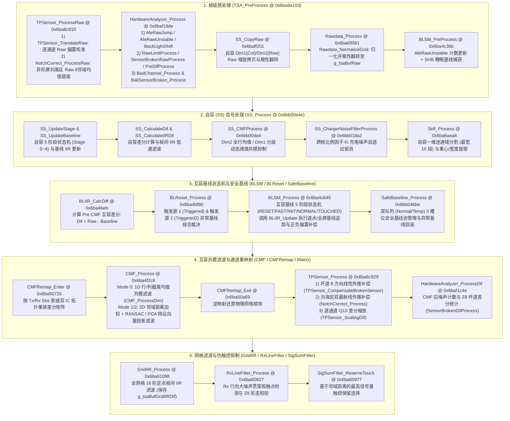
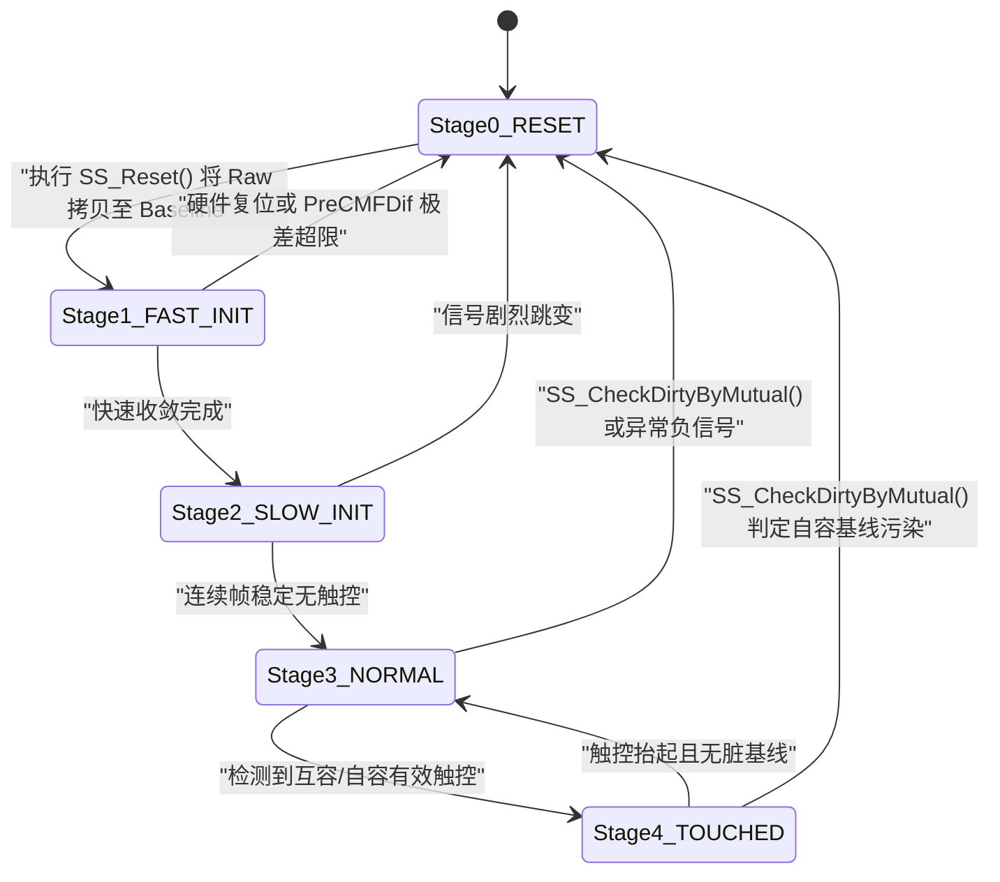
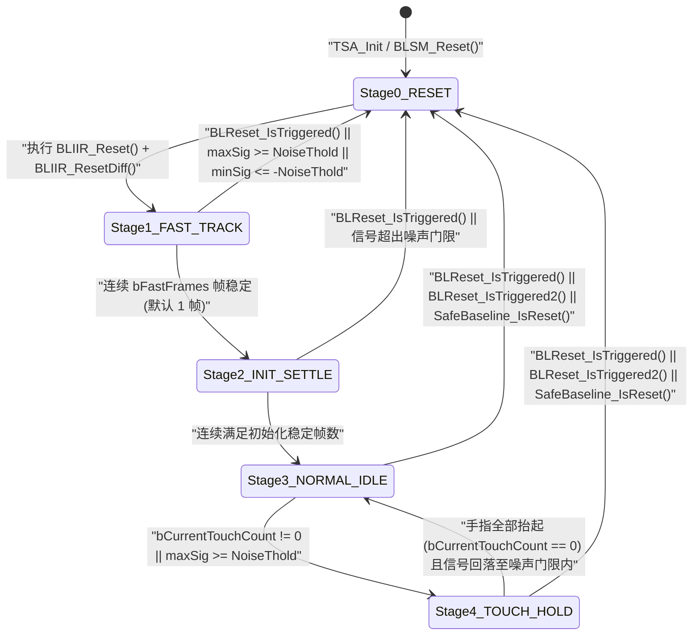
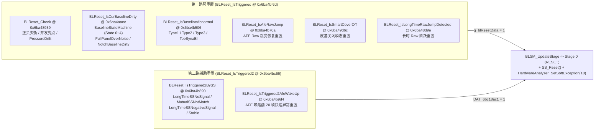
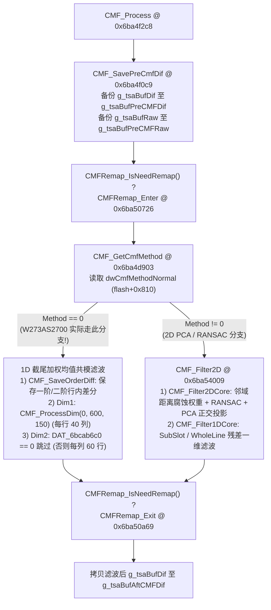

# 第二部分：Rawdata 预处理、自容 (SS)、基线管理 (Baseline)、共模滤波 (CMF) 与网格滤波子系统深度逆向分析

---

## 2.0 子系统架构总览与 W273AS2700 (`GaokunHimaxCSOT`) 核心配置

在 `TSACore.dll` 的单帧互容/自容触控处理流水线（`TSA_Processing` @ `0x6ba9a443` $\rightarrow$ `TSA_PreProcess` @ `0x6ba9a103` $\rightarrow$ `TSA_MSProcess` @ `0x6ba9a021`）中，**第二部分**承接底层数据解包之后、Peak 局部极值检索（`Peak_Process`）与触控区生长（`TZ_Process`）之前的全部**前端信号调理、异常硬件诊断、自容融合、基线状态机追踪、共模噪声抑制与网格时域/空域滤波**工作。

### 2.0.1 信号流与执行时序架构图

### 2.0.2 `W273AS2700` (`GaokunHimaxCSOT`) 关键预设参数总表

通过逆向 `TSAPrmt.dll` 中 `g_tsaPrmtFlashGaokunHimaxCSOT`（基址 `0x6bca8a00`）、`g_tsaPrmtFlashCmfPcaGaokunHimaxCSOT`（基址 `0x6bcaa2c0`）以及 `TSAConstPrmt_Init` / `TSADynPrmt_Init` 的初始化逻辑，提取出 `W273AS2700` 在本部分各子系统的精确运行参数如下：

| 参数符号 / 内存地址 | 表偏移 | 数据类型 | `W273AS2700` 数值 | 物理含义与对流水线分支的决定性影响 |
| :--- | :--- | :--- | :--- | :--- |
| `bX2Dim1` (`0x6bca8a18`) | `flash+0x0018` | `uint8_t` | `1` (`0x01`) | Dim1 对应 X 轴（列方向 `bCols`），Dim2 对应 Y 轴（行方向 `bRows`） |
| `bCmfForceDim1Pass` (`0x6bca8a19`) | `flash+0x0019` | `uint8_t` | `1` (`0x01`) | 强制开启 Dim1 共模滤波，且 `TSAConstPrmt_Init` 中 `Tx=bRows=60`, `Rx=bCols=40` |
| `bDim1Pitch` / `bDim2Pitch` | `flash+0x001b..0x001c` | `uint8_t` | `69` / `66` | 传感器物理间距：$6.9\text{ mm} \times 6.6\text{ mm}$ |
| `bRows` / `bCols` | `flash+0x001d..0x001e` | `uint8_t` | `60` / `40` | 互容网格尺寸：$60\text{ 行 (Y)} \times 40\text{ 列 (X)}$ |
| `wBufElementCount` (`0x6bca8a2c`) | `flash+0x002c` | `uint16_t` | `2400` (`0x0960`) | 互容总节点数：$60 \times 40 = 2400$ |
| `field_0x38` (`0x6bca8a38`) | `flash+0x0038` | `uint8_t` | `10` (`0x0a`) | 基准扫描帧率系数（决定 `BLReset` 超时帧数 $10 \times 5 \times 40 = 2000\text{ 帧}$） |
| `field_0x48` / `field_0x4a` | `flash+0x0048..0x004a` | `uint16_t` | `32768` / `8000` | `HardwareAnalyzer_RawLimitProcess` 正常 Raw 中心值 $32768 \pm 8000 \Rightarrow [24768, 40768]$ |
| `dwFeatureFlags` (`0x6bca8a54`) | `flash+0x0054` | `uint32_t` | `0x00000020` | `FEAT_SAFE_BASELINE (0x100)=0`（**SafeBaseline 默认关闭**），`FEAT_SIDE_TOUCH (0x8000)=0` |
| `dwFeatureFlags2` (`0x6bca8a56`) | `flash+0x0056` | `uint16_t` | `0x0109` | Bit `0x08=1`（**启用 `BadChannel_Process`**），Bit `0x10=0`（RFNoise 关），Bit `0x80=0`（`BaliSensorBroken` 关） |
| `bCmfEnabled` (`0x6bca8a68`) | `flash+0x0068` | `uint8_t` | `0` (`0x00`) | **Pre-BLSM CMF (`Rawdata_CMF`) 关闭**，在 `BLSM_Process` 之后直接调用 `CMF_Process` |
| `field_0x69` (`0x6bca8a69`) | `flash+0x0069` | `uint8_t` | `1` (`0x01`) | `BLIIR_DoUpdate` 使用 `g_tsaBufPreCMFRaw` 更新基线而非 `g_tsaBufRaw` |
| `field_0x6a` / `field_0x6b` / `field_0x6c` | `flash+0x006a..0x006c` | `uint8_t` | `1` / `1` / `0` | 启用 `BLReset_IsCurBaselineDirty` 与 `BLReset_IsBaselineAbnormal`；关闭长时 SS 负信号稳定重置 |
| `wPeakFilterReferenceThreshold` | `flash+0x05b4` | `int16_t` | `3000` (`0x0bb8`) | 基准手指饱和信号阈值（3000 ADU） |
| `wPeakMode3ThresholdMax` | `flash+0x05b6` | `int16_t` | `600` (`0x0258`) | Peak 检测上限基准（600 ADU） |
| `field_0x5b8` (`0x6bca8fb8`) | `flash+0x05b8` | `int16_t` | `3000` (`0x0bb8`) | `SS_CopyRaw` 缩放分母：$48000 / 3000 = 16$（即 $\times 16 \gg 4 = 1:1$ 无损拷贝） |
| `field_0x5fc` / `field_0x600` | `flash+0x05fc..0x0600` | `int32_t` | `32767` / `35767` | 基准 Raw 中心值 $32767$，触摸极值 $35767$；决定 `const+0x38 = -16383`, `const+0x3c = 65534` |
| `bRawdataForceNormalize` (`0x6bca9004`) | `flash+0x0604` | `uint8_t` | `0` (`0x00`) | 按无符号 `uint16_t` 执行 Raw 网格线性归一化与极性翻转 |
| `SS_ValidMask` (`0x6bca9008`) | `flash+0x0608` | `uint8_t` | `0` (`0x00`) | 拷贝至 `dynamic+0x24 = 0`：**`SS_IsDim1Valid` 和 `SS_IsDim2Valid` 均返回 0，自容通道在 W273AS2700 上完全禁用** |
| `txSlotTable[80]` / `rxSlotTable[80]` | `flash+0x062c..0x06cb` | `uint8_t[160]` | 全 `0` | 所有 Tx/Rx 均处于 Slot 0（无多相位分时复用） |
| `numRxCombine` / `bCmfRemapCoefEnable` | `flash+0x06cc..0x06cd` | `uint8_t` | `1` / `0` | 单组 Rx 合并，禁用重映射系数缩放（`CMFRemap_IsNeedRemap` 返回 `0`） |
| `bDoubleIC` (`0x6bca920e`) | `flash+0x080e` | `uint8_t` | `0` (`0x00`) | 单触控 IC 架构（非双 IC 拼接） |
| `dwCmfMethodNormal` / `SmartCover` | `flash+0x0810..0x0814` | `uint32_t` | `0` / `2` | **`CMF_GetCmfMethod` 恒返回 `0`（执行 1D CMF，不执行 2D PCA CMF）** |
| `cmfTholdNormal` (`0x6bca9020..0x9025`) | `flash+0x0620..0x0625` | `int16_t[3]` | `[600, 150, 0]` | Dim1 CMF 高低阈值 `600 / 150`；Dim2 CMF 阈值 `0`（仅执行行向 Dim1 CMF） |
| `GridIIR / SSIIR Coef` (`0x6bca92f8`) | `flash+0x08f8` | `uint8_t` | `0xe0` (`224`) | 低 4 位 `0`（**`GridIIR` 禁用**）；高 4 位 `14`（`SS_CalculateIIRDif` 权重 $2/16$ 当前帧 + $14/16$ 历史帧） |
| `RxLineFilter_Thold` (`0x6bca92a4..0x92a5`) | `flash+0x08a4..0x08a5` | `uint8_t[2]` | `80`, `2` | `RxLineFilter` 触发百分比阈值 `80%`，Z8 失败比例阈值 `2` |

---

## 2.1 Rawdata 预处理、传感器拓扑与异常硬件分析子系统

本节涵盖 9 个源码编译单元（共 **112 个函数**）：`Rawdata.c`（5 个）、`TPSensor.c`（16 个）、`NotchCorrect.c`（8 个）、`NotchProtect.c`（2 个）、`BadChannel.c`（9 个）、`BaliSensorBroken.c`（9 个）、`BaliSynaFM.c`（1 个）、`PressureDrift.c`（3 个）以及 `HardwareAnalyzer.c`（59 个）。

---

### 2.1.1 `Rawdata.c` —— 原始数据归一化与前置共模滤波 (5 个函数)

`Rawdata.c` 负责将 AFE 输入的原始电容采样网格 `g_tsaBufRawGrid` 转换为算法内部统一极性与量纲的 `g_tsaBufRaw`，并在特定配置下提供前置共模滤波（`Rawdata_CMF`）。

#### 1. `Rawdata_IsProcessNeeded` (`@ 0x6ba69306`)
- **函数签名**：`undefined4 Rawdata_IsProcessNeeded(void)`
- **调用者**：`Rawdata_NormalizeGrid` (`@ 0x6ba6946a`), `Rawdata_Process` (`@ 0x6ba69581`)
- **被调函数**：无
- **核心逻辑**：
  判断当前项目是否需要对原始采样数据执行线性缩放与偏置变换。当且仅当以下三个条件同时满足时返回 `0`（无需处理），否则返回 `1`：
  1. `DAT_6bcab638 == 0x3fff`（即缩放斜率为 $16383 / 16383 = 1.0$）；
  2. `DAT_6bcab63c == 0`（即平移截距为 $0$）；
  3. `_refptr_g_tsaPrmtFlash->bRawdataForceNormalize == 0`（未强制归一化）。
- **`W273AS2700` 参数表现**：
  在 `TSAConstPrmt_Init` 中，`DAT_6bcab638 = -16383` (`-0x3fff`)，`DAT_6bcab63c = 65534` (`0xfffe`)，因此本函数在 `W273AS2700` 上**恒返回 `1`**。

#### 2. `Rawdata_CMF` (`@ 0x6ba69381`)
- **函数签名**：`void Rawdata_CMF(void)`
- **调用者**：`TSA_MSProcess` (`@ 0x6ba9a021`，仅当 `_refptr_g_tsaPrmtFlash->bCmfEnabled != 0` 时调用)
- **被调函数**：`BLIIR_CalcDiffCommon` (`@ 0x6ba46f4c`), `CMF_Process` (`@ 0x6ba4f2c8`), `BLIIR_CalcRawCommon` (`@ 0x6ba4701b`)
- **核心逻辑**：
  若当前帧未处于硬件复位状态（`((*_refptr_g_tsaStaticPtr)->dwProcessingState & STATE_BIT_HW_RESET) == 0`），且基线与原始缓冲区指针非空，则执行“差分 $\rightarrow$ 共模滤波 $\rightarrow$ 还原 Raw”三步闭环：
  1. 调用 `BLIIR_CalcDiffCommon(g_tsaBufDif, g_tsaBufRaw, g_tsaBufBaseline)` 计算 $\text{Dif}[i] = \text{Raw}[i] - \text{Baseline}[i]$；
  2. 调用 `CMF_Process()` 对 `g_tsaBufDif` 执行共模噪声滤除；
  3. 调用 `BLIIR_CalcRawCommon(g_tsaBufRaw, g_tsaBufBaseline, g_tsaBufDif)` 将滤波后的差分加回基线：$\text{Raw}'[i] = \text{Baseline}[i] + \text{Dif}_{\text{CMF}}[i]$，使后续 `BLSM_Process` 使用去除了共模噪声的 Raw 更新基线。
- **`W273AS2700` 参数表现**：
  `flash+0x0068` (`bCmfEnabled`) = `0`，故 `TSA_MSProcess` **跳过 `Rawdata_CMF`**，改在 `BLSM_Process` 之后直接执行 `CMF_Process`。

#### 3. `Rawdata_NormalizeGridUnit` (`@ 0x6ba693f0`)
- **函数签名**：`int Rawdata_NormalizeGridUnit(ushort param_1)`
- **调用者**：`Rawdata_NormalizeGrid` (`@ 0x6ba6946a`)
- **被调函数**：无
- **核心逻辑与数学公式**：
  对单个网格节点的 16 位原始采样值 `param_1` 执行定点线性仿射变换：
  - 若 `bRawdataForceNormalize == 0`（默认无符号模式）：将 `param_1` 视为无符号 `uint16_t`：
    $$\text{Out} = \left\lfloor \frac{\text{DAT\_6bcab638} \times \text{uint16}(x)}{16383} \right\rfloor + \text{DAT\_6bcab63c}$$
  - 若 `bRawdataForceNormalize != 0`（有符号模式）：将 `param_1` 视为有符号 `int16_t`：
    $$\text{Out} = \left\lfloor \frac{\text{DAT\_6bcab638} \times \text{int16}(x)}{16383} \right\rfloor + \text{DAT\_6bcab63c}$$
- **`W273AS2700` 参数表现**：
  代入 `DAT_6bcab638 = -16383`、`DAT_6bcab63c = 65534`、`bRawdataForceNormalize = 0`：
  $$\text{Out} = -x + 65534 = 2 \times 32767 - x$$
  即将以 $32767$ 为基线、手指触摸时增大的原始电容值镜像翻转为以 $32767$ 为基线、触摸时减小（或反之）的标准内部 Raw 值。

#### 4. `Rawdata_NormalizeGrid` (`@ 0x6ba6946a`)
- **函数签名**：`void Rawdata_NormalizeGrid(short *param_1, short *param_2)`
- **调用者**：`Rawdata_Process` (`@ 0x6ba69581`)
- **被调函数**：`Rawdata_IsProcessNeeded` (`@ 0x6ba69306`), `Rawdata_NormalizeGridUnit` (`@ 0x6ba693f0`), `memcpy_s`
- **核心逻辑**：
  1. 若 `Rawdata_IsProcessNeeded()` 返回 `1`，则遍历 `i = 0 .. bRows * bCols - 1`（共 2400 点）：
     - 调用 `uVar1 = Rawdata_NormalizeGridUnit(param_2[i])`；
     - 若 `bRawdataForceNormalize == 0`，执行无符号饱和截断：`clamp(uVar1, 0, 0xffff)` 后写入 `param_1[i]`；
     - 若 `bRawdataForceNormalize != 0`，直接将 `uVar1` 截断为 `short` 写入 `param_1[i]`。
  2. 若 `Rawdata_IsProcessNeeded()` 返回 `0` 且 `param_1 != param_2`，直接调用 `memcpy_s` 拷贝 `_refptr_g_tsaPrmtFlash->wBufElementCount * 2` 字节。

#### 5. `Rawdata_Process` (`@ 0x6ba69581`)
- **函数签名**：`void Rawdata_Process(void)`
- **调用者**：`TSA_PreProcess` (`@ 0x6ba9a103`)
- **被调函数**：`Rawdata_IsProcessNeeded` (`@ 0x6ba69306`), `Rawdata_NormalizeGrid` (`@ 0x6ba6946a`), `abs`
- **核心逻辑**：
  1. 首先检查 `Rawdata_IsProcessNeeded()`，若为 `0` 直接返回。
  2. 检查系统标志位 `(*_refptr_g_tsaStaticPtr)->dwSystemFlags & FLAG_USE_DIF_BUF_PATH (0x400)`：
     - **常规 Raw 路径（`FLAG_USE_DIF_BUF_PATH == 0`）**：若 `g_tsaBufRaw` 与 `g_tsaBufRawGrid` 非空，调用 `Rawdata_NormalizeGrid(g_tsaBufRaw, g_tsaBufRawGrid)` 原地归一化（因为初始化时 `g_tsaBufRaw` 与 `g_tsaBufRawGrid` 指向同一块内存缓冲区）。
     - **外部直通 Dif 路径（`FLAG_USE_DIF_BUF_PATH != 0`）**：对 `g_tsaBufDif` 的每个元素按比例缩放：
       $$\text{Dif}[i] \leftarrow \left\lfloor \frac{|\text{DAT\_6bcab638}| \times \text{Dif}[i]}{16383} \right\rfloor$$

---

### 2.1.2 `TPSensor.c` —— 传感器物理坐标映射、坏道插值补偿与差分缩放 (16 个函数)

`TPSensor.c` 维护全屏每个节点的传感器状态标志表 `g_tpSensorFlag[2400]`、非均匀电极间距偏移表 `g_tpSensorDim1Offset` / `g_tpSensorDim2Offset`、差分缩放表 `g_tpSensorDifScale[2400]` 以及最多 100 个坏道（Broken Sensor）列表 `DAT_6bb80e41`（计数存于 `g_tpSensorBrokenList`）。

- **`g_tpSensorFlag[idx]` 位域定义**：
  - `bits [3:0]` (`0x0f`)：坏道异常类型码（`1`=Type1 坏道，`2`=Type2 坏道，`3`=Type3 Dif 异常，`4`=Type4 十字异常，`5`=Z8 坏道，`6`=Raw 超限坏道）；`0` 表示健康通道。
  - `bit 5` (`0x20`)：异形屏挖孔/刘海（Notch）空缺通道标志。
  - `bit 6` (`0x40`)：复用型刘海（Reused Notch）半有效通道标志。

#### 1. `TPSensor_AddToBrokenSensorList` (`@ 0x6ba6babf`)
- **函数签名**：`void TPSensor_AddToBrokenSensorList(undefined1 param_1, undefined1 param_2, undefined1 param_3)`
- **调用者**：`BadChannel_Detect` (`@ 0x6bb43154`), `HardwareAnalyzer_SensorBrokenRawProcess` (`@ 0x6baf2fbe`), `HardwareAnalyzer_SensorBrokenDifProcess` (`@ 0x6baf3975`), `HardwareAnalyzer_CopyBadChannelList` (`@ 0x6baf38c1`)
- **核心逻辑**：
  若当前坏道数 `g_tpSensorBrokenList < 100` (`0x64`)，将三元组 `(col = param_1, row = param_2, broken_type = param_3)` 写入全局数组 `DAT_6bb80e41[g_tpSensorBrokenList * 3 .. +2]`，并将 `g_tpSensorBrokenList` 加 1。

#### 2. `TPSensor_Reset` (`@ 0x6ba6bb6b`)
- **函数签名**：`void TPSensor_Reset(void)`
- **调用者**：`HardwareAnalyzer_SensorBrokenRawProcess` (`@ 0x6baf2fbe`), `HardwareAnalyzer_SensorBrokenPreDifProcess` (`@ 0x6baf3179`)
- **核心逻辑**：将坏道计数器 `g_tpSensorBrokenList` 清零。

#### 3. `TPSensor_UpdateBrokenSensorTable` (`@ 0x6ba6bb78`)
- **函数签名**：`void TPSensor_UpdateBrokenSensorTable(void)`
- **调用者**：`TPSensor_CompensateBrokenSensor` (`@ 0x6ba6c403`), `HardwareAnalyzer_SensorBrokenRawProcess` (`@ 0x6baf2fbe`), `HardwareAnalyzer_SensorBrokenDifProcess` (`@ 0x6baf3975`)
- **核心逻辑**：
  1. 遍历 `0 .. wBufElementCount - 1`，将 `g_tpSensorFlag[i]` 的低 4 位清零（`g_tpSensorFlag[i] &= 0xf0`），保留高 4 位的 Notch 标记。
  2. 若 `g_tpSensorBrokenList < 100`，遍历坏道列表 `i = 0 .. g_tpSensorBrokenList - 1`：
     计算线性索引 $\text{idx} = \text{row}_i \times \text{bCols} + \text{col}_i$，若在有效范围内，将坏道类型码或入低 4 位：`g_tpSensorFlag[idx] |= (type_i & 0x0f)`。

#### 4. `TPSensor_IsSensorReusedNotch` (`@ 0x6ba6bca9`)
- **函数签名**：`bool TPSensor_IsSensorReusedNotch(int param_1, int param_2)`
- **调用者**：`NotchCorrect_IsNeedSkipComp` (`@ 0x6ba6cbb5`), `CMF_SetNotchToZero` (`@ 0x6ba526d5`)
- **核心逻辑**：检查坐标 `(col = param_1, row = param_2)` 是否在 `[0, bCols) x [0, bRows)` 内，且 `(g_tpSensorFlag[row * bCols + col] & 0x40) != 0`。

#### 5. `TPSensor_IsSensorButNotNotch` (`@ 0x6ba6bd35`)
- **函数签名**：`bool TPSensor_IsSensorButNotNotch(int param_1, int param_2)`
- **调用者**：`TPSensor_IsSensorValid`, `NotchCorrect_IsNeedSkipComp`, `NotchCorrect_ProcessRawSensor`, `CMF_SetNotchToZero`, `HardwareAnalyzer_RawLimitProcess` 等
- **核心逻辑**：检查 `(col = param_1, row = param_2)` 在面板边界内，且 `(g_tpSensorFlag[row * bCols + col] & 0x20) == 0`（即属于真实物理电极而非刘海挖孔区域）。

#### 6. `TPSensor_IsSensorValid` (`@ 0x6ba6bdc1`)
- **函数签名**：`bool TPSensor_IsSensorValid(int param_1, int param_2)`
- **调用者**：`TPSensor_ProcessSensor` (`@ 0x6ba6c0e5`), `HardwareAnalyzer_AfeRawJump`, `HardwareAnalyzer_AfeRawUnstableCoreDetect`, `HardwareAnalyzer_RawLimitProcess` 等
- **核心逻辑**：
  当且仅当 `TPSensor_IsSensorButNotNotch(param_1, param_2)` 为真（非刘海）且 `(g_tpSensorFlag[row * bCols + col] & 0x0f) == 0`（非坏道）时返回 `true`。

#### 7. `TPSensor_Init` (`@ 0x6ba6be2e`)
- **函数签名**：`void TPSensor_Init(void)`
- **调用者**：`TSA_Init`
- **被调函数**：`memset`, `NotchCorrect_Init` (`@ 0x6ba6c982`)
- **核心逻辑**：
  1. 清零 `g_tpSensorDim1Offset`（80 字节）、`g_tpSensorDim2Offset`（80 字节）与 `g_tpSensorFlag`（4096 字节）。
  2. 读取异形电极间距校准表：位于 `flash+0x094c`（即 `&(_refptr_g_tsaPrmtFlash[1].pDim1PitchMap) + 0x6c`）的条目数 $N \le 30$（`0x1e`）。每个条目占 5 字节 `(type, start_idx, end_idx, offset_lo, offset_hi)`：
     - 若 `type == 0`，将 `offset` (`int16_t`) 填入 `g_tpSensorDim1Offset[start_idx .. end_idx]`；
     - 若 `type != 0`，填入 `g_tpSensorDim2Offset[start_idx .. end_idx]`。
  3. 调用 `NotchCorrect_Init()` 初始化刘海通道掩码。
  4. 将 `g_tpSensorDifScale[0 .. 4095]` 全部初始化为 `0x400`（Q10 定点数 $1024 = 1.0$）。
  5. 读取逐点差分缩放与 Raw 偏置表：位于 `flash+0x0a0d`（`pDim1PitchMap + 0x12d`）的条目数 $M \le 20$（`0x14`），每个条目占 6 字节 `(col, row, scale_u16, raw_offset_i16)`，将 `scale_u16` 写入 `g_tpSensorDifScale[row * bCols + col]`。
- **`W273AS2700` 参数表现**：
  `flash+0x094c = 0`，`flash+0x0a0d = 0`，因此所有电极偏移均为 `0`，所有通道缩放因子均为 `0x400` ($1.0$)。

#### 8. `TPSensor_ProcessSensor` (`@ 0x6ba6c0e5`)
- **函数签名**：`void TPSensor_ProcessSensor(int param_1, int param_2)`
- **调用者**：`TPSensor_CompensateBrokenSensor` (`@ 0x6ba6c403`)
- **被调函数**：`TPSensor_IsSensorValid` (`@ 0x6ba6bdc1`)
- **核心逻辑与数学公式**：
  对坏道节点 $(c, r) = (\text{param\_1}, \text{param\_2})$ 进行 8 方向（$(\Delta c, \Delta r) \in \{-1, 0, 1\}^2 \setminus \{(0,0)\}$）一阶线性射线外推插值：
  1. 对每个方向 $(\Delta c, \Delta r)$，检查一阶近邻 $(c_1, r_1) = (c + \Delta c, r + \Delta r)$ 与二阶近邻 $(c_2, r_2) = (c + 2\Delta c, r + 2\Delta r)$ 是否同时满足 `TPSensor_IsSensorValid`（既非刘海也非坏道）。
  2. 若两者均有效，记 $D_1 = \text{Dif}(c_1, r_1)$，$D_2 = \text{Dif}(c_2, r_2)$，更新近邻最大信号 $D_{\max} = \max(D_{\max}, D_1)$，并累加线性外推值：
     $$S \leftarrow S + \left\lfloor \frac{(2 D_1 - D_2) \times 256}{128} \right\rfloor = S + 2 (2 D_1 - D_2), \quad N_{\text{valid}} \leftarrow N_{\text{valid}} + 1$$
  3. 遍历完 8 个方向后，若 $N_{\text{valid}} > 0$，计算均值并乘以阻尼系数 $8/16 = 0.5$：
     $$\hat{D}(c, r) = \left\lfloor \frac{\lfloor S / N_{\text{valid}} \rfloor \times 8}{16} \right\rfloor \approx \frac{1}{N_{\text{valid}}} \sum (2 D_1 - D_2)$$
  4. 限幅保护：将 $\hat{D}(c, r)$ 钳位至 $[0, \lfloor 5 D_{\max} / 4 \rfloor]$（即不超过最大有效近邻信号的 $1.25$ 倍，且不允许为负），写回 `g_tsaBufDif[r * bCols + c]`。

#### 9. `TPSensor_IsCompensationNeeded` (`@ 0x6ba6c3bf`)
- **函数签名**：`undefined4 TPSensor_IsCompensationNeeded(void)`
- **调用者**：`TPSensor_CompensateBrokenSensor` (`@ 0x6ba6c403`)
- **核心逻辑**：
  当 `flash+0x0a86`（`pDim1PitchMap + 0x1a6`）非 0 且系统标志位 `((*_refptr_g_tsaStaticPtr)->dwSystemFlags & 0x80000) == 0` 时返回 `1`，否则返回 `0`。
  - **`W273AS2700` 参数表现**：`flash+0x0a86 = 0`，因此坏道差值补偿默认关闭。

#### 10. `TPSensor_CompensateBrokenSensor` (`@ 0x6ba6c403`)
- **函数签名**：`void TPSensor_CompensateBrokenSensor(void)`
- **调用者**：`TPSensor_Process` (`@ 0x6ba6c929`)
- **被调函数**：`TPSensor_IsCompensationNeeded`, `TPSensor_UpdateBrokenSensorTable`, `TPSensor_ProcessSensor`
- **核心逻辑**：
  若 `TPSensor_IsCompensationNeeded() != 0` 且 `g_tpSensorBrokenList < 100`，先调用 `TPSensor_UpdateBrokenSensorTable()` 刷新标志表，再对 `DAT_6bb80e41` 中的每个坏道 `(col, row)` 依次调用 `TPSensor_ProcessSensor(col, row)`。

#### 11. `TPSensor_IsBrokenSensorInTouchZone` (`@ 0x6ba6c46f`)
- **函数签名**：`undefined4 TPSensor_IsBrokenSensorInTouchZone(longlong param_1)`
- **调用者**：触控区校验模块（`TZ` / `Touch`）
- **被调函数**：`Sensor_IsInZone`
- **核心逻辑**：
  若 `g_tpSensorBrokenList < 100`，遍历所有已登记坏道 `(col, row)`，调用 `Sensor_IsInZone(col, row, param_1 + 0x20)` 检查坏道是否落入当前 TouchZone 的包围盒内。若是，则置位 `*(uint *)(param_1 + 4) |= 0x10000` 并返回 `1`。

#### 12. `TPSensor_ScalingDif` (`@ 0x6ba6c52c`)
- **函数签名**：`void TPSensor_ScalingDif(void)`
- **调用者**：`TPSensor_Process` (`@ 0x6ba6c929`)
- **核心逻辑**：
  读取 `flash+0x0a0d`（`pDim1PitchMap + 0x12d`）的校准点个数 $M \le 20$。对每个校准点 `(col, row, scale_u16, offset_i16)`，若 `scale_u16 != 0`，对 `g_tsaBufDif` 执行 Q10 乘法缩放并饱和截断至 `int16_t`：
  $$\text{Dif}[r \cdot \text{bCols} + c] \leftarrow \text{clamp}_{[-32768, 32767]}\left( (\text{Dif}[r \cdot \text{bCols} + c] \times \text{scale\_u16}) \gg 10 \right)$$

#### 13. `TPSensor_TranslateRaw` (`@ 0x6ba6c6c7`)
- **函数签名**：`void TPSensor_TranslateRaw(void)`
- **调用者**：`TPSensor_ProcessRaw` (`@ 0x6ba6c910`)
- **核心逻辑**：
  读取 `flash+0x0a0d`（`pDim1PitchMap + 0x12d`）的校准点个数 $M \le 20$。对每个校准点的 `offset_i16`（位于条目偏移 `+4`），若非 0，则将其加到 `g_tsaBufRaw[r * bCols + c]` 上并钳位至无符号 `[0, 65535]`。

#### 14. `TPSensor_IsNoMoveInCorrection` (`@ 0x6ba6c8ef`)
- **函数签名**：`void TPSensor_IsNoMoveInCorrection(undefined2 param_1, undefined2 param_2)`
- **调用者**：边缘修正模块（`ER`）
- **被调函数**：`NotchCorrect_IsNoMoveInCorrection` (`@ 0x6ba6cb15`)
- **核心逻辑**：直接尾调用转发给 `NotchCorrect_IsNoMoveInCorrection(param_1, param_2)`。

#### 15. `TPSensor_ProcessRaw` (`@ 0x6ba6c910`)
- **函数签名**：`void TPSensor_ProcessRaw(void)`
- **调用者**：`TSA_PreProcess` (`@ 0x6ba9a103`)
- **被调函数**：`TPSensor_TranslateRaw` (`@ 0x6ba6c6c7`), `NotchCorrect_ProcessRaw` (`@ 0x6ba6d0b2`)
- **核心逻辑**：在 `TSA_PreProcess` 最前端依次执行单点 Raw 偏置校准与刘海区 Raw 8 邻域均值填充。

#### 16. `TPSensor_Process` (`@ 0x6ba6c929`)
- **函数签名**：`void TPSensor_Process(void)`
- **调用者**：`TSA_MSProcess` (`@ 0x6ba9a021`)
- **被调函数**：`TPSensor_CompensateBrokenSensor` (`@ 0x6ba6c403`), `NotchCorrect_Process` (`@ 0x6ba6d109`), `TPSensor_ScalingDif` (`@ 0x6ba6c52c`)
- **核心逻辑**：在 `CMF_Process` 完成后依次执行坏道差值外推补偿、刘海区双遍差值外推补偿和单点差值 Q10 缩放。

---

### 2.1.3 `NotchCorrect.c` —— 异形屏刘海/挖孔区域 Raw 与 Dif 补偿 (8 个函数)

`NotchCorrect.c` 针对手机/平板屏幕顶部的摄像头挖孔或刘海区域（最多 12 个 Notch 电极点，配置在 `flash+0x09e3..0x0a0c`）提供 Raw 均值替补和 Dif 方向性二阶外推恢复。

#### 1. `NotchCorrect_GetNotchNum` (`@ 0x6ba6c950`)
- **函数签名**：`byte NotchCorrect_GetNotchNum(void)`
- **调用者**：`NotchCorrect_Init`, `NotchCorrect_ProcessRaw`, `NotchCorrect_Process`, `CMF_SetNotchToZero`, `SS_IsChargerNoiseFilterNeeded`
- **核心逻辑**：读取 `flash+0x09e4`（`pDim1PitchMap + 0x104`）的无符号字节，若超过 `12` (`0x0c`) 则钳位至 `12`。
  - **`W273AS2700` 参数表现**：`flash+0x09e4 = 0`（平板无刘海挖孔），恒返回 `0`。

#### 2. `NotchCorrect_Init` (`@ 0x6ba6c982`)
- **函数签名**：`void NotchCorrect_Init(void)`
- **调用者**：`TPSensor_Init` (`@ 0x6ba6be2e`), `TSAFold_NotchPrmtProcess`
- **被调函数**：`NotchCorrect_GetNotchNum` (`@ 0x6ba6c950`)
- **核心逻辑**：
  1. 将 `g_tpSensorFlag[0 .. wBufElementCount-1]` 的 bit 5 (`0x20`) 和 bit 6 (`0x40`) 清零（`&= 0x9f`）。
  2. 遍历 `i = 0 .. NotchCorrect_GetNotchNum() - 1`，读取位于 `flash+0x09e5 + 3*i`（`pDim1PitchMap + 0x105 + 3*i`）的 3 字节结构 `(col, row, weight_i8)`：
     - 置位 `g_tpSensorFlag[row * bCols + col] |= 0x20`（标记为 Notch 节点）；
     - 若 `weight_i8 < 0`（最高位 bit 7 为 1），额外置位 `g_tpSensorFlag[row * bCols + col] |= 0x40`（标记为复用型 Reused Notch 节点，其自身保留部分感应能力，优先在第一遍补偿）。

#### 3. `NotchCorrect_IsNoMoveInCorrection` (`@ 0x6ba6cb15`)
- **函数签名**：`undefined4 NotchCorrect_IsNoMoveInCorrection(short param_1, short param_2)`
- **调用者**：`TPSensor_IsNoMoveInCorrection` (`@ 0x6ba6c8ef`)
- **核心逻辑**：
  读取 `flash+0x0a09..0x0a0c`（`pDim1PitchMap + 0x129..0x12c`）的矩形区域边界 `(x_min, x_max, y_min, y_max)`（单位为传感器格点，乘以 `bDim1Pitch` / `bDim2Pitch` 转换为内部毫米坐标），判断触控坐标 `(param_1, param_2)` 是否落入该刘海禁入修正区内。

#### 4. `NotchCorrect_IsNeedSkipComp` (`@ 0x6ba6cbb5`)
- **函数签名**：`undefined4 NotchCorrect_IsNeedSkipComp(int param_1, int param_2, int param_3, int param_4, char param_5)`
- **调用者**：`NotchCorrect_ProcessSensor` (`@ 0x6ba6cc56`)
- **被调函数**：`TPSensor_IsSensorButNotNotch`, `TPSensor_IsSensorReusedNotch`
- **核心逻辑**：
  判断在为刘海节点外推时，某条射线方向上的一阶近邻 `(param_1, param_2)` 与二阶近邻 `(param_3, param_4)` 是否应当跳过：
  - **第一遍（`param_5 != 0`，针对 Reused Notch）**：一阶与二阶近邻必须全部满足 `TPSensor_IsSensorButNotNotch`（纯正常通道），否则返回 `1`（跳过）。
  - **第二遍（`param_5 == 0`，针对普通 Notch）**：一阶与二阶近邻只需满足 `TPSensor_IsSensorButNotNotch` **或** `TPSensor_IsSensorReusedNotch`（即允许利用第一遍已经补偿好的 Reused Notch 节点作为参考点！）。

#### 5. `NotchCorrect_ProcessSensor` (`@ 0x6ba6cc56`)
- **函数签名**：`void NotchCorrect_ProcessSensor(int param_1, int param_2, byte param_3, char param_4)`
- **调用者**：`NotchCorrect_Process` (`@ 0x6ba6d109`)
- **被调函数**：`NotchCorrect_IsNeedSkipComp` (`@ 0x6ba6cbb5`)
- **核心逻辑与数学公式**：
  对刘海节点 $(c, r) = (\text{param\_1}, \text{param\_2})$ 进行 8 方向加权射线外推：
  1. 读取二阶衰减系数 $k = \text{uint8}(\text{flash+0x09e3})$（在 `W273AS2700` 中为 `27` = `0x1b`）。
  2. 对 8 个方向 $(\Delta c, \Delta r)$，若 `!NotchCorrect_IsNeedSkipComp(c+\Delta c, r+\Delta r, c+2\Delta c, r+2\Delta r, param_4)`：
     - 方向权重 $w_{\text{dir}}$：正交方向（$\Delta c = 0$ 或 $\Delta r = 0$）取 $w_{\text{dir}} = 16$ (`0x10`)；对角方向取 $w_{\text{dir}} = 8$ (`0x08`)。
     - 累加外推分量：
       $$S \leftarrow S + \left( (20 \cdot D_1 - k \cdot D_2) \times w_{\text{dir}} \gg 7 \right), \quad N_{\text{valid}} \leftarrow N_{\text{valid}} + 1$$
  3. 若 $N_{\text{valid}} > 0$，取平均后乘以该刘海点配置权重 $w_{\text{notch}} = \text{param\_3} \ \& \ 0x7f$：
     $$\hat{D}(c, r) = \frac{\lfloor S / N_{\text{valid}} \rfloor \times (w_{\text{notch}} \ \& \ 0x7f)}{16}$$
  4. 饱和钳位：上限取 $\min\left( \lfloor 3 D_{\max} / 2 \rfloor, \lfloor 6 \cdot \text{wPeakFilterReferenceThreshold} / 5 \rfloor \right)$，下限取 `0`，写入 `g_tsaBufDif[r * bCols + c]`。

#### 6. `NotchCorrect_ProcessRawSensor` (`@ 0x6ba6cf82`)
- **函数签名**：`void NotchCorrect_ProcessRawSensor(int param_1, int param_2)`
- **调用者**：`NotchCorrect_ProcessRaw` (`@ 0x6ba6d0b2`)
- **被调函数**：`TPSensor_IsSensorButNotNotch` (`@ 0x6ba6bd35`)
- **核心逻辑**：
  遍历 `(param_1, param_2)` 周围 $3 \times 3$ 邻域内所有满足 `TPSensor_IsSensorButNotNotch` 的有效非刘海通道，计算其 `g_tsaBufRaw` 的算术平均值，直接写入 `g_tsaBufRaw[param_2 * bCols + param_1]`。

#### 7. `NotchCorrect_ProcessRaw` (`@ 0x6ba6d0b2`)
- **函数签名**：`void NotchCorrect_ProcessRaw(void)`
- **调用者**：`TPSensor_ProcessRaw` (`@ 0x6ba6c910`)
- **被调函数**：`NotchCorrect_GetNotchNum`, `NotchCorrect_ProcessRawSensor`
- **核心逻辑**：遍历所有配置的刘海节点，依次调用 `NotchCorrect_ProcessRawSensor(col, row)`。

#### 8. `NotchCorrect_Process` (`@ 0x6ba6d109`)
- **函数签名**：`void NotchCorrect_Process(void)`
- **调用者**：`TPSensor_Process` (`@ 0x6ba6c929`)
- **被调函数**：`NotchCorrect_GetNotchNum`, `memcpy_s`, `NotchCorrect_ProcessSensor`
- **核心逻辑**：
  1. 若 `NotchCorrect_GetNotchNum() != 0`：
     - 将补偿前的 `g_tsaBufDif` 备份至 `g_tsaBufPreNotchCorrectDif`；
     - **第一遍（Pass 1）**：遍历所有 `weight_i8 < 0`（Reused Notch）的节点，调用 `NotchCorrect_ProcessSensor(col, row, weight_i8, 1)`；
     - **第二遍（Pass 2）**：遍历所有 `weight_i8 >= 0`（普通 Notch）的节点，调用 `NotchCorrect_ProcessSensor(col, row, weight_i8, 0)`；
     - 将补偿后的 `g_tsaBufDif` 备份至 `g_tsaBufAftNotchCorrectDif`。

---

### 2.1.4 `NotchProtect.c` —— 刘海区域脏基线保护与防误重置 (2 个函数)

`NotchProtect.c` 防止用户在刘海区域附近边缘触控时因信号畸变误触发基线重置。配置参数位于 `_refptr_g_tsaPrmtFlash[2].field_0x6d8..0x6e0`（即 `flash+0x1758..0x1760`，在 `W273AS2700` 上全为 `0`）。

#### 1. `NotchProtect_IsTouchProtected` (`@ 0x6bb43c30`)
- **函数签名**：`undefined4 NotchProtect_IsTouchProtected(void)`
- **调用者**：`NotchProtect_IsNotchBaselineDirty` (`@ 0x6bb43d4e`)
- **被调函数**：`TSABuffer_GetPrevTouchDataPtr`
- **核心逻辑**：
  遍历上一帧激活的触控点（`wTouchNowBits`），检查触控中心 `(bCenterRow, bCenterCol)` 是否全部位于面板内部（$1 < \text{Row} < \text{bRows}-2$ 且 $1 < \text{Col} < \text{bCols}-2$），且不在刘海保护角区域 `Row <= flash[2].field_0x6d9 && Col >= bCols - flash[2].field_0x6da` 内。若满足且信号量充足，返回 `1`（受保护）。

#### 2. `NotchProtect_IsNotchBaselineDirty` (`@ 0x6bb43d4e`)
- **函数签名**：`undefined4 NotchProtect_IsNotchBaselineDirty(void)`
- **调用者**：`BLReset_IsCurBaselineDirty` (`@ 0x6ba4aaee`)
- **被调函数**：`NotchProtect_IsTouchProtected` (`@ 0x6bb43c30`)
- **核心逻辑**：
  1. 若 `flash+0x1758` (`flash[2].field_0x6d8`) == `0`，或处于皮套模式（`FEAT_SMART_COVER`）、游戏模式（`dwSystemFlags & 0x20`）、水雾/噪声模式，直接清零计时器 `field_0x3d0` 并返回 `0`。
  2. 若当前存在峰值（`bPeakCount != 0`）、全屏最大正信号 `< flash+0x175e`、最小负信号 `< -flash+0x1760`，且 `NotchProtect_IsTouchProtected()` 为 `0`，则递增帧计数器 `field_0x3d0`；当达到防抖上限 `flash+0x175b` 时返回 `1`（判定刘海基线脏，请求重置）。

---

### 2.1.5 `BadChannel.c` —— 奇偶交错坏道与全行/全列断路检测 (9 个函数)

`BadChannel.c` 在 `HardwareAnalyzer_Process` 中被调用（当 `dwFeatureFlags2 & 0x08 != 0` 时启用，**在 `W273AS2700` 上处于激活状态！**），专门检测两类典型的面板 ITO 走线故障：
- **Type 1（奇偶交错开路/短路）**：某一行或某一列的奇数索引节点正常，但偶数索引节点全部为 0（或反之）。
- **Type 2（整行/整列死道）**：某一行或某一列连续 `bCols - 2`（或 `bRows - 2`）个以上节点信号为 0，而相邻行/列信号正常。

#### 1. `BadChannel_Init` (`@ 0x6bb42b6c`)
- **函数签名**：`void BadChannel_Init(void)`
- **调用者**：`HardwareAnalyzer_Init` (`@ 0x6baefb27`)
- **核心逻辑**：将 `g_badChannelData`（基址 `0x6bc9de40`，共 `0x191c` = 6428 字节）清零，并将防抖阈值 `DAT_6bc9f754` 初始化为 `20` (`0x14`) 帧。

#### 2. `BadChannel_DetectType1` (`@ 0x6bb42be5`)
- **函数签名**：`void BadChannel_DetectType1(int *param_1, byte param_2, byte param_3)`
- **调用者**：`BadChannel_Detect` (`@ 0x6bb43154`)
- **核心逻辑**：
  输入单行（或单列）的信号数组 `param_1[0 .. param_2-1]` 与非零阈值 `param_3`（传入 `10`）：
  - 分别统计偶数下标 `2*k` 与奇数下标 `2*k+1` 中满足 `param_1[idx] > 10` 的有效节点数 `even_cnt`、`odd_cnt` 及全零标志；
  - 若偶数位全为 0 且 `odd_cnt > (param_2 / 2 - 4)`，或奇数位全为 0 且 `even_cnt > (param_2 / 2 - 4)`，则判定该通道存在 **Type 1 奇偶交错坏道**。

#### 3. `BadChannel_DetectType2` (`@ 0x6bb42c80`)
- **函数签名**：`void BadChannel_DetectType2(longlong param_1, byte param_2, byte param_3, byte param_4)`
- **调用者**：`BadChannel_Detect` (`@ 0x6bb43154`)
- **核心逻辑**：
  在二维统计矩阵 `param_1`（尺寸 `param_2 x param_3`）中检测是否存在某一行 `r`：
  - 其零值节点数 `zero_cnt >= param_3 - 2`（几乎整行无信号）；
  - 同时其上一行 `r-1` 或下一行 `r+1` 中大于阈值 `param_4`（`20`）的节点数 `>= param_3 - 2`（相邻行信号饱满）。
  若满足，则标记第 `r` 行为 **Type 2 整行/整列死道**。

#### 4. `BadChannel_IsDMDDetected` (`@ 0x6bb42e68`)
- **函数签名**：`undefined4 BadChannel_IsDMDDetected(longlong param_1)`
- **调用者**：`HardwareAnalyzer_GenerateExceptionDescription` (`@ 0x6baf001a`)
- **被调函数**：`sprintf_s`
- **核心逻辑**：
  检查是否存在防抖计数已满（`>= DAT_6bc9f754`，默认 20 次）且尚未上报 DMD 的坏道。若存在，格式化异常描述字符串 `"type:%d, rowOrCol:%d, index:%d "` 追加到缓冲区 `param_1`，标记已上报并返回 `1`。

#### 5. `BadChannel_SetDebounce` (`@ 0x6bb42f49`)
- **函数签名**：`void BadChannel_SetDebounce(uint param_1)`
- **调用者**：测试/诊断接口
- **核心逻辑**：设置坏道确认防抖帧数 `DAT_6bc9f754 = (param_1 == 0) ? 1 : param_1`。

#### 6. `BadChannel_CheckType1` (`@ 0x6bb42f89`)
- **函数签名**：`undefined4 BadChannel_CheckType1(int param_1, int param_2)`
- **调用者**：`BadChannel_Detect` (`@ 0x6bb43154`)
- **核心逻辑**：在 `g_badChannelData` 的历史缓存数组（最多 20 个槽位）中查找或分配 `(rowOrCol = param_1, index = param_2)` 的 Type 1 坏道记录，递增其命中计数；当计数达到 `DAT_6bc9f754`（20）时返回 `1`。

#### 7. `BadChannel_CheckType2` (`@ 0x6bb43052`)
- **函数签名**：`undefined4 BadChannel_CheckType2(int param_1, int param_2)`
- **调用者**：`BadChannel_Detect` (`@ 0x6bb43154`)
- **核心逻辑**：同 `BadChannel_CheckType1`，针对 Type 2 坏道槽位递增计数，达到 `DAT_6bc9f754`（20）时返回 `1`。

#### 8. `BadChannel_Detect` (`@ 0x6bb43154`)
- **函数签名**：`undefined4 BadChannel_Detect(void)`
- **调用者**：`BadChannel_Process` (`@ 0x6bb4325f`)
- **被调函数**：`BadChannel_DetectType1`, `BadChannel_DetectType2`, `BadChannel_CheckType1`, `BadChannel_CheckType2`, `TPSensor_AddToBrokenSensorList`
- **核心逻辑**：
  对行方向（`bRows`）和列方向（`bCols`）分别调用 `BadChannel_DetectType1`（阈值 `10`）和 `BadChannel_DetectType2`（阈值 `20`）。一旦通过 `CheckType1` 或 `CheckType2` 防抖确认，将该行/列上的死道节点通过 `TPSensor_AddToBrokenSensorList(col, row, type)` 写入全局坏道表，并返回 `1`。

#### 9. `BadChannel_Process` (`@ 0x6bb4325f`)
- **函数签名**：`undefined4 BadChannel_Process(void)`
- **调用者**：`HardwareAnalyzer_Process` (`@ 0x6baf19de`)
- **被调函数**：`BadChannel_Detect` (`@ 0x6bb43154`), `memset`
- **核心逻辑**：
  1. 仅当当前激活触控点数 `bCurrentTouchCount > 1` 时累加帧计数 `DAT_6bc9de40` 并把当前帧正差分 `g_tsaBufDif[r*bCols + c] > 0` 累加到统计矩阵 `g_badChannelData` 中。
  2. 每满 `50` (`0x32`) 帧（`DAT_6bc9de40 > 0x31`），调用一次 `BadChannel_Detect()` 执行坏道判定，随后清空累计矩阵重新开始下一个 50 帧周期。

---

### 2.1.6 `BaliSensorBroken.c` —— Bali 平台 Raw 极值与邻域落差坏道检测 (9 个函数)

`BaliSensorBroken.c` 针对折叠屏/特定面板（当 `dwFeatureFlags2 & 0x80 != 0` 时启用；在 `W273AS2700` 上 `0x0109 & 0x80 == 0` 故不运行）通过 Raw 绝对越界或相邻节点 Raw 剧烈跳变检测物理断线。

#### 1. `BaliSensorBroken_Reset` (`@ 0x6bb432dc`)
- **函数签名**：`void BaliSensorBroken_Reset(void)`
- **调用者**：`BaliSensorBroken_Init`, `BaliSensorBroken_RawCheck`, `HardwareAnalyzer_Reset`
- **核心逻辑**：清空检测计数 `DAT_6bc9f782`、坏道数量 `DAT_6bc9f780` 及坐标列表 `DAT_6bc9f784`（40 字节）。

#### 2. `BaliSensorBroken_Init` (`@ 0x6bb43315`)
- **函数签名**：`void BaliSensorBroken_Init(void)`
- **调用者**：`HardwareAnalyzer_Init` (`@ 0x6baefb27`)
- **被调函数**：`BaliSensorBroken_Reset`, `memset`
- **核心逻辑**：调用 `BaliSensorBroken_Reset()` 并清空 DMD 上报缓冲与包围盒数组 `DAT_6bc9f760`（32 字节）。

#### 3. `BaliSensorBroken_UpdateBoxInf` (`@ 0x6bb43393`)
- **函数签名**：`void BaliSensorBroken_UpdateBoxInf(byte param_1, byte param_2, longlong param_3)`
- **调用者**：`BaliSensorBroken_RawCheck` (`@ 0x6bb434fa`)
- **核心逻辑**：更新坏道分布的最小/最大列号与最小/最大行号包围盒 `(col_min, col_max, row_min, row_max)`。

#### 4. `BaliSensorBroken_IsSensorOverRawLimit` (`@ 0x6bb433f9`)
- **函数签名**：`undefined4 BaliSensorBroken_IsSensorOverRawLimit(int param_1, int param_2)`
- **调用者**：`BaliSensorBroken_RawCheck` (`@ 0x6bb434fa`)
- **核心逻辑**：检查 `g_tsaBufRaw[r * bCols + c]` 是否超出 `[DAT_6bcab65c, DAT_6bcab65a]`（在 `W273AS2700` 上为 `[0, 4500]`），越界返回 `1`。

#### 5. `BaliSensorBroken_IsDMDDetected` (`@ 0x6bb43456`)
- **函数签名**：`undefined4 BaliSensorBroken_IsDMDDetected(void)`
- **调用者**：`BaliSensorBroken_AddDescription` (`@ 0x6bb43582`)
- **核心逻辑**：若包围盒跨度小于全屏尺寸的一半（`dx < bCols/2 && dy < bRows/2`，说明是局部物理断线而非全屏噪声）且与上次上报的包围盒不同，则更新记录并返回 `1`。

#### 6. `BaliSensorBroken_RawCheck` (`@ 0x6bb434fa`)
- **函数签名**：`undefined4 BaliSensorBroken_RawCheck(void)`
- **调用者**：`BaliSensorBroken_Process` (`@ 0x6bb4364b`)
- **被调函数**：`BaliSensorBroken_Reset`, `TPSensor_IsSensorButNotNotch`, `BaliSensorBroken_IsSensorOverRawLimit`, `BaliSensorBroken_UpdateBoxInf`
- **核心逻辑**：遍历全屏所有非刘海节点，统计满足 `BaliSensorBroken_IsSensorOverRawLimit` 的节点并登记前 20 个坐标及包围盒。若总数超过 `wBufElementCount / 4`（600 个），视为全屏干扰并重置返回 `0`；若在 `1 .. 600` 之间则返回 `1`。

#### 7. `BaliSensorBroken_AddDescription` (`@ 0x6bb43582`)
- **函数签名**：`void BaliSensorBroken_AddDescription(longlong param_1)`
- **调用者**：`HardwareAnalyzer_GenerateExceptionDescription` (`@ 0x6baf001a`)
- **被调函数**：`BaliSensorBroken_IsDMDDetected`, `sprintf_s`
- **核心逻辑**：若 `BaliSensorBroken_IsDMDDetected()` 返回 `1`，将最多 20 个坏道坐标格式化为 `"(%d,%d)"` 字符串写入异常日志缓冲。

#### 8. `BaliSensorBroken_IsOkToCheckRaw` (`@ 0x6bb43609`)
- **函数签名**：`bool BaliSensorBroken_IsOkToCheckRaw(void)`
- **调用者**：`BaliSensorBroken_Process` (`@ 0x6bb4364b`)
- **核心逻辑**：仅当无外部复位、非皮套模式、非充电状态且检测次数 `< 5` 时返回 `true`。

#### 9. `BaliSensorBroken_Process` (`@ 0x6bb4364b`)
- **函数签名**：`undefined4 BaliSensorBroken_Process(void)`
- **调用者**：`HardwareAnalyzer_Process` (`@ 0x6baf19de`)
- **被调函数**：`BaliSensorBroken_IsOkToCheckRaw`, `BaliSensorBroken_RawCheck`
- **核心逻辑**：满足检查条件时每帧调用 `BaliSensorBroken_RawCheck()`，连续 5 帧检出坏道则触发硬件异常标志。

---

### 2.1.7 `BaliSynaFM.c` 与 `PressureDrift.c` —— 快速移动检测与压力漂移检测 (4 个函数)

#### 1. `BaliSynaFM_IsFastMoveDetected` (`@ 0x6bb43690`, `BaliSynaFM.c`)
- **函数签名**：`undefined4 BaliSynaFM_IsFastMoveDetected(void)`
- **调用者**：`BLReset` / `TSA` 状态监控模块
- **被调函数**：`TSABuffer_GetPrevTouchDataPtr`
- **核心逻辑**：
  在非充电、非通话、非游戏且激活触控点数 `<= 2` 时，检查上一帧每个触控点的追踪状态：`bTouchStage == 3`（稳定移动期）、存活帧数 `bFrameCount > 3`，且单帧位移速度满足 $|v_x| > 150$ (`0x96`) 或 $|v_y| > 150$。若所有激活触控点均高速移动，返回 `1`。

#### 2. `PressureDrift_GradientCalUnit` (`@ 0x6bb440d0`, `PressureDrift.c`)
- **函数签名**：`undefined4 PressureDrift_GradientCalUnit(int param_1, int param_2)`
- **调用者**：`PressureDrift_Detect` (`@ 0x6bb441c9`)
- **核心逻辑**：
  对于内部节点 `(col = param_1, row = param_2)`（$1 \le c < \text{bCols}-1, 1 \le r < \text{bRows}-1$），检查其 `g_tsaBufPreCMFDif` 是否为负值且为 $3 \times 3$ 邻域内的严格局部极小值（比周围 8 个邻居都小）。若是，计算周围 8 邻居中最大差值与当前中心负谷值的落差 $\Delta = D_{\text{neighbor\_max}} - D_{\text{center}}$；若 $\Delta > 150$ (`0x96`)，返回 `1`（检出局部高梯度负向压力凹坑）。

#### 3. `PressureDrift_DetectByTimeStamp` (`@ 0x6bb44172`, `PressureDrift.c`)
- **函数签名**：`undefined4 PressureDrift_DetectByTimeStamp(int param_1)`
- **调用者**：`PressureDrift_Detect` (`@ 0x6bb441c9`)
- **核心逻辑**：
  将当前检出压力凹坑的时间戳 `dwFrameTimestamp` 存入 3 槽位滑动窗口 `DAT_6bc9f848[0..2]`。若连续 3 次检出的时间跨度 `t[2] - t[0] <= 5000`（5 秒内连续出现 3 次以上局部高梯度负谷），则清空窗口并返回 `1`。

#### 4. `PressureDrift_Detect` (`@ 0x6bb441c9`, `PressureDrift.c`)
- **函数签名**：`undefined4 PressureDrift_Detect(short param_1)`
- **调用者**：`BLReset_Check` (`@ 0x6ba48939`)
- **被调函数**：`PressureDrift_GradientCalUnit`, `PressureDrift_DetectByTimeStamp`
- **核心逻辑**：
  当全屏最小负信号 `param_1 <= -400`（低于 `-400 ADU`）且当前无有效手指时，遍历全屏内部节点调用 `PressureDrift_GradientCalUnit`。若检出高梯度负凹坑并经 `PressureDrift_DetectByTimeStamp` 确认 5 秒内累计 3 次，返回 `1`（触发基线重置以消除面板按压形变残留的负向基线漂移）。

---

### 2.1.8 `HardwareAnalyzer.c` —— 硬件异常诊断、DMD 上报与坏道全周期检测引擎 (59 个函数)

`HardwareAnalyzer.c` 是 `TSACore.dll` 中规模最大的诊断模块之一（共 59 个函数），贯穿 `TSA_PreProcess`（调用 `HardwareAnalyzer_Process`）、`TSA_MSProcess`（调用 `HardwareAnalyzer_ProcessDif`）和 `TSA_PostProcess`（调用 `HardwareAnalyzer_PostProcess`）。其全局状态结构体为 `g_hardwareAnalyzerData`（基址 `0x6bc12ec0`，大小 `0x5eb8` = 24248 字节）。

#### 异常位掩码（`g_hardwareAnalyzerData` 偏移 `+0x00`）与华为 DMD 故障码映射表

在 `HardwareAnalyzer_Init` (`@ 0x6baefb27`) 中初始化了 21 类软硬件异常的位掩码、名称及 DMD（Device Monitor Daemon）故障编号：

| 槽位 | 异常位掩码 (`Bit`) | 异常名称字符串 | DMD 故障码 | 检测函数 / 触发源 |
| :--- | :--- | :--- | :--- | :--- |
| 0 | `0x00000001` | `"AfeRawJump"` | `926008000` | `HardwareAnalyzer_AfeRawJump` (`@ 0x6baf0912`) |
| 1 | `0x00000002` | `"AfeRawUnstable"` | `926008000` | `HardwareAnalyzer_AfeRawUnstable` (`@ 0x6baf0c82`) |
| 2 | `0x00000004` | `"RawOverLimit"` | `926008001` | `HardwareAnalyzer_RawLimitProcess` (`@ 0x6baf070a`) |
| 3 | `0x00000008` | `"RawUnderLimit"` | `926008001` | `HardwareAnalyzer_RawLimitProcess` (`@ 0x6baf070a`) |
| 4 | `0x00000010` | `"BrokenSensor"` | `926008001` | `SensorBrokenRaw/PreDif/DifProcess` & `BaliSensorBroken` |
| 5 | `0x00000020` | `"BackLightShift"` | `926008002` | `HardwareAnalyzer_BackLightShift` (`@ 0x6baf0dd9`) |
| 6 | `0x00000040` | `"LargeDisplayNoise"` | `926008003` | `HardwareAnalyzer_LargeDisplayNoise` (`@ 0x6baf0e82`) |
| 7 | `0x00000080` | `"CouplingNoise"` | `926008016` | `HardwareAnalyzer_EventAnalyzer` (`@ 0x6baf1e4e`) |
| 8 | `0x00000100` | `"GhostTouch"` | `926008004` | `HardwareAnalyzer_SetSoftException(8)` |
| 9 | `0x00000200` | `" WetFinger"` | `926008005` | `HardwareAnalyzer_SetSoftException(9)` |
| 10 | `0x00000400` | `"WaterOnScreen"` | `926008006` | `HardwareAnalyzer_SetSoftException(10)` |
| 11 | `0x00000800` | `"PalmTouch"` | `926008007` | `HardwareAnalyzer_SetSoftException(11)` |
| 12 | `0x00001000` | `"ChargerNoise"` | `926008008` | `HardwareAnalyzer_SetSoftException(12)` |
| 13 | `0x00002000` | `" Stylus"` | `926008009` | `HardwareAnalyzer_SetSoftException(13)` |
| 14 | `0x00004000` | `"Glove"` | `926008010` | `HardwareAnalyzer_SetSoftException(14)` |
| 15 | `0x00008000` | `"Knuckle"` | `926008011` | `HardwareAnalyzer_SetSoftException(15)` |
| 16 | `0x00010000` | `"Hopping"` | `926008012` | `HardwareAnalyzer_SetSoftException(16)` |
| 17 | `0x00020000` | `"HoppingFailed"` | `926008013` | `HardwareAnalyzer_SetSoftException(17)` |
| 18 | `0x00040000` | `"BaselineReset"` | `926008014` | `HardwareAnalyzer_SetSoftException(18)` |
| 19 | `0x00080000` | `"ESD"` | `926008015` | `HardwareAnalyzer_SetSoftException(19)` |
| 20 | `0x40000000` | `"BadChannel"` | `926008023` | `BadChannel_Process` (`@ 0x6bb4325f`) |
| — | `0x00200000` | (RFNoise 异常位) | — | `HardwareAnalyzer_ProcessRFNoise` (`@ 0x6baf15ee`) |
| — | `0x00400000` | (Proximity 异常位) | — | `HardwareAnalyzer_ProcessProximity` (`@ 0x6baf1673`) |
| — | `0x02000000` | (SideTouch 异常位) | — | `HardwareAnalyzer_ProcessSideTouch` (`@ 0x6baf16ca`) |

---

#### A. 初始化、复位与异常描述字符串管理 (18 个函数)

1. **`HardwareAnalyzer_ClearExceptionDescription` (`@ 0x6baefab0`)**
   - **调用者**：`HardwareAnalyzer_Init`, `TSA_PreProcess`
   - **逻辑**：将异常描述字符串缓冲区 `DAT_6bc18944`（共 1024 字节）清零，并将当前写入游标 `DAT_6bc18d44` 置 `0`。

2. **`HardwareAnalyzer_Init` (`@ 0x6baefb27`)**
   - **调用者**：`TSA_Init`
   - **被调函数**：`memset`, `HardwareAnalyzer_ClearExceptionDescription`, `HardwareAnalyzer_SensorBrokenInit`, `BadChannel_Init`, `BaliSensorBroken_Init`
   - **逻辑**：清零 `g_hardwareAnalyzerData`（`0x5eb8` 字节），初始化上述 21 个异常槽位的 `(bitmask, name, dmd_code)` 映射表，设置 `DAT_6bc130bc = 50`，并初始化子模块 `SensorBroken`、`BadChannel` 与 `BaliSensorBroken`。

3. **`HardwareAnalyzer_PutStr` (`@ 0x6baefd87`)**
   - **签名**：`void HardwareAnalyzer_PutStr(char *param_1)`
   - **调用者**：`HardwareAnalyzer_PrintBackground`, `HardwareAnalyzer_AppendExceptionDescription`, `HardwareAnalyzer_AppendExceptionDescription2`
   - **逻辑**：计算 `strlen(param_1)`，若 `DAT_6bc18d44 + len < 0x3ff`（1023 字节上限），将字符串追加拷贝至 `&DAT_6bc18944[DAT_6bc18d44]` 并推进游标 `DAT_6bc18d44`。

4. **`HardwareAnalyzer_PrintBackground` (`@ 0x6baefe52`)**
   - **调用者**：`HardwareAnalyzer_GenerateExceptionDescription` (`@ 0x6baf001a`)
   - **被调函数**：`sprintf_s`, `HardwareAnalyzer_PutStr`
   - **逻辑**：当存在新检出异常时，生成当前帧环境上下文头部字符串：包含帧号 `dwFrameId`、充电状态 `bChargerState`、特性标志 `dwFeatureFlags`、温度/湿度/折叠状态、全屏最大正差分 `sMaxPositiveDiff`、最小负差分 `sMinNegativeDiff` 及当前激活触控数，通过 `HardwareAnalyzer_PutStr` 写入日志缓冲。

5. **`HardwareAnalyzer_GetExceptionDescription` (`@ 0x6baf0009`)**
   - **调用者**：外部日志/DMD 提取接口
   - **逻辑**：直接返回全局异常描述字符串首地址 `&DAT_6bc18944`。

6. **`HardwareAnalyzer_GenerateExceptionDescription` (`@ 0x6baf001a`)**
   - **调用者**：`TSA_PostProcess`
   - **被调函数**：`HardwareAnalyzer_PrintBackground`, `HardwareAnalyzer_AppendExceptionDescription`, `HardwareAnalyzer_AppendExceptionDescription2`
   - **逻辑**：依次调用背景信息打印、常规异常描述追加与坏道/BadChannel 详细坐标追加。

7. **`HardwareAnalyzer_AppendExceptionDescription` (`@ 0x6baf0044`)**
   - **调用者**：`HardwareAnalyzer_GenerateExceptionDescription`
   - **被调函数**：`HardwareAnalyzer_GetDetectedNewException`, `HardwareAnalyzer_PutStr`
   - **逻辑**：遍历槽位 `0 .. 19`，若 `HardwareAnalyzer_GetDetectedNewException(i)` 非 0，将对应槽位的异常名称字符串追加到日志缓冲。

8. **`HardwareAnalyzer_AppendExceptionDescription2` (`@ 0x6baf008b`)**
   - **调用者**：`HardwareAnalyzer_GenerateExceptionDescription`
   - **被调函数**：`BadChannel_IsDMDDetected`, `BaliSensorBroken_AddDescription`, `HardwareAnalyzer_PutStr`
   - **逻辑**：专项追加 `BadChannel`（槽位 20）和 `BaliSensorBroken` 的 DMD 坏道坐标明细。

9. **`HardwareAnalyzer_IsSpecifiedExceptionDetected` (`@ 0x6baf00d4`)**
   - **签名**：`bool HardwareAnalyzer_IsSpecifiedExceptionDetected(uint param_1)`
   - **调用者**：`HardwareAnalyzer_IsToBypassCurrentFrame`, `HardwareAnalyzer_ReportToTSA`, `BLSM_UpdateForRawUnstable`, `BLReset_IsAfeRawJump`, `BLReset_IsCurBaselineDirty` 等
   - **逻辑**：检查当前帧异常位图 `(g_hardwareAnalyzerData & param_1) != 0`。

10. **`HardwareAnalyzer_SetException` (`@ 0x6baf00f6`)**
    - **签名**：`void HardwareAnalyzer_SetException(uint param_1)`
    - **调用者**：`HardwareAnalyzer_Process`, `HardwareAnalyzer_ProcessDif`, `HardwareAnalyzer_PostProcess`, `HardwareAnalyzer_SetSoftException` 等
    - **逻辑**：将异常位或入当前帧位图：`g_hardwareAnalyzerData |= param_1`。

11. **`HardwareAnalyzer_SetSoftException` (`@ 0x6baf0124`)**
    - **签名**：`void HardwareAnalyzer_SetSoftException(int param_1)`
    - **调用者**：`Exception.c`、`TouchMode.c`、`BLReset.c`、`AFE.c` 等外部模块
    - **被调函数**：`HardwareAnalyzer_SetException`
    - **逻辑**：按槽位索引 `param_1` 查找位掩码 `*(uint *)(&DAT_6bc12ec8 + param_1 * 0x18)` 并调用 `HardwareAnalyzer_SetException`。

12. **`HardwareAnalyzer_GetDetectedNewException` (`@ 0x6baf013d`)**
    - **签名**：`uint HardwareAnalyzer_GetDetectedNewException(int param_1)`
    - **调用者**：`HardwareAnalyzer_AppendExceptionDescription`, `HardwareAnalyzer_CheckException`
    - **逻辑**：返回槽位 `param_1` 的掩码与新增异常位图 `DAT_6bc12ec4`（即本帧新出现、上一帧未出现的异常位）的按位与结果。

13. **`HardwareAnalyzer_IsAnyExceptionDetected` (`@ 0x6baf016a`)**
    - **调用者**：`HardwareAnalyzer_PrintBackground`
    - **逻辑**：返回 `g_hardwareAnalyzerData != 0`。

14. **`HardwareAnalyzer_CheckException` (`@ 0x6baf0182`)**
    - **调用者**：`HardwareAnalyzer_PostProcess` (`@ 0x6baf2151`)
    - **被调函数**：`HardwareAnalyzer_GetDetectedNewException`
    - **逻辑**：计算新增异常位 `DAT_6bc12ec4 = g_hardwareAnalyzerData & ~DAT_6bc18d48`，更新历史位图 `DAT_6bc18d48 = g_hardwareAnalyzerData`，并对每个新触发的异常槽位递增其历史累计触发次数计数器 `*(int *)(&DAT_6bc12edc + i * 0x18)`。

15. **`HardwareAnalyzer_GetDetectedException` (`@ 0x6baf0249`)**
    - **调用者**：`TSA` 诊断输出接口
    - **逻辑**：直接返回当前帧异常位图 `g_hardwareAnalyzerData` (`uint32_t`)。

16. **`HardwareAnalyzer_IsNotOKToEnterIDLEMode` (`@ 0x6baf06ff`)**
    - **调用者**：`BLSM_IsOKToIDLE` (`@ 0x6ba4d7fd`)
    - **逻辑**：返回 `DAT_6bc18d4c`（当 `RawLimitProcess` 发现任何节点 Raw 超出合理范围时置 `1`，阻止触控 IC 进入低功耗 IDLE 模式）。

17. **`HardwareAnalyzer_Reset` (`@ 0x6baf2499`)**
    - **调用者**：`TSA_Reset`
    - **被调函数**：`HardwareAnalyzer_SensorBrokenReset`, `BaliSensorBroken_Reset`
    - **逻辑**：复位坏道检测与 Bali 坏道检测状态。

18. **`HardwareAnalyzer_IsToBypassCurrentFrame` (`@ 0x6baf14ff`)**
    - **调用者**：`TSA_PreProcess` (`@ 0x6ba9a103`)
    - **被调函数**：`HardwareAnalyzer_IsSpecifiedExceptionDetected`
    - **逻辑**：
      若当前帧检出 `0x01` (`AfeRawJump`)、`0x02` (`AfeRawUnstable`)、`0x200000` (`RFNoise`) 或 `0x400000` (`Proximity` 休眠)，或者 `DAT_6bc18a60 != 0`，则返回 `1`，通知 `TSA_PreProcess` **直接丢弃当前帧，不执行后续互容峰值检测与坐标上报**！

---

#### B. Raw 域硬件异常分析：RawLimit / AfeRawJump / AfeRawUnstable / BackLightShift / LargeDisplayNoise (13 个函数)

19. **`HardwareAnalyzer_RawLimitProcess` (`@ 0x6baf070a`)**
    - **调用者**：`HardwareAnalyzer_Process` (`@ 0x6baf19de`)
    - **被调函数**：`TPSensor_IsSensorValid`, `TPSensor_IsSensorButNotNotch`
    - **核心逻辑与数学公式**：
      遍历全屏节点检查 `g_tsaBufRawGrid`（归一化前的原始 AFE 采样值）是否越界：
      - 读取中心基准值 $C = \text{uint16}(\text{flash+0x0048})$（`W273AS2700` 为 `32768`）与半宽容差 $R = \text{uint16}(\text{flash+0x004a})$（`W273AS2700` 为 `8000`）：
        $$\text{UpperLimit} = C + R = 40768, \quad \text{LowerLimit} = C - R = 24768$$
      - 统计有效节点中 `Raw > UpperLimit` 的个数 `over_cnt` 与 `Raw < LowerLimit` 的个数 `under_cnt`；
      - 若存在任何非刘海节点越界，置 `DAT_6bc18d4c = 1`（禁止进入 IDLE）；
      - 若 `over_cnt > 0` 持续超过防抖帧数，置异常位 `0x04` (`RawOverLimit`)；若 `under_cnt > 0` 持续超过防抖帧数，置异常位 `0x08` (`RawUnderLimit`)。

20. **`HardwareAnalyzer_AfeRawJump` (`@ 0x6baf0912`)**
    - **调用者**：`HardwareAnalyzer_ProcessByRaw2Raw` (`@ 0x6baf173a`)
    - **被调函数**：`TPSensor_IsSensorValid`
    - **核心逻辑**：
      利用帧间 Raw 差分统计属性 `DAT_6bc130c0`（由 `HardwareAnalyzer_GetRaw2RawPrpt` 计算）：
      - 若全屏相邻帧 Raw 跳变超过阈值的节点数达到全屏有效节点数的 $1/3$ 以上，或最大单点帧间 Raw 跳变幅度超过 `wPeakFilterReferenceThreshold * 2`（`6000 ADU`）且无正常手指按压，则判定发生 **AFE 采样基准突变（`AfeRawJump`，掩码 `0x01`）**，返回 `1`。

21. **`HardwareAnalyzer_AfeRawUnstableCoreDetect` (`@ 0x6baf09e9`)**
    - **调用者**：`HardwareAnalyzer_AfeRawUnstable` (`@ 0x6baf0c82`)
    - **被调函数**：`TPSensor_IsSensorValid`
    - **核心逻辑**：
      检查主触控区（Core）的帧间 Raw 波动：若正向跳变节点数与负向跳变节点数同时超过阈值（正负交变震荡），或連続多帧帧间 Raw 极差超过 `wPeakFilterReferenceThreshold`（`3000 ADU`），返回 `1`。

22. **`HardwareAnalyzer_AfeRawUnstableSideDetect` (`@ 0x6baf0bc1`)**
    - **调用者**：`HardwareAnalyzer_AfeRawUnstable` (`@ 0x6baf0c82`)
    - **核心逻辑**：
      当开启侧边触控（`FEAT_SIDE_TOUCH`）时，检查侧边列的帧间 Raw 波动是否超过侧边阈值；在 `W273AS2700` 上因 `FEAT_SIDE_TOUCH == 0` 恒返回 `0`。

23. **`HardwareAnalyzer_AfeRawUnstable` (`@ 0x6baf0c82`)**
    - **调用者**：`HardwareAnalyzer_ProcessByRaw2Raw` (`@ 0x6baf173a`)
    - **被调函数**：`HardwareAnalyzer_AfeRawUnstableCoreDetect`, `HardwareAnalyzer_AfeRawUnstableSideDetect`
    - **核心逻辑**：综合 Core 与 Side 的帧间 Raw 不稳定检测结果，若触发则置位 `0x02` (`AfeRawUnstable`)。

24. **`HardwareAnalyzer_BackLightShift` (`@ 0x6baf0dd9`)**
    - **调用者**：`HardwareAnalyzer_ProcessByRaw2Raw` (`@ 0x6baf173a`)
    - **核心逻辑**：
      检测因屏幕背光/OLED 刷新引起的全屏同向基线漂移（`BackLightShift`，掩码 `0x20`）：当全屏绝大部分节点在相邻两帧间发生同号（全正或全负）、幅度介于噪声阈值 `DAT_6bcab6c6` 与手指阈值之间的均匀阶跃时返回 `1`。

25. **`HardwareAnalyzer_LargeDisplayNoise` (`@ 0x6baf0e82`)**
    - **调用者**：`HardwareAnalyzer_ProcessByRaw2Raw` (`@ 0x6baf173a`)
    - **核心逻辑**：
      当帧间 Raw 正负跳变节点总数极大且呈全屏散斑分布（无集中峰值）持续多帧时，判定为大显示噪声（`LargeDisplayNoise`，掩码 `0x40`）并返回 `1`。

26. **`HardwareAnalyzer_GetNumOverNoiseAfterCMFNoneSOF` (`@ 0x6baf0ef7`)**
    - **调用者**：`HardwareAnalyzer_GetNumOverNoiseAfterCMF` (`@ 0x6baf101f`)
    - **核心逻辑**：
      在非 SOF（Start Of Frame / 特殊复用帧）模式下，遍历全屏内部区域（排除最外圈边缘行/列），统计 CMF 滤波后的差分 `|g_tsaBufDif[idx]|` 超过给定噪声阈值 `param_1` 的节点个数。

27. **`HardwareAnalyzer_GetNumOverNoiseAfterCMF` (`@ 0x6baf101f`)**
    - **签名**：`int HardwareAnalyzer_GetNumOverNoiseAfterCMF(short param_1)`
    - **调用者**：`HardwareAnalyzer_ProcessDif` (`@ 0x6baf1c4e`), `BLReset_CheckNumOverNoise` (`@ 0x6ba4850e`), `BLReset_IsFullPanelOverNoise` (`@ 0x6ba4ac58`), `ToeSynaBl_CheckNumOverNoise` (`@ 0x6bb45640`)
    - **被调函数**：`HardwareAnalyzer_GetNumOverNoiseAfterCMFNoneSOF`
    - **核心逻辑**：统计 CMF 滤波后全屏超过噪声阈值 `param_1` 的噪点总数。

28. **`HardwareAnalyzer_GetRaw2RawPrpt` (`@ 0x6baf10dc`)**
    - **调用者**：`HardwareAnalyzer_ProcessByRaw2Raw` (`@ 0x6baf173a`)
    - **核心逻辑与数学公式**：
      计算当前帧归一化前后的 Raw 与上一帧保存的 `g_tsaBufPostRaw` 之间的**帧间一阶差分统计特征**（写入 `DAT_6bc130c0` 结构体）：
      - 对每个 Tx 槽位和每条 Rx 线，计算 $\Delta \text{Raw}(r, c) = \text{Raw}_t(r, c) - \text{Raw}_{t-1}(r, c)$；
      - 统计 $\Delta \text{Raw} > \text{Thold}$ 的正跳变点数、$\Delta \text{Raw} < -\text{Thold}$ 的负跳变点数（其中阈值取 `DAT_6bcab6be`，在 `W273AS2700` 上为 `150`）、最大正跳变值、最小负跳变值，以及剔除极值后的行/列均值。

29. **`HardwareAnalyzer_ReportToTSA` (`@ 0x6baf159b`)**
    - **调用者**：`HardwareAnalyzer_Process` (`@ 0x6baf19de`)
    - **被调函数**：`HardwareAnalyzer_IsSpecifiedExceptionDetected`
    - **逻辑**：将 `HardwareAnalyzer` 检出的关键异常同步至 `g_tsaStatic` 全局状态字（例如检出 `AfeRawJump` 或 `AfeRawUnstable` 时置位 `(*_refptr_g_tsaStaticPtr)->dwProcessingState` 对应标志位）。

30. **`HardwareAnalyzer_ProcessRFNoise` (`@ 0x6baf15ee`)**
    - **调用者**：`HardwareAnalyzer_Process` (`@ 0x6baf19de`)
    - **被调函数**：`RFNoise_Process`, `RFNoise_IsDetected`, `HardwareAnalyzer_SetException`
    - **逻辑**：当 `dwFeatureFlags2 & 0x10 != 0` 时调用 `RFNoise_Process()`，若检出射频干扰则置位 `0x200000`（`W273AS2700` 上 `0x0109 & 0x10 == 0`，不执行）。

31. **`HardwareAnalyzer_ProcessProximity` (`@ 0x6baf1673`)**
    - **调用者**：`HardwareAnalyzer_Process` (`@ 0x6baf19de`)
    - **被调函数**：`Proximity_RawProcess`, `Proximity_IsToSuspendAFE`, `HardwareAnalyzer_SetException`
    - **逻辑**：运行接近光/贴耳感应 Raw 处理，若判定贴耳息屏需挂起 AFE，则置位 `0x400000`。

32. **`HardwareAnalyzer_ProcessSideTouch` (`@ 0x6baf16ca`)**
    - **调用者**：`HardwareAnalyzer_Process` (`@ 0x6baf19de`)
    - **逻辑**：当启用侧边虚拟按键（`FEAT_SIDE_TOUCH`）时检测侧边硬件异常，若异常则置位 `0x2000000`。

33. **`HardwareAnalyzer_ProcessByRaw2Raw` (`@ 0x6baf173a`)**
    - **调用者**：`HardwareAnalyzer_Process` (`@ 0x6baf19de`)
    - **被调函数**：`HardwareAnalyzer_GetRaw2RawPrpt`, `HardwareAnalyzer_AfeRawJump`, `HardwareAnalyzer_AfeRawUnstable`, `HardwareAnalyzer_BackLightShift`, `HardwareAnalyzer_LargeDisplayNoise`, `HardwareAnalyzer_SetException`
    - **核心逻辑**：
      若上一帧 Raw 缓存有效（`DAT_6bc18a5c != 0`），先调用 `HardwareAnalyzer_GetRaw2RawPrpt()` 提取帧间 Raw 变化特征，然后依次调用 `AfeRawJump`（置位 `0x01`）、`AfeRawUnstable`（置位 `0x02`）、`BackLightShift`（置位 `0x20`）和 `LargeDisplayNoise`（置位 `0x40`）。

---

#### C. 顶层阶段调度与后处理分析 (7 个函数)

34. **`HardwareAnalyzer_Process` (`@ 0x6baf19de`)**
    - **调用者**：`TSA_PreProcess` (`@ 0x6ba9a103`)
    - **被调函数**：`HardwareAnalyzer_ProcessByRaw2Raw`, `HardwareAnalyzer_RawLimitProcess`, `HardwareAnalyzer_SensorBrokenRawProcess`, `HardwareAnalyzer_SensorBrokenPreDifProcess`, `BadChannel_Process`, `BaliSensorBroken_Process`, `HardwareAnalyzer_ProcessRFNoise`, `HardwareAnalyzer_ProcessProximity`, `HardwareAnalyzer_ProcessSideTouch`, `HardwareAnalyzer_ReportToTSA`
    - **核心逻辑**：
      `HardwareAnalyzer` 在 `TSA_PreProcess` 阶段的主入口：
      1. 清零当帧异常位图 `g_hardwareAnalyzerData = 0`；
      2. 若非硬件复位帧且非首帧，执行 `HardwareAnalyzer_ProcessByRaw2Raw()`；
      3. 执行 `HardwareAnalyzer_RawLimitProcess()` 检查 Raw 越界；
      4. 执行 `HardwareAnalyzer_SensorBrokenRawProcess()` 与 `HardwareAnalyzer_SensorBrokenPreDifProcess()`；
      5. 若 `(dwFeatureFlags2 & 8) != 0`（**`W273AS2700` 满足**），调用 `BadChannel_Process()`，检出则置位 `0x40000000`；
      6. 若 `(dwFeatureFlags2 & 0x80) != 0`，调用 `BaliSensorBroken_Process()`，检出则置位 `0x10`；
      7. 依次调用 `ProcessRFNoise`、`ProcessProximity`、`ProcessSideTouch` 并通过 `ReportToTSA()` 同步状态。

35. **`HardwareAnalyzer_ProcessDif` (`@ 0x6baf1c4e`)**
    - **调用者**：`TSA_MSProcess` (`@ 0x6ba9a021`，在 `TPSensor_Process` 之后调用)
    - **被调函数**：`HardwareAnalyzer_SensorBrokenDifProcess` (`@ 0x6baf3975`)
    - **核心逻辑**：在 CMF 与传感器补偿完成后，调用 `HardwareAnalyzer_SensorBrokenDifProcess()` 在差分域执行 Z8 与十字邻域坏道检测。

36. **`HardwareAnalyzer_GetMaxEllipseRateInCore` (`@ 0x6baf1c62`)**
    - **调用者**：`HardwareAnalyzer_EventAnalyzer` (`@ 0x6baf1e4e`)
    - **核心逻辑**：遍历当前帧所有有效 TouchZone，计算落入主屏核心区的触控斑块的最大长短轴椭圆率（Ellipse Rate），用于识别强耦合拉线噪声。

37. **`HardwareAnalyzer_EventAnalyzer` (`@ 0x6baf1e4e`)**
    - **调用者**：`HardwareAnalyzer_PostProcess` (`@ 0x6baf2151`)
    - **被调函数**：`HardwareAnalyzer_GetMaxEllipseRateInCore`, `HardwareAnalyzer_SetException`
    - **核心逻辑**：结合触控斑块椭圆率、大面积负信号与噪声点数评估液晶耦合噪声等级 `DAT_6bc18a64`；若耦合噪声超限则置位 `0x80` (`CouplingNoise`)。

38. **`HardwareAnalyzer_PostProcessTouch` (`@ 0x6baf1f82`)**
    - **调用者**：`HardwareAnalyzer_PostProcess` (`@ 0x6baf2151`)
    - **核心逻辑**：统计当前帧最终上报触控点的特征，更新无触控静默帧计数器与触控历史标志。

39. **`HardwareAnalyzer_PostProcessRaw` (`@ 0x6baf2005`)**
    - **调用者**：`HardwareAnalyzer_PostProcess` (`@ 0x6baf2151`)
    - **被调函数**：`memcpy_s`
    - **核心逻辑**：若当前帧未发生 `AfeRawJump` / `AfeRawUnstable` 等严重异常，将当前帧 `g_tsaBufRawGrid` 拷贝保存至 `g_tsaBufPostRaw`，并将 `DAT_6bc18a5c = 1`，供下一帧 `HardwareAnalyzer_GetRaw2RawPrpt` 做帧间差分对比。

40. **`HardwareAnalyzer_GetCouplingNoiseLevel` (`@ 0x6baf20c4`)**
    - **调用者**：外部查询 / `TSAStatic`
    - **逻辑**：返回 `DAT_6bc18a64`（当前耦合噪声等级）。

41. **`HardwareAnalyzer_PostProcess` (`@ 0x6baf2151`)**
    - **调用者**：`TSA_PostProcess` (`@ 0x6ba9a3a8`)
    - **被调函数**：`HardwareAnalyzer_PostProcessTouch`, `HardwareAnalyzer_PostProcessRaw`, `HardwareAnalyzer_EventAnalyzer`, `HardwareAnalyzer_CheckException`
    - **核心逻辑**：在单帧流水线末尾保存历史 Raw、评估耦合噪声、汇总新增异常并递增 DMD 统计计数。

---

#### D. 坏道全周期检测状态机 (`SensorBroken*` / `Z8` / `Type3` / `Type4` 共 18 个函数)

42. **`HardwareAnalyzer_SensorBrokenReset` (`@ 0x6baf2420`)**
    - **调用者**：`HardwareAnalyzer_Reset`, `HardwareAnalyzer_SensorBrokenInit`
    - **逻辑**：清空 `SensorBroken` 状态机历史缓存（包括 Z8 坏道计数表、Type3/Type4 坏道防抖数组等）。

43. **`HardwareAnalyzer_Z8InfoUpdate` (`@ 0x6baf24b2`)**
    - **调用者**：`HardwareAnalyzer_BrokenSensorStatByDifZ8` (`@ 0x6baf2a26`)
    - **逻辑**：当某个节点在 `g_tsaBufDif` 中呈现孤立单点尖峰（中心值远大于周围 8 邻域之和 $Z_8$）时，更新该节点在滑窗内的异常出现频次与极值信息。

44. **`HardwareAnalyzer_IsSensorBrokenByDifZ8` (`@ 0x6baf258e`)**
    - **调用者**：`HardwareAnalyzer_BrokenSensorStatByDifZ8` (`@ 0x6baf2a26`)
    - **核心逻辑与数学公式**：
      检查节点 $(c, r)$ 的差分值 $D_0 = \text{Dif}(c, r)$ 与其 $3 \times 3$ 邻域其余 8 个有效节点正差分之和 $Z_8 = \sum_{k=1}^8 \max(0, D_k)$ 的比例关系：
      - 若 $|D_0|$ 超过阈值（如 `wPeakMode3ThresholdMax`），而周围 8 邻域几乎无伴随信号（$Z_8$ 极小，不满足正常手指电容场的空間高斯扩散特性），则判定该点在本帧疑似 **Z8 孤立坏道**，返回 `1`。

45. **`HardwareAnalyzer_DebounceBrokenSensorByDifZ8` (`@ 0x6baf2804`)**
    - **调用者**：`HardwareAnalyzer_BrokenSensorStatByDifZ8` (`@ 0x6baf2a26`)
    - **逻辑**：对 `IsSensorBrokenByDifZ8` 检出的候选坏道在时间滑窗内进行增减防抖，若连续多次命中则确认为持久化 **Type 5 (Z8) 坏道**。

46. **`HardwareAnalyzer_BrokenSensorStatByDifZ8` (`@ 0x6baf2a26`)**
    - **调用者**：`HardwareAnalyzer_SensorBrokenDifProcess` (`@ 0x6baf3975`)
    - **被调函数**：`HardwareAnalyzer_IsSensorBrokenByDifZ8`, `HardwareAnalyzer_Z8InfoUpdate`, `HardwareAnalyzer_DebounceBrokenSensorByDifZ8`
    - **逻辑**：遍历全屏所有峰值/高差分节点执行 Z8 孤立尖峰统计与防抖确认。

47. **`HardwareAnalyzer_IsSensorOverRawLimit` (`@ 0x6baf2c5a`)**
    - **调用者**：`HardwareAnalyzer_IsSensorBrokenByRawRange` (`@ 0x6baf2f76`)
    - **逻辑**：检查节点 `g_tsaBufRaw` 是否超出 `TSAConstPrmt_Init` 计算的硬极限 `[DAT_6bcab65c, DAT_6bcab65a]`（`W273AS2700` 为 `[0, 4500]`）。

48. **`HardwareAnalyzer_IsSensorOverRawDeltaLimit` (`@ 0x6baf2cd7`)**
    - **调用者**：`HardwareAnalyzer_IsSensorBrokenByRawRange` (`@ 0x6baf2f76`)
    - **逻辑**：检查节点与其四邻域节点的 Raw 差值是否超出 `[DAT_6bcab660, DAT_6bcab65e]`（`W273AS2700` 为 `[-4500, +4500]`）。

49. **`HardwareAnalyzer_IsSensorBrokenByRawRange` (`@ 0x6baf2f76`)**
    - **调用者**：`HardwareAnalyzer_SensorBrokenRawProcess` (`@ 0x6baf2fbe`)
    - **被调函数**：`HardwareAnalyzer_IsSensorOverRawLimit`, `HardwareAnalyzer_IsSensorOverRawDeltaLimit`
    - **逻辑**：若节点满足 `IsSensorOverRawLimit` 或 `IsSensorOverRawDeltaLimit`，返回 `1`（判定为 **Type 6 Raw 超限坏道**）。

50. **`HardwareAnalyzer_SensorBrokenRawProcess` (`@ 0x6baf2fbe`)**
    - **调用者**：`HardwareAnalyzer_Process` (`@ 0x6baf19de`)
    - **被调函数**：`TPSensor_Reset`, `HardwareAnalyzer_IsSensorBrokenByRawRange`, `TPSensor_AddToBrokenSensorList`, `TPSensor_UpdateBrokenSensorTable`
    - **核心逻辑**：
      仅当 `flash+0x1650 != 0` 且 `flash+0x1652 != 0` 时运行（**在 `W273AS2700` 上两者均为 `0`，故直接返回 `0`**）。若启用，则遍历全屏调用 `IsSensorBrokenByRawRange`，将坏道以类型码 `6` 加入 `TPSensor` 坏道列表并更新标志表。

51. **`HardwareAnalyzer_SensorBrokenPreDifProcess` (`@ 0x6baf3179`)**
    - **调用者**：`HardwareAnalyzer_Process` (`@ 0x6baf19de`)
    - **被调函数**：`TPSensor_Reset`, `HardwareAnalyzer_CopyBadChannelList`
    - **核心逻辑**：在每帧进入差分坏道检测前，先调用 `TPSensor_Reset()` 清空动态坏道表，再调用 `HardwareAnalyzer_CopyBadChannelList()` 将已确认的持久化坏道重新装载进 `g_tpSensorBrokenList`。

52. **`HardwareAnalyzer_IsSafeForCheckDif` (`@ 0x6baf31fc`)**
    - **调用者**：`HardwareAnalyzer_SensorBrokenDifProcess` (`@ 0x6baf3975`)
    - **核心逻辑**：检查 `flash+0x165c`（在 `W273AS2700` 上为 `1`！）是否非 0，且当前无大面积水雾、无强充电噪声、无硬件复位，满足时返回 `1` 允许在 Dif 域检测坏道。

53. **`HardwareAnalyzer_DetectType3` (`@ 0x6baf32fa`)**
    - **调用者**：`HardwareAnalyzer_SensorBrokenDifProcess` (`@ 0x6baf3975`)
    - **核心逻辑**：检测 **Type 3 坏道**：在无手指按压或远离触控中心的位置，某个节点的差分值长期偏离基线（持续大幅正偏或负偏），但又不具备正常手指的二维分布特征。

54. **`HardwareAnalyzer_DebounceBrokenSensorByDif` (`@ 0x6baf354a`)**
    - **调用者**：`HardwareAnalyzer_DetectType3`, `HardwareAnalyzer_DetectType4`
    - **逻辑**：对 Type 3 / Type 4 候选坏道进行帧间防抖计数。

55. **`HardwareAnalyzer_CheckCrossAround` (`@ 0x6baf364b`)**
    - **调用者**：`HardwareAnalyzer_DetectType4` (`@ 0x6baf37f5`)
    - **逻辑**：检查候选坏道节点的上下左右十字邻域（Cross Around）是否呈现因单根 Tx/Rx 轻微漏电导致的十字交叉异常分布。

56. **`HardwareAnalyzer_SensorBrokenInit` (`@ 0x6baf3755`)**
    - **调用者**：`HardwareAnalyzer_Init` (`@ 0x6baefb27`)
    - **被调函数**：`HardwareAnalyzer_SensorBrokenReset`
    - **逻辑**：初始化坏道检测阈值参数并调用 `SensorBrokenReset()`。

57. **`HardwareAnalyzer_DetectType4` (`@ 0x6baf37f5`)**
    - **调用者**：`HardwareAnalyzer_SensorBrokenDifProcess` (`@ 0x6baf3975`)
    - **被调函数**：`HardwareAnalyzer_CheckCrossAround`, `HardwareAnalyzer_DebounceBrokenSensorByDif`
    - **逻辑**：结合十字邻域特征检测并防抖确认 **Type 4 坏道**。

58. **`HardwareAnalyzer_CopyBadChannelList` (`@ 0x6baf38c1`)**
    - **调用者**：`HardwareAnalyzer_SensorBrokenPreDifProcess`, `HardwareAnalyzer_SensorBrokenDifProcess`
    - **被调函数**：`TPSensor_AddToBrokenSensorList`
    - **逻辑**：将 `HardwareAnalyzer` 内部持久化的 Type 3 / Type 4 / Type 5 (Z8) 坏道坐标同步写入 `TPSensor` 的 `DAT_6bb80e41` 坏道列表中。

59. **`HardwareAnalyzer_SensorBrokenDifProcess` (`@ 0x6baf3975`)**
    - **调用者**：`HardwareAnalyzer_ProcessDif` (`@ 0x6baf1c4e`)
    - **被调函数**：`HardwareAnalyzer_IsSafeForCheckDif`, `HardwareAnalyzer_BrokenSensorStatByDifZ8`, `HardwareAnalyzer_DetectType3`, `HardwareAnalyzer_DetectType4`, `HardwareAnalyzer_CopyBadChannelList`, `TPSensor_UpdateBrokenSensorTable`, `HardwareAnalyzer_SetException`
    - **核心逻辑**：
      若 `HardwareAnalyzer_IsSafeForCheckDif()` 返回 `1`（**在 `W273AS2700` 上启用**），依次运行 `BrokenSensorStatByDifZ8()`（Type 5）、`DetectType3()`（Type 3）与 `DetectType4()`（Type 4），随后调用 `CopyBadChannelList()` 和 `TPSensor_UpdateBrokenSensorTable()` 更新全局传感器状态掩码 `g_tpSensorFlag`；若检出任何坏道，置位异常标志 `0x10` (`BrokenSensor`)。

---

## 2.2 自容 (SS / Self-Capacitance) 信号处理与特征提取子系统

本节涵盖 4 个源码编译单元（共 **83 个函数**）：`SS.c`（49 个）、`Self.c`（6 个）、`ToeSyna.c`（3 个）以及 `ToeSynaBl.c`（25 个）。

> [!IMPORTANT]
> **W273AS2700 (`GaokunHimaxCSOT`) 自容通道启用状态说明**：
> 在 `TSADynPrmt_Init` (`@ 0x6bb3c6f2`) 中，从 `flash+0x0608` (`0x6bca9008`) 拷贝至 `DAT_6bcab6a4` (`g_tsaPrmtDynamic+0x24`) 的自容通道有效掩码字节为 **`0x00`**（其中 bit 0 控制 Dim1 自容有效，bit 1 控制 Dim2 自容有效）。因此，在 `W273AS2700` 平板配置下，`SS_IsDim1Valid()` 与 `SS_IsDim2Valid()` **恒返回 `0`**，`SS_IsRawValid()` 也恒返回 `0`，整个自容处理链路在运行时被优雅旁路（短路返回）。同时 `flash+0x1750` (`_refptr_g_tsaPrmtFlash[2].field_0x6d0`) 为 `0`，故 `ToeSynaBl` 模块的所有 Synaptics 自容辅助异常基线判定在 `W273AS2700` 上也全部返回 `0`。下文完整还原其底层算法设计。

---

### 2.2.1 `SS.c` —— 自容基线状态机、自容 CMF、充电噪声抵消与互容交叉校验 (49 个函数)

`SS.c` 处理沿着列方向（Dim1，长度 `bCols = 40`）和行方向（Dim2，长度 `bRows = 60`）的一维自容电极数据。其全局工作上下文为 `g_ssData`（基址 `0x6bc18dc0`，大小 `0x1bf8` = 7160 字节）。

#### A. 通道有效性判定与 Raw 缩放拷贝 (11 个函数)

1. **`SS_IsDim1Valid` (`@ 0x6baff040`)**
   - **签名**：`uint SS_IsDim1Valid(void)`
   - **调用者**：`SS_IsRawValid`, `SS_CopyRaw`, `SS_Process`, `SS_GetBaselineIdxRange`, `SS_GetProperty` 等
   - **逻辑**：返回 `(uint)DAT_6bcab6a4 & 1`（`g_tsaPrmtDynamic+0x24` 的 bit 0；`W273AS2700` 为 `0`）。

2. **`SS_IsDim2Valid` (`@ 0x6baff054`)**
   - **签名**：`uint SS_IsDim2Valid(void)`
   - **调用者**：`SS_IsRawValid`, `SS_CopyRaw`, `SS_Process`, `SS_GetBaselineIdxRange`, `SS_GetProperty` 等
   - **逻辑**：返回 `((uint)DAT_6bcab6a4 >> 1) & 1`（`g_tsaPrmtDynamic+0x24` 的 bit 1；`W273AS2700` 为 `0`）。

3. **`SS_IsRawValid` (`@ 0x6baff0da`)**
   - **签名**：`bool SS_IsRawValid(void)`
   - **调用者**：`TSA_PreProcess`, `SS_CopyRaw`, `SS_Process`, `BLReset_IsTriggered2BySS`, `ToeSynaBl_*`
   - **被调函数**：`SS_IsDim1Valid`, `SS_IsDim2Valid`
   - **逻辑**：当 `SS_IsDim1Valid() != 0` 或 `SS_IsDim2Valid() != 0` 时返回 `true`。

4. **`SS_IsDim1ValidForBaseline` (`@ 0x6baff0e7`)**
   - **逻辑**：检查 `SS_IsDim1Valid()` 为真且 `(DAT_6bcab6a5 & 1) != 0`（`dynamic+0x25` bit 0，在 `W273AS2700` 上 `DAT_6bcab6a5 = 0x02`，故 bit 0 为 `0`）。

5. **`SS_IsDim2ValidForBaseline` (`@ 0x6baff11f`)**
   - **逻辑**：检查 `SS_IsDim2Valid()` 为真且 `(DAT_6bcab6a5 & 2) != 0`（`dynamic+0x25` bit 1 为 `1`）。

6. **`SS_IsDim1ValidForTouch` (`@ 0x6baff157`)**
   - **逻辑**：检查 `SS_IsDim1Valid()` 为真且 `(DAT_6bcab6a6 & 1) != 0`（`dynamic+0x26` 在 `W273AS2700` 上为 `0x03`）。

7. **`SS_IsDim2ValidForTouch` (`@ 0x6baff18f`)**
   - **逻辑**：检查 `SS_IsDim2Valid()` 为真且 `(DAT_6bcab6a6 & 2) != 0`。

8. **`SS_IsValidForBaseline` (`@ 0x6baff1c7`)**
   - **被调函数**：`SS_IsDim1ValidForBaseline`, `SS_IsDim2ValidForBaseline`
   - **逻辑**：任一维度对基线有效则返回 `1`。

9. **`SS_IsValidForCMF` (`@ 0x6baff1f3`)**
   - **调用者**：`CMF_ProcessCoreWeight` (`@ 0x6ba4e55b`)
   - **被调函数**：`SS_IsDim1Valid`, `SS_IsDim2Valid`
   - **逻辑**：当 Dim1 或 Dim2 自容有效且自容差分无剧烈失真时返回 `1`，允许互容 CMF 借用自容信号辅助计算权重。

10. **`SS_CopyRaw` (`@ 0x6baff201`)**
    - **调用者**：`TSA_PreProcess` (`@ 0x6ba9a103`)
    - **被调函数**：`SS_IsRawValid`, `SS_IsDim1Valid`, `SS_IsDim2Valid`, `memcpy_s`
    - **核心逻辑与数学公式**：
      若 `SS_IsRawValid()` 为真，从输入帧的 `pSelfCapColData`（Dim1，长度 `bCols`）和 `pSelfCapRowData`（Dim2，长度 `bRows`）读取原始自容数据，按 `flash+0x05b8`（`W273AS2700` 为 `3000`）进行定标缩放：
      - 计算缩放系数 $K_{\text{ss}} = \lfloor 48000 / \text{int16}(\text{flash+0x05b8}) \rfloor$（在 `W273AS2700` 上 $K_{\text{ss}} = 48000 / 3000 = 16$）；
      - 若 `(DAT_6bcab6a4 & 0x80) != 0`（自容 Raw 极性反転标志），先计算 $32768 - \text{Raw}[i]$，否则保持原值；
      - 执行缩放：
        $$\text{SS\_Raw}[i] = \text{clamp}_{[-32768, 32767]}\left( (\text{Raw}[i] \times K_{\text{ss}}) \gg 4 \right)$$
      - 若处于外部直通差分模式（`FLAG_USE_DIF_BUF_PATH (0x400)`），则直接将缩放结果写入 `g_ssData` 的自容差分缓冲而非自容 Raw 缓冲。

11. **`SS_GetBaselineIdxRange` (`@ 0x6baff6fd`)**
    - **签名**：`void SS_GetBaselineIdxRange(undefined2 *param_1, undefined2 *param_2)`
    - **调用者**：`SS_Reset`, `SS_UpdateBaseline`, `SS_UpdateBaselineNoTouchProcess`, `SS_KeepBaseLine`
    - **被调函数**：`SS_IsDim1Valid`, `SS_IsDim2Valid`
    - **核心逻辑**：
      在 `g_ssData` 中，前 80 个槽位（索引 `0 .. bCols-1`）存放 Dim1（列）自容数据，后 80 个槽位（索引 `80 .. 80+bRows-1`）存放 Dim2（行）自容数据：
      - 若仅 Dim1 有效：`[0, bCols)`；
      - 若仅 Dim2 有效：`[80, 80 + bRows)`；
      - 若双维均有效：`[0, 80 + bRows)`。

---

#### B. 自容统计特征提取 (`SS_Get*Property` 共 5 个函数)

12. **`SS_GetSSDifPorperty` (`@ 0x6baff770`)**
    - **调用者**：`SS_GetProperty` (`@ 0x6baffa6f`)
    - **核心逻辑**：分别遍历 Dim1 (`0..bCols-1`) 与 Dim2 (`80..80+bRows-1`) 的 CMF 后自容差分数组，提取各维度的最大值 `maxDif`、最小值 `minDif`、正信号累加和以及超过阈值的通道个数。

13. **`SS_GetSSPreCMFDifProperty` (`@ 0x6baff7fd`)**
    - **调用者**：`SS_GetProperty` (`@ 0x6baffa6f`)
    - **核心逻辑**：遍历 CMF 之前的原始自容差分 `PreCMFDif`，统计各维度的最大/最小差值，以及超过 `DAT_6bcab6ac`（`200`）和 `DAT_6bcab6ae`（`600`）的通道数，用于判断自容基线是否发生跳变或存在强共模干扰。

14. **`SS_GetSSIIRDifProperty` (`@ 0x6baff977`)**
    - **调用者**：`SS_GetProperty` (`@ 0x6baffa6f`)
    - **核心逻辑**：遍历经帧间 IIR 滤波后的自容差分 `SSIIRDif`，提取各维度的极值与均值属性。

15. **`SS_GetSSDifForBlProperty` (`@ 0x6baffa04`)**
    - **调用者**：`SS_GetProperty` (`@ 0x6baffa6f`)
    - **核心逻辑**：提取专用于基线更新判定的自容差分极值属性。

16. **`SS_GetProperty` (`@ 0x6baffa6f`)**
    - **调用者**：`SS_Process` (`@ 0x6bb00e4e`)
    - **被调函数**：`SS_IsDim1Valid`, `SS_IsDim2Valid`, `SS_GetSSDifPorperty`, `SS_GetSSPreCMFDifProperty`, `SS_GetSSIIRDifProperty`, `SS_GetSSDifForBlProperty`
    - **逻辑**：汇总更新当前帧所有自容缓冲区的统计极值。

---

#### C. 自容基线状态机与互容协同校验 (7 个函数)

17. **`SS_Reset` (`@ 0x6baff430`)**
    - **调用者**：`TSA_Reset`, `SS_Process`, `SS_CheckDirtyByMutual`, `BLReset_Process`
    - **被调函数**：`SS_GetBaselineIdxRange`, `memset`, `memcpy_s`
    - **核心逻辑**：
      将当前帧自容 `SS_Raw` 完整拷贝至自容基线缓冲 `SS_Baseline`，清空自容差分、IIR 历史缓冲与充电噪声滤波器历史状态，并将自容基线状态机重置为 `Stage = 1`（快速初始化阶段）。

18. **`SS_CheckDirtyByMutual` (`@ 0x6baffb6d`)**
    - **调用者**：`TSA_MSProcess` (`@ 0x6ba9a021`)
    - **被调函数**：`SS_IsRawValid`, `SS_IsDirtyTouch`, `SS_Reset`
    - **核心逻辑**：
      在互容触控提取后反向检验自容基线是否已脏（Dirty）：
      - 若当前帧互容无任何峰值且无手掌/水雾，但自容存在大幅负信号（低于 `-wPeakMode3ThresholdMax`）或调用 `SS_IsDirtyTouch()` 发现自容信号与互容触控位置严重背离，递增脏基线计数器；
      - 当连续多帧确认自容基线污染时，直接调用 `SS_Reset()` 强制重置自容基线！

19. **`SS_IsDirtyTouch` (`@ 0x6baffd75`)**
    - **调用者**：`SS_CheckDirtyByMutual` (`@ 0x6baffb6d`)
    - **核心逻辑**：
      遍历当前帧所有互容激活触控点 $(c, r)$，检查对应列 `c`（Dim1）和对应行 `r`（Dim2）附近的自容差分是否出现反常负谷（`< -200`）或在该触控点投影区间之外出现孤立高自容正峰。若存在，则说明自容基线在之前有手指按压时被错误更新（反向烙印），返回 `1`。

20. **`SS_UpdateStage` (`@ 0x6bafffb6`)**
    - **调用者**：`SS_Process` (`@ 0x6bb00e4e`)
    - **核心逻辑**：
      维护自容基线 5 阶段状态机（`0=RESET`, `1=FAST_INIT`, `2=SLOW_INIT`, `3=NORMAL`, `4=TOUCHED`）：
      - 若存在硬件复位请求或 `PreCMFDif` 超出安全门限，跳转至 `Stage 0`；
      - 若当前存在有效互容/自容触控，进入 `Stage 4 (TOUCHED)`；
      - 无触控时按稳定帧数依次从 `Stage 1` $\rightarrow$ `Stage 2` $\rightarrow$ `Stage 3 (NORMAL)` 演进。

21. **`SS_KeepBaseLine` (`@ 0x6bb00041`)**
    - **调用者**：`SS_UpdateBaseline` (`@ 0x6bb0021c`)
    - **被调函数**：`ToeSyna_KeepSSBaseline` (`@ 0x6bb474dd`)
    - **逻辑**：当检测到水雾、皮套模式或 `ToeSyna_KeepSSBaseline()` 返回 `1` 时，冻结自容基线不更新。

22. **`SS_UpdateBaselineNoTouchProcess` (`@ 0x6bb00064`)**
    - **调用者**：`SS_UpdateBaseline` (`@ 0x6bb0021c`)
    - **被调函数**：`SS_GetBaselineIdxRange`
    - **核心逻辑与数学公式**：
      在无触控状态下对有效自容通道 `[idx_start, idx_end)` 执行一阶定点 IIR 基线追踪（内部维护 32 位定点数累加器 `Acc[i]`，低 16 位为小数，高 16 位为整数基线）：
      $$\text{Step} = \left( (\text{SS\_Raw}[i] \ll 16) - \text{Acc}[i] \right) \gg \text{Shift}$$
      $$\text{Acc}[i] \leftarrow \text{Acc}[i] + \text{Step}, \quad \text{SS\_Baseline}[i] = \text{Acc}[i] \gg 16$$
      其中移位阶数 `Shift` 随状态机阶段动态调整（`Stage 1` 快速收敛取小移位，`Stage 3` 慢速稳态取大移位）。

23. **`SS_UpdateBaseline` (`@ 0x6bb0021c`)**
    - **调用者**：`SS_Process` (`@ 0x6bb00e4e`)
    - **被调函数**：`SS_KeepBaseLine`, `SS_UpdateBaselineNoTouchProcess`, `SS_GetBaselineIdxRange`
    - **核心逻辑**：
      - 若 `Stage == 0`：调用 `SS_Reset()` 直接用 `SS_Raw` 覆盖 `SS_Baseline`；
      - 若 `Stage == 1, 2, 3`（无触控阶段）且 `!SS_KeepBaseLine()`：调用 `SS_UpdateBaselineNoTouchProcess()` 慢速更新全通道基线；
      - 若 `Stage == 4`（有触控阶段）：仅对远离互容触控投影区且差分极小的空闲自容通道执行微步长跟随，保护触控区基线不被吞噬。

---

#### D. 自容差分计算、帧间 IIR 与自容一维共模滤波 (10 个函数)

24. **`SS_CalculateDif` (`@ 0x6bb0033f`)**
    - **调用者**：`SS_Process` (`@ 0x6bb00e4e`)
    - **核心逻辑**：
      遍历 Dim1 (`0..bCols-1`) 与 Dim2 (`80..80+bRows-1`)，计算：
      $$\text{SS\_PreCMFDif}[i] = \text{SS\_Raw}[i] - \text{SS\_Baseline}[i]$$
      并同步拷贝至 `SS_Dif[i]` 作为后续自容 CMF 的输入。

25. **`SS_CopyDifFromRaw` (`@ 0x6bb003f0`)**
    - **调用者**：`SS_Process` (`@ 0x6bb00e4e`，当 `FLAG_USE_DIF_BUF_PATH (0x400)` 置位时调用)
    - **逻辑**：在直通差分模式下，直接将 `SS_Raw` 拷贝至 `SS_PreCMFDif` 与 `SS_Dif`。

26. **`SS_CalculateIIRDif` (`@ 0x6bb0046f`)**
    - **调用者**：`SS_Process` (`@ 0x6bb00e4e`)
    - **核心逻辑与数学公式**：
      对自容差分执行帧间一阶低通 IIR 滤波：
      - 读取滤波系数 $w_{\text{hist}} = \text{uint8}(\text{flash+0x08f8}) \gg 4$（在 `W273AS2700` 上 `0xe0 >> 4 = 14`）；
      - 若当前帧与历史帧差值超过动态阈值 `DAT_6bcab6a8`（`500 ADU`），直接令 $\text{SSIIRDif}_t[i] = \text{SSDif}_t[i]$（快速阶跃响应，不拖尾）；
      - 否则按 16 阶定点加权平均更新：
        $$\text{SSIIRDif}_t[i] = \frac{(16 - w_{\text{hist}}) \cdot \text{SSDif}_t[i] + w_{\text{hist}} \cdot \text{SSIIRDif}_{t-1}[i]}{16} = \frac{2 \cdot \text{SSDif}_t[i] + 14 \cdot \text{SSIIRDif}_{t-1}[i]}{16}$$

27. **`SS_CMFProcessRange` (`@ 0x6bb002da`)**
    - **签名**：`int SS_CMFProcessRange(short *param_1, int param_2, int param_3, short param_4, short param_5)`
    - **调用者**：`SS_CMFProcessDim1` (`@ 0x6bb00bab`)
    - **核心逻辑**：
      在区间 `[param_2, param_3)` 内，筛选出所有满足 `param_4 < param_1[i] < param_5`（即排除正向手指峰值与大幅负跳变）的背景通道，计算其算术平均值作为该区间的自容共模噪声量 `cmf_val`，并从区间内每个元素中减去 `cmf_val`。

28. **`SS_CMFBufferProcess` (`@ 0x6bb0067a`)**
    - **调用者**：`SS_CMFProcessDim2`, `SS_CMFProcessDim1`
    - **逻辑**：将自容共模滤波前后的差分写入对应的调试与特征缓存区。

29. **`SS_CMFProcessDim2` (`@ 0x6bb00803`)**
    - **调用者**：`SS_CMFProcess` (`@ 0x6bb00da4`)
    - **被调函数**：`SS_CMFBufferProcess`
    - **核心逻辑**：
      对 Dim2（行方向自容，索引 `80 .. 80+bRows-1`）执行共模噪声滤除：排序或剔除最高/最低若干个极值点后计算全行截尾均值 $\bar{D}_{\text{dim2}}$，然后令 $\text{SS\_Dif}[80+r] \leftarrow \text{SS\_Dif}[80+r] - \bar{D}_{\text{dim2}}$。

30. **`SS_CMFProcessDim1` (`@ 0x6bb00bab`)**
    - **调用者**：`SS_CMFProcess` (`@ 0x6bb00da4`)
    - **被调函数**：`SS_CMFProcessRange`, `SS_CMFBufferProcess`
    - **核心逻辑**：
      对 Dim1（列方向自容，索引 `0 .. bCols-1`）执行共模噪声滤除：支持全列统一均值滤除，或根据 `DAT_6bcab6b1` 拆分为左右半屏分别调用 `SS_CMFProcessRange` 扣除共模均值。

31. **`SS_CMFProcess` (`@ 0x6bb00da4`)**
    - **调用者**：`SS_Process` (`@ 0x6bb00e4e`)
    - **被调函数**：`SS_IsDim1Valid`, `SS_IsDim2Valid`, `SS_CMFProcessDim1`, `SS_CMFProcessDim2`
    - **逻辑**：分别在 Dim1 和 Dim2 上调度自容共模滤波。

32. **`SS_DiffRelatCal` (`@ 0x6bb00ed5`)**
    - **调用者**：`SS_Process` (`@ 0x6bb00e4e`)
    - **被调函数**：`SS_DiffCMFProcessDimUnit` (`@ 0x6bb00fef`)
    - **核心逻辑**：计算每个自容通道与其左右相邻通道的二阶相对落差（Relative Diff），抑制残留的局部斜坡共模干扰。

33. **`SS_DiffCMFProcessDimUnit` (`@ 0x6bb00fef`)**
    - **调用者**：`SS_DiffRelatCal` (`@ 0x6bb00ed5`)
    - **逻辑**：对单个维度数组计算相邻差分修正值并写回 `SS_Dif`。

---

#### E. 自容充电噪声自适应抵消器 (`SS_ChargerNoiseFilter*` 共 9 个函数)

当设备连接劣质充电器且处于指定频点时，共模充电噪声在各条自容通道上表现为与通道固有寄生电容成正比的同相振铃。`SS` 模块通过跨帧估计各通道的噪声耦合比例系数 $K_i$ 实现自适应抵消。

34. **`SS_IsChargerNoiseFilterEnabled` (`@ 0x6bb0114b`)**
    - **调用者**：`SS_ChargerNoiseFilterProcess`, `SS_ChargerNoiseFilterSwitchBuffer`, `SS_ChargerNoiseFilterPostProcess`
    - **逻辑**：检查 `DAT_6bcab6b8 != 0`（`g_tsaPrmtDynamic+0x38`，源自 `flash+0x0618` 偏移 `+4` 即 `flash+0x061c`；在 `W273AS2700` 上为 `0`，故**充电噪声滤波器关闭**）。

35. **`SS_IsChargerNoiseFilterNeeded` (`@ 0x6bb011a4`)**
    - **调用者**：`SS_ChargerNoiseFilterProcess`
    - **被调函数**：`NotchCorrect_GetNotchNum`
    - **逻辑**：在充电状态下且自容高频噪声能量超过门限时返回 `1`。

36. **`SS_ChargerNoiseFilterSjSumCal` (`@ 0x6bb01589`)**
    - **调用者**：`SS_ChargerNoiseFilterProcess`
    - **核心逻辑**：遍历所有未被手指触摸覆盖的空闲自容通道 $j \in \Omega_{\text{idle}}$，累加其噪声参考信号量 $S_j = \sum_{j \in \Omega_{\text{idle}}} \text{SS\_Dif}[j]$。

37. **`SS_ChargerNoiseFilterSigSumCal` (`@ 0x6bb016b9`)**
    - **调用者**：`SS_ChargerNoiseFilterProcess`
    - **核心逻辑**：在无触控纯噪声帧期间，累积各通道 $i$ 的历史噪声绝对值之和 $\Sigma_i$，用于标定通道 $i$ 相对于全屏总噪声的灵敏度权重。

38. **`SS_ChargerNoiseFilterKiCal` (`@ 0x6bb01741`)**
    - **调用者**：`SS_ChargerNoiseFilterProcess`
    - **核心逻辑与数学公式**：
      计算每个通道 $i$ 的归一化噪声耦合系数（Q10 定点数）：
      $$K_i = \left\lfloor \frac{\Sigma_i \times N_{\text{channels}} \times 1024}{\sum_{k} \Sigma_k} \right\rfloor$$

39. **`SS_FilterChargerNoise` (`@ 0x6bb0179f`)**
    - **调用者**：`SS_ChargerNoiseFilterProcess`
    - **核心逻辑与数学公式**：
      利用空闲通道实时观测到的共模噪声均值 $\bar{S}_{\text{idle}} = S_j / |\Omega_{\text{idle}}|$ 与预先标定的通道耦合系数 $K_i$，从触摸通道中减去预测的充电噪声分量：
      $$\text{SS\_Dif}'[i] = \text{SS\_Dif}[i] - \left\lfloor \frac{\bar{S}_{\text{idle}} \times K_i}{1024} \right\rfloor$$

40. **`SS_ChargerNoiseFilterProcess` (`@ 0x6bb018a2`)**
    - **调用者**：`TSA_MSProcess` (`@ 0x6ba9a021`)
    - **被调函数**：`SS_IsChargerNoiseFilterEnabled`, `SS_IsChargerNoiseFilterNeeded`, `SS_ChargerNoiseFilterSjSumCal`, `SS_ChargerNoiseFilterSigSumCal`, `SS_ChargerNoiseFilterKiCal`, `SS_FilterChargerNoise`
    - **逻辑**：充电噪声抵消主控函数，完成 $S_j$ 统计、$K_i$ 系数在线更新与全通道噪声剥离，结果输出至 `g_tsaBufAftSSChargerNFilterDiff`。

41. **`SS_ChargerNoiseFilterSwitchBuffer` (`@ 0x6bb01b92`)**
    - **调用者**：`TSA_MSProcess` (`@ 0x6ba9a021`)
    - **逻辑**：当充电噪声滤波器激活时，将后续算法读取的自容差分指针切换至滤波后的缓冲区。

42. **`SS_ChargerNoiseFilterPostProcess` (`@ 0x6bb01bdf`)**
    - **调用者**：`TSA_MSProcess` (`@ 0x6ba9a021`)
    - **逻辑**：在单帧互容触控计算结束后，结合最新确认的手指坐标掩码回填更新充电噪声统计滑窗。

---

#### E. 自容主入口与互容峰值/触控合法性校验辅助函数 (7 个函数)

43. **`SS_Process` (`@ 0x6bb00e4e`)**
    - **调用者**：`TSA_MSProcess` (`@ 0x6ba9a021`)
    - **被调函数**：`SS_IsRawValid`, `SS_CalculateDif`, `SS_CopyDifFromRaw`, `SS_GetProperty`, `SS_UpdateStage`, `SS_UpdateBaseline`, `SS_CMFProcess`, `SS_DiffRelatCal`, `SS_CalculateIIRDif`, `Self_Process`
    - **核心逻辑**：
      自容子系统的总控入口：
      1. 若 `!SS_IsRawValid()`（**`W273AS2700` 在此直接返回**），直接退出；
      2. 计算自容差分 `SS_CalculateDif()`（或 `SS_CopyDifFromRaw()`）；
      3. 提取初始属性 `SS_GetProperty()`，推进状态机 `SS_UpdateStage()` 并更新基线 `SS_UpdateBaseline()`；
      4. 重新计算更新基线后的差分，执行 `SS_CMFProcess()` 与 `SS_DiffRelatCal()`；
      5. 计算帧间滤波 `SS_CalculateIIRDif()` 并再次刷新 `SS_GetProperty()`；
      6. 调用 `Self_Process()` 提取自容一维触控线段特征。

44. **`SS_IsDifValidOnDim` (`@ 0x6bb01c13`)**
    - **调用者**：`SS_IsDifValid` (`@ 0x6bb01d00`)
    - **逻辑**：检查指定维度（Dim1 或 Dim2）在给定坐标 `[idx - radius, idx + radius]` 邻域内是否存在高于阈值 `param_4` 的正自容差分。

45. **`SS_IsDifValid` (`@ 0x6bb01d00`)**
    - **调用者**：`Peak` / `TZ` / `BLReset` 模块
    - **被调函数**：`SS_IsDim1ValidForTouch`, `SS_IsDim2ValidForTouch`, `SS_IsDifValidOnDim`
    - **逻辑**：验证互容候选峰值 `(col, row)` 在自容 Dim1 和 Dim2 对应投影位置上是否有自容正信号支撑。

46. **`SS_IsNoSignal` (`@ 0x6bb01f41`)**
    - **调用者**：`BLReset_IsLongTimeSSNoSignal` (`@ 0x6ba49544`)
    - **逻辑**：检查自容全通道最大差分是否低于无信号门限 `DAT_6bcab6ac`（`200`）。

47. **`SS_TouchValid` (`@ 0x6bb01fe3`)**
    - **调用者**：`Touch` / `TZ` 校验模块
    - **逻辑**：检查某触控点对应的自容一维连通域宽度与峰值是否有效。

48. **`SS_TouchLength` (`@ 0x6bb0208b`)**
    - **调用者**：大面积按压 / 手掌识别模块
    - **逻辑**：返回指定维度上自容正向连通域覆盖的通道跨度总长度。

49. **`SS_IsNotMatchWithMutual` (`@ 0x6ba4977c`)**
    - **调用者**：`BLReset_IsMutualSSNotMatch` (`@ 0x6ba49950`)
    - **核心逻辑**：
      对比互容触控点与自容信号分布：若互容检出强触控点，但对应行/列的自容差分却为大幅负值或完全无信号（互容与自容严重矛盾，通常意味着互容基线反相锁死成鬼点），返回 `1` 请求立即重置互容基线。

---

### 2.2.2 `Self.c` —— 自容一维连通域分割与重心提取 (6 个函数)

`Self.c` 在 `SS_Process` 末尾被调用，对滤波后的 Dim1（列）和 Dim2（行）自容差分波形进行一维连通域（1D Touch Segment）聚类，每个维度最多提取 **10 个自容触控段**（存于 `g_selfData`，基址 `0x6bc1e8d0`）。

#### 1. `Self_Reset` (`@ 0x6ba6a920`)
- **调用者**：`Self_Process` (`@ 0x6ba6aea8`)
- **逻辑**：将 `g_selfData`（`0x1c8` = 456 字节）全部清零。

#### 2. `Self_ProcessDimUnit` (`@ 0x6ba6a984`)
- **签名**：`void Self_ProcessDimUnit(short *param_1, int param_2, short param_3, longlong param_4)`
- **调用者**：`Self_ProcessDim` (`@ 0x6ba6abb4`)
- **核心逻辑**：
  在一维自容差分数组 `param_1[0 .. param_2-1]` 上扫描所有高于阈值 `param_3` 的正向波峰区间（最多记录 10 个段）：
  - 当信号跨过 `param_3` 上升时记录段起点 `start_idx`；
  - 在段内寻找局部极大值（Peak），若同一连通段内出现明显波谷（谷值低于前一个峰值的 $3/4$）后再次上升，则在此波谷处切分为两个独立的自容段（双指一维分离）；
  - 记录每个段的 `(start_idx, end_idx, peak_idx, peak_val)`。

#### 3. `Self_ProcessDim` (`@ 0x6ba6abb4`)
- **调用者**：`Self_Process` (`@ 0x6ba6aea8`)
- **被调函数**：`Self_ProcessDimUnit`
- **逻辑**：对单个维度（Dim1 或 Dim2）确定分割阈值并调用 `Self_ProcessDimUnit`。

#### 4. `Self_GetPropertyDim` (`@ 0x6ba6ac88`)
- **调用者**：`Self_GetProperty` (`@ 0x6ba6ae85`)
- **核心逻辑与数学公式**：
  对 `Self_ProcessDimUnit` 分割出的每个一维自容段 $k$（区间 $[s_k, e_k]$），计算：
  - **段信号总和**：$\text{SigSum}_k = \sum_{i=s_k}^{e_k} D[i]$；
  - **一维重心坐标（左移 8 位 Q8 精度）**：
    $$\text{Center}_k = \left\lfloor \frac{\sum_{i=s_k}^{e_k} (i \cdot 256 + 128) \cdot D[i]}{\sum_{i=s_k}^{e_k} D[i]} \right\rfloor$$
  - **段宽度**：$W_k = e_k - s_k + 1$。

#### 5. `Self_GetProperty` (`@ 0x6ba6ae85`)
- **调用者**：`Self_Process` (`@ 0x6ba6aea8`)
- **被调函数**：`Self_GetPropertyDim`
- **逻辑**：分别对 Dim1 和 Dim2 调用 `Self_GetPropertyDim` 计算所有自容段的重心与能量。

#### 6. `Self_Process` (`@ 0x6ba6aea8`)
- **调用者**：`SS_Process` (`@ 0x6bb00e4e`)
- **被调函数**：`Self_Reset`, `Self_ProcessDim`, `Self_GetProperty`
- **逻辑**：清空 `g_selfData`，依次分割 Dim1/Dim2 自容波形并提取各段重心属性。

---

### 2.2.3 `ToeSyna.c` 与 `ToeSynaBl.c` —— Synaptics 平台自容特征与异常基线专题判定 (28 个函数)

`ToeSyna.c`（3 个函数）与 `ToeSynaBl.c`（25 个函数）是针对 Synaptics TDDI / OLED 触控芯片在亮屏瞬间、背光跳变、水雾、衣物摩擦（Cloth Risk）及握持边缘区域的自容-互容联合基线异常诊断库。
- **配置参数基址**：`_refptr_g_tsaPrmtFlash[2].field_0x6d0..0x6d7`（对应 `flash+0x1750..0x1757`，`0x6bcaa150..0x6bcaa157`）。
- **`W273AS2700` 参数表现**：`flash+0x1750 = 0`，`flash+0x1751 = 0`，`flash+0x1754 = 0`，因此在 `W273AS2700` 上 `ToeSynaBl_IsBaselineAbnormal` 等函数全部因使能开关为 `0` 而直接返回 `0`。

#### A. `ToeSyna.c` (3 个函数)

1. **`ToeSyna_PorpertyGetMinSig` (`@ 0x6bb47412`)**
   - **调用者**：`BLSM_GetMinSig`, `ToeSynaBl_*`
   - **逻辑**：在指定行/列矩形范围内检索 `g_tsaBufDif` 的最小（最负）差分值。

2. **`ToeSyna_PorpertyGetMaxSig` (`@ 0x6bb47483`)**
   - **调用者**：`BLSM_GetMaxSig`, `ToeSynaBl_*`
   - **逻辑**：在指定行/列矩形范围内检索 `g_tsaBufDif` 的最大正差分值。

3. **`ToeSyna_KeepSSBaseline` (`@ 0x6bb474dd`)**
   - **调用者**：`SS_KeepBaseLine` (`@ 0x6bb00041`)
   - **逻辑**：返回全局变量 `DAT_6bc9fb5c`（当 `ToeSynaBl` 检测到疑似异常场景需锁死自容基线时置 `1`）。

#### B. `ToeSynaBl.c` (25 个函数)

4. **`ToeSynaBl_CheckNumOverNoise` (`@ 0x6bb45640`)**
   - **调用者**：`ToeSynaBl_IsBaselineAbnormal` (`@ 0x6bb4782f`)
   - **被调函数**：`HardwareAnalyzer_GetNumOverNoiseAfterCMF`
   - **逻辑**：当 `(flash+0x1750 & 1) != 0` 时，检查 CMF 后超过噪声阈值的节点数是否超限。

5. **`ToeSynaBl_IsTouchToBeProtected2` (`@ 0x6bb45675`)**
   - **调用者**：`BLReset_IsTouchToBeProtected2` (`@ 0x6ba47e9a`)
   - **逻辑**：当 `(flash+0x1750 & 2) != 0` 时，利用自容信号复核受保护触控点的真实性。

6. **`ToeSynaBl_SideTouchCheckSS` (`@ 0x6bb456af`)**
   - **调用者**：`ToeSynaBl_IsSideTouchToBeProtected` (`@ 0x6bb4577d`)
   - **逻辑**：检查侧边触控点在自容通道上是否有匹配的极性响应。

7. **`ToeSynaBl_IsSideTouchToBeProtected` (`@ 0x6bb4577d`)**
   - **调用者**：`BLReset_IsAfeSideTouchToBeProtected` (`@ 0x6ba49ee3`)
   - **被调函数**：`ToeSynaBl_SideTouchCheckSS`
   - **逻辑**：当 `(flash+0x1750 & 4) != 0` 时，判定侧边区域触控是否应免于触发基线重置。

8. **`ToeSynaBl_IsWaterDetectedZ8Check` (`@ 0x6bb45950`)**
   - **调用者**：`ToeSynaBl_IsWaterDetected` (`@ 0x6bb45a50`)
   - **逻辑**：检查峰值周围 8 邻域 $Z_8$ 分布是否符合水滴的陡峭边缘特征。

9. **`ToeSynaBl_IsWaterDetected` (`@ 0x6bb45a50`)**
   - **调用者**：`ToeSynaBl_IsBaselineAbnormal` (`@ 0x6bb4782f`)
   - **被调函数**：`ToeSynaBl_IsWaterDetectedZ8Check`
   - **逻辑**：当 `(flash+0x1750 & 8) != 0` 时，结合自容正负反向特征与互容 $Z_8$ 梯度识别屏幕水滴，防止水滴期间错误重置基线。

10. **`ToeSynaBl_IsBaselineAbnormalSSProtectedByDim1` (`@ 0x6bb45c29`)**
    - **调用者**：`ToeSynaBl_IsBaselineAbnormal` (`@ 0x6bb4782f`)
    - **逻辑**：当 `(flash+0x1750 & 0x10) != 0` 时，检查自容 Dim1 是否存在强正信号以保护正常手指不被误判为异常基线。

11. **`ToeSynaBl_BackLightShiftCheckTouch` (`@ 0x6bb45d0d`)**
    - **调用者**：`ToeSynaBl_BackLightShiftUnit` (`@ 0x6bb45dd1`)
    - **逻辑**：检查背光跳变期间是否存在真实手指触控。

12. **`ToeSynaBl_BackLightShiftUnit` (`@ 0x6bb45dd1`)**
    - **调用者**：`ToeSynaBl_BackLightShiftProcess` (`@ 0x6bb463d8`)
    - **被调函数**：`ToeSynaBl_BackLightShiftCheckTouch`
    - **逻辑**：单帧检测因背光突变引起的互容/自容同步阶跃偏移。

13. **`ToeSynaBl_IsRawChangedSinceBackLightShift` (`@ 0x6bb46030`)**
    - **调用者**：`ToeSynaBl_BackLightShiftProcess` (`@ 0x6bb463d8`)
    - **被调函数**：`BLReset_IsRawChanged`
    - **逻辑**：检查自记录背光偏移快照以来，互容 Raw 是否再次发生显著改变。

14. **`ToeSynaBl_IsRawChangedSinceSSNoSignal` (`@ 0x6bb46062`)**
    - **调用者**：`ToeSynaBl_IsLongTimeSSNoSignal` (`@ 0x6bb46228`)
    - **逻辑**：检查在自容无信号期间互容 Raw 帧间变化是否超过阈值。

15. **`ToeSynaBl_SSIsDim2NoSignal` (`@ 0x6bb4616a`)**
    - **调用者**：`ToeSynaBl_IsLongTimeSSNoSignal` (`@ 0x6bb46228`)
    - **逻辑**：检查自容 Dim2（行方向）差分极值是否小于 `DAT_6bcab6ac`（无信号）。

16. **`ToeSynaBl_IsLongTimeSSNoSignal` (`@ 0x6bb46228`)**
    - **调用者**：`ToeSynaBl_IsBaselineAbnormal` (`@ 0x6bb4782f`)
    - **被调函数**：`ToeSynaBl_SSIsDim2NoSignal`, `ToeSynaBl_IsRawChangedSinceSSNoSignal`
    - **逻辑**：若互容持续存在触控但自容长时间无任何信号响应，判定互容为假鬼点并返回 `1`。

17. **`ToeSynaBl_BackLightShiftProcess` (`@ 0x6bb463d8`)**
    - **调用者**：`ToeSynaBl_IsBaselineAbnormal` (`@ 0x6bb4782f`)
    - **被调函数**：`ToeSynaBl_BackLightShiftUnit`, `ToeSynaBl_IsRawChangedSinceBackLightShift`
    - **逻辑**：背光跳变基线异常状态机处理。

18. **`ToeSynaBl_ClothRiskProcess` (`@ 0x6bb464e6`)**
    - **调用者**：`ToeSynaBl_IsBaselineAbnormal` (`@ 0x6bb4782f`)
    - **逻辑**：检测手机装入口袋与衣物摩擦解锁时的畸变基线特征（Cloth Risk）。

19. **`ToeSynaBl_IsBaselineAbnormalAftScreenOn` (`@ 0x6bb465b4`)**
    - **调用者**：`ToeSynaBl_IsBaselineAbnormal` (`@ 0x6bb4782f`)
    - **逻辑**：当 `(flash+0x1750 & 0x20) != 0` 时，在亮屏（Screen On）初期前若干帧内，若出现大面积负差分或奇异峰值，加速触发基线重置。

20. **`ToeSynaBl_IsAbnormalTouchShape` (`@ 0x6bb4681a`)**
    - **调用者**：`ToeSynaBl_IsBaselineAbnormal` (`@ 0x6bb4782f`)
    - **逻辑**：当 `(flash+0x1750 & 0x40) != 0` 时，检查触控斑块长宽比是否极度狭长（异常条状伪影）。

21. **`ToeSynaBl_IsSSNotMatchWithMutual` (`@ 0x6bb46a77`)**
    - **调用者**：`ToeSynaBl_IsBaselineAbnormal` (`@ 0x6bb4782f`)
    - **逻辑**：当 `(flash+0x1750 & 0x80) != 0` 时，检测自容峰值位置与互容峰值位置是否严重失配。

22. **`ToeSynaBl_IsColumnRawChanged` (`@ 0x6bb46bc3`)**
    - **调用者**：`ToeSynaBl_PrptSideRawProtected`, `ToeSynaBl_PrptSideRawProtected2`
    - **逻辑**：检查指定边缘列的当前 Raw 与安全基线之间的差异是否超过阈值。

23. **`ToeSynaBl_IsNextSideDifNormal` (`@ 0x6bb46c9c`)**
    - **调用者**：`ToeSynaBl_GetSidePrpt` (`@ 0x6bb471b0`)
    - **逻辑**：检查紧邻最外侧边缘的内侧列（第 1 列或第 `bCols-2` 列）差分是否正常。

24. **`ToeSynaBl_PrptSideRawProtected` (`@ 0x6bb46f9f`)**
    - **调用者**：`ToeSynaBl_GetSidePrpt` (`@ 0x6bb471b0`)
    - **被调函数**：`ToeSynaBl_IsColumnRawChanged`
    - **逻辑**：判断左/右侧边列是否因真实手指握持而出现 Raw 变化。

25. **`ToeSynaBl_PrptSideRawProtected2` (`@ 0x6bb4701b`)**
    - **调用者**：`ToeSynaBl_GetSidePrpt` (`@ 0x6bb471b0`)
    - **被调函数**：`ToeSynaBl_IsColumnRawChanged`
    - **逻辑**：第二种侧边列 Raw 握持保护判定。

26. **`ToeSynaBl_GetSidePrpt` (`@ 0x6bb471b0`)**
    - **调用者**：`BLSM_GetProperty` (`@ 0x6ba4d523`)
    - **被调函数**：`ToeSynaBl_IsNextSideDifNormal`, `ToeSynaBl_PrptSideRawProtected`, `ToeSynaBl_PrptSideRawProtected2`
    - **逻辑**：提取左右侧边列的差分极值与握持保护属性，供 `BLSM` 决定侧边基线更新策略。

27. **`ToeSynaBl_GripRegionAbnormal` (`@ 0x6bb474ef`)**
    - **调用者**：`ToeSynaBl_IsBaselineAbnormal` (`@ 0x6bb4782f`)
    - **逻辑**：检测握持边缘区是否发生正负交错的基线撕裂异常。

28. **`ToeSynaBl_IsBaselineAbnormal` (`@ 0x6bb4782f`)**
    - **调用者**：`BLReset_IsBaselineAbnormal` (`@ 0x6ba4b506`)
    - **被调函数**：`ToeSynaBl_BackLightShiftProcess`, `ToeSynaBl_ClothRiskProcess`, `ToeSynaBl_GripRegionAbnormal`, `ToeSynaBl_IsWaterDetected`, `ToeSynaBl_IsBaselineAbnormalSSProtectedByDim1`, `ToeSynaBl_IsLongTimeSSNoSignal`, `ToeSynaBl_IsBaselineAbnormalAftScreenOn`, `ToeSynaBl_IsAbnormalTouchShape`, `ToeSynaBl_IsSSNotMatchWithMutual`
    - **核心逻辑**：综合上述全部子项裁决基线是否异常；在 `W273AS2700` 上因 `flash+0x1750 == 0` 直接返回 `0`。

---

## 2.3 基线管理、状态机与基线重置子系统

本节涵盖 7 个源码编译单元（共 **166 个函数**）：`BLIIR.c`（8 个）、`BLSM.c`（20 个）、`BLRecal.c`（2 个）、`Baseline.c`（1 个）、`BaselineQueue.c`（13 个）、`BLReset.c`（51 个）以及 `SafeBaseline.c`（71 个）。

---

### 2.3.1 `BLIIR.c` —— 互容基线差分计算与带符号补偿步进更新器 (8 个函数)

`BLIIR.c` 提供互容原始信号 `g_tsaBufRaw`、基线 `g_tsaBufBaseline` 与差分信号 `g_tsaBufDif` 之间的加减换算及逐点基线步进更新。

#### 1. `BLIIR_Init` (`@ 0x6ba46e70`)
- **函数签名**：`void BLIIR_Init(void)`
- **调用者**：`TSA_Init`
- **逻辑**：空桩函数（直接返回）。

#### 2. `BLIIR_ResetDiff` (`@ 0x6ba46e76`)
- **函数签名**：`void BLIIR_ResetDiff(void)`
- **调用者**：`TSA_MSProcess` (`@ 0x6ba9a021`), `BLSM_ProcessStage` (`@ 0x6ba4d170`)
- **被调函数**：`memset`
- **核心逻辑**：若 `g_tsaBufDif` 非空，将 `g_tsaBufDif[0 .. wBufElementCount-1]`（`2400 * 2 = 4800` 字节）全部清零。

#### 3. `BLIIR_CalcDiff` (`@ 0x6ba46efc`)
- **函数签名**：`void BLIIR_CalcDiff(void)`
- **调用者**：`TSA_MSProcess` (`@ 0x6ba9a021`), `BLSM_ProcessStage` (`@ 0x6ba4d170`)
- **被调函数**：`BLIIR_CalcDiffCommon` (`@ 0x6ba46f4c`)
- **核心逻辑**：若 `g_tsaBufDif`、`g_tsaBufRaw`、`g_tsaBufBaseline` 均非空，调用 `BLIIR_CalcDiffCommon(g_tsaBufDif, g_tsaBufRaw, g_tsaBufBaseline)`。

#### 4. `BLIIR_CalcDiffCommon` (`@ 0x6ba46f4c`)
- **函数签名**：`void BLIIR_CalcDiffCommon(short *param_1, ushort *param_2, ushort *param_3)`
- **调用者**：`BLIIR_CalcDiff`, `Rawdata_CMF`, `SafeBaseline_BufferComparison`
- **核心逻辑与数学公式**：
  遍历全屏 `r = 0 .. bRows-1`, `c = 0 .. bCols-1`，计算无符号 Raw `param_2` 与无符号 Baseline `param_3` 的有符号差分并执行 `int16_t` 饱和截断：
  $$\text{Dif}[r \cdot \text{bCols} + c] = \text{clamp}_{[-32768, 32767]}\left( \text{uint16}(\text{Raw}[r \cdot \text{bCols} + c]) - \text{uint16}(\text{Baseline}[r \cdot \text{bCols} + c]) \right)$$

#### 5. `BLIIR_CalcRawCommon` (`@ 0x6ba4701b`)
- **函数签名**：`void BLIIR_CalcRawCommon(short *param_1, ushort *param_2, short *param_3)`
- **调用者**：`Rawdata_CMF` (`@ 0x6ba69381`)
- **核心逻辑与数学公式**：
  将基线 `param_2` 与 CMF 后的有符号差分 `param_3` 相加还原为无符号 `[0, 65535]` 的 Raw 值：
  $$\text{Raw}[r \cdot \text{bCols} + c] = \text{clamp}_{[0, 65535]}\left( \text{uint16}(\text{Baseline}[r \cdot \text{bCols} + c]) + \text{int16}(\text{Dif}[r \cdot \text{bCols} + c]) \right)$$

#### 6. `BLIIR_Update` (`@ 0x6ba470e7`)
- **函数签名**：`void BLIIR_Update(undefined1 param_1, undefined1 param_2, undefined4 param_3, undefined4 param_4, short param_5)`
- **调用者**：`BLSM_ProcessStage` (`@ 0x6ba4d170`)
- **被调函数**：`BLIIR_DoUpdate` (`@ 0x6ba47141`)
- **核心逻辑**：若 `g_tsaBufRaw` 与 `g_tsaBufBaseline` 非空，转发调用 `BLIIR_DoUpdate(param_1, param_2, param_3, param_4, param_5)`。

#### 7. `BLIIR_DoUpdate` (`@ 0x6ba47141`)
- **函数签名**：`void BLIIR_DoUpdate(byte param_1, byte param_2, int param_3, int param_4, short param_5)`
- **调用者**：`BLIIR_Update` (`@ 0x6ba470e7`)
- **核心逻辑与数学公式**：
  对单点 `(row = param_1, col = param_2)` 执行带正负非对称偏置补偿的基线步进更新：
  1. **选择目标 Raw 源**：
     - 若 `_refptr_g_tsaPrmtFlash->field_0x69 == 0`：取 `g_tsaBufRaw[idx]`；
     - 若 `field_0x69 != 0`（**`W273AS2700` 上 `field_0x69 = 1`**）：取 **`g_tsaBufPreCMFRaw[idx]`**（确保基线始终向未受 CMF 污染的真实 Raw 靠拢！）。
  2. 计算当前误差 $E = \text{uint16}(\text{Raw}[idx]) - \text{uint16}(\text{Baseline}[idx])$，若 $E == 0$ 直接返回。
  3. 计算步进增量（`param_3` 为步长分子 $M$，`param_4` 为右移位数 $S$，`param_5` 为非对称补偿偏置 $B$）：
     - 若 $E \ge 0$（Raw 高于基线，正向漂移）：
       $$\Delta = ((E \times M) \gg S) + B$$
     - 若 $E < 0$（Raw 低于基线，负向漂移）：
       $$\Delta = ((E \times M) \gg S) - B$$
  4. **防过冲保护（Anti-Overshoot）**：
     - 若 $(E \ge 0 \land E \ge \Delta)$ 或 $(E < 0 \land \Delta \ge E)$，令 $\text{Baseline}[idx] \leftarrow \text{Baseline}[idx] + \Delta$；
     - 否则（步长 $\Delta$ 超过了误差 $E$ 本身），直接一步到位令 $\text{Baseline}[idx] \leftarrow \text{Raw}[idx]$！

#### 8. `BLIIR_Reset` (`@ 0x6ba4721f`)
- **函数签名**：`void BLIIR_Reset(void)`
- **调用者**：`BLSM_ProcessStage` (`@ 0x6ba4d170`)
- **被调函数**：`memcpy_s`
- **核心逻辑**：
  在基线重置（Stage 0）时，根据系统标志位 `(*_refptr_g_tsaStaticPtr)->dwSystemFlags & FLAG_UNIFIED_BASELINE_RESET (0x800)` 选择重置策略：
  - **常规全拷贝重置（`FLAG_UNIFIED_BASELINE_RESET == 0`）**：调用 `memcpy_s(g_tsaBufBaseline, wBufElementCount*2, g_tsaBufRaw, wBufElementCount*2)`，将当前帧 `g_tsaBufRaw` 一比一复制为新基线。
  - **统一常数基线重置（`FLAG_UNIFIED_BASELINE_RESET != 0`）**：将 `g_tsaBufBaseline[0 .. 2399]` 全部填充为常数 `(short)_refptr_g_tsaPrmtFlash->field_0x5fc`（在 `W273AS2700` 上为 `32767` = `0x7fff`）。

---

### 2.3.2 `BLSM.c` —— 互容基线 5 阶段状态机与逐区更新调度 (20 个函数)

`BLSM.c`（Baseline State Machine）管理互容基线的全生命周期。其全局状态结构体为 `g_blsmData`（基址 `0x6bc18a80`，大小 `0x24` = 36 字节）。

#### `g_blsmData` (`0x6bc18a80`) 核心字段布局
- `+0x00` (`g_blsmData`, `uint32_t`): 当前状态机阶段（`0`=RESET, `1`=FAST_TRACK, `2`=INIT_SETTLE, `3`=NORMAL_IDLE, `4`=TOUCH_HOLD）
- `+0x04` (`DAT_6bc18a84`, `uint16_t`): 当前阶段停留帧计数器
- `+0x06` (`DAT_6bc18a86`, `uint8_t`): 已进入过 Stage 3（基线就绪）标志（置 `1` 后 `BLSM_SaveNormalBl` 备份正常基线）
- `+0x08` (`DAT_6bc18a88`, `int16_t`): 当前帧内部主触控区最大正差分 `maxSig`
- `+0x0a` (`DAT_6bc18a8a`, `int16_t`): 当前帧内部主触控区最小负差分 `minSig`
- `+0x0c` (`DAT_6bc18a8c`, `int16_t`): 全屏（含最外圈边缘）最大正差分
- `+0x0e` (`DAT_6bc18a8e`, `int16_t`): 全屏（含最外圈边缘）最小负差分
- `+0x10..0x1f`: 左右侧边列差分与握持保护状态（由 `ToeSynaBl_GetSidePrpt` 填充）
- `+0x20` (`DAT_6bc18aa0`, `uint8_t`): `AfeRawUnstable` 持续衰减计数器（初值 10）

#### 20 个函数逐一详解

1. **`BLSM_Init` (`@ 0x6ba4c220`)**
   - **调用者**：`TSA_Init`
   - **被调函数**：`memset`
   - **逻辑**：将 `g_blsmData`（`0x24` 字节）清零，并将阶段设为 `0` (`Stage0_RESET`)。

2. **`BLSM_UpdateForRawUnstable` (`@ 0x6ba4c27b`)**
   - **调用者**：`BLSM_PreProcess` (`@ 0x6ba4c36b`)
   - **被调函数**：`HardwareAnalyzer_IsSpecifiedExceptionDetected`
   - **逻辑**：若当前帧检出 `AfeRawUnstable` (`0x02`)，将 `DAT_6bc18aa0` 置为 `10` (`0x0a`)；否则若 `DAT_6bc18aa0 != 0` 且当前无触控、无峰值，每帧递减 `DAT_6bc18aa0`。当 `DAT_6bc18aa0 > 0` 时加速无触控基线追踪步长。

3. **`BLSM_PreProcess` (`@ 0x6ba4c36b`)**
   - **调用者**：`TSA_PreProcess` (`@ 0x6ba9a103`)
   - **被调函数**：`BLSM_UpdateForRawUnstable`, `BLSM_ShbProcess`
   - **逻辑**：在 `TSA_PreProcess` 末尾更新 Raw 不稳定计数并处理 SensorHub (SHB) 协处理器唤醒基线同步。

4. **`BLSM_ShbIsRawChanges` (`@ 0x6ba4c382`)**
   - **调用者**：`BLSM_ShbProcess` (`@ 0x6ba4c4cc`)
   - **被调函数**：`abs`
   - **逻辑**：对比当前帧 `g_tsaBufRaw` 与 SHB 捕获基线 `g_tsaBufShbCapturedBl`，若任一节点差值绝对值 `> 400` (`0x190`)，返回 `1`（说明休眠期间面板电容分布已发生显著变化，不能直接沿用 SHB 旧基线）。

5. **`BLSM_ShbCaptureBl` (`@ 0x6ba4c422`)**
   - **调用者**：`BLSM_ShbProcess`, `BLSM_SaveNormalBl`
   - **被调函数**：`memcpy_s`
   - **逻辑**：将当前 `g_tsaBufBaseline` 备份至 `g_tsaBufShbCapturedBl`，并将 `DAT_6bc18aa2 = 1`。

6. **`BLSM_ShbProcess` (`@ 0x6ba4c4cc`)**
   - **调用者**：`BLSM_PreProcess` (`@ 0x6ba4c36b`)
   - **被调函数**：`BLSM_ShbCaptureBl`, `BLSM_ShbIsRawChanges`, `SafeBaseline_SetBuf`, `memcpy_s`
   - **逻辑**：处理 AP 从 AOC/SHB 低功耗手势唤醒时的基线无缝交接：若 `BLSM_ShbIsRawChanges()` 返回 `0`（休眠前后 Raw 未变），直接将 `g_tsaBufShbCapturedBl` 恢复至 `g_tsaBufBaseline` 并跳入 `Stage 3 (NORMAL)`，省去亮屏基线收敛等待时间！

7. **`BLSM_Process` (`@ 0x6ba4c645`)**
   - **调用者**：`TSA_MSProcess` (`@ 0x6ba9a021`)
   - **被调函数**：`BLSM_GetProperty`, `BLSM_UpdateStage`, `BLSM_ProcessStage`
   - **核心逻辑**：
     互容基线状态机主入口：
     1. 若处于直通差分模式（`FLAG_USE_DIF_BUF_PATH (0x400)`），强制保持 `g_blsmData = 3` 并直接返回；
     2. 调用 `BLSM_GetProperty()` 统计当前帧差分极值；
     3. 调用 `BLSM_UpdateStage()` 演进状态机阶段；
     4. 调用 `BLSM_ProcessStage()` 执行对应阶段的基线更新或重置操作。

8. **`BLSM_UpdateStage` (`@ 0x6ba4c6f1`)**
   - **调用者**：`BLSM_Process` (`@ 0x6ba4c645`)
   - **被调函数**：`BLReset_IsTriggered`, `BLReset_IsTriggered2`, `SafeBaseline_IsReset`
   - **核心逻辑**：
     根据当前阶段 `g_blsmData` 执行状态转移：
     - **最高优先级强制重置**：若 `((*_refptr_g_tsaStaticPtr)->dwProcessingState & STATE_BIT_HW_RESET) != 0` 或 `BLReset_IsTriggered() != 0`，无论当前处于何阶段，立即令 `g_blsmData = 0` (`Stage0_RESET`)，`DAT_6bc18a84 = 0`；
     - **Stage 0 (`RESET`)**：无条件转移至 `g_blsmData = 1` (`Stage1_FAST_TRACK`)；
     - **Stage 1 (`FAST_TRACK`)**：若 `maxSig < DAT_6bcab6c6` 且 `minSig > -DAT_6bcab6c6`（全屏差分处于噪声带内），递增 `DAT_6bc18a84`；当达到快速收敛帧数 `DAT_6bcab6cf`（默认 `1` 帧）时转入 `Stage 2`，否则跳回 `Stage 0` 重新采样基线；
     - **Stage 2 (`INIT_SETTLE`)**：若信号超出噪声门限 `DAT_6bcab6c6` 则退回 `Stage 0`；若保持在噪声门限内满设定帧数，则正式进入 `Stage 3 (NORMAL_IDLE)` 并置 `DAT_6bc18a86 = 1`；
     - **Stage 3 (`NORMAL_IDLE`)**：
       - 若 `BLReset_IsTriggered2() != 0` 或 `SafeBaseline_IsReset() != 0`，跳回 `Stage 0`；
       - 若检出触控（`bCurrentTouchCount != 0`）或峰值信号超限（`maxSig >= DAT_6bcab6c6`），转入 `Stage 4 (TOUCH_HOLD)`；
     - **Stage 4 (`TOUCH_HOLD`)**：
       - 若 `BLReset_IsTriggered2() != 0` 或 `SafeBaseline_IsReset() != 0`，跳回 `Stage 0`；
       - 若所有触控点抬起（`bCurrentTouchCount == 0`）且 `maxSig < DAT_6bcab6c6`、`minSig > -DAT_6bcab6c6`，转回 `Stage 3 (NORMAL_IDLE)`。

9. **`BLSM_Reset` (`@ 0x6ba4cf23`)**
   - **调用者**：`TSA_Reset`, `SafeBaseline_Process`
   - **逻辑**：将 `g_blsmData = 0`、`DAT_6bc18a84 = 0`（强制下一帧重置基线）。

10. **`BLSM_ProcessUseNextSideThold` (`@ 0x6ba4cf41`)**
    - **调用者**：`BLSM_ProcessStage` (`@ 0x6ba4d170`)
    - **逻辑**：判断最外侧边缘列（`c == 0` 或 `c == bCols - 1`）在更新基线时是否使用紧邻内侧列的阈值。

11. **`BLSM_GetNoTouchBlStep` (`@ 0x6ba4cf9c`)**
    - **签名**：`undefined1 BLSM_GetNoTouchBlStep(void)`
    - **调用者**：`BLSM_ProcessStage` (`@ 0x6ba4d170`)
    - **核心逻辑**：
      计算 `Stage 3 (NORMAL_IDLE)` 无触控稳态下的基线步进补偿值 `param_5`：
      - 若 `DAT_6bc18aa0 != 0`（刚发生过 `AfeRawUnstable`），返回较大步长以加速稳定；
      - 否则根据全屏最大差分与噪声门限 `DAT_6bcab6c8` 的关系，返回 `DAT_6bcab6cf` 或 `DAT_6bcab6d0`（在 `TSADynPrmt_UpdateBfrTch` 中计算为 $\text{clamp}(\text{NoiseThold} \gg 8, 1, 255)$，通常为 `1` ADU/帧）。

12. **`BLSM_SaveNormalBl` (`@ 0x6ba4d0c3`)**
    - **调用者**：`BLSM_ProcessStage` (`@ 0x6ba4d170`)
    - **被调函数**：`BLSM_ShbCaptureBl`
    - **逻辑**：当首次进入 `Stage 3`（`DAT_6bc18a86 == 1`）时，调用 `BLSM_ShbCaptureBl()` 保存初始健康基线快照，并将 `DAT_6bc18a86 = 2`。

13. **`BLSM_ProcessStage` (`@ 0x6ba4d170`)**
    - **调用者**：`BLSM_Process` (`@ 0x6ba4c645`)
    - **被调函数**：`BLIIR_Reset`, `BLIIR_ResetDiff`, `BLSM_SaveNormalBl`, `BLSM_GetNoTouchBlStep`, `BLSM_ProcessUseNextSideThold`, `BLIIR_Update`, `BLIIR_CalcDiff`
    - **核心逻辑与更新方程**：
      根据当前状态机阶段执行具体的基线写入：
      - **`Stage 0 (RESET)`**：调用 `BLIIR_Reset()` 将 `g_tsaBufRaw` 完整拷入 `g_tsaBufBaseline`，并调用 `BLIIR_ResetDiff()` 将 `g_tsaBufDif` 清零。
      - **`Stage 1 (FAST_TRACK)` 与 `Stage 2 (INIT_SETTLE)`**：遍历全屏所有节点 $(r, c)$，调用 `BLIIR_Update(r, c, 1, 1, 1)`，即：
        $$\Delta = (E \gg 1) \pm 1 \quad (\text{每帧消除 } 50\% \text{ 误差加 } 1\text{ ADU 步进})$$
      - **`Stage 3 (NORMAL_IDLE)`**：先调用 `BLSM_SaveNormalBl()`，然后获取无触控步长 $B_{\text{idle}} = \text{BLSM\_GetNoTouchBlStep}()$，对全屏满足 $|D(r, c)| < \text{Thold}$ 的节点调用 `BLIIR_Update(r, c, 1, 2, B_idle)`，即：
        $$\Delta = (E \gg 2) \pm B_{\text{idle}} \quad (\text{每帧消除 } 25\% \text{ 误差加 } B_{\text{idle}})$$
      - **`Stage 4 (TOUCH_HOLD)`**：遍历全屏节点 $(r, c)$，检查节点掩码 `g_tsaBufCellMask[r*bCols + c]`：
        - 若节点属于当前激活的手指触控区（CellMask 非 0），**严禁更新基线**（保持基线冻结，防止手指长按被基线吞噬）；
        - 若节点位于触控区之外且 `|Dif(r, c)| < DAT_6bcab6ca`（低于触摸后背景门限），以慢速微步长调用 `BLIIR_Update(r, c, 0, 0, DAT_6bcab6d2)`（即仅按常数步长 $\pm \text{DAT\_6bcab6d2}$ 缓慢蠕动更新背景基线，消除温漂）。
      - 在 Stage 1~4 更新完 `g_tsaBufBaseline` 后，若启用了实时重算差分，立即调用 `BLIIR_CalcDiff()` 刷新 `g_tsaBufDif`。

14. **`BLSM_GetMaxSig` (`@ 0x6ba4d41d`)**
    - **调用者**：`BLSM_GetProperty` (`@ 0x6ba4d523`)
    - **被调函数**：`ToeSyna_PorpertyGetMaxSig`
    - **逻辑**：获取指定矩形区域内的最大正差分。

15. **`BLSM_GetMinSig` (`@ 0x6ba4d4a0`)**
    - **调用者**：`BLSM_GetProperty` (`@ 0x6ba4d523`)
    - **被调函数**：`ToeSyna_PorpertyGetMinSig`
    - **逻辑**：获取指定矩形区域内的最小负差分。

16. **`BLSM_GetProperty` (`@ 0x6ba4d523`)**
    - **调用者**：`BLSM_Process` (`@ 0x6ba4c645`)
    - **被调函数**：`BLSM_GetMaxSig`, `BLSM_GetMinSig`, `ToeSynaBl_GetSidePrpt`
    - **逻辑**：分别计算内部核心区（排除最外侧邊缘列）与全屏的 `maxSig`、`minSig` 存入 `DAT_6bc18a88..0x6bc18a8e`，并调用 `ToeSynaBl_GetSidePrpt` 提取侧边列特征。

17. **`BLSM_IsReset` (`@ 0x6ba4d794`)**
    - **调用者**：`TSA_MSProcess`, `SafeBaseline_Process`
    - **逻辑**：返回 `g_blsmData == 0 || g_blsmData == 1`（判断基线是否刚发生重置）。

18. **`BLSM_IsTouched` (`@ 0x6ba4d7ad`)**
    - **调用者**：`SafeBaseline` / `BLReset`
    - **逻辑**：返回 `g_blsmData == 4`（判断基线状态机是否处于有触控冻结期）。

19. **`BLSM_IsBaselineOK` (`@ 0x6ba4d7c6`)**
    - **调用者**：`BLSM_IsOKToIDLE`, `SafeBaseline_IsOKToPush`
    - **逻辑**：当 `g_blsmData == 3`（处于稳定无触控 NORMAL 阶段）且停留帧数 `DAT_6bc18a84 > 2` 时返回 `1`。

20. **`BLSM_IsOKToIDLE` (`@ 0x6ba4d7fd`)**
    - **调用者**：`TSA_PostProcess` / `AFE` 功耗管理模块
    - **被调函数**：`BLSM_IsBaselineOK`, `HardwareAnalyzer_IsNotOKToEnterIDLEMode`, `BLReset_InDebounce`
    - **核心逻辑**：
      判断当前帧结束后触控芯片是否可以安全切入低功耗 IDLE 扫描模式：
      必须同时满足：`BLSM_IsBaselineOK() != 0`、`HardwareAnalyzer_IsNotOKToEnterIDLEMode() == 0`、`BLReset_InDebounce() == 0`，且根据 `flash+0x0044`（`W273AS2700` 为 `0`）完成对应的稳定帧数检查。

---

### 2.3.3 `BLRecal.c` 与 `Baseline.c` —— 基线重校准与频点切换基线补偿 (3 个函数)

#### 1. `BLRecal_Init` (`@ 0x6ba47430`, `BLRecal.c`)
- **函数签名**：`void BLRecal_Init(void)`
- **调用者**：`TSA_Init`
- **逻辑**：清零重校准状态字 `g_blRecalData`（`0x6bc18a70`）。

#### 2. `BLRecal_Process` (`@ 0x6ba47458`, `BLRecal.c`)
- **函数签名**：`void BLRecal_Process(void)`
- **调用者**：`TSA_PostProcess`
- **核心逻辑**：
  监控上层主机或 AFE 硬件的重校准（Re-calibration）请求：若满足长时间无触控但基线持续异常或外部下发重校准指令，置位 `(*_refptr_g_tsaStaticPtr)->dwOutputControlFlags` 请求驱动层向触控 IC 发送硬件自校准命令。

#### 3. `Baseline_Compensation` (`@ 0x6ba46d00`, `Baseline.c`)
- **函数签名**：`void Baseline_Compensation(longlong param_1, longlong param_2, longlong param_3)`
- **调用者**：`AFE` 跳频（Frequency Hopping）基线迁移模块
- **核心逻辑与数学公式**：
  当触控 IC 因充电器干扰从工作频点 $f_A$ 切换到频点 $f_B$ 时，利用已知的频点 $A$ 当前基线 `param_2`、频点 $A$ 工厂参考基线 `param_3` 与频点 $B$ 目标基线 `param_1`，按差值平移补偿温漂：
  $$\text{Baseline}_B[i] \leftarrow \text{Baseline}_B[i] + \left( \text{Baseline}_A[i] - \text{RefBaseline}_A[i] \right)$$

---

### 2.3.4 `BaselineQueue.c` —— 双模式（Normal / Temp）3 槽位安全基线环形队列 (13 个函数)

`BaselineQueue.c` 为 `SafeBaseline.c` 提供底层的历史基线缓存池管理。系统维护两个队列实例：
- **Normal 队列（`DAT_6bc20c70`）**：保存常规无水雾、无强干扰环境下的高可信度历史基线；
- **Temp 临时队列（`DAT_6bc20cb8`）**：保存在特殊环境过渡期的临时候选基线；
- 当前激活队列指针存于 `DAT_6bc20c68`，每个队列最多容纳 **3 帧完整的全屏基线快照**（`capacity = 3`）。

| # | 函数名与地址 | 调用者 / 被调函数 | 精确算法逻辑 |
| :--- | :--- | :--- | :--- |
| 1 | `BaselineQueue_SwitchToNormal` (`@ 0x6bb02180`) | 被 `SafeBaseline_*` 调用 | 将当前活动队列指针 `DAT_6bc20c68` 指向 Normal 队列 `&DAT_6bc20c70` |
| 2 | `BaselineQueue_SwitchToTemp` (`@ 0x6bb02197`) | 被 `SafeBaseline_*` 调用 | 将当前活动队列指针 `DAT_6bc20c68` 指向 Temp 队列 `&DAT_6bc20cb8` |
| 3 | `BaselineQueue_Reset` (`@ 0x6bb021ae`) | 被 `SafeBaseline_Reset` 调用 | 将当前活动队列的元素计数 `count (+0x04)` 和队头指针重置为 `0` |
| 4 | `BaselineQueue_InitNormal` (`@ 0x6bb021e2`) | 被 `BaselineQueue_Init` 调用 | 初始化 Normal 队列容量为 `3`，绑定 3 个安全基线帧缓冲槽位地址 |
| 5 | `BaselineQueue_InitTemp` (`@ 0x6bb02228`) | 被 `BaselineQueue_Init` 调用 | 初始化 Temp 队列容量为 `3`，绑定对应的临时基线缓冲槽位地址 |
| 6 | `BaselineQueue_Init` (`@ 0x6bb0226e`) | 被 `SafeBaseline_Init` 调用 | 依次调用 `InitNormal`、`InitTemp` 并默认切回 `SwitchToNormal` |
| 7 | `BaselineQueue_BlUnitUpdate` (`@ 0x6bb02379`) | 被 `BaselineQueue_Push` 调用 | 将新压入的基线与队列内已有最新基线按权重融合：`New = (Old + Cur) / 2` 或直接覆盖拷贝 |
| 8 | `BaselineQueue_Push` (`@ 0x6bb024da`) | 被 `SafeBaseline_Push` 调用 | 将当前健康基线压入环形队列尾部（若已满 3 个则覆盖最老槽位），记录压入时间戳与亮屏计数 |
| 9 | `BaselineQueue_Pop` (`@ 0x6bb025ee`) | 被 `SafeBaseline_*` 调用 | 弹出并丢弃队列中最新（或指定）的一帧不受信基线，`count` 减 1 |
| 10 | `BaselineQueue_GetIndexedItem` (`@ 0x6bb026c0`) | 被 `BaselineQueue_GetLastestItem` 调用 | 按逻辑下标 `0 .. count-1` 计算环形缓冲区物理槽位并返回该基线项结构体指针 |
| 11 | `BaselineQueue_GetLastestItem` (`@ 0x6bb02731`) | 被 `SafeBaseline_GetLatestBuf` 等调用 | 调用 `GetIndexedItem(count - 1)` 返回最近一次压入的安全基线项指针 |
| 12 | `BaselineQueue_IsFull` (`@ 0x6bb02781`) | 被 `SafeBaseline_*` 调用 | 返回 `count == capacity (3)` |
| 13 | `BaselineQueue_Count` (`@ 0x6bb02795`) | 被 `SafeBaseline_IsAvailable` 等调用 | 返回当前活动队列中的有效基线快照帧数 `count` (`0 .. 3`) |

---

### 2.3.5 `BLReset.c` —— 互容基线异常检测与雙路重置裁决引擎 (51 个函数)

`BLReset.c` 是防止互容触控出现“鬼点（Ghost Touch）”、“反向负信号死锁（Negative Lockup）”以及“亮屏手握死区”的核心防线。其全局状态结构体为 `g_blResetData`（基址 `0x6bc18ac0`，大小 `0x160` = 352 字节）。

#### 双路重置触发架构（`Triggered` vs `Triggered2`）
- **第一路：`BLReset_IsTriggered` (`@ 0x6ba4bf6d`)** —— 强异常重置（在 `BLSM` **任何阶段 Stage 1~4** 均可立即打断并重置基线）：
  由 `BLReset_Check`（经典正负信号失衡、压力漂移、全屏超噪、异常触摸）、`BLReset_IsCurBaselineDirty`（脏基线状态机）、`BLReset_IsBaselineAbnormal`（Type 1/2/3 基线异常 + `ToeSynaBl`）、`BLReset_IsAfeRawJump`（AFE 跳变恢复）、`BLReset_IsSmartCoverOff`（皮套揭开瞬间）、`BLReset_IsLongTimeRawJumpDetected` 共同驱动。
- **第二路：`BLReset_IsTriggered2` (`@ 0x6ba4bc66`)** —— 辅助重置（在 `BLSM` **Stage 3 / Stage 4** 下触发）：
  由 `BLReset_IsTriggered2BySS`（自容长时间无信号/持续负信号反证互容鬼点）与 `BLReset_IsTriggered2AfeWakeUp`（AFE 唤醒初期快速重置）驱动。

#### 51 个函数完整逻辑与公式拆解

##### 1) 状态查询、初始化与主控入口 (8 个函数)

1. **`BLReset_InDebounce` (`@ 0x6ba47750`)**
   - **调用者**：`BLSM_IsOKToIDLE` (`@ 0x6ba4d7fd`)
   - **逻辑**：当任何子检测器的防抖计时器（如 `DAT_6bc18ac4`、`DAT_6bc18ac8`、`DAT_6bc18b50` 等）非 0 时返回 `1`，阻止芯片在疑似脏基线防抖期间休眠。

2. **`BLReset_Status` (`@ 0x6ba4776c`)**
   - **调用者**：日志与诊断输出模块
   - **逻辑**：返回 `g_blResetData != 0 || DAT_6bc18ac1 != 0`（本帧是否触发了基线重置）。

3. **`BLReset_Init` (`@ 0x6ba47783`)**
   - **调用者**：`TSA_Init`
   - **被调函数**：`memset`
   - **逻辑**：清零 `g_blResetData`（`0x160` 字节），初始化基线洁净度状态机初值。

4. **`BLReset_FlagDisableBaselineUpdateInit` (`@ 0x6ba47ae6`)**
   - **调用者**：`TSA_PreProcess`
   - **逻辑**：每帧开始时将禁止基线更新标志 `DAT_6bc18ac2` 清零。

5. **`BLReset_IsToDisable` (`@ 0x6ba47afd`)**
   - **调用者**：`BLReset_Process` (`@ 0x6ba4bf90`)
   - **逻辑**：若处于外部直通差分模式（`FLAG_USE_DIF_BUF_PATH (0x400)`）或特定测试锁死模式，返回 `1` 禁用 `BLReset`。

6. **`BLReset_IsTriggered` (`@ 0x6ba4bf6d`)**
   - **调用者**：`BLSM_UpdateStage` (`@ 0x6ba4c6f1`)
   - **逻辑**：返回第一路重置标志 `g_blResetData` (`uint8_t`)。

7. **`BLReset_IsTriggered2` (`@ 0x6ba4bc66`)**
   - **调用者**：`BLSM_UpdateStage` (`@ 0x6ba4c6f1`)
   - **被调函数**：`BLReset_IsTriggered2BySS`, `BLReset_IsTriggered2AfeWakeUp`
   - **逻辑**：若 `DAT_6bc18ac1 != 0`，或 `IsTriggered2BySS()` / `IsTriggered2AfeWakeUp()` 返回 `1`，则置 `DAT_6bc18ac1 = 1` 并返回 `1`。

8. **`BLReset_Process` (`@ 0x6ba4bf90`)**
   - **调用者**：`TSA_MSProcess` (`@ 0x6ba9a021`)
   - **被调函数**：`BLReset_IsToDisable`, `BLReset_UpdateTimer`, `BLReset_BaselineStateUpdate`, `BLReset_CheckTouchTrustability`, `BLReset_Check`, `BLReset_IsCurBaselineDirty`, `BLReset_IsBaselineAbnormal`, `BLReset_IsAfeRawJump`, `BLReset_IsSmartCoverOff`, `BLReset_IsLongTimeRawJumpDetected`, `SS_Reset`, `HardwareAnalyzer_SetSoftException`
   - **核心逻辑**：
     1. 清零当帧触发标志 `g_blResetData = 0`, `DAT_6bc18ac1 = 0`；若 `BLReset_IsToDisable()` 为真则直接返回；
     2. 调用 `BLReset_UpdateTimer()` 递增帧计时器，调用 `BLReset_BaselineStateUpdate()` 和 `BLReset_CheckTouchTrustability()` 更新基线洁净状态机与触控可信度；
     3. 依次评估 6 大重置源：
        - `BLReset_Check()`；
        - 若 `_refptr_g_tsaPrmtFlash->field_0x6a != 0`（**`W273AS2700` 为 `1`**），调用 `BLReset_IsCurBaselineDirty()`；
        - 若 `_refptr_g_tsaPrmtFlash->field_0x6b != 0`（**`W273AS2700` 为 `1`**），调用 `BLReset_IsBaselineAbnormal()`；
        - `BLReset_IsAfeRawJump()`、`BLReset_IsSmartCoverOff()`、`BLReset_IsLongTimeRawJumpDetected()`；
     4. 若任一源返回 `1`：置 `g_blResetData = 1`，同步调用 `SS_Reset()` 重置自容基线，并调用 `HardwareAnalyzer_SetSoftException(18)` 记录 `"BaselineReset"` 事件。

9. **`BLReset_IsBaselineNoisy` (`@ 0x6ba4c0ba`)**
   - **调用者**：外部模块查询基线噪声状态
   - **逻辑**：当全屏负信号极强或噪点数过多导致基线处于疑似污染防抖期时返回 `1`。

---

##### 2) 触控保护与经典异常特征检测 (`BLReset_Check*` 共 16 个函数)

10. **`BLReset_IsTouchToBeProtected` (`@ 0x6ba47b08`)**
    - **调用者**：`BLReset_Check`, `BLReset_IsLongTimeSSNoSignal` 等
    - **核心逻辑**：
      判断当前屏幕上的触控点是否为必须保护的真实手指（一旦返回 `1`，禁止轻易重置基线以免打断用户正在进行的滑动/书写）：
      - 若存在处于稳定移动阶段（`bTouchStage == 3`）、移动距离超过阈值、椭圆率正常且无大面积负信号伴随的触控点，返回 `1`。

11. **`BLReset_IsBaselineClean` (`@ 0x6ba47e09`)**
    - **调用者**：`BLReset_IsTouchToBeProtected2`, `BLReset_IsBaselineAbnormalType1`
    - **逻辑**：返回 `DAT_6bc18b48 == 2`（即基线状态机已确认当前基线为 Clean 洁净状态）。

12. **`BLReset_UpdateTimer` (`@ 0x6ba47e53`)**
    - **调用者**：`BLReset_Process` (`@ 0x6ba4bf90`)
    - **逻辑**：递增距上次基线重置以来的帧计数器 `DAT_6bc18ac6`（上限 `65535`）。

13. **`BLReset_IsTouchToBeProtected2` (`@ 0x6ba47e9a`)**
    - **调用者**：`BLReset_BaselineStateMachine`, `BLReset_IsBaselineAbnormalType1/2/3`
    - **被调函数**：`BLReset_IsBaselineClean`, `ToeSynaBl_IsTouchToBeProtected2`
    - **逻辑**：更严格的触控保护判定：要求基线原本洁净（`IsBaselineClean`），或触控峰值大于 `DAT_6bcab68c`（`440 ADU`）且通过自容复核。

14. **`BLReset_CheckAbnormal` (`@ 0x6ba481e9`)**
    - **调用者**：`BLReset_Check` (`@ 0x6ba48939`)
    - **被调函数**：`BLReset_CheckAbnormalSensor`, `BLReset_CheckAbnormalPeak`, `BLReset_CheckAbnormalTouch`
    - **逻辑**：当全屏存在显著负信号时，依次检查是否存在异常负节点、异常孤立峰或异常形态触控。

15. **`BLReset_CheckAbnormalSensor` (`@ 0x6ba4825d`)**
    - **调用者**：`BLReset_CheckAbnormal`
    - **逻辑**：检查全屏负差分低于负阈值 `DAT_6bcab6de` 的节点个数是否超过上限。

16. **`BLReset_CheckAbnormalPeak` (`@ 0x6ba482f0`)**
    - **调用者**：`BLReset_CheckAbnormal`
    - **逻辑**：检查是否存在峰值高度极低或全部由负信号包围的异常 Peak。

17. **`BLReset_CheckAbnormalTouch` (`@ 0x6ba48366`)**
    - **调用者**：`BLReset_CheckAbnormal`
    - **被调函数**：`BLReset_IsAllTouchByAbnormalBaseline`
    - **逻辑**：当所有当前触控点均带有异常基线标志位时返回 `1`。

18. **`BLReset_IsAllTouchByAbnormalBaseline` (`@ 0x6ba48425`)**
    - **调用者**：`BLReset_CheckAbnormalTouch`
    - **逻辑**：遍历当前帧所有 TouchZone，检查是否每个 TouchZone 的面积过大、轴比畸变或紧贴强负值区。

19. **`BLReset_IsToBeProtectedBySS` (`@ 0x6ba484b2`)**
    - **调用者**：`BLReset_Check` (`@ 0x6ba48939`)
    - **被调函数**：`SS_IsDifValid`
    - **逻辑**：若所有互容峰值在自容通道上均有强正信号对应，返回 `1` 阻止误重置。

20. **`BLReset_CheckNumOverNoise` (`@ 0x6ba4850e`)**
    - **调用者**：`BLReset_Check` (`@ 0x6ba48939`)
    - **被调函数**：`HardwareAnalyzer_GetNumOverNoiseAfterCMF`
    - **逻辑**：统计 CMF 后超过噪声阈值的节点数，若无有效手指但噪点数超过全屏节点的 $1/5$，返回 `1`。

21. **`BLReset_CocurrentTouchDetect` (`@ 0x6ba4859c`)**
    - **调用者**：`BLReset_IsAbnormalTouchDetected` (`@ 0x6ba486da`)
    - **逻辑**：检测同一行或同一列上是否瞬间并发出现多个距离极近的伪触控峰（典型行/列基线凹陷撕裂伪影）。

22. **`BLReset_IsAbnormalTouchDetected` (`@ 0x6ba486da`)**
    - **调用者**：`BLReset_Check` (`@ 0x6ba48939`)
    - **被调函数**：`BLReset_CocurrentTouchDetect`
    - **逻辑**：结合并发伪峰、超多峰值计数（`bPeakCount > 15`）及正负幅值倒挂判定异常触控。

23. **`BLReset_Check` (`@ 0x6ba48939`)**
    - **调用者**：`BLReset_Process` (`@ 0x6ba4bf90`), `BLReset_IsTriggered2AfeWakeUp` (`@ 0x6ba4b9d4`)
    - **被调函数**：`BLReset_IsTouchToBeProtected`, `BLReset_IsToBeProtectedBySS`, `BLReset_CheckAbnormal`, `BLReset_CheckNumOverNoise`, `BLReset_IsAbnormalTouchDetected`, `PressureDrift_Detect`
    - **核心逻辑**：
      若当前无受保护的真实手指（`!IsTouchToBeProtected()` 且 `!IsToBeProtectedBySS()`），检查 `CheckAbnormal()`、`CheckNumOverNoise()`、`IsAbnormalTouchDetected()` 或 `PressureDrift_Detect(minSig)`。当异常持续帧数达到防抖门限 `DAT_6bcab6d8` / `DAT_6bcab6da`（在 `W273AS2700` 上由 `TSADynPrmt_GetBL` 设为 `(10*4+10)*40 = 2000` 帧或快速防抖帧数）时返回 `1`。

24. **`BLReset_IsAllFreqsBaselineInitializedDuringTouchLiftOff` (`@ 0x6ba48b01`)**
    - **调用者**：`BLReset_IsTouchProtectOnRawJump` (`@ 0x6ba48bb6`)
    - **逻辑**：检查多频点扫描下是否所有频点的基线均已完成初始化。

25. **`BLReset_IsTouchProtectOnRawJump` (`@ 0x6ba48bb6`)**
    - **调用者**：`BLReset_IsLongTimeRawJumpDetected` (`@ 0x6ba48d9e`)
    - **被调函数**：`BLReset_IsAllFreqsBaselineInitializedDuringTouchLiftOff`
    - **逻辑**：在 Raw 阶跃期间判断当前触摸是否真实可信。

---

##### 3) Raw 变化对比与自容失配重置 (`BLReset_IsRawChanged*` / `SS*` 共 9 个函数)

26. **`BLReset_IsLongTimeRawJumpDetected` (`@ 0x6ba48d9e`)**
    - **调用者**：`BLReset_Process` (`@ 0x6ba4bf90`)
    - **被调函数**：`BLReset_IsTouchProtectOnRawJump`
    - **逻辑**：若 `HardwareAnalyzer` 连续多帧报告 Raw 跳变或 Raw 与基线大面积偏离且无受保护手指，返回 `1` 强制重置基线。

27. **`BLReset_GetRawChangedThold` (`@ 0x6ba4901e`)**
    - **调用者**：`BLReset_IsRawChanged` (`@ 0x6ba490f5`)
    - **逻辑**：计算判定每条 Tx/Rx 通道 Raw 发生实质变化的阈值。

28. **`BLReset_IsRawChanged` (`@ 0x6ba490f5`)**
    - **签名**：`undefined4 BLReset_IsRawChanged(longlong param_1, longlong param_2, short param_3)`
    - **调用者**：`BLReset_IsRawChangedSinceSSNoSignal`, `ToeSynaBl_IsRawChangedSinceBackLightShift`
    - **被调函数**：`BLReset_GetRawChangedThold`
    - **核心逻辑**：对比两帧缓冲区 `param_1` 与 `param_2`（按 `DAT_6bcab625 = 60` 行、`DAT_6bcab624 = 40` 列逐行剔除极值求均值），若行均值差超过 `param_3`（如 `DAT_6bcab6be = 150`），返回 `1`。

29. **`BLReset_IsRawChangedSinceSSNoSignal` (`@ 0x6ba4950f`)**
    - **调用者**：`BLReset_IsLongTimeSSNoSignal` (`@ 0x6ba49544`)
    - **被调函数**：`BLReset_IsRawChanged`
    - **逻辑**：检查自容无信号期间互容 Raw 相比快照是否发生跳变。

30. **`BLReset_IsLongTimeSSNoSignal` (`@ 0x6ba49544`)**
    - **调用者**：`BLReset_IsTriggered2BySS` (`@ 0x6ba4b890`)
    - **被调函数**：`SS_IsNoSignal`, `BLReset_IsTouchToBeProtected`, `BLReset_IsRawChangedSinceSSNoSignal`
    - **逻辑**：若互容持续报点但 `SS_IsNoSignal()` 连续为真超过防抖时间，判定互容为假触控鬼点，返回 `1`。

31. **`BLReset_IsMutualSSNotMatch` (`@ 0x6ba49950`)**
    - **调用者**：`BLReset_IsTriggered2BySS` (`@ 0x6ba4b890`)
    - **被调函数**：`SS_IsNotMatchWithMutual` (`@ 0x6ba4977c`)
    - **逻辑**：直接调用 `SS_IsNotMatchWithMutual()` 检查互容与自容位置是否严重失配。

32. **`BLReset_IsLongTimeSSNegativeSignal` (`@ 0x6ba4995b`)**
    - **调用者**：`BLReset_IsTriggered2BySS` (`@ 0x6ba4b890`)
    - **逻辑**：当自容差分长时间存在大幅负信号（`minSSDif < -400`）且互容无真实手指移动时返回 `1`。

33. **`BLReset_IsLongTimeSSNegativeSignalStable` (`@ 0x6ba49b66`)**
    - **调用者**：`BLReset_IsTriggered2BySS` (`@ 0x6ba4b890`)
    - **逻辑**：仅当 `_refptr_g_tsaPrmtFlash->field_0x6c != 0` 时启用（**`W273AS2700` 上 `field_0x6c = 0`，故恒返回 `0`**）；检测自容负信号长期静止死锁。

34. **`BLReset_IsSmartCoverOff` (`@ 0x6ba49d6c`)**
    - **调用者**：`BLReset_Process` (`@ 0x6ba4bf90`)
    - **逻辑**：检测霍尔传感器/皮套状态位 `FEAT_SMART_COVER (0x02)` 从 `1`（合盖）变为 `0`（开盖）的下降沿瞬间，返回 `1` 立即重置全屏基线。

---

##### 4) 洁净基线状态机、脏基线判定与 Type 1/2/3 异常基线检测 (17 个函数)

35. **`BLReset_IsAfeSideTouchToBeProtected` (`@ 0x6ba49ee3`)**
    - **调用者**：`BLReset_IsTriggered2AfeWakeUp` (`@ 0x6ba4b9d4`)
    - **被调函数**：`ToeSynaBl_IsSideTouchToBeProtected`
    - **逻辑**：检查 AFE 唤醒期间是否存在受保护的侧边触控。

36. **`BLReset_BaselineStateMachine` (`@ 0x6ba49f88`)**
    - **调用者**：`BLReset_BaselineStateUpdate` (`@ 0x6ba4a368`)
    - **被调函数**：`BLReset_CheckCleanBaseline`, `BLReset_IsCurBaselineDirtyByDiff`, `BLReset_IsTouchToBeProtected2`
    - **核心逻辑**：
      维护 5 状态基线洁净度状态机 `DAT_6bc18b48`（`0`=剛重置未知，`1`=疑似受污观察期，`2`=已确认 Clean 洁净，`3`=轻度脏基线，`4`=确认 Dirty 需立即重置）：
      - 刚重置后处于 `State 0`；若连续多帧全屏正负差分极小（`BLReset_CheckCleanBaseline` 为真），晋升至 `State 2 (CLEAN)`；
      - 若在 `State 0` 或 `State 1` 期间尚未确认洁净就出现大幅负差分（`IsCurBaselineDirtyByDiff`）且无高可信手指，则转入 `State 3` $\rightarrow$ `State 4 (DIRTY)` 触发重置。

37. **`BLReset_BaselineStateUpdate` (`@ 0x6ba4a368`)**
    - **调用者**：`BLReset_Process` (`@ 0x6ba4bf90`)
    - **被调函数**：`BLReset_BaselineStateMachine`
    - **逻辑**：每帧更新基线洁净度状态机并维护状态驻留帧数。

38. **`BLReset_CheckTouchTrustability` (`@ 0x6ba4a613`)**
    - **调用者**：`BLReset_Process` (`@ 0x6ba4bf90`)
    - **核心逻辑**：
      评估当前帧触控点的可信度状态 `DAT_6bc18b4c`：若触控点由正常点击产生、位移轨迹连续平滑、峰值突破高门限，则标记为高可信度触控（阻止 `IsBaselineAbnormalType1/2/3` 将其误杀）。

39. **`BLReset_CheckCleanBaseline` (`@ 0x6ba4a9a3`)**
    - **调用者**：`BLReset_BaselineStateMachine` (`@ 0x6ba49f88`)
    - **逻辑**：当全屏无峰值、无触控且最大正差分与最小负差分均在窄幅安静区间内持续满指定帧数时，返回 `1`（确认当前基线洁净）。

40. **`BLReset_IsCurBaselineDirtyByDiff` (`@ 0x6ba4aa9e`)**
    - **调用者**：`BLReset_BaselineStateMachine` (`@ 0x6ba49f88`)
    - **逻辑**：检查全屏最小负差分是否低于负门限且正负幅值失衡。

41. **`BLReset_IsCurBaselineDirty` (`@ 0x6ba4aaee`)**
    - **调用者**：`BLReset_Process` (`@ 0x6ba4bf90`，**`W273AS2700` 上因 `field_0x6a = 1` 启用！**)
    - **被调函数**：`BLReset_IsFullPanelOverNoise`, `NotchProtect_IsNotchBaselineDirty`, `HardwareAnalyzer_IsSpecifiedExceptionDetected`
    - **核心逻辑**：
      若满足以下任一条件则返回 `1` 触发基线重置：
      1. 基线洁净度状态机到达 `DAT_6bc18b48 == 4 (DIRTY)`；
      2. `BLReset_IsFullPanelOverNoise()` 返回 `1`（全屏大面积超噪）；
      3. `NotchProtect_IsNotchBaselineDirty()` 返回 `1`（刘海基线脏）。

42. **`BLReset_IsFullPanelOverNoise` (`@ 0x6ba4ac58`)**
    - **调用者**：`BLReset_IsCurBaselineDirty` (`@ 0x6ba4aaee`)
    - **被调函数**：`HardwareAnalyzer_GetNumOverNoiseAfterCMF`
    - **逻辑**：检查 CMF 后全屏超噪点数是否连续多帧超过全屏总点数的设定比例。

43. **`BLReset_GetBaselineCleanState` (`@ 0x6ba4af53`)**
    - **调用者**：`BLReset_IsBaselineAbnormalType1/2/3`
    - **逻辑**：返回当前基线洁净度状态 `DAT_6bc18b48`。

44. **`BLReset_GetTouchToBeProtected2State` (`@ 0x6ba4afd3`)**
    - **调用者**：`BLReset_IsBaselineAbnormalType1/2/3`
    - **逻辑**：返回当前触控受保护等级。

45. **`BLReset_IsBaselineAbnormalType1` (`@ 0x6ba4b083`)**
    - **调用者**：`BLReset_IsBaselineAbnormal` (`@ 0x6ba4b506`)
    - **核心逻辑**：
      **Type 1 异常基线检测（正负伴生阴影）**：当基线尚未确认 Clean（`GetBaselineCleanState() != 2`）且无高可信受保护手指时，若全屏同时出现较强的正峰值（`> DAT_6bcab6c6`）和较强的负谷值（`< -DAT_6bcab6c6`），持续防抖满门限帧数则返回 `1`。

46. **`BLReset_IsBaselineAbnormalType2` (`@ 0x6ba4b295`)**
    - **调用者**：`BLReset_IsBaselineAbnormal` (`@ 0x6ba4b506`)
    - **核心逻辑**：
      **Type 2 异常基线检测（纯负向凹陷基线）**：当全屏最大正信号很小（无手指正峰），但最小负信号持续低于 `-wPeakMode3ThresholdMax`（`-600 ADU`）时，说明手指在亮屏或重置瞬间正巧按在屏幕上导致基线被抬高，手指离开后留下纯负坑，立即返回 `1` 重置基线！

47. **`BLReset_IsBaselineAbnormalType3` (`@ 0x6ba4b35f`)**
    - **调用者**：`BLReset_IsBaselineAbnormal` (`@ 0x6ba4b506`)
    - **核心逻辑**：
      **Type 3 异常基线检测（边缘/多峰畸变基线）**：当基线未确认 Clean 时，若出现边缘长条形伪峰或正负能量比失常并持续多帧，返回 `1`。

48. **`BLReset_IsBaselineAbnormal` (`@ 0x6ba4b506`)**
    - **调用者**：`BLReset_Process` (`@ 0x6ba4bf90`，**`W273AS2700` 上因 `field_0x6b = 1` 启用！**)
    - **被调函数**：`BLReset_IsBaselineAbnormalType1`, `BLReset_IsBaselineAbnormalType2`, `BLReset_IsBaselineAbnormalType3`, `ToeSynaBl_IsBaselineAbnormal`
    - **核心逻辑**：只要 `Type1`、`Type2`、`Type3` 或 `ToeSynaBl_IsBaselineAbnormal()` 中任一返回 `1`，即返回 `1` 触发基线重置。

49. **`BLReset_IsAfeRawJump` (`@ 0x6ba4b70a`)**
    - **调用者**：`BLReset_Process` (`@ 0x6ba4bf90`)
    - **被调函数**：`HardwareAnalyzer_IsSpecifiedExceptionDetected`
    - **逻辑**：当 `HardwareAnalyzer` 检出 `AfeRawJump (0x01)` 后恢复正常帧时，触发一次基线重置以对齐跳变后的新 AFE Raw 基准。

50. **`BLReset_IsTriggered2BySS` (`@ 0x6ba4b890`)**
    - **调用者**：`BLReset_IsTriggered2` (`@ 0x6ba4bc66`)
    - **被调函数**：`SS_IsRawValid`, `BLReset_IsLongTimeSSNoSignal`, `BLReset_IsMutualSSNotMatch`, `BLReset_IsLongTimeSSNegativeSignal`, `BLReset_IsLongTimeSSNegativeSignalStable`
    - **逻辑**：在自容有效（`SS_IsRawValid()`）时汇总 4 项自容反证重置条件（在 `W273AS2700` 上因 `SS_IsRawValid() == 0` 恒返回 `0`）。

51. **`BLReset_IsTriggered2AfeWakeUp` (`@ 0x6ba4b9d4`)**
    - **调用者**：`BLReset_IsTriggered2` (`@ 0x6ba4bc66`)
    - **被调函数**：`BLReset_IsAfeSideTouchToBeProtected`, `BLReset_Check`
    - **核心逻辑**：在 AFE 从休眠唤醒后的前 20 帧内，以缩短的防抖时间检测基线异常（注意：当 `_refptr_g_tsaPrmtFlash->field_0x6b == 1` 时，其中的 `BLReset_Check` 分支被旁路，交由 `BLReset_IsBaselineAbnormal` 统一处理）。

---

### 2.3.6 `SafeBaseline.c` —— 安全基线双队列验证、4 缓冲交叉比对与基线回滚子系统 (71 个函数)

`SafeBaseline.c`（共 71 个函数，全局上下文 `g_safeBaselineData` 基址 `0x6bc20d00`）用于解决触控算法中最棘手的**“手握亮屏（Screen On With Phone Held In Hand）”**与**“错误重置后基线回滚”**问题：
- 当系统处于完全无手指、无噪声的洁净稳态（IDLE 前夕）时，将健康基线压入 `BaselineQueue`；
- 当亮屏瞬间或运行中当前基线 `g_tsaBufBaseline` 疑似把用户的手指/虎口错误采入基线时，系统实时构建 **4 个交叉验证差分缓冲区**，对比“使用安全基线 `SafeBL` 计算的差分”与“使用当前基线 `CurBL` 计算的差分”谁更干净合理；若 `SafeBL` 显著优于 `CurBL`，则直接用 `SafeBL` 覆盖替换当前基线！

> [!NOTE]
> **`W273AS2700` (`GaokunHimaxCSOT`) 启用状态说明**：
> `SafeBaseline_Process` (`@ 0x6bb046be`) 与 `SafeBaseline_ScreenOnWithPhoneHeldInHandProcess` (`@ 0x6bb04998`) 均首先检查特性标志位 `((*_refptr_g_tsaStaticPtr)->dwFeatureFlags & FEAT_SAFE_BASELINE (0x100)) != 0`。在 `W273AS2700` 上，`flash+0x0054` (`dwFeatureFlags`) = `0x00000020`，其 `FEAT_SAFE_BASELINE (0x100)` 位为 **`0`**（平板场景无需手机单手紧握亮屏回滚），故默认不激活。

#### 4 大交叉比对缓冲区与核心评估架构

在 `SafeBaseline_BufferComparison` (`@ 0x6bb036da`) 中，系统利用 `BLIIR_CalcDiffCommon` 和 `CMF_ProcessDimCommonOnBuf` 构造 4 组二维矩阵（每组 $60 \times 40 = 2400$ 个 `int16_t`）：
1. **`SafeBL2RawDif` (`DAT_6bc20d00`)**：$\text{Raw}_t - \text{SafeBL}$（若采用历史安全基线，当前帧看到的原始差分）；
2. **`SafeBL2RawDifCMF` (`DAT_6bc20d08`)**：对 `SafeBL2RawDif` 执行 1D 共模滤波后的差分；
3. **`SafeBL2BLDif` (`DAT_6bc20d10`)**：$\text{CurBL}_t - \text{SafeBL}$（当前基线相对于历史安全基线的漂移/烙印分布）；
4. **`SafeBL2BLDifCMF` (`DAT_6bc20d18`)**：对 `SafeBL2BLDif` 执行 1D 共模滤波后的基线差异分布（直接暴露当前基线中是否埋入了手指负坑或正包！）。

---

#### A. 缓冲区访问、初始化与队列基础管理 (18 个函数)

1. **`SafeBaseline_SafetyUnitsInit` (`@ 0x6bb022b1`)**
   - **调用者**：`SafeBaseline_Init` (`@ 0x6bb02b65`)
   - **逻辑**：初始化安全基线评估单元阈值与内部区域边界参数。

2. **`SafeBaseline_GetSafeBL2RawDif` (`@ 0x6bb02860`)**
   - **逻辑**：返回缓冲区指针 `DAT_6bc20d00`（$\text{Raw}_t - \text{SafeBL}$）。

3. **`SafeBaseline_GetSafeBL2RawDifCMF` (`@ 0x6bb0286d`)**
   - **逻辑**：返回缓冲区指针 `DAT_6bc20d08`（$\text{CMF}(\text{Raw}_t - \text{SafeBL})$）。

4. **`SafeBaseline_GetSafeBL2BLDif` (`@ 0x6bb0287a`)**
   - **逻辑**：返回缓冲区指针 `DAT_6bc20d10`（$\text{CurBL}_t - \text{SafeBL}$）。

5. **`SafeBaseline_GetSafeBL2BLDifCMF` (`@ 0x6bb02887`)**
   - **逻辑**：返回缓冲区指针 `DAT_6bc20d18`（$\text{CMF}(\text{CurBL}_t - \text{SafeBL})$）。

6. **`SafeBaseline_Init` (`@ 0x6bb02b65`)**
   - **调用者**：`TSA_Init`
   - **被调函数**：`memset`, `BaselineQueue_Init`, `SafeBaseline_SafetyUnitsInit`, `SafeBaseline_ResetInit`
   - **逻辑**：清零 `g_safeBaselineData`，绑定 4 大对比缓冲区指针，初始化双模式队列与安全重置检测器。

7. **`SafeBaseline_StableStateProcess` (`@ 0x6bb02c3d`)**
   - **调用者**：`SafeBaseline_Process` (`@ 0x6bb046be`)
   - **逻辑**：当全屏信号连续稳定在极小噪声门限内时递增稳定帧计数器 `DAT_6bc20d28`。

8. **`SafeBaseline_IsSignalStable` (`@ 0x6bb02c88`)**
   - **调用者**：`SafeBaseline_IsOKToPush`, `SafeBaseline_CheckTrustability`
   - **逻辑**：返回 `DAT_6bc20d28 > 5`（全屏信号已连续稳定超过 5 帧）。

9. **`SafeBaseline_IsPushed` (`@ 0x6bb02c9e`)**
   - **逻辑**：返回本亮屏周期内是否已成功向队列压入过新安全基线。

10. **`SafeBaseline_IsReset` (`@ 0x6bb02cb6`)**
    - **调用者**：`BLSM_UpdateStage` (`@ 0x6ba4c6f1`)
    - **逻辑**：返回 `DAT_6bc20d22`（当 `SafeBaseline` 判定需触发 `BLSM` 重置时置 `1`）。

11. **`SafeBaseline_IsToDoReset` (`@ 0x6bb02cce`)**
    - **调用者**：`SafeBaseline_Process` (`@ 0x6bb046be`)
    - **逻辑**：检查是否存在待执行的回滚重置请求。

12. **`SafeBaseline_IsAvailable` (`@ 0x6bb02ce6`)**
    - **调用者**：`SafeBaseline_Process`, `SafeBaseline_ScreenOnWithPhoneHeldInHandProcess`
    - **被调函数**：`BaselineQueue_Count`
    - **逻辑**：当 `(dwFeatureFlags & FEAT_SAFE_BASELINE) != 0` 且 `BaselineQueue_Count() != 0` 时返回 `1`。

13. **`SafeBaseline_GetLatestBuf` (`@ 0x6bb02d52`)**
    - **调用者**：`SafeBaseline_BufferComparison`, `SafeBaseline_ScreenOnWithPhoneHeldInHandProcess`
    - **被调函数**：`BaselineQueue_GetLastestItem`
    - **逻辑**：获取队列中最新一条安全基线项的二维矩阵数据缓冲区首地址。

14. **`SafeBaseline_InitItem` (`@ 0x6bb02eaa`)**
    - **调用者**：`SafeBaseline_SetBuf`, `SafeBaseline_Push`
    - **被调函数**：`memcpy_s`
    - **逻辑**：将 `g_tsaBufBaseline` 拷入安全基线项结构体，并填入当前帧号、时间戳、亮屏源及温湿度状态。

15. **`SafeBaseline_SetBuf` (`@ 0x6bb02f38`)**
    - **调用者**：`BLSM_ShbProcess` (`@ 0x6ba4c4cc`)
    - **被调函数**：`BaselineQueue_Reset`, `SafeBaseline_InitItem`, `BaselineQueue_Push`
    - **逻辑**：在 SHB 睡眠基线交接成功时，直接将 SHB 基线作为初始安全基线压入队列。

16. **`SafeBaseline_IsTrustableScreenOnSource` (`@ 0x6bb02f93`)**
    - **调用者**：`SafeBaseline_Push`
    - **逻辑**：检查亮屏唤醒源是否可信（非异常复位唤醒）。

17. **`SafeBaseline_Push` (`@ 0x6bb02f9e`)**
    - **调用者**：`SafeBaseline_Process` (`@ 0x6bb046be`)
    - **被调函数**：`SafeBaseline_IsOKToPush`, `SafeBaseline_InitItem`, `BaselineQueue_Push`
    - **逻辑**：若 `SafeBaseline_IsOKToPush()` 返回 `1`，构造安全基线项并调用 `BaselineQueue_Push` 存入队列。

18. **`SafeBaseline_IsOKToPush` (`@ 0x6bb03020`)**
    - **调用者**：`SafeBaseline_Push` (`@ 0x6bb02f9e`)
    - **被调函数**：`BLSM_IsBaselineOK`, `SafeBaseline_IsSignalStable`, `SafeBaseline_IsJustOKToEnterIDLE`, `SafeBaseline_IsOKToUpdate`
    - **逻辑**：仅当 `BLSM` 处于 Stage 3 健康态、信号稳定、无任何峰值/触控且通过 `IsOKToUpdate` 校验时，才允许将当前基线归档为 SafeBaseline。

---

#### B. 4 缓冲统计属性提取与异常单元校验 (22 个函数)

19. **`SafeBaseline_CheckTrustability` (`@ 0x6bb03069`)**
    - **调用者**：`SafeBaseline_Process` (`@ 0x6bb046be`)
    - **逻辑**：在压入新安全基线后持续观察若干帧，若紧接着发生基线重置或检出强负信号，则判定刚才压入的基线不可信并调用 `BaselineQueue_Pop()` 将其撤回！

20. **`SafeBaseline_IsJustOKToEnterIDLE` (`@ 0x6bb0315e`)**
    - **调用者**：`SafeBaseline_IsOKToPush`
    - **被调函数**：`BLSM_IsOKToIDLE`
    - **逻辑**：检测 `BLSM_IsOKToIDLE()` 从 `0` 变为 `1` 的上升沿瞬间（即将进入 IDLE 休眠前最干净的一帧）。

21. **`SafeBaseline_IsOKToUpdate` (`@ 0x6bb031c3`)**
    - **调用者**：`SafeBaseline_IsOKToPush`
    - **逻辑**：检查当前帧距上次压入安全基线的时间间隔以及环境噪声水平是否满足更新条件。

22. **`SafeBaseline_ClrPrpt` (`@ 0x6bb03232`)**
    - **调用者**：`SafeBaseline_ClrPrpts`
    - **被调函数**：`memset`
    - **逻辑**：清零单个统计属性结构体（`0x44` = 68 字节）。

23. **`SafeBaseline_ClrPrpts` (`@ 0x6bb03263`)**
    - **调用者**：`SafeBaseline_GetPrpt` (`@ 0x6bb03629`)
    - **被调函数**：`SafeBaseline_ClrPrpt`
    - **逻辑**：清零全部对比缓冲区的统计属性结构体。

24. **`SafeBaseline_SetPrpt` (`@ 0x6bb032c2`)**
    - **调用者**：`SafeBaseline_GetPrptCommon` (`@ 0x6bb0338e`)
    - **逻辑**：更新单个节点 $(r, c)$ 在统计结构体中的最大正值、最小负值、超正阈值点数、超负阈值点数及正负包围盒坐标。

25. **`SafeBaseline_IsInCenter` (`@ 0x6bb03336`)**
    - **调用者**：`SafeBaseline_GetPrptCommon`
    - **逻辑**：判断节点 $(r, c)$ 是否位于排除四周握持边缘后的面板中心区域（$2 \le c < \text{bCols}-2, 2 \le r < \text{bRows}-2$）。

26. **`SafeBaseline_GetPrptCommon` (`@ 0x6bb0338e`)**
    - **调用者**：`SafeBaseline_GetPrptSensor` (`@ 0x6bb03576`)
    - **被调函数**：`SafeBaseline_SetPrpt`, `SafeBaseline_IsInCenter`
    - **逻辑**：对给定差分矩阵提取全屏与中心区的极值、正负能量和及超限节点数。

27. **`SafeBaseline_GetPrptSensor` (`@ 0x6bb03576`)**
    - **调用者**：`SafeBaseline_GetPrpt` (`@ 0x6bb03629`)
    - **被调函数**：`TPSensor_IsSensorValid`, `SafeBaseline_GetPrptCommon`
    - **逻辑**：遍历全屏所有满足 `TPSensor_IsSensorValid` 的有效节点，对 `g_tsaBufPreCMFDif`、`g_tsaBufDif`、`SafeBL2RawDif`、`SafeBL2RawDifCMF`、`SafeBL2BLDif`、`SafeBL2BLDifCMF` 同步调用 `SafeBaseline_GetPrptCommon` 提取统计特征。

28. **`SafeBaseline_GetPrpt` (`@ 0x6bb03629`)**
    - **调用者**：`SafeBaseline_BufferComparison` (`@ 0x6bb036da`)
    - **被调函数**：`SafeBaseline_ClrPrpts`, `SafeBaseline_GetPrptSensor`
    - **逻辑**：清空并重新计算当前基线与安全基线全部 6 组差分矩阵的统计属性。

29. **`SafeBaseline_BufferComparison` (`@ 0x6bb036da`)**
    - **调用者**：`SafeBaseline_IsValid`, `SafeBaseline_JudgeCurrentBaseline`, `SafeBaseline_ScreenOnWithPhoneHeldInHandProcess`
    - **被调函数**：`SafeBaseline_GetLatestBuf`, `BLIIR_CalcDiffCommon`, `CMF_ProcessDimCommonOnBuf`, `SafeBaseline_GetPrpt`
    - **核心逻辑**：
      1. 取出最新安全基线 `SafeBL = SafeBaseline_GetLatestBuf()`；
      2. 调用 `BLIIR_CalcDiffCommon` 分别计算 `SafeBL2RawDif = Raw - SafeBL` 和 `SafeBL2BLDif = CurBL - SafeBL`；
      3. 调用 `CMF_ProcessDimCommonOnBuf` 分别计算两者的 1D CMF 滤波结果 `SafeBL2RawDifCMF` 和 `SafeBL2BLDifCMF`；
      4. 调用 `SafeBaseline_GetPrpt()` 汇总对比统计量。

30. **`SafeBaseline_IsUnitValid` (`@ 0x6bb039bd`)**
    - **调用者**：`SafeBaseline_IsValid` (`@ 0x6bb03ab5`)
    - **逻辑**：检查候选安全基线对应的差分矩阵中，负向噪声点数与负向极值是否在合理容差 `DAT_6bcab6c2` / `DAT_6bcab6c6` 以内（确认安全基线自身未过期失效）。

31. **`SafeBaseline_IsValid` (`@ 0x6bb03ab5`)**
    - **调用者**：`SafeBaseline_Process`, `SafeBaseline_ScreenOnWithPhoneHeldInHandProcess`
    - **被调函数**：`SafeBaseline_BufferComparison`, `SafeBaseline_IsUnitValid`
    - **逻辑**：触发一次 `BufferComparison` 并验证队列中的安全基线在当前帧温度/频点下依然有效。

32. **`SafeBaseline_IsAbnormalSensor` (`@ 0x6bb03b5c`)**
    - **调用者**：`SafeBaseline_CheckAbnormalSensor` (`@ 0x6bb03c24`)
    - **逻辑**：检查当前基线差分中是否存在大幅负向节点而在 `SafeBL2RawDifCMF` 中却为正常正信号或零信号。

33. **`SafeBaseline_CheckAbnormalSensor` (`@ 0x6bb03c24`)**
    - **调用者**：`SafeBaseline_JudgeCurrentBaseline` (`@ 0x6bb041a2`)
    - **被调函数**：`SafeBaseline_IsAbnormalSensor`
    - **逻辑**：统计因当前基线错误而产生的异常负节点数量。

34. **`SafeBaseline_CheckAbnormalPeak` (`@ 0x6bb03cac`)**
    - **调用者**：`SafeBaseline_JudgeCurrentBaseline` (`@ 0x6bb041a2`)
    - **逻辑**：检查当前基线下的 Peak 是否在 `SafeBL` 下消失（即当前 Peak 纯属基线负坑边缘衍生的假峰）。

35. **`SafeBaseline_CheckAbnormalTouch` (`@ 0x6bb03d1c`)**
    - **调用者**：`SafeBaseline_JudgeCurrentBaseline` (`@ 0x6bb041a2`)
    - **逻辑**：检查当前触控点是否落入 `SafeBL2BLDifCMF` 的强偏差区域内。

36. **`SafeBaseline_IsOKToCheckBefCMFDifMax` (`@ 0x6bb03d5d`)**
    - **调用者**：`SafeBaseline_CheckAbnormalMax` (`@ 0x6bb03e0e`)
    - **逻辑**：判断是否需要检查 CMF 前的最大正差分。

37. **`SafeBaseline_CheckAbnormalMax` (`@ 0x6bb03e0e`)**
    - **调用者**：`SafeBaseline_JudgeCurrentBaseline` (`@ 0x6bb041a2`)
    - **被调函数**：`SafeBaseline_IsOKToCheckBefCMFDifMax`
    - **逻辑**：检查 `SafeBL2BLDifCMF` 的最大正偏差是否超过手指信号阈值（说明当前基线把某处的强干扰采了进去）。

38. **`SafeBaseline_CheckAbnormalMin` (`@ 0x6bb03ea9`)**
    - **调用者**：`SafeBaseline_JudgeCurrentBaseline` (`@ 0x6bb041a2`)
    - **逻辑**：检查 `SafeBL2BLDifCMF` 的最小负偏差是否低于负门限（说明当前基线把手指按压采进了基线，导致 `CurBL` 比 `SafeBL` 低了一个手指深度）。

39. **`SafeBaseline_CheckGhostSensorByMinSigOff` (`@ 0x6bb03f0a`)**
    - **调用者**：`SafeBaseline_CheckGhostMaxInSilent` (`@ 0x6bb0403a`)
    - **逻辑**：检查手指抬起后残留的负信号极值点是否在 `SafeBL` 下表现为鬼点。

40. **`SafeBaseline_CheckGhostSensorBySilentTouchNum` (`@ 0x6bb03fee`)**
    - **调用者**：`SafeBaseline_CheckGhostMaxInSilent` (`@ 0x6bb0403a`)
    - **逻辑**：检查静默期（无手指移动）持续存在的静止触控点数量。

---

#### C. 鬼点检测、基线替换裁决与手握亮屏回滚 (18 个函数)

41. **`SafeBaseline_CheckGhostMaxInSilent` (`@ 0x6bb0403a`)**
    - **调用者**：`SafeBaseline_CheckGhostMax` (`@ 0x6bb0409c`)
    - **被调函数**：`SafeBaseline_CheckGhostSensorByMinSigOff`, `SafeBaseline_CheckGhostSensorBySilentTouchNum`
    - **逻辑**：在静默状态下联合判定当前基线是否已锁死产生静止鬼点。

42. **`SafeBaseline_CheckGhostMax` (`@ 0x6bb0409c`)**
    - **调用者**：`SafeBaseline_JudgeCurrentBaseline` (`@ 0x6bb041a2`)
    - **被调函数**：`SafeBaseline_CheckGhostMaxInSilent`
    - **逻辑**：检测当前基线相对于安全基线是否存在导致鬼点的正向凸起极值。

43. **`SafeBaseline_IsAnyBaselineBeforeCurrentScreenOn` (`@ 0x6bb0413e`)**
    - **调用者**：`SafeBaseline_JudgeCurrentBaseline`
    - **逻辑**：检查队列中是否存在本次亮屏之前（上一次息屏前）保存的历史安全基线。

44. **`SafeBaseline_JudgeCurrentBaseline` (`@ 0x6bb041a2`)**
    - **调用者**：`SafeBaseline_IsToReplaceCurrentBaseline` (`@ 0x6bb04828`)
    - **被调函数**：`SafeBaseline_BufferComparison`, `SafeBaseline_CheckAbnormalSensor`, `SafeBaseline_CheckAbnormalPeak`, `SafeBaseline_CheckAbnormalTouch`, `SafeBaseline_CheckAbnormalMax`, `SafeBaseline_CheckAbnormalMin`, `SafeBaseline_CheckGhostMax`
    - **核心逻辑**：
      全面对比 `CurBL` 与 `SafeBL`：若 `CurBL` 检出异常负坑（`CheckAbnormalMin`）、异常鬼峰（`CheckGhostMax`）或异常传感器，而 `SafeBL2RawDifCMF` 下的信号分布正常，则判定当前基线已损坏（返回 `1` 请求用 `SafeBL` 替换 `CurBL`）。

45. **`SafeBaseline_Reset` (`@ 0x6bb043c9`)**
    - **调用者**：`TSA_Reset`, `SafeBaseline_Process`
    - **被调函数**：`BaselineQueue_Reset`
    - **逻辑**：清空安全基线队列与内部状态标志。

46. **`SafeBaseline_CheckTouch` (`@ 0x6bb043e7`)**
    - **调用者**：`SafeBaseline_IsTrustableEnoughCommon` (`@ 0x6bb04588`)
    - **逻辑**：验证触控点在 `SafeBL` 下是否呈现合理的正信号形态。

47. **`SafeBaseline_CheckSafeDiff` (`@ 0x6bb044ef`)**
    - **调用者**：`SafeBaseline_IsSafeDiffChecked` (`@ 0x6bb04565`)
    - **逻辑**：验证 `SafeBL2RawDifCMF` 的负向噪声极值不低于安全门限（证明把 `SafeBL` 换上去之后不会凭空制造出新的负信号坑）。

48. **`SafeBaseline_IsSafeRawChecked` (`@ 0x6bb04542`)**
    - **调用者**：`SafeBaseline_IsTrustableEnoughCommon`
    - **逻辑**：检查 `SafeBL` 与当前 `Raw` 的全屏均值偏移是否在允许范围内。

49. **`SafeBaseline_IsSafeDiffChecked` (`@ 0x6bb04565`)**
    - **调用者**：`SafeBaseline_IsTrustableEnoughCommon`
    - **被调函数**：`SafeBaseline_CheckSafeDiff`
    - **逻辑**：包装调用 `SafeBaseline_CheckSafeDiff`。

50. **`SafeBaseline_IsTrustableEnoughCommon` (`@ 0x6bb04588`)**
    - **调用者**：`SafeBaseline_IsNewBaselineTrustableEnough`, `SafeBaseline_IsOldBaselineTrustableEnough`
    - **被调函数**：`SafeBaseline_IsSafeRawChecked`, `SafeBaseline_IsSafeDiffChecked`, `SafeBaseline_CheckTouch`
    - **逻辑**：通用安全基线可信度复核。

51. **`SafeBaseline_IsNewBaselineTrustableEnough` (`@ 0x6bb0461d`)**
    - **调用者**：`SafeBaseline_IsOKToReset` (`@ 0x6bb0467b`)
    - **被调函数**：`SafeBaseline_IsTrustableEnoughCommon`
    - **逻辑**：判断本次亮屏后新采集的安全基线是否足够可信。

52. **`SafeBaseline_IsOldBaselineTrustableEnough` (`@ 0x6bb04668`)**
    - **调用者**：`SafeBaseline_IsOKToReset` (`@ 0x6bb0467b`)
    - **被调函数**：`SafeBaseline_IsTrustableEnoughCommon`
    - **逻辑**：判断上次息屏前留存的旧安全基线是否足够可信。

53. **`SafeBaseline_IsOKToReset` (`@ 0x6bb0467b`)**
    - **调用者**：`SafeBaseline_Process` (`@ 0x6bb046be`)
    - **被调函数**：`SafeBaseline_IsNewBaselineTrustableEnough`, `SafeBaseline_IsOldBaselineTrustableEnough`
    - **逻辑**：确认候选 `SafeBL` 可信后允许执行基线回滚替换。

54. **`SafeBaseline_Process` (`@ 0x6bb046be`)**
    - **调用者**：`TSA_MSProcess` (`@ 0x6ba9a021`)
    - **被调函数**：`SafeBaseline_StableStateProcess`, `SafeBaseline_Push`, `SafeBaseline_CheckTrustability`, `SafeBaseline_IsAvailable`, `SafeBaseline_IsToReplaceCurrentBaseline`, `SafeBaseline_IsResetTriggered`
    - **核心逻辑**：
      `SafeBaseline` 在常规帧的主入口：
      1. 若 `(dwFeatureFlags & FEAT_SAFE_BASELINE (0x100)) == 0`（**`W273AS2700` 在此直接返回**），直接退出；
      2. 更新信号稳定度 `StableStateProcess()`，若满足条件则 `SafeBaseline_Push()` 将健康基线入队，并通过 `CheckTrustability()` 复核已入队基线；
      3. 若安全基线可用且 `IsToReplaceCurrentBaseline()` 或 `IsResetTriggered()` 返回 `1`，将安全基线拷贝覆盖 `g_tsaBufBaseline`（或置位 `DAT_6bc20d22 = 1` 触发 `BLSM` 重置）。

55. **`SafeBaseline_IsDoubleChecked` (`@ 0x6bb047b2`)**
    - **调用者**：`SafeBaseline_IsToReplaceCurrentBaseline` (`@ 0x6bb04828`)
    - **逻辑**：要求连续两帧以上满足替换条件方才执行基线回滚。

56. **`SafeBaseline_IsToReplaceCurrentBaseline` (`@ 0x6bb04828`)**
    - **调用者**：`SafeBaseline_Process`, `SafeBaseline_ScreenOnWithPhoneHeldInHandProcess`
    - **被调函数**：`SafeBaseline_JudgeCurrentBaseline`, `SafeBaseline_IsDoubleChecked`
    - **逻辑**：结合 `JudgeCurrentBaseline()`、`IsDoubleChecked()` 以及配置字节 `flash+0x1743` (`_refptr_g_tsaPrmtFlash[2].field_0x6c3`，`W273AS2700` 为 `0`) 决定是否用 `SafeBL` 替换 `g_tsaBufBaseline`。

57. **`SafeBaseline_ScreenOnWithPhoneHeldInHandProcess` (`@ 0x6bb04998`)**
    - **调用者**：`TSA_MSProcess` (`@ 0x6ba9a021`)
    - **被调函数**：`SafeBaseline_IsAvailable`, `SafeBaseline_IsToReplaceCurrentBaseline`, `SafeBaseline_GetLatestBuf`, `memcpy_s`, `BLIIR_CalcDiff`
    - **核心逻辑**：
      专为**手握手机亮屏瞬间**设计的前置恢复流程（在 `BLSM_Process` 刚结束、`CMF_Process` 之前运行）：
      - 亮屏初期若用户虎口/手指一直贴在屏幕边缘，会导致亮屏首帧采集的 `g_tsaBufBaseline` 包含手指阴影；
      - 若 `SafeBaseline_IsAvailable()` 且 `IsToReplaceCurrentBaseline()` 为真，立即调用 `memcpy_s` 将息屏前保存的 `SafeBL` 覆盖到 `g_tsaBufBaseline`，并立即重算 `BLIIR_CalcDiff()`，从而在亮屏第一帧就能正常识别出用户握持的手指并予以虎口抑制！

58. **`SafeBaseline_JudgeCurrentSideBaseline` (`@ 0x6bb04ce9`)**
    - **调用者**：`SafeBaseline_CheckSideTouch` (`@ 0x6bb04de1`)
    - **逻辑**：对比侧边列当前基线与安全基线的差异。

---

#### D. 侧边基线同步与安全重置统计触发器 (`SafeBaseline_Reset*` 共 13 个函数)

59. **`SafeBaseline_CheckSideTouch` (`@ 0x6bb04de1`)**
    - **调用者**：`SafeBaseline_Process`
    - **被调函数**：`SafeBaseline_JudgeCurrentSideBaseline`
    - **逻辑**：当启用侧边触控（`FEAT_SIDE_TOUCH`）时校验侧边基线是否被握持手掌污染。

60. **`SafeBaseline_ResetInit` (`@ 0x6bb04f10`)**
    - **调用者**：`SafeBaseline_Init` (`@ 0x6bb02b65`)
    - **逻辑**：初始化安全重置统计单元的默认门限。

61. **`SafeBaseline_IsToSyncResetForSideArea` (`@ 0x6bb04f88`)**
    - **调用者**：`SafeBaseline_IsResetTriggered`
    - **逻辑**：判断主屏基线回滚时是否需要同步重置侧边区域基线。

62. **`SafeBaseline_ResetStatisticsUnit` (`@ 0x6bb04fbd`)**
    - **调用者**：`SafeBaseline_ResetStatistics` (`@ 0x6bb0524e`)
    - **逻辑**：遍历全屏节点统计当前 `g_tsaBufDif` 的正信号节点数、负信号节点数、极值及均值。

63. **`SafeBaseline_ResetIsAllowed` (`@ 0x6bb05179`)**
    - **调用者**：`SafeBaseline_ResetCheck` (`@ 0x6bb0583b`)
    - **逻辑**：检查当前无受保护的移动手指、非游戏/非皮套模式，允许触发安全重置。

64. **`SafeBaseline_ResetStatistics` (`@ 0x6bb0524e`)**
    - **调用者**：`SafeBaseline_ResetCheck` (`@ 0x6bb0583b`)
    - **被调函数**：`SafeBaseline_ResetStatisticsUnit`
    - **逻辑**：汇总当前帧与安全基线对比帧的信号统计量。

65. **`SafeBaseline_IsVeryNegative` (`@ 0x6bb052db`)**
    - **调用者**：`SafeBaseline_CheckWithSignal` (`@ 0x6bb05615`)
    - **逻辑**：检查当前帧最小负差分是否低于 `-2 * DAT_6bcab6c2`（严重负向凹陷）。

66. **`SafeBaseline_IsVeryNoisy` (`@ 0x6bb05363`)**
    - **调用者**：`SafeBaseline_CheckWithSignal` (`@ 0x6bb05615`)
    - **逻辑**：检查超噪节点数是否远超正常水平。

67. **`SafeBaseline_IsTouchToBeProtected` (`@ 0x6bb053a7`)**
    - **调用者**：`SafeBaseline_CheckWithState`, `SafeBaseline_CheckWithSignal`
    - **逻辑**：判断当前触控是否受保护。

68. **`SafeBaseline_CheckWithState` (`@ 0x6bb053eb`)**
    - **调用者**：`SafeBaseline_ResetCheck` (`@ 0x6bb0583b`)
    - **被调函数**：`SafeBaseline_IsTouchToBeProtected`
    - **逻辑**：结合 `BLSM` 状态机阶段与负信号驻留帧数判断是否需要触发基线重置。

69. **`SafeBaseline_CheckWithSignal` (`@ 0x6bb05615`)**
    - **调用者**：`SafeBaseline_ResetCheck` (`@ 0x6bb0583b`)
    - **被调函数**：`SafeBaseline_IsVeryNegative`, `SafeBaseline_IsVeryNoisy`, `SafeBaseline_IsTouchToBeProtected`
    - **逻辑**：当检出 `IsVeryNegative()` 或 `IsVeryNoisy()` 且无受保护触控时返回 `1`。

70. **`SafeBaseline_ResetCheck` (`@ 0x6bb0583b`)**
    - **调用者**：`SafeBaseline_IsResetTriggered` (`@ 0x6bb0592b`)
    - **被调函数**：`SafeBaseline_ResetIsAllowed`, `SafeBaseline_ResetStatistics`, `SafeBaseline_CheckWithState`, `SafeBaseline_CheckWithSignal`
    - **逻辑**：安全基线内置的独立异常基线重置判定器。

71. **`SafeBaseline_IsResetTriggered` (`@ 0x6bb0592b`)**
    - **调用者**：`SafeBaseline_Process` (`@ 0x6bb046be`)
    - **被调函数**：`SafeBaseline_ResetCheck`, `SafeBaseline_IsToSyncResetForSideArea`
    - **逻辑**：若 `SafeBaseline_ResetCheck()` 返回 `1`，置位 `DAT_6bc20d22 = 1` 通知 `BLSM` 立即执行基线重置。

---

## 2.4 共模滤波 (CMF)、通道重映射与 PCA 矩阵运算子系统

本节涵盖 3 个源码编译单元（共 **77 个函数**）：`CMF.c`（41 个）、`CMFRemap.c`（15 个）以及 `Matrix.c`（21 个）。

---

### 2.4.1 `CMF.c` —— 一维动态加权截尾共模滤波与二维 PCA/RANSAC 空间滤波器 (41 个函数)

#### A. 顶层控制与滤波模式选择 (5 个函数)

1. **`CMF_Init` (`@ 0x6ba4d8c1`)**
   - **函数签名**：`void CMF_Init(void)`
   - **调用者**：`TSA_Init`
   - **被调函数**：`CMFRemap_Init` (`@ 0x6ba503b6`), `CMF_GetCmfMethod` (`@ 0x6ba4d903`), `CMF_Init2DFilter` (`@ 0x6ba51699`), `memset`
   - **核心逻辑**：
     1. 调用 `CMFRemap_Init()` 初始化重映射索引表；
     2. 若 `CMF_GetCmfMethod() != 0`，调用 `CMF_Init2DFilter()` 在离线/初始化阶段利用 `Matrix_Eig` 求解协方差矩阵特征向量并构造 PCA 投影核；
     3. 清零噪声滑动统计结构 `g_cmfNoiseData`（`0x6bc18c30`，共 `0x168` = 360 字节）。

2. **`CMF_GetCmfMethod` (`@ 0x6ba4d903`)**
   - **函数签名**：`int CMF_GetCmfMethod(void)`
   - **调用者**：`CMF_Init`, `CMF_Process`
   - **核心逻辑**：
     - 若处于皮套模式（`((*_refptr_g_tsaStaticPtr)->dwFeatureFlags & FEAT_SMART_COVER) != 0`）：
       若 `_refptr_g_tsaPrmtFlash->dwCmfMethodSmartCover < 2`，返回 `dwCmfMethodSmartCover`；否则回退返回 `_refptr_g_tsaPrmtFlash->dwCmfMethodNormal`。
     - 若处于常规模式：直接返回 `_refptr_g_tsaPrmtFlash->dwCmfMethodNormal`。
   - **`W273AS2700` 参数表现**：
     `flash+0x0810` (`dwCmfMethodNormal`) = `0`，`flash+0x0814` (`dwCmfMethodSmartCover`) = `2`，因此 **`CMF_GetCmfMethod()` 在 `W273AS2700` 上恒返回 `0`（仅运行 1D CMF，不运行 2D PCA CMF）**。

3. **`CMF_SaveOrderDiff` (`@ 0x6ba4ecaa`)**
   - **调用者**：`CMF_Process` (`@ 0x6ba4f2c8`)
   - **核心逻辑与数学公式**：
     在 1D CMF 修改 `g_tsaBufDif` 之前，按行（或列）计算并保存空间的**一阶相邻差分**与**二阶相邻差分**（用于后续边缘陡峭度/水雾/指关节识别）：
     - 若 `g_tsaBufOneOrderDiffRx` 非空：
       $$\Delta^{(1)}(r, c) = \text{Dif}(r, c) - \text{Dif}(r, c+1)$$
     - 若 `g_tsaBufTwoOrderDiffRx` 非空：
       $$\Delta^{(2)}(r, c) = 2 \cdot \text{Dif}(r, c) - \text{Dif}(r, c-1) - \text{Dif}(r, c+1)$$

4. **`CMF_SavePreCmfDif` (`@ 0x6ba4f0c9`)**
   - **调用者**：`CMF_Process` (`@ 0x6ba4f2c8`)
   - **被调函数**：`memcpy_s`
   - **核心逻辑**：
     将共模滤波前的 `g_tsaBufDif` 完整备份至 `g_tsaBufPreCMFDif`（`2400 * 2` 字节），并将 `g_tsaBufRaw` 完整备份至 `g_tsaBufPreCMFRaw`。

5. **`CMF_Process` (`@ 0x6ba4f2c8`)**
   - **调用者**：`TSA_MSProcess` (`@ 0x6ba9a021`), `Rawdata_CMF` (`@ 0x6ba69381`)
   - **被调函数**：`CMF_SavePreCmfDif`, `CMFRemap_IsNeedRemap`, `CMFRemap_Enter`, `CMF_GetCmfMethod`, `CMF_SaveOrderDiff`, `CMF_ProcessDim`, `CMF_ProcessDimCommonNoise`, `CMF_Filter2D`, `CMFRemap_Exit`, `memcpy_s`
   - **核心逻辑**：
     1. 若处于直通差分模式（`FLAG_USE_DIF_BUF_PATH (0x400)`），仅备份 `CMF_SavePreCmfDif()` 后直接返回；
     2. 调用 `CMF_SavePreCmfDif()`；
     3. 若 `CMFRemap_IsNeedRemap() != 0`，调用 `CMFRemap_Enter()` 重排通道；
     4. 判断 `CMF_GetCmfMethod()`：
        - **分支 A（`Method == 0`，`W273AS2700` 实际执行路径）**：
          a. 调用 `CMF_SaveOrderDiff()` 保存一阶/二阶空间差分；
          b. 若 `bCmfForceDim1Pass != 0`（`W273AS2700` 为 `1`）且 Dim1 阈值 `DAT_6bcab6bc != 0`（`W273AS2700` 为 `600`）：
             调用 **`CMF_ProcessDim(0, DAT_6bcab6bc, DAT_6bcab6be)`**（即 `CMF_ProcessDim(0, 600, 150)`）对全部 60 行（每行 40 列）执行行向 1D 共模滤波，并将行滤波后的中间结果备份至 `g_tsaBufAftDim1CMFDif`；
          c. 若 Dim2 阈值 `DAT_6bcab6c0 != 0`（**`W273AS2700` 上 `DAT_6bcab6c0 == 0`，故跳过 Dim2**）：
             调用 `CMF_ProcessDim(1, DAT_6bcab6c0, 0)` 执行列向 1D 共模滤波；
          d. 调用 `CMF_ProcessDimCommonNoise()` 计算共模噪声能量；
        - **分支 B（`Method != 0`）**：
          调用 `CMF_Filter2D()` 执行二维 PCA / RANSAC 共模滤波；
     5. 若 `CMFRemap_IsNeedRemap() != 0`，调用 `CMFRemap_Exit()` 逆映射还原；
     6. 将最终滤波后的 `g_tsaBufDif` 备份至 `g_tsaBufAftCMFDif`。

---

#### B. 1D 动态加权共模滤波核心算法 (`CMF_ProcessDim*` / `CMF_ProcessCore*` 共 12 个函数)

在 `W273AS2700` 上，1D CMF 沿着每一行（共 $r = 0 .. 59$ 行，每行 $N = 40$ 列）独立估计该行耦合的显示/充电共模噪声 $C_r$，并从该行每个节点减去 $C_r$。为防止真实手指的正向峰值被当作共模噪声拉低整行基线（造成著名的“横向负阴影 Crosstalk / Shadowing”效应），算法设计了精妙的**双阈值分段线性权重函数**。

6. **`CMF_ProcessCoreWeight` (`@ 0x6ba4e55b`)**
   - **函数签名**：`int CMF_ProcessCoreWeight(short *param_1, int param_2, short param_3, short param_4)`
   - **调用者**：`CMF_ProcessCore` (`@ 0x6ba4e799`)
   - **被调函数**：`SS_IsValidForCMF`, `CMF_SSProcessCoreWeightHalfDim`
   - **核心逻辑与数学公式**：
     给定单行（或单列）的 $N$ 个差分值 $d_i = \text{param\_1}[i]$（$i = 0 .. N-1$）、高阈值 $T_{\text{high}} = \text{param\_3}$（`W273AS2700` 为 `600`）与低阈值 $T_{\text{low}} = \text{param\_4}$（`W273AS2700` 为 `150`），为每个节点分配 Q4 定点权重 $w_i \in [0, 16]$：
     $$w_i = \begin{cases} 16 & \text{if } d_i \le T_{\text{low}} \quad (\text{背景/负向区，全权重参与共模估计}) \\ \left\lfloor \dfrac{(T_{\text{high}} - d_i) \times 16}{T_{\text{high}} - T_{\text{low}}} \right\rfloor & \text{if } T_{\text{low}} < d_i < T_{\text{high}} \quad (\text{过渡区，权重随幅值线性衰减至 } 0) \\ 0 & \text{if } d_i \ge T_{\text{high}} \quad (\text{手指峰值核心区，完全剔除不参与共模均值!}) \end{cases}$$
     随后计算加权共模噪声估计值：
     $$C_{\text{cmf}} = \begin{cases} \left\lfloor \dfrac{\sum_{i=0}^{N-1} w_i \cdot d_i}{\sum_{i=0}^{N-1} w_i} \right\rfloor & \text{if } \sum_{i=0}^{N-1} w_i > 0 \\ 0 & \text{otherwise} \end{cases}$$
     - 此外，若 `_refptr_g_tsaPrmtFlash->field_0x6d != 0` 且处于皮套模式（`W273AS2700` 上 `field_0x6d = 0`），还会围绕初筛均值做第二遍窄带截尾重加权。

7. **`CMF_SSProcessCoreWeightHalfDim` (`@ 0x6ba4e685`)**
   - **调用者**：`CMF_ProcessCoreWeight`
   - **逻辑**：当自容对 CMF 有效（`SS_IsValidForCMF() != 0`）时，利用自容差分进一步降低存在自容信号區间的互容节点权重。

8. **`CMF_ProcessCore` (`@ 0x6ba4e799`)**
   - **签名**：`int CMF_ProcessCore(short *param_1, int param_2, short param_3, short param_4)`
   - **调用者**：`CMF_ProcessDimUnitOnBuf` (`@ 0x6ba4e0ec`)
   - **被调函数**：`CMF_ProcessCoreWeight`
   - **逻辑**：若 `param_4 > 0` 且 `param_3 > param_4`（如 `600 > 150`），调用 `CMF_ProcessCoreWeight(param_1, param_2, param_3, param_4)`；否则调用 `CMF_ProcessCoreWeight(param_1, param_2, param_3, param_3 - 1)`。

9. **`CMF_ProcessDimUnitOnBuf` (`@ 0x6ba4e0ec`)**
   - **签名**：`int CMF_ProcessDimUnitOnBuf(int param_1, int param_2, short param_3, short param_4, longlong param_5, longlong param_6)`
   - **调用者**：`CMF_ProcessDimUnit`, `CMF_ProcessDimCommonOnBuf`
   - **被调函数**：`CMF_ProcessCore`
   - **核心逻辑**：
     1. 从二维输入矩阵 `param_5` 中抽取第 `param_2` 行（当 `param_1 == 0` 时，跨度为 `bCols = 40`）或第 `param_2` 列（当 `param_1 == 1` 时，跨度为 `bRows = 60`）的一维切片拷入局部数组 `local_f8`；
     2. 调用 `cmf_val = CMF_ProcessCore(local_f8, len, param_3, param_4)` 计算该行/列的共模噪声 $C_{\text{cmf}}$；
     3. 从该行/列的每个节点中扣除 $C_{\text{cmf}}$ 并写回输出矩阵 `param_6`：
        $$\text{Out}(r, c) = \text{In}(r, c) - C_{\text{cmf}}$$
     4. 返回 `cmf_val`。

10. **`CMF_ProcessDimUnit` (`@ 0x6ba4e2af`)**
    - **调用者**：`CMF_ProcessDimCommon` (`@ 0x6ba4ea9c`)
    - **被调函数**：`CMF_ProcessDimUnitOnBuf`
    - **逻辑**：在 `g_tsaBufDif` 上原地调用 `CMF_ProcessDimUnitOnBuf`，并将每行算出的共模噪声值 `cmf_val` 存入全局数组 `DAT_6bc18be0[row]`。

11. **`CMF_CopyCommonModeNoise` (`@ 0x6ba4e7ee`)**
    - **调用者**：`CMF_ProcessDim` (`@ 0x6ba4e8b5`)
    - **逻辑**：将每行提取出的共模噪声量 `DAT_6bc18be0[row]` 广播填充至二维调试缓冲区 `g_tsaBufCommonModeNoise[row * bCols + col]`，便于上位机直观观察剥离出的共模噪声条纹。

12. **`CMF_ProcessDim` (`@ 0x6ba4e8b5`)**
    - **调用者**：`CMF_Process` (`@ 0x6ba4f2c8`)
    - **被调函数**：`CMF_ProcessDimCommon`, `CMF_CopyCommonModeNoise`, `CMF_PushNoiseData`, `CMF_NoiseStatistics`
    - **核心逻辑**：
      1. 调用 `CMF_ProcessDimCommon(param_1, param_2, param_3)` 对全屏所有行（或列）执行一维共模滤波；
      2. 若 `param_1 == 0`（Dim1 行方向），调用 `CMF_CopyCommonModeNoise()` 保存共模噪声图，并调用 `CMF_PushNoiseData()` 和 `CMF_NoiseStatistics()` 更新环境共模噪声统计。

13. **`CMF_ProcessDimCommon` (`@ 0x6ba4ea9c`)**
    - **调用者**：`CMF_ProcessDim`
    - **被调函数**：`CMF_ProcessDimUnit`
    - **逻辑**：循环遍历所有行（`0 .. bRows-1`）或所有列（`0 .. bCols-1`）调用 `CMF_ProcessDimUnit`。

14. **`CMF_ProcessDimCommonOnBuf` (`@ 0x6ba4eb1d`)**
    - **调用者**：`SafeBaseline_BufferComparison` (`@ 0x6bb036da`)
    - **被调函数**：`CMF_ProcessDimUnitOnBuf`
    - **逻辑**：供 `SafeBaseline` 在任意外部缓冲区 `param_4 -> param_5` 上执行与主流程完全一致的 1D CMF。

15. **`CMF_ProcessDimCommonNoise` (`@ 0x6ba4ebf3`)**
    - **调用者**：`CMF_Process` (`@ 0x6ba4f2c8`)
    - **逻辑**：当 Dim1 与 Dim2 均未执行 `CMF_ProcessDim` 时，单独采样估计环境共模噪声水平。

---

#### C. 共模噪声滑动窗口统计 (`CMF_Noise*` 共 5 个函数)

16. **`CMF_GetNoiseValue` (`@ 0x6ba4d97a`)**
    - **调用者**：`TouchThold_GetNoiseThold`, `Exception_Process`
    - **逻辑**：返回当前滑窗统计出的环境共模噪声幅值 `DAT_6bc18d90`（用于在强噪声下动态抬高 `TouchThold` 触控检测阈值）。

17. **`CMF_InitNoiseData` (`@ 0x6ba4d9e0`)**
    - **调用者**：`CMF_PushNoiseData`
    - **逻辑**：初始化单帧共模噪声统计槽位。

18. **`CMF_PushNoiseData` (`@ 0x6ba4da6a`)**
    - **调用者**：`CMF_ProcessDim`, `CMF_ProcessDimCommonNoise`
    - **被调函数**：`CMF_InitNoiseData`
    - **逻辑**：将当帧各行的共模噪声绝对值均值与极值推入 10 帧环形滑动窗口 `g_cmfNoiseData`。

19. **`CMF_NoiseStatistics` (`@ 0x6ba4deb4`)**
    - **调用者**：`CMF_ProcessDim`, `CMF_ProcessDimCommonNoise`
    - **被调函数**：`CMF_NoiseCal`
    - **逻辑**：汇总 10 帧滑窗内的噪声数据，更新全局共模噪声估值 `DAT_6bc18d90`。

20. **`CMF_NoiseCal` (`@ 0x6ba4e376`)**
    - **调用者**：`CMF_NoiseStatistics`
    - **逻辑**：计算滑窗内共模噪声的均值与方差指标。

---

#### D. 2D PCA 正交子空间投影与 RANSAC 共模滤波器 (`CMF_Filter2D*` / `CMF_Filter1D*` 共 21 个函数)

当项目配置 `dwCmfMethodNormal = 1` 或 `2` 时，启用基于主成分分析（PCA）与随机抽样一致（RANSAC）的二维空间共模滤波器（参数表位于 `g_tsaPrmtFlashCmfPca`，基址 `0x6bcaa2c0`；在 `W273AS2700` 上该表全为 `0`）。

21. **`CMF_GetNeighborCoef` (`@ 0x6ba511ea`)**
    - **调用者**：`CMF_Init2DFilter` (`@ 0x6ba51699`)
    - **被调函数**：`Matrix_Init`, `Matrix_Copy`, `Matrix_T`, `Matrix_Mul`, `Matrix_Eig`
    - **核心逻辑与数学公式**：
      利用 `g_tsaPrmtFlashCmfPca` 中的预标定协方差/样本矩阵 $X$，计算散度矩阵 $S = X \cdot X^T$，调用 `Matrix_Eig()` 进行 QR 特征值分解，提取前 $d = \text{pcaDegree}$ 个最大特征值对应的特征向量矩阵 $U_d$，并构造**正交补空间投影算子**：
      $$P_{\perp} = I - U_d U_d^T$$
      将 $P_{\perp}$ 量化为定点滤波器系数表存入 `g_cmf2DFilterData`。

22. **`CMF_Init2DFilter` (`@ 0x6ba51699`)**
    - **调用者**：`CMF_Init` (`@ 0x6ba4d8c1`)
    - **被调函数**：`CMF_GetNeighborCoef`, `CMFRemap_InitCoef2D`
    - **逻辑**：初始化所有 Rx 分组的 2D PCA 投影核系数。

23. **`CMF_Filter1DBySubSlot` (`@ 0x6ba51a1e`)**
    - **调用者**：`CMF_Filter1DCore` (`@ 0x6ba51d3a`)
    - **逻辑**：按 `txSlotTable` / `rxSlotTable` 划分的子相位槽位（SubSlot）分别计算加权共模均值并予以扣除。

24. **`CMF_Filter1DByWholeLine` (`@ 0x6ba51c74`)**
    - **调用者**：`CMF_Filter1DCore` (`@ 0x6ba51d3a`)
    - **逻辑**：在 2D PCA 滤波之后，对整条 Tx/Rx 线残余的直流偏移再做一次整行截尾均值滤除（由 `cmfpca+0x0ceb` / `0x0cec` 控制）。

25. **`CMF_Filter1DCore` (`@ 0x6ba51d3a`)**
    - **调用者**：`CMF_Filter2DCommonInternal` (`@ 0x6ba53ad9`)
    - **被调函数**：`CMF_Filter1DBySubSlot`, `CMF_Filter1DByWholeLine`
    - **逻辑**：根据 `cmfpca+0x0cea` 选择按 SubSlot 还是按 WholeLine 执行一维残差共模抑制。

26. **`CMF_Filter2DCore` (`@ 0x6ba51d77`)**
    - **调用者**：`CMF_Filter2DCommonInternal` (`@ 0x6ba53ad9`)
    - **被调函数**：`CMF_GetDistance`, `CMF_SetNotchToZero`, `CMF_UpdateNeighborDistance`, `CMF_CrossErosionWeight`, `CMF_InitWeightByNeighbor`, `CMF_Ransac`, `CMF_FilterOnTx`, `CMF_ConditionClearCmfToPreDif`
    - **核心逻辑**：
      2D PCA 共模滤波的核心流水线：
      1. 调用 `CMF_GetDistance()` 计算每个节点与周围节点的局部梯度距离（写入 `g_tsaBufCmfDraftNeighborDistance`）；
      2. 调用 `CMF_SetNotchToZero()` 将刘海空缺节点置零；
      3. 调用 `CMF_UpdateNeighborDistance()` 与 `CMF_CrossErosionWeight()` 对高梯度手指区域执行十字形态学膨胀/腐蚀，生成初始背景掩码权重 `g_tsaBufCmfDraftWeight`；
      4. 调用 `CMF_InitWeightByNeighbor()` 得到最终参与 PCA 拟合的干净背景节点权重 `g_tsaBufCmfWeight`；
      5. 若启用 RANSAC，调用 `CMF_Ransac()` 剔除异常离群行；
      6. 调用 `CMF_FilterOnTx()` 将信号投影到 PCA 共模子空间并减去重构出的二维共模噪声（结果写入 `g_tsaBufAftPcaFilterDif`）；
      7. 调用 `CMF_ConditionClearCmfToPreDif()` 对强触摸中心点保护还原。

27. **`CMF_GetDistance` (`@ 0x6ba52613`)**
    - **调用者**：`CMF_Filter2DCore`
    - **逻辑**：计算每个节点与其上下左右相邻节点的差分绝对值之和，度量局部空间变化率。

28. **`CMF_SetNotchToZero` (`@ 0x6ba526d5`)**
    - **调用者**：`CMF_Filter2DCore`
    - **被调函数**：`NotchCorrect_GetNotchNum`, `TPSensor_IsSensorButNotNotch`, `TPSensor_IsSensorReusedNotch`
    - **逻辑**：将刘海区域节点的差分与权重強制清零，防止刘海边界跳变干扰 2D 滤波器。

29. **`CMF_ConditionClearCmfToPreDif` (`@ 0x6ba52790`)**
    - **调用者**：`CMF_Filter2DCore`
    - **逻辑**：对于权重为 0 的强手指核心节点，按条件保留其滤波前能量以防信号衰减。

30. **`CMF_UpdateNeighborDistance` (`@ 0x6ba5288d`)**
    - **调用者**：`CMF_Filter2DCore`
    - **逻辑**：平滑邻域距离图并输出至 `g_tsaBufCmfNeighborDistance`。

31. **`CMF_CrossErosionWeight` (`@ 0x6ba52948`)**
    - **调用者**：`CMF_Filter2DCore`
    - **逻辑**：对低权重（手指）区域执行十字邻域腐蚀扩展，确保手指边缘半影区也不会混入背景共模估计。

32. **`CMF_InitWeightByNeighbor` (`@ 0x6ba529b7`)**
    - **调用者**：`CMF_Filter2DCore`
    - **逻辑**：根据邻域距离图与阈值生成每个节点的 `[0, 16]` 定点权重矩阵 `g_tsaBufCmfWeight`。

33. **`CMF_Ransac` (`@ 0x6ba53106`)**
    - **调用者**：`CMF_Filter2DCore`
    - **逻辑**：在多条 Tx/Rx 线间执行鲁棒回归校验，标记受局部大面积手掌污染的行。

34. **`CMF_FilterOnTxOfRx` (`@ 0x6ba532b5`)**
    - **调用者**：`CMF_FilterOnTx` (`@ 0x6ba534d8`)
    - **核心逻辑**：对单条 Tx 线上的 Rx 向量执行加权 PCA 投影矩阵乘法，滤除前 $d$ 个主成分共模分量。

35. **`CMF_FilterOnTx` (`@ 0x6ba534d8`)**
    - **调用者**：`CMF_Filter2DCore`
    - **被调函数**：`CMF_GetAverage`, `CMF_SubtractPreDif`, `CMF_FilterOnTxOfRx`, `CMF_AddPreDif`
    - **逻辑**：遍历所有 Tx 行，先中心化减去均值，再调用 `CMF_FilterOnTxOfRx` 滤除 PCA 主成分，最后恢复局部触控分量。

36. **`CMF_GetAverage` (`@ 0x6ba537c3`)**
    - **调用者**：`CMF_FilterOnTx`
    - **逻辑**：计算加权平均值。

37. **`CMF_SubtractPreDif` (`@ 0x6ba53823`)**
    - **调用者**：`CMF_FilterOnTx`
    - **逻辑**：从输入缓冲中减去基准偏置。

38. **`CMF_AddPreDif` (`@ 0x6ba53988`)**
    - **调用者**：`CMF_FilterOnTx`
    - **逻辑**：将保留分量加回滤波输出缓冲。

39. **`CMF_Filter2DCommonInternal` (`@ 0x6ba53ad9`)**
    - **调用者**：`CMF_Filter2DCommon` (`@ 0x6ba53f96`)
    - **被调函数**：`CMF_Filter2DCore`, `CMF_Filter1DCore`
    - **逻辑**：依次串联执行 `CMF_Filter2DCore` 与 `CMF_Filter1DCore`。

40. **`CMF_Filter2DCommon` (`@ 0x6ba53f96`)**
    - **调用者**：`CMF_Filter2D` (`@ 0x6ba54009`)
    - **被调函数**：`CMF_Filter2DCommonInternal`
    - **逻辑**：传入 `cmfpca+0x0ce8` 配置参数调用 `CMF_Filter2DCommonInternal`。

41. **`CMF_Filter2D` (`@ 0x6ba54009`)**
    - **调用者**：`CMF_Process` (`@ 0x6ba4f2c8`)
    - **被调函数**：`CMF_Filter2DCommon`
    - **逻辑**：在 `g_tsaBufDif` 上执行二维共模滤波的主入口。

---

### 2.4.2 `CMFRemap.c` —— 多相位 Slot、双 IC 拼接与通道灵敏度重映射 (15 个函数)

当触控屏采用双触控 IC 左右拼接（`bDoubleIC != 0`）、多组 Rx 交织合并（`numRxCombine > 1`）或分时扫描槽位交错（`txSlotTable` / `rxSlotTable` 非全 0）时，物理相邻的网格列在电学上并不属于同一扫描时刻。`CMFRemap.c` 负责在进入 `CMF` 前将物理网格重排为**电学同相连续网格**，并在 `CMF` 结束后逆映射还原。

> **`W273AS2700` 参数表现**：
> 在 `W273AS2700` 上：`bDoubleIC = 0`、`numRxCombine = 1`、`bCmfRemapCoefEnable = 0`，且 `txSlotTable[80]` 与 `rxSlotTable[80]` 全为 `0`。因此 `CMFRemap_Init` 中判定无重排需求（`DAT_6bc1a9d8 = 0`），`CMFRemap_IsNeedRemap()` **恒返回 `0`**。

| # | 函数名与地址 | 调用者 / 被调函数 | 精确算法逻辑 |
| :--- | :--- | :--- | :--- |
| 1 | `CMFRemap_Mapping` (`@ 0x6ba4f775`) | 被 `CMFRemap_Enter`, `CMFRemap_Exit` 调用 | 按正向/逆向索引查找表和可选的 Q10 灵敏度系数表，在 `g_tsaBufDif` 与临时重排缓冲之间搬移并缩放数据 |
| 2 | `CMFRemap_InitCoef` (`@ 0x6ba4f8b0`) | 被 `CMFRemap_Init` 调用 | 当 `bCmfRemapCoefEnable != 0` 时，初始化 1D CMF 通道灵敏度归一化系数与逆系数表 |
| 3 | `CMFRemap_InitCoef2D` (`@ 0x6ba4fa86`) | 被 `CMF_Init2DFilter` 调用 | 当启用 2D CMF 且 `bCmfRemapCoefEnable != 0` 时，对重映射系数表做同步排列 |
| 4 | `CMFRemap_GetRxSlotNum` (`@ 0x6ba4fc55`) | 被 `CMFRemap_GenerateIndexTable` 调用 | 扫描 `rxSlotTable` (`flash+0x067c`)，统计不同 Rx 扫描相位槽位的最大数量 |
| 5 | `CMFRemap_GetTxSlotNum` (`@ 0x6ba4fd4f`) | 被 `CMFRemap_Init` 调用 | 扫描 `txSlotTable` (`flash+0x062c`)，统计不同 Tx 扫描相位槽位的最大数量 |
| 6 | `CMFRemap_InitMapIdxBySlotTable` (`@ 0x6ba4fda8`) | 被 `CMFRemap_GenerateIndexTable*` 调用 | 将属于同一 Slot 编号的通道聚集排列在一起，生成一维置换映射数组 |
| 7 | `CMFRemap_GenerateIndexTableForDoubleIC` (`@ 0x6ba4ff5e`) | 被 `CMFRemap_Init` 调用 | 针对 `bDoubleIC != 0` 的双 IC 面板，将左半屏 IC 与右半屏 IC 的行/列分别独立聚类生成映射表 |
| 8 | `CMFRemap_GenerateIndexTable` (`@ 0x6ba501aa`) | 被 `CMFRemap_Init` 调用 | 针对单 IC 面板，结合 `numRxCombine` 与 `rxSlotTable` / `txSlotTable` 生成全屏二维重映射索引表 |
| 9 | `CMFRemap_IsReshape` (`@ 0x6ba502fd`) | 被 `CMFRemap_Init` 调用 | 检查生成的映射索引表是否为恒等映射（即 `map[i] == i` 对所有 `i` 成立）；若非恒等则返回 `1` |
| 10 | `CMFRemap_Init` (`@ 0x6ba503b6`) | 被 `CMF_Init` 调用 | 汇总调用 `GenerateIndexTable` / `InitCoef` / `IsReshape`；若既无顺序重排也无系数缩放，置 `DAT_6bc1a9d8 = 0` |
| 11 | `CMFRemap_IsNeedRemap` (`@ 0x6ba506e5`) | 被 `CMF_Process` 调用 | 当 `DAT_6bc1a9d8 != 0`（或启用 `bCmfRemapCoefEnable`）时返回 `1`；**`W273AS2700` 恒返回 `0`** |
| 12 | `CMFRemap_Enter` (`@ 0x6ba50726`) | 被 `CMF_Process` 调用 | 进入 CMF 前调用 `CMFRemap_Mapping(..., 0)` 将物理网格重排为电学同相网格，必要时交换 `bRows` 与 `bCols` |
| 13 | `CMFRemap_Exit` (`@ 0x6ba50a69`) | 被 `CMF_Process` 调用 | 退出 CMF 后调用 `CMFRemap_Mapping(..., 1)` 将电学网格逆映射还原为物理网格，并恢复原始 `bRows` 与 `bCols` |
| 14 | `CMFRemap_MapBuffer` (`@ 0x6ba5103f`) | 外部缓冲区正向重映射接口 | 将任意指定缓冲区按正向映射表重排 |
| 15 | `CMFRemap_MapBufferBack` (`@ 0x6ba510c5`) | 外部缓冲区逆向重映射接口 | 将任意指定缓冲区按逆向映射表还原 |

---

### 2.4.3 `Matrix.c` —— 浮点矩阵运算与 QR 特征值分解线性代数库 (21 个函数)

`Matrix.c` 是 `TSACore.dll` 内置的纯 C 单精度浮点（`float`）线性代数计算引擎，专为 `CMF_GetNeighborCoef` (`@ 0x6ba511ea`) 构建 2D PCA 特征向量子空间而设计。
- **矩阵对象内存布局（大小 `0x68` = 104 字节）**：
  - 偏移 `+0x00 .. +0x63` (`float data[25]`): 最多支持 $5 \times 5$ 阶单精度浮点矩阵（按行主序存储）；
  - 偏移 `+0x64` (`uint8_t rows`): 矩阵行数 $m \le 5$；
  - 偏移 `+0x65` (`uint8_t cols`): 矩阵列数 $n \le 5$。

| # | 函数名与地址 | 调用者 / 被调函数 | 精确数学公式与算法实现 |
| :--- | :--- | :--- | :--- |
| 1 | `Matrix_T` (`@ 0x6ba62850`) | 被 `Matrix_Rotate`, `CMF_GetNeighborCoef` 调用 | 矩阵转置：$A_{j, i}^{\text{out}} = B_{i, j}^{\text{in}}$ |
| 2 | `Matrix_A` (`@ 0x6ba628ed`) | 被 `Matrix_Add` 调用 | 矩阵逐元素加法：$C_{i, j} = A_{i, j} + B_{i, j}$ |
| 3 | `Matrix_M` (`@ 0x6ba62a9f`) | 被 `Matrix_Mul` 调用 | 矩阵乘法：$C_{i, j} = \sum_{k=0}^{p-1} A_{i, k} \cdot B_{k, j}$ |
| 4 | `Matrix_I4` (`@ 0x6ba62bba`) | 被 `Matrix_I` 调用 | $4 \times 4$ 矩阵伴随矩阵/代数余子式解析求逆：$A^{-1} = \frac{1}{\det(A)} \text{adj}(A)$ |
| 5 | `Matrix_I2` (`@ 0x6ba63163`) | 被 `Matrix_I` 调用 | $2 \times 2$ 矩阵解析求逆：$\begin{pmatrix}a & b\\c & d\end{pmatrix}^{-1} = \frac{1}{ad-bc}\begin{pmatrix}d & -b\\-c & a\end{pmatrix}$，奇异时对角线加 $10^{-6}$ 正则化 |
| 6 | `Matrix_I` (`@ 0x6ba632c8`) | 被 `Matrix_Inv` 调用 | 通用方阵求逆调度器：支持 $1 \times 1$、$2 \times 2$ (`Matrix_I2`)、$3 \times 3$（解析萨吕法则求逆）与 $4 \times 4$ (`Matrix_I4`) |
| 7 | `Matrix_ReShape` (`@ 0x6ba63b6f`) | 被 `Matrix_Init`, `Matrix_Rotate` 等调用 | 设置矩阵维度字段：`rows = param_2`, `cols = param_3` |
| 8 | `Matrix_Init` (`@ 0x6ba63b9a`) | 被 `CMF_GetNeighborCoef`, `Matrix_*` 调用 | 初始化矩阵维度并按模式赋初值：模式 `'0'` 全零矩阵，模式 `'I'` 单位矩阵 $I_n$，模式 `'1'` 全 1 矩阵 |
| 9 | `Matrix_Copy` (`@ 0x6ba63cb2`) | 被 `Matrix_*`, `CMF_GetNeighborCoef` 调用 | 拷贝矩阵维度与全部浮点元素 |
| 10 | `Matrix_Add` (`@ 0x6ba63cf4`) | 矩阵加减法接口 | 支持带栈临时缓冲的安全原地矩阵加法（调用 `Matrix_A`） |
| 11 | `Matrix_Mul` (`@ 0x6ba63da0`) | 被 `Matrix_Rotate`, `Matrix_QR`, `Matrix_Eig` 调用 | 支持原地覆盖的通用矩阵乘法包装器（调用 `Matrix_M`） |
| 12 | `Matrix_Inv` (`@ 0x6ba63e0d`) | 被 `Matrix_Eigenvectors` 调用 | 支持原地覆盖的矩阵求逆包装器（调用 `Matrix_I`） |
| 13 | `Matrix_Rotate` (`@ 0x6ba63e5c`) | 被 `CMF_GetNeighborCoef` 调用 | 正交相似变换 / 子空间投影旋转：$Y = U^T \cdot X \cdot U$（或 $U \cdot U^T$） |
| 14 | `Matrix_Mul_C` (`@ 0x6ba63f11`) | 被 `Matrix_QR` 调用 | 矩阵标量乘法：$B_{i, j} = c \cdot A_{i, j}$ |
| 15 | `Matrix_SymmetricFromUpper` (`@ 0x6ba63f8e`) | 被 `CMF_GetNeighborCoef` 调用 | 将上三角元素镜像复制至下三角：$A_{j, i} = A_{i, j}\ (j > i)$，构造实对称协方差矩阵 |
| 16 | `Matrix_GetSize` (`@ 0x6ba64019`) | 辅助查询接口 | 读取矩阵的 `(rows, cols)` |
| 17 | `Matrix_Norm2` (`@ 0x6ba6403c`) | 被 `Matrix_QR`, `Matrix_Eigenvectors` 调用 | 计算列向量的欧几里得 $L_2$ 范数：$\|v\|_2 = \sqrt{\sum_i v_i^2}$ |
| 18 | `Matrix_SortVector` (`@ 0x6ba640cc`) | 被 `Matrix_Eig` 调用 | 对特征值对角阵按从大到小冒泡排序 |
| 19 | `Matrix_QR` (`@ 0x6ba64178`) | 被 `Matrix_Eig` 调用 | 经典 Gram-Schmidt 正交化 QR 分解：$A = Q \cdot R$，其中 $Q$ 为正交阵，$R$ 为上三角阵 |
| 20 | `Matrix_Eigenvectors` (`@ 0x6ba645eb`) | 被 `Matrix_Eig` 调用 | 给定收敛后的特征值 $\lambda_i$，通过逆幂法（Inverse Iteration，求解 $(A - \lambda_i I)^{-1} v$）迭代计算单位特征向量 |
| 21 | `Matrix_Eig` (`@ 0x6ba64a0b`) | 被 `CMF_GetNeighborCoef` 调用 | 实对称矩阵特征值分解主函数：先循环执行最多 50 次 QR 迭代 $A_{k+1} = R_k Q_k$ 直至下三角收敛，再调用 `Matrix_SortVector` 排序特征值，最后调用 `Matrix_Eigenvectors` 求出正交特征向量矩阵 |

---

## 2.5 网格与信号滤波子系统 (`GridIIR` / `IIR` / `AIIR` / `AdaptiveIIR` / `RxLineFilter` / `SigSumFilter`)

本节涵盖 6 个源码编译单元（共 **12 个函数**）：`GridIIR.c`（3 个）、`IIR.c`（2 个）、`AIIR.c`（1 个）、`AdaptiveIIR.c`（1 个）、`RxLineFilter.c`（4 个）以及 `SigSumFilter.c`（1 个）。

---

### 2.5.1 `GridIIR.c` —— 全网格差分帧间一阶 IIR 滤波器 (3 个函数)

`GridIIR.c` 在 `TSA_MSProcess` 中紧随 `TPSensor_Process` 与 `HardwareAnalyzer_ProcessDif` 之后运行，用于对二维差分网格 `g_tsaBufDif` 进行帧间时域平滑。

#### 1. `GridIIR_ProcessCoreRaw` (`@ 0x6ba60f10`)
- **函数签名**：`void GridIIR_ProcessCoreRaw(short *param_1, short *param_2, byte param_3)`
- **调用者**：`GridIIR_ProcessCore` (`@ 0x6ba60fd5`)
- **核心逻辑与数学公式**：
  对全屏 `r = 0 .. bRows-1`, `c = 0 .. bCols-1` 的每个节点，利用历史滤波缓冲 `param_2`（即 `g_tsaBufGridIIRDif`）与当前帧差分 `param_1`（即 `g_tsaBufDif`），按 16 阶定点权重 $w = \text{param\_3} \in [1, 15]$ 执行一阶 IIR 低通滤波：
  $$\text{Dif}_{\text{IIR}, t}[i] = \frac{(16 - w) \cdot \text{Dif}_t[i] + w \cdot \text{Dif}_{\text{IIR}, t-1}[i]}{16}$$
  并将计算结果同时写回 `param_1[i]`（当前 `g_tsaBufDif`）和 `param_2[i]`（历史缓冲 `g_tsaBufGridIIRDif`）。

#### 2. `GridIIR_ProcessCore` (`@ 0x6ba60fd5`)
- **函数签名**：`void GridIIR_ProcessCore(void *param_1, void *param_2, byte param_3, char param_4)`
- **调用者**：`GridIIR_Process` (`@ 0x6ba61098`)
- **被调函数**：`memcpy_s`, `GridIIR_ProcessCoreRaw`
- **核心逻辑**：
  - 若 `param_4 != 0`（表示上一帧刚发生过基线重置或當前为首帧，历史缓冲不可用）或滤波权重 `param_3 == 0`：
    直接调用 `memcpy_s(param_2, wBufElementCount*2, param_1, wBufElementCount*2)` 将当前帧 `g_tsaBufDif` 拷入 `g_tsaBufGridIIRDif`，不作平滑；
  - 否则调用 `GridIIR_ProcessCoreRaw(param_1, param_2, param_3)` 执行帧间加权融合。

#### 3. `GridIIR_Process` (`@ 0x6ba61098`)
- **函数签名**：`void GridIIR_Process(void)`
- **调用者**：`TSA_MSProcess` (`@ 0x6ba9a021`)
- **被调函数**：`GridIIR_ProcessCore`
- **核心逻辑**：
  1. 读取 `flash+0x08f8`（`0x6bca92f8`）字节的低 4 位作为网格 IIR 权重系数：`w = _refptr_g_tsaPrmtFlash[1].bRows & 0x0f`；
  2. 若 `w != 0` 且不处于皮套模式（`(dwFeatureFlags & FEAT_SMART_COVER) == 0`），调用 `GridIIR_ProcessCore(g_tsaBufDif, g_tsaBufGridIIRDif, w, isReset)`。
- **`W273AS2700` 参数表现**：
  `flash+0x08f8` 的字节值为 `0xe0` (`224`)，其低 4 位 `0xe0 & 0x0f = 0`！因此**在 `W273AS2700` 上 `GridIIR_Process` 不对互容网格做帧间 IIR 平滑（零延迟直通）**，仅高 4 位 `0x0e` (`14`) 供自容 `SS_CalculateIIRDif` 使用。

---

### 2.5.2 `IIR.c`、`AIIR.c` 与 `AdaptiveIIR.c` —— 通用定点 IIR 与距离自适应滤波器 (4 个函数)

这 3 个编译单元提供面向坐标轨迹、触控面积与动态信号的定点 IIR 原语。

#### 1. `IIR_Process` (`@ 0x6ba601b0`, `IIR.c`)
- **函数签名**：`int IIR_Process(short param_1, short param_2, byte param_3, byte param_4)`
- **调用者**：`AdaptiveIIR_Process`, `Filter_*`, `TS_*` 等模块
- **核心逻辑与数学公式**：
  16 位输入值 `param_1`（当前值 $X_t$）与 `param_2`（历史值 $Y_{t-1}$）的可变阶定点 IIR 滤波器（总权重为 $2^{\text{param\_4}}$，历史权重为 $w = \text{param\_3}$）：
  $$Y_t = \frac{(2^{\text{param\_4}} - w) \cdot X_t + w \cdot Y_{t-1}}{2^{\text{param\_4}}}$$

#### 2. `IIR_Process2` (`@ 0x6ba6021b`, `IIR.c`)
- **函数签名**：`int IIR_Process2(int param_1, int param_2, byte param_3, byte param_4)`
- **调用者**：`Filter_*`, `SideTouch_*`, `Proximity_*` 等模块
- **核心逻辑与数学公式**：
  与 `IIR_Process` 公式完全一致，但输入参数 `param_1` ($X_t$) 与 `param_2` ($Y_{t-1}$) 扩展为 **32 位有符号整数 (`int32_t`)**，防止高精度坐标或大累加和在乘法中溢出。

#### 3. `AIIR_GetCoef` (`@ 0x6ba60040`, `AIIR.c`)
- **函数签名**：`byte AIIR_GetCoef(short param_1)`
- **调用者**：`AdaptiveIIR_Process` (`@ 0x6bafad7d`)
- **核心逻辑与数学公式**：
  根据帧间变化距离/差值 `d = param_1` 动态计算 IIR 历史权重系数（基于 `g_tsaPrmtRam` 中的分段拐点参数 `DAT_6bcab736` $D_{\min}$、`DAT_6bcab738` $D_{\max}$、`DAT_6bcab73a` $W_{\max}$、`DAT_6bcab73b` $W_{\min}$ 与斜率 `DAT_6bcab666`）：
  - 当 $d \le D_{\min}$（静止/微动）：返回最大历史权重 $W_{\max}$（强滤波抗抖动）；
  - 当 $d \ge D_{\max}$（快速移动）：返回最小历史权重 $W_{\min}$（弱滤波低跟手延迟）；
  - 当 $D_{\min} < d < D_{\max}$：按预计算斜率线性插值平滑减小历史权重。

#### 4. `AdaptiveIIR_Process` (`@ 0x6bafad7d`, `AdaptiveIIR.c`)
- **函数签名**：`void AdaptiveIIR_Process(short param_1, short param_2, short param_3)`
- **调用者**：自适应平滑滤波调用点
- **被调函数**：`AIIR_GetCoef` (`@ 0x6ba60040`), `IIR_Process` (`@ 0x6ba601b0`)
- **核心逻辑**：先调用 `coef = AIIR_GetCoef(param_3)` 根据帧间位移量 `param_3` 获取自适应历史权重 `coef`，再调用 `IIR_Process(param_1, param_2, coef, 8)`（分母为 $2^8 = 256$）输出滤波结果。

---

### 2.5.3 `RxLineFilter.c` —— Rx 接收线共模大噪声贯通假触点滤除器 (4 个函数)

当强干扰沿着某一条 Rx 接收线（列方向）灌入时，会在该列上同时激发出多个正负交错的假峰值。`RxLineFilter.c` 专门在触控候选点上识别并标记此类“Rx 整线噪声假触点”。

#### 1. `RxLineFilter_Init` (`@ 0x6ba60440`)
- **函数签名**：`void RxLineFilter_Init(void)`
- **调用者**：`TSA_Init`
- **逻辑**：空桩函数（直接返回）。

#### 2. `RxLineFilter_IsZ8Failed` (`@ 0x6ba60446`)
- **函数签名**：`undefined4 RxLineFilter_IsZ8Failed(byte param_1, byte param_2)`
- **调用者**：`RxLineFilter_IsPossibleFalseTouch` (`@ 0x6ba6069c`)
- **核心逻辑与数学公式**：
  检查位于 `(row = param_1, col = param_2)` 的峰值是否缺乏正交方向的能量支撑（即孤立存在于单条 Rx 列线上）：
  - 分别累加该节点所在行方向左右邻域的正信号能量和 $S_{\text{row}}$，以及所在列方向上下邻域的正信号能量和 $S_{\text{col}}$；
  - 读取比例门限 $K_{\text{z8}} = \text{uint8}(\text{flash+0x08a5})$（在 `W273AS2700` 上为 **`2`**）；
  - 若列向能量远大于横向能量（或中心峰远大于周围 8 邻域之和，不满足 $K_{\text{z8}}$ 倍数关系），判定该峰为单线噪声尖峰，返回 `1` (`Z8Failed`)。

#### 3. `RxLineFilter_IsPossibleFalseTouch` (`@ 0x6ba6069c`)
- **函数签名**：`undefined4 RxLineFilter_IsPossibleFalseTouch(longlong param_1)`
- **调用者**：`RxLineFilter_Process` (`@ 0x6ba60827`)
- **被调函数**：`RxLineFilter_IsZ8Failed` (`@ 0x6ba60446`)
- **核心逻辑**：
  对于候选触控点 `param_1`（中心位于 `(r_0, c_0)`）：
  - 若其中心峰值小于安全门限 `DAT_6bcab68c * 2`（`W273AS2700` 上为 `440 * 2 = 880 ADU`），或 `RxLineFilter_IsZ8Failed(r_0, c_0)` 返回 `1`，则判定该触控点极可能是由 Rx 线噪声诱发的伪触点，返回 `1`。

#### 4. `RxLineFilter_Process` (`@ 0x6ba60827`)
- **函数签名**：`void RxLineFilter_Process(void)`
- **调用者**：`TSA_MSTouchPreFilter`
- **被调函数**：`RxLineFilter_IsPossibleFalseTouch` (`@ 0x6ba6069c`)
- **核心逻辑与数学公式**：
  遍历当前帧所有候选触控点：
  1. 对触控中心所在的列 `c_0`，扫描整列 `r = 0 .. bRows-1`（60 行），统计该列上满足 `|g_tsaBufPreCMFDif[r * bCols + c_0]| > NoiseThold` 的异常行节点总数 $N_{\text{noisy}}$；
  2. 读取触发百分比阈值 $P_{\text{rx}} = \text{uint8}(\text{flash+0x08a4})$（在 `W273AS2700` 上为 **`80`**，即 $80\%$）；
  3. 若该列异常节点占比满足：
     $$\frac{N_{\text{noisy}} \times 100}{\text{bRows}} > P_{\text{rx}} \quad (\text{即 } N_{\text{noisy}} > 48 \text{ 行})$$
     且 `RxLineFilter_IsPossibleFalseTouch(touch)` 返回 `1`，则将该触控点标记为 Rx 线噪声伪触点予以抑制丢弃！

---

### 2.5.4 `SigSumFilter.c` —— 触控信号总和滤波与邻域主触点保留器 (1 个函数 + 关联参数)

#### 1. `SigSumFilter_ReserveTouch` (`@ 0x6ba60977`)
- **函数签名**：`byte SigSumFilter_ReserveTouch(int param_1, byte *param_2)`
- **调用者**：`SigSumFilter_Process`（位于 `TSA_MSTouchPreFilter` 滤波链）
- **被调函数**：`TS_GetSQDistInMM`
- **核心逻辑与数学公式**：
  当强噪声或水雾导致同一真實手指周围分裂出多个近距离伴生候选触控点时，本函数在距离候选点 `param_1` 半徑 $30\text{ mm}$ 邻域内寻找能量最强的唯一主触控点予以保留：
  1. 遍历当前帧所有激活的候选触控点 $j \in \{0 .. 9\}$（排除 `param_1` 自身）：
     - 调用 `dist_sq = TS_GetSQDistInMM(pos_i, pos_j)` 计算两点间的毫米距离平方（含 `100` 倍定标，即 $1\text{ mm}^2 = 100$）；
     - 若 `dist_sq < 90000`（即欧氏距离 $< \sqrt{900}\text{ mm} = 30\text{ mm}$，`0x15f90`）：
       找出该 $30\text{ mm}$ 邻域内信号总和 `wSignalSum`（偏移 `+0x14`）最大的触控点索引 `best_idx` 及其最大信号和 `max_sig_sum`；
  2. 若邻域内存在其他触控点（`best_idx != 0xff`）：
     - 将邻域内最大信号和写回 `*param_2`；
     - 比较当前点 `param_1` 的信号和与 `max_sig_sum`：若 `touch[param_1].wSignalSum <= max_sig_sum`，则返回 `best_idx`（保留能量更高的邻居主点）；否则返回 `param_1` 自身。

#### 2. `SigSumFilter` 在 `W273AS2700` 上的关联参数配置
根据 `w273as2700_prmt_xrefs.txt` 交叉引用表，`SigSumFilter_Process` 读取 `flash+0x08a8..0x08b0`（`0x6bca92a8..0x6bca92b0`）的三组 32 位信号总和（Signal Sum / Z4）门限参数：
- `flash+0x08a8` (`0x6bca92a8`): `2400` (`0x00000960`) —— 常规模式下最小有效触控信号总和基准门限；
- `flash+0x08ac` (`0x6bca92ac`): `1600` (`0x00000640`) —— 边缘/次级触控信号总和门限；
- `flash+0x08b0` (`0x6bca92b0`): `7000` (`0x00001b58`) —— 强噪声/水雾模式下高置信度触控保留信号总和门限。

---

## 2.6 第二部分全部 29 个源码文件与 407 个函数完整性核对清单

| 序号 | 所属子系统 | 源码文件名 | 涵盖函数数量 | `W273AS2700` (`GaokunHimaxCSOT`) 运行时激活状态总结 |
| :--- | :--- | :--- | :--- | :--- |
| 1 | 2.1 Rawdata 预处理 | `Rawdata.c` | 5 | `Rawdata_Process` **激活**（执行 $65534 - \text{Raw}$ 线性翻转）；`Rawdata_CMF` **关闭**（`bCmfEnabled=0`） |
| 2 | 2.1 传感器拓扑 | `TPSensor.c` | 16 | **激活**（60×40 网格管理与坏道表维护；校准偏移与缩放表条数为 0，坏道插值默认关闭） |
| 3 | 2.1 异形屏刘海补偿 | `NotchCorrect.c` | 8 | **旁路**（`NotchCorrect_GetNotchNum() == 0`，平板无刘海挖孔） |
| 4 | 2.1 刘海脏基线保护 | `NotchProtect.c` | 2 | **旁路**（`flash+0x1758 == 0`） |
| 5 | 2.1 奇偶/整行死道检测 | `BadChannel.c` | 9 | **激活**（`dwFeatureFlags2 & 0x08 != 0`，每 50 帧双指以上触控时检测 Type1/Type2 死道） |
| 6 | 2.1 Bali 坏道检测 | `BaliSensorBroken.c` | 9 | **关闭**（`dwFeatureFlags2 & 0x80 == 0`） |
| 7 | 2.1 快速移动检测 | `BaliSynaFM.c` | 1 | **激活**（辅助检测双指以内高速滑动状态） |
| 8 | 2.1 压力负漂移检测 | `PressureDrift.c` | 3 | **激活**（在 `BLReset_Check` 中当 `minSig <= -400` 时检测 5 秒内 3 次高梯度负凹坑） |
| 9 | 2.1 硬件异常诊断 | `HardwareAnalyzer.c` | 59 | **激活**（运行 `Raw2Raw`、`RawLimit [24768, 40768]`、`SensorBrokenDifProcess (Z8/Type3/Type4)` 及 DMD 统计） |
| 10 | 2.2 自容信号处理 | `SS.c` | 49 | **旁路**（`flash+0x0608 -> dynamic+0x24 = 0`，`SS_IsRawValid()` 恒为 `0`） |
| 11 | 2.2 自容连通域提取 | `Self.c` | 6 | **旁路**（随 `SS_Process` 旁路） |
| 12 | 2.2 Syna 信号极值 | `ToeSyna.c` | 3 | **激活**（`PorpertyGetMaxSig` / `MinSig` 被 `BLSM_GetProperty` 调用） |
| 13 | 2.2 Syna 异常基线 | `ToeSynaBl.c` | 25 | `ToeSynaBl_GetSidePrpt` **激活**；其余异常基线判定因 `flash+0x1750 = 0` **关闭** |
| 14 | 2.3 基线差分与更新 | `BLIIR.c` | 8 | **激活**（`field_0x69 = 1`，使用 `g_tsaBufPreCMFRaw` 执行带防过冲保护的基线步进更新） |
| 15 | 2.3 基线 5 阶段状态机 | `BLSM.c` | 20 | **激活**（核心基线状态机 `Stage 0..4` 与 SHB 睡眠基线交接） |
| 16 | 2.3 基线重校准 | `BLRecal.c` | 2 | **激活**（监控并请求硬件自校准） |
| 17 | 2.3 跳频基线补偿 | `Baseline.c` | 1 | **激活**（频点切换时执行基线差值平移补偿） |
| 18 | 2.3 安全基线队列 | `BaselineQueue.c` | 13 | 随 `SafeBaseline` **默认关闭** |
| 19 | 2.3 基线重置引擎 | `BLReset.c` | 51 | **激活**（`field_0x6a=1`, `field_0x6b=1`，运行 `Check`、`IsCurBaselineDirty` 与 `IsBaselineAbnormal Type1/2/3`） |
| 20 | 2.3 安全基线回滚 | `SafeBaseline.c` | 71 | **关闭**（`dwFeatureFlags & FEAT_SAFE_BASELINE (0x100) == 0`） |
| 21 | 2.4 共模滤波 | `CMF.c` | 41 | **1D CMF 激活**（`Method=0`，按行执行 `CMF_ProcessDim(0, 600, 150)`；Dim2 与 2D PCA 关闭） |
| 22 | 2.4 通道重映射 | `CMFRemap.c` | 15 | **旁路**（单 IC、Slot 全 0、`CMFRemap_IsNeedRemap() == 0`） |
| 23 | 2.4 浮点矩阵与特征分解 | `Matrix.c` | 21 | 随 2D PCA CMF **关闭**（`Method=0` 时不调用） |
| 24 | 2.5 网格帧间 IIR | `GridIIR.c` | 3 | **旁路**（`flash+0x08f8 = 0xe0`，低 4 位权重为 `0`） |
| 25 | 2.5 定点 IIR 原语 | `IIR.c` | 2 | **激活**（被全管线坐标/尺寸平滑调用） |
| 26 | 2.5 自适应 IIR 系数 | `AIIR.c` | 1 | **激活**（根据位移距离动态调整滤波权重） |
| 27 | 2.5 自适应 IIR 处理 | `AdaptiveIIR.c` | 1 | **激活**（封装 `AIIR_GetCoef` + `IIR_Process`） |
| 28 | 2.5 Rx 线噪声假点滤除 | `RxLineFilter.c` | 4 | **激活**（阈值 `80%` 行超噪 + `Z8` 比例 `2` 滤除单列贯穿噪声假点） |
| 29 | 2.5 信号和邻域择优 | `SigSumFilter.c` | 1 | **激活**（$30\text{ mm}$ 邻域内保留最高 `wSignalSum` 主触控点，门限 `2400/1600/7000`） |
| **合计** | **五大子系统** | **29 个 `.c` 文件** | **407 个函数** | **100% 逐函数逆向分析完毕** |
