# 第 3 部分：异常检测、噪声抑制、峰值提取、触摸区域聚类与通用数学工具（Exception / RFNoise / SignalDisparity / Peak / TZ / SubTZ / MISC）

---

## 3.1 子系统架构综述与 W273AS2700 (GaokunHimaxCSOT) 核心参数总览

在 `TSACore.dll` 的手指触控主干流水线 `TSA_Processing` (`@ 0x6ba9a443`) 中，完成前端差分矩阵计算（`BLIIR`）、共模滤波（`CMF`）与自容/频偏预处理后，算法进入**中段空间特征提取与环境异常判定阶段**。本章节完整覆盖以下 15 个反编译源码模块（共计 **314 个函数实例**）：

1. **环境异常与水雾/充电器/信号视差状态机**：
   - `Exception.c`（12 个函数）：顶层异常分发器与全局防抖状态机（水下模式 `0x2000`/`0x4000`、充电器噪声 `0x100`、耦合噪声 `0x8000`、基线异常 `0x200`、湿手 `0x80`、水滴 `0x40`、信号视差 `0x08`）。
   - `FIException.c`（12 个函数）：**Full Incell (`dwPeakProcessingMode == 3`)** 专用异常检测模块，也是 **`W273AS2700` (`GaokunHimaxCSOT`) 实际激活执行的分支**。
   - `HIException.c`（33 个函数）：**Hybrid Incell (`dwPeakProcessingMode != 3`)** 专用异常检测模块（含 Rx 线正负交替波峰充电器噪声状态机、面板级/区域级负向信号视差 SD 判据、大小水滴与湿手鉴别状态机）。
2. **射频共模噪声检测与自互容信号视差补偿**：
   - `RFNoise.c`（9 个函数）：基于帧间原始差分（`Raw2RawDif`）跨 1/2/3 帧滑窗累加与上下半区对称性检验（`RFNoise_IsVariationInRangeUpDown`）的射频噪声检测器。
   - `SignalDisparity.c`（12 个函数）：利用自容差分（`g_tsaBufSSDif`）与互容差分（`g_tsaBufDif`）构建二维外积权重直方图，计算 97% 分位补偿系数（`GetSDScalingByScoring`）与自容信号比系数（`GetSDScalingBySignalRatio`），并在启用 `FEAT_SIGNAL_DISPARITY_POST` 时生成补偿矩阵 `g_tsaBufSd`。
3. **局部极值（Peak）搜索、滤波、追踪与历史维护**：
   - `Peak.c`（39 个函数）：3×3 邻域局部极值搜索（正极值 & Full Incell 负极值）、`Z1`/`Z8`/`Z9` 能量滤波、大手指 UDFP 修正、帧间欧氏距离最近邻 ID 追踪（`Peak_IDTracking`）及升降序重排。
   - `PrevPeak.c`（9 个函数）：上一帧有效正极值缓存（`g_prevPeaksPtr`）同步与外边缘方位判定。
   - `EdgePeakFilter.c`（2 个函数）：外边缘孤立伪波峰抑制器（检查边缘峰是否至少达到同边缘最大信号的 $5/8$）。
   - `Image.c`（3 个函数）：二维差分图像的十字形形态学腐蚀算子（`Image_CrossErosion`），用于大面积接触区域的粘连分离前期预处理。
4. **连通域（TouchZone / TZ）与子连通域（SubTZ）洪水填充、形态学分割及几何矩特征提取**：
   - `TouchZone.c`（2 个函数）：内角点（Inner Corner）波峰与对角近邻信号比计算及边缘标志置位。
   - `TZ.c`（96 个函数）：核心连通域（TouchZone）引擎——种子波峰选取、自适应阈值计算、8-邻域洪水填充（`TZ_SearchNeighbors`）、单区域二次腐蚀拆分（`TZ_ProcessSingle`）、多峰粘连鞍点检测与椭圆协方差拟合（`TZ_GetAxisByEllipseFit` / `TZ_CalcEigenValues`）、手掌/握持（Grip/Large Finger/Fat Finger）多维判别、以及指尖/大拇指重心修正。
   - `SubTZ.c`（16 个函数）与 `_CASE_COLLISIONS.c` 中的 `SubTz_GetSignalThresh`（1 个函数）：在连通域内部围绕各个局部波峰执行的子区域（Sub-TouchZone）二次聚类、重心提取与多指粘连（Multi-Finger, `MF`）协方差长短轴分离。
5. **定点数学库、触控热区（HotZone）坐标精调、安全格式化与辅助工具**：
   - `TSAMath.c`（2 个函数）：8 扇区查表插值定点反正切 `TSAMath_ATan2`（精度 $0.01^\circ$，输出范围 $[-18000, 18000]$）。
   - `_CASE_COLLISIONS.c`（除 `SubTz_GetSignalThresh` 外 10 个 `Misc_*` 函数）：64 位安全移位、二分法整数平方根 `Misc_SqrtUint32`/`Misc_SqrtUint64`、$0.1^\circ$ 查表正余弦 `Misc_Sin`/`Misc_Cos`、矩形包含测试与 Quickselect 第 $K$ 小元素查找 `Misc_FindKthSmallest`。
   - `MISC.c`（76 个函数）：包含 `Misc_SortData`、`JITFilter`（抖动抑制滤波器）、`SinXDivX`（$\text{sinc}$ 多项式逼近）、`HotZone*`（UI 控件热区自适应扩张与触控点吸附优化器）、`GripFilterCheckMultiGripUnit`、以及 `Sec*` 安全格式化输出底层实现。

---

### 3.1.1 `TSA_Processing` 中段流水线数据流图

```mermaid
flowchart TD
    subgraph Stage1["1. 帧级噪声与异常预检"]
        A["RFNoise_Detect @ 0x6bb44ceb<br/>计算帧间Raw2Raw滑窗噪声与上下半区对称性"] --> B["SignalDisparity_Process @ 0x6bb35d84<br/>自互容外积打分法与信号比法计算SD缩放因子"]
        B --> C["Exception_CheckChargerNoiseInRxLines @ 0x6ba59214<br/>Mode=3调用FIException(空操作); Mode!=3调用HIException"]
    end

    subgraph Stage2["2. 波峰检测与边缘伪峰滤除 (Peak & EdgePeakFilter)"]
        C --> D["Peak_Process @ 0x6ba68c4b"]
        D --> D1["Peak_DetectInRange @ 0x6ba685d7<br/>遍历60×40网格提取3×3局部正Peak"]
        D1 --> D2["Peak_Z8Filter @ 0x6ba68502<br/>滤除Z8 < PeakSig/32的孤立尖峰"]
        D2 --> D3["Peak_IsFullIncellSDDetected @ 0x6ba689c9<br/>Mode=3视差判定与Peak_Z1Filter回退"]
        D3 --> D4["Peak_SortInSigAscending & Peak_IDTracking<br/>幅值排序与IDT_Process(1)跨帧ID关联"]
        D4 --> D5["Exception_CheckPanelSD @ 0x6ba59325<br/>面板级负信号视差检查"]
    end

    subgraph Stage3["3. 连通域洪水填充与子区域分割 (TZ & SubTZ)"]
        D5 --> E["TZ_Process @ 0x6ba7c2c1"]
        E --> E1["TZ_ExtractTouchZone @ 0x6ba7bd67<br/>按Peak种子执行8-邻域洪水填充"]
        E1 --> E2["Exception_ProcessTouchZone @ 0x6ba591d1<br/>Mode=3调用FIException_ProcessTouchZone<br/>检测基线异常(0x200)与湿手(0x80)"]
        E2 --> E3["TZ_Merge / TZ_SplitProcess<br/>近邻区域合并与腐蚀双峰切分"]
        E3 --> E4["SubTZ_Process @ 0x6ba7e646<br/>多Peak连通域内子区域遍历与多指MF鉴别"]
        E4 --> E5["TZ_FeatureCalc @ 0x6ba7bf6f<br/>计算重心、椭圆协方差长短轴、方向角与Grip特征"]
    end

    subgraph Stage4["4. 帧末异常状态汇总与历史更新"]
        E5 --> F["Exception_Process @ 0x6ba58f25<br/>汇总全局异常码、防抖状态机及动态参数更新"]
        F --> G["PrevPeak_Process @ 0x6ba68f77<br/>保存当前帧正Peak至g_prevPeaksPtr供下一帧追踪"]
    end
```



---

### 3.1.2 `W273AS2700` (`GaokunHimaxCSOT`) 关键静态参数表

以下参数提取自 `TSAPrmt.dll` 中 `W273AS2700` 预设表（基址 `g_tsaPrmtFlash` `@ 0x6bca8a00`）：

| 偏移量 (`g_tsaPrmtFlash+`) | 符号/反编译字段名 | 类型 | `W273AS2700` 数值 | 物理含义与对本章节算法的影响 |
| :--- | :--- | :--- | :--- | :--- |
| `+0x0018` | `bDimensionSwap` | `u8` | `1` (`0x01`) | 维度交换标志 |
| `+0x0019` | `bCmfForceDim1Pass` | `u8` | `1` (`0x01`) | 主扫描方向选择：`1` 表示沿 Dim1（行方向，`bRows=40`）执行 RFNoise 与充电器噪声扫描 |
| `+0x001a` | `field_0x1a` | `u8` | `0` (`0x00`) | `EdgePeakFilter_WorkAround` 方向选择：`0` 表示检查第 `0` 列与第 `bCols-1 = 59` 列 |
| `+0x001b` | `field_0x1b` | `u8` | `69` (`0x45`) | Dim1（列方向）传感器物理间距（Pitch），单位 $0.1\text{ mm}$，即 **$6.9\text{ mm}$** |
| `+0x001c` | `field_0x1c` | `u8` | `66` (`0x42`) | Dim2（行方向）传感器物理间距（Pitch），单位 $0.1\text{ mm}$，即 **$6.6\text{ mm}$** |
| `+0x001d` | `bCols` | `u8` | `60` (`0x3c`) | 互容矩阵列数（Dim1 通道数 = 60） |
| `+0x001e` | `bRows` | `u8` | `40` (`0x28`) | 互容矩阵行数（Dim2 通道数 = 40） |
| `+0x002c` | `wBufElementCount` | `u16` | `2400` (`0x0960`) | 互容网格总节点数 $60 \times 40 = 2400$ |
| `+0x0034` | `dwPeakProcessingMode` | `i32` | `3` (`0x00000003`) | **核心架构模式：`3` = Full Incell 模式**。决定 `Exception_*` 全部路由至 `FIException_*`，且 `Peak_Process` 激活 `wPeakMode3ThresholdMax / 2` 钳位、`Peak_Z8Filter` 与 `Peak_IsFullIncellSDDetected` |
| `+0x0050` | `dwSystemFlags` (初值) | `u32` | `0x00000101` | 系统标志位（bit 0 = 1） |
| `+0x0054` | `dwFeatureFlags` (初值) | `u32` | `0x01090020` | 特性标志：`0x20`（握持/区域分离）开启；`0x4000`（`FEAT_SIGNAL_DISPARITY_POST`）关闭；`0x8000`（边缘排除）关闭 |
| `+0x0058` | `dwFeatureFlags2` (初值) | `u32` | `0x00000120` | 扩展特性标志：bit `0x10`（RFNoise 复制前一帧 Raw2Raw）关闭；bit `0x20`（`Peak_DetectInRange` 内调用 `PressureDrift_Detect`）开启 |
| `+0x0090..0x0093` | `field_0x90..0x93` | `u8[4]` | `0, 59, 0, 39` | 有效传感区域边界索引：`[ColMin=0, ColMax=59, RowMin=0, RowMax=39]` |
| `+0x05a6` | `wDim1Res` | `u16` | `2560` (`0x0a00`) | Dim1 逻辑坐标分辨率（$0 \sim 2559$） |
| `+0x05a8` | `wDim2Res` | `u16` | `1600` (`0x0640`) | Dim2 逻辑坐标分辨率（$0 \sim 1599$） |
| `+0x05b4` | `wPeakFilterReferenceThreshold` | `u16` | `3000` (`0x0bb8`) | 波峰与信号视差参考基准阈值（3000） |
| `+0x05b6` | `wPeakMode3ThresholdMax` | `u16` | `600` (`0x0258`) | Mode 3（Full Incell）波峰/噪声激活阈值上限（600，折半后为 300） |
| `+0x081c` | `field_0x81c` | `u16` | `220` (`0x00dc`) | 连通域（TZ）基础信号绝对阈值下限（220） |
| `+0x081e` | `field_0x81e` | `u8` | `64` (`0x40`) | 常规连通域洪水填充阈值比例系数：$64 / 128 = 50\%$ Peak 幅值 |
| `+0x081f` | `field_0x81f` | `u8` | `64` (`0x40`) | 边缘/充电器/SubTZ 洪水填充阈值比例系数：$64 / 128 = 50\%$ Peak 幅值 |
| `+0x0820` | `field_0x820` | `u8` | `64` (`0x40`) | SD=8 状态下 SubTZ 阈值比例系数：$64 / 128 = 50\%$ Peak 幅值 |
| `+0x0824` | `field_0x824` | `u16` | `12000` (`0x2ee0`) | 强信号连通域判定阈值（12000） |
| `+0x0828` | `field_0x828` | `i32` | `18000` (`0x4650`) | 绝对大手指（AbsFF）$Z_9$ 能量阈值（18000） |
| `+0x082c` | `field_0x82c` | `u16` | `15` (`0x000f`) | 大手指长轴（MajorAxis）判定阈值（$15\text{ mm}$） |
| `+0x082e` | `field_0x82e` | `u16` | `25` (`0x0019`) | 绝对大手指短轴（MinorAxis）判定阈值（$25\text{ mm}$） |
| `+0x0830..0x0833` | `field_0x830..0x833` | `u8[4]` | `60, 40, 56, 48` | 双峰鞍点与重心峰值比（`CentToMinPkRatio`，分母 64）各级分类门限 |
| `+0x0836` | `field_0x836` | `u8` | `30` (`0x1e`) | 大物体（Large Object / Palm）长轴规格阈值（$30\text{ mm}$） |
| `+0x0838` | `field_0x838` | `u16` | `300` (`0x012c`) | 边缘宽度计算（`TZ_GetEdgeWidth`）信号阈值（300） |
| `+0x083c` | `dwGripFlags` | `u32` | `0` (`0x00000000`) | 握持附加标志位（全 0） |
| `+0x08b8..0x08bc` | `flash[1].field_0x78..0x7c` | `u8/u16` | `10, 3, 200, 120` | 连通域搜索半径 `3`、握持合并时间窗 `200` 帧、差椭圆非握持保持时间 `120` 帧 |
| `+0x0918` | `flash[1].pDim1PitchMap[7]` | `u8[8]` | `0e 02 00 00 00 00 00 00` | 无异常/0x400 状态时拷贝至 `g_tsaPrmtDynamic+0x80` 的 8 字节动态配置（首字 `0x020e = 526`） |
| `+0x0920` | `flash[1].pDim1PitchMap[8]` | `u32` | `15` (`0x0000000f`) | 无异常时拷贝至 `g_tsaPrmtDynamic+0x88` 的参数（15） |
| `+0x093c..0x093e` | `flash[1].pDim1PitchMap+0x5c..0x5e` | `u8[3]` | `4, 10, 70` | `FIException_CheckWetFinger` 湿手检测参数：最小水滴节点数 `4`，正向峰值比例窗口 `[10%, 70%]` |

---

## 3.2 顶层异常状态机模块 (`Exception.c`)

`Exception.c` 是 `TSACore.dll` 的异常管理抽象层。它通过检查 `g_tsaPrmtFlash->dwPeakProcessingMode == 3`（在 `W273AS2700` 中恒为 `3`），将具体的检测逻辑分发至 `FIException_*`（Full Incell）或 `HIException_*`（Hybrid Incell），并在帧末通过 `Exception_Process` 统一维护跨帧异常防抖状态机与噪声等级标志。

### 3.2.1 异常码（Exception Code）位域定义

在 `g_touches` (`+0x20`)、`g_prevTouches->nTouchCount`（结构体首字段复用为上一帧全局异常状态码）以及每个 `TouchZone` (`+0x350` / `+0x354`) 中，异常状态码定义如下：

| 异常码（Hex） | 十进制 | 物理含义 | 触发来源与效果 |
| :--- | :--- | :--- | :--- |
| `0x0000` | `0` | 正常状态（Normal） | 恢复默认动态参数 `g_tsaPrmtDynamic+0x80..0x88` |
| `0x0002` | `2` | 疑似湿手/轻度信号视差过渡态 | 不直接记录入全局最大异常码，仅用于延续上一帧 `0x40`/`0x80`/`0x08` 状态 |
| `0x0008` | `8` | 信号视差（Signal Disparity, SD） | 调整 `SubTz_GetSignalThresh` 分割阈值（使用 `field_0x820`） |
| `0x0040` | `64` | 水滴模式（Water） | 置位 `g_tsaStatic->bField_0x110 = 1`，激活水滴抑制 |
| `0x0080` | `128` | 湿手模式（Wet Finger） | 置位 `g_tsaStatic->bField_0x110 = 1`，提高波峰与分裂门限 |
| `0x0100` | `256` | 充电器噪声（Charger Noise） | 置位 `g_tsaStatic->bField_0x111 = 2`（噪声等级 2），清零恢复计时器 |
| `0x0200` | `512` | 异常基线/基线重置状态（Abnormal Baseline） | Full Incell 下当单 TZ 包含全部 Peak 且负信号计数 `> 200` 或 `BLReset_Status() == 1` 时触发 |
| `0x0400` | `1024` | 特殊正常兼容态 | 同 `0x0000`，恢复 `g_tsaPrmtDynamic+0x80` 默认配置 |
| `0x1000` | `4096` | 刚退出特殊控制模式（Exited Special Ctrl） | 当 `bJustExitedSpecialCtrlMode != 0` 时置位 |
| `0x2000` | `8192` | 水下模式（正向信号，UnderWater Normal） | `Exception_CheckUnderWater` 检测到可能水下且信号未反转 |
| `0x4000` | `16384` | 水下模式（信号反转，UnderWater Reverted） | `Exception_CheckUnderWater` 检测到可能水下且 `TSAStatic_IsSignalReverted() != 0` |
| `0x8000` | `32768` | 耦合噪声（Coupling Noise） | 置位 `g_tsaStatic->bField_0x111 = 3`（噪声等级 3），清零恢复计时器 |

---

### 3.2.2 `Exception.c` 逐函数深度解析（共 12 个函数）

#### 1. `Exception_Init` (`@ 0x6ba587f7`)
- **功能**：初始化异常检测子系统状态变量。
- **调用者**：`TSA_ScenarioInit` / 系统初始化路径。
- **被调函数**：`FIException_Init` (`@ 0x6ba593c2`)、`HIException_Init` (`@ 0x6ba5bf39`)。
- **算法逻辑**：
  - 若 `g_tsaPrmtFlash->dwPeakProcessingMode == 3`（`W273AS2700` 满足），调用 `FIException_Init()` 清零 `g_tsaStatic[1]` 偏移 `+0x42..+0x5a` 处的 FI 异常状态区；
  - 若 `dwPeakProcessingMode != 3`，调用 `HIException_Init()` 清零 `g_tsaStatic[1]` 偏移 `+0x1a..+0x36` 处的 HI 异常状态区。

#### 2. `Exception_GetWaterPrpt` (`@ 0x6ba5882e`)
- **功能**：计算全屏差分矩阵落入水滴特征幅值区间 $[T_{\min}, T_{\max}]$ 的正、负节点数量，供水下模式判定使用。
- **调用者**：`Exception_CheckUnderWater` (`@ 0x6ba589c1`)。
- **被调函数**：`BLIIR_CalcDiffCommon`。
- **参数**：`char param_1`（差分源选择标志：`0` = 计算 `Raw - Bl`；非 `0` = 计算 `Bl - BlNormal`）。
- **算法与公式**：
  1. 根据 `param_1` 调用 `BLIIR_CalcDiffCommon` 生成全屏差分 `g_tsaBufDif`（尺寸 `bCols × bRows` = $60 \times 40 = 2400$）。
  2. 读取动态阈值上下限：$T_{\min} = \text{i16}(\text{g\_tsaPrmtDynamic} + 0x22)$，$T_{\max} = \text{i16}(\text{g\_tsaPrmtDynamic} + 0x20)$。
  3. 遍历全部 $2400$ 个节点 $d_k = \text{g\_tsaBufDif}[k]$：
     - 若 $T_{\min} \le d_k \le T_{\max}$，正水滴节点计数 `local_e++`；
     - 若 $T_{\min} \le -d_k \le T_{\max}$，负水滴节点计数 `local_10++`。
  4. 将统计结果写入全局属性结构体 `g_tsaPrpt`：
     - `*(int16_t*)(&g_tsaPrpt->field_0xbc) = local_e`（正向水滴特征点数）；
     - `*(int16_t*)(&g_tsaPrpt->field_0xbe) = local_10`（负向水滴特征点数）。

#### 3. `Exception_CheckUnderWater` (`@ 0x6ba589c1`)
- **功能**：检测设备是否处于水下浸泡状态（UnderWater），并设置全局候选异常码 `0x2000` 或 `0x4000`。
- **调用者**：`TSA_Processing` 主流水线前期阶段。
- **被调函数**：`Exception_GetWaterPrpt` (`@ 0x6ba5882e`)、`TSA_IsPossibleUnderWater`、`TSAStatic_IsSignalReverted`。
- **算法逻辑**：
  1. 检查 `g_tsaStatic->dwSystemFlags`：
     - 若 `(dwSystemFlags & 1) == 0` 且 `(dwSystemFlags & 4) != 0`：调用 `Exception_GetWaterPrpt(1)`（使用 `Bl - BlNormal`），随后若 `TSA_IsPossibleUnderWater() != 0`，同时将 HI 和 FI 的当前帧候选异常码（`g_tsaStatic[1].field_0x32` 与 `g_tsaStatic[1].llField_0x58 + 2`）设为 `0x2000`。
     - 否则（`W273AS2700` 初值 `dwSystemFlags = 0x0101`，bit 0 为 1，走此分支）：调用 `Exception_GetWaterPrpt(0)`（使用 `Raw - Bl`）。若 `TSA_IsPossibleUnderWater() != 0`：
       - 若 `TSAStatic_IsSignalReverted() == 0`，将候选异常码设为 `0x2000`；
       - 若信号已反转（`!= 0`），将候选异常码设为 `0x4000`。

#### 4. `Exception_InitVariable` (`@ 0x6ba58aaa`)
- **功能**：根据 `dwPeakProcessingMode` 将四个输出指针绑定到 `g_tsaStatic[1]` 对应的 FI 或 HI 状态槽位。
- **调用者**：`Exception_Process` (`@ 0x6ba58f25`)。
- **参数与指针映射**：
  | 参数指针 | 物理角色 | Mode == 3 (`FIException`, `W273AS2700`) | Mode != 3 (`HIException`) |
  | :--- | :--- | :--- | :--- |
  | `*param_1` (`uint16_t*`) | 异常状态防抖帧计数器 `wDebounceCnt` | `&g_tsaStatic[1].field_0x42` | `&g_tsaStatic[1].field_0x1a` |
  | `*param_2` (`uint64_t*`) | 噪声退出累积信号能量 `ullNoiseExitAccum` | `(char*)&g_tsaStatic[1].llField_0x48 + 2` | `&g_tsaStatic[1].field_0x22` |
  | `*param_3` (`int32_t*`) | 上一帧候选异常码 `dwPrevCandidateExc` | `(char*)&g_tsaStatic[1].llField_0x50 + 2` | `&g_tsaStatic[1].field_0x2a` |
  | `*param_4` (`int32_t*`) | 当前帧最高候选异常码 `dwCurrCandidateExc` | `(char*)&g_tsaStatic[1].llField_0x58 + 2` | `&g_tsaStatic[1].field_0x32` |

#### 5. `Exception_DebounceProcess` (`@ 0x6ba58b9e`)
- **功能**：对全局异常状态切换执行帧计数防抖（进入异常需连续 10 帧，退出异常回 0 需连续 300 帧）。
- **调用者**：`Exception_UpdatePrevException` (`@ 0x6ba58c5c`)。
- **参数**：`ushort *param_1` (`wDebounceCnt`)、`int *param_2` (`dwPrevCandidateExc`)、`int *param_3` (`dwCurrCandidateExc`)。
- **算法与状态转移公式**：
  - 若 `*param_2 == *param_3`（当前帧候选异常码与上一帧候选异常码一致）：
    1. 防抖计数递增：`*param_1 = *param_1 + 1`；
    2. 判断是否达到防抖门限：
       $$\text{Trigger} = \begin{cases} \text{true}, & \text{if } (*\text{param\_3} == 0 \land *\text{param\_1} > 299) \quad (\text{连续 300 帧正常才退出异常}) \\ \text{true}, & \text{if } (*\text{param\_3} \neq 0 \land *\text{param\_1} > 9) \quad (\text{连续 10 帧相同非零异常才切换}) \\ \text{false}, & \text{otherwise} \end{cases}$$
    3. 若触发切换：`g_touches->dwExceptionCode (+0x20) = *param_3`，且清零计数器 `*param_1 = 0`；否则保持上一帧已确认的全局异常码 `g_prevTouches->nTouchCount`。
  - 若 `*param_2 != *param_3`（候选码变化）：保持 `g_touches->dwExceptionCode = g_prevTouches->nTouchCount`，并重置 `*param_1 = 0`。

#### 6. `Exception_UpdatePrevException` (`@ 0x6ba58c5c`)
- **功能**：融合强优先级异常（`0x100`、`0x8000`、`0x2000`、`0x4000`、`0x200`、`0x1000`）与常规异常防抖逻辑，决定当前帧最终输出的全局异常码 `*(int*)(g_touches + 0x20)`。
- **调用者**：`Exception_Process` (`@ 0x6ba58f25`)。
- **被调函数**：`BLReset_Status`、`Exception_DebounceProcess` (`@ 0x6ba58b9e`)。
- **优先级判定树（由高到低）**：
  1. **充电器噪声 (`0x100`)**：若 `*param_3 == 0x100` 或 `g_prevTouches->nTouchCount == 0x100`，立即锁定输出 `0x100`（除非在 `Exception_Process` 前置检查中已完成跳频并清零）。
  2. **耦合噪声 (`0x8000`)**：若 `*param_3 == 0x8000`，立即输出 `0x8000`。
  3. **水下正向模式 (`0x2000`)**：若 `*param_3 == 0x2000` 或 `g_prevTouches->nTouchCount == 0x2000`，立即锁定输出 `0x2000`。
  4. **水下反转模式 (`0x4000`)**：若 `*param_3 == 0x4000`，立即输出 `0x4000`。
  5. **Full Incell 基线重置状态 (`0x200`)**：若 `BLReset_Status() == 1` 且 `dwPeakProcessingMode == 3`，立即输出 `0x200`。
  6. **刚退出特殊控制模式 (`0x1000`)**：若 `g_tsaStatic->bJustExitedSpecialCtrlMode != 0`，将输出异常码或上 `0x1000`（`|= 0x1000`），`*param_2 = 0x1000`。
  7. **常规防抖分支**：
     - 若上一帧异常码含 `0x1300` 掩码位（`0x100 | 0x200 | 0x1000`），直接清零输出异常码为 `0`；
     - 否则若 `*param_3 == g_prevTouches->nTouchCount`，直接保持并清零防抖计数；
     - 否则若上一帧处于非零异常（`nTouchCount != 0`）且上一帧存在有效触控点（`bPrevTouchCount != 0`）：
       - 特例：若上一帧为水滴 `0x40` 且当前帧检测到湿手 `*param_3 == 0x80`，允许立即升级为 `0x80`；
       - 其余情况在手指未抬起期间冻结异常状态切换（维持 `g_prevTouches->nTouchCount`）；
     - 否则（手指已抬起或从 0 进入异常）：调用 `Exception_DebounceProcess(param_1, param_2, param_3)` 执行 10 帧进入 / 300 帧退出防抖。

#### 7. `Exception_Process` (`@ 0x6ba58f25`)
- **功能**：帧末全局异常状态机总控入口。
- **调用者**：`TSA_Processing` (`@ 0x6ba9a443`)。
- **被调函数**：`Exception_InitVariable`、`AFE_IsManualFreqHopping`、`TSAStatic_IsFreqShiftDone`、`Exception_UpdatePrevException`。
- **算法步骤**：
  1. 调用 `Exception_InitVariable(&local_10, &local_18, &local_20, &local_28)` 获取状态槽位指针。
  2. **充电器噪声跳频解锁**：若上一帧异常码为 `0x100`，且不处于手动跳频或跳频已完成（`TSAStatic_IsFreqShiftDone() != 0`），将 `g_prevTouches->nTouchCount` 清零以允许退出 `0x100`。
  3. **水下模式极性切换解锁**：若上一帧为 `0x2000` 且当前帧候选码 `*local_28 == 0x4000`，将 `g_prevTouches->nTouchCount` 清零以允许切换至 `0x4000`。
  4. 调用 `Exception_UpdatePrevException(local_10, local_20, local_28)` 更新 `*(int*)(g_touches + 0x20)`。
  5. **更新水雾标志 `bField_0x110`**：若当前确认异常码为 `0x40`（水滴）或 `0x80`（湿手），置 `g_tsaStatic->bField_0x110 = 1`，否则置 `0`。
  6. **更新噪声等级 `bField_0x111` 与恢复积分器 `*local_18`**：
     - 若确认异常码为 `0x100`：`bField_0x111 = 2`，`*local_18 = 0`；
     - 若确认异常码为 `0x8000`：`bField_0x111 = 3`，`*local_18 = 0`；
     - 否则：将 `*local_18 += g_tsaStatic->nBaselineStageInitialSignal`；当累积量 `*local_18 > 0x52`（82）时，清除噪声等级 `bField_0x111 = 0` 并将 `*local_18` 钳位在 `0x53`（83）。
  7. **更新动态参数表 `g_tsaPrmtDynamic+0x80..0x8b`**：
     - 若确认异常码为 `0` 或 `0x400`：从 Flash 预设表恢复 `*(double*)(g_tsaPrmtDynamic + 0x80) = g_tsaPrmtFlash[1].pDim1PitchMap[7]`（`W273AS2700` 中首 `u16` 为 `0x020e = 526`），`*(uint32_t*)(g_tsaPrmtDynamic + 0x88) = *(uint32_t*)(g_tsaPrmtFlash[1].pDim1PitchMap + 8)`（`W273AS2700` 中为 `15`）；
     - 否则（处于异常状态）：清除 `g_tsaPrmtDynamic[0x80]` 的 bit 2（`&= 0xfb`）。
  8. 清零当前帧候选异常码 `*local_28 = 0`；若本帧确认异常码与上一帧不同，置位 `g_tsaStatic->dwSpecialControlFlags |= 0x80`。

#### 8. `Exception_ProcessTouchZone` (`@ 0x6ba591d1`)
- **功能**：单个连通域（TouchZone）级别的异常分析入口。
- **调用者**：`TZ_ExtractTouchZone` (`@ 0x6ba7bd67`)。
- **被调函数**：`FIException_ProcessTouchZone` (`@ 0x6ba59bdb`)、`HIException_ProcessTouchZone` (`@ 0x6ba5bfeb`)。
- **逻辑**：`dwPeakProcessingMode == 3` 时调用 `FIException_ProcessTouchZone(param_1)`，否则调用 `HIException_ProcessTouchZone(param_1)`。

#### 9. `Exception_CheckChargerNoiseInRxLines` (`@ 0x6ba59214`)
- **功能**：Rx 线充电器噪声检测分发器。
- **调用者**：`TSA_Processing`。
- **被调函数**：`FIException_CheckChargerNoiseInRxLines`、`HIException_CheckChargerNoiseInRxLines`、`StrPrintf_Process`。
- **逻辑**：按 `dwPeakProcessingMode == 3` 分发；若日志级别非 0，打印 `noiseLevel = %d` (`g_tsaStatic->bField_0x111`)。

#### 10. `Exception_IsChargerNoiseDetected` (`@ 0x6ba592a7`)
- **功能**：查询当前帧是否检测到充电器噪声。
- **调用者**：`TZ_GetSignalThresh` (`@ 0x6ba77c04`)、`SubTz_GetSignalThresh` (`@ 0x6ba7de91`) 等。
- **被调函数**：`FIException_IsChargerNoiseDetected`（恒返回 `0`）、`HIException_IsChargerNoiseDetected`。

#### 11. `Exception_GetDetectedChargerNoise` (`@ 0x6ba592e6`)
- **功能**：获取检测到的充电器噪声幅值。
- **调用者**：外部状态/日志查询。
- **被调函数**：`HIException_GetDetectedChargerNoise`。在 `dwPeakProcessingMode == 3`（`W273AS2700`）下直接返回 `0`。

#### 12. `Exception_CheckPanelSD` (`@ 0x6ba59325`)
- **功能**：面板级信号视差（Panel Signal Disparity）检测分发器。
- **调用者**：`Peak_Process` / `TSA_Processing`。
- **被调函数**：`FIException_CheckPanelSD`（空操作）、`HIException_CheckPanelSD`。

---

## 3.3 Full Incell 异常检测模块 (`FIException.c`) —— `W273AS2700` 激活分支

由于 `W273AS2700` (`GaokunHimaxCSOT`) 的 `dwPeakProcessingMode = 3`，所有 `Exception_*` 调用全部路由至 `FIException.c`。在该架构下，充电器噪声与面板级 SD 由前端 CMF/自容模块处理，因此 `FIException` 专注于**连通域基线异常（`0x200`）**与**基于历史轨迹 3×3 邻域水滴扩散特征的湿手检测（`0x80`）**。

### 3.3.1 `FIException.c` 逐函数深度解析（共 12 个函数）

#### 1. `FIException_CheckPanelSD` (`@ 0x6ba593bc`)
- **功能**：Full Incell 面板级 SD 检查（空函数 `return;`）。
- **调用者**：`Exception_CheckPanelSD` (`@ 0x6ba59325`)。

#### 2. `FIException_Init` (`@ 0x6ba593c2`)
- **功能**：清零 `g_tsaStatic[1]` 中的 FI 异常状态字段（`+0x42`、`+0x4a`、`+0x52`、`+0x56`、`+0x5a`）。
- **调用者**：`Exception_Init` (`@ 0x6ba587f7`)。

#### 3. `FIException_CheckChargerNoiseInRxLines` (`@ 0x6ba59429`)
- **功能**：Full Incell 充电器噪声检查（空函数 `return;`）。
- **调用者**：`Exception_CheckChargerNoiseInRxLines` (`@ 0x6ba59214`)。

#### 4. `FIException_IsChargerNoiseDetected` (`@ 0x6ba5942f`)
- **功能**：查询是否检测到充电器噪声，恒返回 `0`。
- **调用者**：`Exception_IsChargerNoiseDetected` (`@ 0x6ba592a7`)。

#### 5. `FIException_Recording` (`@ 0x6ba5943a`)
- **功能**：将当前连通域的异常码 `param_1` 更新至全局 FI 候选异常码槽位 `*(uint32_t*)((char*)&g_tsaStatic[1].llField_0x58 + 2)`（取最大值，但忽略过渡态 `param_1 == 2`）。
- **调用者**：`FIException_ProcessTouchZone` (`@ 0x6ba59bdb`)。

#### 6. `FIException_DebounceTouchZone` (`@ 0x6ba59471`)
- **功能**：结合上一帧对应历史触控点（`*(byte*)(tz + 0x324)`）的异常码 `prevTouch+0x1ec` 与上一帧全局异常码 `g_prevTouches->nTouchCount`，对当前连通域异常码 `*(int*)(tz + 0x350)` 进行状态延续与修正。
- **调用者**：`FIException_ProcessTouchZone` (`@ 0x6ba59bdb`)。
- **核心规则**：
  1. 若 `*(byte*)(tz + 0x324) != 20`（已关联上一帧历史触控点），取出该触控点上一帧异常码 `local_c = prevTouch->dwExceptionCode (+0x1ec)`。
  2. 若上一帧全局异常码含水滴/湿手位（`(g_prevTouches->nTouchCount & 0xc0) != 0`）：只要 `local_10 != 0` 或 `local_c != 0`，就强制继承上一帧全局异常码 `g_prevTouches->nTouchCount`。
  3. 若上一帧全局异常码为 `8`（SD）：当本帧未检测到湿手（`llField_0x50 + 6 == 0`）或历史活跃点数 `field_0x5 > 2` 时，锁定为 `8`；否则允许更新为 `local_10`。
  4. 若当前 TZ 异常码 `local_10 == 2`（由 `TZ_GetExceptionRatio` 产生的轻度异常标志）：若历史点 `local_c` 为 `0x40`/`0x80` 则升级为 `0x80`；若 `local_c == 8` 则升级为 `8`。
  5. **多指强制降级为 SD (`8`)**：若上一帧活跃触控点数 `g_prevTouches->field_0x5 > 4`（超过 4 指）且 `local_10 != 0`，强制置 `local_10 = 8`。

#### 7. `FIException_CheckAbnormalTouchZoneBaseline` (`@ 0x6ba595ee`)
- **功能**：检查当前连通域是否因基线失锁产生大面积负信号异常（返回 `1` 表示异常，触发 `0x200`）。
- **调用者**：`FIException_ProcessTouchZone` (`@ 0x6ba59bdb`)。
- **判定公式**：
  $$\text{IsAbnormalBL} = \left(\text{tz->bPeakNum } (+0x2b2) == \text{g\_peaksPtr->bPeakCount}\right) \land \left(\text{tz->wNegCellCount } (+0x33c) > 200\right)$$
  即：当前单个连通域吞并了全屏所有检测到的波峰，且连通域关联的负信号节点数超过 200 个。

#### 8. `FIException_IsAroundSmall` (`@ 0x6ba59639`)
- **功能**：检查给定网格坐标 `(col = param_1, row = param_2)` 周围 $(2r+1)\times(2r+1)$ 邻域（`r = param_3 = 1`，即 3×3 邻域）内的所有互容差分信号是否全部 $\le \text{param\_4}$（即周围没有任何强手指主峰信号）。
- **调用者**：`FIException_GetWaterSize` (`@ 0x6ba59733`)。
- **算法**：遍历 $\Delta x, \Delta y \in [-1, 1]$，若存在任意有效网格点使得 `g_tsaBufDif[(row + dy)*bCols + (col + dx)] > param_4`，立即返回 `0`；全部 $\le \text{param\_4}$ 则返回 `1`。

#### 9. `FIException_GetWaterSize` (`@ 0x6ba59733`)
- **功能**：在历史触控点轨迹队列中的第 `param_2` 个历史坐标 `(histCol, histRow)` 的 3×3 邻域内，搜索满足“水滴残留微弱正信号”特征的未访问节点。
- **调用者**：`FIException_CheckWetFinger` (`@ 0x6ba59919`)。
- **被调函数**：`FIException_IsAroundSmall` (`@ 0x6ba59639`)。
- **参数**：
  - `param_1`：关联的历史触控点索引 `prevTouchIdx`；
  - `param_2`：16 帧环形历史位置队列中的槽位索引（`histCol` 位于 `prevTouch + 0x476 + param_2`，`histRow` 位于 `prevTouch + 0x486 + param_2`）；
  - `param_3`：当前已累计的水滴节点数 `waterSize`；
  - `param_4`：水滴信号下限 $S_{\min}$；
  - `param_5`：水滴信号上限 $S_{\max}$。
- **算法**：遍历历史坐标周围 3×3 邻域 $(\text{col}, \text{row})$，若该点尚未被标记（`g_reached[idx] == 0`），且其差分值 $d \in [S_{\min}, S_{\max}]$，同时其周围 3×3 邻域内所有点均 $\le S_{\max}$（`FIException_IsAroundSmall(col, row, 1, S_max) != 0`），则标记 `g_reached[idx] = 1`、递增 `waterSize` 并返回（每个历史轨迹点最多贡献 1 个水滴残留点）。

#### 10. `FIException_CheckWetFinger` (`@ 0x6ba59919`)
- **功能**：Full Incell 核心湿手检测算法——利用手指滑动或按压历史轨迹上的孤立微弱残留信号点数量与正负信号面积比判定湿手（`0x80`）。
- **调用者**：`FIException_ProcessTouchZone` (`@ 0x6ba59bdb`)。
- **被调函数**：`TSAStatic_IsProximityEnabled`、`PrevTouch_HistoryQueuePush`、`FIException_GetWaterSize`、`memset_s`。
- **算法与 `W273AS2700` 参数代入**：
  1. 若当前 TZ 未关联历史触控点（`prevTouchIdx >= 20`）或接近感应模式开启（`TSAStatic_IsProximityEnabled() != 0`），返回 `0`。
  2. 调用 `PrevTouch_HistoryQueuePush` 将上一帧该触控点的网格坐标压入 16 槽位环形队列（队列头尾指针在 `+0x474`、`+0x475`）。
  3. 检查全屏最大正峰值：`g_tsaPrpt->nSPeakPositive < g_tsaPrmtFlash->wPeakMode3ThresholdMax`（在 `W273AS2700` 中为 **`600`**）时直接返回 `0`。
  4. 计算水滴信号幅值窗口 $[S_{\min}, S_{\max}]$：
     - 读取 `W273AS2700` 参数：
       - `minRatio = *(u8*)(g_tsaPrmtFlash[1].pDim1PitchMap + 0x5d)`（偏移 `+0x093d` = **`10`**，即 $10\%$）；
       - `maxRatio = *(u8*)(g_tsaPrmtFlash[1].pDim1PitchMap + 0x5e)`（偏移 `+0x093e` = **`70`**，即 $70\%$）；
     - 计算窗口：
       $$S_{\min} = \left\lfloor \frac{\text{nSPeakPositive} \times 10}{100} \right\rfloor, \quad S_{\max} = \left\lfloor \frac{\text{nSPeakPositive} \times 70}{100} \right\rfloor$$
  5. 清零 `g_reached` 访问位图，遍历该触控点环形队列中的所有历史位置，调用 `FIException_GetWaterSize` 累计孤立微弱正信号点总数 `local_a`（存入 `tz + 0x10`）。
  6. 计算当前连通域内部负向与正向特征比值：
     $$\text{local\_14} = \left\lfloor \frac{10 \times \text{tz->wField\_0x2ec}}{\text{tz->wField\_0x2ee}} \right\rfloor$$
  7. 综合判定条件（在 `W273AS2700` 中最小水滴点数阈值 `*(u8*)(pDim1PitchMap + 0x5c)` 偏移 `+0x093c` = **`4`**）：
     $$\text{IsWetFinger} = (\text{local\_a} \ge 4) \land (\text{local\_14} \ge 20) \land ((\text{tz->dwFlags } (+0x04) \ \& \ 0x20) == 0)$$
     全部满足返回 `1`（判定为湿手），否则返回 `0`。

#### 11. `FIException_GetRatio` (`@ 0x6ba59bbf`)
- **功能**：封装调用 `TZ_GetExceptionRatio(param_1)` (`@ 0x6ba7bc69`) 计算连通域正负信号比与边缘负信号计数。
- **调用者**：`FIException_ProcessTouchZone` (`@ 0x6ba59bdb`)。

#### 12. `FIException_ProcessTouchZone` (`@ 0x6ba59bdb`)
- **功能**：Full Incell 模式下对单个连通域执行完整异常判定的主入口。
- **调用者**：`Exception_ProcessTouchZone` (`@ 0x6ba591d1`)。
- **被调函数**：`FIException_GetRatio`、`FIException_CheckAbnormalTouchZoneBaseline`、`FIException_CheckWetFinger`、`FIException_DebounceTouchZone`、`FIException_Recording`。
- **执行流程**：
  1. 清零本帧湿手触发标志 `llField_0x50 + 6 = 0`，调用 `FIException_GetRatio(tz)`。
  2. 若全局候选异常码已为 `0x100`（充电器噪声），直接将 `tz+0x350 |= 0x100`、`tz+0x354 = 0x100`、`tz+0x348 = 1`。
  3. 否则：
     - 调用 `FIException_CheckAbnormalTouchZoneBaseline(tz)`：若返回 `1`，置位基线异常 `tz+0x350 |= 0x200`、`tz+0x354 = 0x200`、`tz+0x34c = 1`；
     - 若基线正常，调用 `FIException_CheckWetFinger(tz)`：若返回 `1`，置位 `llField_0x50 + 6 = 1`、`tz+0x350 |= 0x80`、`tz+0x354 = 0x80`；
     - 调用 `FIException_DebounceTouchZone(tz)` 执行连通域级防抖。
  4. 调用 `FIException_Recording(*(uint32_t*)(tz + 0x350))` 将结果汇总至全局候选槽位。

---

## 3.4 Hybrid Incell 异常检测模块 (`HIException.c`)

当 `dwPeakProcessingMode != 3` 时激活 `HIException.c`。

### 3.4.1 `HIException.c` 逐函数深度解析（共 33 个函数）

#### 1. 充电器噪声（Charger Noise）与耦合噪声（Coupling Noise）检测函数族（14 个函数）

- **`HIException_GetChargerNoiseThold` (`@ 0x6ba5b7df`)**：
  - **功能**：计算充电器噪声幅值门限 `g_tsaStatic[1].field_0x36` 与耦合噪声门限 `field_0x3a`。
  - **调用者**：`HIException_CheckChargerNoiseInRxLines` (`@ 0x6ba5b9d1`)。
  - **公式**：
    $$T_{\text{charger}} = \max\left(\left\lfloor \frac{\text{i16}(\text{g\_tsaPrmtDynamic}+0x00) \times \text{i16}(\text{g\_tsaPrmtDynamic}+0x8c)}{100} \right\rfloor, \ \text{g\_tsaPrpt}[1].\text{field\_0x14}\right)$$
    若 `TSAStatic_IsCouplingNoiseEstimateNeeded() != 0`，进一步计算 $T_{\text{coupling}} = \lfloor \text{dyn}[0] \times \text{dyn}[0x94] / 100 \rfloor$，并取 $T_{\text{charger}} = \max(T_{\text{charger}}, T_{\text{coupling}})$。

- **`HIException_GetMinDifRxInSpecificTxLine` (`@ 0x6ba5b16d`)**：
  - **功能**：在指定 Tx 线 `param_1` 上搜索互容差分信号最小（最负）的 Rx 线索引。
  - **调用者**：`HIException_CheckChargerNoiseInRxLines`。

- **`HIException_GetMaxDifTxInSpecificRxLine` (`@ 0x6ba5b26f`)**：
  - **功能**：在指定 Rx 线 `param_1` 上搜索互容差分信号最大的 Tx 线索引。
  - **调用者**：`HIException_CheckChargerNoiseInRxLines`。

- **`HIException_GetMinDifTxInSpecificRxLine` (`@ 0x6ba5b371`)**：
  - **功能**：在指定 Rx 线 `param_1` 上搜索互容差分信号最小（最负）的 Tx 线索引。
  - **调用者**：`HIException_CheckChargerNoiseInRxLines`。

- **`HIException_ChargerCheckWholeTx` (`@ 0x6ba5a4f5`)**：
  - **功能**：检查候选负波峰所在完整 Tx 线上是否不存在大于 $\max(-d_{\text{peak}}/2, T_{\text{charger}})$ 的正向触摸峰（排除真实手指按压导致的邻道负耦合）。
  - **调用者**：`HIException_GetNextPeakState` (`@ 0x6ba5aa93`)。

- **`HIException_ChargerCheckNeighbourTx` (`@ 0x6ba5a93f`)**：
  - **功能**：检查候选负波峰两侧相邻 Tx 线（`param_1 - 1` 至 `param_1 + 1`）在同一 Rx 位置上是否全部 $< 0$（若存在 $\ge 0$ 则返回 `0`）。
  - **调用者**：`HIException_GetNextPeakState` (`@ 0x6ba5aa93`)。

- **`HIException_GetNextPeakState` (`@ 0x6ba5aa93`)**：
  - **功能**：沿 Rx 线扫描正负交替波峰的有限状态机（状态 `0`=初始，`1`=负峰，`2`=正峰）。当 `param_2 > param_3` 时转入状态 `2`（正峰）；当 `-param_2 > param_3` 且通过 `ChargerCheckWholeTx` 与 `ChargerCheckNeighbourTx` 检验时转入状态 `1`（负峰）。
  - **调用者**：`HIException_ChargerGetRxLinePeakNum` (`@ 0x6ba5ab84`)。

- **`HIException_ChargerGetTxWidth` (`@ 0x6ba5a6d3`)**：
  - **功能**：计算指定波峰在正交方向（Tx 方向）上超过半高宽（$\max(|d|/2, T_{\text{charger}})$）的节点宽度。
  - **调用者**：`HIException_ChargerGetRxLinePeakNum` (`@ 0x6ba5ab84`)。

- **`HIException_ChargerGetRxLinePeakNum` (`@ 0x6ba5ab84`)**：
  - **功能**：在单条 Rx 线上统计满足自互容同号条件（`local_a * local_10 >= 0`）的正负交替波峰数量及各自最大正交宽度（`param_4[0]`=负峰数，`param_4[1]`=正峰数，`param_4[2]`=负峰最大宽度，`param_4[3]`=正峰最大宽度）。
  - **调用者**：`HIException_CheckChargerNoiseInRxLines` (`@ 0x6ba5b9d1`)。

- **`HIException_CheckRxLinePeaks` (`@ 0x6ba5b916`)**：
  - **功能**：校验 `HIException_ChargerGetRxLinePeakNum` 提取的正负波峰统计特征是否符合充电器/耦合高频干扰特征：
    - 条件 1（充电器）：正峰最大宽度 $\ge$ 负峰最大宽度（`param_1[3] >= param_1[2]`），正负峰均非 0，且正负峰总数 $\ge 3$；
    - 条件 2（耦合噪声）：正峰数 $\ge 2$、负峰数 $\ge 2$、正负峰总数 $\ge 5$、`g_tsaPrpt[1].field_0x78 > 5` 且 `TSAStatic_IsCouplingNoiseEstimateNeeded() != 0`。
  - **调用者**：`HIException_CheckChargerNoiseInRxLines`。

- **`HIException_UpdatePeakState` (`@ 0x6ba5b473`)**：
  - **功能**：在 `g_tsaBufRaw2rawDifAftCMF`（CMF 后帧间差分）上统计超过阈值 `g_tsaPrpt[1].field_0x14` 的正负交替跳变次数 `*param_2`。
  - **调用者**：`HIException_CheckRaw2RawNoiseInSpecificRxLine` (`@ 0x6ba5b5b3`)。

- **`HIException_CheckRaw2RawNoiseInSpecificRxLine` (`@ 0x6ba5b5b3`)**：
  - **功能**：对指定 Rx 线的 `g_tsaBufRaw2rawDifAftCMF` 计算平均绝对值与最大绝对值之比（检查 $\lfloor (\text{mean}\times 100)/\max \rfloor$ 是否落在 $(54, 74)$ 区间内，即接近正弦/方波均值比 $64\%$）及正负交替跳变次数 `local_25`（$\ge 6$，或 $\ge 3$ 且满足均值比/耦合估计已应用）。
  - **调用者**：`HIException_CheckChargerNoiseInRxLines`。

- **`HIException_CheckChargerNoiseInRxLines` (`@ 0x6ba5b9d1`)**：
  - **功能**：Hybrid Incell 充电器与耦合噪声检测主函数。定位最负差分节点所在 Rx 线，统计该线正负交替波峰与 Raw2Raw 跳变特征，确诊后若充电器插入则置 `bField_0x111 = 2`、候选码 `0x100`；若处于耦合噪声估计则置 `bField_0x111 = 3`、候选码 `0x8000`。
  - **调用者**：`Exception_CheckChargerNoiseInRxLines` (`@ 0x6ba59214`)。

- **`HIException_IsChargerNoiseDetected` (`@ 0x6ba5bd3a`)** 与 **`HIException_GetDetectedChargerNoise` (`@ 0x6ba5bd58`)**：
  - **功能**：分别返回 `g_tsaStatic[1].field_0x32 == 0x100` 布尔值与噪声幅值 `g_tsaStatic[1].field_0x38`。

#### 2. 信号视差（SD）、水滴（Water）与湿手（Wet Finger）检测函数族（19 个函数）

- **`HIException_IsNegSigSatisfySDCriteria` (`@ 0x6ba5a243`)**：
  - **功能**：给定负峰值坐标 `(negCol = param_1, negRow = param_2)`，检查是否满足信号视差（Signal Disparity）的正交十字交叉判据。
  - **调用者**：`HIException_CheckPanelSD` (`@ 0x6ba5a3ff`)、`HIException_CheckTouchZoneSD` (`@ 0x6ba5a456`)。
  - **核心几何算法**：
    1. 前提条件：全屏最大负峰值绝对值小于最大正峰值，即 $-\text{g\_tsaPrpt->nSPeakNegative} < \text{g\_tsaPrpt->nSPeakPositive}$。
    2. 遍历当前所有正波峰 `g_peaksPtr`（共 `bPeakCount` 个）：
       - 寻找**第一个波峰** $P_a$，使得 $|P_a.\text{col} - \text{negCol}| \le 1$（列坐标与负峰对齐，误差 $\le 1$），记其索引为 `local_c`；
       - 寻找**另一个不同波峰** $P_b$（$b \neq \text{local\_c}$），使得 $|P_b.\text{row} - \text{negRow}| \le 1$（行坐标与负峰对齐，误差 $\le 1$）。
    3. 若同时存在列对齐正峰 $P_a$ 与行对齐正峰 $P_b$（即两个正触控点形成矩形对角，而在其交叉虚点 `(negCol, negRow)` 处产生了负向视差鬼点），返回 `1`！

- **`HIException_CheckPanelSD` (`@ 0x6ba5a3ff`)**：
  - **功能**：对全屏最负节点 `(bNextSideThreshCol, field_0xa7)` 调用 `HIException_IsNegSigSatisfySDCriteria`，结果存入 `g_tsaStatic->field_0x113`。

- **`HIException_GetPeakNumInTouchZoneLine` (`@ 0x6ba5add6`)**、**`HIException_GetMaxPeakNumInTouchZoneDim` (`@ 0x6ba5afd0`)**、**`HIException_GetMaxPeakNumInTouchZone` (`@ 0x6ba5b0af`)**：
  - **功能**：在连通域外接矩形内逐行/逐列扫描超过连通域阈值 `*param_1` 的正负交替峰最大数量，存入 `tz + 0x35c` 与 `tz + 0x35d`。

- **`HIException_CheckTouchZoneSD` (`@ 0x6ba5a456`)**：
  - **功能**：检查连通域内波峰总数 `tz+0x2b2` 是否 $\ge$ 单行/单列最大交替峰数，且连通域最负点 `(tz+0x30, tz+0x31)` 满足 `HIException_IsNegSigSatisfySDCriteria`。

- **`HIException_CheckSmallWater` (`@ 0x6ba59d40`)**、**`HIException_CheckNormalOrBigWater` (`@ 0x6ba59d00`)**、**`HIException_CheckWater` (`@ 0x6ba59e68`)**：
  - **功能**：水滴判别器。
    - `CheckSmallWater`：正负节点总数 `< 8`，最负值幅值与主峰幅值均 `< wPeakFilterReferenceThreshold / 2`（`W273AS2700` 中为 `1500`），且存在多符号节点（`tz+0x358 != 0`）或主峰幅值 `< wPeakFilterReferenceThreshold / 4`（`750`）。
    - `CheckNormalOrBigWater`：`tz+0x344 < 150` 且 `tz+0x346 < 150`。

- **`HIException_IsInnerEdgeNegSigExist` (`@ 0x6ba59ea6`)** 与 **`HIException_WaterOrWetFinger` (`@ 0x6ba59f73`)**：
  - **功能**：在 `0x40`（水滴）与 `0x80`（湿手）之间做最终裁决（检查负信号节点数 `tz+0x33c > 25`、波峰 $Z_8 < \text{PeakSig}$、次小峰幅值 $< \text{nSPeakPositive}/2$ 等）。

- **`HIException_SDOrWetFinger` (`@ 0x6ba5a0c6`)**：
  - **功能**：结合 `PosnSpecial_GetPosMarker()`、`HIException_CheckTouchZoneSD`、主峰幅值与 `g_tsaPrmtDynamic+0x90` 比较，返回 `0x80`（湿手）、`8`（SD）或 `2`（轻度过渡态）。

- **`HIException_CheckSDBasedOnMultiSignSensor` (`@ 0x6ba5bfbc`)**：
  - **功能**：返回 `*(uint16_t*)(tz + 0x358) > 4`。

- **`HIException_Init` (`@ 0x6ba5bf39`)**、**`HIException_GetRatio` (`@ 0x6ba5bfa0`)**、**`HIException_Recording` (`@ 0x6ba5bd6f`)**、**`HIException_DebounceTouchZone` (`@ 0x6ba5bda6`)**、**`HIException_ProcessTouchZone` (`@ 0x6ba5bfeb`)**：
  - **功能**：Hybrid Incell 模式下的初始化、比例计算、候选码记录、防抖与连通域异常总控入口。

---

## 3.5 射频共模噪声检测模块 (`RFNoise.c`)

`RFNoise.c` 位于 `../../src/WorkAround/RFNoise/RFNoise.c`，用于检测沿扫描线（由 `bCmfForceDim1Pass` 决定：在 `W273AS2700` 中 `bCmfForceDim1Pass = 1`，即沿 `bRows = 40` 条水平行方向，每行包含 `bCols = 60` 个节点）出现的射频共模干扰。

### 3.5.1 `RFNoise.c` 逐函数深度解析（共 9 个函数）

#### 1. `RFNoise_Init` (`@ 0x6bb444b6`)
- **功能**：使用 `memset_s` 清零三个帧间差分历史缓冲区 `g_tsaBufPrevRaw2rawDif`、`g_tsaBufRaw2rawDif2`、`g_tsaBufRaw2rawDif3`（每个大小 `g_gridBufSize * 2` = $2400 \times 2 = 4800$ 字节），并将全局变量 `g_maxAbsCMFNoiseDim1`、`g_maxAbsCMFNoiseDim2`、`g_numCMNLineDim1`、`g_numCMNLineDim2` 清零。
- **调用者**：`TSA_ScenarioInit`。
- **被调函数**：`memset_s`、`StrPrintf_Process`、`HardwareAnalyzer_SetSoftException`。

#### 2. `RFNoise_CopyPrevRaw2RawDif` (`@ 0x6bb4463a`)
- **功能**：当 `(g_tsaStatic->dwFeatureFlags2 & 0x10) != 0` 时，将 `g_tsaBufRaw2rawDif` 拷贝至 `g_tsaBufPrevRaw2rawDif`。
- **W273AS2700 配置表现**：在 `W273AS2700` 中 `dwFeatureFlags2` 初值为 `0x00000120`，bit `0x10` 为 **0**，因此默认不拷贝，历史滑窗 `g_tsaBufPrevRaw2rawDif` 与 `g_tsaBufRaw2rawDif2` 保持为 0。

#### 3. `RFNoise_Raw2RawProcessDimUnit` (`@ 0x6bb446d9`)
- **功能**：对单条扫描线（`param_1 = 1` 时为第 `param_2` 行，共 60 列；`param_1 = 2` 时为第 `param_2` 列，共 40 行）计算 1 帧、2 帧累加、3 帧累加帧间差分的同号极值下界与整行代数和。
- **调用者**：`RFNoise_Raw2RawProcessDim` (`@ 0x6bb44a73`)。
- **算法与数学公式**：
  1. 对该行上每个节点 $c$，根据极性标志 `g_tsaStatic->bField_0x11a` 计算当前帧间原始差：
     $$r_1(c) = \begin{cases} \text{PreHWRaw}[c] - \text{Raw}[c], & \text{if } \text{bField\_0x11a} == 0 \\ \text{Raw}[c] - \text{PreHWRaw}[c], & \text{if } \text{bField\_0x11a} \neq 0 \end{cases}$$
  2. 构造 2 帧与 3 帧滑窗累加量，并滚动更新历史缓冲：
     $$r_2(c) = r_1(c) + \text{PrevRaw2rawDif}[c], \quad r_3(c) = r_2(c) + \text{Raw2rawDif2}[c]$$
  3. 累计整行代数和：`*param_6 = \sum_c r_1(c)`。
  4. 对每个窗口 $k \in \{1, 2, 3\}$，统计该行上的最大值 $M_k = \max_c r_k(c)$ 与最小值 $m_k = \min_c r_k(c)$，提取**全行同号共模偏移量**（存入 `*param_3`、`*param_4`、`*param_5`）：
     $$\text{LineCMF}_k = \begin{cases} m_k, & \text{if } m_k > 0 \quad (\text{整行全部为正偏移，取最小正值}) \\ -M_k, & \text{if } M_k < 0 \quad (\text{整行全部为负偏移，取最小负绝对值}) \\ 0, & \text{otherwise} \quad (\text{行内有正有负，非纯粹整行共模偏移}) \end{cases}$$

#### 4. `RFNoise_IsVariationInRangeUpDown` (`@ 0x6bb449e6`)
- **功能**：检验上半屏累积变化量 `param_1` ($V_{\text{up}}$) 与下半屏反向累积变化量 `param_2` ($-V_{\text{down}}$) 是否同号且幅值相对误差在 $1/\text{param\_3}$（`param_3 = 4`，即 $25\%$）以内。
- **调用者**：`RFNoise_Raw2RawProcessDim` (`@ 0x6bb44a73`)。
- **判定公式**：
  若 $V_1, V_2 < 0$ 则同时取反；当 $V_1 > 0 \land V_2 > 0$ 时：
  $$\text{IsSymmetric} = \left(\min(V_1, V_2) > \max(V_1, V_2) - \left\lfloor \frac{\max(V_1, V_2)}{\text{param\_3}} \right\rfloor\right)$$
  即上下半屏的帧间变化方向相反（因为传入的是 `local_14` 和 `-local_18`）、且幅值之比落在 $(0.75, 1.0]$ 之间！

#### 5. `RFNoise_Raw2RawProcessDim` (`@ 0x6bb44a73`)
- **功能**：遍历全部扫描线（`W273AS2700` 中 `param_1 = 1`，遍历 `bRows = 40` 行），汇总共模噪声幅值 `*param_2`、超标噪声行数 `*param_3`，并判断是否存在上下半区对称射频翻转噪声（返回值 `local_1a`）。
- **调用者**：`RFNoise_Detect` (`@ 0x6bb44ceb`)。
- **算法步骤**：
  1. 遍历每一行 $a \in [0, 39]$，调用 `RFNoise_Raw2RawProcessDimUnit` 得到 $\text{LineCMF}_1, \text{LineCMF}_2, \text{LineCMF}_3$ 及行和 $S_a$。
  2. 若 $\text{LineCMF}_1 > \text{wPeakMode3ThresholdMax}$（`W273AS2700` 中为 `600`）：
     - 噪声行数 `local_19++`；
     - 若 $a < 20$（上半屏），`local_14 += S_a`；否则（下半屏）`local_18 += S_a`。
  3. 若 $\text{LineCMF}_1 > \text{g\_tsaPrpt}[1].\text{field\_0x14}$，同样累加 `local_14`（上半屏）或 `local_18`（下半屏）（注：若同时大于两者，会累加两次，赋予强噪声行双倍权重）。
  4. 记录所有行上 $\text{LineCMF}_1, \text{LineCMF}_2, \text{LineCMF}_3$ 的各自最大值 $C_1, C_2, C_3$，然后取三者中的**最小值**作为最终共模噪声值：
     $$*\text{param\_2} = \min(C_1, C_2, C_3)$$
  5. 若 `local_19 != 0` 或超过半数网格点异常（`g_tsaPrpt->field_0x4 > wBufElementCount / 2 = 1200`），调用 `RFNoise_IsVariationInRangeUpDown(local_14, -local_18, 4)` 决定返回值 `0` 或 `1`。

#### 6. `RFNoise_Detect` (`@ 0x6bb44ceb`)
- **功能**：根据 `bCmfForceDim1Pass`（`W273AS2700` 中为 `1`）调用 `RFNoise_Raw2RawProcessDim(1, &g_maxAbsCMFNoiseDim1, &g_numCMNLineDim1)`。
- **调用者**：`TSA_Processing`。

#### 7. `RFNoise_IsDetected` (`@ 0x6bb44c44`)
- **功能**：判断 `g_maxAbsCMFNoiseDim1`（或 Dim2）是否大于动态阈值 `*(int16_t*)(g_tsaPrmtDynamic + 8)`。

#### 8. `RFNoise_GetNoiseValue` (`@ 0x6bb44ca1`) 与 9. `RFNoise_GetNumNoisyLine` (`@ 0x6bb44cc6`)
- **功能**：分别返回当前激活维度的 `g_maxAbsCMFNoiseDim1/2` 与 `g_numCMNLineDim1/2`。

---

## 3.6 自互容信号视差补偿模块 (`SignalDisparity.c`)

当多根手指同时按压 Incell/On-cell 触控屏时，自容（Self-Capacitance）通道的负载分流会导致互容（Mutual-Capacitance）交叉节点产生严重的负向信号衰减（即**信号视差 Signal Disparity, SD**）。`SignalDisparity.c` 利用自容行/列差分 `g_tsaBufSSDif` 的外积来建模每个互容节点的视差衰减权重，并估算线性补偿系数 `nSdScale`（存入 `g_tsaStatic[1].field_0x12`）。

> [!IMPORTANT]
> **W273AS2700 (`GaokunHimaxCSOT`) 运行时行为说明**：
> 在 `W273AS2700` 中，`g_tsaPrmtFlash->dwFeatureFlags` 初值为 `0x01090020`，其中 `FEAT_SIGNAL_DISPARITY_POST` (`0x4000`) 为 **0（关闭）**。因此：
> 1. `SignalDisparity_Process` **会正常执行** `GetSDScalingByScoring` 和 `GetSDScalingBySignalRatio`，并更新 `g_tsaStatic[1].field_0x12`；
> 2. 但 `SignalDisparity_Compensation` 和 `SignalDisparity_SwitchBuffer` 均因 `FEAT_SIGNAL_DISPARITY_POST == 0` 而**被跳过**，不会将 `g_tsaBufDif` 替换为 `g_tsaBufSd`。

### 3.6.1 `SignalDisparity.c` 逐函数深度解析（共 12 个函数）

#### 1. `SignalDisparity_Init` (`@ 0x6bb35510`)
- **功能**：清零信号已补偿状态标志 `*(uint32_t*)&g_tsaStatic[1].field_0x16 = 0`。
- **调用者**：`TSA_ScenarioInit`。

#### 2. `SignalDisparity_GetMinCoef` (`@ 0x6bb3552a`)
- **功能**：在长度为 `param_2`（`256`）的权重直方图数组 `g_weight` 中，寻找累积权重首次超过总权重 `param_3` 的 **$97\%$**（`0x61 / 100 = 97 / 100`）处的下标 $k - 1$。
- **调用者**：`SignalDisparity_GetSDScalingByScoring` (`@ 0x6bb355c6`)。
- **数学公式**：
  求最大整数 $k \in [0, 255]$，使得：
  $$\sum_{i=0}^{k} \text{g\_weight}[i] \times 100 \le 97 \times W_{\text{total}}$$
  若首项即大于 $0.97 W_{\text{total}}$，则钳位返回 `0`。

#### 3. `SignalDisparity_GetSDScalingByScoring` (`@ 0x6bb355c6`)
- **功能**：通过自容差分外积打分直方图法估算信号视差缩放系数 `nSdScaleByScoring`（Q8 定点格式，范围 $[0, 255]$）。
- **调用者**：`SignalDisparity_Process` (`@ 0x6bb35d84`)。
- **被调函数**：`memset_s`、`SignalDisparity_GetMinCoef` (`@ 0x6bb3552a`)。
- **算法与数学推导**：
  1. 清零 256 桶直方图 `g_weight[0..255]`（共 `0x400` 字节）。
  2. 遍历所有行 $r \in [0, 39]$ 与所有列 $c \in [0, 59]$，读取行自容差分 $\Delta S_{\text{row}}(r) = \text{g\_tsaBufSSDif}[60 + r]$ 与列自容差分 $\Delta S_{\text{col}}(c) = \text{g\_tsaBufSSDif}[c]$。
  3. 仅当行列自容均存在显著正响应（$\Delta S_{\text{row}}(r) \ge 300 \land \Delta S_{\text{col}}(c) \ge 300$）时，计算该交叉点的**自容外积耦合基数**：
     $$w(r, c) = \max\left(1, \ \left\lfloor \frac{\Delta S_{\text{col}}(c) \times \Delta S_{\text{row}}(r)}{144} \right\rfloor\right) \quad (0x90 = 144)$$
  4. 读取该点当前互容差分 $D(r,c) = \text{g\_tsaBufDif}[r \times 60 + c]$，计算两个候选缩放系数桶下标（钳位至 $[0, 255]$）：
     - **消除负视差所需最小缩放系数** $k_{\text{neg}}$（使补偿后信号 $\ge 0$）：
       $$k_{\text{neg}} = \text{clamp}_{[0, 255]}\left(\left\lfloor \frac{-256 \times D(r,c)}{w(r,c)} \right\rfloor\right)$$
     - **不超过峰值参考阈值所需最大缩放系数** $k_{\text{ref}}$（防止过度补偿使峰顶超过 `wPeakFilterReferenceThreshold` = `3000`）：
       $$k_{\text{ref}} = \text{clamp}_{[0, 255]}\left(\left\lfloor \frac{256 \times (\text{wPeakFilterReferenceThreshold} - D(r,c))}{w(r,c)} \right\rfloor\right)$$
  5. 将权重 $w(r,c)$ 同时投放到直方图的 $k_{\text{neg}}$ 桶与 $k_{\text{ref}}$ 桶中，但总权重累加器 `local_18` 仅累加一次 $w(r,c)$：
     $$\text{g\_weight}[k_{\text{neg}}] \mathrel{+}= w(r,c), \quad \text{g\_weight}[k_{\text{ref}}] \mathrel{+}= w(r,c), \quad W_{\text{total}} \mathrel{+}= w(r,c)$$
  6. 调用 `SignalDisparity_GetMinCoef(g_weight, 256, W_total)`：由于每个有效点在 $k_{\text{neg}}$ 和 $k_{\text{ref}}$ 各投了 $w(r,c)$（两桶之和为 $2 W_{\text{total}}$），寻找累积权重达到 $0.97 W_{\text{total}}$ 的分位点，等价于在消除绝大部分负向视差的同时保证不引起正峰过饱和。

#### 4. `SignalDisparity_GetSDScalingBySignalRatio` (`@ 0x6bb35844`)
- **功能**：通过行自容与互容行积分信号比回归估算缩放系数上界 `nSdScaleBySignalRatio`（范围 $[0, 10]$）。
- **调用者**：`SignalDisparity_Process` (`@ 0x6bb35d84`)。
- **数学公式**：
  1. 累加所有 $\Delta S_{\text{col}}(c) \ge 300$ 的列自容总和：
     $$S_{\text{col\_sum}} = \sum_{\Delta S_{\text{col}}(c) \ge 300} \Delta S_{\text{col}}(c)$$
  2. 对所有 $\Delta S_{\text{row}}(r) \ge 300$ 的行，结合 `g_tsaBufSelf` 偏移 `+0x280` 处的行特征量 $M_{\text{row}}(r) = \text{g\_tsaBufSelf}[0x280 + 60 + r]$，计算最小二乘内积与平方和：
     $$P_{xy} = \sum_{\Delta S_{\text{row}}(r) \ge 300} \Delta S_{\text{row}}(r) \cdot M_{\text{row}}(r), \quad P_{xx} = \sum_{\Delta S_{\text{row}}(r) \ge 300} \left(\Delta S_{\text{row}}(r)\right)^2$$
  3. 与动态期望比例 `*(int16_t*)(g_tsaPrmtDynamic + 0x36)` 比较，计算缩放系数并钳位至 $[0, 10]$：
     $$k_{\text{ratio}} = \text{clamp}_{[0, 10]}\left(\left\lfloor \frac{\left(\lfloor \frac{\text{dyn\_0x36} \times 256}{100} \rfloor - \lfloor \frac{P_{xy} \times 256}{P_{xx}} \rfloor\right) \times 144}{S_{\text{col\_sum}}} \right\rfloor\right)$$

#### 5. `SignalDisparity_GetExcludedEdge` (`@ 0x6bb359cc`)
- **功能**：若 `(g_tsaStatic->dwFeatureFlags & 0x8000) != 0` 返回排除边缘宽度 `2`，否则返回 `0`（`W273AS2700` 中返回 `0`）。
- **调用者**：`SignalDisparity_CompensationByScale` (`@ 0x6bb359f7`)。

#### 6. `SignalDisparity_CompensationByScale` (`@ 0x6bb359f7`)
- **功能**：使用缩放系数 `param_1` ($k_{\text{SD}}$) 对互容差分矩阵进行逐点补偿，写入 `g_tsaBufSd`，并返回补偿后的最大信号值。
- **调用者**：`SignalDisparity_Compensation` (`@ 0x6bb35be9`)。
- **补偿公式**：
  对非排除边缘区域内满足 $\Delta S_{\text{row}}(r) \ge 120$ (`0x78`)、$\Delta S_{\text{col}}(c) \ge 120$ 且 `g_tsaBufSelf[0x3c0 + ... ] >= 600` 的节点 $(r, c)$：
  $$D_{\text{sd}}(r, c) = D(r, c) + \left\lfloor \frac{\lfloor \frac{\Delta S_{\text{col}}(c) \times \Delta S_{\text{row}}(r)}{144} \rfloor \times k_{\text{SD}}}{256} \right\rfloor$$

#### 7. `SignalDisparity_Compensation` (`@ 0x6bb35be9`)
- **功能**：将 `g_tsaBufDif` 拷贝至 `g_tsaBufSd`，调用 `SignalDisparity_CompensationByScale`；若补偿后最大值 $< 2 \times \text{wPeakFilterReferenceThreshold}$（`W273AS2700` 中为 $2 \times 3000 = 6000$），则置位 `g_tsaStatic[1].field_0x16 |= 1`（标记补偿有效）。

#### 8. `SignalDisparity_IsSignalCompensated` (`@ 0x6bb35d1a`)
- **功能**：返回 `g_tsaStatic[1].field_0x16 & 1`。

#### 9. `SignalDisparity_PostProcess` (`@ 0x6bb35d33`)
- **功能**：若 `g_tsaDifBufPtrSdBackup != 0`，将 `g_tsaBufDif` 指针恢复为原始备份指针 `g_tsaDifBufPtrSdBackup`。
- **调用者**：`TSA_Processing` 帧末阶段。

#### 10. `SignalDisparity_Process` (`@ 0x6bb35d84`)
- **功能**：信号视差处理主入口。当 `SS_IsDim1Valid()` 与 `SS_IsDim2Valid()` 均为真时，计算：
  $$k_{\text{SD}} = \max\left(\text{GetSDScalingByScoring}(), \ \text{GetSDScalingBySignalRatio}()\right)$$
  存入 `*(int*)&g_tsaStatic[1].field_0x12`；仅当 `FEAT_SIGNAL_DISPARITY_POST` (`0x4000`) 开启时调用 `SignalDisparity_Compensation()`。

#### 11. `SignalDisparity_IsOKToProcess` (`@ 0x6bb35e27`)
- **功能**：检查上一帧状态是否允许切换至 SD 补偿缓冲区：`g_prevTouches->field_0xd == 0` 且 `(g_prevTouches->nTouchCount & 0xc8) != 0`（`0xc8 = 0x80 | 0x40 | 0x08`，即上一帧处于湿手、水滴或 SD 异常态）。

#### 12. `SignalDisparity_SwitchBuffer` (`@ 0x6bb35e61`)
- **功能**：若 `FEAT_SIGNAL_DISPARITY_POST` 开启、补偿已完成且 `SignalDisparity_IsOKToProcess()` 为真，则将 `g_tsaBufDif` 备份至 `g_tsaDifBufPtrSdBackup`，并将 `g_tsaBufDif` 指向 `g_tsaBufSd`。

---

## 3.7 局部波峰检测、滤波与帧间 ID 追踪模块 (`Peak.c` / `PrevPeak.c` / `EdgePeakFilter.c`)

`Peak.c`（源码路径 `../../src/Alg/Peak/PeakData.c` 与 `Peak.c`）负责在 $60 \times 40$ 互容差分网格上提取局部极大值（Peak），计算其 3×3 邻域能量特征（$Z_5 / Z_8 / Z_9$），执行伪峰滤除与幅值排序，并通过 `Peak_IDTracking` -> `IDT_Process(1)` 实现波峰级别的跨帧匈牙利/最近邻身份关联。

### 3.7.1 全局波峰容器 `g_pPeaks` (`g_peaksPtr`) 内存布局

`Peak_Clean` 清零总大小为 `0x1a0`（416 字节）的全局结构体 `g_pPeaks`，其头部 16 字节为全局统计头，随后是最多 **20 个波峰槽位**（`TSA_MAX_PEAK_NUM = 20`，每个槽位大小 `0x14` = 20 字节）：

| 偏移量 | 字段类型 | 物理含义 | 初始化值 (`Peak_Clean`) |
| :--- | :--- | :--- | :--- |
| `+0x00` | `uint8_t bPeakCount` | 当前检测到的有效波峰总数（$0 \sim 20$） | `0` |
| `+0x01` | `uint8_t bInnerPeakCount` | 非外边缘（内部）波峰数量 | `0` |
| `+0x02` | `int16_t nMaxPeakSig` | 所有波峰中的最大中心差分幅值 $Z_1$ | `-32768` (`0x8000`) |
| `+0x04` | `int16_t nMinPeakSig` | 所有波峰中的最小中心差分幅值 $Z_1$ | `32767` (`0x7fff`) |
| `+0x08` | `int32_t nMaxPeakZ5` | 所有波峰中的最大 2×2/十字邻域能量（`+0x20` 字段最大值） | `-2147483648` (`0x80000000`) |
| `+0x0c` | `uint8_t bMinPeakRow` | 所有波峰中的最小行号（Dim2 最小索引） | `bRows` (`40`) |
| **`+0x10 + i*0x14`** | **Peak 槽位 $i$ ($0 \le i < 20$)** | **单个波峰描述符（20 字节）** | **清零** |
| `  +0x10` (槽内 `+0x00`) | `uint32_t dwTrackedFlags / ID` | 追踪元数据（`+0x14` 即槽内 `+0x04` 存放 `Peak_IDTracking` 分配的 `TouchID`） | `0` |
| `  +0x14` (槽内 `+0x04`) | `uint8_t bTrackedId` | 跨帧追踪关联的触控 ID（由 `g_touches[i].bTouchId (+0x154)` 回填） | `0` |
| `  +0x15` (槽内 `+0x05`) | `uint8_t bCol` | 波峰所在列索引（Dim1，$\in [0, 59]$） | `0` |
| `  +0x16` (槽内 `+0x06`) | `uint8_t bRow` | 波峰所在行索引（Dim2，$\in [0, 39]$） | `0` |
| `  +0x17` (槽内 `+0x07`) | `uint8_t bValidNeighborCnt` | 3×3 邻域内有效周围节点个数（内部点为 `8`，边点为 `5`，角点为 `3`） | `0` |
| `  +0x18` (槽内 `+0x08`) | `int16_t nSig` ($Z_1$) | 波峰中心节点互容差分信号幅值 | `0` |
| `  +0x1c` (槽内 `+0x0c`) | `int32_t nZ8` | 周围 8 邻域差分信号代数和（不含中心点） | `0` |
| `  +0x20` (槽内 `+0x10`) | `int32_t nZ4OrZ5` | 最大 2×2 象限和与十字 5 点和的最大值（若 `dwProcessingState & 0x10` 则为上下 3 点和） | `0` |

---

### 3.7.2 `Peak.c` 逐函数深度解析（共 39 个函数）

#### 1. 核心流程与滤波函数（11 个函数）

- **`Peak_Process` (`@ 0x6ba68c4b`)**：
  - **功能**：波峰检测与追踪总控入口。
  - **调用者**：`TSA_Processing` (`@ 0x6ba9a443`)。
  - **被调函数**：`Peak_IsToExcludeSideRegion`、`Peak_DetectInRange`、`Peak_Z8Filter`、`Peak_IsFullIncellSDDetected`、`Peak_Z1Filter`、`SignalDisparity_IsOKToProcess`、`Peak_GetMaxPeak`、`Peak_needUDFPLargeFingerWorkaround`、`Peak_SortInSigAscending`、`Peak_SortInSigDescending`、`Peak_IDTracking`。
  - **算法与 `W273AS2700` 执行路径**：
    1. 备份原始动态波峰阈值 `nOriginalPeakThreshold = *(int16_t*)(g_tsaPrmtDynamic + 8)`。
    2. **Mode 3 阈值折半钳位（`W273AS2700` 激活）**：因为 `dwPeakProcessingMode == 3`，计算上限 `nMode3ThresholdCap = wPeakMode3ThresholdMax / 2 = 600 / 2 = 300`。若 `*(int16_t*)(g_tsaPrmtDynamic + 8) > 300`，先将其临时降低至 **`300`** 以捕获受 Full Incell 视差衰减的弱正峰。
    3. 调用 `Peak_IsToExcludeSideRegion()`（恒返回 `0`），确定搜索范围为全屏：行 $[0, 39]$，列 $[0, 59]$。
    4. 调用 `Peak_DetectInRange(thold, 0, 39, 0, 59)` 执行 3×3 局部极大值搜索。
    5. **Mode 3 专属后处理（`W273AS2700` 激活）**：
       - 调用 `Peak_Z8Filter()` 滤除周围 8 邻域能量和过小（$Z_8 < \lfloor Z_1 / 32 \rfloor$）的孤立噪点峰；
       - 调用 `Peak_IsFullIncellSDDetected()` 判断当前帧是否发生 Full Incell 信号视差：
         - 若**未发生 SD**（返回 `0`）：置 `g_tsaStatic->bFullIncellSignalDisparity = 0`，调用 `Peak_Z1Filter(nOriginalPeakThreshold)` 按原始高阈值濾除刚用 `300` 低阈值捞出的弱峰，并恢复 `*(int16_t*)(g_tsaPrmtDynamic + 8) = nOriginalPeakThreshold`；
         - 若**发生 SD**（返回 `1`）：置 `g_tsaStatic->bFullIncellSignalDisparity = 1`，保留低阈值 `300` 及所有弱正峰，并将连通域分割阈值动态参数更新为：
           $$\text{i32}(\text{g\_tsaPrmtDynamic} + 0x10) = \left\lfloor \frac{\text{u8}(\text{g\_tsaPrmtDynamic}[0x1c]) \times \text{i16}(\text{g\_tsaPrmtDynamic} + 8)}{16} \right\rfloor$$
    6. （Mode 2 分支，`W273AS2700` 不走）：若 `dwPeakProcessingMode == 2` 且 `SignalDisparity_IsOKToProcess()` 为真且波峰数 $> 2$，按 `Peak_GetMaxPeak() / 3` 执行 `Peak_Z1Filter`。
    7. 遍历所有剩余波峰，统计最小行号存入 `g_peaksPtr[0xc].bPeakCount`。
    8. 调用 `Peak_needUDFPLargeFingerWorkaround()`：在 `W273AS2700` 中预设名为 `"W273AS2700"`（非 `"P115"`），返回 `0`，因此总是调用 **`Peak_SortInSigAscending()`** 按幅值升序排列波峰。
    9. 调用 `Peak_IDTracking()` 完成波峰级跨帧 ID 追踪。

- **`Peak_IsToExcludeSideRegion` (`@ 0x6ba685ac`)**：
  - **功能**：是否排除左右最外侧列，恒返回 `0`。

- **`Peak_DetectInRange` (`@ 0x6ba685d7`)**：
  - **功能**：在给定矩形网格范围 $[\text{row} \in [\text{param\_2}, \text{param\_3}], \text{col} \in [\text{param\_4}, \text{param\_5}]]$ 内搜索所有满足局部极大值条件与压力漂移检验的波峰。
  - **调用者**：`Peak_Process` (`@ 0x6ba68c4b`)。
  - **被调函数**：`Peak_Clean`、`Peak_IsToExcludeSideRegion`、`TouchThold_ToeUseSpecialThold`、`PressureDrift_Detect`、`Peak_Insert`。
  - **非对称 3×3 局部极大值判定准则（防止平顶双峰重复提取）**：
    对中心点 $(r, c)$ 的差分值 $s = D(r, c) \ge T_{\text{thold}}$，其 8-邻域按扫描先后顺序采用**前向严格大于（$>$）、后向大于等于（$\ge$）**的非对称比较，确保相等平顶仅在光栅扫描的最后一个（或第一个）位置产生唯一波峰：
    - 对下一行三个邻居 $(r+1, c+1), (r+1, c), (r+1, c-1)$ 及右侧邻居 $(r, c+1)$：要求邻居值 $\le s$（即 $s \ge \text{neighbor}$）；
    - 对左侧邻居 $(r, c-1)$ 及上一行三个邻居 $(r-1, c+1), (r-1, c), (r-1, c-1)$：要求邻居值 $< s$（即 $s > \text{neighbor}$）。
    - **压力漂移检验**：在 `W273AS2700` 中 `dwFeatureFlags2` 初值含 `0x20` 位，因此对每个局部极值点都会调用 `PressureDrift_Detect(col, row)`；仅当返回 `0`（非漂移伪峰）时才调用 `Peak_Insert(col, row)`。

- **`Peak_Z8Filter` (`@ 0x6ba68502`)**：
  - **功能**：倒序遍历所有波峰，若周围 8 邻域差分之和 $Z_8$（`+0x1c`）小于中心峰值 $Z_1$（`+0x18`）的 $1/32$，即：
    $$Z_8 < \left\lfloor \frac{Z_1}{32} \right\rfloor$$
    则调用 `Peak_Remove` 将该孤立尖峰移除。

- **`Peak_Z1Filter` (`@ 0x6ba6848b`)**：
  - **功能**：倒序遍历所有波峰，若中心幅值 $Z_1 < \text{param\_1}$，调用 `Peak_Remove` 移除。

- **`Peak_IsFullIncellInsideSensor` (`@ 0x6ba68944`)**：
  - **功能**：判断第 `param_1` 个波峰是否为能量弥散的内部宽接触峰：
    $$Z_1 < \left\lfloor \frac{Z_8}{5} \right\rfloor \iff Z_8 > 5 Z_1$$
  - **调用者**：`Peak_IsFullIncellSDDetected` (`@ 0x6ba689c9`)。

- **`Peak_IsFullIncellSDDetected` (`@ 0x6ba689c9`)**：
  - **功能**：Full Incell (`dwPeakProcessingMode == 3`) 专用的信号视差（SD）帧级检测状态机。
  - **调用者**：`Peak_Process` (`@ 0x6ba68c4b`)。
  - **算法与 `W273AS2700` 参数代入**：
    1. 若 `bPeakCount == 0`，返回 `0`。
    2. 初始继承上一帧状态 `local_a = g_tsaStatic->bFullIncellSignalDisparity`。
    3. **强峰计时锁定**：若当前最大波峰 $Z_{1,\max} > 3 \times \text{wPeakMode3ThresholdMax} = 3 \times 600 = 1800$，递增 `g_tsaStatic->field_0xa0`（上限 6）；达到 6 帧后不断刷新时间戳 `g_tsaStatic->field_0x78 = pFrameBufferPtr`。否则清零 `field_0xa0 = 0`。
    4. **1000 帧（或 ms）冷却窗**：若 `pFrameBufferPtr - field_0x78 < 1000` (`0x3e9`)，强制返回 `0`。
    5. 否则，当 $Z_{1,\max} < 2 \times \text{wPeakMode3ThresholdMax} = 1200$ 时：
       - 检查全屏总正能量特征：`*(int*)&g_tsaPrpt->field_0xc8 > 2 * wPeakFilterReferenceThreshold = 6000`：
         - 若 $\le 6000$，置 `local_a = 0`；
         - 若 $> 6000$，遍历所有波峰 $i$：若总波峰数 `bPeakCount > 4`，或者波峰 $i$ 满足 `Peak_IsFullIncellInsideSensor(i)` ($Z_8 > 5 Z_1$) 且 $4 Z_{1,i} > 3 Z_{1,\max}$（即 $Z_{1,i} > 0.75 Z_{1,\max}$），则判定发生 Full Incell SD，置 `local_a = 1`。

- **`Peak_needUDFPLargeFingerWorkaround` (`@ 0x6ba68bc6`)**：
  - **功能**：检查当前参数表名称前 4 字符是否为 `"P115"`、UDFP 屏下指纹开启、最大 $Z_5 > 12500$ (`0x30d4`) 且最小波峰行号 $> \frac{3}{4}\text{bRows}$。在 `W273AS2700` 中恒返回 `0`。

- **`Peak_SortInSigAscending` (`@ 0x6ba66013`)**：
  - **功能**：使用双层循环选择/交换排序将 `g_pPeaks` 中的所有波峰按中心幅值 $Z_1$ (`+0x18`) **升序**排列。
  - **平局打破（Tie-Breaking）机制**：若发现两个波峰幅值完全相等（`peak[i].nSig == peak[j].nSig`），直接将后一个波峰 `peak[j].nSig` 加 1，**并且同步将 `g_tsaBufDif` 对应网格节点的差分值加 1**！这保证了全屏所有波峰的幅值严格唯一，使得后续通过幅值反查波峰索引的 `Peak_GetIdxBySig` 绝对不会发生哈希冲突。

- **`Peak_SortInSigDescending` (`@ 0x6ba66412`)**：
  - **功能**：将所有波峰按中心幅值 $Z_1$ **降序**排列。

- **`Peak_IDTracking` (`@ 0x6ba68167`)**：
  - **功能**：将当前帧波峰网格坐标转换为 Q8 定点中心坐标（$\text{col} \times 256 + 128$, $\text{row} \times 256 + 128$）填入 `g_touches[i]` 的 `+0x15e`、`+0x160`，调用 `IDT_Process(1)` 执行帧间匹配，再将匹配出的 `TouchID`（`g_touches[i]+0x154`）写回 `g_pPeaks[i]` 的 `+0x14` 字段。

#### 2. 波峰数据结构维护与能量计算函数（7 个函数）

- **`Peak_Clean` (`@ 0x6ba659b0`)**：清零 `g_pPeaks`（`0x1a0` 字节）并初始化极值字段。
- **`Peak_Insert` (`@ 0x6ba65e68`)**：
  - 若 `bPeakCount < 20`，调用 `Peak_Fill` 写入新槽位；若该峰不在最外圈边缘（`Peak_IsOnOuterEdge == 0`），递增内部波峰计数 `g_pPeaks[1].bPeakCount`；递增 `bPeakCount`。
  - 若已满 20 个波峰（溢出）：寻找现有 20 个波峰中幅值最小者 `local_10`；若新波峰幅值大于该最小峰，则覆盖替换 `local_10` 槽位，否则丢弃并返回 `0x14`。
- **`Peak_Fill` (`@ 0x6ba65cb8`)**：填入 `(col, row, nSig)`，调用 `Peak_CalcZn`，并更新全局头部的最大幅值（`+2`）、最小幅值（`+4`）与最大邻域能量（`+8`）。
- **`Peak_Remove` (`@ 0x6ba65b60`)**：删除指定下标 `param_1` 的波峰，将后续槽位依次前移 `0x14` 字节并递减 `bPeakCount`。
- **`Peak_CalcZn` (`@ 0x6ba67c89`)**：
  - **功能**：计算第 `param_1` 个波峰的 3×3 邻域能量特征：
    - `local_14`（存入 `+0x1c`）：周围有效 8-邻域节点的差分信号总和 **$Z_8$**；
    - `local_15`（存入 `+0x17`）：有效 8-邻域节点个数（3、5 或 8）；
    - `local_38, local_34, local_30, local_2c`：分别为包含中心点在内的**左上、右上、左下、右下四个 2×2 象限**的 4 点信号和（$Z_4$）；
    - `local_10`：当 `(dwProcessingState & 0x10) == 0` 时为**中心 + 上下左右十字 5 点和**（$Z_{5,\text{cross}}$）；当 `(dwProcessingState & 0x10) != 0` 时为**中心 + 上下垂直 3 点和**；
    - 最终存入 `+0x20` 的值为：
      $$Z_{\text{max\_sub}} = \begin{cases} \max(Z_{4,\text{TL}}, Z_{4,\text{TR}}, Z_{4,\text{BL}}, Z_{4,\text{BR}}, Z_{5,\text{cross}}), & \text{if } (\text{dwProcessingState} \ \& \ 0x10) == 0 \\ Z_{3,\text{vert}}, & \text{otherwise} \end{cases}$$
- **`Peak_GetZ9` (`@ 0x6ba65a72`)**：返回 3×3 完整 9 点能量和 $Z_9 = Z_8 + Z_1 = \text{i32}(\text{peak}+0x1c) + \text{i16}(\text{peak}+0x18)$。
- **`Peak_GetMaxPeak` (`@ 0x6ba683f0`)**：遍历所有波峰返回最大 $Z_1$ 幅值。

#### 3. 几何位置、边缘判定与距离查询函数（21 个函数）

| 函数名 | 地址 | 功能与精确判定表达式 |
| :--- | :--- | :--- |
| `Peak_IsTouchValid` | `@ 0x6ba65a3e` | 检查 `*(uint32_t*)(g_touches + param_1 * 0x168 + 0x21c) < 5` |
| `Peak_GetIdxBySig` | `@ 0x6ba666f3` | 在 `g_pPeaks` 中线性查找 `nSig == param_1` 的波峰下标，未找到返回 `0x14` (20) |
| `Peak_IsOnInnerEdgeDim1Near` | `@ 0x6ba66764` | 返回 `peak.bCol == 1` |
| `Peak_IsOnInnerEdgeDim1Far` | `@ 0x6ba6679b` | 返回 `peak.bCol == bCols - 2`（`W273AS2700` 中为 `58`） |
| `Peak_IsOnInnerEdgeDim2Near` | `@ 0x6ba667e6` | 返回 `peak.bRow == 1` |
| `Peak_IsOnInnerEdgeDim2Far` | `@ 0x6ba6681d` | 返回 `peak.bRow == bRows - 2`（`W273AS2700` 中为 `38`） |
| `Peak_IsOnInnerEdgeDim1` | `@ 0x6ba66868` | 返回 `bCol == 1 \|\| bCol == bCols - 2` |
| `Peak_IsOnOuterEdgeDim1Near` | `@ 0x6ba6691f` | 返回 `peak.bCol == 0` |
| `Peak_IsOnOuterEdgeDim1Far` | `@ 0x6ba66956` | 返回 `peak.bCol == bCols - 1`（`W273AS2700` 中为 `59`） |
| `Peak_IsOnOuterEdgeDim2Near` | `@ 0x6ba669a1` | 返回 `peak.bRow == 0` |
| `Peak_IsOnOuterEdgeDim2Far` | `@ 0x6ba669d8` | 返回 `peak.bRow == bRows - 1`（`W273AS2700` 中为 `39`） |
| `Peak_IsOnOuterEdgeDim1` | `@ 0x6ba66a23` | 返回 `bCol == 0 \|\| bCol == bCols - 1` |
| `Peak_IsOnOuterEdgeDim2` | `@ 0x6ba66a60` | 返回 `bRow == 0 \|\| bRow == bRows - 1` |
| `Peak_IsOnOuterEdge` | `@ 0x6ba66a9d` | 返回波峰是否位于四条最外圈边界上（`IsOnOuterEdgeDim1 \|\| IsOnOuterEdgeDim2`） |
| `Peak_GetDistance` | `@ 0x6ba66bbd` | 调用 `Sensor_GetDistance(col1, row1, col2, row2)` 计算两波峰间物理距离 |
| `Peak_GetSquareDistance` | `@ 0x6ba66c86` | 调用 `Sensor_GetSquareDistance(col1, row1, col2, row2)` 计算两波峰物理距离平方 |
| `Peak_IsOnLine` | `@ 0x6ba679f2` | `param_1 == 1` 时判断 `peak.bRow == param_2`；`param_1 == 2` 时判断 `peak.bCol == param_2` |
| `Peak_IsInNxNBox` | `@ 0x6ba67a7e` | 遍历所有波峰，调用 `Sensor_IsInNxNBox` 检查是否存在波峰落在给定中心点 $N\times N$ 邻域内 |
| `Peak_GetDim1DistToEdge` | `@ 0x6ba67b4d` | 返回 $\min(\text{bCol}, \ \text{bCols} - 1 - \text{bCol})$ |
| `Peak_GetDim2DistToEdge` | `@ 0x6ba67bca` | 返回 $\min(\text{bRow}, \ \text{bRows} - 1 - \text{bRow})$ |
| `Peak_GetDistToEdge` | `@ 0x6ba67c47` | 返回波峰到四条外边界的最小网格距离 $\min(\text{Dim1Dist}, \text{Dim2Dist})$ |

---

### 3.7.3 历史波峰缓存模块 (`PrevPeak.c`) 逐函数解析（共 9 个函数）

`PrevPeak.c`（源码路径 `../../src/Alg/Peak/PrevPeakData.c`）维护上一帧波峰快照 `g_prevPeaksPtr`（总大小 `0xf4` = 244 字节：4 字节头部 + 20 个 12 字节槽位）。

1. **`PrevPeak_Init` (`@ 0x6ba68f10`)**：调用 `memset_s(g_prevPeaksPtr, 0xf4, 0, 0xf4)` 清零历史波峰缓存。
2. **`PrevPeak_Process` (`@ 0x6ba68f77`)**：在每帧末尾将 `g_peaksPtr` 同步至 `g_prevPeaksPtr`：
   - `+0x00` (`u8`) = `bPeakCount`；`+0x02` (`i16`) = `nMaxPeakSig`；
   - 对每个波峰 $i$（步长 `0x0c` = 12 字节）：`+0x04` (`u32`) = `dwTrackedFlags/ID`，`+0x08` (`i32`) = `nZ4OrZ5`，`+0x0c` (`i16`) = `nSig`，`+0x0e` (`u8`) = `bCol`，`+0x0f` (`u8`) = `bRow`。
3. **`PrevPeak_IsOnOuterEdgeDim1Near` (`@ 0x6ba69156`)**：返回 `prevPeak[i].bCol == 0`。
4. **`PrevPeak_IsOnOuterEdgeDim1Far` (`@ 0x6ba69188`)**：返回 `prevPeak[i].bCol == bCols - 1` (`59`)。
5. **`PrevPeak_IsOnOuterEdgeDim2Near` (`@ 0x6ba691ce`)**：返回 `prevPeak[i].bRow == 0`。
6. **`PrevPeak_IsOnOuterEdgeDim2Far` (`@ 0x6ba69200`)**：返回 `prevPeak[i].bRow == bRows - 1` (`39`)。
7. **`PrevPeak_IsOnOuterEdgeDim1` (`@ 0x6ba69246`)**：返回 `Near || Far`（Dim1）。
8. **`PrevPeak_IsOnOuterEdgeDim2` (`@ 0x6ba69283`)**：返回 `Near || Far`（Dim2）。
9. **`PrevPeak_IsOnOuterEdge` (`@ 0x6ba692c0`)**：返回 `Dim1 || Dim2`。

---

### 3.7.4 边缘伪峰滤波模块 (`EdgePeakFilter.c`) 逐函数解析（共 2 个函数）

1. **`EdgePeakFilter_GetMaxSig` (`@ 0x6bb43820`)**：
   - **功能**：获取指定行（`param_1 == 1`）或指定列（`param_1 != 1`）上的最大互容差分信号值 $S_{\text{line\_max}}$。
   - **调用者**：`EdgePeakFilter_WorkAround` (`@ 0x6bb438f6`)。
2. **`EdgePeakFilter_WorkAround` (`@ 0x6bb438f6`)**：
   - **功能**：滤除位于面板首尾边界线上、且幅值明显小于同边界线最大信号（不足 $5/8$）的次生边缘波峰。
   - **算法与 `W273AS2700` 参数表现**：
     - 在 `W273AS2700` 中 `g_tsaPrmtFlash->field_0x1a == 0`，因此检查**左右两条垂直外边界列**（第 `0` 列与第 `bCols - 1 = 59` 列）；若 `field_0x1a != 0` 则检查上下两条水平外边界行（第 `0` 行与第 `39` 行）。
     - 对每条边界线，先调用 `EdgePeakFilter_GetMaxSig` 求出该边界线上的最大差分值 $S_{\text{max}}$，然后倒序遍历所有位于该边界线上的波峰 $i$（`Peak_IsOnLine` 为真）：若其幅值满足：
       $$Z_{1,i} < \left\lfloor \frac{S_{\text{max}}}{8} \right\rfloor \times 5 \approx 0.625 S_{\text{max}}$$
       则调用 `Peak_Remove(i)` 将该边缘次峰移除。

---

## 3.8 形态学十字腐蚀 (`Image.c`) 与内角点处理 (`TouchZone.c`)

### 3.8.1 `Image.c` 逐函数深度解析（共 3 个函数）

`Image.c`（源自 `../../src/Alg/Misc/TSA_Misc.c`）在对大面积粘连连通域进行二次拆分（`TZ_ProcessSingle`）时，对二值化/阈值截断后的二维差分图像执行**条件十字形态学腐蚀（Conditional Cross Erosion）**。

1. **`Image_CrossErosion` (`@ 0x6ba65625`)**：
   - **功能**：在栈上分配 `9800` (`0x2648`) 字节临时快照缓冲 `local_2658`，将输入图像 `param_1`（尺寸 `param_2 × param_3`，每个元素 `int16_t`）拷贝至 `local_2658`；若 `param_4 != 0` 调用 `Image_CrossErosionDim1`，若 `param_5 != 0` 调用 `Image_CrossErosionDim2`。
   - **调用者**：`TZ_ProcessSingle` (`@ 0x6ba7623d`)。

2. **`Image_CrossErosionDim1` (`@ 0x6ba6540b`)**：
   - **功能**：水平方向（Dim1，列方向）条件腐蚀。
   - **精确形态学算子逻辑**：
     遍历快照图像 `param_2` 中的每个背景零值像素 $p = (r, c)$（即 `src[r, c] == 0`）：
     - 若其**上下垂直相邻像素均为 0**（或位于上下边界外）：即 $(r = 0 \lor \text{src}[r-1, c] = 0) \land (r = H-1 \lor \text{src}[r+1, c] = 0)$，说明此处是一条垂直贯通的零值背景沟槽；
     - 则将该零值像素**左右两侧的水平相邻像素置零**（腐蚀列方向前景）：
       $$\text{dst}[r, c-1] = 0 \quad (c > 0), \qquad \text{dst}[r, c+1] = 0 \quad (c < W - 1)$$

3. **`Image_CrossErosionDim2` (`@ 0x6ba65518`)**：
   - **功能**：垂直方向（Dim2，行方向）条件腐蚀。
   - **精确形态学算子逻辑**：
     遍历快照图像 `param_2` 中的每个零值像素 `src[r, c] == 0`：
     - 若其**左右水平相邻像素均为 0**（或位于左右边界外）：即 $(c = 0 \lor \text{src}[r, c-1] = 0) \land (c = W-1 \lor \text{src}[r, c+1] = 0)$；
     - 则将该零值像素**上下两侧的垂直相邻像素置零**（腐蚀行方向前景）：
       $$\text{dst}[r-1, c] = 0 \quad (r > 0), \qquad \text{dst}[r+1, c] = 0 \quad (r < H - 1)$$

---

### 3.8.2 `TouchZone.c` 逐函数深度解析（共 2 个函数）

`TouchZone.c` 专门处理波峰位于传感器**四个内角点（Inner Corners）**：$(1, 1)$、$(bCols-2, 1) = (58, 1)$、$(1, bRows-2) = (1, 38)$、$(bCols-2, bRows-2) = (58, 38)$ 时的角点信号衰减比例计算。

1. **`TouchZone_GetInnerCornerSigRatio` (`@ 0x6ba883a8`)**：
   - **功能**：计算两个外侧边缘邻点信号 `param_2` ($S_a$)、`param_3` ($S_c$) 的较小值相对于内角点中心信号 `param_1` ($S_{\text{center}}$) 的 Q4 定点比值（上限 `255`）：
     $$\text{Ratio}_{\text{corner}} = \min\left(255, \ \left\lfloor \frac{16 \times \min(S_a, S_c)}{S_{\text{center}}} \right\rfloor\right)$$
   - **调用者**：`TouchZone_InnerCornerHandler` (`@ 0x6ba88419`)。

2. **`TouchZone_InnerCornerHandler` (`@ 0x6ba88419`)**：
   - **功能**：当连通域主波峰 `(col = param_2, row = param_3)` 恰好落在四个内角点之一时，读取其紧邻的两个外边框正交节点差分信号 $S_a, S_c$：
     - $(1, 1)$：读取 $(1, 0)$ 与 $(0, 1)$；
     - $(58, 1)$：读取 $(58, 0)$ 与 $(59, 1)$；
     - $(1, 38)$：读取 $(1, 39)$ 与 $(0, 38)$；
     - $(58, 38)$：读取 $(58, 39)$ 与 $(59, 38)$。
     若 $S_{\text{center}} > 0 \land S_a > 0 \land S_c > 0$，调用 `TouchZone_GetInnerCornerSigRatio` 并将结果写入连通域结构体 `*(uint8_t*)(tz + 0x36c)`。
   - **调用者**：`TZ_FeatureCalcUnit` (`@ 0x6ba78fd6`)。

---

## 3.9 子连通域聚类与多指粘连鉴别模块 (`SubTZ.c` + `_CASE_COLLISIONS.c:SubTz_GetSignalThresh`)

当一个连通域（TouchZone）内部包含多个局部波峰（`tz->bPeakNum > 1`）或处于握持/手掌边缘状态时，外层连通域洪水填充可能将两根靠拢的手指（Multi-Finger, `MF`）或手指与手掌粘连在同一个 `TouchZone` 中。`SubTZ.c`（源码路径 `../../src/Alg/TouchZone/SubTouchZone/SubTouchZone.c`）在父连通域内部围绕每个局部波峰以**更高阈值**执行二次局部洪水填充，构建最多 10 个子连通域（`g_subTZ`，每个单元结构体大小 `0x48` = 72 字节，起始于 `&DAT_6bbc8688`），并计算每个子区域的零阶/一阶/二阶矩、重心与椭圆长短轴，用于判定该连通域是否属于真正的多指按压（`SubTZ_IsMF`）。

### 3.9.1 `SubTZ` 单元结构体（72 字节，`0x48` bytes）内存布局

| 偏移量 | 类型 | 物理含义 |
| :--- | :--- | :--- |
| `+0x00` | `int16_t nMaxSig` | 子区域内最大节点差分值（初值 `0x8000 = -32768`） |
| `+0x02` | `uint8_t bMaxPeakIdx` (`DAT_6bbc868a`) | 子区域关联的最大波峰全局索引（未关联为 `0x14`） |
| `+0x03` | `uint8_t bPeakCount` (`DAT_6bbc868b`) | 子区域覆盖的波峰个数 |
| `+0x04` | `uint16_t wCellCount` (`DAT_6bbc868c`) | 子区域包含的有效网格节点数 |
| `+0x06` | `uint16_t wCentroidCol` | 子区域列方向重心坐标（Q8 定点） |
| `+0x08` | `uint16_t wCentroidRow` | 子区域行方向重心坐标（Q8 定点） |
| `+0x0c` | `int32_t nSumSig` ($M_{00}$) | 零阶矩：子区域内信号总和 $\sum s_i$（对应 `DAT_6bbc8694`） |
| `+0x10` | `int32_t nSumColSig` ($M_{10}$) | 列一阶矩：$\sum c_i s_i$ |
| `+0x14` | `int32_t nSumRowSig` ($M_{01}$) | 行一阶矩：$\sum r_i s_i$ |
| `+0x18` | `int64_t llSumColRowSig` ($M_{11}$) | 交叉二阶矩：$\sum c_i r_i s_i$ |
| `+0x20` | `int64_t llSumCol2Sig` ($M_{20}$) | 列二阶矩：$\sum c_i^2 s_i$ |
| `+0x28` | `int64_t llSumRow2Sig` ($M_{02}$) | 行二阶矩：$\sum r_i^2 s_i$ |
| `+0x30` | `uint16_t wMajorAxisMM` | 椭圆拟合长轴物理长度（单位 $\text{mm}$） |
| `+0x32` | `uint16_t wMinorAxisMM` | 椭圆拟合短轴物理长度（单位 $\text{mm}$） |
| `+0x34` | `uint16_t wMajorAxisPixel` | 椭圆拟合长轴内部像素长度 |
| `+0x36` | `uint16_t wMinorAxisPixel` | 椭圆拟合短轴内部像素长度 |
| `+0x38` | `int8_t cOrientation` | 椭圆主轴方向角 |
| `+0x39..0x3c` | `uint8_t[4]` | 子区域边界框 `[colMin, colMax, rowMin, rowMax]`（`colMin/rowMin` 初值 `0xff`） |
| `+0x3d` | `uint8_t bMaxGripRegion` | 子区域覆盖的最大 `g_tsaBufGripRegion` 值 |
| `+0x40` | `uint32_t dwFilterFlags` (`DAT_6bbc86c8`) | 过滤淘汰原因位图（bit 0：峰值 $\le$ 主峰一半；bit 1：能量和 $\le$ 最大子区域 $1/8$） |

---

### 3.9.2 `SubTZ.c` 与 `SubTz_GetSignalThresh` 逐函数深度解析（共 17 个函数）

#### 1. `SubTz_GetSignalThresh` (`@ 0x6ba7de91`，位于 `_CASE_COLLISIONS.c`)
- **功能**：计算当前父连通域 `param_1` 执行子区域洪水填充时的信号截断阈值 $T_{\text{sub}}$，并设置数据源缓冲区指针 `*param_2`。
- **调用者**：`SubTZ_Process` (`@ 0x6ba7e646`)。
- **被调函数**：`TSAStatic_IsAFTModeEnabled`、`SignalDisparity_IsSignalCompensated`。
- **阈值决策树与 `W273AS2700` 参数代入**：
  1. 若 `TSAStatic_IsAFTModeEnabled() != 0`，直接使用父连通域基础阈值 `local_a = *param_1`（`tz->nSignalThresh`）。
  2. 否则，若 `tz+0x34b != 0` 或 `(tz->dwExceptionCode (+0x350) & 0xc8) != 0`，且已执行 SD 补偿（在 `W273AS2700` 中 `FEAT_SIGNAL_DISPARITY_POST == 0`，此分支不触发），切换 `*param_2 = g_tsaBufSd` 并取最小波峰处 SD 信号的一半。
  3. 否则，根据父连通域标志位与异常状态计算比例阈值（在 `W273AS2700` 中 `field_0x81f = 64`、`field_0x820 = 64`，而 `64 / 128 = 50%`）：
     - 若 `(tz->dwFlags (+0x04) & 2) != 0`：取最小波峰（索引在 `tz+0x2b6`，即 `short` 偏移 `+0x15b`）幅值的 `field_0x81f / 128`（**$50\%$**）；
     - 若 `(tz->dwFlags & 2) == 0`：
       - 若 `tz->dwExceptionCode == 8`（SD 状态）：取次大/选定波峰（索引在 `tz+0x2b7`）幅值的 `field_0x820 / 128`（**$50\%$**）；
       - 若最小波峰（`tz+0x2b6`）位于四条最外圈边界上：取 `tz+0x2b7` 波峰幅值的 `field_0x81f / 128`（**$50\%$**）；
       - 否则（内部常规波峰）：取最小波峰（`tz+0x2b6`）幅值的 `field_0x81f / 128`（**$50\%$**）：
         $$T_{\text{sub}} = \max\left(\text{tz->nSignalThresh}, \ \left\lfloor \frac{\text{field\_0x81f} \times Z_{1,\text{min\_pk}}}{128} \right\rfloor\right) = \max\left(T_{\text{tz}}, \ \left\lfloor \frac{Z_{1,\text{min\_pk}}}{2} \right\rfloor\right)$$

#### 2. `SubTZ_UnitInit` (`@ 0x6ba7d2e0`)
- **功能**：清零单个 72 字节 `SubTZ` 结构体，置初值 `nMaxSig = -32768` (`0x8000`)、`colMin = 0xff`、`rowMin = 0xff`。
- **调用者**：`SubTZ_PeakBasedTraversal`、`SubTZ_GripBasedTraversal`。

#### 3. `SubTZ_IsInCurrTZ` (`@ 0x6ba7d35d`)
- **功能**：检查网格节点 `param_2` 在 `g_tsaBufTz` 中的连通域归属标记是否落在当前父连通域的标记区间 `[tz->bTzId (+0x35e), tz->bTzId + 8)` 内。
- **调用者**：`SubTZ_TraversalNeighbors` (`@ 0x6ba7d5a5`)。

#### 4. `SubTZ_UpdateUnit` (`@ 0x6ba7d3cd`)
- **功能**：将单个网格节点 `(col = param_3, row = param_4, sig = param_2)` 累加到子连通域的零阶矩（`+0x0c`）、一阶矩（`+0x10`, `+0x14`）、二阶矩（`+0x18`, `+0x20`, `+0x28`）中，并更新外接矩形边界框 `+0x39..0x3c`。
- **调用者**：`SubTZ_TraversalNeighbors`、`SubTZ_TraversalGripNeighbors`。

#### 5. `SubTZ_SetExtraFlag` (`@ 0x6ba7d4fe`)
- **功能**：当 `g_tsaStatic->dwProcessingState & PROC_MS_ACTIVE` 开启时，若节点信号 $4 \times \text{sig} > 3 \times \text{dyn\_thold}$，将 `g_tsaBufTzZone[idx]` 设为 `g_tzAccess[9]`，并更新子区域最大握持分区号 `+0x3d`。
- **调用者**：`SubTZ_TraversalNeighbors`、`SubTZ_TraversalGripNeighbors`。

#### 6. `SubTZ_TraversalNeighbors` (`@ 0x6ba7d5a5`)
- **功能**：基于波峰阈值的 3×3 8-邻域洪水填充扩展步。
- **调用者**：`SubTZ_PeakBasedTraversal` (`@ 0x6ba7d838`)。
- **算法**：
  遍历中心点自身及周围 8 个邻居（共 9 个方向偏移）：
  - 若节点未访问（`g_subTZAccess[idx] == 0`）且属于当前父连通域（或父连通域处于 `0xc8` 异常态）：
    - 若节点信号 `sig >= param_3` ($T_{\text{sub}}$)：递增子区域节点数 `wCellCount`、更新最大信号 `nMaxSig`、调用 `SubTZ_UpdateUnit` 累加矩，并将非中心邻居压入 BFS 队列 `PosnSpecial_Put(idx)`；
    - 若 `sig < param_3`，但父连通域处于 SD 异常（`tz+0x34b != 0` 或 `tz+0x350 & 8`）且 `sig > 0`：仅将其作为边缘裙摆点调用 `SubTZ_UpdateUnit` 计入重心与二阶矩，但**不压入队列继续向外扩展**（防止越过鞍点粘连邻指！）。
    - 在访问表 `g_subTZAccess[idx]` 中写入带符号的访问批次号。

#### 7. `SubTZ_PeakBasedTraversal` (`@ 0x6ba7d838`)
- **功能**：初始化容量为 100 的局部 BFS 队列 `PosnSpecial_Init(local_d8, 100)`，以波峰 `(col = param_4, row = param_5)` 为种子执行 `SubTZ_TraversalNeighbors` 洪水填充。
- **调用者**：`SubTZ_Process` (`@ 0x6ba7e646`)。

#### 8. `SubTZ_Centroid` (`@ 0x6ba7d960`)
- **功能**：调用 `CTD_BasicCalculation` 计算子区域的列重心 `+0x06` 与行重心 `+0x08`：
  $$C_{\text{col}} = \text{CTD\_BasicCalculation}(M_{10}, M_{00}), \quad C_{\text{row}} = \text{CTD\_BasicCalculation}(M_{01}, M_{00})$$

#### 9. `SubTZ_IsGrip` (`@ 0x6ba7d9b0`)
- **功能**：判断子连通域是否呈现边缘握持形态：子区域紧贴左右最外列（`colMin == 0 || colMax == bCols - 1`）且椭圆长轴 `wMajorAxisMM (+0x30) > 19`（即 $\ge 20\text{ mm}$）。
- **调用者**：`SubTZ_Filter` (`@ 0x6ba7da00`)。

#### 10. `SubTZ_Filter` (`@ 0x6ba7da00`)
- **功能**：过滤无效微弱子连通域，统计有效子区域数量 `DAT_6bbc8681`，并计算任意非主子区域与主子区域（$Z_9$ 最大者 `DAT_6bbc8682`）波峰之间的最大鞍点重心峰值比 `DAT_6bbc8683`。
- **调用者**：`SubTZ_Process` (`@ 0x6ba7e646`)。
- **保留判据**：
  设父连通域最小波峰幅值为 $S_{\text{min\_pk}}$，主子区域总能量为 $M_{00,\text{main}}$。子区域 $k$ 被判定为有效当且仅当：
  $$\left(\text{sub}[k].\text{nMaxSig} > \left\lfloor \frac{S_{\text{min\_pk}}}{2} \right\rfloor \ \land \ \text{sub}[k].M_{00} > \left\lfloor \frac{M_{00,\text{main}}}{8} \right\rfloor\right) \ \lor \ \text{SubTZ\_IsGrip}(\text{sub}[k]) \neq 0$$
  若有效且 $k \neq \text{main}$，调用 `TZ_GetAutoCentToMinPkRatio` 计算两峰连线中点信号与较小峰之比，更新最大值 `DAT_6bbc8683`。

#### 11. `SubTZ_PeakInfoRetrieval` (`@ 0x6ba7dcec`)
- **功能**：扫描全屏波峰列表，找出所有落在当前子连通域已标记网格（`g_tsaBufSubTZ[peakIdx] != 0`）内的波峰，统计波峰数 `*param_4` 并返回其中幅值最大的波峰索引 `*param_3`。
- **调用者**：`SubTZ_Process` (`@ 0x6ba7e646`)。

#### 12. `SubTZ_TraversalGripNeighbors` (`@ 0x6ba7e28f`) 与 13. `SubTZ_GripBasedTraversal` (`@ 0x6ba7e51f`)
- **功能**：当父连通域带有 `0x1000000`（Grip 分离阶段）标志时使用的专用 BFS 遍历器——依据 `g_tsaBufGripStage[idx] == 1` 或 `g_tsaBufTzZone[idx] == tz->bTzId` 进行分区聚类，并在边界处调用 `TZ_TryExtraMergePeak` 尝试吸收邻近非握持峰。

#### 14. `SubTZ_Process` (`@ 0x6ba7e646`)
- **功能**：子连通域分割总控入口。
- **调用者**：`TZ_FeatureCalcUnit` (`@ 0x6ba78fd6`)、`TZ_IsZoneNeedSeparate` (`@ 0x6ba7b2cf`) 等。
- **算法步骤**：
  1. 备份当前全局 BFS 队列 `_refptr_g_list`，将全局访问表指针切换至 `g_subTZAccess`，清零 `g_subTZ` 全局结构（`0x2d8` = 728 字节）。
  2. 遍历父连通域内的所有波峰 $i \in [0, \text{bPeakNum}-1]$：
     - 若该波峰所在网格尚未被任何子区域访问：
       - 若无 `0x1000000` 标志，调用 `SubTz_GetSignalThresh` 与 `SubTZ_PeakBasedTraversal`；
       - 若有 `0x1000000` 标志，调用 `GripFilter_IsPeakAbsGrip` 与 `SubTZ_GripBasedTraversal`。
     - 若生成的子区域非空（`wCellCount != 0`）：
       - 递增访问批次偏移 `g_subTZAccess[9] += 8`；
       - 依次调用 `SubTZ_Centroid`、`SubTZ_GetAxis`、`SubTZ_PeakInfoRetrieval`；
       - 记录拥有最大波峰 $Z_9$ 的子区域索引 `DAT_6bbc8682` 及拥有最多节点数的子区域 `DAT_6bbc8686`（节点数存入 `DAT_6bbc8684`）；
       - 调用 `TZ_SeparateZoneRegretProcess` 执行握持分离反悔检验；
       - 递增子区域计数 `g_subTZ++`。
  3. 若无 `0x1000000` 标志，调用 `SubTZ_Filter(param_1)` 过滤弱子区域。
  4. 恢复 `_refptr_g_list` 与 `g_tzAccess`。

#### 15. `SubTZ_GetNumAftFilter` (`@ 0x6ba7ec0c`)
- **功能**：返回经过 `SubTZ_Filter` 过滤后存活的有效子连通域个数 `DAT_6bbc8681`。

#### 16. `SubTZ_IsMF` (`@ 0x6ba7ec1d`)
- **功能**：判定当前父连通域是否包含多个独立手指（Multi-Finger）。
- **调用者**：`TZ_FeatureCalcUnit`、`TZ_GetShapeBaseOnCentToMinPkRatio` 等。
- **判定公式与 `W273AS2700` 参数代入**：
  当过滤后有效子连通域数量 $N_{\text{sub}} = \text{SubTZ\_GetNumAftFilter}() > 1$ 时：
  $$\text{IsMF} = \left(\text{DAT\_6bbc8683} < \text{field\_0x833}\right) \ \lor \ \left(\text{g\_prevTouches->bPrevTouchCount} == N_{\text{sub}} \ \land \ \text{DAT\_6bbc8684} > 10\right)$$
  其中在 `W273AS2700` 中，`field_0x833` = **`48`**（即鞍点中心信号与较小波峰幅值之比 $< 48/64 = 75\%$，表明两峰之间存在明显波谷），或者有效子区域数恰好等于上一帧触控点数且最大子区域面积 $> 10$ 个网格。

#### 17. `SubTZ_GetAxis` (`@ 0x6ba7f1cc`)
- **功能**：调用 `TZ_GetAxisInternal` 计算子连通域的椭圆长轴、短轴（像素单位存入 `+0x34`, `+0x36`）与方向角（`+0x38`），再调用 `TS_PixelToMM` 转换为毫米单位存入 `+0x30`、`+0x32`。


---

## 3.10 连通触控区核心特征提取、二阶矩椭圆拟合与握持分离（`TZ.c`）

`TZ.c` 是整个触控区域分析子系统中体量最大、算法最密集的核心模块（共包含 **170 个函数**，源码横跨 `TZ.c`、`TZ_DFS.c`、`TZ_ShapeDebounce.c` 等编译单元）。它负责从 `Peak` 种子或全图节点出发，通过 8 邻域连通性搜索构建大小为 `0x370` 字节（880 字节）的 `TouchZone` 结构体实例（存放于 `g_touchZones` 数组，最多 20 个区域，首部 `+0x10` 字节为区域头部，单实例起始于 `+0x10 + i * 0x370`），并完成：
1. **二阶中心矩（Central Moments）椭圆长短轴与方向角求解**（`TZ_GetAxis` / `TZ_GetAxisInternal`）；
2. **4× 双三次插值（Bicubic Interpolation）高分辨率等高线轮廓追踪与圆度/椭圆度评估**（`TZ_GetContour` / `TZ_Interpolate` / `TZ_BiCubicInter` / `TZ_FindContourDot` / `TZ_GetCircleRate` / `TZ_GetEllipseRate` / `TZ_GetEllipseRateMirror`）；
3. **单峰/多峰形态分类（Normal Finger `NF=1`、Fat Finger `FF=2`、Multi-Finger `MF=3`、Large Object `LO=4`）与历史防抖**（`TZ_GetType` / `TZ_DFSProcess` / `TZ_JudgeFFOrNF` / `TZ_JudgeFFOrMF` / `TZ_GetDBShape`）；
4. **边缘握持（Grip）与正常触控粘连检测及区域强行切分/反悔恢复**（`TZ_CheckToSeparateZone` / `TZ_SeparateZoneRegretProcess` / `TZ_TryMergePeak`）；
5. **大阻抗/弱分离双指虚拟峰值（Virtual Peak, VPA）搜索与插入**（`TZ_VPProcess` / `TZ_TryInsertVPA`）；
6. **最终触控点注册与多峰 SubTZ 分裂注册**（`TZ_UnitToTouch` / `TZ_RegisterTouch` / `TZ_MFProcess` / `TZ_RegisterBasedOnSubTZ`）。

### 3.10.1 `TouchZone` 单元结构体内存布局（单实例 `0x370` = 880 字节）

```
g_touchZones 全局缓冲区结构:
  +0x00 (uint8_t) : bTzCount            // 当前已生成的 TouchZone 数量 (上限 20)
  +0x01 (uint8_t) : bPositiveAccessTag  // 正信号连通域访问标记基准值
  +0x02 (uint8_t) : bNegativeAccessTag  // 负信号连通域访问标记基准值
  +0x04 (int16_t) : sGlobalMaxSig       // 全局最大信号
  +0x06 (int16_t) : sGlobalMinSig       // 全局最小信号
  +0x08 (uint8_t) : bMaxPositiveArea    // 最大正连通域面积
  +0x09 (uint8_t) : bAccessBaseTag      // 遍历前的基准访问号
  +0x0A (uint16_t): wTotalTouchedNodes  // 全图已遍历有效节点总数
  +0x10 (TouchZoneUnit[20]): 每个元素 0x370 (880) 字节

TouchZoneUnit (size = 0x370) 关键字段偏移:
  +0x00 (int16_t) : sSigThold           // 当前区域的遍历信号阈值 T_sig
  +0x02 (uint8_t) : bSeedPeakIdx        // 触发该区域的种子 Peak 索引
  +0x03 (uint8_t) : bMatchedPrevTouchIdx// 关联的历史触控索引 (默认 0x14)
  +0x04 (uint32_t): dwTzFlags           // 区域状态位掩码 (见下方位定义)
  +0x08 (uint32_t): dwTzType            // 区域分类: 0=Unknown, 1=NF(单指), 2=FF(粗指/大拇指), 3=MF(多指粘连), 4=LO(大面积物体/手掌)
  +0x0C (uint16_t): wArea               // 连通域包含的网格节点数 (面积)
  +0x0E (uint16_t): wPositiveArea       // 正信号节点计数
  +0x10 (int32_t) : iWeightedSumDim1    // Σ (col * (sig + offset)) 一阶列矩分子
  +0x14 (int32_t) : iWeightedSumDim2    // Σ (row * (sig + offset)) 一阶行矩分子
  +0x18 (int32_t) : iTotalSignalSum     // Σ (sig + offset) 零阶矩 (总信号质量 M00)
  +0x1C (int64_t) : llMomentColRow      // Σ (col * row * w) 二阶交叉矩 M11
  +0x24 (int32_t) : iRawSignalSum       // 未加偏置的原始信号累加和 Σ sig
  +0x28 (int32_t) : iNegativeSignalSum  // 区域周围或内部负信号累加和
  +0x2C (int16_t) : sMinSignalInTz      // 区域周边最小（最负）信号值
  +0x2E (uint8_t) : bNegativeNodeCount  // 负信号节点计数
  +0x30 (uint16_t): wMaxNodeSignal      // 区域内最大单节点信号值
  +0x32 (uint8_t) : bNormalizedAvgSig   // 归一化单峰平均信号强度
  +0x33..0x36     : bMinCol, bMaxCol, bMinRow, bMaxRow // 连通域全节点包围盒 [minCol, maxCol] x [minRow, maxRow]
  +0x37..0x38     : bMaxNodeCol, bMaxNodeRow // 最大信号节点坐标
  +0x39..0x3C     : bCoreMinCol, bCoreMaxCol, bCoreMinRow, bCoreMaxRow // 高于 50% 峰值信号的核心区包围盒
  +0x3D..0x40     : bEdgeNodeCounts[4]  // 贴靠左(0)、右(1)、上(2)、下(3)边界的节点数
  +0x41..0x42     : bSpanCol, bSpanRow  // 列跨度 (maxCol-minCol+1)、行跨度 (maxRow-minRow+1)
  +0x43..0x44     : bMinSpan, bMaxSpan  // min(bSpanCol, bSpanRow), max(bSpanCol, bSpanRow)
  +0x46..0x4C     : sHrMinCol, sHrMaxCol, sHrMinRow, sHrMaxRow // 4x 高分辨率插值网格边界 (int16_t x 4)
  +0x4E..0x2A5    : sContourDots[150][2]// 4x 高分辨率轮廓点坐标数组 (最多 150 个点，每点 col_hr, row_hr 各 int16_t)
  +0x2A6 (int16_t): sContourDotCount    // 轮廓点数量 (上限 150 = 0x96)
  +0x2A8 (int16_t): sCircleRate         // 轮廓圆度误差指标 (0 为理想圆，越大越偏离圆)
  +0x2AA (int16_t): sEllipseRate        // 轮廓椭圆拟合残差率 (越小越接近标准椭圆)
  +0x2AC (int16_t): sEllipseRateMirror  // 边缘截断镜像补全后的椭圆拟合残差率
  +0x2AE (uint16_t): wCentroidDim1      // 质心 Dim1 精细坐标 (Q8 定点: col * 256)
  +0x2B0 (uint16_t): wCentroidDim2      // 质心 Dim2 精细坐标 (Q8 定点: row * 256)
  +0x2B2 (uint8_t): bPeakCount          // 落入该连通域内的 Peak 总数
  +0x2B3 (uint8_t): bMatchedIdPeakCount // 具有历史跟踪 ID 的 Peak 数量
  +0x2B4 (uint8_t): bEdgeMergedPeakCount// 边缘合并属性 Peak 数量
  +0x2B5 (uint8_t): bGripWallPeakCount  // 处于 GripWall 的 Peak 数量
  +0x2B6 (uint8_t): bMaxSigPeakIdx      // 区域内信号最强的 Peak 索引
  +0x2B7 (uint8_t): bMinSigPeakIdx      // 区域内信号最弱的 Peak 索引
  +0x2B8 (uint8_t): bMaxRawSigPeakIdx   // SD 补偿前原始信号最强的 Peak 索引
  +0x2B9..0x2CC   : bPeakIndices[20]    // 区域内包含的 Peak 索引列表
  +0x2CE..0x2E1   : bMatchedTouchIds[20]// 区域内关联的历史触控 ID 列表
  +0x2E4 (int32_t): iCenter3x3SigSum    // 两个最近 Peak 中点处的 3x3 能量和 Z9
  +0x2E8 (uint8_t): bCentToMinPkRatio   // 双峰连线鞍部中心信号与最小峰信号之比 (Q6: ratio * 64)
  +0x2EC (uint16_t): wMajorAxis         // 二阶矩拟合椭圆长轴长度 (缩放因子 10)
  +0x2EE (uint16_t): wMinorAxis         // 二阶矩拟合椭圆短轴长度 (缩放因子 10)
  +0x2F0 (int8_t) : cOrientationAngle   // 椭圆主轴方向角 (-90° ~ +90°)
  +0x2F8 (int64_t): llMomentCol2        // Σ (col^2 * w) 二阶列矩 M20
  +0x300 (int64_t): llMomentRow2        // Σ (row^2 * w) 二阶行矩 M02
  +0x308..0x31F   : wEdgeMaxSig[4], wEdgeSumSig[4], bEdgeCount[4] // 四条物理边界上的最大信号、信号和、节点数
  +0x320 (uint8_t): bGripEdgeMask       // 握持边界掩码 (bit0=左, bit1=右, bit2=上, bit3=下)
  +0x321 (uint8_t): bGripRatio          // 综合握持比例 (0~100)
  +0x322 (uint8_t): bGripLevel          // 握持等级 (0~4)
  +0x324 (uint8_t): bPrevTouchIdx       // 关联的上一帧主触控索引
  +0x325 (uint8_t): bPrevTouchMatchCount// 关联的上一帧触控数量
  +0x326 (uint8_t): bPrevTouchId        // 继承或分配的触控 ID
  +0x328 (uint16_t): wTzAge             // 连通域持续帧数 (Age)
  +0x32C (int32_t): iSignalChangeRatio  // 相对上一帧总信号量的变化百分比
  +0x330 (uint16_t): wMoveDistFromPrev  // 相对上一帧位置的帧间位移
  +0x332 (uint16_t): wMoveDistFromFirst // 相对按下初始位置的总位移
  +0x334..0x33A   : 历史椭圆残差与跳变计数
  +0x33C..0x346   : wExceptionRatios[6] // 6 项异常正负比与自容互容比特征 (Q8)
  +0x348 (uint16_t): wShapeRatio        // 长短轴比例 (wMajorAxis * 16 / wMinorAxis)
  +0x34C (int32_t): iDensityMetric      // 峰值×长轴×短轴 / 总信号和 (能量集中度指标)
  +0x350 (uint32_t): dwSurroundingFlags // 周边负信号与跨行跨列间隙状态标志
  +0x354 (int32_t): iZValue             // 映射后的触控压力/面积 Z 值
  +0x358..0x35B   : 边缘宽度与椭圆率辅助特征
  +0x35C..0x360   : bMergedPrevIds[5]   // 合并进当前区域的多个历史触控 ID
  +0x362..0x36A   : sPeakTzAgeMax, sPeakTzAgeMin, sMaxNotGripTime, sMinPeakGripTime, sMaxPeakGripTimeOff
```

---

### 3.10.2 `TZ.c` 全部 170 个函数逐一详解

#### 第一组：顶层调度与连通域生命周期管理（15 个函数）

1. **`TZ_Process` (`@ 0x6ba8c9f0`)**
   - **调用者**：`TouchZone_Process` (`@ 0x6ba7dc05`)。
   - **被调函数**：`TZ_Init`, `TZ_NormalTraversal`, `TZ_DilateAndErode`, `TZ_SSLoProcess`, `TZ_PeakBasedProcess`, `TZ_AgeProcess`, `TZ_UpdatePeakTzAge`。
   - **逻辑详解**：
     - 首先调用 `TZ_Init()` 清零 `g_touchZones` 与访问标记矩阵。
     - 根据 `g_tsaPrmtFlash->bTzTraversalMode`（偏移 `+0x19`）分支：
       - Mode 0：`TZ_NormalTraversal()` 全图扫描大于阈值的连通域；
       - Mode 1：`TZ_DilateAndErode()` 形态学膨胀腐蚀后再走 `TZ_PeakBasedProcess()`；
       - Mode 2：`TZ_SSLoProcess()` 结合自容大物体检测后再走 `TZ_PeakBasedProcess()`；
       - **Mode 3（`W273AS2700` 配置值 `bTzTraversalMode = 3`）**：直接调用 `TZ_PeakBasedProcess()`，以 `g_pPeaks` 中的有效峰值为种子执行连通域生长！
     - 最后调用 `TZ_AgeProcess()` 与 `TZ_UpdatePeakTzAge()` 更新各连通域及节点帧龄。

2. **`TZ_Init` (`@ 0x6ba8aa70`)**
   - **逻辑详解**：将 `g_touchZones` 清零，设置 `bPositiveAccessTag = 1`、`bNegativeAccessTag = -1`，将 `g_tzAccess`（访问标记图）全部清零，并设置 `g_ptrAccess = &g_touchZones`。

3. **`TZ_PeakBasedProcess` (`@ 0x6ba8bffd`)**
   - **调用者**：`TZ_Process`。
   - **被调函数**：`TZ_CheckFatFingerSD`, `TZ_UpdateGripFlag`, `TZ_SimpleTraversal`, `TZ_CentrodToTouch`, `TZ_PeakBasedTraversal`, `TZ_UnitProcess`, `TZ_UnitToTouch`。
   - **逻辑详解**：
     - 首先调用 `TZ_CheckFatFingerSD()` 检测是否存在粗指正负信号分裂需提高动态阈值的情况，调用 `TZ_UpdateGripFlag()` 更新四边握持状态。
     - 若处于硬件测试或简化模式（`dwProcessingState & 0x20` 等），执行 `TZ_SimpleTraversal()` + `TZ_CentrodToTouch()`；
     - **常规路径（`W273AS2700` 激活）**：
       1. 调用 `TZ_PeakBasedTraversal()` 从所有未访问的 Peak 种子出发进行 8 邻域生长，构建初始 `TouchZone` 列表；
       2. 遍历每个已生成的 `TouchZone`（注意循环中 `bTzCount` 可能因握持切分而动态增加），依次调用 `TZ_UnitProcess(tzUnit)` 计算完整几何/形态特征、执行握持分离与虚拟峰值插入；
       3. 再次遍历所有 `TouchZone`，调用 `TZ_UnitToTouch(tzUnit)` 将每個连通域转化为 1 个或多个上报触控点（写入 `g_touches`）。

4. **`TZ_AgeProcess` (`@ 0x6ba8c428`)**
   - **逻辑详解**：将上一帧连通域编号矩阵备份至 `g_tsaBufTzZonePrev`，将本帧 `g_tzAccess` 中的正访问号映射为 `TouchZone` 索引写入 `g_tsaBufTzZone`。若某连通域关联了上一帧触控（`bPrevTouchIdx < 20`），继承其 `wTzAge + 1`，否则初始化 `wTzAge = 1`。

5. **`TZ_UpdatePeakTzAge` (`@ 0x6ba8c9ad`)** & 6. **`TZ_UpdatePeakTzAgeUnit` (`@ 0x6ba8c665`)**
   - **逻辑详解**：维护每个网格节点的触控区驻留时间矩阵 `g_tsaBufTzAge`（`uint16_t[Cols * Rows]`）。对当前帧属于某个 `TouchZone` 的节点，其驻留时间在上一帧邻域最大驻留时间基础上递增（若处于握持态或非边缘则按步长累加，上限 `30000`）；对本帧无触控的节点清零。同时统计每个 `TouchZone` 内所有 Peak 节点驻留时间的最大值 `sPeakTzAgeMax`（`+0x362`）与最小值 `sPeakTzAgeMin`（`+0x364`）。

7. **`TZ_NormalTraversal` (`@ 0x6ba8baec`)**
   - **逻辑详解**：全图扫描模式（Mode 0）：遍历所有传感器节点 `(c, r)`，若信号绝对值超过阈值且未被访问，调用 `TZ_TraversalNeighbor` 洪水填充构建连通域。

8. **`TZ_DilateAndErode` (`@ 0x6ba8bcf4`)**
   - **逻辑详解**：形态学模式（Mode 1）：对差分图像执行二值化、膨胀与腐蚀操作以消除孤立噪点。

9. **`TZ_SSLoProcess` (`@ 0x6ba8be08`)**
   - **逻辑详解**：Mode 2 专用预处理：结合自容（Self-Cap）信号检测大面积低幅值手掌区域。

10. **`TZ_SimpleTraversal` (`@ 0x6ba8b88f`)** & 11. **`TZ_PeakBasedTraversalSimple` (`@ 0x6ba89b60`)** & 12. **`TZ_TraversalNeighborSimple` (`@ 0x6ba89752`)** & 13. **`TZ_UpdateWeightedSumSimple` (`@ 0x6ba896a4`)** & 14. **`TZ_CentrodToTouch` (`@ 0x6ba8b9bf`)**
    - **逻辑详解**：简化版连通域遍历与质心直转触控点路径（仅累加一阶加权和计算质心，不做二阶矩椭圆拟合、轮廓插值或 SubTZ 分裂）。

15. **`TZ_GetAccessFlagPtr` (`@ 0x6ba8b2a9`)** & 16. **`TZ_GetTouchZoneRange` (`@ 0x6ba8b2b9`)** & 17. **`TZ_GetDistanceMapPtr` (`@ 0x6ba8ce17`)** & 18. **`TZ_Transform` (`@ 0x6ba8ca70`)**
    - **逻辑详解**：
      - `TZ_GetAccessFlagPtr` 返回 `g_tzAccess` 指针；
      - `TZ_GetTouchZoneRange` 输出指定 `TouchZone` 的 `[bMinCol, bMaxCol, bMinRow, bMaxRow]` 包围盒；
      - `TZ_GetDistanceMapPtr` 返回预计算的网格欧氏距离平方查找表 `&g_aucDistanceMap`；
      - `TZ_Transform` 将 `g_tsaBufDif` 拷贝至 `g_tzBuffer` 供后续高分辨率双三次插值使用。

---

#### 第二组：基于 Peak 种子的 8 邻域生长与动态分割阈值计算（21 个函数）

19. **`TZ_PeakBasedTraversal` (`@ 0x6ba89162`)**
    - **调用者**：`TZ_PeakBasedProcess`。
    - **被调函数**：`TZ_UnitInit`, `TZ_GetSigThold`, `TZ_TraversalNeighbor`, `TZ_IsValid`, `TZ_GetPrevTouch`, `TZ_PeakInfoRetrieval`, `TZ_BeforeSDCompensationPeakInfoRetrieval`, `TZ_GetProperty`, `TZ_GetEdgeWidth`, `TZ_GetContour`。
    - **逻辑详解**：
      - 按 `g_pPeaks` 中的峰值顺序遍历每个未被访问（`g_tzAccess[col + row * bCols] == 0`）的 Peak `(pkCol, pkRow)`：
      - 调用 `TZ_UnitInit(tzUnit)` 初始化当前 `TouchZone` 单元，记录种子 `bSeedPeakIdx`；
      - 调用 `TZ_GetSigThold(tzUnit)` 计算该连通域的生长截断阈值 $T_{\text{sig}}$（写入 `tzUnit->sSigThold`）；
      - 调用 `TZ_TraversalNeighbor(tzUnit, pkCol, pkRow)` 执行递归 8 邻域洪水填充（Flood Fill），将所有满足 $\text{Dif}(c, r) > T_{\text{sig}}$ 的连通节点纳入该 `TouchZone`，同时在生长过程中若遇到其他 Peak 节点，将其一并注册到 `tzUnit->bPeakIndices[]` 中；
      - 生长完成后调用 `TZ_IsValid(tzUnit)` 校验面积与能量有效性：若无效则回退 `bPositiveAccessTag` 丢弃该区域；若有效则依次调用 `TZ_GetPrevTouch`、`TZ_PeakInfoRetrieval`、`TZ_BeforeSDCompensationPeakInfoRetrieval`、`TZ_GetProperty`、`TZ_GetEdgeWidth`、`TZ_GetContour` 完成基础属性提取，并将 `g_touchZones.bTzCount` 加 1。

20. **`TZ_UnitInit` (`@ 0x6ba7f620`)** & 21. **`TZ_UnitMaxMinInit` (`@ 0x6ba87d7e`)**
    - **逻辑详解**：将 `TouchZoneUnit` 清零，将 `bPrevTouchIdx`、`bMaxSigPeakIdx`、`bMinSigPeakIdx` 初始化为 `0x14`（无效索引），将包围盒初始化为反向极值（`bMinCol = bCols, bMaxCol = 0, bMinRow = bRows, bMaxRow = 0`）。

22. **`TZ_CheckFatFingerSD` (`@ 0x6ba8b4f9`)**
    - **逻辑详解**：在连通域遍历前检查是否存在满足 `TZ_IsSD()` 的强正负伴生峰值：若存在，则将动态参数表中的 `g_tsaPrmtDynamic` 阈值临时抬高（取 `wPeakMode3ThresholdMax` 等），防止粗指边缘负伴生信号干扰连通域分割。

23. **`TZ_IsSD` (`@ 0x6ba8a67e`)**
    - **逻辑详解**：判断指定 Peak 周围是否存在显著负值伴生（Signal Disparity）且正峰面积较大。

24. **`TZ_UpdateGripFlag` (`@ 0x6ba8b852`)** & 25. **`TZ_UpdateGripFlagDim` (`@ 0x6ba8b70a`)**
    - **逻辑详解**：扫描四条外边缘通道上的节点驻留状态与握持滤波器输出，更新全局边缘握持激活标志。

26. **`TZ_GetSigThold` (`@ 0x6ba8a90b`)** & 27. **`TZ_GetSigTholdCommon` (`@ 0x6ba8a7e4`)** & 28. **`TZ_GetSigTholdForSideTouch` (`@ 0x6ba8a480`)** & 29. **`TZ_GetSigTholdForAFT` (`@ 0x6ba8a51f`)** & 30. **`TZ_GetSigTholdForCharger` (`@ 0x6ba8a5d3`)** & 31. **`TZ_GetEdgeSigThold` (`@ 0x6ba87e84`)**
    - **逻辑详解**：计算连通域洪水填充的边界截断阈值 $T_{\text{sig}}$：
      - 常规情况下（`TZ_GetSigTholdCommon`），取动态基准阈值 `g_tsaPrmtDynamic[0]` 与种子峰值信号按比例缩放值 `pkSig * bTzSigTholdRatio >> 7`（受上下限 `wTzSigTholdMin` / `wTzSigTholdMax` 钳位）；
      - 若种子峰位于边缘、或者处于充电噪态（Charger）、或者触发了防误触（AFT / SideTouch / EdgeMerged / GripWall），则分别调用对应的专用阈值函数抬高截断阈值 $T_{\text{sig}}$，使连通域向内收缩，避免将边缘握持阴影或噪声桥接进正常手指连通域。

32. **`TZ_IsGripWall` (`@ 0x6ba87cc5`)** & 33. **`TZ_IsIDMerged` (`@ 0x6ba87ef9`)** & 34. **`TZ_IsEdgeMerged` (`@ 0x6ba88122`)**
    - **逻辑详解**：辅助 `TZ_GetSigThold` 判断种子峰是否紧贴握持墙（`TZ_IsGripWall`）、是否由两个历史 ID 合并而来（`TZ_IsIDMerged`）、或是否与边缘峰值发生粘连（`TZ_IsEdgeMerged`），若是则提高分割阈值以促使粘连区域自然断开。

35. **`TZ_TraversalNeighbor` (`@ 0x6ba88709`)**
    - **调用者**：`TZ_PeakBasedTraversal`, `TZ_NormalTraversal`, 以及自身递归调用。
    - **被调函数**：`TZ_UpdateDimMaxMin`, `TZ_UpdateMValue`, `TZ_UpdateEdgeInfo`, `TZ_PeakRegister`。
    - **逻辑详解**：
      - 标记当前节点 `g_tzAccess[col + row * bCols] = bPositiveAccessTag`；
      - 若该节点恰好是一个有效 Peak（`g_peaksGrid[idx] & 1`），调用 `TZ_PeakRegister(tzUnit, pkIdx)` 将其加入当前 `TouchZone` 的峰值列表；
      - 调用 `TZ_UpdateDimMaxMin` 更新包围盒，调用 `TZ_UpdateMValue` 累加零阶/一阶/二阶矩，调用 `TZ_UpdateEdgeInfo` 统计四边贴靠节点数与边缘信号和；
      - 遍历周围 8 个邻居 `(nc, nr)`：
        - 若邻居信号 $\text{Dif}(nc, nr) > T_{\text{sig}}$ 且未被访问，递归调用 `TZ_TraversalNeighbor(tzUnit, nc, nr)` 继续生长；
        - 若邻居信号为负值（$< -T_{\text{neg}}$），将其计入当前区域的周边负信号统计（`iNegativeSignalSum`、`sMinSignalInTz`、`bNegativeNodeCount`）。

36. **`TZ_UpdateDimMaxMin` (`@ 0x6ba8781b`)**
    - **逻辑详解**：更新 `TouchZone` 的全节点包围盒 `[bMinCol, bMaxCol, bMinRow, bMaxRow]`；若当前节点信号超过种子峰信号的 50%，同步更新核心区包围盒 `[bCoreMinCol, bCoreMaxCol, bCoreMinRow, bCoreMaxRow]`。

37. **`TZ_UpdateMValue` (`@ 0x6ba87890`)**
    - **逻辑详解**：每纳入一个连通域节点 `(col, row)`（信号值为 $S = \text{Dif}(col, row)$），计算加权质量 $w = S + \text{wCentroidOffset}$，累加零阶、一阶、二阶矩：
      $$M_{00} \mathrel{+}= w, \quad M_{10} \mathrel{+}= \text{col} \cdot w, \quad M_{01} \mathrel{+}= \text{row} \cdot w$$
      $$M_{20} \mathrel{+}= \text{col}^2 \cdot w, \quad M_{02} \mathrel{+}= \text{row}^2 \cdot w, \quad M_{11} \mathrel{+}= \text{col} \cdot \text{row} \cdot w$$
      分别存入 `iTotalSignalSum`（`+0x18`）、`iWeightedSumDim1`（`+0x10`）、`iWeightedSumDim2`（`+0x14`）、`llMomentCol2`（`+0x2F8`）、`llMomentRow2`（`+0x300`）、`llMomentColRow`（`+0x1C`）。

38. **`TZ_UpdateEdgeInfo` (`@ 0x6ba87985`)**
    - **逻辑详解**：若节点位于传感器四条边界（`col == 0`、`col == bCols - 1`、`row == 0`、`row == bRows - 1`）或次外层内边缘，更新 `bEdgeNodeCounts[4]`、`wEdgeMaxSig[4]`、`wEdgeSumSig[4]`。

39. **`TZ_IsValid` (`@ 0x6ba8aaca`)**
    - **逻辑详解**：检查生长出的 `TouchZone` 是否有效（面积 `wArea > 0` 且总信号和 `iTotalSignalSum > 0`）。

---

#### 第三组：二阶中心矩椭圆拟合与质心/边缘宽度计算（16 个函数）

40. **`TZ_GetProperty` (`@ 0x6ba8b126`)**
    - **调用者**：`TZ_PeakBasedTraversal`。
    - **被调函数**：`TZ_CentroidCore`, `TZ_GetAxis`。
    - **逻辑详解**：连通域生长完毕后，计算列跨度 `bSpanCol = bMaxCol - bMinCol + 1`、行跨度 `bSpanRow = bMaxRow - bMinRow + 1` 及 `bMinSpan` / `bMaxSpan`；调用 `TZ_CentroidCore` 计算质心，调用 `TZ_GetAxis` 拟合椭圆长短轴与方向角。

41. **`TZ_CentroidCore` (`@ 0x6ba7f363`)** & 42. **`TZ_CentroidGripRatio` (`@ 0x6ba7f2f0`)** & 43. **`TZ_CentroidEdgeFlag` (`@ 0x6ba7f3cb`)**
    - **逻辑详解**：
      - 利用一阶矩计算连通域整体质心（Q8 定点坐标）：
        $$\text{wCentroidDim1} = \left\lfloor \frac{M_{10} \times 256}{M_{00}} \right\rfloor, \quad \text{wCentroidDim2} = \left\lfloor \frac{M_{01} \times 256}{M_{00}} \right\rfloor$$
      - `TZ_CentroidEdgeFlag` 根据质心是否落入外围通道设置 `dwTzFlags` 的边缘状态位（如 `0x20`、`0x1000` 等）。

42. **`TZ_GetAxis` (`@ 0x6ba7f08d`)** & 45. **`TZ_GetAxisInternal` (`@ 0x6ba7ec90`)**
    - **调用者**：`TZ_GetProperty`, `TZ_GetERInernal`。
    - **被调函数**：`SensorPitchSizeMapDim1`, `SensorPitchSizeMapDim2`, `sqrt`, `atan2`。
    - **逻辑详解（核心二阶中心矩椭圆拟合公式）**：
      - 设零阶矩 $M_{00}$，一阶矩 $M_{10}, M_{01}$，二阶原点矩 $M_{20}, M_{02}, M_{11}$。
      - 首先归一化质心坐标 $\bar{x} = M_{10} / M_{00}, \bar{y} = M_{01} / M_{00}$，计算归一化二阶中心矩（协方差矩阵元素）：
        $$\mu_{20} = \frac{M_{20}}{M_{00}} - \bar{x}^2, \quad \mu_{02} = \frac{M_{02}}{M_{00}} - \bar{y}^2, \quad \mu_{11} = \frac{M_{11}}{M_{00}} - \bar{x}\bar{y}$$
      - 求解 $2 \times 2$ 协方差矩阵 $\begin{pmatrix} \mu_{20} & \mu_{11} \\ \mu_{11} & \mu_{02} \end{pmatrix}$ 的特征值 $\lambda_1, \lambda_2$：
        $$\Delta = \sqrt{(\mu_{20} - \mu_{02})^2 + 4\mu_{11}^2}$$
        $$\lambda_{\max} = \frac{\mu_{20} + \mu_{02} + \Delta}{2}, \quad \lambda_{\min} = \frac{\mu_{20} + \mu_{02} - \Delta}{2}$$
      - 转化为等效椭圆半长轴与半短轴（乘以缩放常数 $\sqrt{6} \times 10 \approx 24.4949$，即 `DAT_6bb52ed0 = 6.0` 再乘 100 开方）：
        $$a = \sqrt{600 \cdot \lambda_{\max}}, \quad b = \sqrt{600 \cdot \lambda_{\min}}$$
        写入 `wMajorAxis`（`+0x2EC`）与 `wMinorAxis`（`+0x2EE`）。
      - 计算主轴方向角 $\theta \in [-90^\circ, +90^\circ]$：
        $$\theta = \text{round}\left( \frac{180}{\pi} \cdot \text{atan2}\left(\lambda_{\max} - \mu_{20},\ \mu_{11}\right) \right)$$
        写入 `cOrientationAngle`（`+0x2F0`）。
      - 在 `TZ_GetAxis` 中，若启用了非均匀传感器间距映射（`pDim1PitchMap` / `pDim2PitchMap`），还会根据椭圆倾角 $\theta$ 将网格单位长短轴投影到物理毫米/像素尺寸进行修正。

46. **`TZ_GetEdgeWidth` (`@ 0x6ba875ca`)** & 47. **`TZ_GetTzEdgeWidthDim1` (`@ 0x6ba7fd24`)** & 48. **`TZ_GetTzEdgeWidthDim2` (`@ 0x6ba7fd66`)**
    - **逻辑详解**：统计连通域在四条物理边界上的实际接触宽度（连续边界节点跨度），供握持抑制（GripFilter）与大拇指边缘接触判断使用。

49. **`TZ_PeakRegister` (`@ 0x6ba82339`)** & 50. **`TZ_PeakInfoRetrieval` (`@ 0x6ba8acb6`)** & 51. **`TZ_BeforeSDCompensationPeakInfoRetrieval` (`@ 0x6ba8adec`)** & 52. **`TZ_GetMaxMinPkIdx` (`@ 0x6ba82207`)** & 53. **`TZ_VirtualPeakInfoRetrieval` (`@ 0x6ba8af94`)**
    - **逻辑详解**：
      - `TZ_PeakRegister` 将连通域覆盖到的 Peak 索引追加至 `tzUnit->bPeakIndices[]`（`+0x2B9`），并递增 `bPeakCount`（`+0x2B2`）。
      - `TZ_PeakInfoRetrieval` 汇总区域内所有 Peak 的属性标志（统计带历史 ID 的峰值数 `bMatchedIdPeakCount`、边缘合并峰值数 `bEdgeMergedPeakCount`、GripWall 峰值数 `bGripWallPeakCount`），并调用 `TZ_GetMaxMinPkIdx` 找出区域内信号最大峰 `bMaxSigPeakIdx`（`+0x2B6`）和最小峰 `bMinSigPeakIdx`（`+0x2B7`）。
      - `TZ_BeforeSDCompensationPeakInfoRetrieval` 找出 SD 正负补偿前原始差分信号最大的 Peak 索引 `bMaxRawSigPeakIdx`（`+0x2B8`）。
      - `TZ_VirtualPeakInfoRetrieval` 在插入虚拟峰值后重新刷新上述 Peak 统计信息。

54. **`TZ_GetPrevTouch` (`@ 0x6ba8ab23`)**
    - **逻辑详解**：遍历区域内所有 Peak 关联的历史触控 ID（`peak.bMatchedId`），在 `g_prevTouches` 中查找对应的历史触控点：
      - 若区域关联了单个历史触控，记录 `bPrevTouchIdx`（`+0x324`）与 `bPrevTouchId`（`+0x326`），计算相对上一帧及初始按下点的位移 `wMoveDistFromPrev`（`+0x330`）、`wMoveDistFromFirst`（`+0x332`）以及总信号变化比 `iSignalChangeRatio`（`+0x32C`）；
      - 若区域同时吞并了多个历史触控 ID（说明本帧发生了双指/多指连通域合并或握持粘连），置位 `dwTzFlags |= 0x200000`（Merged Touch 标志），并将被吞并的历史 ID 列表存入 `bMergedPrevIds[]`（`+0x35C`）。

55. **`TZ_GetMinEllipseRate` (`@ 0x6ba7fda8`)**
    - **逻辑详解**：返回 `sEllipseRate`（`+0x2AA`）与镜像补偿后的 `sEllipseRateMirror`（`+0x2AC`）中的较小值。

---

#### 第四组：4× 高分辨率双三次插值与等高线轮廓椭圆度分析（20 个函数）

当连通域面积较大（`wArea > 3`）时，`TZ.c` 会对连通域包围盒执行 **4 倍过采样双三次插值（4× Bicubic Interpolation）**，在 $4\times$ 高分辨率网格上追踪信号等于阈值 $T_{\text{sig}}$ 的闭合等高线轮廓（Contour），并据此计算精确的圆度（Circle Rate）与椭圆拟合残差（Ellipse Rate），用于区分圆润的大拇指/手掌与不规则的多指粘连或边缘握持。

56. **`TZ_ContourInit` (`@ 0x6ba8590b`)**
    - **调用者**：`TouchZone_Init` (`@ 0x6ba7dbec`)。
    - **逻辑详解**：初始化 $4\times 4$ 双三次插值卷积核权重表 `g_afu[4][4]`（对应 1/4 网格步长 $u \in \{0, 0.25, 0.5, 0.75\}$ 的三次样条插值基函数系数）。

57. **`TZ_GetContour` (`@ 0x6ba87571`)**
    - **调用者**：`TZ_PeakBasedTraversal`。
    - **被调函数**：`TZ_Interpolate`, `TZ_FindContourDot`, `TZ_GetCircleRate`, `TZ_GetEllipseRate`, `TZ_GetEllipseRateMirror`。
    - **逻辑详解**：当连通域节点数 `wArea > 3` 时依次执行：
      1. `TZ_Interpolate(tzUnit)` 生成 4× 高分辨率插值场；
      2. `TZ_FindContourDot(tzUnit)` 沿阈值边界追踪闭合轮廓点序列（存入 `sContourDots[150][2]`）；
      3. `TZ_GetCircleRate(tzUnit)` 计算轮廓圆度残差 `sCircleRate`；
      4. `TZ_GetEllipseRate(tzUnit)` 计算轮廓椭圆拟合残差 `sEllipseRate`；
      5. `TZ_GetEllipseRateMirror(tzUnit)` 计算边缘镜像补全后的椭圆拟合残差 `sEllipseRateMirror`。

58. **`TZ_Interpolate` (`@ 0x6ba8613f`)** & 59. **`TZ_CalcHighResDif` (`@ 0x6ba8607c`)** & 60. **`TZ_GetDifHR` (`@ 0x6ba85fac`)**
    - **逻辑详解**：将连通域包围盒向外扩充 1 格后左移 2 位（放大 4 倍：`sHrMinCol = (bMinCol - 1) << 2` 等），遍历该 4× 高分辨率窗口内的每个子像素点 $(c_{\text{hr}}, r_{\text{hr}})$，调用 `TZ_BiCubicInter(c_hr >> 2, r_hr >> 2, c_hr & 3, r_hr & 3)` 计算插值信号，写入 `g_tzBufferHighRes` 并生成二值掩码 `g_tzBufferBin`。

61. **`TZ_BiCubicInter` (`@ 0x6ba85a85`)** & 62. **`TZ_BiCubicInterEdge` (`@ 0x6ba85db3`)** & 63. **`TZ_BiCubicInter4x4` (`@ 0x6ba85c95`)**
    - **逻辑详解**：经典的二维可分离 $4\times 4$ 双三次样条插值：
      $$I(x + \frac{\Delta_x}{4}, y + \frac{\Delta_y}{4}) = \sum_{j=0}^{3} w_{\Delta_y}[j] \sum_{i=0}^{3} w_{\Delta_x}[i] \cdot \text{Dif}(x - 1 + i, y - 1 + j)$$
      若 $4\times 4$ 邻域超出传感器物理边界，则调用 `TZ_BiCubicInterEdge` 将最外层有效行列向外复制填充（Clamped Edge Padding）后再调用 `TZ_BiCubicInter4x4`。

64. **`TZ_FindContourDot` (`@ 0x6ba8649b`)** & 65. **`TZ_FindContourFirstDotDim2` (`@ 0x6ba86380`)** & 66. **`TZ_PushEdgeDot` (`@ 0x6ba8641c`)** & 67. **`TZ_ShowContourInIDE` (`@ 0x6ba862eb`)**
    - **逻辑详解**：
      - `TZ_FindContourFirstDotDim2` 从最大信号峰值对应的 4× 坐标 `(pkCol << 2, pkRow << 2)` 出发，沿行方向递减搜索第一个跨过阈值 `sSigThold` 的高分辨率边界点作为轮廓起点；
      - `TZ_FindContourDot` 采用 **Moore 8 邻域边界追踪算法（Moore-Neighbor Tracing）**：按顺时针 8 方向增量表 `local_78` 搜索下一个满足 `TZ_GetDifHR > sSigThold` 的边界点，调用 `TZ_PushEdgeDot` 压入 `sContourDots` 数组（最多 150 个点），直到回到起点 `(sHrStartCol, sHrStartRow)` 形成闭合轮廓。

68. **`TZ_GetCircleRate` (`@ 0x6ba866ad`)**
    - **逻辑详解**：设追踪到的轮廓点集为 $\{(x_i, y_i)\}_{i=1}^{N}$（$N = \text{sContourDotCount}$），先求轮廓几何中心 $(\bar{x}, \bar{y}) = (\frac{1}{N}\sum x_i, \frac{1}{N}\sum y_i)$，再计算各点到中心的半径 $r_i = \sqrt{(x_i - \bar{x})^2 + (y_i - \bar{y})^2}$。圆度误差率定义为半径的变异系数（Coefficient of Variation, CV）百分比：
      $$\text{sCircleRate} = \left\lfloor 100 \times \sqrt{\frac{N \sum_{i=1}^{N} r_i^2}{\left(\sum_{i=1}^{N} r_i\right)^2} - 1} \right\rfloor = \left\lfloor 100 \times \frac{\sigma_r}{\mu_r} \right\rfloor$$
      对于理想圆形，$r_i$ 恒定，$\text{sCircleRate} = 0$。

69. **`TZ_GetEllipseRate` (`@ 0x6ba86fe1`)** & 70. **`TZ_GetERInernal` (`@ 0x6ba86b64`)** & 71. **`TZ_CalcAxisMass` (`@ 0x6ba86978`)**
    - **逻辑详解**：
      - `TZ_CalcAxisMass` 对轮廓点集 $\{(x_i, y_i)\}_{i=1}^{N}$ 计算等权重几何二阶矩；
      - `TZ_GetERInernal` 调用 `TZ_GetAxisInternal` 求出轮廓椭圆的长半轴 $a$、短半轴 $b$ 及倾角 $\theta$，然后将所有轮廓点旋转至椭圆主轴坐标系并按长短轴比 $k = a/b$ 归一化为等效圆半径 $\tilde{r}_i$：
        $$u_i = (x_i - \bar{x})\cos\theta + (y_i - \bar{y})\sin\theta, \quad v_i = \left(-(x_i - \bar{x})\sin\theta + (y_i - \bar{y})\cos\theta\right) \cdot \frac{a}{b}$$
        $$\tilde{r}_i = \sqrt{u_i^2 + v_i^2}$$
      - 最后计算归一化半径 $\tilde{r}_i$ 的变异系数百分比：
        $$\text{sEllipseRate} = \left\lfloor 100 \times \sqrt{\frac{N \sum_{i=1}^{N} \tilde{r}_i^2}{\left(\sum_{i=1}^{N} \tilde{r}_i\right)^2} - 1} \right\rfloor$$
        若轮廓接近标准椭圆，则 $\tilde{r}_i$ 近似常数，$\text{sEllipseRate}$ 接近 0；若为双指粘连的哑铃形或 L 形握持，则 $\text{sEllipseRate}$ 显著增大（$> 20$）。

72. **`TZ_GetEllipseRateMirror` (`@ 0x6ba8749f`)** & 73. **`TZ_CalcEdgeCount` (`@ 0x6ba8707e`)** & 74. **`TZ_GetEdgeDotType` (`@ 0x6ba8700e`)** & 75. **`TZ_GetMaxEdgeType` (`@ 0x6ba87437`)** & 76. **`TZ_CopyEdgeDot` (`@ 0x6ba87246`)** & 77. **`TZ_RemoveEdgeDot` (`@ 0x6ba87167`)** & 78. **`TZ_MirrorEdgeDot` (`@ 0x6ba872cc`)**
    - **逻辑详解**：当手指或手掌贴在屏幕物理边缘时，连通域被屏幕边界截断为半个椭圆，导致直接计算的 `sEllipseRate` 偏高。`TZ_GetEllipseRateMirror` 解决该问题：
      1. 调用 `TZ_CalcEdgeCount` 与 `TZ_GetMaxEdgeType` 找出轮廓点贴靠最多的那条屏幕边界 $E \in \{0, 1, 2, 3\}$；
      2. 调用 `TZ_RemoveEdgeDot` 剔除直接贴在屏幕截断边界 $E$ 上的直线段轮廓点；
      3. 调用 `TZ_MirrorEdgeDot` 将剩余的真实弧形轮廓点关于屏幕物理边界 $E$ 进行镜像对称复制，拼接成一个完整的对称闭合轮廓；
      4. 对镜像补全后的点集调用 `TZ_GetERInernal` 计算椭圆拟合残差 `sEllipseRateMirror`（`+0x2AC`）！

---

#### 第五组：单单元综合特征处理、形态分类（NF/FF/MF/LO）与握持比例计算（42 个函数）

79. **`TZ_UnitProcess` (`@ 0x6ba8b236`)**
    - **调用者**：`TZ_PeakBasedProcess`。
    - **被调函数**：`TZ_GetEdgeTouchedFlag`, `TZ_GetHTIValidFlag`, `TZ_GetSurroundingStatusFlag`, `TZ_GetGripRatio`, `TZ_GetShapeFlag`, `TZ_GetCMFFlag`, `TZ_GetShapeRatio`, `TZ_GetType`, `TZ_CheckToSeparateZone`, `TZ_VPProcess`。
    - **逻辑详解**：对单个 `TouchZone` 依次执行边缘接触判定、周边负信号与沟壑检测、握持比例计算、形态特征提取、区域类型判定（NF/FF/MF/LO）、握持粘连切分检查（`TZ_CheckToSeparateZone`）以及虚拟峰值插入（`TZ_VPProcess`）。

80. **`TZ_GetEdgeTouchedFlag` (`@ 0x6ba81544`)**
    - **逻辑详解**：检查连通域包围盒是否触及四条外边界，设置 `dwTzFlags` 的边缘接触位。

81. **`TZ_GetHTIValidFlag` (`@ 0x6ba81626`)**
    - **逻辑详解**：检查连通域是否满足重按/高能量有效条件，置位 `dwTzFlags |= 0x400`。

82. **`TZ_GetSurroundingStatusFlag` (`@ 0x6ba81efd`)** & 83. **`TZ_GetSurroundingStatus` (`@ 0x6ba819d9`)** & 84. **`TZ_IsClearSignalGapAlongDim1` (`@ 0x6ba81663`)** & 85. **`TZ_IsClearSignalGapAlongDim2` (`@ 0x6ba8181e`)**
    - **逻辑详解**：检测连通域外围 1 圈是否存在清晰的低信号隔离带（Signal Gap）：`TZ_IsClearSignalGapAlongDim1` 与 `TZ_IsClearSignalGapAlongDim2` 分别检查连通域上下两侧或左右两侧外延一行/一列的信号是否均小于内部边界信号的 $1/8$（`sVar2 >> 3`）且波动平坦（极差 $\le 1/4$），结果组装为位掩码写入 `dwSurroundingFlags`（`+0x350`）。

86. **`TZ_GetGripRatio` (`@ 0x6ba81f2f`)** & 87. **`TZ_CalcGripRatio` (`@ 0x6ba7fa1a`)** & 88. **`TZ_CalcGripRatioDim1OnLongAxis` (`@ 0x6ba7f685`)** & 89. **`TZ_CalcGripRatioDim1OnShortAxis` (`@ 0x6ba7f7d8`)** & 90. **`TZ_UpdateGripRatio` (`@ 0x6ba7faa8`)** & 91. **`TZ_GripLevelProcess` (`@ 0x6ba80e91`)**
    - **逻辑详解**：计算连通域贴靠屏幕边缘的节点占比与信号占比：
      - 根据传感器横竖方向（`bCols` vs `bRows`），调用 `TZ_CalcGripRatioDim1OnLongAxis` 或 `TZ_CalcGripRatioDim1OnShortAxis` 计算四条边上的握持比例，记录 `bGripEdgeMask`（`+0x320`）与 `bGripRatio`（`+0x321`）；
      - `TZ_GripLevelProcess` 根据 `bGripRatio`、椭圆长短轴倾角及历史握持状态，将握持程度量化为 `bGripLevel`（`+0x322`）。

92. **`TZ_GetShapeFlag` (`@ 0x6ba81fdb`)** & 93. **`TZ_GetShapeRatio` (`@ 0x6ba833cb`)**
    - **逻辑详解**：
      - `TZ_GetShapeFlag` 根据连通域跨度、面积与长短轴设置形态标志位；
      - `TZ_GetShapeRatio` 计算长短轴比例：
        $$\text{wShapeRatio} = \left\lfloor \frac{\text{wMajorAxis} \times 16}{\max(1, \text{wMinorAxis})} \right\rfloor$$
        写入 `+0x348`。

94. **`TZ_GetCMFFlag` (`@ 0x6ba82694`)** & 95. **`TZ_GetExceptionRatio` (`@ 0x6ba8244c`)** & 96. **`TZ_GetAbsRatio` (`@ 0x6ba823ad`)** & 97. **`TZ_GetRatio` (`@ 0x6ba823fc`)**
    - **逻辑详解**：
      - `TZ_GetExceptionRatio` 计算 6 项 Q8 归一化比值写入 `wExceptionRatios[0..5]`（`+0x33C..+0x346`），包括：区域负信号和与正信号和之比、最负单点信号与最大峰信号之比、正信号和与参考阈值之比、自容通道信号与互容峰值信号之比；
      - `TZ_GetCMFFlag` 利用这 6 项比值判断当前连通域是否受共模噪声或悬浮水滴异常影响。

98. **`TZ_GetType` (`@ 0x6ba837f8`)**
    - **调用者**：`TZ_UnitProcess`。
    - **被调函数**：`TZ_DFSProcess`, `TZ_IsLO`, `TZ_MultiFatFingerCheck`, `TZ_PeakFilter`, `TZ_GetDBShape`。
    - **逻辑详解**：决定连通域的最终分类 `dwTzType`（`+0x08`）：
      1. 首先调用 `TZ_DFSProcess(tzUnit)` 进行初步几何与多峰分类（得到单指 `1`、粗指 `2` 或多指 `3`）；
      2. 调用 `TZ_IsLO(tzUnit)` 检查是否属于超大面积手掌/脸部贴靠（若是则覆盖为 `4 = LO`）；
      3. 调用 `TZ_MultiFatFingerCheck(tzUnit)` 检查多峰粗指特殊情形；
      4. 若判定为多指（`3`）且包含超过 2 个 Peak，调用 `TZ_PeakFilter(tzUnit)` 滤除距离过近的伪伴生峰；
      5. 调用 `TZ_GetDBShape(tzUnit)` 结合历史帧形状（Shape Debounce）进行时序防抖修正。

99. **`TZ_DFSProcess` (`@ 0x6ba832d9`)** & 100. **`TZ_JudgeFFOrNF` (`@ 0x6ba8d1ed`)** & 101. **`TZ_JudgeFFOrMF` (`@ 0x6ba8d12d`)** & 102. **`TZ_IsAbsFatFinger` (`@ 0x6ba8ceaf`)** & 103. **`TZ_IsAbsFFMinorAxis` (`@ 0x6ba8ce81`)** & 104. **`TZ_IsAbsFFRatio` (`@ 0x6ba8ce57`)** & 105. **`TZ_IsAbsFFZ9` (`@ 0x6ba8ce30`)**
    - **逻辑详解（单指 NF / 粗指 FF / 多指粘连 MF 核心判别树）**：
      - **当连通域内仅含 1 个 Peak（`bPeakCount == 1`）时**：调用 `TZ_JudgeFFOrNF(tzUnit)`：
        - 若短轴 `wMinorAxis > wAbsFFMinorAxisThold`（`field_0x826`，`W273AS2700` 中为 `130`），判定为粗指 `FF = 2`；否则为正常单指 `NF = 1`。
      - **当连通域内包含多个 Peak（`bPeakCount >= 2`）时**：这是区分“大拇指平按产生的单指多伪峰（FF=2）”与“真正两个手指靠拢粘连（MF=3）”的关键环节！
        1. 先调用 `TZ_GetDFSPrpt(tzUnit)` 计算双峰鞍部中心信号比 `bCentToMinPkRatio`（`+0x2E8`）与中心 $3\times 3$ 能量和 `iCenter3x3SigSum`（`+0x2E4`）；
        2. 调用 `TZ_IsAbsFatFinger(tzUnit)` 检查绝对粗指条件：若短轴超过阈值、或鞍部中心比 `bCentToMinPkRatio > field_0x830`（`54/64`，说明两峰之间几乎没有凹陷谷底，完全连成一片高原）、或中心 $3\times 3$ 能量 `iCenter3x3SigSum > field_0x828`（`11000`），直接判定为单粗指 `FF = 2`；
        3. 否则调用 `TZ_JudgeFFOrMF(tzUnit)` 依次按 5 级准则判别：
           - 若外围存在清晰信号沟壑（`dwSurroundingFlags > 8`）$\rightarrow$ `FF = 2`；
           - `TZ_GetShapeBaseOnMinorAxis`：若短轴 `wMinorAxis > field_0x82e`（`120`）$\rightarrow$ `FF = 2`；
           - `TZ_GetShapeBaseOnCentralSensor`：若质心所在网格刚好是局部中心极值 $\rightarrow$ `FF = 2`；
           - `TZ_GetShapeBaseOnMajorAxis`：若长轴 `wMajorAxis < field_0x82c`（`150`）且不在边缘 $\rightarrow$ `FF = 2`；
           - `TZ_GetShapeBaseOnCentToMinPkRatio`：若两峰中点鞍部信号与较弱峰之比 `bCentToMinPkRatio < field_0x833`（`40/64`，即鞍部明显凹陷低于最小峰的 $62.5\%$），则判定为**真正的多指粘连 `MF = 3`**；否则判定为单粗指 `FF = 2`！

106. **`TZ_GetDFSPrpt` (`@ 0x6ba830c5`)** & 107. **`TZ_Get2ClosestPeaks` (`@ 0x6ba8146f`)** & 108. **`TZ_GetAutoCentToMinPkRatio` (`@ 0x6ba82e3c`)** & 109. **`TZ_GetAveCentSig` (`@ 0x6ba82b60`)** & 110. **`TZ_UpdateAveCentSig` (`@ 0x6ba82c8d`)** & 111. **`TZ_GetCentInfo` (`@ 0x6ba82aa5`)** & 112. **`TZ_GetZ9` (`@ 0x6ba829c0`)** & 113. **`TZ_GetShapeBaseOnCentToMinPkRatio` (`@ 0x6ba8cf22`)** & 114. **`TZ_GetShapeBaseOnMinorAxis` (`@ 0x6ba8cfd5`)** & 115. **`TZ_GetShapeBaseOnMajorAxis` (`@ 0x6ba8d011`)** & 116. **`TZ_GetShapeBaseOnCentralSensor` (`@ 0x6ba8d053`)**
     - **逻辑详解**：
       - `TZ_Get2ClosestPeaks` 在连通域包含的所有 Peak 中找出切比雪夫距离最近的一对峰值 $(P_0, P_1)$；
       - `TZ_GetAutoCentToMinPkRatio` 计算 $P_0(c_0, r_0)$ 与 $P_1(c_1, r_1)$ 连线中点 $((c_0+c_1)/2, (r_0+r_1)/2)$ 处的平均信号 $S_{\text{mid}}$（若同行或同列则通过 `TZ_UpdateAveCentSig` 取两峰连线路径上的**最小谷底信号** $\min S_{\text{valley}}$），并计算 Q6 比值：
         $$\text{bCentToMinPkRatio} = \min\left(64,\ \left\lfloor \frac{S_{\text{mid}} \times 64}{\min(S_{P_0}, S_{P_1})} \right\rfloor\right)$$
         同时通过 `TZ_GetCentInfo` $\rightarrow$ `TZ_GetZ9` 计算中点 $3\times 3$ 邻域信号和存入 `iCenter3x3SigSum`（`+0x2E4`）。

117. **`TZ_PeakFilter` (`@ 0x6ba8a009`)** & 118. **`TZ_PeakFilterOnce` (`@ 0x6ba89cc0`)**
     - **逻辑详解**：当一个连通域内包含 $\ge 3$ 个 Peak 时，循环检查任意两个距离 $< 3$ 的近邻峰对：若它们之间的鞍部比值过高（`> field_0x832 = 40`）且能量集中度高，说明较弱的那个峰只是强峰肩部的噪声突起，将其从 `tzUnit->bPeakIndices[]` 中剔除并把历史 ID 转移给强峰。

119. **`TZ_IsLO` (`@ 0x6ba83474`)** & 120. **`TZ_MultiFatFingerCheck` (`@ 0x6ba836a1`)** & 121. **`TZ_GetDBShape` (`@ 0x6ba8a24f`)** & 122. **`TZ_GetPrevShape` (`@ 0x6ba8a030`)** & 123. **`TZ_GetPrevAge` (`@ 0x6ba8a186`)** & 124. **`TZ_LogDbShape` (`@ 0x6ba832d0`)**
     - **逻辑详解**：
       - `TZ_IsLO`：当连通域面积 `wArea`、跨度 `bMaxSpan` 或短轴 `wMinorAxis` 超过大物体阈值时返回 1（判定为 `LO = 4`）；
       - `TZ_GetDBShape`：查询连通域内各 Peak 在上一帧的历史形状（`TZ_GetPrevShape`）与跟踪帧龄（`TZ_GetPrevAge`）。若上一帧稳定（`Age >= 5`）处于分离多指状态（`MF = 3`）而本帧误判为单粗指（`FF = 2`），或反之，则维持历史形状分类以防止单帧形态跳变导致触控点分裂/合并闪烁。

---

#### 第六组：边缘握持粘连切分（Separate Zone）与反悔恢复（23 个函数）

当用户单手握持设备边缘、同时用另一只手指在屏幕内侧靠近边缘处滑动时，内部手指的连通域极易与边缘握持区域（Grip Zone）合并为同一个 `TouchZone`。本组 23 个函数专门负责检测这种“内侧正常触控 + 外侧边缘握持”的粘连现象，并将内部正常触控从握持连通域中**剥离切分（Separate Zone）**出来独立成为一个新的 `TouchZone`。

125. **`TZ_CheckToSeparateZone` (`@ 0x6ba855b7`)**
     - **调用者**：`TZ_UnitProcess`。
     - **被调函数**：`TZ_IsGripMergeAllowed`, `TZ_GetPeakGripFlag`, `TZ_TryMergePeak`, `TZ_GetOutEdgeSumRatio`, `TZ_GetMove`, `TZ_IsOKToInsertGripPeak`, `TZ_IsToSeparateZone`, `TZ_MovePeakNotInGripToEnd`, `SubTZ_SeparateZone`, `TZ_SeparateZoneRegretProcess`。
     - **逻辑详解**：
       1. 检查是否启用了握持切分特性（`g_tsaPrmtFlash[1].field_0x78 != 0` 且 `TZ_IsGripMergeAllowed(tzUnit)` 返回非零）；
       2. 调用 `TZ_GetPeakGripFlag` 区分当前连通域内哪些 Peak 属于边缘握持（Grip Peak）、哪些属于内部非握持触控（Not-In-Grip Peak），并统计各自的驻留时间（`TZ_GetMaxNotGripTime` / `TZ_GetMinPeakGripTime`）；
       3. 若连通域仅含 1 个 Peak 但疑似发生了握持吞并（`TZ_IsOKToInsertGripPeak`），调用 `TZ_TryMergePeak` 搜索并补插一个虚拟峰值；
       4. 调用 `TZ_IsToSeparateZone(tzUnit)` 判断当前连通域是否同时包含 Grip Peak 与 Not-In-Grip Peak 且满足切分时序/形态条件：
          - 若满足切分条件，调用 `TZ_MovePeakNotInGripToEnd` 将非握持 Peak 移至列表末尾，然后调用 `SubTZ_SeparateZone(tzUnit, newTzUnit)`（定义于 `SubTZ.c`）将连通域一分为二，生成一个新的独立 `TouchZone`（`g_touchZones.bTzCount++`），最后调用 `TZ_SeparateZoneRegretProcess` 检查切分后的子区域是否形态异常需要撤销切分！

126. **`TZ_SeparateZoneRegretProcess` (`@ 0x6ba85492`)** & 127. **`TZ_IsAbnormalShape` (`@ 0x6ba852d3`)**
     - **逻辑详解**：切分后对两个子区域调用 `TZ_IsAbnormalShape` 检查：若切分出的子区域距历史触控位置过近但峰值能量过弱，或变成细长单列伪影，则启动“切分反悔（Regret）”机制，还原备份的原 `TouchZone` 并将 `bTzCount` 减 1。

128. **`TZ_GetPeakGripFlag` (`@ 0x6ba84485`)** & 129. **`TZ_IsPeakNotInGrip` (`@ 0x6ba8437e`)** & 130. **`TZ_IsPeakInGrip` (`@ 0x6ba843c8`)** & 131. **`TZ_GetMaxNotGripTime` (`@ 0x6ba84020`)** & 132. **`TZ_GetMinPeakGripTime` (`@ 0x6ba841d4`)**
     - **逻辑详解**：
       - `TZ_IsPeakInGrip(pkIdx)` 检查 Peak 所在网格的 `g_tsaBufGripStage == 1` 且启用了握持合并传感器，若是则为该 Peak 置位 `0x400`（In-Grip 标志）；
       - `TZ_IsPeakNotInGrip(tzUnit, pkIdx)` 检查 Peak 不在外边缘且 `sPeakTzAgeMax >= 5000`，若是则置位 `0x800`（Not-In-Grip 标志）；
       - `TZ_GetMaxNotGripTime` 与 `TZ_GetMinPeakGripTime` 从 `g_tsaBufGripTime` / `g_tsaBufGripTimeOff` 中读取峰值节点的握持持续时间写入 `+0x366..+0x36A`。

133. **`TZ_IsToSeparateZone` (`@ 0x6ba851a2`)** & 134. **`TZ_IsTimeOnIntervalOK` (`@ 0x6ba8513a`)** & 135. **`TZ_MovePeakNotInGripToEnd` (`@ 0x6ba851f9`)** & 136. **`TZ_IsGripMergeAllowed` (`@ 0x6ba85566`)**
     - **逻辑详解**：判断连通域是否同时拥有 In-Grip 峰与 Not-In-Grip 峰（`dwTzFlags & 0x3000000 == 0x3000000`），且内外峰的按下时间差满足间隔要求（`TZ_IsTimeOnIntervalOK`）或检测到明显的触控合并特征（`TZ_IsPossibleGripMerge`）。

137. **`TZ_IsPossibleGripMerge` (`@ 0x6ba83fcd`)** & 138. **`TZ_IsTouchMerged` (`@ 0x6ba83d3e`)** & 139. **`TZ_IsRptTouchMerged` (`@ 0x6ba83b24`)** & 140. **`TZ_IsToBeRptTouchMerged` (`@ 0x6ba83b90`)** & 141. **`TZ_IsLineJump` (`@ 0x6ba83d7d`)** & 142. **`TZ_IsPoorEllipseRate` (`@ 0x6ba83ea4`)**
     - **逻辑详解**：从三个维度检测正常触控是否被边缘握持吞并：
       1. `TZ_IsTouchMerged`（含 `TZ_IsRptTouchMerged` / `TZ_IsToBeRptTouchMerged`）：检查本区域是否吞并了两个历史触控 ID（其中一个为已上报触控，另一个为边缘准触控）；
       2. `TZ_IsLineJump`：检查帧间质心位移 `wMoveDistFromPrev` 是否突然跳变超过 `3~4 mm` 同时伴随信号量暴涨（`iSignalChangeRatio >= 86%`）；
       3. `TZ_IsPoorEllipseRate`：检查椭圆拟合残差 `sEllipseRate` 与镜像残差 `sEllipseRateMirror` 是否双双恶化（`> 20`），说明原本圆润的触控区域因粘连边缘握持而严重畸变。

143. **`TZ_IsOKToInsertGripPeak` (`@ 0x6ba850e8`)** & 144. **`TZ_TryMergePeak` (`@ 0x6ba84d81`)** & 145. **`TZ_TryExtraMergePeak` (`@ 0x6ba84dea`)** & 146. **`TZ_SearchMergePeak` (`@ 0x6ba84a90`)** & 147. **`TZ_GetSearchRange` (`@ 0x6ba846aa`)** & 148. **`TZ_GetSigTholdForMergePeak` (`@ 0x6ba83afc`)** & 149. **`TZ_IsVPHighPriority` (`@ 0x6ba848db`)** & 150. **`TZ_GetOutEdgeSumRatio` (`@ 0x6ba84e4c`)** & 151. **`TZ_GetMove` (`@ 0x6ba84fba`)**
     - **逻辑详解**：当粘连严重导致内部峰或握持峰未能作为局部极大值被检出（`bPeakCount == 1`）时，`TZ_TryMergePeak` 调用 `TZ_SearchMergePeak` 在质心周围的指定搜索窗口（`TZ_GetSearchRange`）内寻找属于同一历史连通域且高于阈值（`TZ_GetSigTholdForMergePeak`）的次级高点，调用 `TZ_InsertVirtualPeak` 强行插入一个虚拟峰，从而使 `SubTZ_SeparateZone` 能够以双峰为锚点完成连通域切分。

---

#### 第七组：虚拟峰值（Virtual Peak, VPA）插入与最终触控点注册（19 个函数）

152. **`TZ_VPInit` (`@ 0x6ba8d320`)** & 153. **`TZ_VPProcess` (`@ 0x6ba8d348`)** & 154. **`TZ_IsVirtualPeakAllowed` (`@ 0x6ba8d230`)** & 155. **`TZ_TryInsertVPA` (`@ 0x6ba8d6c4`)** & 156. **`TZ_InsertVirtualPeak` (`@ 0x6ba8d460`)** & 157. **`TZ_GetSigTholdForVPA` (`@ 0x6ba8d519`)** & 158. **`TZ_SearchNxN` (`@ 0x6ba8d53e`)**
     - **逻辑详解**：
       - 当两个手指靠得非常近时，其中一个手指可能只表现为强峰侧翼的肩部隆起而未能满足局部极大值条件，导致连通域呈现细长椭圆形（长短轴比满足 `(bPeakCount + 1) * 8 - 4 < (wMajorAxis * 8) / wMinorAxis`）。
       - `TZ_VPProcess` 先调用 `TZ_IsVirtualPeakAllowed` 检查长短轴展弦比是否显著拉长；若是且峰值数偏少，则调用 `TZ_TryInsertVPA`：
       - `TZ_TryInsertVPA` 对区域内每个现有 Peak，调用 `TZ_SearchNxN` 在其 $5\times 5$ 外框边界（距离为 2 的环带）上搜索不在任何现有 Peak $3\times 3$ 邻域内且信号超过 `TZ_GetSigTholdForVPA` 的最强节点，调用 `TZ_InsertVirtualPeak`（内部调用 `Peak_Insert` 并置位虚拟峰标志 `0x100`）将其注册为虚拟峰，随后重新执行 `TZ_VirtualPeakInfoRetrieval` 和 `TZ_GetType` 将该连通域升级为多指（`MF = 3`）进行分裂处理！

159. **`TZ_UnitToTouch` (`@ 0x6ba8134b`)** & 160. **`TZ_UnitToTouchNormal` (`@ 0x6ba8126f`)** & 161. **`TZ_ExceptionProcess` (`@ 0x6ba812c2`)**
     - **调用者**：`TZ_PeakBasedProcess`。
     - **被调函数**：`TZ_UnitToTouchNormal`, `TZ_ExceptionProcess`, `TZ_RegisterTouch`, `TZ_MFProcess`。
     - **逻辑详解**：將处理完毕的 `TouchZone` 转化为最终触控点：
       - 若 `dwTzType == 1`（正常单指 NF）或 `4`（大物体 LO）：调用 `TZ_UnitToTouchNormal`：若通过 `TZ_ExceptionProcess`（调用 `HIException_IsTouchZoneAvailable`、`FIException_IsTouchZoneAvailable`、`RFNoise_CheckValidTouchZone` 三重异常校验），则调用 `TZ_RegisterTouch(tzUnit)` 直接将该连通域注册为 1 个触控点；
       - 若 `dwTzType == 2`（粗指 FF）或 `3`（多指粘连 MF）：调用 `TZ_MFProcess(tzUnit)` 进行子区域（SubTZ）分割或多峰独立质心注册。

162. **`TZ_MFProcess` (`@ 0x6ba80fbd`)** & 163. **`TZ_RegistForShapeFF` (`@ 0x6ba811e3`)** & 164. **`TZ_RegisterBasedOnSubTZ` (`@ 0x6ba8096a`)**
     - **逻辑详解**：
       - 若 `dwTzType == 2`（粗指 FF）：调用 `TZ_RegistForShapeFF`，先将主峰与区域整体质心融合后调用 `TZ_RegisterTouch` 注册粗指主触控点；
       - 若 `dwTzType == 3`（多指粘连 MF）：调用 `SubTZ_Process(tzUnit)`（定义于 `SubTZ.c`）将该 `TouchZone` 围绕各个 Peak 切分为多个 $5\times 5$ `SubTZ` 子区域，然后调用 `TZ_RegisterBasedOnSubTZ(tzUnit)` 将每个有效的 `SubTZ` 独立封装并调用 `TZ_RegisterTouch` 注册为独立的触控点（从而实现粘连双指/多指的精确拆分）！

165. **`TZ_RegisterTouch` (`@ 0x6ba8039b`)**
     - **调用者**：`TZ_UnitToTouchNormal`, `TZ_RegistForShapeFF`, `TZ_RegisterBasedOnSubTZ`, `TZ_CentrodToTouch`。
     - **被调函数**：`TZ_StylusXYCorrection`, `TZ_GetZValue`, `TZ_UpdateTouchFlag`, `TZ_UpdateInsideSensor`, `TZ_GetId`, `Touch_Register`。
     - **逻辑详解**：将 `TouchZone`（或拆分后的 `SubTZ`）各项几何、信号、形态、握持与异常属性打包为 `0x80` 字节的临时触控描述符：
       1. 调用 `TZ_StylusXYCorrection` 对被动笔/小接触面中心做非线性跨导纠偏；
       2. 调用 `TZ_GetZValue` 计算压力/面积指标 $Z$；
       3. 调用 `TZ_UpdateTouchFlag` 汇总触控标志位；
       4. 调用 `TZ_UpdateInsideSensor` 更新内部传感器状态；
       5. 调用 `TZ_GetId` 确定继承的历史触控 ID；
       6. 最终调用 `Touch_Register` 写入全局触控列表 `g_touches`！

166. **`TZ_StylusXYCorrection` (`@ 0x6ba7fc89`)**
     - **逻辑详解**：利用正弦查找表 `g_asSinTable` 对小尺寸触控点在网格中心与边界之间的亚像素周期性 S 型非线性偏差（S-curve Nonlinearity）进行补偿。

167. **`TZ_GetZValue` (`@ 0x6ba7fe48`)**
     - **逻辑详解**：计算触控点的 $Z$ 值：$\text{iZValue} = \lfloor \frac{\text{iTotalSignalSum}}{\max(1, \text{wArea})} \rfloor$。

168. **`TZ_UpdateTouchFlag` (`@ 0x6ba7fe99`)** & 169. **`TZ_UpdateInsideSensor` (`@ 0x6ba8019d`)** & 170. **`TZ_GetId` (`@ 0x6ba802e3`)**
     - **逻辑详解**：组装传递给 `Touch_Register` 的触控点状态位掩码（如边缘标志、粗指标志、多指拆分标志、虚拟峰标志等）与历史匹配 ID。


---

## 3.11 定点数学库、通用工具集与热区自适应纠偏子系统（`TSAMath.c` / `_CASE_COLLISIONS.c` / `MISC.c`）

本节涵盖 Part 3 剩余的三个支撑模块：
1. **`TSAMath.c`（2 个函数）**：基于多项式有理逼近的定点数反正切函数 `TSAMath_ATan2`；
2. **`_CASE_COLLISIONS.c`（11 个函数）**：因文件名大小写冲突（`Misc.c` vs `MISC.c`、`SubTz.c` vs `SubTZ.c`）被反编译脚本归入该文件的 10 个核心定点数学/排序函数与 1 个 `SubTz_GetSignalThresh`（已在 3.9 节详述）；
3. **`MISC.c`（178 个函数条目，含去重前各编译单元内联的 `MAX`/`MIN`、CRT 导入桩与华为 SecureC 格式化库）**：包含极其重要的**传感器非均匀间距映射（`SensorPitchSizeMap`）**、**贝塞尔轨迹外推（`Bezier`）**、**一阶自适应抖动滤波器（`JITFilter`）**、**Lanczos/Sinc 插值核（`SinXDivX`）**、**UI 热区自适应坐标牵引子系统（`HotZone*` 共 27 个函数）**、以及 **ASA 主动笔初始化辅助函数群**。

---

### 3.11.1 `TSAMath.c` 全部 2 个函数详解

1. **`TSAMath_ATan2` (`@ 0x6bb429d4`)**
   - **调用者**：手势方向角计算、主动笔倾角（Tilt）与方位角（Azimuth）解算。
   - **被调函数**：`TSAMath_ArcTanOctant`。
   - **逻辑详解**：输入二维定点向量 $(y, x)$（`param_1 = y, param_2 = x`），将平面划分为 8 个八分圆（Octant），通过取绝对值并比较 $|x|$ 与 $|y|$ 的大小，转化为 $0^\circ \sim 45^\circ$ 范围内的比值调用 `TSAMath_ArcTanOctant(min(|x|,|y|), max(|x|,|y|))` 求解基准角 $\alpha \in [0, 4500]$（单位：$0.01^\circ$），最后根据 $(x, y)$ 所在象限及 $|y| \ge |x|$ 关系加减 $9000$（$90^\circ$）或 $18000$（$180^\circ$），返回 $[-18000, +18000]$（即 $-180.00^\circ \sim +180.00^\circ$，精度 $0.01^\circ$）的定点角度。

2. **`TSAMath_ArcTanOctant` (`@ 0x6bb428a0`)**
   - **调用者**：`TSAMath_ATan2`。
   - **逻辑详解**：计算第一八分圆（$0 \le \text{num} \le \text{den}$）内的反正切角度（单位 $0.01^\circ$）：
     - 先将分子分母归一化为 Q15 定点比值 $t = \lfloor \frac{\text{num} \times 32768}{\text{den}} \rfloor \in [0, 32768]$（对应实数 $u = t / 32768 \in [0, 1]$）；
     - 采用三阶多项式逼近 $\arctan(u)$（单位 $0.01^\circ$）：
       $$\theta_{0.01^\circ}(t) \approx \left\lfloor \frac{\left(\left(\frac{-521 \cdot t}{32768} - 1106\right) \cdot \frac{t}{32768} + 6132\right) \cdot t}{32768} \right\rfloor$$
       当 $t = 32768$（即 $u = 1$）时，$\theta = (-521 - 1106 + 6132) = 4505 \approx 45.00^\circ$，无需任何浮点指令即可在全整数算术下达到 $0.05^\circ$ 以内的精度！

---

### 3.11.2 `_CASE_COLLISIONS.c` 全部 11 个函数详解

1. **`Misc_GetShiftNum` (`@ 0x6ba64b9c`)**
   - **逻辑详解**：计算 64 位无符号整数 `param_1` 超出上限掩码 `param_2` 所需的右移位数 $k$（每次右移 1 位直到 `(param_1 >> k) <= param_2`），用于防止 64 位定点乘法溢出。

2. **`Misc_ShiftInINT64S` (`@ 0x6ba64c33`)**
   - **逻辑详解**：带符号 64 位整数安全右移：提取符号位，对绝对值调用 `Misc_GetShiftNum` 计算缩放到 32 位范围所需的右移位数并执行移位，最后恢复符号。

3. **`Misc_GetShiftBits` (`@ 0x6ba64cdb`)**
   - **逻辑详解**：计算有符号 32 位整数绝对值的有效位宽（Leading Zero Count 的补数），返回其最高有效位位置 $b \in [0, 31]$。

4. **`Misc_RightShift` (`@ 0x6ba64d3c`)**
   - **逻辑详解**：带四舍五入（Round-to-Nearest）的有符号算术右移：
     $$\text{Misc\_RightShift}(x, n) = \text{sign}(x) \cdot \left( \left(|x| \gg n\right) + \left((|x| \gg (n - 1)) \bmod 2\right) \right)$$

5. **`Misc_SqrtUint32` (`@ 0x6ba64d8b`)**
   - **逻辑详解**：32 位无符号整数逐位二分硬件开方算法（Digit-by-digit integer square root），循环 16 次求解 $\lfloor \sqrt{x} \rfloor$，无任何除法或浮点运算。

6. **`Misc_SqrtUint64` (`@ 0x6ba64ddd`)**
   - **逻辑详解**：64 位无符号整数逐位开方算法，循环 32 次求解 $\lfloor \sqrt{x} \rfloor$（被 `SubTZ_SortPeakBaseOnDist` 等广泛调用）。

7. **`Misc_Sin` (`@ 0x6ba64e40`)** & 8. **`Misc_Cos` (`@ 0x6ba64eaa`)**
   - **逻辑详解**：查表法正余弦函数：输入角度 $\theta \in [-180^\circ, +180^\circ]$，利用三角诱导公式映射到 $[0^\circ, 90^\circ]$ 后查询 91 项 Q10 定点正弦表 `g_asSinTable[0..90]`（其中 $\sin(90^\circ) = 1024$）。

9. **`Misc_IsInRect` (`@ 0x6ba64f1f`)**
   - **逻辑详解**：判断二维点 `(x, y)` 是否落在矩形 `[minX, maxX] x [minY, maxY]` 闭区间内（被 `SubTZ_GetRectInfo` 等调用）。

10. **`Misc_FindKthSmallest` (`@ 0x6ba6572e`)**
    - **逻辑详解**：基于 **Quickselect（Hoare 快速选择分区算法）** 的 $O(N)$ 第 $k$ 小元素（中位数/分位数）查找函数！通过双指针扫描与枢纽元（Pivot）交换，原地重排 `int16_t` 数组并返回 `a[k]`，被全图基线/中值滤波广泛调用。

11. **`SubTz_GetSignalThresh` (`@ 0x6ba7de91`)**
    - **逻辑详解**：计算 `SubTZ` 局部连通域的截断阈值（详见 **3.9.2 节第 4 项**）。

---

### 3.11.3 `MISC.c` 全部核心算法与工具函数分组详解

`MISC.c` 汇总了反编译导出时未归入单一专有前缀模块的 178 个函数定义。按功能职责可划分为以下 **6 大技术模块**：

#### 模块 A：触控轨迹滤波、插值核与传感器物理间距映射（11 个核心算法函数）

1. **`CaculateInterval` (`@ 0x6bade69c`)**
   - **调用者**：`TSA_Processing` 帧首。
   - **逻辑详解**：从 AFE 帧头结构 `g_thpAFEStruct` 中读取当前帧微秒时间戳，减去上一帧时间戳 `g_prevUsTimeStamp` 得到帧间时间间隔 `g_uSTimeInterval`（单位：$\mu\text{s}$，例如 120Hz 下约为 $8333\ \mu\text{s}$），并更新 `g_prevUsTimeStamp`。

2. **`SensorPitchSizeMapDim1` (`@ 0x6bb060b4`)** & 3. **`SensorPitchSizeMapDim2` (`@ 0x6bb060e8`)** & 4. **`SensorPitchSizeMap` (`@ 0x6bb05fc0`)**
   - **调用者**：`TZ_GetAxis`, 坐标转换模块。
   - **逻辑详解**：折叠屏或窄边框平板的边缘通道与中心通道物理间距（Pitch）可能存在非均匀变化。`SensorPitchSizeMap` 根据传入的精细网格坐标 `sensorCoord` 与缩放因子 `scale`，计算整数通道号 `uVar1 = sensorCoord / scale` 与通道内余数 `rem = sensorCoord % scale`，在 `pDim1PitchMap` / `pDim2PitchMap`（双精度浮点数组，最多 79 通道）上执行线性插值：
     $$\text{PhysicalPos} = \left\lfloor \text{PitchMap}[u + 1] \cdot \text{rem} + \text{PitchMap}[u] \cdot (\text{scale} - \text{rem}) \right\rfloor$$

3. **`RefreshClipPrmt` (`@ 0x6bb26b52`)** & 6. **`GetSensorStartDspl` (`@ 0x6bb26af1`)**
   - **逻辑详解**：计算分块/局部扫描窗口在全屏传感器坐标系下的起始位移偏差与裁剪边界修正量。

7. **`Bezier` (`@ 0x6ba6595d`)**
   - **调用者**：坐标预测与平滑模块。
   - **逻辑详解**：二阶贝塞尔/抛物线轨迹预测公式：给定连续三帧（或三个控制点）坐标 $P_1, P_2, P_3$（`param_1, param_2, param_3`），计算加权平滑/外推位置：
     $$P_{\text{out}} = \left\lfloor \frac{3 P_3 + 6 P_2 - P_1}{8} \right\rfloor$$
     注意系数之和为 $\frac{3 + 6 - 1}{8} = 1$，这是一个具有一阶速度外推能力的三点有限冲激响应（FIR）预测滤波器！

8. **`JITFilter` (`@ 0x6ba602c6`)**
   - **调用者**：触控坐标防抖（Jitter Filter）模块。
   - **逻辑详解**：**自适应一阶低通 IIR 抖动滤波器（Adaptive Jitter Filter）**：
     - 输入：当前测量值 $x_{\text{cur}}$（`param_1`）、上一帧滤波输出 $y_{\text{prev}}$（`param_2`）、满权重移动门限 $D_{\max}$（`param_3`）、静止死区门限 $D_{\min}$（`param_4`）、最大平滑系数 $\alpha_{\max}$（`param_5`）、最小平滑系数 $\alpha_{\min} \ge 1$（`param_6`），权重分母为 64（Q6）。
     - 计算当前帧位移绝对值 $d = |x_{\text{cur}} - y_{\text{prev}}|$：
       - 若 $d \ge D_{\max}$（快速滑动）：平滑权重 $\alpha = \alpha_{\max}$（快速跟手，低延迟）；
       - 若 $d \le D_{\min}$（手指静止微颤）：平滑权重 $\alpha = \alpha_{\min}$（强滤波抑制抖动）；
       - 若 $D_{\min} < d < D_{\max}$（慢速起动过渡区）：对权重 $\alpha$ 进行线性插值：
         $$\alpha = \alpha_{\min} + \left\lfloor \frac{(d - D_{\min}) \cdot (\alpha_{\max} - \alpha_{\min})}{D_{\max} - D_{\min}} \right\rfloor$$
     - 最终更新滤波输出（带四舍五入避免定点截断导致的慢速爬行粘滞死区）：
       $$y_{\text{new}} = \frac{\alpha \cdot x_{\text{cur}} + (64 - \alpha) \cdot y_{\text{prev}} \pm 32}{64}$$

9. **`SinXDivX` (`@ 0x6ba8573e`)**
   - **调用者**：`TZ_ContourInit` (`@ 0x6ba8590b`)。
   - **逻辑详解**：计算三次卷积插值核（Cubic Convolution Interpolation Kernel，Keys 样条参数 $a = -0.5$ 或 $-0.75$）：
     - 当 $|x| < 1$ 时：$W(x) = (a + 2)|x|^3 - (a + 3)|x|^2 + 1$；
     - 当 $1 \le |x| < 2$ 时：$W(x) = a|x|^3 - 5a|x|^2 + 8a|x| - 4a$；
     - 当 $|x| \ge 2$ 时：$W(x) = 0$。
     该函数在初始化时生成 `TZ_BiCubicInter` 所使用的 $4\times 4$ 插值权重表 `g_afu`。

10. **`GripFilterCheckMultiGripUnit` (`@ 0x6bae73f3`)**
    - **逻辑详解**：检查多边形边缘握持抑制单元中落入抑制矩形框内的触控点数量。

---

#### 模块 B：UI 热区自适应坐标牵引与点击统计子系统（`HotZone*`，共 27 个函数）

当用户在手机/平板边缘点击小型 UI 控件（如角落返回键、关闭按钮等）时，由于手指肚视觉视差，实际按压质心往往偏向控件外侧。`HotZone` 子系统接收上层 OS 下发的活跃 UI 控件矩形列表（存储在 `g_hotZoneRect`），当检测到单指轻触落在控件外围微调带（Adjust Area）内时，自动将上报坐标向控件内部牵引微调，并统计点击成功率生成诊断报告。

1. **`ClearHotZone` (`@ 0x6baf3be8`)**：清零 `g_hotZoneRect`（700 字节）。
2. **`HotZoneAdjustClearAnalyzer` (`@ 0x6baf3fb1`)**：清零 `g_hotZoneAnalyzer` 统计分析器。
3. **`HasHotZone` (`@ 0x6baf4008`)**：检查当前是否配置了有效的热区矩形。
4. **`HotZoneAdjustIsFeatureOn` (`@ 0x6baf404a`)**：检查 `g_tsaStatic.dwFeatureFlags & 0x400000` 是否开启热区牵引功能。
5. **`HotZoneAdjustScenario` (`@ 0x6baf406a`)**：仅在非打字场景（`!TSA_IsTypingScenario()`）且屏幕未旋转（`!TSAStatic_IsScreenRotated()`）时允许触发热区牵引。
6. **`ExtToInt` (`@ 0x6baf409d`)**：将外部屏幕像素热区矩形转换为内部传感器坐标。
7. **`CalculateDistance` (`@ 0x6baf4286`)**：计算触控点到热区矩形四条边的垂直距离。
8. **`SearchNearestDisTwo` (`@ 0x6baf458d`)** & 9. **`SearchNearest` (`@ 0x6baf4fbe`)** & 10. **`CalculateHotZoneIdx` (`@ 0x6baf50ad`)**：在多个候选 UI 控件热区中搜索距离当前触控点最近的目标热区索引。
11. **`CalculateSizeIndex` (`@ 0x6baf46dd`)**：根据控件尺寸大小映射到对应的参数档位。
12. **`CalculateExpandZone` (`@ 0x6baf480c`)**：计算控件外扩触发边界（Expand Zone）。
13. **`CalculateTargetZoneLen` (`@ 0x6baf4c6c`)** & 14. **`CalculateTargetZone` (`@ 0x6baf4d02`)**：计算牵引目标内缩区域（Target Zone）。
14. **`IsInAdjustLine` (`@ 0x6baf4dd6`)** & 16. **`IsInAdjustArea` (`@ 0x6baf4e28`)** & 17. **`IsInHotZone` (`@ 0x6baf4e98`)** & 18. **`HotZoneIsInCore` (`@ 0x6baf51b8`)**：判断触控点是已落在控件核心区内（无需调整），还是落在外围待牵引环带内。
19. **`CalculateNewPosition` (`@ 0x6baf4eef`)** & 20. **`CalculateInternalHotZone` (`@ 0x6baf4f8a`)**：线性映射计算牵引后的新触控坐标。
21. **`UpdateHotZonePosition` (`@ 0x6baf522e`)** & 22. **`HotZoneAdjustPoint` (`@ 0x6baf5859`)** & 23. **`HotZoneAdjustProcessFirstUnit` (`@ 0x6baf5c13`)** & 24. **`HotZoneAdjustProcessFirst` (`@ 0x6baf5d93`)**：在触控首帧按下（First Touch）时评估并执行热区坐标牵引，若成功牵引则置位 `touch.dwFlags |= 8`。
25. **`AdjustByHistory` (`@ 0x6baf540d`)** & 26. **`HotZoneAdjustProcessAfter` (`@ 0x6baf5f50`)**：在首帧之后的后续移动帧中，继承首帧的牵引偏移量并随滑动距离逐渐衰减归零，保证滑动手势平滑过渡不发生突变。
27. **`CalculateAppIndex` (`@ 0x6baf61ed`)** & 28. **`ClearDiffNum` (`@ 0x6baf6268`)** & 29. **`CalculateSuccessNum` (`@ 0x6baf6380`)** & 30. **`DetailDescriptionPutStr` (`@ 0x6baf6865`)** & 31. **`ClearDetailDescription` (`@ 0x6baf69b5`)** & 32. **`GenerateDetailDescription` (`@ 0x6baf6a1d`)** & 33. **`GenerateAndGetDetailDescription` (`@ 0x6baf6d4a`)** & 34. **`IsNeedRecord` (`@ 0x6baf6dae`)** & 35. **`HotZoneRecord` (`@ 0x6baf726b`)**：统计各 App 下热区点击与牵引成功率，格式化输出诊断统计字符串。

---

#### 模块 C：ASA 主动笔子系统初始化辅助函数群（22 个函数）

这组函数位于地址区间 `0x6baa3500 ~ 0x6bac8a04`，是在 `TSA_ProcessingInit` / `ASA_Init` 阶段调用的主动笔各子模块状态清零与缓冲区绑定函数（注意：它们仅做结构体清零与指针初始化，不属于每帧 `TSA_ASAProcess` 实时解算流水线）：
- `AnimationInit` (`@ 0x6baa3500`), `ButtonInit` (`@ 0x6baa3bb0`), `LinearTestInit` (`@ 0x6baa3c80`), `OemSubDataRegister` (`@ 0x6baa7170`), `OemInfoCfgInit` (`@ 0x6baa727c`), `PositionOffsetCalibrationInit` (`@ 0x6baa7fb0`), `CoordinateInit` (`@ 0x6baac440`), `CompensationByPRInit` (`@ 0x6baac486`), `CoorInit` (`@ 0x6baac528`), `CoorReviseInit` (`@ 0x6bab2370`), `FilterInit` (`@ 0x6bab29a0`), `PressTouchSignalInit` (`@ 0x6bab37f0`), `NoPressInkInit` (`@ 0x6bab380c`), `GridPeaksInit` (`@ 0x6babb9d7`), `PeaksInit` (`@ 0x6babd750`), `BtPressureInit` (`@ 0x6babf350`), `PressureInit` (`@ 0x6babf389`), `RawInit` (`@ 0x6bac0260`), `ASAOutClean` (`@ 0x6bac30f0`), `ReportInit` (`@ 0x6bac311c`), `TiltInit` (`@ 0x6bac3700`), `ASAPropertyInit` (`@ 0x6bac8350`), `ASAStaticCounterClean` (`@ 0x6bac8414`), `ExitInRangeMode` (`@ 0x6bac8726`), `ExitActiveStylusMode` (`@ 0x6bac87b1`), `ASAStaticReset` (`@ 0x6bac8829`), `ASAStaticPostProcess` (`@ 0x6bac8a04`)。

---

#### 模块 D：华为 SecureC 安全边界检查与格式化输出引擎（`Sec*`，共 53 个函数）

位于地址区间 `0x6ba41430 ~ 0x6ba466d0`，为静态链接进 `TSACore.dll` 的华为 `securec` 安全 C 运行库底层实现，供 `vsprintf_s` / `vsnprintf_s` / `memset_s` / `strcat_s` 调用：
- **内存与字符串边界检查（5 个）**：`_text` (`@ 0x6ba41430`, `memset_s` 内部校验)、`SecMemsetError` (`@ 0x6ba41680`)、`SecDoCat` (`@ 0x6ba45a50`)、`CheckSrcRange` (`@ 0x6ba45c40`)、`CheckSrcCountRange` (`@ 0x6ba466d0`)。
- **`vsnprintf_s` 格式化状态机（48 个）**：`SecVsnprintfImpl` (`@ 0x6ba436a6`), `SecOutputS` (`@ 0x6ba42f21`), `SecPutZeroChar` (`@ 0x6ba43658`), `SecDecodeState` (`@ 0x6ba420e1`), `SecDecodeFlags` (`@ 0x6ba42138`), `SecDecodeWidth` (`@ 0x6ba4274a`), `SecDecodePrecision` (`@ 0x6ba426bb`), `SecDecodeSize` (`@ 0x6ba422f6`), `SecDecodeSizeI` (`@ 0x6ba421e4`), `SecDecodeTypeC` (`@ 0x6ba42445`), `SecDecodeTypeSchar` (`@ 0x6ba424be`), `SecDecodeTypeSwchar` (`@ 0x6ba4256d`), `SecDecodeTypeS` (`@ 0x6ba425f6`), `SecUpdateWcharFlags` (`@ 0x6ba42808`), `SecUpdateWstringFlags` (`@ 0x6ba42835`), `SecUpdatePointFlags` (`@ 0x6ba42851`), `SecUpdateXpxFlags` (`@ 0x6ba428e2`), `SecUpdateOudiFlags` (`@ 0x6ba4296f`), `SecUpdateNegativeChar` (`@ 0x6ba42d3f`), `SecNumberToBuffer` (`@ 0x6ba41bb4`), `SecNumberToString` (`@ 0x6ba41b37`), `SecIsNumberNeedTo32Bit` (`@ 0x6ba41b5e`), `SecNumber64ToString` (`@ 0x6ba41ad4`), `SecNumber64ToDecString` (`@ 0x6ba41977`), `SecNumber64ToOctalString` (`@ 0x6ba41a0d`), `SecNumber64ToHexString` (`@ 0x6ba41a71`), `SecNumberSatisfyPrecision` (`@ 0x6ba42d93`), `SecNumberForceOctal` (`@ 0x6ba42e2d`), `SecUpdateSignedNumberPrefix` (`@ 0x6ba42e91`), `SecNumberCompatZero` (`@ 0x6ba42f17`), `SecInitFloatBuffer` (`@ 0x6ba42bb5`), `SecFreeFloatBuffer` (`@ 0x6ba42a0c`), `SecInitFloatFmt` (`@ 0x6ba42ac1`), `SecSeekToFrontPercent` (`@ 0x6ba42a87`), `SecFormatDouble` (`@ 0x6ba41813`), `SecFormatFloat` (`@ 0x6ba417d0`), `SecWriteFloatText` (`@ 0x6ba42040`), `SecWriteLeftPadding` (`@ 0x6ba41d98`), `SecWritePrefix` (`@ 0x6ba41dea`), `SecWriteLeadingZero` (`@ 0x6ba41e7c`), `SecWriteText` (`@ 0x6ba4207d`), `SecWriteRightPadding` (`@ 0x6ba41edc`), `SecOutputOneChar` (`@ 0x6ba42652`), `SecWriteMultiChar` (`@ 0x6ba43734`), `SecWriteString` (`@ 0x6ba437ba`), `SecWriteStringChk` (`@ 0x6ba41f38`), `SecWriteStringToStream` (`@ 0x6ba41cf5`), `SecWriteStringToStreamOpt` (`@ 0x6ba41c83`), `SecIsStreamBufEnough` (`@ 0x6ba41d7a`), `SecWriteTextAfterWctomb` (`@ 0x6ba41fac`)。

---

#### 模块 E：各编译单元静态内联的 `MAX` / `MIN` 函数实例（14 个）

由于 C 源码头文件中定义了 `static inline int MAX(int a, int b)` 与 `static inline int MIN(int a, int b)`，在未开启跨函数内联消除的编译单元中各自生成了独立地址的函数体：
- `MAX` 实例（7 个）：`@ 0x6ba6f470`、`@ 0x6ba7c760`、`@ 0x6ba83ad0`、`@ 0x6ba8d7e0`（反编译名 `_text`）、`@ 0x6baa0740`、`@ 0x6bae1df0`、`@ 0x6bb0cf70`。
- `MIN` 实例（7 个）：`@ 0x6ba602b0`、`@ 0x6ba6f486`、`@ 0x6ba83ae6`、`@ 0x6baa0756`、`@ 0x6baa15b0`、`@ 0x6bade426`、`@ 0x6bae1e06`（外加 `@ 0x6bade410` 的 `MAX`）。

---

#### 模块 F：標準 C 运行库（CRT）数学函数与导入桩（28 个）

- **x87/SSE2 硬件数学库实现**：`sqrt` (`@ 0x6bb48e10`), `atan2` (`@ 0x6bb494e0`), `cos` (`@ 0x6bb49510`), `__cosl_internal` (`@ 0x6bb495f0`), `sin` (`@ 0x6bb49f40`), `__sinl_internal` (`@ 0x6bb4a020`), `_text` (`@ 0x6bb4e700`, `__matherr` 错误处理桩), `___chkstk_ms` (`@ 0x6bb48db0`, MinGW 栈探测桩)。
- **MSVCRT 导入跳转桩（PLT Thunks & EXTERNAL 符号）**：`memcpy` (`@ 0x6bb4e548` / `EXTERNAL:00000051`), `memset` (`@ 0x6bb4e540` / `EXTERNAL:00000052`), `malloc` (`@ 0x6bb4e560` / `EXTERNAL:0000004e`), `free` (`@ 0x6bb4e5a0` / `EXTERNAL:00000046`), `strcmp` (`@ 0x6bb4e518` / `EXTERNAL:00000057`), `strncmp` (`@ 0x6bb4e508` / `EXTERNAL:00000059`), `strlen` (`@ 0x6bb4e510` / `EXTERNAL:00000058`), `vsprintf` (`@ 0x6bb4e4d8` / `EXTERNAL:0000005f`), `wctomb` (`@ 0x6bb4e4d0` / `EXTERNAL:00000060`), `fputc` (`@ 0x6bb4e5b0` / `EXTERNAL:00000044`), `fprintf` (`@ 0x6bb4e5b8` / `EXTERNAL:00000043`), `fopen` (`@ 0x6bb4e5c0` / `EXTERNAL:00000042`), `fclose` (`@ 0x6bb4e5d8` / `EXTERNAL:0000003f`), `_errno` (`@ 0x6bb4e628` / `EXTERNAL:00000035`)。

---

## 3.12 Part 3 全链路核心发现总结

1. **`W273AS2700` (`GaokunHimaxCSOT`) 的激活路径特征**：
   - 在 `Exception` 阶段，由于 `dwPeakProcessingMode == 3`，系统**跳过 `HIException`**，专门激活 **`FIException`**（悬浮手指正负异号伴生与水滴异常检测）与 **`RFNoise`**（射频共模干扰抑制，配置开关 `bRfNoiseEnable = 1`）。
   - 在 `Peak` 阶段，同样因为 `dwPeakProcessingMode == 3`，系统激活 **`Peak_TraversalMode3`**，支持**自适应充电噪态/边缘/历史跟踪动态阈值**、**对角鞍部双峰防粘连拆分（`Peak_IsPeakDiagonal`）**、**边缘握持墙峰值抑制（`EdgePeakFilter`）**以及 **`SignalDisparity` 正负信号补偿**。
   - 在 `TouchZone` 阶段，因为 `bTzTraversalMode == 3`，系统激活 **`TZ_PeakBasedProcess`**，从检出的 Peak 种子出发进行 8 邻域自适应阈值洪水填充。
2. **多指粘连（MF）与大拇指粗指（FF）及边缘握持（Grip）的三重解耦机制**：
   - **第一重（连通域级切分）**：`TZ_CheckToSeparateZone` 结合握持驻留时间、帧间跳变与 4× 双三次插值轮廓椭圆残差（`TZ_GetEllipseRate` / `TZ_GetEllipseRateMirror`），将粘连在边缘握持区上的正常手指通过 `SubTZ_SeparateZone` 剥离为独立的 `TouchZone`，并具备切分反悔（Regret）保护；
   - **第二重（虚拟峰值补全）**：当双指紧贴导致次峰消失为肩部隆起时，`TZ_VPProcess` 根据二阶中心矩长短轴展弦比触发 $5\times 5$ 环带虚拟峰值搜索（`TZ_TryInsertVPA`），补齐缺失峰值；
   - **第三重（SubTZ $5\times 5$ 加权分区拆分）**：对判定为多指粘连（`MF = 3`）的连通域，`SubTZ_Process` 以各 Peak 为中心构建 $5\times 5$ 子区域，对重叠网格节点按距离倒数加权分摊信号能量（`SubTZ_CalculateCenterForAll`），实现亚像素级的多指独立坐标解算。
