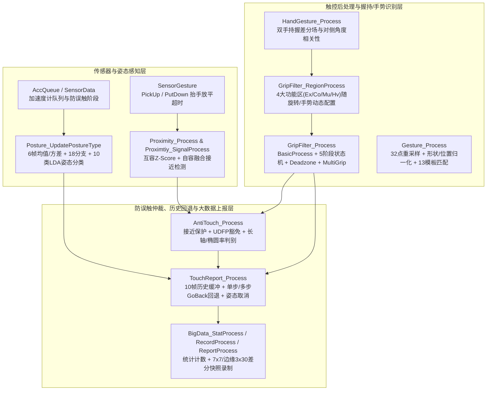
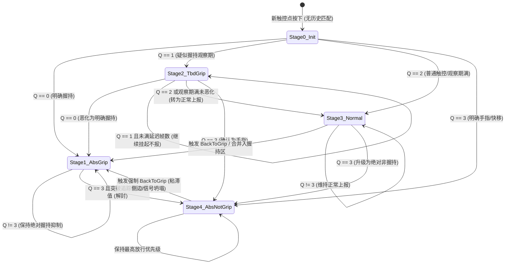

# 第5部分：边缘握持过滤、手势识别、接近感应、防误触与最终上报管线深度逆向分析 (`GripFilter` / `Gesture` / `HandGesture` / `Posture` / `Sensor*` / `Proximity` / `AntiTouch` / `TouchReport` / `BigData`)

## 5.0 子系统架构总览与 `TSA_Processing` 调用流

在 `TSACore.dll` 的手指触控主干管线 `TSA_Processing @ 0x6ba9a443` 中，当原始互容/自容矩阵完成前端滤波、连通域分割 (`TouchZone`)、二维亚像素质心解算 (`CTD`)、跨帧身份追踪 (`IDT`) 以及坐标平滑滤波 (`Filter`) 后，触控点并不会直接输出到操作系统，而是进入复杂的**后处理、环境感知、防误触仲裁与上报回退管线**。本章节完整覆盖以下 13 个反编译源码模块（共计 **352 个模块内函数 + 1 个跨文件辅助函数 `GripFilterCheckMultiGripUnit`，合计 353 个函数**）：

1. **`GripFilter.c` (150 个函数 + `Misc.c` 中的 `GripFilterCheckMultiGripUnit @ 0x6bae73f3`)**：边缘握持抑制、4 类功能区域（排除区 `Ex`、核心排除区 `Co`、多指握持区 `Mu`、重度握持区 `Hv`）、五阶段 (`Stage 0..4`) 质量状态机、动态/静态死区 (`Deadzone`)、合并回退 (`BackToGrip`)、粘滞侧边触控 (`StuckSideTouch`) 与点击握持比 (`ClickGripRatio`) 判别。
2. **`Gesture.c` (16 个函数)**：黑屏/唤醒单笔画轨迹重采样（32 等距折线点）、长宽比约束二维形状归一化 ($[0, 128]^2$)、质心零均值位置归一化及 13 组内置手势模板的 $L_1$ 曼哈顿距离匹配引擎。
3. **`HandGesture.c` (32 个函数)**：基于双手持握场景的专属差分场计算 (`HandGestureDif = Raw - HandGestureBL`)、主轴角度相关性检查 (`AngleFormat1`/`AngleFormat2`)、双手握持区域动态收窄与握持关联触控识别。
4. **`Posture.c` (10 个函数)**：基于 6 帧加速度计三轴滑动窗口均值与修正样本方差（除数为 5）、两级决策树分支 (`Branch 0..17`) 与 10 类线性判别函数 (`LDA`) 的设备空间姿态分类器（输出正常握持、平放、倒置/悬空 `HangingPosture` 等 5 类姿态）。
5. **`Sensor.c` (14 个函数)**、**`SensorData.c` (3 个函数)**、**`SensorGesture.c` (7 个函数)**、**`AccQueue.c` (1 个函数)**：传感器行列网格与核心/边缘区几何映射、运动传感器防误触 2000 ms 阶段判定、接近感应抬手 (`PickUp`) / 放平 (`PutDown`) 手势超时管理以及加速度计队列初始化。
6. **`Proximity.c` (54 个函数)** 与 **`Proximtiy.c` (1 个函数)**：通话/息屏接近感应子系统，包含互容全屏/分区 Z-Score 统计量计算 (`ZnProcess`)、自容融合 (`SelfToMutual`)、大耳朵贴脸 (`LargeEarCondition1/2`) 与正常手指触摸区分、自适应 IIR 低通滤波及防抖状态机。
7. **`AntiTouch.c` (17 个函数)**：防误触拦截引擎，结合 `GripFilter` 结果、接近感应状态 (`Proximity`)、屏下指纹 (`UDFP`) 区域豁免以及椭圆长轴/轴比动态阈值，生成单点防误触标记与退避回滚请求。
8. **`TouchReport.c` (14 个函数)**：最终触控事件仲裁器，维护 10 帧历史回看环形缓冲区 (`HistoryBuffer`)，支持延迟起报点补偿 (`UpdateStartReportPoint`)、单步回退 (`GoBackOneStep`)、多步回退 (`GoBackMultiStep`) 及悬空姿态紧急取消 (`PostureAntiTouch`)。
9. **`BigData.c` (33 个函数)**：线上遥测与大数据故障诊断模块，统计点击/移动/边缘握持/防误触计数，并在触发最大信号、贴膜异常 (`Film`)、鬼点 (`GhostTouch`)、握持误触 (`Grip`) 或大鱼际 (`Thenar`) 条件时录制 7×7 局部差分窗口与边缘 3×30 差分快照。

---

### 5.0.1 全局核心数据结构内存布局

| 全局符号 | 地址 (`TSACore.dll`) | 大小 / 元素跨度 | 核心字段偏移与物理含义 |
| :--- | :--- | :--- | :--- |
| `g_grip` (`_refptr_g_grip`) | `0x6bc74cc0` | 单例控制结构 | `+0x00`: `uint8_t curTouchIdx`（当前处理的触控槽位 `0..9`）；`+0x01`: `uint8_t curEdge`（当前边缘 `0=Top, 1=Bottom, 2=Left, 2=Right`）；`+0x02`: `uint8_t curTouchId`；`+0x04`: `uint32_t globalFlags`（bit 0=`ScreenRotated`, bit 1=`Pad`, bit 2=`2HandGame`, bit 3=`VideoMode`, bit 4=`MergeHandlerEnabled`）；`+0x08`: `uint8_t prevScreenRotate`；`+0x09`: `uint8_t prevHandGesture`；`+0x0c..0x33`: 10 槽位质量字节 (`quality[10]`)、Stage 阶段字节 (`stage[10]`)、最大延迟计数 (`maxDelayCnt[10]`) 与正常延迟计数 (`delayCnt[10]`)；`+0x34..0x60`: 当前触摸点的多维判定结果缓存（`+0x34` 临时握持标志, `+0x38` 绝对握持标志, `+0x3c` 绝对非握持标志, `+0x40` 安全触摸标志, `+0x44..0x48` 死区置位/清除标志, `+0x4c..0x5f` 快移/上方/近距/抓握/多指/新点/重度区标志）；`+0x64..0x6a`: 动态死区标志与宽高 (`deadzoneActive[4]`, `deadzoneDim1Width`, `deadzoneDim2Width`)；`+0x84`: 当前激活的参数指针 `pCurPrmt`（指向横竖屏对应的 `0x8c` 字节参数块）。 |
| `g_gripRegion` (`_refptr_g_gripRegion`) | `0x6bc74e60` | `4 × 0xd8` 字节 (`0x360` B) | 按 4 类功能区索引 `regionType ∈ {0: Ex(排除区), 1: Co(核心边界区), 2: Mu(多指握持区), 3: Hv(重度握持区)}` 组织的区域表，每项跨度 `0xd8` (216) 字节，内部包含 5 个子区域 (`subIdx = 0..4`：`0=TopLeft, 1=TopRight, 2=BottomLeft, 3=BottomRight, 4=Palm`)，每个子区域跨度 `0x24` (36) 字节：`+0x00` 启用标志 (`u8`)，`+0x02..0x08` 传感器网格框 (`rowStart, rowEnd, colStart, colEnd`)，`+0x0a..0x10` 精细坐标框 (`dim1Start, dim1End, dim2Start, dim2End`)，`+0x12..0x22` 分级阈值边界。 |
| `g_gesture` | `0x6bb74020` | 单例控制结构 | `+0x00`: 采样点计数 `sampleCnt` (`u16`, 最大 `300 = 0x12c`)；`+0x02..0x4b1`: 原始轨迹坐标队列 `rawSamples[300][2]` (`i16 x, y`)；`+0x4b2..0x531`: 重采样/归一化后的 32 点序列 `normSamples[32][2]` (`i16 x, y`, 每点 4 字节)；`+0x53c`: 13 模板误差数组 `errors[13]` (`u16`)；`+0x558`: 识别出的手势代码 `gestureCode`。 |
| `g_handGesture` (`_refptr_g_handGesture`) | `0x6bc751c0` | 单例控制结构 | `+0x00`: 使能标志；`+0x04`: 基准帧差分就绪标志；`+0x0c`: 双手检测结果 (`b2HandDetected`)；`+0x0d`: 单手握持方向 (`1=左手, 2=右手`)；`+0x28..0x12b`: 10 槽位关联握持历史记录表（每槽 `0x18` 字节，记录关联握持帧数、角度、位置与面积）；尾部关联 `g_handGestureBL` 与 `g_handGestureDif`（各 $60 \times 40 \times 2 = 4800$ 字节）。 |
| `g_postureData` | `0x6bbadd40` | `0x110` 字节 | `+0x00..0xd3`: 三轴加速度计 6 帧环形队列 (`queue[3][6]`)、队首/队尾指针、均值 (`mean[3]`) 与修正样本方差 (`var[3]`)；`+0xd4`: 姿态更新计数；`+0xdc..0xfc`: 5 类姿态模式置信度累加器；`+0x100`: 当前输出姿态 `curPosture` (`0..4`)；`+0x104`: 上一帧姿态 `prevPosture`。 |
| `g_proximityData` (`_refptr_g_proximityData`) | `0x6bb68dc0` | 单例控制结构 | `+0x00`: 接近检测状态 `bDetected`；`+0x01`: 息屏请求 `bDisableScreen`；`+0x02`: 状态上报请求；`+0x05`: 当前扫描率状态；`+0x10`: 全屏最大差分 `maxDiff`；`+0x18..0x98`: 5 个统计分区 (`Zone 0..4`) 的均值、标准差、Z-Score 统计量与条件位掩码 (`fullCondMask`, `mutualCondMask`, `selfCondMask`)。 |
| `g_antiTouch` (`_refptr_g_antiTouch`) | `0x6bc71aa0` | 单例控制结构 | `+0x00`: 全局防误触激活标志；`+0x01`: 退避回滚请求标志 (`bGoBackReport`)；`+0x04..0x0d`: 10 槽位防误触状态字节 (`status[10]`)；`+0x0e..0x17`: 10 槽位持久化拦截标志 (`persistFlag[10]`)；`+0x18..0x21`: 10 槽位接近保护标志 (`proxFlag[10]`)。 |
| `g_touchReport` (`_refptr_g_touchReport`) | `0x6bb69080` | `0x5eb8` (24248) 字节 | 含 10 帧历史回看缓冲区（每帧保存 `0x5dc = 1500` 字节的完整触控快照，共 $10 \times 1500 = 15000$ 字节）、每槽位延迟起报状态、回退步数计数、姿态取消掩码与最终上报槽位映射表。 |
| `g_bigData` (`_refptr_g_bigData`) | `0x6bc71ae0` | 单例遥测结构 | 包含日常触控统计计数器、4 类异常触发录制槽（MaxSig、Film、GhostTouch、Grip/Thenar）、7×7 局部差分快照缓冲、3×30 边缘差分快照缓冲以及文本格式化输出缓冲区。 |

---

### 5.0.2 `W273AS2700` (`GaokunHimaxCSOT`) 预设参数表完整映射

在 `TSAPrmt.dll` 的 `W273AS2700` (`g_tsaPrmtFlash` 基址 `0x6bca8a00`，单结构体跨度 `0x840 = 2112` 字节) 中，与第 5 部分 13 个模块直接绑定的配置参数及其在 `W273AS2700` 中的实测数值如下表所示：

| 参数符号 / 代码访问表达式 | Flash 偏移 (`0x6bca8a00`+) | 类型 | `W273AS2700` 实测值 | 物理含义与使用函数 |
| :--- | :--- | :--- | :--- | :--- |
| `_refptr_g_tsaPrmtFlash[0].bRows` (`+0x1d`) | `flash+0x001d` | `u8` | `60` (`0x3c`) | 传感器 Dim1 行数（60 行），用于 `GripFilter`, `HandGesture`, `Proximity`, `BigData`, `Sensor` |
| `_refptr_g_tsaPrmtFlash[0].bCols` (`+0x1e`) | `flash+0x001e` | `u8` | `40` (`0x28`) | 传感器 Dim2 列数（40 列），用于 `GripFilter`, `HandGesture`, `Proximity`, `BigData`, `Sensor` |
| `_refptr_g_tsaPrmtFlash[0].wBufElementCount` (`+0x2c`) | `flash+0x002c` | `u16` | `2400` (`0x0960`) | 互容矩阵总节点数 $60 \times 40 = 2400$ |
| `_refptr_g_tsaPrmtFlash[0].bAFTModeEnabled` (`+0x60`) | `flash+0x0060` | `u32` | `0` (`0x00000000`) | 外部 AFT 算法总开关（`0` 表示在 `W273AS2700` 中走内置 `GripFilter` 而非独立 `AFT` 模块） |
| `_refptr_g_tsaPrmtFlash[0].bProximityEnabled` (`+0x64`) | `flash+0x0064` | `u32` | `0` (`0x00000000`) | 接近感应静态总开关 (`Proximity_IsEnabled` / `AntiTouch_IsToProtectProximity`) |
| `_refptr_g_tsaPrmtFlash[0].wResScale` (`+0x5a0`) | `flash+0x05a0` | `u16` | `1` (`0x0001`) | 坐标分辨率缩放因子 (`Sensor_GetDistance`, `Sensor_GetSquareDistance`) |
| `_refptr_g_tsaPrmtFlash[0].wDim1Res` (`+0x5a6`) | `flash+0x05a6` | `u16` | `2560` (`0x0a00`) | Dim1 逻辑分辨率上限 (`2560`) |
| `_refptr_g_tsaPrmtFlash[0].wDim2Res` (`+0x5a8`) | `flash+0x05a8` | `u16` | `1600` (`0x0640`) | Dim2 逻辑分辨率上限 (`1600`) |
| `_refptr_g_tsaPrmtFlash[0].wPeakFilterReferenceThreshold` (`+0x5b4`) | `flash+0x05b4` | `u16` | `3000` (`0x0bb8`) | 峰值参考信号阈值 (`BigData_IsOKToRecordMaxSig` / `BigData_IsOKToRecordGhostTouch`) |
| `_refptr_g_tsaPrmtFlash[0].wPeakMode3ThresholdMax` (`+0x5b6`) | `flash+0x05b6` | `u16` | `600` (`0x0258`) | 峰值基础信号阈值 (`HandGesture_GetPkThold`, `BigData_IsOKToRecordFilm`) |
| `_refptr_g_tsaPrmtFlash[0].field_0x688..0x79f` | `flash+0x0688..0x079f` | `struct[2]` | 全 `0` | 竖屏 (`+0x688`, `0x8c` B) 与横屏 (`+0x714`, `0x8c` B) 的 `GripFilter` 详细区域/时间参数表 (`GripFilter_GetPrmt`) |
| `_refptr_g_tsaPrmtFlash[0].field_0x7a0..0x81b` | `flash+0x07a0..0x081b` | `struct` | 全 `0` | 折叠屏 (`Fold`) 态与 `Pad` 态附加 `GripFilter` 区域参数 |
| `_refptr_g_tsaPrmtFlash[0].field_0x81c` | `flash+0x081c` | `u16` | `220` (`0x00dc`) | `HandGesture_IsDistInValid` 双手触摸点间最小有效距离阈值 (`220`) |
| `_refptr_g_tsaPrmtFlash[0].field_0x81e..0x820` | `flash+0x081e..0x0820` | `u8[3]` | `64, 64, 64` | `HandGesture_TimeStep` 差分基线更新步长参数 (`64`) |
| `_refptr_g_tsaPrmtFlash[0].field_0x824` | `flash+0x0824` | `u16` | `12000` (`0x2ee0`) | `HandGesture_IsOKToResetBaseline` 基线强制复位超时阈值 (`12000` 帧/ms) |
| `_refptr_g_tsaPrmtFlash[0].field_0x82c` | `flash+0x082c` | `u16` | `15` (`0x000f`) | `HandGesture_CheckValidity` 有效手势节点数阈值 (`15`) |
| `_refptr_g_tsaPrmtFlash[0].field_0x830..0x837` | `flash+0x0830..0x0837` | `u8[8]` | `60,40,56,48,48,48,30,16` | `HandGesture` 角度相关性与宽高判定门限 (`HandGesture_IsAngleValid`, `HandGesture_GetWidth`, `HandGesture_DifUnit`) |
| `_refptr_g_tsaPrmtFlash[0].field_0x838` | `flash+0x0838` | `u16` | `300` (`0x012c`) | `HandGesture` 差分峰值门限偏移 (`300`) |
| `_refptr_g_tsaPrmtFlash[0].dwGripFlags` (`+0x83c`) | `flash+0x083c` | `u32` | `0` (`0x00000000`) | `GripFilter` 与 `HandGesture` 特性开关位掩码（bit 0=`GripFilter` 总开关，在 `W273AS2700` 中为 `0` 即默认禁用） |
| `_refptr_g_tsaPrmtFlash[1].field_0x78` | `flash+0x08b8` | `u16` | `778` (`0x030a`) | `GripFilter_IsFlickDetected` 快速划动 (`Flick`) 位移距离阈值 (`778`) |
| `_refptr_g_tsaPrmtFlash[1].field_0x7e` | `flash+0x08be` | `u16` | `400` (`0x0190`) | `GripFilter_IsSuppressedByHandGesture` / `IsSuppressedByCoreTouch` 核心触摸抑制时间窗口 (`400`) |
| `_refptr_g_tsaPrmtFlash[1].field_0x80` | `flash+0x08c0` | `u8` | `0` (`0x00`) | `GripFilter` 动态死区 4 边使能位掩码（bit 0..3 对应 Top/Bottom/Left/Right） |
| `_refptr_g_tsaPrmtFlash[1].field_0x81` | `flash+0x08c1` | `u8` | `0` (`0x00`) | `GripFilter_IsEnableWeakenCornerClickSupress` 弱化四角点击抑制开关 |
| `_refptr_g_tsaPrmtFlash[1].field_0x82` | `flash+0x08c2` | `u8` | `0` (`0x00`) | `GripFilter_IDLEProcess` 握持空闲态处理开关 |
| `_refptr_g_tsaPrmtFlash[1].field_0x84` | `flash+0x08c4` | `u32` | `2` (`0x00000002`) | 设备形态类型 (`GripFilter_IsPad`: `4`=Pad, `5`=Fold, `2`=普通平板/横屏设备分支) |
| `flash+0x08c8..0x08f7` (`pDim1PitchMap - 0x18` + `edge*0xc`) | `flash+0x08c8..0x08f7` | `struct[4]` | 每边 `{0, 0xffffffff, 0}` | 4 条边缘 (`edge=0..3`) 的点击握持比配置：每项 12 字节，`+0x00` 模式=`0`，`+0x04..0x06` 比例阈值=`0xff (255)`，`+0x08` 边缘合并标志=`0` |
| `_refptr_g_tsaPrmtFlash[2].field_0x5e0` | `flash+0x1660` | `u32` | `0` (`0x00000000`) | `Proximity` 场景与超时控制标志位 (`Proximity_Process`, `Proximity_SelfCalc`) |
| `_refptr_g_tsaPrmtFlash[2].field_0x5e4` | `flash+0x1664` | `i32` | `250` (`0x000000fa`) | `Proximity` 基础互容接近阈值 (`250`) |
| `_refptr_g_tsaPrmtFlash[2].field_0x5e8` | `flash+0x1668` | `i32` | `187` (`0x000000bb`) | `Proximity_DynamicThreshold` 动态接近下限阈值 (`187`) |
| `_refptr_g_tsaPrmtFlash[2].field_0x5ec` | `flash+0x166c` | `i32` | `2000` (`0x000007d0`) | `Proximity_DynamicThreshold` 强信号上限阈值 (`2000`) |
| `_refptr_g_tsaPrmtFlash[2].field_0x5f0..0x5f7` | `flash+0x1670..0x1677` | `u8[8]` | `12,12,40,35,5,5,16,32` | `Proximity` TZ 刷新系数 (`12,12,40,35`)、进入防抖帧数 (`5`)、退出防抖帧数 (`5`)、未检测/已检测 IIR 滤波系数 (`16`, `32`) |
| `_refptr_g_tsaPrmtFlash[2].field_0x5f8..0x5fa` | `flash+0x1678..0x167a` | `u16, i16` | `30`, `200` | `Proximity_BaselineUpdate` 基线更新速率 (`30`) 与最大允许温漂差分 (`200`) |
| `_refptr_g_tsaPrmtFlash[2].field_0x5fc..0x602` | `flash+0x167c..0x1682` | `u16[4]` | `120, 120, 120, 120` | `Proximity_HandleNextScanRate` 四档扫描率配置（均为 `120` Hz） |
| `_refptr_g_tsaPrmtFlash[2].bRawdataForceNormalize` (`+0x604`) | `flash+0x1684` | `u32` | `2000` (`0x000007d0`) | `PickUp` 抬手手势有效超时窗口 (`2000` ms) |
| `_refptr_g_tsaPrmtFlash[2].field_0x608` | `flash+0x1688` | `u32` | `2000` (`0x000007d0`) | `PutDown` 放平手势有效超时窗口 (`2000` ms) |
| `_refptr_g_tsaPrmtFlash[2].field_0x60c` | `flash+0x168c` | `u8` | `10` (`0x0a`) | `tholdSensorAlongYDirection`：接近感应顶部有效区域行边界（前 `10` 行/列） |
| `_refptr_g_tsaPrmtFlash[2].field_0x610..0x618` | `flash+0x1690..0x1698` | `u32[3]` | `0, 2000, 3000` | 息屏超时标志 (`0`) 及接近感应两阶段时间阈值 (`2000` ms, `3000` ms) |
| `_refptr_g_tsaPrmtFlash[2].field_0x6c1` | `flash+0x1741` | `u8` | `0` (`0x00`) | `AntiTouch_IsTouchCloseToUdfpArea` 屏下指纹区域邻近豁免开关 (`0`=关闭) |
| `_refptr_g_tsaPrmtFlash[2].field_0x6c2` | `flash+0x1742` | `u8` | `0` (`0x00`) | `AntiTouch` 接近上报拦截模式 (`0`) |
| `_refptr_g_tsaPrmtFlash[2].field_0x6c4` | `flash+0x1744` | `u32` | `0` (`0x00000000`) | `Posture_UpdatePostureType` 姿态分类器使能位（bit 0 = `0`，在 `W273AS2700` 中默认关闭） |
| `_refptr_g_tsaPrmtFlash[2].field_0x6cc` | `flash+0x174c` | `u32` | `0` (`0x00000000`) | `SensorData_IsAntiTouchStage` (bit 0/1) 与 `TouchReport_IsMultStepBackEnable` (bit 1) 使能掩码 (`0`) |
| `g_tsaPrmtFlashPosture` (`0x6bcab600`) | `posture+0x0000..0x3eb1f` | `struct` | 全 `0` | 姿态决策树与 10 类 LDA 分类器系数表（`W273AS2700` 中全填 `0`） |

---

## 5.1 `GripFilter.c` —— 边缘握持抑制、死区状态机与多指防误触子系统 (共 150 个模块内函数 + 1 个跨文件单元函数)

### 5.1.1 算法架构与数学模型深度解析

`GripFilter` 是 `TSACore.dll` 中体量最大的后处理防误触模块（5589 行 C 代码，150 个内部函数外加 `Misc.c` 中的 `GripFilterCheckMultiGripUnit`）。其核心目标是在不牺牲窄边框正常边缘点击/滑动响应的前提下，精准识别并抑制手掌握持、虎口挤压、侧边粘滞触控以及多指伴随误触。

#### 1. 四大功能区域 (`RegionType 0..3`) 与五子区 (`SubRegion 0..4`) 几何模型
`GripFilter_RegionProcess @ 0x6baec71c` 根据当前屏幕旋转角 (`ScreenRotate` $\in \{0^\circ, 90^\circ, 180^\circ, 270^\circ\}$)、设备形态（手机/普通平板 `Normal`、平板 `Pad`、折叠屏 `Fold`）以及 `HandGesture` 单双手检测结果，在 `g_gripRegion` 中动态构建 4 类矩形区域，每类包含 5 个子区（`0: TopLeft`, `1: TopRight`, `2: BottomLeft`, `3: BottomRight`, `4: Palm`）：
- **`Region 0` (`Ex` - Excluded Region)**：角落绝对排除区，落入其中的微弱/异常触控优先判定为握持。
- **`Region 1` (`Co` - Core Boundary Region)**：核心区与边缘握持区的交界带，用于界定边缘触摸是否已滑入屏幕核心工作区。
- **`Region 2` (`Mu` - Multi-Grip Region)**：多指伴随握持高发区，当核心区或对侧边缘存在有效操作时，位于 `Mu` 区内的次级触控会被标记为多指伴随握持。
- **`Region 3` (`Hv` - Heavy Grip Region)**：重度握持挤压区（如横屏双手游戏时的底部两角、竖屏单手握持时的底角与掌心区），在该区域内启用更严苛的信号比阈值与更长的起报延迟 (`MaxDelay`)。

每个子区同时维护两套坐标系边界：
1. **传感器通道索引边界** $[r_{\text{start}}, r_{\text{end}}] \times [c_{\text{start}}, c_{\text{end}}]$；
2. **精细逻辑坐标边界**：通过 `SensorPitchSizeMapDim1` / `Dim2` 将通道索引映射为精细坐标，并在角落区域按 4 个等级 (`Level 0..3`) 线性插值划分内缩边界。

#### 2. 触控质量评估 (`Quality 0..3`) 与五阶段状态机 (`Stage 0..4`)
对每一个存活触控槽位 $i \in [0, 9]$，`GripFilter_BasicProcess @ 0x6bae4ab3` 先执行一系列特征检测（临时握持 `TempGrip`、绝对握持 `AbsGrip`、绝对非握持 `AbsNotGrip`、安全触控 `SafeTouch`、快速移动 `FastMove`、抓握 `Grap`、多指伴随 `MultiGrip` 等），随后由 `GripFilter_GetQuality @ 0x6bae42bc` 将当前点在本帧的握持倾向归纳为 4 档质量码 $Q_i(t) \in \{0, 1, 2, 3\}$：
- **$Q_i = 0$ (`AbsGrip` / 明确握持)**：满足 `BasicIsAbsGrip`、近距伴随握持 (`CloseGrip`)、抓握 (`Grap`)、多指握持 (`MultiGrip`)、上方伴随握持 (`AboveGrip`) 或重度握持区 (`HeavyGripRegion`)，且不满足 `AbsNotGrip`。
- **$Q_i = 1$ (`TempGrip` / 疑似握持待定)**：未触发 `AbsGrip`，但满足 `BasicIsTempGrip`（如位于角落排除区、椭率过大、面积异常、处于全局抑制窗口内等）且未超时。
- **$Q_i = 2$ (`SafeOrNormal` / 普通放行)**：既非 `AbsGrip` 也非 `TempGrip`（或 `TempGrip` 延迟观察期已满且未恶化），或满足 `SafeTouch` / `NewTouch`。
- **$Q_i = 3$ (`AbsNotGrip` / 明确正常手指)**：满足 `BasicIsAbsNotGrip` 或 `FastMove`（快速划动脱离边缘）。

在此基础上，`GripFilter_GetStage @ 0x6bae492d` 结合上一帧状态 $S_{\text{prev}}$ 与当前质量 $Q_i(t)$ 驱动五阶段状态机 $S_i(t) \in \{0, 1, 2, 3, 4\}$：

其中：
- **`Stage 1` (`AbsGrip`)** 与 **`Stage 2` (`TbdGrip`)** 均被 `GripFilter_IsGripOrTbd` 视为需抑制状态，在 `GripFilter_Report` 中不会向 OS 上报坐标（其中 `Stage 1` 置位 `touchFlags | 0x01`，`Stage 2` 置位 `touchFlags | 0x04`）。
- **`Stage 3` (`Normal`)** 与 **`Stage 4` (`AbsNotGrip`)** 为放行上报状态；但若后续帧中手指滑向边缘并与手掌合并，或被判定为侧边粘滞残留点 (`StuckSideTouch`)，`GripFilter_BackToGrip @ 0x6bae24a1` 会将其强行拉回 `Stage 1` 并触发退避逻辑。

#### 3. 点击握持比 (`ClickGripRatio`) 与动态死区 (`Dynamic Deadzone`)
为区分“手指轻触边缘”与“手掌鱼际挤压边缘”，`GripFilter_IsRatioOK @ 0x6baecdc6` 引入了边缘信号点击握持比检验：
$$\text{ClickGripRatio}(i) < \text{Thold}_{\text{edge}}(\text{level}) + \Delta_{\text{extra}} - \Delta_{\text{weaken}}$$
当某条屏幕边缘上存在处于 `Stage 1` (`AbsGrip`) 的握持点且满足 `GripFilter_IsGripCriteriaDeadzone` 时，`GripFilter_UpdateDeadzone @ 0x6bae5981` 会激活该边缘的动态死区，死区宽度取配置参数与当前握持触控块边缘宽度的较大值。

---

### 5.1.2 `GripFilter.c` 全函数逐一详解 (1–75)

#### 1. `GripFilter_Process @ 0x6bae1d3c`
- **功能概述**：`GripFilter` 子系统的帧级主入口函数，由 `TSA_Processing` 在触控追踪完成后调用。
- **调用关系**：
  - **调用者**：`TSA_Processing @ 0x6ba9a443`
  - **被调函数**：`TSA_IsProtectedByWaterProof`, `GripFilter_RegionProcess`, `GripFilter_GetPropertyGlobal`, `GripFilter_IDLEProcess`, `GripFilter_BasicProcess`, `GripFilter_GetQuality`, `GripFilter_GetStage`, `GripFilter_UpdateDeadzone`, `GripFilter_Report`, `GripFilter_Log`
- **算法逻辑详解**：
  1. 检查 `_refptr_g_tsaPrmtFlash->dwGripFlags & 1`（`flash+0x083c` bit 0）是否为 `0`，或防水保护 `TSA_IsProtectedByWaterProof()` 是否激活，若是则直接返回（在 `W273AS2700` 中 `dwGripFlags = 0`，故默认短路返回）。
  2. 调用 `GripFilter_RegionProcess()` 更新 4 大功能区边界，调用 `GripFilter_GetPropertyGlobal()` 提取全局横竖屏/游戏/视频/合并开关属性，并调用 `GripFilter_IDLEProcess()` 处理空闲计数。
  3. 遍历当前帧所有激活触控点 `idx = 0 .. bCurTouchNum - 1`：
     - 将当前索引写入 `g_grip.curTouchIdx = idx`；
     - 依次调用 `GripFilter_BasicProcess()`、`GripFilter_GetQuality()`、`GripFilter_GetStage()` 完成单点特征提取、质量评级与五阶段状态机演进。
  4. 调用 `GripFilter_UpdateDeadzone()` 更新四边动态死区，调用 `GripFilter_Report()` 将握持判定结果写回 `g_touchesPtr` 标志位，并在日志开启时调用 `GripFilter_Log()`。
- **`W273AS2700` 参数依赖**：`flash+0x083c` (`dwGripFlags = 0`)。

#### 2. `GripFilter_RegionProcess @ 0x6baec71c`
- **功能概述**：根据当前屏幕旋转角、设备形态（手机/Pad/折叠屏）和手势状态动态重算 4 类握持区域配置。
- **调用关系**：
  - **调用者**：`GripFilter_Process`
  - **被调函数**：`TSAStatic_GetScreenRotate`, `HandGesture_GetHandGesture`, `GripFilter_RegionReset`, `GripFilter_RegionSetByScreenRotationFold`, `GripFilter_RegionSetByScreenRotationPad`, `GripFilter_RegionSetByScreenRotation`, `GripFilter_RegionSetByHandGesture`
- **算法逻辑详解**：
  1. 读取当前旋转状态 `rot = TSAStatic_GetScreenRotate()` 与手势状态 `hg = HandGesture_GetHandGesture()`。
  2. 若 `rot != g_grip.prevScreenRotate` 或 `hg != g_grip.prevHandGesture`：
     - 调用 `GripFilter_RegionReset()` 将 `g_gripRegion` 重置为默认参数；
     - 读取设备类型 `devType = _refptr_g_tsaPrmtFlash[1].field_0x84` (`flash+0x08c4`)：
       - 若 `devType == 5`（折叠屏 `Fold`），调用 `GripFilter_RegionSetByScreenRotationFold()`；
       - 若 `devType == 4`（平板 `Pad`），调用 `GripFilter_RegionSetByScreenRotationPad()`；
       - 否则调用 `GripFilter_RegionSetByScreenRotation()`；
     - 调用 `GripFilter_RegionSetByHandGesture()` 根据左右手握持状态调整区域激活；
     - 更新 `g_grip.prevScreenRotate = rot` 与 `g_grip.prevHandGesture = hg`。
- **`W273AS2700` 参数依赖**：`flash+0x08c4` (`u32 = 2`)。

#### 3. `GripFilter_IsGripTouch @ 0x6bae19d1`
- **功能概述**：判断指定当前触控槽位 `param_1` 在本帧是否被判定为握持点（供外部模块查询）。
- **调用关系**：
  - **调用者**：`AntiTouch_IsGrip`, `BigData_IsOKToRecordGrip`, `TouchReport` 等外部模块
  - **被调函数**：无
- **算法逻辑详解**：
  检查 `_refptr_g_tsaPrmtFlash->dwGripFlags & 1` 是否开启，且 `param_1 < bCurTouchNum`，并检查 `g_touchesPtr[param_1].gripFlags (+0x214)` 的低 3 位 `(flags & 7) != 0`（bit 0=`AbsGrip`, bit 1=`MultiGrip/BackToGrip`, bit 2=`TbdGrip`）。满足则返回 `1`，否则返回 `0`。

#### 4. `GripFilter_IsMergeHandlerEnabled @ 0x6bae18c4`
- **功能概述**：检查当前是否启用了握持与正常触控合并防粘连处理 (`MergeHandler`)。
- **调用关系**：
  - **调用者**：`GripFilter_GetPropertyGlobal`, `TZ_IsEdgeMerged` 等
  - **被调函数**：`TSA_IsProtectedByWaterProof`, `GripFilter_IsMergeHandlerEdgeEnabled`
- **算法逻辑详解**：
  若 `dwGripFlags & 1` 开启、未处于防水模式，且四条边 (`edge = 0..3`) 中任意一条边满足 `GripFilter_IsMergeHandlerEdgeEnabled(edge) != 0`，则返回 `1`，否则返回 `0`。

#### 5. `GripFilter_Report @ 0x6bae1a5b`
- **功能概述**：将 `GripFilter` 对每个触控点的最终 Stage 状态转换为 `g_touchesPtr[i]` 上的抑制位掩码。
- **调用关系**：
  - **调用者**：`GripFilter_Process`
  - **被调函数**：`GripFilter_IsGrip`, `GripFilter_IsGripOrTbd`
- **算法逻辑详解**：
  遍历所有激活触控点 `i = 0 .. bCurTouchNum - 1`：
  - 若 `GripFilter_IsGrip(i)` 为真（即 `stage[i] == 1`），置位 `g_touchesPtr[i].gripFlags (+0x214) |= 1`，同时置位 `g_touchesPtr[i].suppressFlags (+0x1f8) |= 0x20`（标记为 Grip 抑制不报点）；
  - 否则若 `GripFilter_IsGripOrTbd(i)` 为真（即 `stage[i] == 2` 待定观察期），置位 `g_touchesPtr[i].gripFlags (+0x214) |= 4`，同样置位 `g_touchesPtr[i].suppressFlags (+0x1f8) |= 0x20`（挂起暂不上报）；
  - 若处于 Stage 3 或 Stage 4，则清除对应的抑制位，允许正常上报。

#### 6. `GripFilter_IDLEProcess @ 0x6bae1c75`
- **功能概述**：当全屏无任何触控点或仅存握持点时，维护空闲计时并适时重置动态死区与历史状态。
- **调用关系**：
  - **调用者**：`GripFilter_Process`
  - **被调函数**：`GripFilter_IsOKToEnterIDLE`, `GripFilter_DeadzoneReset`
- **算法逻辑详解**：
  若 `_refptr_g_tsaPrmtFlash[1].field_0x82 != 0` (`flash+0x08c2`) 且 `GripFilter_IsOKToEnterIDLE()` 返回真，则累加空闲帧计数器；当计数超过阈值时调用 `GripFilter_DeadzoneReset()` 清空动态死区。在 `W273AS2700` 中 `flash+0x08c2 = 0`。

#### 7. `GripFilter_BasicProcess @ 0x6bae4ab3`
- **功能概述**：对当前触控点 `g_grip.curTouchIdx` 执行全套几何、信号、时序与多指关系检测，填充 `g_grip` 临时判定字段。
- **调用关系**：
  - **调用者**：`GripFilter_Process`
  - **被调函数**：`Touch_IsOff`, `GripFilter_GetProperty`, `GripFilter_IsBackToGrip`, `GripFilter_BackToGrip`, `GripFilter_BasicIsTempGrip`, `GripFilter_BasicIsAbsGrip`, `GripFilter_BasicIsAbsNotGrip`, `GripFilter_IsSafeTouch`, `GripFilter_SetDeadZoneFlag`, `GripFilter_ClearDeadZoneFlag`, `GripFilter_FastMoveDetect`, `GripFilter_AboveGripDetect`, `GripFilter_CloseGripDetect`, `GripFilter_GrapDetect`, `GripFilter_MultiGripDetect`, `GripFilter_SafeTouchDetect`, `GripFilter_NewTouchDetect`, `GripFilter_HeavyGripRegionDetect`
- **算法逻辑详解**：
  1. 先清空 `g_grip` 中偏移 `+0x34 .. +0x60` 的本帧单点检测标志，并调用 `GripFilter_GetProperty()` 获取该点的历史 Stage、延迟计数及所在边缘 `curEdge`。
  2. 若该点已抬起 (`Touch_IsOff(curTouchIdx) != 0`)，仅调用 `GripFilter_ClearDeadZoneFlag()` 检查是否需要解除死区后即返回。
  3. 若该点上一帧已处于正常放行状态 (`Stage 3` 或 `Stage 4`)，调用 `GripFilter_IsBackToGrip()` 检查是否发生向边缘合并或侧边粘滞；若是则调用 `GripFilter_BackToGrip()` 将其打回握持态并返回。
  4. 依次调用基础判别函数并将布尔结果存入 `g_grip`：
     - `g_grip.bTempGrip (+0x34) = GripFilter_BasicIsTempGrip()`
     - `g_grip.bAbsGrip (+0x38) = GripFilter_BasicIsAbsGrip()`
     - `g_grip.bAbsNotGrip (+0x3c) = GripFilter_BasicIsAbsNotGrip()`
     - `g_grip.bSafeTouch (+0x40) = GripFilter_IsSafeTouch()`
  5. 依次运行 10 个专项检测器：`GripFilter_SetDeadZoneFlag`、`GripFilter_ClearDeadZoneFlag`、`GripFilter_FastMoveDetect`、`GripFilter_AboveGripDetect`、`GripFilter_CloseGripDetect`、`GripFilter_GrapDetect`、`GripFilter_MultiGripDetect`、`GripFilter_SafeTouchDetect`、`GripFilter_NewTouchDetect`、`GripFilter_HeavyGripRegionDetect`。

#### 8. `GripFilter_GetPropertyGlobal @ 0x6bae990d`
- **功能概述**：在每帧开始时提取全局上下文属性（横竖屏、Pad 模式、双手游戏、视频模式、合并开关）并加载对应的参数表指针 `pCurPrmt`。
- **调用关系**：
  - **调用者**：`GripFilter_Process`
  - **被调函数**：`TSAStatic_IsScreenRotated`, `GripFilter_IsPad`, `GripFilter_Is2HandGame`, `GripFilter_IsVideoMode`, `GripFilter_IsMergeHandlerEnabled`, `GripFilter_GetPrmt`
- **算法逻辑详解**：
  将 5 个全局布尔属性打包进 `g_grip.globalFlags (+0x04)` 的 bit 0..4，并调用 `GripFilter_GetPrmt()` 将当前生效的参数块地址写入 `g_grip.pCurPrmt (+0x84)`。

#### 9. `GripFilter_RegionReset @ 0x6bae9e90`
- **功能概述**：使用默认静态参数重新初始化 4 类握持区域 (`Ex`, `Co`, `Mu`, `Hv`)。
- **调用关系**：
  - **调用者**：`GripFilter_Init`, `GripFilter_RegionProcess`
  - **被调函数**：`memset_s`, `GripFilter_RegionSet`
- **算法逻辑详解**：
  清空 `g_gripRegion` (`0x360` 字节)，然后对 `regionType = 0..3` 循环调用 `GripFilter_RegionSet(regionType, 0xf, ...)` 加载竖屏默认四角与掌心参数。

#### 10. `GripFilter_RegionSetByScreenRotation @ 0x6baebde9`
- **功能概述**：针对普通手机/设备形态 (`devType != 4 && devType != 5`)，根据屏幕旋转角 (`0°/90°/180°/270°`) 动态启用或调整四角与掌心握持区。
- **调用关系**：
  - **调用者**：`GripFilter_RegionProcess`
  - **被调函数**：`TSAStatic_GetScreenRotate`, `GripFilter_Is2HandGame`, `GripFilter_IsVideoMode`, `GripFilter_RegionSet`
- **算法逻辑详解**：
  - 当竖屏 (`rot == 0` 或 `180°`) 时，激活底角与两侧掌心区 (`Palm`)；
  - 当横屏 (`rot == 90°` 或 `270°`) 时，区分双手游戏模式 (`Is2HandGame`) 与视频模式 (`IsVideoMode`)，分别加载横屏参数表 `flash+0x0714` 中对应的四角排除区、核心区、多指区与重度握持区。

#### 11. `GripFilter_RegionSetByScreenRotationPad @ 0x6baec121`
- **功能概述**：针对平板形态 (`devType == 4`)，按屏幕旋转角设置握持防误触区域。
- **调用关系**：
  - **调用者**：`GripFilter_RegionProcess`
  - **被调函数**：`TSAStatic_GetScreenRotate`, `GripFilter_RegionSet`
- **算法逻辑详解**：
  使用 `flash+0x07a0` 处的 Pad 专属参数块，根据横竖屏旋转状态配置四角与两侧掌心握持区。

#### 12. `GripFilter_RegionSetByScreenRotationFold @ 0x6baec3e4`
- **功能概述**：针对折叠屏展开态 (`devType == 5`)，按屏幕旋转角设置握持区域。
- **调用关系**：
  - **调用者**：`GripFilter_RegionProcess`
  - **被调函数**：`TSAStatic_GetScreenRotate`, `GripFilter_RegionSet`
- **算法逻辑详解**：
  根据折叠屏的悬停/展开状态与屏幕旋转角，从折叠屏参数区加载四角与侧边握持防误触边界。

#### 13. `GripFilter_RegionSetByHandGesture @ 0x6baec611`
- **功能概述**：根据 `HandGesture` 识别出的单手（左手/右手）或双手握持状态，动态开关左右两侧的掌心握持区 (`Palm`) 与底角区域。
- **调用关系**：
  - **调用者**：`GripFilter_RegionProcess`
  - **被调函数**：`HandGesture_GetHandGesture`, `GripFilter_RegionSet`
- **算法逻辑详解**：
  若 `HandGesture` 识别为左手握持 (`1`) 或右手握持 (`2`)，则重点强化持握侧的掌心与对侧指尖排除区；若识别为双手握持 (`HandGesture_Is2HandDetected`)，则对称启用左右两侧握持区。

#### 14. `GripFilter_Log @ 0x6bae1b85`
- **功能概述**：当调试日志级别开启时，输出当前帧 `GripFilter` 各触控点的 Stage、Quality 及触发标志。
- **调用关系**：
  - **调用者**：`GripFilter_Process`
  - **被调函数**：`StrPrintf_Process`
- **算法逻辑详解**：检查 `*_refptr_g_tsaLogLoglevel != 0`，格式化打印握持状态机信息。

#### 15. `GripFilter_IsToCancelIDMapping @ 0x6bae8858`
- **功能概述**：在跨帧 ID 追踪 (`IDT`) 阶段，判断上一帧的握持点与当前帧的新增核心区正常触控点之间是否应当切断 ID 继承映射。
- **调用关系**：
  - **调用者**：`IDT` 身份追踪模块 (`IDT_MatchProcess` 等)
  - **被调函数**：`GripFilter_IsInMultiGripRegion`, `GripFilter_IsPeakAbsNotGrip`
- **算法逻辑详解**：
  若上一帧某点被标记为握持点，而当前帧匹配的候选点已跳出多指握持区且满足峰值绝对非握持条件 (`GripFilter_IsPeakAbsNotGrip`)，且位移跨度较大，则返回 `1` 强制取消旧 ID 映射，使其作为全新的正常手指点分配新 ID，防止正常点击因继承了握持点的 `Stage 1` 状态而被连带吞点。

#### 16. `GripFilter_Init @ 0x6bae174a`
- **功能概述**：初始化 `GripFilter` 子系统的全局状态、动态死区与区域配置表。
- **调用关系**：
  - **调用者**：`TSA_Init` / 系统初始化流程
  - **被调函数**：`memset_s`, `GripFilter_DeadZoneInit`, `GripFilter_RegionInit`
- **算法逻辑详解**：清零 `g_grip` 结构体，调用 `GripFilter_DeadZoneInit()` 初始化死区，并调用 `GripFilter_RegionInit()` 初始化 4 大功能区。

#### 17. `GripFilter_IsOKToEnterIDLE @ 0x6bae1bcc`
- **功能概述**：判断当前是否满足进入 `GripFilter` 空闲态的条件。
- **调用关系**：
  - **调用者**：`GripFilter_IDLEProcess`
  - **被调函数**：`GripFilter_IsAbsGrip`
- **算法逻辑详解**：当屏幕上无触控点，或所有触控点均非绝对握持点时返回 `1`。

#### 18. `GripFilter_IsGrip @ 0x6bae193f`
- **功能概述**：判断指定槽位 `param_1` 当前是否处于 `Stage 1` (`AbsGrip` 绝对握持态)。
- **调用关系**：
  - **调用者**：`GripFilter_Report`, `GripFilter_SetDeadZoneFlag` 等
  - **被调函数**：无
- **算法逻辑详解**：返回 `g_grip.stage[param_1] == 1`。

#### 19. `GripFilter_IsMergeHandlerEdgeEnabled @ 0x6bae1763`
- **功能概述**：查询指定边缘 `edge` (`0..3`) 是否开启了边缘触控合并防粘连处理。
- **调用关系**：
  - **调用者**：`GripFilter_IsMergeHandlerEnabled`, `GripFilter_IsGripMergeAllowed`
  - **被调函数**：`TSAStatic_IsScreenRotated`
- **算法逻辑详解**：
  根据屏幕旋转状态映射物理边缘索引，读取 `_refptr_g_tsaPrmtFlash[1].pDim1PitchMap + edge * 0xc - 0x10`（即 `flash + 0x08d0 + edge * 0xc`）处的 `uint32` 标志字：若 `(flags & 2) != 0` 则返回 `1`。在 `W273AS2700` 中 4 条边的该标志字均为 `0`。

#### 20. `GripFilter_IsAbsGrip @ 0x6bae1bd9`
- **功能概述**：检查给定触控槽位是否带有绝对握持标记。
- **调用关系**：
  - **调用者**：`GripFilter_IsOKToEnterIDLE`, `GripFilter_AboveGripDetect`, `GripFilter_CloseGripDetect`
  - **被调函数**：无
- **算法逻辑详解**：检查 `g_touchesPtr[idx].gripFlags (+0x214) & 1` 或 `g_grip.stage[idx] == 1`。

#### 21. `GripFilter_GetQuality @ 0x6bae42bc`
- **功能概述**：综合 `GripFilter_BasicProcess` 的各项单项检测标志，计算当前触控点的本帧质量等级 $Q \in \{0, 1, 2, 3\}$。
- **调用关系**：
  - **调用者**：`GripFilter_Process`
  - **被调函数**：`GripFilter_IsDelayTimeOut`
- **算法逻辑详解**：
  1. 若 `bAbsNotGrip != 0` 或 `bFastMove != 0`，且未触发强制重度握持，则质量定为 **`3` (`AbsNotGrip`)**；
  2. 否则若 `bAbsGrip != 0`、`bAboveGrip != 0`、`bCloseGrip != 0`、`bGrap != 0`、`bMultiGrip != 0` 或 `bHeavyGripRegion != 0`，则质量定为 **`0` (`AbsGrip`)**；
  3. 否则若 `bTempGrip != 0`：调用 `GripFilter_IsDelayTimeOut()` 检查该点自按下以来的观察期计数是否已超时：
     - 若未超时且无 `bSafeTouch` / `bNewTouch` 豁免，则质量定为 **`1` (`TempGrip` 挂起待定)**；
     - 若已超时仍未恶化为 `AbsGrip`，则解除挂起，质量升为 **`2` (`Normal`)**；
  4. 其余情况质量定为 **`2` (`Normal`)**。

#### 22. `GripFilter_GetPrmt @ 0x6bae43a3`
- **功能概述**：根据横竖屏与设备形态选择当前生效的 `0x8c` 字节 `GripFilter` 参数结构体指针。
- **调用关系**：
  - **调用者**：`GripFilter_GetPropertyGlobal`
  - **被调函数**：`TSAStatic_IsScreenRotated`
- **算法逻辑详解**：
  若未旋转（竖屏），返回 `&_refptr_g_tsaPrmtFlash[0].field_0x688` (`flash+0x0688`)；若已旋转（横屏），返回 `&_refptr_g_tsaPrmtFlash[0].field_0x714` (`flash+0x0714`)。

#### 23. `GripFilter_GetStage @ 0x6bae492d`
- **功能概述**：执行五阶段状态机 (`Stage 0..4`) 的状态转移，更新 `g_grip.stage[curTouchIdx]`。
- **调用关系**：
  - **调用者**：`GripFilter_Process`
  - **被调函数**：`GripFilter_StageOnQuality`, `GripFilter_GetTrackingThold`, `Sensor_GetSquareDistance`
- **算法逻辑详解**：
  - **Case `Stage 0`（初始新点）**：直接调用 `GripFilter_StageOnQuality()` 将 $Q \in \{0,1,2,3\}$ 映射为 `Stage` $\in \{1,2,3,4\}$。
  - **Case `Stage 1`（绝对握持态）**：仅当本帧 $Q == 3$ (`AbsNotGrip`) 且当前位置距初始按下位置的平方距离超过 `GripFilter_GetTrackingThold()` 的平方时，才允许解封跃迁至 `Stage 4`；否则锁定在 `Stage 1`。
  - **Case `Stage 2`（待定观察态）**：若本帧 $Q == 0$ 则降级为 `Stage 1`；若 $Q == 1$ 则维持 `Stage 2` 并递增延迟计数器 (`delayCnt++`, `maxDelayCnt++`)；若 $Q == 2$ 则转入 `Stage 3`；若 $Q == 3$ 则转入 `Stage 4`。
  - **Case `Stage 3`（正常上报态）**：若 $Q == 3$ 则升级为 `Stage 4`；即使本帧 $Q == 0$ 或 $1$，只要未在 `BasicProcess` 中触发 `BackToGrip`，仍保持 `Stage 3` 不中断正常滑动。
  - **Case `Stage 4`（绝对非握持态）**：保持最高优先级 `Stage 4`。

#### 24. `GripFilter_UpdateDeadzone @ 0x6bae5981`
- **功能概述**：在每帧末尾汇总四条边的死区置位/清除请求，更新 `g_grip` 的动态死区激活状态与死区宽度。
- **调用关系**：
  - **调用者**：`GripFilter_Process`
  - **被调函数**：无
- **算法逻辑详解**：
  检查 `_refptr_g_tsaPrmtFlash[1].field_0x80` (`flash+0x08c0`) 的四边死区使能掩码，结合 `g_grip` 中本帧各触控点触发的 `SetDeadZoneFlag` 与 `ClearDeadZoneFlag` 更新四边死区宽度。

#### 25. `GripFilter_GetProperty @ 0x6bae9747`
- **功能概述**：在处理当前触控点 `curTouchIdx` 前，从上一帧匹配槽位 (`matchedPrevIdx`) 继承其历史 `Stage`、`Quality` 与延迟计数器，并确定当前点所属的屏幕边缘 `curEdge`。
- **调用关系**：
  - **调用者**：`GripFilter_BasicProcess`
  - **被调函数**：`GripFilter_GetEdge`
- **算法逻辑详解**：
  读取 `g_touchesPtr[curTouchIdx].matchedPrevIdx (+0x155)`：若存在有效历史匹配点 (`< 10`)，则继承其 `stage`、`maxDelayCnt` 与 `delayCnt`；若为全新按下点，则初始化 `stage = 0, maxDelayCnt = 0, delayCnt = 0`。随后调用 `GripFilter_GetEdge()` 计算 `curEdge`。

#### 26. `GripFilter_GetEdge @ 0x6bae9854`
- **功能概述**：判定给定触控点属于屏幕四条物理边缘中的哪一条 (`0: Top, 1: Bottom, 2: Left, 3: Right, 4: Core/None`)。
- **调用关系**：
  - **调用者**：`GripFilter_GetProperty`
  - **被调函数**：无
- **算法逻辑详解**：
  检查触控点的峰值通道坐标 `(peakRow, peakCol)` 或精细坐标是否落在顶边 (`row == 0`)、底边 (`row == bRows - 1`)、左边 (`col == 0`) 或右边 (`col == bCols - 1`) 的边缘带内，返回对应边缘枚举 `0..4`。

#### 27. `GripFilter_IsGripMergeAllowed @ 0x6bae1eda`
- **功能概述**：判断指定连通域 (`TouchZone`) 或触控点是否允许执行边缘握持合并处理。
- **调用关系**：
  - **调用者**：`TZ_IsEdgeMerged` 等连通域分割函数
  - **被调函数**：`GripFilter_IsMergeHandlerEdgeEnabled`, `GripFilter_IsMergeHandlerSensorEnabled`
- **算法逻辑详解**：当该点位于使能了 `MergeHandler` 的边缘且传感器通道位于允许合并的范围内时返回 `1`。

#### 28. `GripFilter_GetShapeFlag @ 0x6bae9201`
- **功能概述**：根据触控连通域的几何形状特征（椭圆长短轴比、面积、跨度、边缘贴靠度）提取形状异常位掩码。
- **调用关系**：
  - **调用者**：`GripFilter_BasicIsTempGrip`, `GripFilter_BasicIsAbsGripPrmt`
  - **被调函数**：`GripFilter_GetEdgeWidthStart`, `GripFilter_GetEdgeWidthEnd`
- **算法逻辑详解**：
  对比当前触控块的 `area`、长轴 `axisMajor`、椭圆率 `ellipseRate` 以及沿边缘方向的跨度与 `pCurPrmt` 中的门限，生成形状异常标志位（如细长条边缘挤压、大面积手掌贴靠等）。

#### 29. `GripFilter_IsInMultiGripRegion @ 0x6bae977e`
- **功能概述**：判断给定坐标点是否位于 `Region 2` (`Mu` - 多指握持区) 的任意激活子区内。
- **调用关系**：
  - **调用者**：`GripFilter_IsToCancelIDMapping`, `GripFilter_MultiGripDetect`
  - **被调函数**：无
- **算法逻辑详解**：遍历 `g_gripRegion[2]` 的 5 个子区 (`subIdx = 0..4`)，若子区已使能且触控点坐标落在 `[dim1Start, dim1End] × [dim2Start, dim2End]` 内，则返回 `1`。

#### 30. `GripFilter_IsPeakAbsNotGrip @ 0x6baea103`
- **功能概述**：判断某个连通域峰值 (`Peak`) 是否具备明确的非握持（正常手指）特征。
- **调用关系**：
  - **调用者**：`GripFilter_IsToCancelIDMapping`, `TZ` 模块
  - **被调函数**：`GripFilter_GetCenterLevel`
- **算法逻辑详解**：检查峰值位置距离边缘的等级 (`CenterLevel`) 以及峰值信号强度和周围梯度；若深入内部核心区或具有陡峭的指尖单峰特征则返回 `1`。

#### 31. `GripFilter_GetCenterLevel @ 0x6baea5fb`
- **功能概述**：计算给定坐标在角落或边缘区域内的内缩深度等级 (`Level 0..3`)。
- **调用关系**：
  - **调用者**：`GripFilter_IsPeakAbsNotGrip`, `GripFilter_IsPeakAbsGrip`
  - **被调函数**：无
- **算法逻辑详解**：将触控坐标与 `g_gripRegion` 子区内的 4 级阶梯边界进行比较，越靠近面板外缘等级越低 (`0`)，越靠近中心等级越高 (`3`)。

#### 32. `GripFilter_Is2HandGame @ 0x6bae1e40`
- **功能概述**：判断当前是否处于横屏双手游戏握持场景。
- **调用关系**：
  - **调用者**：`GripFilter_GetPropertyGlobal`, `GripFilter_RegionSetByScreenRotation`
  - **被调函数**：`TSA_IsGameScenario`, `HandGesture_Is2HandDetected`
- **算法逻辑详解**：当系统处于游戏场景 (`TSA_IsGameScenario() != 0`)，或 `HandGesture_Is2HandDetected() != 0` 检测到双手对称持握时，返回 `1`。

#### 33. `GripFilter_RegionSet @ 0x6baebad8`
- **功能概述**：向 `g_gripRegion[regionType]` 批量写入四角与掌心 5 个子区的几何边界参数。
- **调用关系**：
  - **调用者**：`GripFilter_RegionReset`, `GripFilter_RegionSetByScreenRotation*`, `GripFilter_RegionSetByHandGesture`
  - **被调函数**：`GripFilter_RegionSetTopLeftCorner`, `GripFilter_RegionSetTopRightCorner`, `GripFilter_RegionSetBottomLeftCorner`, `GripFilter_RegionSetBottomRightCorner`, `GripFilter_RegionSetPalm`
- **算法逻辑详解**：根据子区启用位掩码 `subMask` 的 bit 0..4，依次调用左上角、右上角、左下角、右下角及掌心区的专用设置函数。

#### 34. `GripFilter_IsVideoMode @ 0x6bae1e9c`
- **功能概述**：判断当前是否处于横屏视频播放场景。
- **调用关系**：
  - **调用者**：`GripFilter_GetPropertyGlobal`, `GripFilter_RegionSetByScreenRotation`, `GripFilterCheckMultiGripUnit`
  - **被调函数**：`TSAStatic_IsScreenRotated`, `TSA_IsGameScenario`
- **算法逻辑详解**：当屏幕处于横屏旋转状态 (`TSAStatic_IsScreenRotated() != 0`) 且**非**游戏场景 (`TSA_IsGameScenario() == 0`) 时，判定为横屏视频/观影模式，返回 `1`。

#### 35. `GripFilter_IsPeakAbsGrip @ 0x6baea0be`
- **功能概述**：判断某个连通域峰值 (`Peak`) 是否直接落入绝对握持区域且呈现握持信号特征。
- **调用关系**：
  - **调用者**：`TZ_GetPeakGripFlag`
  - **被调函数**：`GripFilter_GetCenterLevel`
- **算法逻辑详解**：若峰值位于角落排除区最外层等级且信号平坦度/比率符合握持特征，返回 `1`。

#### 36. `GripFilter_IsMerged @ 0x6bae83a6`
- **功能概述**：检测当前正常触控点是否正在与邻近的边缘握持区域发生连通域粘连合并。
- **调用关系**：
  - **调用者**：`GripFilter_IsBackToGripSatisfied`, `GripFilter_SafeTouchDetect`
  - **被调函数**：`GripFilter_IsRatioOK`
- **算法逻辑详解**：检查当前触控点的连通域边界是否扩展到了边缘通道，且边缘通道信号占比超过 `_refptr_g_tsaPrmtFlash[1].pDim1PitchMap + edge*0xc - 0x12` (`flash+0x08ce`) 门限，或 `GripFilter_IsRatioOK` 失败。若是则判定发生了手掌与手指连通域合并，返回 `1`。

#### 37. `GripFilter_IsGripOrTbdTouch @ 0x6bae1995`
- **功能概述**：供外部模块查询指定槽位 `param_1` 是否处于绝对握持或待定握持状态。
- **调用关系**：
  - **调用者**：外部模块 (`Touch`, `IDT`, `Filter` 等)
  - **被调函数**：`GripFilter_IsGripOrTbd`
- **算法逻辑详解**：当 `dwGripFlags & 1` 开启且 `GripFilter_IsGripOrTbd(param_1)` 为真时返回 `1`。

#### 38. `GripFilter_DeadZoneInit @ 0x6bae596d`
- **功能概述**：初始化动态死区状态。
- **调用关系**：
  - **调用者**：`GripFilter_Init`
  - **被调函数**：`GripFilter_DeadzoneReset`
- **算法逻辑详解**：直接调用 `GripFilter_DeadzoneReset()` 将四边死区标志与宽度清零。

#### 39. `GripFilter_RegionInit @ 0x6bae9f0d`
- **功能概述**：初始化 `g_gripRegion` 区域表并记录初始旋转角。
- **调用关系**：
  - **调用者**：`GripFilter_Init`
  - **被调函数**：`GripFilter_RegionReset`, `TSAStatic_GetScreenRotate`, `HandGesture_GetHandGesture`
- **算法逻辑详解**：调用 `GripFilter_RegionReset()`，并将当前 `ScreenRotate` 和 `HandGesture` 保存到 `g_grip.prevScreenRotate` 与 `g_grip.prevHandGesture`。

#### 40. `GripFilter_GetTrackingThold @ 0x6bae5d38`
- **功能概述**：获取触控点脱离握持状态所需的最小移动追踪距离阈值。
- **调用关系**：
  - **调用者**：`GripFilter_GetStage`, `GripFilter_FastMoveDetect`
  - **被调函数**：`TSAOut_ExtToIntDist`
- **算法逻辑详解**：读取 `pCurPrmt` 中的外部距离阈值并通过 `TSAOut_ExtToIntDist` 转换为内部坐标距离单位。

#### 41. `GripFilter_BasicIsTempGrip @ 0x6bae39aa`
- **功能概述**：判断当前触控点是否符合“疑似握持 (`TempGrip`)”条件，需进入 `Stage 2` 延迟观察。
- **调用关系**：
  - **调用者**：`GripFilter_BasicProcess`
  - **被调函数**：`GripFilter_IsInExcludedRegion`, `GripFilter_GetShapeFlag`, `GripFilter_IsSuppressedGlobally`, `GripFilter_IsSuppressedGlobally2`, `GripFilter_BasicIsTempGripAbnormal`, `GripFilter_IsNegSigTouch`, `GripFilter_IsRatioOK`
- **算法逻辑详解**：
  若当前点满足以下任一条件，则返回 `1`（标记为 `TempGrip`）：
  1. 位于角落排除区 `GripFilter_IsInExcludedRegion()`；
  2. 触发形状异常标志 `GripFilter_GetShapeFlag()`；
  3. 处于全局核心触控/手势抑制时间窗内 (`IsSuppressedGlobally` / `IsSuppressedGlobally2`)；
  4. 存在异常抬起或负信号伴随 (`BasicIsTempGripAbnormal` / `IsNegSigTouch`)；
  5. 边缘点击握持信号比不达标 (`!GripFilter_IsRatioOK(1)`)。

#### 42. `GripFilter_BasicIsAbsGrip @ 0x6bae3fc1`
- **功能概述**：判断当前触控点是否直接符合“明确握持 (`AbsGrip`)”条件，需立即打入 `Stage 1` 强抑制。
- **调用关系**：
  - **调用者**：`GripFilter_BasicProcess`
  - **被调函数**：`GripFilter_IsInDynamicDeadZone`, `GripFilter_BasicIsAbsGripPrmt`, `GripFilter_BasicIsAbsGripAbnormal`, `GripFilter_IsNegSigTouchBypass`, `GripFilter_IsRatioOK`
- **算法逻辑详解**：
  若当前点满足以下任一条件且未被 `IsNegSigTouchBypass` 豁免，则返回 `1`：
  1. 落入已激活的边缘动态死区 (`GripFilter_IsInDynamicDeadZone() != 0`)；
  2. 超出 `pCurPrmt` 规定的绝对握持面积/长轴/贴边跨度上限 (`GripFilter_BasicIsAbsGripPrmt() != 0`)；
  3. 满足异常绝对握持条件 (`GripFilter_BasicIsAbsGripAbnormal() != 0`)；
  4. 边缘点击握持信号比严重超标 (`!GripFilter_IsRatioOK(2)`)。

#### 43. `GripFilter_BasicIsAbsNotGrip @ 0x6bae4262`
- **功能概述**：判断当前触控点是否具备明确的手指特征 (`AbsNotGrip`)，可直接放行至 `Stage 4`。
- **调用关系**：
  - **调用者**：`GripFilter_BasicProcess`
  - **被调函数**：`GripFilter_IsInExcludedRegion`, `GripFilter_IsLongPress`, `GripFilter_IsGlobalSuppressedClick`
- **算法逻辑详解**：
  当触控点完全不在排除区 (`!IsInExcludedRegion`)，或虽然在边缘但满足合法长按放行条件 (`GripFilter_IsLongPress`) 且非全局抑制点击 (`!IsGlobalSuppressedClick`) 时，返回 `1`。

#### 44. `GripFilter_IsBackToGrip @ 0x6bae237b`
- **功能概述**：检查一个原本处于正常上报状态 (`Stage 3/4`) 的触控点是否在本帧退化为握持点。
- **调用关系**：
  - **调用者**：`GripFilter_BasicProcess`
  - **被调函数**：`GripFilter_IsBackToGripAllowed`, `GripFilter_IsBackToGripSatisfied`, `GripFilter_IsStuckSideTouch`
- **算法逻辑详解**：
  若满足以下两条路径之一，则返回 `1`：
  1. 允许回退 (`GripFilter_IsBackToGripAllowed() != 0`) 且满足向边缘合并/信号坍塌条件 (`GripFilter_IsBackToGripSatisfied() != 0`)；
  2. 该点被判定为长期停留在侧边不动的粘滞侧边触控点 (`GripFilter_IsStuckSideTouch() != 0`)。

#### 45. `GripFilter_BackToGrip @ 0x6bae24a1`
- **功能概述**：执行状态回退，将已上报触控点强行重置为 `Stage 1` (`AbsGrip`)。
- **调用关系**：
  - **调用者**：`GripFilter_BasicProcess`
  - **被调函数**：无
- **算法逻辑详解**：
  将 `g_grip.stage[curTouchIdx]` 强制设为 `1`，`quality[curTouchIdx]` 设为 `0`，并置位 `g_touchesPtr[curTouchIdx].gripFlags (+0x214) |= 2`（标记发生过 `BackToGrip`，供 `AntiTouch` 与 `TouchReport` 触发历史帧回退取消）。

#### 46. `GripFilter_IsSafeTouch @ 0x6bae42a9`
- **功能概述**：快速判断当前点是否已通过安全触控距离阈值。
- **调用关系**：
  - **调用者**：`GripFilter_BasicProcess`
  - **被调函数**：`GripFilter_GetCtdDistToEdge`, `GripFilter_GetSafeTouchThold`
- **算法逻辑详解**：若质心距边缘的距离 `GripFilter_GetCtdDistToEdge()` 大于 `GripFilter_GetSafeTouchThold()`，返回 `1`。

#### 47. `GripFilter_IsDelayTimeOut @ 0x6bae47ec`
- **功能概述**：判断处于 `Stage 2` (`TempGrip`) 的触控点是否已经历了足够帧数的观察延迟。
- **调用关系**：
  - **调用者**：`GripFilter_GetQuality`
  - **被调函数**：`GripFilter_IsToBypassDelay`, `GripFilter_IsToApplyMaxDelay`, `GripFilter_IsToApplyDelay`, `GripFilter_GetDelayTime`
- **算法逻辑详解**：
  1. 若 `GripFilter_IsToBypassDelay()` 为真（例如快速轻敲已抬起或信号极佳），立即返回 `1`（视作超时放行）；
  2. 若 `GripFilter_IsToApplyMaxDelay()` 为真（如处于重度握持区 `Hv`），比较 `maxDelayCnt[idx]` 是否达到最大延迟帧数；
  3. 若 `GripFilter_IsToApplyDelay()` 为真，比较 `delayCnt[idx]` 是否达到 `GripFilter_GetDelayTime()` 返回的常规延迟帧数。

#### 48. `GripFilter_StageOnQuality @ 0x6bae48e1`
- **功能概述**：将首帧或状态切换时的质量码 $Q \in \{0, 1, 2, 3\}$ 映射为状态机阶段 $S \in \{1, 2, 3, 4\}$。
- **调用关系**：
  - **调用者**：`GripFilter_GetStage`
  - **被调函数**：无
- **算法逻辑详解**：映射关系为 $S = Q + 1$（即 $Q=0 \to \text{Stage } 1$, $Q=1 \to \text{Stage } 2$, $Q=2 \to \text{Stage } 3$, $Q=3 \to \text{Stage } 4$）。

#### 49. `GripFilter_SetDeadZoneFlag @ 0x6bae5021`
- **功能概述**：当某条边缘出现明确的握持挤压触控时，请求激活或扩宽该边缘的动态死区。
- **调用关系**：
  - **调用者**：`GripFilter_BasicProcess`
  - **被调函数**：`GripFilter_IsGripCriteriaDeadzone`, `GripFilter_GetEdgeWidthStart`, `GripFilter_GetEdgeWidthEnd`
- **算法逻辑详解**：
  若当前点满足 `GripFilter_IsGripCriteriaDeadzone()`，则计算该握持块在垂直于边缘方向上的侵入宽度，并设置 `g_grip.setDeadZoneFlag (+0x44)` 及建议死区宽度。

#### 50. `GripFilter_ClearDeadZoneFlag @ 0x6bae5565`
- **功能概述**：当握持点抬起或正常手指在死区内完成有效滑动时，请求清除对应边缘的动态死区。
- **调用关系**：
  - **调用者**：`GripFilter_BasicProcess`
  - **被调函数**：`Touch_IsOff`
- **算法逻辑详解**：若触发死区的原握持点已抬起 (`Touch_IsOff`) 且该边无其他握持点，或者有 `Stage 4` 正常触控点穿越该边缘，置位 `g_grip.clearDeadZoneFlag (+0x48)`。

#### 51. `GripFilter_FastMoveDetect @ 0x6bae65ff`
- **功能概述**：检测触控点是否正在执行快速滑动或快速划动 (`Flick`)，以加速解除握持挂起。
- **调用关系**：
  - **调用者**：`GripFilter_BasicProcess`
  - **被调函数**：`GripFilter_BasicIsFlick`, `GripFilter_GetTrackingThold`, `Sensor_GetSquareDistance`
- **算法逻辑详解**：
  若当前点位移超过追踪阈值且速度极快，或满足 `GripFilter_BasicIsFlick()`（快速内划手势），则置位 `g_grip.bFastMove (+0x4c) = 1`。

#### 52. `GripFilter_AboveGripDetect @ 0x6bae698c`
- **功能概述**：检测竖屏握持时位于手掌/大鱼际握持点正上方的同侧伴随误触点 (`AboveGrip`)。
- **调用关系**：
  - **调用者**：`GripFilter_BasicProcess`
  - **被调函数**：`GripFilter_IsInPalmRegion`, `GripFilter_IsAbsGrip`, `GripFilter_IsOnSameSide`, `GripFilter_GetDim2Distance`
- **算法逻辑详解**：
  当设备竖屏持握时，若同侧边缘下方掌心区 (`PalmRegion`) 已存在一个 `AbsGrip` 握持点，而当前边缘点位于其上方（Dim1 坐标更小）且横向距离很近，则判定为同一只手掌边缘延伸产生的伴随握触，置位 `g_grip.bAboveGrip (+0x50) = 1`。

#### 53. `GripFilter_CloseGripDetect @ 0x6bae6e5b`
- **功能概述**：检测紧邻已有握持点的近距离伴随伪峰 (`CloseGrip`)。
- **调用关系**：
  - **调用者**：`GripFilter_BasicProcess`
  - **被调函数**：`GripFilter_CloseGripOnCore`, `GripFilter_CloseGripOnSide`
- **算法逻辑详解**：分别调用核心区邻近检测 `GripFilter_CloseGripOnCore()` 与侧边邻近检测 `GripFilter_CloseGripOnSide()`，若任一命中则置位 `g_grip.bCloseGrip (+0x54) = 1`。

#### 54. `GripFilter_GrapDetect @ 0x6bae71df`
- **功能概述**：检测用户五指/手掌同时抓握屏幕两侧边缘的“抓握 (`Grap`)”动作。
- **调用关系**：
  - **调用者**：`GripFilter_BasicProcess`
  - **被调函数**：`GripFilter_IsOnOppositeSide`, `GripFilter_IsTouchIntervalInTime`, `GripFilter_IsSideTouch`
- **算法逻辑详解**：
  遍历其他激活触控点，若在对侧边缘 (`GripFilter_IsOnOppositeSide`) 同时存在多个几乎同时按下 (`IsTouchIntervalInTime`) 的侧边触控点，且符合抓握几何排布，则置位 `g_grip.bGrap (+0x58) = 1`。

#### 55. `GripFilter_MultiGripDetect @ 0x6bae7d43`
- **功能概述**：检测多指操作场景下的边缘伴随握持 (`MultiGrip`)。
- **调用关系**：
  - **调用者**：`GripFilter_BasicProcess`
  - **被调函数**：`GripFilter_IsInMultiGripRegion`, `GripFilter_CheckMultiGrip`, `GripFilter_CheckCornerMultiGrip`, `GripFilter_CheckScreenRotatedMultiGrip`
- **算法逻辑详解**：
  若当前点位于多指握持区 `Mu`，依次检查常规多指伴随 (`CheckMultiGrip`)、角落多指伴随 (`CheckCornerMultiGrip`) 及横屏多指伴随 (`CheckScreenRotatedMultiGrip`)；命中则置位 `g_grip.bMultiGrip (+0x5c) = 1`。

#### 56. `GripFilter_SafeTouchDetect @ 0x6bae891d`
- **功能概述**：检测边缘触控点是否在持续移动或保持稳定圆形指尖形态且未与边缘合并，从而授予安全放行标志。
- **调用关系**：
  - **调用者**：`GripFilter_BasicProcess`
  - **被调函数**：`GripFilter_IsMerged`, `GripFilter_IsSeparated`, `GripFilter_GetSafeDistToEdgeThold`
- **算法逻辑详解**：若当前点未发生合并 (`!IsMerged`)，或已从握持块中成功分离 (`IsSeparated`) 且向屏幕内部移动超过安全距离，置位安全放行标志。

#### 57. `GripFilter_NewTouchDetect @ 0x6bae8ab3`
- **功能概述**：识别在已有稳态握持点存在期间、由另一只手指正常点按产生的新增有效触控 (`NewTouch`)。
- **调用关系**：
  - **调用者**：`GripFilter_BasicProcess`
  - **被调函数**：`GripFilter_IsHigherPriorityTouch`, `GripFilter_IsRatioOK`
- **算法逻辑详解**：若当前点具备比现有握持点更高的手指优先级 (`GripFilter_IsHigherPriorityTouch`) 且点击握持比合格 (`GripFilter_IsRatioOK`)，则标记为有效新触控点，避免被已有握持点连带抑制。

#### 58. `GripFilter_HeavyGripRegionDetect @ 0x6bae8d98`
- **功能概述**：检测触控点是否落入重度握持挤压区 (`Region 3: Hv`) 且不满足放行门限。
- **调用关系**：
  - **调用者**：`GripFilter_BasicProcess`
  - **被调函数**：`GripFilter_IsTouchInHeavyRegion`, `GripFilter_GetGripLevel`, `GripFilter_IsSignalOK`
- **算法逻辑详解**：
  若当前点位于重度握持区 (`GripFilter_IsTouchInHeavyRegion`)，读取其所在深度等级 (`GetGripLevel`) 并调用 `GripFilter_IsSignalOK()` 检验信号强度与握持比；若信号未达到重度区的高门槛，则置位重度握持抑制标志。

#### 59. `GripFilter_IsInPalmRegion @ 0x6bae696e`
- **功能概述**：判断给定触控点是否位于掌心子区 (`subIdx == 4`)。
- **调用关系**：
  - **调用者**：`GripFilter_AboveGripDetect`, `GripFilter_BasicIsTempGrip`
  - **被调函数**：无
- **算法逻辑详解**：检查触控点坐标是否落在 `g_gripRegion[0].sub[4]`（排除区掌心子区）的边界框内。

#### 60. `GripFilter_GetCtdDistToEdge @ 0x6bae61b9`
- **功能概述**：计算当前触控点的精细质心坐标 (`CTD`) 到最近屏幕物理边缘的距离。
- **调用关系**：
  - **调用者**：`GripFilter_IsSafeTouch`, `GripFilter_SafeTouchDetect`
  - **被调函数**：`GripFilter_GetScreenRotatedCtdDistToEdge`
- **算法逻辑详解**：根据 `curEdge` (`0..3`) 计算质心到顶边 (`y`)、底边 (`Dim1Res - 1 - y`)、左边 (`x`) 或右边 (`Dim2Res - 1 - x`) 的像素距离。

#### 61. `GripFilter_GetScreenRotatedCtdDistToEdge @ 0x6bae6220`
- **功能概述**：在横屏旋转状态下计算质心到旋转后逻辑边缘的距离。
- **调用关系**：
  - **调用者**：`GripFilter_GetCtdDistToEdge`
  - **被调函数**：`TSAStatic_GetScreenRotate`
- **算法逻辑详解**：结合屏幕旋转角 (`90°` / `270°`) 转换坐标轴后计算距边缘距离。

#### 62. `GripFilter_IsScreenRotatedMultiGripEnabled @ 0x6bae7ae6`
- **功能概述**：检查横屏模式下是否启用多指握持伴随检测。
- **调用关系**：
  - **调用者**：`GripFilter_CheckScreenRotatedMultiGrip`
  - **被调函数**：`TSAStatic_IsScreenRotated`
- **算法逻辑详解**：若屏幕已旋转且 `pCurPrmt` 中横屏多指抑制开关开启，返回 `1`。

#### 63. `GripFilter_IsRatioOK @ 0x6baecdc6`
- **功能概述**：核心信号判据函数——检验当前触控点的边缘点击握持比 (`ClickGripRatio`) 是否低于允许阈值（即属于正常手指而非手掌挤压）。
- **调用关系**：
  - **调用者**：`GripFilter_BasicIsTempGrip`, `GripFilter_BasicIsAbsGrip`, `GripFilter_IsMerged`, `GripFilter_IsSeparated`, `GripFilterCheckMultiGripUnit` 等
  - **被调函数**：`GripFilter_IsOnDim1`, `GripFilter_IsOnDim2`, `GripFilter_GetClickGripRatio`, `GripFilter_GetEdgeClickRatioThold`
- **算法逻辑详解**：
  1. 若当前点不在四条边上 (`!IsOnDim1 && !IsOnDim2`)，直接返回 `1`（合格）。
  2. 读取该边的配置结构体 `pEdgeCfg = _refptr_g_tsaPrmtFlash[1].pDim1PitchMap + curEdge * 0xc - 0x18`（即 `flash + 0x08c8 + curEdge * 0xc`）。若其对应的比例阈值字节为 `0xff`（在 `W273AS2700` 中 `+0x04..+0x06` 均为 `0xff`），表示该档位不设限，直接返回 `1`。
  3. 调用 `GripFilter_GetClickGripRatio(curTouchIdx, curEdge)` 获取实测边缘信号比 $R_{\text{grip}}$，调用 `GripFilter_GetEdgeClickRatioThold(level)` 获取动态调整后的阈值 $T_{\text{ratio}}$：
     - 若 $R_{\text{grip}} < T_{\text{ratio}}$，返回 `1`（正常手指点击）；否则返回 `0`（判定为握持挤压）。
- **`W273AS2700` 参数依赖**：`flash+0x08c8..0x08f7`（四边阈值字节均为 `0xff`，故默认返回 `1`）。

#### 64. `GripFilter_GetGripLevel @ 0x6baea5a5`
- **功能概述**：获取当前触控点在指定功能区域 (`regionType`) 内的空间分级深度 (`Level 0..3`)。
- **调用关系**：
  - **调用者**：`GripFilter_HeavyGripRegionDetect`, `GripFilter_GetEdgeClickRatioThold`
  - **被调函数**：`GripFilter_GetCenterLevel`, `GripFilter_GetTouchedLevel`
- **算法逻辑详解**：综合质心所在深度 `GetCenterLevel` 与连通域接触边界深度 `GetTouchedLevel` 返回握持等级。

#### 65. `GripFilter_IsPad @ 0x6bae1e1c`
- **功能概述**：判断当前设备配置是否为平板 (`Pad`) 形态。
- **调用关系**：
  - **调用者**：`GripFilter_GetPropertyGlobal`, `GripFilter_IsHigherPriorityTouch`
  - **被调函数**：无
- **算法逻辑详解**：检查 `_refptr_g_tsaPrmtFlash[1].field_0x84 == 4` (`flash+0x08c4`)。在 `W273AS2700` 中该值为 `2`，故返回 `0`。

#### 66. `GripFilter_RegionSetTopLeftCorner @ 0x6baeaf42`
- **功能概述**：配置指定 `regionType` 下左上角子区 (`subIdx = 0`) 的通道边界与精细坐标阶梯阈值。
- **调用关系**：
  - **调用者**：`GripFilter_RegionSet`
  - **被调函数**：`SensorPitchSizeMapDim1`, `SensorPitchSizeMapDim2`
- **算法逻辑详解**：
  将参数表中的行跨度 `[0, rowWidth]` 与列跨度 `[0, colWidth]` 写入 `g_gripRegion[regionType].sub[0]`，并调用 `SensorPitchSizeMapDim1/Dim2` 转换为精细坐标边界，同时按 4 级步长划分左上角由外向内的分级矩形。

#### 67. `GripFilter_RegionSetTopRightCorner @ 0x6baeb0a9`
- **功能概述**：配置指定 `regionType` 下右上角子区 (`subIdx = 1`) 的通道边界与精细坐标阶梯阈值。
- **调用关系**：
  - **调用者**：`GripFilter_RegionSet`
  - **被调函数**：`SensorPitchSizeMapDim1`, `SensorPitchSizeMapDim2`
- **算法逻辑详解**：行范围为 `[0, rowWidth]`，列范围为 `[bCols - colWidth, bCols - 1]`，映射精细坐标并生成右上角 4 级内缩边界。

#### 68. `GripFilter_RegionSetBottomLeftCorner @ 0x6baeb21d`
- **功能概述**：配置指定 `regionType` 下左下角子区 (`subIdx = 2`) 的通道边界与精细坐标阶梯阈值。
- **调用关系**：
  - **调用者**：`GripFilter_RegionSet`
  - **被调函数**：`SensorPitchSizeMapDim1`, `SensorPitchSizeMapDim2`
- **算法逻辑详解**：行范围为 `[bRows - rowWidth, bRows - 1]`，列范围为 `[0, colWidth]`，映射精细坐标并生成左下角 4 级内缩边界。

#### 69. `GripFilter_RegionSetBottomRightCorner @ 0x6baeb391`
- **功能概述**：配置指定 `regionType` 下右下角子区 (`subIdx = 3`) 的通道边界与精细坐标阶梯阈值。
- **调用关系**：
  - **调用者**：`GripFilter_RegionSet`
  - **被调函数**：`SensorPitchSizeMapDim1`, `SensorPitchSizeMapDim2`
- **算法逻辑详解**：行范围为 `[bRows - rowWidth, bRows - 1]`，列范围为 `[bCols - colWidth, bCols - 1]`，映射精细坐标并生成右下角 4 级内缩边界。

#### 70. `GripFilter_RegionSetPalm @ 0x6baeb512`
- **功能概述**：配置指定 `regionType` 下掌心侧边子区 (`subIdx = 4`) 的通道边界与精细坐标边界。
- **调用关系**：
  - **调用者**：`GripFilter_RegionSet`
  - **被调函数**：`SensorPitchSizeMapDim1`, `SensorPitchSizeMapDim2`
- **算法逻辑详解**：根据掌心区参数设置左右两侧中下部边缘条带的行列范围与精细坐标框。

#### 71. `GripFilter_IsGripOrTbd @ 0x6bae1966`
- **功能概述**：判断指定槽位 `param_1` 当前是否处于 `Stage 1` (`AbsGrip`) 或 `Stage 2` (`TbdGrip`)。
- **调用关系**：
  - **调用者**：`GripFilter_Report`, `GripFilter_IsGripOrTbdTouch`
  - **被调函数**：无
- **算法逻辑详解**：返回 `(g_grip.stage[param_1] == 1) || (g_grip.stage[param_1] == 2)`。

#### 72. `GripFilter_DeadzoneReset @ 0x6bae4ce0`
- **功能概述**：重置四条边缘的动态死区状态与死区宽度。
- **调用关系**：
  - **调用者**：`GripFilter_IDLEProcess`, `GripFilter_DeadZoneInit`
  - **被调函数**：`memset_s`
- **算法逻辑详解**：将 `g_grip` 中偏移 `+0x64` 起的动态死区激活数组与宽高字段清零。

#### 73. `GripFilter_IsLongPressAllowed @ 0x6bae28e0`
- **功能概述**：判断边缘触控点是否允许通过稳定长按 (`LongPress`) 解除疑似握持抑制。
- **调用关系**：
  - **调用者**：`GripFilter_IsLongPress`
  - **被调函数**：`GripFilter_IsCornerLongPressAllowed`, `GripFilter_IsVideoModeLongPressAllowed`, `GripFilter_IsScreenRotatedStateLongPressAllowed`
- **算法逻辑详解**：依次检查四角长按许可、视频模式长按许可及横屏状态长按许可，三者均通过时返回 `1`。

#### 74. `GripFilter_BasicIsTempGripAbnormal @ 0x6bae3618`
- **功能概述**：检测触控点是否存在异常短暂抬起后重按或剧烈信号抖动等疑似握持异常形态。
- **调用关系**：
  - **调用者**：`GripFilter_BasicIsTempGrip`
  - **被调函数**：`GripFilter_IsAbnormalLiftOff`, `GripFilter_IsToCheckAbnormal`
- **算法逻辑详解**：当 `GripFilter_IsToCheckAbnormal()` 为真且检测到同位置附近刚发生过异常抬起 (`GripFilter_IsAbnormalLiftOff`) 或形变突变时返回 `1`。

#### 75. `GripFilter_IsNegSigTouch @ 0x6bae38c7`
- **功能概述**：检测触控点周围是否伴随显著的负差分信号（常见于手掌大面积接地不良或水汽/握持基线负漂）。
- **调用关系**：
  - **调用者**：`GripFilter_BasicIsTempGrip`
  - **被调函数**：无
- **算法逻辑详解**：检查当前触控连通域的负峰值信号量及邻域负信号节点数是否超过 `pCurPrmt` 设定阈值。

---

### 5.1.3 `GripFilter.c` 全函数逐一详解 (76–150 + `GripFilterCheckMultiGripUnit`)

#### 76. `GripFilter_IsLongPress @ 0x6bae675f`
- **功能概述**：判断边缘触控点是否构成了位置稳定、时长达标的合法手指长按 (`LongPress`)。
- **调用关系**：
  - **调用者**：`GripFilter_BasicIsAbsNotGrip`
  - **被调函数**：`GripFilter_IsLongPressAllowed`, `Sensor_GetSquareDistance`
- **算法逻辑详解**：
  若 `GripFilter_IsLongPressAllowed()` 为真，且该触控点持续按下时间 `onTime` 超过长按时间门限、当前坐标距初始按下坐标的平方距离小于静止抖动半径平方、面积与信号稳定，则返回 `1`。

#### 77. `GripFilter_IsGlobalSuppressedClick @ 0x6bae82c8`
- **功能概述**：判断当前即将抬起的短按点击 (`Click`) 是否因其他边缘握持或核心区活动而应被全局抑制。
- **调用关系**：
  - **调用者**：`GripFilter_BasicIsAbsNotGrip`
  - **被调函数**：`GripFilter_IsCornerGripClick`
- **算法逻辑详解**：检查是否为角落握持误触点击 (`GripFilter_IsCornerGripClick`) 或在重度握持激活期间发生的极短促伪点击。

#### 78. `GripFilter_IsSuppressedGlobally2 @ 0x6bae2a9d`
- **功能概述**：第二类全局抑制检查——检测是否存在跨边缘或双手游戏态下的全局握持抑制条件。
- **调用关系**：
  - **调用者**：`GripFilter_BasicIsTempGrip`
  - **被调函数**：`GripFilter_IsTouchInCornerRegion`
- **算法逻辑详解**：当处于特定旋转/游戏场景且角落触控点伴随其他活跃点时，返回 `1` 施加临时挂起。

#### 79. `GripFilter_IsSuppressedGlobally @ 0x6bae3211`
- **功能概述**：第一类全局抑制检查——汇总手势抑制 (`HandGesture`) 与核心区触控抑制 (`CoreTouch`)。
- **调用关系**：
  - **调用者**：`GripFilter_BasicIsTempGrip`
  - **被调函数**：`GripFilter_IsSuppressedByHandGesture`, `GripFilter_IsSuppressedByCoreTouch`
- **算法逻辑详解**：若 `GripFilter_IsSuppressedByHandGesture()` 或 `GripFilter_IsSuppressedByCoreTouch()` 返回非零，则返回 `1`。

#### 80. `GripFilter_BasicIsAbsGripPrmt @ 0x6bae3c2f`
- **功能概述**：基于 `pCurPrmt` 参数表检验当前触控点是否触发绝对握持的几何/信号硬上限。
- **调用关系**：
  - **调用者**：`GripFilter_BasicIsAbsGrip`
  - **被调函数**：`GripFilter_GetShapeFlag`, `GripFilter_GetAbsThold`
- **算法逻辑详解**：比较触控块的贴边宽度、总节点数、长轴长度及峰值信号与 `GripFilter_GetAbsThold()` 返回的绝对阈值，超限则返回 `1`。

#### 81. `GripFilter_BasicIsAbsGripAbnormal @ 0x6bae3d07`
- **功能概述**：检测触控点是否呈现极端异常的握持形态（如超大跨度、多峰粘连、边缘负信号包围）。
- **调用关系**：
  - **调用者**：`GripFilter_BasicIsAbsGrip`
  - **被调函数**：`GripFilter_IsToCheckAbnormal`
- **算法逻辑详解**：当 `GripFilter_IsToCheckAbnormal()` 开启且连通域几何畸变超出绝对异常门限时返回 `1`。

#### 82. `GripFilter_IsNegSigTouchBypass @ 0x6bae3f02`
- **功能概述**：判断虽伴随轻微负信号但中心正峰值极强且形态圆润的触控点是否可豁免握持抑制。
- **调用关系**：
  - **调用者**：`GripFilter_BasicIsAbsGrip`
  - **被调函数**：无
- **算法逻辑详解**：当正峰值信号远大于负向伴随信号且连通域紧凑时返回 `1` 予以豁免。

#### 83. `GripFilter_IsCornerGripClick @ 0x6bae7060`
- **功能概述**：判断位于屏幕四角的短促点按是否为手掌虎口/鱼际瞬间贴靠产生的误触点击。
- **调用关系**：
  - **调用者**：`GripFilter_IsGlobalSuppressedClick`
  - **被调函数**：`GripFilter_IsTouchInCornerRegion`, `GripFilter_IsRatioOK`
- **算法逻辑详解**：若触控点位于四角区域、按下时长极短、位移极小且边缘握持比接近阈值或伴随重度握持区激活，则返回 `1`。

#### 84. `GripFilter_IsNearbyCorner @ 0x6baea708`
- **功能概述**：判断给定坐标是否位于四角区域的外扩邻域内。
- **调用关系**：
  - **调用者**：`GripFilter_CheckCornerMultiGrip`, `GripFilter_IsToApplyMaxDelay`
  - **被调函数**：无
- **算法逻辑详解**：检查传感器坐标是否距屏幕四个顶点在预设通道步长以内。

#### 85. `GripFilter_IsOnDim2 @ 0x6baec7e8`
- **功能概述**：判断触控点是否紧贴左右两条长边（Dim2 方向边缘，即 `col == 0` 或 `col == bCols - 1`）。
- **调用关系**：
  - **调用者**：`GripFilter_IsRatioOK`, `GripFilter_GetClickGripRatio`
  - **被调函数**：无
- **算法逻辑详解**：当 `curEdge == 2` (Left) 或 `curEdge == 3` (Right) 且触控边界覆盖最外侧列通道时返回 `1`。

#### 86. `GripFilter_IsBackToGripAllowed @ 0x6bae1f52`
- **功能概述**：判断已放行的触控点 (`Stage 3/4`) 当前是否允许执行 `BackToGrip` 状态回退。
- **调用关系**：
  - **调用者**：`GripFilter_IsBackToGrip`
  - **被调函数**：`GripFilter_IsInExcludedRegion`
- **算法逻辑详解**：当触控点从内部向边缘滑入排除区或贴边通道、且总移动轨迹符合向边缘收敛特征时返回 `1`。

#### 87. `GripFilter_IsBackToGripSatisfied @ 0x6bae1fd5`
- **功能概述**：检验已放行触控点是否满足回退为握持点的具体信号与几何判据。
- **调用关系**：
  - **调用者**：`GripFilter_IsBackToGrip`
  - **被调函数**：`GripFilter_IsMerged`, `GripFilter_IsRatioOK`
- **算法逻辑详解**：若该点与边缘握持块发生合并 (`GripFilter_IsMerged() != 0`)，或其质心贴靠边缘后点击握持比急剧恶化 (`!GripFilter_IsRatioOK(2)`)，则返回 `1`。

#### 88. `GripFilter_IsStuckSideTouch @ 0x6bae223a`
- **功能概述**：检测长期滞留在侧边极窄区域内既不内滑也不抬起的“粘滞侧边触控 (`StuckSideTouch`)”。
- **调用关系**：
  - **调用者**：`GripFilter_IsBackToGrip`
  - **被调函数**：`GripFilter_IsToCheckStuckSideTouch`, `GripFilter_GetSideTouchOnTime`, `Sensor_GetSquareDistance`
- **算法逻辑详解**：
  当 `GripFilter_IsToCheckStuckSideTouch()` 为真，且该点在侧边驻留时长 `GripFilter_GetSideTouchOnTime()` 超出阈值、累计位移平方小于微小门限时，判定为手掌边缘长期贴靠造成的粘滞触控，返回 `1` 触发 `BackToGrip`。

#### 89. `GripFilter_IsSeparated @ 0x6bae864d`
- **功能概述**：判断原本与边缘粘连的触控点是否已向屏幕内部移动并与边缘握持块成功分离。
- **调用关系**：
  - **调用者**：`GripFilter_SafeTouchDetect`
  - **被调函数**：`GripFilter_IsRatioOK`
- **算法逻辑详解**：检查连通域内侧边界已脱离最外缘通道，且 `GripFilter_IsRatioOK` 恢复正常（使用 `flash+0x08ce` 阈值），返回 `1`。

#### 90. `GripFilter_GetDelayTime @ 0x6bae4796`
- **功能概述**：获取 `Stage 2` (`TempGrip`) 观察期的标准延迟帧数阈值。
- **调用关系**：
  - **调用者**：`GripFilter_IsDelayTimeOut`
  - **被调函数**：`GripFilter_IsTouchInHeavyRegion`
- **算法逻辑详解**：根据当前点是否位于重度握持区或普通排除区，从 `pCurPrmt` 中读取对应的延迟帧数配置。

#### 91. `GripFilter_GetEdgeWidthStart @ 0x6bae4d44`
- **功能概述**：获取当前触控连通域在垂直于所贴靠边缘方向上的起始通道索引。
- **调用关系**：
  - **调用者**：`GripFilter_GetShapeFlag`, `GripFilter_SetDeadZoneFlag`
  - **被调函数**：无
- **算法逻辑详解**：若在顶/底边 (`edge 0/1`) 则返回连通域行范围起点 `rowStart`；若在左/右边 (`edge 2/3`) 则返回列范围起点 `colStart`。

#### 92. `GripFilter_GetEdgeWidthEnd @ 0x6bae4d95`
- **功能概述**：获取当前触控连通域在垂直于所贴靠边缘方向上的结束通道索引。
- **调用关系**：
  - **调用者**：`GripFilter_GetShapeFlag`, `GripFilter_SetDeadZoneFlag`
  - **被调函数**：无
- **算法逻辑详解**：若在顶/底边则返回 `rowEnd`；若在左/右边则返回 `colEnd`。

#### 93. `GripFilter_IsGripCriteriaDeadzone @ 0x6bae4df8`
- **功能概述**：判断当前触控点是否满足激活边缘动态死区的握持条件。
- **调用关系**：
  - **调用者**：`GripFilter_SetDeadZoneFlag`
  - **被调函数**：`GripFilter_IsGrip`
- **算法逻辑详解**：检查 `_refptr_g_tsaPrmtFlash[1].field_0x80` (`flash+0x08c0`) 中对应边缘的死区开关位是否开启，且当前点已处于 `Stage 1` (`GripFilter_IsGrip`) 并紧贴边缘。

#### 94. `GripFilter_GetCoreDim2Distance @ 0x6bae5e21`
- **功能概述**：计算边缘触控点与核心区触控点在 Dim2（列/短边）方向上的绝对距离。
- **调用关系**：
  - **调用者**：`GripFilter_CloseGripOnCore`, `GripFilter_GetCoreDistance`
  - **被调函数**：`GripFilter_GetDim2Distance`
- **算法逻辑详解**：调用 `GripFilter_GetDim2Distance()` 计算两点间列方向坐标差值。

#### 95. `GripFilter_CloseGripOnCore @ 0x6bae6b13`
- **功能概述**：检测当核心区存在正常操作手指时，紧邻该手指在边缘产生的伴随伪触控点。
- **调用关系**：
  - **调用者**：`GripFilter_CloseGripDetect`
  - **被调函数**：`GripFilter_GetCoreDim2Distance`, `GripFilter_GetCoreDim1Distance`, `GripFilter_IsTouchIntervalInTime`
- **算法逻辑详解**：遍历其他处于核心区的正常触控点，若当前边缘点与核心区点在 Dim1/Dim2 距离上非常接近且按下时间差在窗口内，判定为伴随近距握持，返回 `1`。

#### 96. `GripFilter_CloseGripOnSide @ 0x6bae6cf9`
- **功能概述**：检测同侧边缘上紧挨着已有 `AbsGrip` 握持点裂变出的次生伴随点。
- **调用关系**：
  - **调用者**：`GripFilter_CloseGripDetect`
  - **被调函数**：`GripFilter_IsAbsGrip`, `GripFilter_IsOnSameSide`, `GripFilter_GetSideDim2Distance`
- **算法逻辑详解**：若同侧边缘已存在 `AbsGrip` 点，且当前点与其沿边缘方向的距离小于侧边伴随门限，返回 `1`。

#### 97. `GripFilter_CheckMultiGrip @ 0x6bae7d07`
- **功能概述**：常规多指伴随握持检测调度函数。
- **调用关系**：
  - **调用者**：`GripFilter_MultiGripDetect`
  - **被调函数**：`GripFilter_CheckMultiGripOnCore`, `GripFilter_CheckMultiGripOnSide`
- **算法逻辑详解**：依次调用 `GripFilter_CheckMultiGripOnCore()` 和 `GripFilter_CheckMultiGripOnSide()`，任一命中即返回 `1`。

#### 98. `GripFilter_BasicIsFlick @ 0x6bae81d7`
- **功能概述**：判断当前触控点是否正在执行合法的边缘快速内划 (`Flick`) 手势。
- **调用关系**：
  - **调用者**：`GripFilter_FastMoveDetect`
  - **被调函数**：`GripFilter_IsFlickAllowed`, `GripFilter_IsFlickDetected`
- **算法逻辑详解**：当 `GripFilter_IsFlickAllowed()` 与 `GripFilter_IsFlickDetected()` 同时返回非零时返回 `1`（立即解封握持抑制，确保全面屏侧滑返回手势零丢帧）。

#### 99. `GripFilter_IsInExcludedRegion @ 0x6bae9f40`
- **功能概述**：判断给定触控点是否位于 `Region 0` (`Ex` - 排除区) 的任意激活子区内。
- **调用关系**：
  - **调用者**：`GripFilter_BasicIsTempGrip`, `GripFilter_BasicIsAbsNotGrip`, `GripFilter_IsBackToGripAllowed`
  - **被调函数**：`GripFilter_IsTouchInCornerRegion`, `GripFilter_IsInPalmRegion`
- **算法逻辑详解**：检查触控点是否落在 `Region 0` 的四角子区 (`subIdx 0..3`) 或掌心子区 (`subIdx 4`) 内。

#### 100. `GripFilter_IsTouchIntervalInTime @ 0x6bae6536`
- **功能概述**：判断两个触控点 `idx1` 与 `idx2` 的按下起始时间戳之差是否在指定区间 `[minDiff, maxDiff]` 内。
- **调用关系**：
  - **调用者**：`GripFilter_GrapDetect`, `GripFilter_CloseGripOnCore`, `GripFilterCheckMultiGripUnit`
  - **被调函数**：无
- **算法逻辑详解**：计算 $\Delta t = |t_{\text{start}}(\text{idx}_1) - t_{\text{start}}(\text{idx}_2)|$，若 $\text{minDiff} \le \Delta t \le \text{maxDiff}$ 则返回 `1`。

#### 101. `GripFilter_IsHigherPriorityTouch @ 0x6baeaf03`
- **功能概述**：在多点共存时，判断当前触控点是否比另一触控点具有更高的“正常手指”优先级。
- **调用关系**：
  - **调用者**：`GripFilter_NewTouchDetect`
  - **被调函数**：`GripFilter_IsPad`, `GripFilter_IsHigherPriorityTouchPad`, `GripFilter_IsHigherPriorityTouchNormal`
- **算法逻辑详解**：若 `GripFilter_IsPad()` 为真则调用 `GripFilter_IsHigherPriorityTouchPad()`，否则调用 `GripFilter_IsHigherPriorityTouchNormal()`。

#### 102. `GripFilter_IsTouchInCornerRegion @ 0x6baea327`
- **功能概述**：判断给定触控点是否位于指定 `regionType` 的四个角落子区 (`subIdx = 0..3`) 之一。
- **调用关系**：
  - **调用者**：`GripFilter_IsInExcludedRegion`, `GripFilter_IsCornerGripClick` 等
  - **被调函数**：`GripFilter_IsSensorInCornerRegion`, `GripFilter_IsTouchPosInCornerRegion`
- **算法逻辑详解**：同时支持按传感器通道索引 (`IsSensorInCornerRegion`) 和按精细质心坐标 (`IsTouchPosInCornerRegion`) 判断是否落入四角区域。

#### 103. `GripFilter_IsTouchInHeavyRegion @ 0x6baea454`
- **功能概述**：判断触控点是否位于 `Region 3` (`Hv` - 重度握持区) 内。
- **调用关系**：
  - **调用者**：`GripFilter_HeavyGripRegionDetect`, `GripFilter_GetDelayTime`
  - **被调函数**：`GripFilter_IsTouchInCornerRegion`
- **算法逻辑详解**：检查触控点是否落在 `g_gripRegion[3]` (`Hv`) 的四角或掌心子区内。

#### 104. `GripFilter_IsHeavyCornerTouched @ 0x6baea7ca`
- **功能概述**：检查当前帧是否有任意触控点正按在重度握持四角区域内。
- **调用关系**：
  - **调用者**：`GripFilter_IsToApplyMaxDelayOnHeavyCorner`
  - **被调函数**：`GripFilter_IsTouchInCornerRegion`
- **算法逻辑详解**：遍历当前激活触控点，若有任意点位于 `Region 3` 四角子区则返回 `1`。

#### 105. `GripFilter_IsOnDim1 @ 0x6baec770`
- **功能概述**：判断触控点是否紧贴顶/底两条短边（Dim1 方向边缘，即 `row == 0` 或 `row == bRows - 1`）。
- **调用关系**：
  - **调用者**：`GripFilter_IsRatioOK`, `GripFilter_GetClickGripRatio`
  - **被调函数**：无
- **算法逻辑详解**：当 `curEdge == 0` (Top) 或 `curEdge == 1` (Bottom) 且触控连通域覆盖首行或末行时返回 `1`。

#### 106. `GripFilter_GetEdgeClickRatioThold @ 0x6baecad0`
- **功能概述**：计算当前边缘在指定严格度等级 (`level = 1, 2, 3`) 下的点击握持比阈值。
- **调用关系**：
  - **调用者**：`GripFilter_IsRatioOK`
  - **被调函数**：`GripFilter_GetGripLevel`, `GripFilter_GetRatioTholdLevelExtra`, `GripFilter_WeakenCornerClickSupress`
- **算法逻辑详解**：
  1. 从 `flash + 0x08c8 + curEdge * 0xc` 读取基础比例阈值（`level == 1` 取 `+0x05`，`level == 2/3` 取 `+0x06`）；
  2. 加上 `GripFilter_GetRatioTholdLevelExtra()` 根据区域深度等级计算的附加余量；
  3. 若开启了角落弱化抑制，调用 `GripFilter_WeakenCornerClickSupress()` 进行修正，返回最终比例阈值。

#### 107. `GripFilter_IsCornerLongPressAllowed @ 0x6bae25b3`
- **功能概述**：检查四角区域内的触控点是否满足长按放行条件。
- **调用关系**：
  - **调用者**：`GripFilter_IsLongPressAllowed`
  - **被调函数**：`GripFilter_IsTouchInCornerRegion`
- **算法逻辑详解**：若点在角落区，要求其信号峰值和内缩深度达到更高门槛才允许通过长按解封。

#### 108. `GripFilter_IsVideoModeLongPressAllowed @ 0x6bae2720`
- **功能概述**：检查横屏视频播放模式下是否允许边缘长按（如长按倍速播放）解封。
- **调用关系**：
  - **调用者**：`GripFilter_IsLongPressAllowed`
  - **被调函数**：`GripFilter_IsVideoMode`
- **算法逻辑详解**：在视频模式下，对非底角握持区的穩定单指长按放宽限制，确保长按倍速手势可用。

#### 109. `GripFilter_IsScreenRotatedStateLongPressAllowed @ 0x6bae280c`
- **功能概述**：检查横屏旋转状态下的边缘长按放行条件。
- **调用关系**：
  - **调用者**：`GripFilter_IsLongPressAllowed`
  - **被调函数**：`TSAStatic_IsScreenRotated`
- **算法逻辑详解**：横屏状态下若触控点位于底部手掌支撑边且面积偏大，则禁止长按解封。

#### 110. `GripFilter_IsAbnormalLiftOff @ 0x6bae340f`
- **功能概述**：检查当前新按下点附近是否在极短时间内刚发生过疑似握持点的异常抬起。
- **调用关系**：
  - **调用者**：`GripFilter_BasicIsTempGripAbnormal`
  - **被调函数**：`Sensor_GetSquareDistance`
- **算法逻辑详解**：对比最近抬起的握持点坐标与当前点坐标距离及时间间隔，防止手掌边缘信号在阈值附近闪烁造成反复按下/抬起误报。

#### 111. `GripFilter_IsToCheckAbnormal @ 0x6bae3513`
- **功能概述**：判断是否需要对当前触控点启用异常握持形态检查。
- **调用关系**：
  - **调用者**：`GripFilter_BasicIsTempGripAbnormal`, `GripFilter_BasicIsAbsGripAbnormal`
  - **被调函数**：无
- **算法逻辑详解**：检查 `pCurPrmt` 中的异常检测开关及当前触控点是否位于边缘带。

#### 112. `GripFilter_IsHeavyRegionTouched @ 0x6baea6e5`
- **功能概述**：判断当前点连通域是否有任何部分接触到 `Region 3` (`Hv` 重度握持区)。
- **调用关系**：
  - **调用者**：`GripFilter_IsToApplyMaxDelay`
  - **被调函数**：`GripFilter_GetTouchedLevel`
- **算法逻辑详解**：调用 `GripFilter_GetTouchedLevel(3)` 检查接触深度是否非零。

#### 113. `GripFilter_IsSignalOK @ 0x6baed803`
- **功能概述**：在重度握持区 (`Hv`) 内检验触控点的峰值信号与边缘握持比是否足够强以证明是刻意手指按压。
- **调用关系**：
  - **调用者**：`GripFilter_HeavyGripRegionDetect`
  - **被调函数**：`GripFilter_IsRatioOK`
- **算法逻辑详解**：要求触控点峰值信号大于重度区分级信号门限且 `GripFilter_IsRatioOK` 通过。

#### 114. `GripFilter_IsSuppressedByHandGesture @ 0x6bae2dd7`
- **功能概述**：判断当前边缘触控点是否因近期 `HandGesture` 握持状态变化而需被抑制。
- **调用关系**：
  - **调用者**：`GripFilter_IsSuppressedGlobally`
  - **被调函数**：`HandGesture_GetHandGesture`
- **算法逻辑详解**：若手势握持状态刚发生切换且时间间隔小于 `_refptr_g_tsaPrmtFlash[1].field_0x7e` (`flash+0x08be`, `400` ms)，则返回 `1`。
- **`W273AS2700` 参数依赖**：`flash+0x08be` (`u16 = 400`)。

#### 115. `GripFilter_IsSuppressedByCoreTouch @ 0x6bae2fb7`
- **功能概述**：当屏幕核心区存在活跃手指操作（或刚结束操作未满 `400` ms）时，抑制边缘新出现的疑似伴随触控点。
- **调用关系**：
  - **调用者**：`GripFilter_IsSuppressedGlobally`
  - **被调函数**：`GripFilter_IsCoreTouchChangeInTime`
- **算法逻辑详解**：调用 `GripFilter_IsCoreTouchChangeInTime()` 检查核心区触控活跃时间窗（门限为 `flash+0x08be = 400`），在窗口内则返回 `1`。
- **`W273AS2700` 参数依赖**：`flash+0x08be` (`u16 = 400`)。

#### 116. `GripFilter_GetAbsThold @ 0x6bae65e3`
- **功能概述**：从 `pCurPrmt` 获取绝对握持判定的几何/面积阈值。
- **调用关系**：
  - **调用者**：`GripFilter_BasicIsAbsGripPrmt`
  - **被调函数**：无
- **算法逻辑详解**：根据当前边缘索引读取 `pCurPrmt` 中对应的绝对握持门限字段。

#### 117. `GripFilter_IsToCheckStuckSideTouch @ 0x6bae2113`
- **功能概述**：判断当前点是否满足启动“粘滞侧边触控 (`StuckSideTouch`)”检查的前提条件。
- **调用关系**：
  - **调用者**：`GripFilter_IsStuckSideTouch`
  - **被调函数**：`GripFilter_IsSideTouch`
- **算法逻辑详解**：当触控点位于左右侧边 (`GripFilter_IsSideTouch`) 且非明确内滑手势时返回 `1`。

#### 118. `GripFilter_IsInDynamicDeadZone @ 0x6bae59ae`
- **功能概述**：判断当前触控点坐标是否落入已激活的边缘动态死区内。
- **调用关系**：
  - **调用者**：`GripFilter_BasicIsAbsGrip`
  - **被调函数**：无
- **算法逻辑详解**：
  检查 `_refptr_g_tsaPrmtFlash[1].field_0x80` (`flash+0x08c0`) 使能位及 `g_grip.deadzoneActive[curEdge]`：若该边动态死区激活，且触控点距边缘距离小于动态死区宽度 (`deadzoneDim1Width` 或 `deadzoneDim2Width`)，则返回 `1`。

#### 119. `GripFilter_IsToApplyMaxDelay @ 0x6bae4536`
- **功能概述**：判断是否应对当前 `Stage 2` 触控点施加更长的最大观察延迟 (`MaxDelay`)。
- **调用关系**：
  - **调用者**：`GripFilter_IsDelayTimeOut`
  - **被调函数**：`GripFilter_IsToApplyMaxDelayOnHeavyCorner`, `GripFilter_IsHeavyRegionTouched`, `GripFilter_IsNearbyCorner`
- **算法逻辑详解**：当触控点接触重度握持区 (`IsHeavyRegionTouched`)、靠近四角 (`IsNearbyCorner`) 或满足重度角最大延迟条件 (`IsToApplyMaxDelayOnHeavyCorner`) 时返回 `1`。

#### 120. `GripFilter_IsToApplyDelay @ 0x6bae4695`
- **功能概述**：判断是否应对当前触控点施加常规观察期延迟 (`Delay`)。
- **调用关系**：
  - **调用者**：`GripFilter_IsDelayTimeOut`
  - **被调函数**：`GripFilter_IsInExcludedRegion`
- **算法逻辑详解**：当触控点位于排除区或边缘带且未触发免延迟条件时返回 `1`。

#### 121. `GripFilter_IsToBypassDelay @ 0x6bae4740`
- **功能概述**：判断当前触控点是否可以跳过 `Stage 2` 延迟观察期直接放行。
- **调用关系**：
  - **调用者**：`GripFilter_IsDelayTimeOut`
  - **被调函数**：`Touch_IsOff`
- **算法逻辑详解**：当边缘点为干净利落的单次轻敲且在抬起瞬间 (`Touch_IsOff`) 各项形态与握持比均正常时，返回 `1` 免除延迟，保证边缘单击能够补偿上报。

#### 122. `GripFilter_GetDim2Distance @ 0x6bae5dd6`
- **功能概述**：计算两个触控点在 Dim2（列方向）上的通道/坐标绝对距离。
- **调用关系**：
  - **调用者**：`GripFilter_AboveGripDetect`, `GripFilter_GetCoreDim2Distance`
  - **被调函数**：无
- **算法逻辑详解**：返回 $|x_1 - x_2|$。

#### 123. `GripFilter_GetSideDim2Distance @ 0x6bae6287`
- **功能概述**：计算侧边两个触控点沿边缘方向的净间距（扣除连通域自身跨度）。
- **调用关系**：
  - **调用者**：`GripFilter_CloseGripOnSide`
  - **被调函数**：无
- **算法逻辑详解**：计算两连通域在侧边方向上的边界间隙距离。

#### 124. `GripFilter_CheckMultiGripOnCore @ 0x6bae7701`
- **功能概述**：检查是否存在因核心区触控而触发的多指伴随握持。
- **调用关系**：
  - **调用者**：`GripFilter_CheckMultiGrip`
  - **被调函数**：`GripFilterCheckMultiGripUnit @ 0x6bae73f3`
- **算法逻辑详解**：遍历当前帧所有触控槽位 `i = 0 .. bCurTouchNum - 1`，对每个槽位调用 `GripFilterCheckMultiGripUnit(i)`。

#### 125. `GripFilter_CheckMultiGripOnSide @ 0x6bae773c`
- **功能概述**：检查是否存在因侧边多点触控而触发的多指伴随握持。
- **调用关系**：
  - **调用者**：`GripFilter_CheckMultiGrip`
  - **被调函数**：`GripFilterCheckMultiGripUnit @ 0x6bae73f3`, `GripFilter_IsOnSameSide`
- **算法逻辑详解**：遍历侧边触控点并调用 `GripFilterCheckMultiGripUnit` 及同侧多点距离判据，识别虎口多峰分裂产生的多指握持。

#### 126. `GripFilter_CheckCornerMultiGrip @ 0x6bae7964`
- **功能概述**：检测角落区域内多点同时出现时的角落多指伴随握持。
- **调用关系**：
  - **调用者**：`GripFilter_MultiGripDetect`
  - **被调函数**：`GripFilter_IsNearbyCorner`, `GripFilter_IsOnSameShortSide`
- **算法逻辑详解**：若当前点靠近角落且同一短边 (`IsOnSameShortSide`) 上存在其他握持或活跃点，则判定为角落多指伴随握持。

#### 127. `GripFilter_CheckScreenRotatedMultiGrip @ 0x6bae7b19`
- **功能概述**：检测横屏状态下（如横屏游戏双手持握）的多指伴随握持。
- **调用关系**：
  - **调用者**：`GripFilter_MultiGripDetect`
  - **被调函数**：`GripFilter_IsScreenRotatedMultiGripEnabled`, `GripFilter_IsOnSameShortSide`
- **算法逻辑详解**：在横屏多指抑制开启时，检查同一侧短边（即横屏的左握手侧或右握手侧）是否出现伴随触控点。

#### 128. `GripFilter_IsFlickAllowed @ 0x6bae7dbd`
- **功能概述**：判断当前边缘触控点是否满足启动快速内划 (`Flick`) 识别的前提条件。
- **调用关系**：
  - **调用者**：`GripFilter_BasicIsFlick`
  - **被调函数**：`GripFilter_IsSideTouch`
- **算法逻辑详解**：检查触控点起始于屏幕边缘且移动方向朝向屏幕内部中心而非沿边缘平行滑动。

#### 129. `GripFilter_IsFlickDetected @ 0x6bae80e0`
- **功能概述**：检验触控点的内划位移速度与距离是否达到 `Flick` 快速划动门限。
- **调用关系**：
  - **调用者**：`GripFilter_BasicIsFlick`
  - **被调函数**：`Sensor_GetSquareDistance`
- **算法逻辑详解**：
  读取 `_refptr_g_tsaPrmtFlash[1].field_0x78` (`flash+0x08b8`, 在 `W273AS2700` 中 `u16 = 778`) 作为距离平方/速度门限，若短时间内向屏幕内部的位移超过该门限则返回 `1`。
- **`W273AS2700` 参数依赖**：`flash+0x08b8` (`u16 = 778`)。

#### 130. `GripFilter_GetSideTouchOnTime @ 0x6bae6425`
- **功能概述**：获取触控点在侧边区域内的累计驻留时间。
- **调用关系**：
  - **调用者**：`GripFilter_IsStuckSideTouch`
  - **被调函数**：无
- **算法逻辑详解**：读取 `g_touchesPtr[curTouchIdx]` 的持续按下时间计数器。

#### 131. `GripFilter_IsHigherPriorityTouchPad @ 0x6baeabbe`
- **功能概述**：平板 (`Pad`) 形态下的触控点优先级比较函数。
- **调用关系**：
  - **调用者**：`GripFilter_IsHigherPriorityTouch`
  - **被调函数**：无
- **算法逻辑详解**：比较两个触控点距边缘的内缩深度、面积紧凑度与峰值强度，内缩更深且更接近指尖形态的点优先级更高。

#### 132. `GripFilter_IsHigherPriorityTouchNormal @ 0x6baead61`
- **功能概述**：普通手机/横屏设备形态 (`devType != 4`) 下的触控点优先级比较函数。
- **调用关系**：
  - **调用者**：`GripFilter_IsHigherPriorityTouch`
  - **被调函数**：无
- **算法逻辑详解**：针对窄边框几何特性，比较两点所在区域等级、按下先后次序及信号质量。

#### 133. `GripFilter_IsSensorInCornerRegion @ 0x6baea1f4`
- **功能概述**：按传感器通道索引 `(row, col)` 判断是否落入指定 `regionType` 的四角子区。
- **调用关系**：
  - **调用者**：`GripFilter_IsTouchInCornerRegion`
  - **被调函数**：无
- **算法逻辑详解**：遍历 `subIdx = 0..3`，检查 `row ∈ [rowStart, rowEnd]` 且 `col ∈ [colStart, colEnd]`。

#### 134. `GripFilter_IsTouchPosInCornerRegion @ 0x6baea2b0`
- **功能概述**：按精细质心坐标 `(dim1Pos, dim2Pos)` 判断是否落入指定 `regionType` 的四角子区。
- **调用关系**：
  - **调用者**：`GripFilter_IsTouchInCornerRegion`
  - **被调函数**：无
- **算法逻辑详解**：遍历 `subIdx = 0..3`，检查 `dim1Pos ∈ [dim1Start, dim1End]` 且 `dim2Pos ∈ [dim2Start, dim2End]`。

#### 135. `GripFilter_GetClickGripRatio @ 0x6baec860`
- **功能概述**：获取指定触控点在指定边缘上的实测点击握持信号比 (`ClickGripRatio`)。
- **调用关系**：
  - **调用者**：`GripFilter_IsRatioOK`
  - **被调函数**：`GripFilter_IsOnDim1`, `GripFilter_IsOnDim2`
- **算法逻辑详解**：
  读取 `_refptr_g_tsaPrmtFlash[1].pDim1PitchMap + edge * 0xc - 0x18` (`flash+0x08c8 + edge*0xc`) 处的模式字：根据最外侧边缘通道信号和与次外侧通道信号和的比值（或 `SideTouch` 握持比），返回 `0..255` 范围内的握持比数值（手掌挤压边缘时最外层信号占比极高，比值偏大；手指正常点击时能量集中在略靠内的通道，比值偏小）。

#### 136. `GripFilter_GetRatioTholdLevelExtra @ 0x6baec8e8`
- **功能概述**：根据触控点在角落/边缘区的深度等级计算点击握持比阈值的附加放宽量 $\Delta_{\text{extra}}$。
- **调用关系**：
  - **调用者**：`GripFilter_GetEdgeClickRatioThold`
  - **被调函数**：无
- **算法逻辑详解**：越靠近内部中心等级，允许的比例阈值适当放宽，返回对应的增量值。

#### 137. `GripFilter_IsEnableWeakenCornerClickSupress @ 0x6baec9fe`
- **功能概述**：检查是否开启了“弱化四角点击抑制”特性。
- **调用关系**：
  - **调用者**：`GripFilter_WeakenCornerClickSupress`
  - **被调函数**：无
- **算法逻辑详解**：读取 `_refptr_g_tsaPrmtFlash[1].field_0x81` (`flash+0x08c1`)，非零且满足角落条件时返回 `1`。在 `W273AS2700` 中该值为 `0`。

#### 138. `GripFilter_WeakenCornerClickSupress @ 0x6baeca55`
- **功能概述**：当弱化四角点击抑制开启时，调整四角区域的点击握持比阈值以降低角落正常点击被误吞的概率。
- **调用关系**：
  - **调用者**：`GripFilter_GetEdgeClickRatioThold`
  - **被调函数**：`GripFilter_IsEnableWeakenCornerClickSupress`
- **算法逻辑详解**：若 `GripFilter_IsEnableWeakenCornerClickSupress()` 为真，则上调角落点击的握持比容忍门限。

#### 139. `GripFilter_GetTouchedLevel @ 0x6baea6a0`
- **功能概述**：根据触控连通域的外接矩形边界计算其侵入指定功能区的深度等级。
- **调用关系**：
  - **调用者**：`GripFilter_GetGripLevel`, `GripFilter_IsHeavyRegionTouched`
  - **被调函数**：无
- **算法逻辑详解**：检查连通域边界框覆盖到了 `g_gripRegion[regionType]` 的哪一级阶梯。

#### 140. `GripFilter_IsCoreTouchChangeInTime @ 0x6bae2c51`
- **功能概述**：检查屏幕核心区触控状态的变化是否发生在最近的时间窗口内。
- **调用关系**：
  - **调用者**：`GripFilter_IsSuppressedByCoreTouch`
  - **被调函数**：无
- **算法逻辑详解**：比较当前时间戳与最近一次核心区有效触控存在的时间戳之差是否小于 `flash+0x08be` (`400` ms)。

#### 141. `GripFilter_IsToApplyMaxDelayOnHeavyCorner @ 0x6bae440b`
- **功能概述**：判断在重度握持角 (`HeavyCorner`) 被按下时是否需要应用最大起报延迟。
- **调用关系**：
  - **调用者**：`GripFilter_IsToApplyMaxDelay`
  - **被调函数**：`GripFilter_IsHeavyCornerTouched`
- **算法逻辑详解**：当 `GripFilter_IsHeavyCornerTouched()` 为真且当前点位于关联边缘时返回 `1`。

#### 142. `GripFilter_GetSafeTouchThold @ 0x6bae5d10`
- **功能概述**：获取判定为安全触控 (`SafeTouch`) 的边缘距离阈值。
- **调用关系**：
  - **调用者**：`GripFilter_IsSafeTouch`
  - **被调函数**：`TSAOut_ExtToIntDist`
- **算法逻辑详解**：将 `pCurPrmt` 中的安全距离参数通过 `TSAOut_ExtToIntDist` 转换为内部坐标单位。

#### 143. `GripFilter_IsOnOppositeSide @ 0x6bae717f`
- **功能概述**：判断两条边缘枚举值 `side1` 与 `side2` 是否位于屏幕的相对两侧（如左与右、顶与底）。
- **调用关系**：
  - **调用者**：`GripFilter_GrapDetect`, `GripFilterCheckMultiGripUnit`
  - **被调函数**：无
- **算法逻辑详解**：当 `(side1 == 0 && side2 == 1)` 或 `(side1 == 1 && side2 == 0)` 或 `(side1 == 2 && side2 == 3)` 或 `(side1 == 3 && side2 == 2)` 时返回 `1`。

#### 144. `GripFilter_GetCoreDim1Distance @ 0x6bae5fc9`
- **功能概述**：计算边缘触控点与核心区触控点在 Dim1（行/长边）方向上的绝对距离。
- **调用关系**：
  - **调用者**：`GripFilter_CloseGripOnCore`, `GripFilter_GetCoreDistance`
  - **被调函数**：无
- **算法逻辑详解**：返回两点在 Dim1 方向上的通道或坐标绝对差值 $|y_1 - y_2|$。

#### 145. `GripFilter_IsOnSameShortSide @ 0x6baeaac1`
- **功能概述**：判断两个触控点是否位于同一条短边（顶边或底边）附近。
- **调用关系**：
  - **调用者**：`GripFilter_CheckCornerMultiGrip`, `GripFilter_CheckScreenRotatedMultiGrip`
  - **被调函数**：无
- **算法逻辑详解**：检查两点是否同属于靠近 `row == 0` 的顶部短边或靠近 `row == bRows - 1` 的底部短边。

#### 146. `GripFilter_GetSafeDistToEdgeThold @ 0x6bae5d57`
- **功能概述**：获取从握持态安全分离所需的距边缘最小像素距离阈值。
- **调用关系**：
  - **调用者**：`GripFilter_SafeTouchDetect`
  - **被调函数**：`TSAOut_ExtToIntDist`
- **算法逻辑详解**：从 `pCurPrmt` 读取分离安全距离并转换为内部精细坐标距离。

#### 147. `GripFilter_IsSideTouch @ 0x6bae5d8e`
- **功能概述**：判断指定触控点是否位于屏幕左右两侧长边边缘带内。
- **调用关系**：
  - **调用者**：`GripFilter_GrapDetect`, `GripFilter_IsToCheckStuckSideTouch`, `GripFilter_IsFlickAllowed`
  - **被调函数**：无
- **算法逻辑详解**：检查触控点列坐标是否紧靠左边缘 (`col <= thold`) 或右边缘 (`col >= bCols - 1 - thold`)。

#### 148. `GripFilter_IsOnSameSide @ 0x6baea8bc`
- **功能概述**：判断两个触控点是否位于屏幕的同一条物理边缘上。
- **调用关系**：
  - **调用者**：`GripFilter_AboveGripDetect`, `GripFilter_CloseGripOnSide`, `GripFilter_CheckMultiGripOnSide`
  - **被调函数**：无
- **算法逻辑详解**：比较两个触控点所属边缘枚举值是否相同且有效。

#### 149. `GripFilter_GetCoreDistance @ 0x6bae6171`
- **功能概述**：计算两个触控点之间的综合网格曼哈顿/切比雪夫核心距离。
- **调用关系**：
  - **调用者**：`GripFilterCheckMultiGripUnit`
  - **被调函数**：`GripFilter_GetCoreDim1Distance`, `GripFilter_GetCoreDim2Distance`
- **算法逻辑详解**：结合 `_refptr_g_tsaPrmtFlash[1].field_0x84` (`flash+0x08c4`) 设备类型，综合 `GetCoreDim1Distance` 与 `GetCoreDim2Distance` 返回两点间的通道距离。

#### 150. `GripFilter_IsMergeHandlerSensorEnabled @ 0x6bae1820`
- **功能概述**：判断触控点的传感器通道位置是否处于允许执行边缘合并防粘连处理的局部区间内。
- **调用关系**：
  - **调用者**：`GripFilter_IsGripMergeAllowed`
  - **被调函数**：无
- **算法逻辑详解**：检查触控点的行列索引是否在边缘合并处理的有效传感器通道段内。

#### 151 (跨文件单元函数). `GripFilterCheckMultiGripUnit @ 0x6bae73f3` (位于 `Misc.c`)
- **功能概述**：`GripFilter_CheckMultiGripOnCore` 与 `GripFilter_CheckMultiGripOnSide` 调用的单点多指伴随握持判定单元（因函数名缺少下划线被归入 `Misc.c`）。
- **调用关系**：
  - **调用者**：`GripFilter_CheckMultiGripOnCore @ 0x6bae7701`, `GripFilter_CheckMultiGripOnSide @ 0x6bae773c`
  - **被调函数**：`Touch_IsGhostByMinSigOff`, `Touch_IsOff`, `GripFilter_IsTouchIntervalInTime`, `GripFilter_IsRatioOK`, `TSA_GetSide`, `GripFilter_GetCoreDistance`, `GripFilter_IsOnOppositeSide`, `GripFilter_IsVideoMode`
- **算法逻辑详解**：
  对于当前被评估点 `cur = *g_grip` 与另一触控点 `param_1`：
  1. 若 `param_1 != cur`、非鬼点 (`!Touch_IsGhostByMinSigOff`)、未抬起 (`!Touch_IsOff`)、处于 `Stage 2` 待定握持态 (`gripFlags & 4`)、两点按下时间差在 `[0, 250]` ms (`0xfa`) 以内、未豁免 (`(suppressFlags & 0x20000000) == 0`) 且 `GripFilter_IsRatioOK(3)` 成立：
  2. 调用 `TSA_GetSide` 获取两点所在侧边 `sideCur` 与 `sideOther`，并计算两点核心距离 `dist = GripFilter_GetCoreDistance(cur, param_1)`：
     - 若 `dist < 6`（两点相距极近）：直接置位当前点的多指握持标志 `g_touchesPtr[cur].gripFlags (+0x214) |= 2`；
     - 否则若两点位于相对两侧 (`GripFilter_IsOnOppositeSide(sideCur, sideOther) != 0`)：
       - 若处于横屏视频模式 (`GripFilter_IsVideoMode() != 0`)，置位 `gripFlags |= 2`；
       - 否则置位对侧伴随标志 `gripFlags |= 0x100`。

---

## 5.2 `Gesture.c` —— 轨迹重采样、长宽比约束归一化与 13 模板匹配手势引擎 (共 16 个函数)

### 5.2.1 算法架构与数学公式深度推导

`Gesture.c` 实现了经典的 **$1 风格单笔画几何模板匹配手势识别器**（支持手指息屏唤醒手势 `Gesture_NormalProcess` 与主动笔手势 `Gesture_StylusProcess`）。当单指或笔尖在屏幕上滑出一段连续轨迹并在抬起瞬间触发解码 (`Gesture_Decode @ 0x6bae11af`) 时，系统经历以下 4 个严格的数学变换阶段：

#### 1. 轨迹边界提取与长宽比约束二维形状归一化 (`Gesture_ShapeNormalization @ 0x6bae02b1`)
设采集到的原始轨迹包含 $N = \text{sampleCnt}$ 个采样点 $\{(x_k, y_k)\}_{k=0}^{N-1}$（$4 < N \le 300$）。首先扫描全轨迹求取轴对齐包围盒 (`AABB`)：
$$x_{\min} = \min_k x_k, \quad x_{\max} = \max_k x_k, \quad y_{\min} = \min_k y_k, \quad y_{\max} = \max_k y_k$$
$$W = x_{\max} - x_{\min}, \quad H = y_{\max} - y_{\min}$$
排除退化轨迹：若 $W + H < 300$，或 $\max(W, H) \le 4$，或总点数 $N \le 4$，直接拒绝解码（返回 `0`）。
随后根据长宽比是否悬殊（阈值为 $4:1$），将轨迹映射到 $[0, 128] \times [0, 128]$ 标准正方形空间：
- **若属于扁平/细长笔画**（即 $\frac{\max(W, H)}{\min(W, H)} > 4$）：保持细长方向比例，避免一维直线被强行拉伸成正方形噪声：
  - 当 $W < H$（竖直细长线）时：
    $$x'_k = \left\lfloor \frac{(x_k - x_{\min}) \cdot 128 \cdot W}{H^2} \right\rfloor, \qquad y'_k = \left\lfloor \frac{(y_k - y_{\min}) \cdot 128}{H} \right\rfloor$$
  - 当 $W \ge H$（水平细长线）时：
    $$x'_k = \left\lfloor \frac{(x_k - x_{\min}) \cdot 128}{W} \right\rfloor, \qquad y'_k = \left\lfloor \frac{(y_k - y_{\min}) \cdot 128 \cdot H}{W^2} \right\rfloor$$
- **若属于常规二维图形**（即 $\frac{\max(W, H)}{\min(W, H)} \le 4$）：两个维度独立线性拉伸至 $[0, 128]$：
  $$x'_k = \left\lfloor \frac{(x_k - x_{\min}) \cdot 128}{W} \right\rfloor, \qquad y'_k = \left\lfloor \frac{(y_k - y_{\min}) \cdot 128}{H} \right\rfloor$$

#### 2. 32 点等弧长折线重采样 (`Gesture_Resample @ 0x6bae09dc`)
对形状归一化后的折线顶点序列 $\{P'_k = (x'_k, y'_k)\}_{k=0}^{N-1}$，计算折线总欧氏弧长 $L_{\text{total}}$：
$$L_{\text{total}} = \sum_{k=0}^{N-2} \|P'_{k+1} - P'_k\|_2 = \sum_{k=0}^{N-2} \left\lfloor\sqrt{(x'_{k+1}-x'_k)^2 + (y'_{k+1}-y'_k)^2}\right\rfloor$$
将总长均匀划分为 31 个步长区间（共 **32 个重采样点** $Q_0, Q_1, \dots, Q_{31}$，步长 $\Delta s = L_{\text{total}} / 31$）：
- 首点固定为 $Q_0 = P'_0$，末点固定为 $Q_{31} = P'_{N-1}$；
- 对中间点 $m \in \{1, \dots, 30\}$，沿折线累加线段长度找到包含目标弧长位置 $s_m = m \cdot \Delta s$ 的线段 $[P'_k, P'_{k+1}]$，调用 `Gesture_LinearInterpolation @ 0x6bae00a9` 执行整数线性插值：
  $$Q_m = P'_k + \left\lfloor \frac{r \cdot (P'_{k+1} - P'_k)}{d_k} \right\rfloor$$
  其中 $d_k = \|P'_{k+1} - P'_k\|_2$ 为当前线段长度，$r$ 为目标点在该线段内的剩余弧长偏移。

#### 3. 质心零均值位置归一化 (`Gesture_PositionNormalization @ 0x6bae0ca8`)
计算 32 个重采样点的几何质心 $(\bar{x}, \bar{y})$（采用四舍五入右移 5 位，即除以 32）：
$$\bar{x} = \left\lfloor \frac{\sum_{m=0}^{31} Q_{m,x} + 16}{32} \right\rfloor, \qquad \bar{y} = \left\lfloor \frac{\sum_{m=0}^{31} Q_{m,y} + 16}{32} \right\rfloor$$
将所有 32 个点平移至以质心为原点的局部坐标系：
$$\tilde{Q}_{m,x} = Q_{m,x} - \bar{x}, \qquad \tilde{Q}_{m,y} = Q_{m,y} - \bar{y} \quad (m = 0, \dots, 31)$$

#### 4. 13 模板 $L_1$ 曼哈顿距离匹配 (`Gesture_CalcError @ 0x6bae0e26`)
将归一化后的 32 点序列 $\{\tilde{Q}_m\}_{m=0}^{31}$ 与静态只读段中预存的 **13 组标准手势模板** $\{T^{(c)}_m\}_{m=0}^{31}$ ($c \in [0, 12]$，如字母 `C`, `e`, `m`, `o`, `s`, `v`, `w`, `z` 及四向划动等) 逐点计算平均 $L_1$ 曼哈顿距离误差：
$$E(c) = \left\lfloor \frac{1}{32} \sum_{m=0}^{31} \left( |\tilde{Q}_{m,x} - T^{(c)}_{m,x}| + |\tilde{Q}_{m,y} - T^{(c)}_{m,y}| \right) \right\rfloor$$
搜索使 $E(c)$ 最小的最佳模板 $c^* = \arg\min_{c \in [0, 12]} E(c)$；若最小误差 $E(c^*)$ 低于该模板的容许误差门限，则输出对应的手势键码 `g_gesture.gestureCode`。

---

### 5.2.2 `Gesture.c` 全函数逐一详解 (1–16)

#### 1. `Gesture_Process @ 0x6bae16db`
- **功能概述**：手势识别模块的顶层帧入口函数。
- **调用关系**：
  - **调用者**：`TSA_Processing @ 0x6ba9a443`
  - **被调函数**：`Gesture_NormalProcess`, `Gesture_StylusProcess`
- **算法逻辑详解**：
  检查全局特性开关 `(*_refptr_g_tsaStaticPtr)->dwFeatureFlags`：
  - 若启用了手指黑屏/唤醒手势标志，调用 `Gesture_NormalProcess()`；
  - 若启用了主动笔手势标志，调用 `Gesture_StylusProcess()`。

#### 2. `Gesture_NormalProcess @ 0x6bae1460`
- **功能概述**：处理手指单点触控轨迹的采样收集与抬起解码。
- **调用关系**：
  - **调用者**：`Gesture_Process`
  - **被调函数**：`Gesture_Reset`, `Gesture_AddSample`, `Gesture_Decode`
- **算法逻辑详解**：
  1. 若当前激活触控点数大于 1（多指同时按下），立即调用 `Gesture_Reset()` 放弃单指手势识别。
  2. 若仅有单指按下且未抬起，调用 `Gesture_AddSample(dim1Pos, dim2Pos)` 将当前帧滤波后坐标追加到 `g_gesture.rawSamples` 队列。
  3. 当该单指抬起 (`Touch_IsOff`) 时，调用 `Gesture_Decode()` 执行归一化与模板匹配，随后重置采样计数。

#### 3. `Gesture_StylusProcess @ 0x6bae157c`
- **功能概述**：处理主动笔 (`ASA`) 笔尖轨迹的手势采样与抬起解码。
- **调用关系**：
  - **调用者**：`Gesture_Process`
  - **被调函数**：`Gesture_Reset`, `Gesture_AddSample`, `Gesture_Decode`
- **算法逻辑详解**：读取主动笔输出结构 `_refptr_g_curASOut` 的笔尖状态与坐标，在笔尖接触屏幕期间调用 `Gesture_AddSample()`，在笔尖离开屏幕瞬间调用 `Gesture_Decode()`。

#### 4. `Gesture_Init @ 0x6bae0083`
- **功能概述**：初始化手势识别模块全局状态与模板链表。
- **调用关系**：
  - **调用者**：`TSA_Init`
  - **被调函数**：`Gesture_Reset`, `Gesture_InitList`
- **算法逻辑详解**：调用 `Gesture_Reset()` 清空采样缓冲，并调用 `Gesture_InitList()` 挂载 13 组静态手势模板指针。

#### 5. `Gesture_Reset @ 0x6bae0010`
- **功能概述**：清空手势采样计数器。
- **调用关系**：
  - **调用者**：`Gesture_Init`, `Gesture_NormalProcess`, `Gesture_StylusProcess`
  - **被调函数**：无
- **算法逻辑详解**：将 `g_gesture.sampleCnt = 0` (`DAT_6bb74020 = 0`)。

#### 6. `Gesture_Decode @ 0x6bae11af`
- **功能概述**：在笔画结束时依次执行形状归一化、32 点重采样、位置归一化与 13 模板误差匹配。
- **调用关系**：
  - **调用者**：`Gesture_NormalProcess`, `Gesture_StylusProcess`
  - **被调函数**：`Gesture_ShapeNormalization`, `Gesture_Resample`, `Gesture_PositionNormalization`, `Gesture_PrintSamples`, `Gesture_CalcError`
- **算法逻辑详解**：
  1. 调用 `Gesture_ShapeNormalization()`；若返回 `0`（点数不足或幅度过小），置 `gestureCode = 0` 并返回；
  2. 调用 `Gesture_Resample()` 重采样为 32 点；若返回 `0` 则中止；
  3. 调用 `Gesture_PositionNormalization()` 将 32 点平移至质心原点；
  4. 调用 `Gesture_PrintSamples()` 打印调试点列，最后调用 `Gesture_CalcError()` 匹配最佳手势模板并写入 `g_gesture.gestureCode`。

#### 7. `Gesture_AddSample @ 0x6bae130d`
- **功能概述**：向 `g_gesture.rawSamples` 队列追加一个二维坐标点 `(x, y)`。
- **调用关系**：
  - **调用者**：`Gesture_NormalProcess`, `Gesture_StylusProcess`
  - **被调函数**：`Gesture_LogGestureSample`
- **算法逻辑详解**：
  若当前 `sampleCnt < 300` (`0x12c`)，检查新点与上一个采样点是否完全重合；若不重合，则写入 `rawSamples[sampleCnt] = (x, y)`，递增 `sampleCnt`，并调用 `Gesture_LogGestureSample()`。

#### 8. `Gesture_GetCode @ 0x6bae10c7`
- **功能概述**：获取最近一次解码识别出的手势键码 `gestureCode`。
- **调用关系**：
  - **调用者**：`TSAOut` / 输出打包模块
  - **被调函数**：无
- **算法逻辑详解**：返回全局变量 `g_gesture.gestureCode` (`DAT_6bb74578`)。

#### 9. `Gesture_InitList @ 0x6bae0026`
- **功能概述**：初始化 13 个标准手势模板的指针数组与手势码映射表。
- **调用关系**：
  - **调用者**：`Gesture_Init`
  - **被调函数**：无
- **算法逻辑详解**：将静态数据段中的 13 组 32 点模板数组地址绑定到 `g_gesture` 模板槽位 `0..12`。

#### 10. `Gesture_ShapeNormalization @ 0x6bae02b1`
- **功能概述**：计算原始笔画包围盒并将坐标按长宽比约束缩放至 $[0, 128] \times [0, 128]$。
- **调用关系**：
  - **调用者**：`Gesture_Decode`
  - **被调函数**：`MAX`, `MIN`
- **算法逻辑详解**：实现 5.2.1 节公式 (1)，检查 $N > 4$、$W + H \ge 300$ 且 $\max(W, H) > 4$，区分 $\max(W,H)/\min(W,H) > 4$ 与 $\le 4$ 两种情形将所有采样点归一化到 $[0, 128]$ 区间。

#### 11. `Gesture_Resample @ 0x6bae09dc`
- **功能概述**：将任意长度 ($5 \dots 300$) 的折线轨迹等弧长重采样为固定 32 个顶点。
- **调用关系**：
  - **调用者**：`Gesture_Decode`
  - **被调函数**：`Misc_SqrtUint32`, `Gesture_LinearInterpolation`
- **算法逻辑详解**：实现 5.2.1 节公式 (2)，先通过 `Misc_SqrtUint32` 求取各段欧氏长度与总弧长 $L_{\text{total}}$，再以 $\Delta s = L_{\text{total}} / 31$ 为步长调用 `Gesture_LinearInterpolation` 生成 32 个等距点存入 `g_gesture.normSamples[32]`。

#### 12. `Gesture_PositionNormalization @ 0x6bae0ca8`
- **功能概述**：消除 32 个重采样点的平移偏置，使其几何质心位于 $(0, 0)$。
- **调用关系**：
  - **调用者**：`Gesture_Decode`
  - **被调函数**：无
- **算法逻辑详解**：实现 5.2.1 节公式 (3)，对 32 个点的 $x, y$ 求和后加 `0x10` (16) 右移 5 位得到均值 $(\bar{x}, \bar{y})$，再逐点减去均值。

#### 13. `Gesture_CalcError @ 0x6bae0e26`
- **功能概述**：计算待测 32 点轨迹与 13 组标准模板之间的平均 $L_1$ 误差并判决最终手势类别。
- **调用关系**：
  - **调用者**：`Gesture_Decode`
  - **被调函数**：`StrPrintf_Process`
- **算法逻辑详解**：实现 5.2.1 节公式 (4)，对每个模板 $c \in [0, 12]$ 累加 32 个点的 $|dx| + |dy|$ 并除以 32，挑选最小误差模板并与阈值比对，匹配成功则输出对应手势码。

#### 14. `Gesture_PrintSamples @ 0x6bae10d4`
- **功能概述**：在日志级别开启时打印归一化后的 32 个手势采样点坐标。
- **调用关系**：
  - **调用者**：`Gesture_Decode`
  - **被调函数**：`StrPrintf_Process`
- **算法逻辑详解**：当 `*_refptr_g_tsaLogLoglevel != 0` 时，遍历 `0..31` 打印 `(x, y)`。

#### 15. `Gesture_LogGestureSample @ 0x6bae0224`
- **功能概述**：在采样阶段打印单帧新增的原始手势坐标点。
- **调用关系**：
  - **调用者**：`Gesture_AddSample`
  - **被调函数**：`StrPrintf_Process`
- **算法逻辑详解**：当日志开启时输出当前采样序号与原始 `(x, y)` 坐标。

#### 16. `Gesture_LinearInterpolation @ 0x6bae00a9`
- **功能概述**：在一维整数线段 `[startVal, endVal]` 上按弧长比例 `remDist / segLen` 执行线性插值。
- **调用关系**：
  - **调用者**：`Gesture_Resample`
  - **被调函数**：无
- **算法逻辑详解**：
  若 `segLen == 0` 则返回 `startVal`；否则返回 $\text{startVal} + \lfloor \frac{\text{remDist} \times (\text{endVal} - \text{startVal})}{\text{segLen}} \rfloor$。

---

## 5.3 `HandGesture.c` —— 手掌握持差分场估计、双手持握几何相关性与握姿区域检测 (共 32 个函数)

### 5.3.1 算法架构与数学模型深度解析

常规互容基线 (`Baseline`) 会随时间追踪缓慢信号以消除温漂，但这会导致用户长期稳定握持手机边缘的信号被逐渐吞入基线中，从而失去手掌握持位置感知。为此，`HandGesture.c` 独立维护了一套专用于感知手掌握持轮廓的**慢速握持基线矩阵 `g_handGestureBL`** 与**握持差分矩阵 `g_handGestureDif`**（尺寸均为 $60 \times 40$ `int16`）：

1. **握持差分场计算 (`HandGesture_DifProcess @ 0x6baeef00`)**：
   当满足更新条件 (`HandGesture_IsOKToCalcDiff`) 时，对边缘与角落通道 $(r, c)$ 计算：
   $$\text{HandGestureDif}[r, c] = \text{Raw}[r, c] - \text{HandGestureBL}[r, c]$$
   并提取高于动态峰值门限 `HandGesture_GetPkThold()` 的边缘激活簇宽度 (`HandGesture_GetWidth`) 与有效节点数 (`HandGesture_CheckValidity`)。
2. **主轴角度格式化与双侧几何相关性 (`HandGesture_IsAngleCorelated @ 0x6baeeb33`)**：
   对触控点的椭圆主轴角度 $\theta \in [-90^\circ, +90^\circ]$ 进行两种象限折叠变换：
   - `HandGesture_AngleFormat1`: 若 $\theta < 0$，则 $\theta_1 = \theta + 180^\circ$，否则 $\theta_1 = \theta$（映射至 $[0^\circ, 180^\circ)$）；
   - `HandGesture_AngleFormat2`: 若 $\theta < 0$，则 $\theta_2 = -\theta$，否则 $\theta_2 = 180^\circ - \theta$（镜像对称变换）。
   当左右两侧边缘同时存在握持触控块时，通过检验两者的主轴倾角是否呈镜像对称或平行相关 (`IsAngleCorelated`)、间距是否大于最小双手跨度 (`flash+0x081c = 220`)，精准判定用户是处于**单手左手握持 (`1`)**、**单手右手握持 (`2`)** 还是**双手对称握持 (`b2HandDetected = 1`)**。

---

### 5.3.2 `HandGesture.c` 全函数逐一详解 (1–32)

#### 1. `HandGesture_Process @ 0x6baef9fc`
- **功能概述**：`HandGesture` 手掌握姿识别模块的顶层帧入口函数。
- **调用关系**：
  - **调用者**：`TSA_Processing @ 0x6ba9a443`
  - **被调函数**：`HandGesture_IsOKToResetBaseline`, `HandGesture_BaselineReset`, `HandGesture_TimeStep`, `HandGesture_IsOKToCalcDiff`, `HandGesture_DifProcess`, `HandGesture_IsOKToProcessTouch`, `HandGesture_TouchProcess`, `HandGesture_2HandDetection`, `HandGesture_GripDetection`, `HandGesture_PostProcess`
- **算法逻辑详解**：
  1. 检查 `_refptr_g_tsaPrmtFlash->dwGripFlags & 2`（`flash+0x083c` bit 1）手势握持检测开关是否开启；在 `W273AS2700` 中 `dwGripFlags = 0`，默认直接返回。
  2. 若 `HandGesture_IsOKToResetBaseline()` 为真，调用 `HandGesture_BaselineReset()` 将当前互容基线拷贝至 `g_handGestureBL`。
  3. 调用 `HandGesture_TimeStep()` 更新时间步计数器；若 `HandGesture_IsOKToCalcDiff()` 为真，调用 `HandGesture_DifProcess()` 计算握持差分矩阵。
  4. 若 `HandGesture_IsOKToProcessTouch()` 为真，调用 `HandGesture_TouchProcess()` 提取各触控点的握持关联特征。
  5. 调用 `HandGesture_2HandDetection()` 检测双手持握，调用 `HandGesture_GripDetection()` 判定左右单手握姿，最后调用 `HandGesture_PostProcess()` 收尾。
- **`W273AS2700` 参数依赖**：`flash+0x083c` (`dwGripFlags = 0`)。

#### 2. `HandGesture_TimeStep @ 0x6baeea17`
- **功能概述**：根据帧间隔时间递进握持检测定时计数器。
- **调用关系**：
  - **调用者**：`HandGesture_Process`
  - **被调函数**：`HandGesture_TimeRecord`
- **算法逻辑详解**：使用 `flash+0x081e..0x0820` (`64, 64, 64`) 步长参数累加帧时间并调用 `HandGesture_TimeRecord()` 更新关联触控点存活计时。

#### 3. `HandGesture_2HandDetection @ 0x6baef641`
- **功能概述**：检测用户是否正以双手同时持握设备（如横屏游戏或竖屏双手打字）。
- **调用关系**：
  - **调用者**：`HandGesture_Process`
  - **被调函数**：`HandGesture_IsRelatedGripDetected`, `HandGesture_IsDistInValid`, `HandGesture_IsAngleCorelated`
- **算法逻辑详解**：
  扫描 `g_handGesture` 的 10 槽位握持记录表，寻找分处屏幕两侧、距离有效 (`!HandGesture_IsDistInValid`) 且主轴倾角满足镜像/平行相关性 (`HandGesture_IsAngleCorelated`) 的触控对；若找到则置 `g_handGesture.b2HandDetected = 1`。

#### 4. `HandGesture_GripDetection @ 0x6baef865`
- **功能概述**：综合边缘握持差分分布与关联触控点位置，输出当前主导握持方向（无握持 `0`、左手 `1`、右手 `2`）。
- **调用关系**：
  - **调用者**：`HandGesture_Process`
  - **被调函数**：`HandGesture_CheckRelatedGrip`
- **算法逻辑详解**：统计左右两侧边缘的握持差分能量与关联握持点数，更新 `g_handGesture.gripDir (+0x0d)`。

#### 5. `HandGesture_Init @ 0x6baedf1b`
- **功能概述**：初始化 `HandGesture` 模块状态、历史记录表与握持基线。
- **调用关系**：
  - **调用者**：`TSA_Init`
  - **被调函数**：`memset_s`, `HandGesture_ResetRecord`, `HandGesture_BaselineReset`
- **算法逻辑详解**：清零 `g_handGesture` 与 `g_handGestureDif`，调用 `HandGesture_ResetRecord()` 重置 10 槽位记录，并调用 `HandGesture_BaselineReset()` 初始化基线。

#### 6. `HandGesture_Is2HandDetected @ 0x6baee0ce`
- **功能概述**：供 `GripFilter` 等外部模块查询当前是否检测到双手握持状态。
- **调用关系**：
  - **调用者**：`GripFilter_Is2HandGame`
  - **被调函数**：无
- **算法逻辑详解**：当 `(dwGripFlags & 2) != 0` 且 `g_handGesture.b2HandDetected != 0` 时返回 `1`。

#### 7. `HandGesture_ResetRecord @ 0x6baede69`
- **功能概述**：清空 10 个触控槽位的关联握持历史记录表。
- **调用关系**：
  - **调用者**：`HandGesture_Init`, `HandGesture_BaselineReset`
  - **被调函数**：`memset_s`
- **算法逻辑详解**：将 `g_handGesture` 偏移 `+0x28` 起的 10 项记录结构清零并置无效 ID。

#### 8. `HandGesture_BaselineReset @ 0x6baeddbd`
- **功能概述**：将当前系统互容基线 (`g_baselineBuf`) 快照复制到 `g_handGestureBL`。
- **调用关系**：
  - **调用者**：`HandGesture_Init`, `HandGesture_Process`
  - **被调函数**：`memcpy`, `HandGesture_ResetRecord`
- **算法逻辑详解**：拷贝 $60 \times 40 \times 2 = 4800$ 字节互容基线至 `g_handGestureBL`，并重置握持差分有效标志。

#### 9. `HandGesture_IsOKToResetBaseline @ 0x6baee815`
- **功能概述**：判断当前帧是否满足重置 `g_handGestureBL` 握持基线的条件。
- **调用关系**：
  - **调用者**：`HandGesture_Process`
  - **被调函数**：无
- **算法逻辑详解**：
  当全屏完全无触控且无边缘异常信号持续达到一定帧数，或自上次基线复位以来已超过最大超时阈值 `_refptr_g_tsaPrmtFlash[0].field_0x824` (`flash+0x0824`, 在 `W273AS2700` 中为 `12000`) 时，返回 `1`。
- **`W273AS2700` 参数依赖**：`flash+0x0824` (`u16 = 12000`)。

#### 10. `HandGesture_IsOKToCalcDiff @ 0x6baee96e`
- **功能概述**：判断当前帧是否需要重新计算 `g_handGestureDif` 握持差分矩阵。
- **调用关系**：
  - **调用者**：`HandGesture_Process`
  - **被调函数**：无
- **算法逻辑详解**：当握持基线已就绪且存在新增/变化的边缘触控点或定时采样周期到达时返回 `1`。

#### 11. `HandGesture_PostProcess @ 0x6baeed20`
- **功能概述**：帧末后处理，清理已失效的握持记录并同步状态位。
- **调用关系**：
  - **调用者**：`HandGesture_Process`
  - **被调函数**：无
- **算法逻辑详解**：维护 `g_handGesture` 的跨帧状态标志与超时计数。

#### 12. `HandGesture_DifProcess @ 0x6baeef00`
- **功能概述**：计算 `g_handGestureDif` 握持差分矩阵并完成连通区域标记与有效性检验。
- **调用关系**：
  - **调用者**：`HandGesture_Process`
  - **被调函数**：`HandGesture_DifUnit`, `HandGesture_GetWidth`, `HandGesture_TZFlagProcess`, `HandGesture_CheckValidity`, `HandGesture_CopyDiff`
- **算法逻辑详解**：
  1. 调用 `HandGesture_DifUnit()` 遍历传感器节点计算 `Raw - HandGestureBL`；
  2. 调用 `HandGesture_GetWidth()` 统计边缘激活带宽度；
  3. 调用 `HandGesture_TZFlagProcess()` 与 `HandGesture_CheckValidity()` 验证握持差分区域是否有效；
  4. 调用 `HandGesture_CopyDiff()` 备份有效差分分布。

#### 13. `HandGesture_IsOKToProcessTouch @ 0x6baef06a`
- **功能概述**：判断当前帧是否存在需要分析握持关联性的激活触控点。
- **调用关系**：
  - **调用者**：`HandGesture_Process`
  - **被调函数**：无
- **算法逻辑详解**：检查当前触控点数 `bCurTouchNum > 0` 且手势差分状态正常。

#### 14. `HandGesture_TouchProcess @ 0x6baef30b`
- **功能概述**：遍历当前激活触控点，识别与边缘握持相关的触控点并记录其主轴角度、坐标与手掌区域。
- **调用关系**：
  - **调用者**：`HandGesture_Process`
  - **被调函数**：`HandGesture_IsGripRelated`, `HandGesture_IsAngleValid`, `HandGesture_SetHandArea`
- **算法逻辑详解**：
  对每个触控点检查 `HandGesture_IsGripRelated()` 与 `HandGesture_IsAngleValid()`；若判定为握持关联点，则将其位置、椭圆主轴角及 `HandGesture_SetHandArea()` 推算的手掌覆盖区写入 `g_handGesture` 的 10 槽位记录表。

#### 15. `HandGesture_CheckRelatedGrip @ 0x6baee667`
- **功能概述**：检查记录表中各关联握持点的持续性与空间一致性。
- **调用关系**：
  - **调用者**：`HandGesture_GripDetection`
  - **被调函数**：`HandGesture_IsRelatedGripDetected`
- **算法逻辑详解**：统计左、右两侧满足 `HandGesture_IsRelatedGripDetected()` 的有效握持槽位数。

#### 16. `HandGesture_TimeRecord @ 0x6baee9ba`
- **功能概述**：递减或清理已抬起触控点在 `g_handGesture` 记录表中的保留时间。
- **调用关系**：
  - **调用者**：`HandGesture_TimeStep`
  - **被调函数**：无
- **算法逻辑详解**：遍历 10 个记录槽位，对不再活跃的记录递减生命周期计数器，归零后清除该槽位。

#### 17. `HandGesture_CheckValidity @ 0x6baeec0f`
- **功能概述**：检验握持差分矩阵中超过门限的激活节点数是否达到有效手掌握持规模。
- **调用关系**：
  - **调用者**：`HandGesture_DifProcess`
  - **被调函数**：无
- **算法逻辑详解**：统计有效差分节点总数并与 `_refptr_g_tsaPrmtFlash[0].field_0x82c` (`flash+0x082c`, 在 `W273AS2700` 中 `u16 = 15`) 比较，不少于 15 个节点时判定有效。
- **`W273AS2700` 参数依赖**：`flash+0x082c` (`u16 = 15`)。

#### 18. `HandGesture_TZFlagProcess @ 0x6baeecc0`
- **功能概述**：标记握持差分矩阵中各激活节点所属的边缘连通域标志。
- **调用关系**：
  - **调用者**：`HandGesture_DifProcess`
  - **被调函数**：无
- **算法逻辑详解**：扫描边缘差分节点，设置左右侧边与角落的激活掩码。

#### 19. `HandGesture_GetWidth @ 0x6baeedbc`
- **功能概述**：计算握持差分信号在边缘方向上的跨度宽度。
- **调用关系**：
  - **调用者**：`HandGesture_DifProcess`
  - **被调函数**：无
- **算法逻辑详解**：结合 `flash+0x0830..0x0837` 门限统计边缘连续正差分通道跨度。

#### 20. `HandGesture_DifUnit @ 0x6baeede7`
- **功能概述**：计算单个传感器节点的握持差分值 `Raw - HandGestureBL` 并与峰值门限比对。
- **调用关系**：
  - **调用者**：`HandGesture_DifProcess`
  - **被调函数**：`HandGesture_GetPkThold`
- **算法逻辑详解**：遍历 $60 \times 40$ 矩阵，计算 `diff = raw[i] - handGestureBL[i]`，若高于 `HandGesture_GetPkThold()` 则置位激活标记。

#### 21. `HandGesture_GetPkThold @ 0x6baef045`
- **功能概述**：获取握持差分激活的信号阈值。
- **调用关系**：
  - **调用者**：`HandGesture_DifUnit`
  - **被调函数**：无
- **算法逻辑详解**：基于 `_refptr_g_tsaPrmtFlash[0].wPeakMode3ThresholdMax` (`flash+0x05b6 = 600`) 与 `flash+0x0838` (`300`) 计算握持差分节点门限。

#### 22. `HandGesture_CopyDiff @ 0x6baef0bb`
- **功能概述**：将当前有效的握持差分数据拷贝至持久缓存供后续帧参考。
- **调用关系**：
  - **调用者**：`HandGesture_DifProcess`
  - **被调函数**：`memcpy`
- **算法逻辑详解**：执行内存块拷贝保存有效握持差分场。

#### 23. `HandGesture_GetHandGestureBL @ 0x6baef9e2`
- **功能概述**：返回慢速握持基线缓冲区 `g_handGestureBL` 的首地址。
- **调用关系**：
  - **调用者**：外部调试/日志或 `TSAOut` 模块
  - **被调函数**：无
- **算法逻辑详解**：返回 `&g_handGestureBL`。

#### 24. `HandGesture_GetHandGestureDif @ 0x6baef9ef`
- **功能概述**：返回握持差分缓冲区 `g_handGestureDif` 的首地址。
- **调用关系**：
  - **调用者**：外部调试/日志或 `TSAOut` 模块
  - **被调函数**：无
- **算法逻辑详解**：返回 `&g_handGestureDif`。

#### 25. `HandGesture_IsRelatedGripDetected @ 0x6baee4eb`
- **功能概述**：判断指定记录槽位是否包含已确认的关联握持点。
- **调用关系**：
  - **调用者**：`HandGesture_2HandDetection`, `HandGesture_CheckRelatedGrip`
  - **被调函数**：无
- **算法逻辑详解**：检查该记录槽位的有效标志、存活时间与关联次数是否达标。

#### 26. `HandGesture_IsDistInValid @ 0x6baee0e5`
- **功能概述**：判断两个候选握持触控点之间的距离是否过近（小于双手握持最小合理间距）。
- **调用关系**：
  - **调用者**：`HandGesture_2HandDetection`
  - **被调函数**：`Sensor_GetDistance`
- **算法逻辑详解**：
  调用 `Sensor_GetDistance()` 计算两点间欧氏距离，若小于 `_refptr_g_tsaPrmtFlash[0].field_0x81c` (`flash+0x081c`, 在 `W273AS2700` 中 `u16 = 220`)，说明两点过近（可能属于同一只手），返回 `1`（距离无效）；否则返回 `0`。
- **`W273AS2700` 参数依赖**：`flash+0x081c` (`u16 = 220`)。

#### 27. `HandGesture_IsAngleValid @ 0x6baeeb8b`
- **功能概述**：判断触控连通域的椭圆主轴倾角是否处于手掌握持或拇指倾斜的合理角度区间内。
- **调用关系**：
  - **调用者**：`HandGesture_TouchProcess`
  - **被调函数**：`HandGesture_AngleFormat1`
- **算法逻辑详解**：调用 `HandGesture_AngleFormat1()` 将角度转换到 $[0^\circ, 180^\circ)$，并与 `flash+0x0830..0x0835` (`60, 40, 56, 48, 48, 48`) 角度窗口边界比较。

#### 28. `HandGesture_SetHandArea @ 0x6baee147`
- **功能概述**：根据当前关联握持点的位置与主轴倾角朝向，推算整只手掌在屏幕上的覆盖扇区边界。
- **调用关系**：
  - **调用者**：`HandGesture_TouchProcess`
  - **被调函数**：无
- **算法逻辑详解**：依据触控点所在侧边与主轴指向，在记录槽位中设置预期手掌覆盖的行区间 `[rowMin, rowMax]` 与列区间 `[colMin, colMax]`。

#### 29. `HandGesture_IsGripRelated @ 0x6baee25c`
- **功能概述**：判断当前触控点是否与边缘握持存在空间或时序关联。
- **调用关系**：
  - **调用者**：`HandGesture_TouchProcess`
  - **被调函数**：无
- **算法逻辑详解**：检查触控点是否位于边缘握持区、是否具有明显椭圆伸展（长短轴比偏大）或落在已有握持手掌推算区内。

#### 30. `HandGesture_IsAngleCorelated @ 0x6baeeb33`
- **功能概述**：检验两个触控点的主轴倾角 $\theta_A, \theta_B$ 是否满足双手持握的镜像对称或同向相关性。
- **调用关系**：
  - **调用者**：`HandGesture_2HandDetection`
  - **被调函数**：`HandGesture_AngleFormat1`, `HandGesture_AngleFormat2`
- **算法逻辑详解**：
  若两点位于同一侧，比较 $|\text{AngleFormat1}(\theta_A) - \text{AngleFormat1}(\theta_B)|$ 是否小于角度差门限 (`flash+0x0836 = 30°`)；若位于相对两侧，比较 $|\text{AngleFormat1}(\theta_A) - \text{AngleFormat2}(\theta_B)|$ 是否小于镜像角度差门限 (`flash+0x0837 = 16°`)。
- **`W273AS2700` 参数依赖**：`flash+0x0836` (`u8 = 30`), `flash+0x0837` (`u8 = 16`)。

#### 31. `HandGesture_AngleFormat1 @ 0x6baeeabd`
- **功能概述**：将 $[-90^\circ, +90^\circ]$ 范围内的角度平移折叠至 $[0^\circ, 180^\circ)$。
- **调用关系**：
  - **调用者**：`HandGesture_IsAngleValid`, `HandGesture_IsAngleCorelated`
  - **被调函数**：无
- **算法逻辑详解**：若 `angle < 0` 则返回 `angle + 180`，否则返回 `angle`。

#### 32. `HandGesture_AngleFormat2 @ 0x6baeeaf5`
- **功能概述**：将 $[-90^\circ, +90^\circ]$ 范围内的角度执行左右镜像对称变换至 $[0^\circ, 180^\circ]$。
- **调用关系**：
  - **调用者**：`HandGesture_IsAngleCorelated`
  - **被调函数**：无
- **算法逻辑详解**：若 `angle < 0` 则返回 `-angle`，否则返回 `180 - angle`。

---

## 5.4 `Posture.c` / `Sensor.c` / `SensorData.c` / `SensorGesture.c` / `AccQueue.c` —— 姿态分类器与传感器辅助子系统 (共 35 个函数)

### 5.4.1 `Posture.c` 算法架构与数学公式深度解析 (共 10 个函数)

`Posture.c` 利用三轴加速度计 (`Accelerometer`) 数据实时识别设备的三维空间持握姿态（特别是区分正常手持、桌面平放与倒置/口袋悬空 `HangingPosture`），为 `TouchReport_PostureAntiTouch` 提供防误触依据：

1. **6 帧滑动窗口均值与无偏样本方差 (`Posture_VarQueue @ 0x6baf789a`)**：
   对三轴加速度计队列 $a_d[k]$（$d \in \{0:X, 1:Y, 2:Z\}$，窗口长度 $M = 6$）：
   $$\mu_d = \frac{1}{6} \sum_{k=0}^{5} a_d[k], \qquad s_d^2 = \frac{1}{5} \sum_{k=0}^{5} \left(a_d[k] - \mu_d\right)^2$$
   注意分母严格采用 $M - 1 = 5$（无偏样本方差）。
2. **18 分支决策树路由 (`Posture_GetBranchType @ 0x6baf7be3`)**：
   基于三轴均值 $(\mu_X, \mu_Y, \mu_Z)$ 的正负号与绝对值大小关系（与 `g_tsaPrmtFlashPosture` 阈值表对比），将空间重力方向划分为 `0..17` 共 18 个决策分支 (`branchType`)。
3. **10 类线性判别分析分类器 (`Posture_ModeType @ 0x6baf7f0a`)**：
   在选定的 `branchType` 下，从 `g_tsaPrmtFlashPosture` 中读取 10 组线性分类超平面权重 $(w_{c,0}, w_{c,1}, \dots, w_{c,6})$ ($c \in [0, 9]$)，计算线性得分：
   $$\text{Score}(c) = w_{c,0} + w_{c,1}\mu_X + w_{c,2}\mu_Y + w_{c,3}\mu_Z + w_{c,4}s_X^2 + w_{c,5}s_Y^2 + w_{c,6}s_Z^2$$
   选取使 $\text{Score}(c)$ 最大的类别 $c^*$，并通过 `Posture_TypePortraitFix @ 0x6baf7fe8` 折叠映射为 5 种最终设备姿态模式 `0..4`（其中姿态 `4` 为倒置/悬空姿态 `HangingPosture`）。

---

### 5.4.2 `Posture.c` 全函数逐一详解 (1–10)

#### 1. `Posture_UpdatePostureType @ 0x6baf81fb`
- **功能概述**：每当新加速度计数据到达时更新 6 帧队列，执行方差计算、分支路由与 LDA 线性分类，更新当前设备姿态 `g_postureData.curPosture`。
- **调用关系**：
  - **调用者**：`SensorData_PostureProcess` / 外部传感器回调
  - **被调函数**：`Posture_EnQuene`, `Posture_DeQuene`, `Posture_VarQueue`, `Posture_GetBranchType`, `Posture_ModeType`, `Posture_TypePortraitFix`
- **算法逻辑详解**：
  1. 检查 `_refptr_g_tsaPrmtFlash[2].field_0x6c4 & 1` (`flash+0x1744` bit 0) 是否开启；在 `W273AS2700` 中该值为 `0`，默认直接返回。
  2. 将新三轴加速度入队 (`Posture_EnQuene`)，若队列满 6 帧则调用 `Posture_VarQueue()` 计算三轴均值 $\mu_d$ 与样本方差 $s_d^2$，随后出队最旧样本 (`Posture_DeQuene`)。
  3. 调用 `Posture_GetBranchType()` 获取决策分支 `0..17`，若为有效分类分支，则调用 `Posture_ModeType()` 执行 10 类 LDA 打分，再经 `Posture_TypePortraitFix()` 修正后更新姿态置信度累加器与 `curPosture`。
- **`W273AS2700` 参数依赖**：`flash+0x1744` (`u32 = 0`), `g_tsaPrmtFlashPosture` (`0x6bcab600`, 全 `0`)。

#### 2. `Posture_IsHangingPosture @ 0x6baf8438`
- **功能概述**：判断设备当前是否处于倒置/口袋悬空防误触姿态 (`curPosture == 4`)。
- **调用关系**：
  - **调用者**：`TouchReport_IsAnyTouchCancelByPosture`, `TouchReport_PostureAntiTouch`
  - **被调函数**：`Posture_GetPosture`
- **算法逻辑详解**：调用 `Posture_GetPosture()`，若返回值为 `4` 且姿态防误触激活，则返回 `1`。

#### 3. `Posture_DeQuene @ 0x6baf7770`
- **功能概述**：从三轴环形队列中弹出最旧的一帧样本。
- **调用关系**：
  - **调用者**：`Posture_UpdatePostureType`
  - **被调函数**：无
- **算法逻辑详解**：递增环形队列头指针 `head = (head + 1) % 6` 并递减当前队列元素计数。

#### 4. `Posture_EnQuene @ 0x6baf77c8`
- **功能概述**：向三轴环形队列尾端压入一帧新的浮点数加速度样本。
- **调用关系**：
  - **调用者**：`Posture_UpdatePostureType`
  - **被调函数**：无
- **算法逻辑详解**：将输入值写入 `queue[tail]`，推进 `tail = (tail + 1) % 6` 并递增队列元素计数（上限 6）。

#### 5. `Posture_InitQuene @ 0x6baf787c`
- **功能概述**：初始化单个轴的 6 帧环形队列控制头。
- **调用关系**：
  - **调用者**：`SensorData_Init`
  - **被调函数**：无
- **算法逻辑详解**：将队列头指针、尾指针与元素计数全部置零。

#### 6. `Posture_VarQueue @ 0x6baf789a`
- **功能概述**：计算 6 帧队列中三轴加速度的样本均值与修正样本方差（除数为 5）。
- **调用关系**：
  - **调用者**：`Posture_UpdatePostureType`
  - **被调函数**：无
- **算法逻辑详解**：遍历队列中的 6 个浮点数求均值 $\mu = \frac{1}{6}\sum x_i$，再累加离差平方和除以 `5.0f` 得到无偏样本方差 $s^2 = \frac{1}{5}\sum (x_i - \mu)^2$。

#### 7. `Posture_GetBranchType @ 0x6baf7be3`
- **功能概述**：根据三轴重力加速度均值 $(\mu_X, \mu_Y, \mu_Z)$ 判定当前所属的 18 个姿态决策树分支 (`0..17`)。
- **调用关系**：
  - **调用者**：`Posture_UpdatePostureType`
  - **被调函数**：无
- **算法逻辑详解**：读取 `g_tsaPrmtFlashPosture` 头部阈值，按 $\mu_Z$（屏幕法向）、$\mu_Y$（机身纵轴）、$\mu_X$（机身横轴）的符号与幅值区间路由至 `0..17` 分支。

#### 8. `Posture_ModeType @ 0x6baf7f0a`
- **功能概述**：在指定决策树分支下执行 10 类线性判别函数 (`LDA`) 打分，返回得分最高的细分姿态码 `0..9`。
- **调用关系**：
  - **调用者**：`Posture_UpdatePostureType`
  - **被调函数**：无
- **算法逻辑详解**：读取 `g_tsaPrmtFlashPosture` 中对应分支的 $10 \times 7$ 浮点权重矩阵，对 6 维特征向量 $[\mu_X, \mu_Y, \mu_Z, s_X^2, s_Y^2, s_Z^2]$ 加上偏置项求内积，返回最大值对应的索引 `0..9`。

#### 9. `Posture_TypePortraitFix @ 0x6baf7fe8`
- **功能概述**：将 10 类细分姿态码 (`0..9`) 与直立/平放分支归纳映射为最终 5 类姿态模式 (`0..4`)。
- **调用关系**：
  - **调用者**：`Posture_UpdatePostureType`
  - **被调函数**：无
- **算法逻辑详解**：结合决策树分支与 `Posture_ModeType` 输出，修正竖屏直立 (`Portrait`) 与悬空倒置 (`4`) 状态。

#### 10. `Posture_GetPosture @ 0x6baf84c7`
- **功能概述**：获取当前已确认的设备姿态类型枚举 (`0..4`)。
- **调用关系**：
  - **调用者**：`Posture_IsHangingPosture`
  - **被调函数**：无
- **算法逻辑详解**：返回 `g_postureData.curPosture` (`DAT_6bbade40`)。

---

### 5.4.3 `Sensor.c` —— 传感器网格几何、距离与区域归属工具库 (共 14 个函数)

#### 1. `Sensor_GetZoneIndex2 @ 0x6ba672e1`
- **功能概述**：根据输入的二维传感器通道坐标 `(row, col)` 获取其在第 2 类连通域标记图 (`ZoneMap2`) 中的连通域编号。
- **调用关系**：
  - **调用者**：`TouchZone` / `GripFilter` / `AntiTouch` 模块
  - **被调函数**：无
- **算法逻辑详解**：检查 `row < bRows` (`60`) 且 `col < bCols` (`40`)，返回 `g_tzMap2[row * bCols + col]`。

#### 2. `Sensor_GetPosType2 @ 0x6ba67374`
- **功能概述**：判定给定传感器坐标 `(row, col)` 在第 2 套边界定义下的位置类型（四角、四边或核心区）。
- **调用关系**：
  - **调用者**：`TouchZone` / `GripFilter`
  - **被调函数**：无
- **算法逻辑详解**：根据行列索引是否位于首尾 2 行/列内，返回角落、边缘或中心区域枚举码。

#### 3. `Sensor_GetPosType @ 0x6ba67339`
- **功能概述**：判定给定传感器坐标 `(row, col)` 在标准 1 通道边界下的位置类型（最外圈边缘或内部）。
- **调用关系**：
  - **调用者**：`TouchZone` / `CTD` / `GripFilter`
  - **被调函数**：无
- **算法逻辑详解**：检查 `row == 0`、`row == bRows - 1`、`col == 0` 或 `col == bCols - 1`，返回边缘/角落/核心位置分类码。

#### 4. `Sensor_GetZoneIndex @ 0x6ba672a6`
- **功能概述**：获取指定通道 `(row, col)` 在主连通域标记图 (`ZoneMap`) 中的连通域索引。
- **调用关系**：
  - **调用者**：`TouchZone` / `Proximity` / `HandGesture`
  - **被调函数**：无
- **算法逻辑详解**：检查行列合法性后读取主 `ZoneMap[row * bCols + col]`。

#### 5. `Sensor_IsTouchTraversed @ 0x6ba67472`
- **功能概述**：判断指定传感器节点在当前帧连通域搜索中是否已被遍历标记。
- **调用关系**：
  - **调用者**：`TZ_TraversalNeighbor` 等
  - **被调函数**：无
- **算法逻辑详解**：检查该节点在遍历标志图中的位状态是否非零。

#### 6. `Sensor_IsTouchTraversedBefore @ 0x6ba6742c`
- **功能概述**：判断指定传感器节点在上一帧连通域搜索中是否曾被遍历覆盖。
- **调用关系**：
  - **调用者**：`TouchZone` 模块
  - **被调函数**：无
- **算法逻辑详解**：查询历史遍历标志数组对应节点的状态。

#### 7. `Sensor_IsInZone @ 0x6ba674b8`
- **功能概述**：判断传感器节点 `(row, col)` 是否位于指定矩形区域 `[rowMin, rowMax] × [colMin, colMax]` 内。
- **调用关系**：
  - **调用者**：`Proximity`, `GripFilter`, `TouchZone`
  - **被调函数**：无
- **算法逻辑详解**：当 `rowMin <= row <= rowMax` 且 `colMin <= col <= colMax` 时返回 `1`。

#### 8. `Sensor_GetSquareDistance @ 0x6ba66b55`
- **功能概述**：计算两个精细坐标点 $(x_1, y_1)$ 与 $(x_2, y_2)$ 在经过分辨率缩放因子 `wResScale` 归一化后的欧氏距离平方。
- **调用关系**：
  - **调用者**：`GripFilter_GetStage`, `GripFilter_FastMoveDetect`, `GripFilter_IsLongPress`, `GripFilter_IsStuckSideTouch`, `GripFilter_IsFlickDetected`, `Sensor_GetDistance` 等
  - **被调函数**：无
- **算法逻辑详解**：
  读取缩放因子 $S = \max(1, \text{wResScale})$（`flash+0x05a0`，在 `W273AS2700` 中 $S = 1$），计算：
  $$d^2 = \left(\left\lfloor\frac{x_1 - x_2}{S}\right\rfloor\right)^2 + \left(\left\lfloor\frac{y_1 - y_2}{S}\right\rfloor\right)^2$$
- **`W273AS2700` 参数依赖**：`flash+0x05a0` (`wResScale = 1`)。

#### 9. `Sensor_IsInCoreZone @ 0x6ba67540`
- **功能概述**：判断给定传感器通道 `(row, col)` 是否位于扣除四周边框后的屏幕核心区 (`CoreZone`)。
- **调用关系**：
  - **调用者**：`GripFilter`, `TouchZone`, `AntiTouch`
  - **被调函数**：`Sensor_IsInZone`
- **算法逻辑详解**：调用 `Sensor_IsInZone` 检查节点是否落在内部核心行列范围内。

#### 10. `Sensor_IsInSideZone @ 0x6ba675c0`
- **功能概述**：判断给定传感器通道 `(row, col)` 是否位于四周边框区域 (`SideZone`)。
- **调用关系**：
  - **调用者**：`GripFilter`, `TouchZone`
  - **被调函数**：`Sensor_IsInCoreZone`
- **算法逻辑详解**：若节点在有效面板范围内但不在 `CoreZone` 内 (`!Sensor_IsInCoreZone`)，则返回 `1`。

#### 11. `Sensor_GetPosType3 @ 0x6ba673c2`
- **功能概述**：获取第 3 套边界定义下的传感器节点位置分类码。
- **调用关系**：
  - **调用者**：`TouchZone` 模块
  - **被调函数**：无
- **算法逻辑详解**：根据扩展边缘宽度返回角落、长边、短边或核心区类型。

#### 12. `Sensor_IsInDifferentTouchZone @ 0x6ba67640`
- **功能概述**：判断两个传感器节点是否归属于不同的非零连通域 (`TouchZone`)。
- **调用关系**：
  - **调用者**：`TouchZone` 分割合并模块
  - **被调函数**：`Sensor_GetZoneIndex`
- **算法逻辑详解**：分别获取两节点的 `ZoneIndex`，若两者均非零且不相等则返回 `1`。

#### 13. `Sensor_IsInNxNBox @ 0x6ba67234`
- **功能概述**：判断两个传感器通道 `(r1, c1)` 与 `(r2, c2)` 的切比雪夫距离是否不超过半径 $N$（即位于以对方为中心的 $(2N+1)\times(2N+1)$ 方框内）。
- **调用关系**：
  - **调用者**：`TouchZone`, `BigData`, `Proximity`
  - **被调函数**：无
- **算法逻辑详解**：若 $|r_1 - r_2| \le N$ 且 $|c_1 - c_2| \le N$ 则返回 `1`，否则返回 `0`。

#### 14. `Sensor_GetDistance @ 0x6ba66b17`
- **功能概述**：计算两个精细坐标点之间的整数欧氏距离 $d = \lfloor\sqrt{d^2}\rfloor$。
- **调用关系**：
  - **调用者**：`HandGesture_IsDistInValid`, `IDT`, `Filter` 等
  - **被调函数**：`Sensor_GetSquareDistance`, `Misc_SqrtUint32`
- **算法逻辑详解**：先调用 `Sensor_GetSquareDistance()` 求得平方距离 $d^2$，再调用 `Misc_SqrtUint32(d^2)` 开方返回整数欧氏距离。

---

### 5.4.4 `SensorData.c` —— 运动传感器防误触阶段管理 (共 3 个函数)

#### 1. `SensorData_IsAntiTouchStage @ 0x6ba6b855`
- **功能概述**：判断当前是否处于由加速度计/陀螺仪运动触发的传感器防误触保护阶段。
- **调用关系**：
  - **调用者**：`AntiTouch_CheckProximityFlag`, `AntiTouch_ProcessProximityUnit`
  - **被调函数**：`SensorData_AntiTouchStageTimeout`
- **算法逻辑详解**：
  检查 `_refptr_g_tsaPrmtFlash[2].field_0x6cc` (`flash+0x174c`)：
  - 若 `(field_0x6cc & 1) != 0` 或 `(field_0x6cc & 2) != 0`（在 `W273AS2700` 中 `field_0x6cc = 0`），检查 `g_sensorData` 防误触阶段标志是否激活且未满 2000 ms 超时 (`!SensorData_AntiTouchStageTimeout()`)；满足则返回 `1`。
- **`W273AS2700` 参数依赖**：`flash+0x174c` (`u32 = 0`)。

#### 2. `SensorData_Init @ 0x6ba6b220`
- **功能概述**：初始化 `g_sensorData` 与 `g_postureData` 的三轴加速度计队列及姿态状态。
- **调用关系**：
  - **调用者**：`TSA_Init`
  - **被调函数**：`memset_s`, `Posture_InitQuene`
- **算法逻辑详解**：清零 `g_sensorData` (`0x38` 字节) 与 `g_postureData` (`0x110` 字节)，并对 X/Y/Z 三轴分别调用 `Posture_InitQuene()`。

#### 3. `SensorData_AntiTouchStageTimeout @ 0x6ba6b7e5`
- **功能概述**：判断传感器防误触阶段持续时间是否已超过 `2000` ms (`0x7d0`)。
- **调用关系**：
  - **调用者**：`SensorData_IsAntiTouchStage`
  - **被调函数**：无
- **算法逻辑详解**：累加帧时间间隔 `g_uSTimeInterval`，当累计时间超过 `2000` ms (`2000000` $\mu\text{s}$ 或 `0x7d0` ms) 时清除阶段标志并返回 `1`。

---

### 5.4.5 `SensorGesture.c` —— 抬手 (`PickUp`) 与放平 (`PutDown`) 手势超时管理 (共 7 个函数)

#### 1. `SensorGesture_IsProximityPickUpGestureTimeOut @ 0x6bb05cf2`
- **功能概述**：判断距离最近一次传感器“抬手贴耳 (`PickUp`)”手势触发是否已超过设定的时间窗口 `timeoutMs`。
- **调用关系**：
  - **调用者**：`Proximity_IsToExitIDLE`, `Proximity_IsNotDetectedProcess`, `Touch_ProcessExtInfo`
  - **被调函数**：`SensorGesture_IsProximityPickUpGestureEnabled`
- **算法逻辑详解**：
  若 `SensorGesture_IsProximityPickUpGestureEnabled()` 为假则直接返回 `1`（视作已超时）；否则比较自 `PickUp` 事件以来的累计时间是否大于传入的 `timeoutMs`（在 `W273AS2700` 中传入 `flash+0x1684 = 2000` ms）。
- **`W273AS2700` 参数依赖**：`flash+0x1684` (`u32 = 2000`)。

#### 2. `SensorGesture_IsProximityPutDownGestureTimeOut @ 0x6bb05d67`
- **功能概述**：判断距离最近一次传感器“放下离开耳朵 (`PutDown`)”手势触发是否已超过设定的时间窗口 `timeoutMs`。
- **调用关系**：
  - **调用者**：`Proximity_IsToExitIDLE`, `Proximity_IsToSuspendAFE`, `Proximity_IsDetectedProcess`, `Touch_ProcessExtInfo`
  - **被调函数**：`SensorGesture_IsProximityPutDownGestureEnabled`
- **算法逻辑详解**：若 `PutDown` 手势未使能则返回 `1`；否则检查自 `PutDown` 事件以来的累计时间是否超过 `timeoutMs`（在 `W273AS2700` 中传入 `flash+0x1688 = 2000` ms）。
- **`W273AS2700` 参数依赖**：`flash+0x1688` (`u32 = 2000`)。

#### 3. `SensorGesture_ClearExternally @ 0x6bb05b45`
- **功能概述**：由外部命令或状态切换清除已锁存的传感器手势触发标志。
- **调用关系**：
  - **调用者**：`Proximity` / `TSA` 外部接口
  - **被调函数**：无
- **算法逻辑详解**：将 `g_sensorGesture` 中对应的手势激活位清零并重置计时器。

#### 4. `SensorGesture_Init @ 0x6bb05aa0`
- **功能概述**：初始化 `g_sensorGesture` 结构体。
- **调用关系**：
  - **调用者**：`TSA_Init`
  - **被调函数**：`memset_s`
- **算法逻辑详解**：清零 `g_sensorGesture` 并初始化 `PickUp`/`PutDown` 时间戳为最大值。

#### 5. `SensorGesture_IsProximityPutDownGestureEnabled @ 0x6bb05cd7`
- **功能概述**：检查外部传感器融合是否启用了 `PutDown` 放平手势辅助接近感应。
- **调用关系**：
  - **调用者**：`SensorGesture_IsProximityPutDownGestureTimeOut`
  - **被调函数**：`SensorGesture_GetEnabledGesture`
- **算法逻辑详解**：检查 `SensorGesture_GetEnabledGesture()` 返回掩码的 `PutDown` 位是否置位。

#### 6. `SensorGesture_IsProximityPickUpGestureEnabled @ 0x6bb05cbc`
- **功能概述**：检查外部传感器融合是否启用了 `PickUp` 抬手手势辅助接近感应。
- **调用关系**：
  - **调用者**：`SensorGesture_IsProximityPickUpGestureTimeOut`
  - **被调函数**：`SensorGesture_GetEnabledGesture`
- **算法逻辑详解**：检查 `SensorGesture_GetEnabledGesture()` 返回掩码的 `PickUp` 位是否置位。

#### 7. `SensorGesture_GetEnabledGesture @ 0x6bb05b1b`
- **功能概述**：获取当前使能的传感器手势位掩码。
- **调用关系**：
  - **调用者**：`SensorGesture_IsProximityPickUpGestureEnabled`, `SensorGesture_IsProximityPutDownGestureEnabled`
  - **被调函数**：无
- **算法逻辑详解**：读取 `g_sensorGesture` 中的使能掩码字段并返回。

---

### 5.4.6 `AccQueue.c` —— 加速度计环形队列初始化 (共 1 个函数)

#### 1. `AccQueue_Init @ 0x6ba6aed0`
- **功能概述**：初始化全局加速度计原始采样队列 `g_accQueue`。
- **调用关系**：
  - **调用者**：`TSA_Init`
  - **被调函数**：`memset_s`
- **算法逻辑详解**：调用 `memset_s(&g_accQueue, 0xc0, 0, 0xc0)` 将 `192` (`0xc0`) 字节的加速度计缓存队列全部清零。

---

## 5.5 `Proximity.c` 与 `Proximtiy.c` —— 互容/自容融合接近感应、Z-Score 统计与防抖状态机 (共 55 个函数)

### 5.5.1 算法架构与数学公式深度推导

在无独立光学接近传感器（或采用 TP 虚拟接近感应）的通话/息屏场景中，`Proximity.c` (54 个函数) 与 `Proximtiy.c` (1 个前端信号预处理入口函数，注意原厂源码文件名拼写为 `Proximtiy.c`) 利用屏幕上部前 `tholdSensorAlongYDirection` (`flash+0x168c = 10`) 行/列的互容 (`Mutual`) 与自容 (`Self`) 信号变化，识别人脸/耳朵贴近 (`Detected`) 与离开 (`NotDetected`)：

#### 1. 自适应 IIR 原始信号滤波 (`Proximity_RawProcess @ 0x6ba78fac` & `Proximity_IIRUnit @ 0x6ba78ee6`)
在 `Proximtiy_SignalProcess @ 0x6bafb057` 阶段，根据当前是否已处于接近状态选择不同的 IIR 低通系数 $\alpha \in \{16, 32\}$（未接近时取 `flash+0x1676 = 16`，已接近时取 `flash+0x1677 = 32`），以 64 为定点分母（右移 6 位）对原始数据执行一阶 IIR 平滑：
$$y_{\text{IIR}}(t) = \left\lfloor \frac{\alpha \cdot x_{\text{raw}}(t) + (64 - \alpha) \cdot y_{\text{IIR}}(t - 1) + 32}{64} \right\rfloor$$

#### 2. 自容向互容差分投影融合 (`Proximity_SelfToMutual @ 0x6ba79440` & `Proximity_SelfToMutualUnit @ 0x6ba792d1`)
自容 (`Self-Capacitance`) 对悬空几厘米内的大面积人脸接近比互容更敏感，而互容 (`Mutual-Capacitance`) 具备二维空间定位能力。当两者同时开启时，对顶部接近区 $(r, c)$ 的互容差分值 $\Delta M(r,c)$ 叠加经过加权缩放的自容行列差分分量：
$$\Delta M_{\text{fused}}(r, c) = \Delta M(r, c) + \text{Scale}\left(\Delta S_{\text{row}}(r), \Delta S_{\text{col}}(c)\right)$$

#### 3. 五分区统计均值、标准差与 Z-Score 显著性检验 (`Proximity_ZnProcess @ 0x6ba769b6` & `Proximity_GetZnUnit @ 0x6ba76632`)
将顶部接近区与全屏划分为 5 个统计子区 (`Zone 0..4`)。对每个子区内的节点集合 $\Omega_k$（节点数 $N_k = |\Omega_k|$），计算差分均值 $\mu_k$、标准差 $\sigma_k$ 以及相对于全屏背景的标准化 Z-Score 统计量 $Z_k$：
$$\mu_k = \frac{1}{N_k}\sum_{(r,c)\in\Omega_k} d(r,c), \qquad \sigma_k = \sqrt{\frac{1}{N_k}\sum_{(r,c)\in\Omega_k} \left(d(r,c) - \mu_k\right)^2}$$
$$Z_k = \frac{(\mu_k - \mu_{\text{bg}}) \cdot \sqrt{N_k}}{\max(\sigma_{\text{bg}}, 1)}$$

#### 4. 大耳朵贴脸 (`LargeEarCondition1/2`) 与正常手指触摸 (`IsNormalTouch`) 判别
为防止正常手指在屏幕顶部下滑通知栏被误判为人脸贴近息屏，`Proximity_FullConditionCheck @ 0x6ba76b48` 结合 `Proximity_IsLargeEarCondition1`、`Proximity_IsLargeEarCondition2` 与 `Proximity_IsNormalTouch` 构建了多维条件位掩码 (`fullCondMask`, `mutualCondMask`, `selfCondMask`)：
- **正常手指触摸 (`IsNormalTouch`)**：单峰陡峭、局部峰值远高于周围均值（$\text{PeakDelta}$ 大）、面积紧凑；
- **大耳朵/脸颊贴近 (`LargeEarCondition1/2`)**：顶部多通道呈现大面积弥散微弱正差分或负向耦合，伴随 `PickUp` 抬手手势在 `2000` ms 窗口内未超时 (`!SensorGesture_IsProximityPickUpGestureTimeOut`)。

---

### 5.5.2 `Proximtiy.c` (1 个函数) 与 `Proximity.c` (54 个函数) 逐一详解

#### 0. `Proximtiy_SignalProcess @ 0x6bafb057` (位于 `Proximtiy.c`)
- **功能概述**：接近感应的前端信号级入口函数（在互容差分与连通域分割前调用）。
- **调用关系**：
  - **调用者**：`TSA_Processing @ 0x6ba9a443`
  - **被调函数**：`Proximity_IsMutualProximityEnabled`, `Proximity_ClearTouchDiff`, `Proximity_UpdateDiffWithScale`, `Proximity_DifProcess`, `Proximity_RawProcess`, `Proximity_SelfToMutual`
- **算法逻辑详解**：
  当 `Proximity_IsMutualProximityEnabled()` 返回非零时，依次调用：
  1. `Proximity_ClearTouchDiff()` 清除非接近区干扰差分；
  2. `Proximity_UpdateDiffWithScale()` 按比例缩放差分；
  3. `Proximity_DifProcess()` 处理顶部接近区差分；
  4. `Proximity_RawProcess()` 执行自适应 IIR 原始数据平滑；
  5. `Proximity_SelfToMutual()` 将自容接近量融合进互容差分场。

#### 1. `Proximity_Process @ 0x6ba79f03`
- **功能概述**：接近感应的后处理决策与状态机主入口函数。
- **调用关系**：
  - **调用者**：`TSA_Processing @ 0x6ba9a443`
  - **被调函数**：`Proximity_IsMutualProximityEnabled`, `Proximity_IsSelfProximityEnabled`, `Proximity_CommonProcess`, `Proximity_SelfCalc`, `Proximity_HandleNextScanRate`, `Proximity_SetStatus`
- **算法逻辑详解**：
  检查互容或自容接近感应是否使能；若使能，调用 `Proximity_CommonProcess()`（互容 Z-Score 与多条件判定）及 `Proximity_SelfCalc()`（纯自容接近计算），结合 `flash+0x1660`、`flash+0x1694` (`2000`) 与 `flash+0x1698` (`3000`) 超时门限调用 `Proximity_SetStatus()` 更新最终接近状态，并调用 `Proximity_HandleNextScanRate()` 调整下一帧扫描率。
- **`W273AS2700` 参数依赖**：`flash+0x1660` (`0`), `flash+0x1694` (`2000`), `flash+0x1698` (`3000`)。

#### 2. `Proximity_IsDetected @ 0x6ba76207`
- **功能概述**：查询当前是否已确认检测到物体（人脸/耳朵）接近。
- **调用关系**：
  - **调用者**：`AntiTouch_IsToProtectProximity`, `Proximity_RawProcess`, `TSAOut` 等
  - **被调函数**：无
- **算法逻辑详解**：返回 `g_proximityData.bDetected` (`*g_proximityData != 0`)。

#### 3. `Proximity_IsToDisableScreen @ 0x6ba76214`
- **功能概述**：查询当前接近状态是否请求上层关闭屏幕背光并鎖定触控。
- **调用关系**：
  - **调用者**：`TSAOut` / 状态打包模块
  - **被调函数**：无
- **算法逻辑详解**：返回 `g_proximityData.bDisableScreen` (`*(g_proximityData + 1)`)。

#### 4. `Proximity_BaselineUpdate @ 0x6ba79184`
- **功能概述**：在接近感应开启期间，按受控速率与温漂差分上限更新接近感应专属基线。
- **调用关系**：
  - **调用者**：`Baseline` 模块 / `TSA_Processing`
  - **被调函数**：`Proximity_IsMutualProximityEnabled`
- **算法逻辑详解**：
  使用 `_refptr_g_tsaPrmtFlash[2].field_0x5e4` (`flash+0x1664 = 250`)、更新周期 `field_0x5f8` (`flash+0x1678 = 30`) 与最大允许单步温漂差分 `field_0x5fa` (`flash+0x167a = 200`)，对未触发接近区域的基线执行缓慢跟随更新。
- **`W273AS2700` 参数依赖**：`flash+0x1664` (`250`), `flash+0x1678` (`30`), `flash+0x167a` (`200`)。

#### 5. `Proximity_IsToSuspendAFE @ 0x6ba7976e`
- **功能概述**：在通话息屏状态下判断是否可以挂起 AFE 高频扫描以节省功耗。
- **调用关系**：
  - **调用者**：`AFE` 扫描控制模块
  - **被调函数**：`Proximity_IsEnabled`, `SensorGesture_IsProximityPutDownGestureTimeOut`
- **算法逻辑详解**：当接近已稳定触发且未检测到 `PutDown` 离开手势（使用 `flash+0x1688 = 2000` ms 窗口）时返回 `1`。

#### 6. `Proximity_IsScreenOffTimeOut @ 0x6ba79873`
- **功能概述**：判断接近感应触发息屏后的持续时间是否已超过最大超时阈值。
- **调用关系**：
  - **调用者**：`Proximity_IsDetectedProcess`, `TSA` 模块
  - **被调函数**：无
- **算法逻辑详解**：结合 `flash+0x1660` 与 `flash+0x1690` (`0`) 检查息屏持续时长是否超限。

#### 7. `Proximity_IsStatusReportNeeded @ 0x6ba76233`
- **功能概述**：查询本帧是否需要向主机上报接近感应状态变化事件。
- **调用关系**：
  - **调用者**：`TSAOut` 模块
  - **被调函数**：无
- **算法逻辑详解**：检查 `g_proximityData` 中的状态上报请求标志位。

#### 8. `Proximity_SetNextStatusReport @ 0x6ba76253`
- **功能概述**：置位下一帧接近状态上报请求标志。
- **调用关系**：
  - **调用者**：`Proximity_SetStatus`
  - **被调函数**：无
- **算法逻辑详解**：当接近状态翻转或需强制同步时置位上报标志。

#### 9. `Proximity_IsToExitIDLE @ 0x6ba797bc`
- **功能概述**：当系统处于 IDLE 低功耗扫描态时，判断是否因 `PickUp`/`PutDown` 手势或接近信号变化而需立即唤醒至全速扫描。
- **调用关系**：
  - **调用者**：`IDLE` 状态管理模块
  - **被调函数**：`Proximity_IsEnabled`, `SensorGesture_IsProximityPickUpGestureTimeOut`, `SensorGesture_IsProximityPutDownGestureTimeOut`
- **算法逻辑详解**：检查 `PickUp` (`flash+0x1684 = 2000` ms) 或 `PutDown` (`flash+0x1688 = 2000` ms) 是否在有效窗口内，若是则返回 `1` 退出 IDLE。

#### 10. `Proximity_IsInHighScanRate @ 0x6ba761ec`
- **功能概述**：判断接近感应当前是否运行在高频扫描率档位。
- **调用关系**：
  - **调用者**：`AFE` / `Proximity` 内部函数
  - **被调函数**：无
- **算法逻辑详解**：检查 `g_proximityData.scanRateState (+0x05)`。

#### 11. `Proximity_GetStatus @ 0x6ba76268`
- **功能概述**：获取接近感应当前的综合状态码。
- **调用关系**：
  - **调用者**：`TSAOut` / 外部状态查询
  - **被调函数**：无
- **算法逻辑详解**：返回 `g_proximityData` 的状态字节。

#### 12. `Proximity_IsSelfProximityEnabled @ 0x6ba76158`
- **功能概述**：判断自容接近感应 (`Self Proximity`) 模式是否开启。
- **调用关系**：
  - **调用者**：`Proximity_Process`, `Proximity_SelfToMutual`
  - **被调函数**：`Proximity_IsEnabled`
- **算法逻辑详解**：当 `Proximity_IsEnabled()` 为真且配置模式包含自容接近位时返回 `1`。

#### 13. `Proximity_SetFullPanelMaxDiff @ 0x6ba76037`
- **功能概述**：直接设置全屏最大互容差分记录值 `g_proximityData.maxDiff`。
- **调用关系**：
  - **调用者**：`Proximity_Init`, `TSABuffer`
  - **被调函数**：无
- **算法逻辑详解**：将输入参数写入 `g_proximityData.maxDiff (+0x10)`。

#### 14. `Proximity_IsValidTouch @ 0x6ba79532`
- **功能概述**：判断指定触控点是否位于顶部接近感应有效区域 (`row < tholdSensorAlongYDirection`) 内。
- **调用关系**：
  - **调用者**：`Proximity_FullConditionCheck`, `AntiTouch`
  - **被调函数**：无
- **算法逻辑详解**：检查触控点行坐标是否小于 `_refptr_g_tsaPrmtFlash[2].field_0x60c` (`flash+0x168c = 10`)。
- **`W273AS2700` 参数依赖**：`flash+0x168c` (`u8 = 10`)。

#### 15. `Proximity_SetFirstFrameFlag @ 0x6ba762df`
- **功能概述**：置位接近感应刚开启时的首帧初始化标志。
- **调用关系**：
  - **调用者**：`Proximity_Init` / 模式切换函数
  - **被调函数**：无
- **算法逻辑详解**：设置首帧标志以触发 IIR 滤波器与基线初值装载。

#### 16. `Proximity_ClearTouchDiff @ 0x6ba78be6`
- **功能概述**：在接近感应处理前清理屏幕底部非接近区域的触控差分干扰。
- **调用关系**：
  - **调用者**：`Proximtiy_SignalProcess`
  - **被调函数**：`Proximity_ClearDiffInTheBottom`
- **算法逻辑详解**：调用 `Proximity_ClearDiffInTheBottom()` 将 `row >= 10` 底部区域中与顶部无关的孤立触控差分在接近统计副本中清零。

#### 17. `Proximity_ClearStatusReport @ 0x6ba76221`
- **功能概述**：在状态上报完成后清除上报请求标志。
- **调用关系**：
  - **调用者**：`TSAOut` 模块
  - **被调函数**：无
- **算法逻辑详解**：将 `g_proximityData.bReportNeeded (+0x02)` 置 `0`。

#### 18. `Proximity_Init @ 0x6ba7606c`
- **功能概述**：初始化 `g_proximityData` 全局结构、动态阈值与默认状态。
- **调用关系**：
  - **调用者**：`TSA_Init`
  - **被调函数**：`memset_s`, `Proximity_SetFullPanelMaxDiff`
- **算法逻辑详解**：清零 `g_proximityData`，设置初始阈值为 `flash+0x1664` (`250`)。

#### 19. `Proximity_IsMutualProximityEnabled @ 0x6ba76123`
- **功能概述**：判断互容接近感应 (`Mutual Proximity`) 模式是否开启。
- **调用关系**：
  - **调用者**：`Proximtiy_SignalProcess`, `Proximity_Process`, `Proximity_BaselineUpdate`
  - **被调函数**：`Proximity_IsEnabled`
- **算法逻辑详解**：当 `Proximity_IsEnabled()` 为真且模式支持互容接近时返回 `1`。

#### 20. `Proximity_UpdateDiffWithScale @ 0x6ba78742`
- **功能概述**：对接近感应区的差分信号应用增益缩放。
- **调用关系**：
  - **调用者**：`Proximtiy_SignalProcess`
  - **被调函数**：`Proximity_AdaptiveIIR`
- **算法逻辑详解**：调用 `Proximity_AdaptiveIIR()` 获取缩放/滤波系数并更新接近区差分矩阵。

#### 21. `Proximity_DifProcess @ 0x6ba78e25`
- **功能概述**：计算顶部前 `10` 行 (`flash+0x168c`) 的接近感应专用互容差分。
- **调用关系**：
  - **调用者**：`Proximtiy_SignalProcess`
  - **被调函数**：无
- **算法逻辑详解**：遍历 `row = 0 .. tholdSensorAlongYDirection - 1` (`0..9`)，用滤波后 Raw 数据减去接近基线得到接近差分。

#### 22. `Proximity_RawProcess @ 0x6ba78fac`
- **功能概述**：对原始互容采样数据执行自适应一阶 IIR 时域平滑。
- **调用关系**：
  - **调用者**：`Proximtiy_SignalProcess`
  - **被调函数**：`Proximity_IsDetected`, `Proximity_IIRUnit`
- **算法逻辑详解**：
  若当前未检测到接近 (`!Proximity_IsDetected()`)，选取 IIR 系数 $\alpha = \text{flash+0x1676} = 16$；若已检测到接近，选取 $\alpha = \text{flash+0x1677} = 32$；随后调用 `Proximity_IIRUnit()` 执行滤波。
- **`W273AS2700` 参数依赖**：`flash+0x1676` (`u8 = 16`), `flash+0x1677` (`u8 = 32`)。

#### 23. `Proximity_SelfToMutual @ 0x6ba79440`
- **功能概述**：将自容 Rx/Tx 通道的接近变化量投影叠加到顶部互容差分矩阵上。
- **调用关系**：
  - **调用者**：`Proximtiy_SignalProcess`
  - **被调函数**：`Proximity_IsSelfProximityEnabled`, `Proximity_SelfToMutualUnit`
- **算法逻辑详解**：遍历顶部 `row < 10` (`flash+0x168c`) 区域，对每个节点调用 `Proximity_SelfToMutualUnit()`。

#### 24. `Proximity_HandleNextScanRate @ 0x6ba795cd`
- **功能概述**：根据当前接近检测状态与手势活动情况，从 4 档预设扫描率中设定下一帧 AFE 扫描频率。
- **调用关系**：
  - **调用者**：`Proximity_Process`
  - **被调函数**：无
- **算法逻辑详解**：根据状态从 `_refptr_g_tsaPrmtFlash[2].field_0x5fc..0x602` (`flash+0x167c..0x1682`) 中选取扫描率。在 `W273AS2700` 中四档均为 `120` Hz。
- **`W273AS2700` 参数依赖**：`flash+0x167c..0x1682` (`u16[4] = {120, 120, 120, 120}`)。

#### 25. `Proximity_SetStatus @ 0x6ba79b5b`
- **功能概述**：更新接近感应的检测状态 `bDetected` 与息屏标志 `bDisableScreen`，并在状态变化时触发上报。
- **调用关系**：
  - **调用者**：`Proximity_Process`
  - **被调函数**：`Proximity_SetNextStatusReport`
- **算法逻辑详解**：将新状态写入 `g_proximityData`，若与旧状态不同则调用 `Proximity_SetNextStatusReport()`。

#### 26. `Proximity_CommonProcess @ 0x6ba79d90`
- **功能概述**：互容接近感应的核心统计、条件检验与状态演进流程。
- **调用关系**：
  - **调用者**：`Proximity_Process`
  - **被调函数**：`Proximity_DynamicThreshold`, `Proximity_ZnProcess`, `Proximity_FullConditionCheck`, `Proximity_MutualConditionCheck`, `Proximity_SelfConditionCheck`, `Proximity_IsNotDetectedProcess`, `Proximity_IsDetectedProcess`, `Proximity_RefreshTZPrmt`
- **算法逻辑详解**：
  1. 调用 `Proximity_DynamicThreshold()` 动态调整接近判断门限；
  2. 调用 `Proximity_ZnProcess()` 计算 5 个分区的均值、标准差与 Z-Score；
  3. 依次调用 `Proximity_FullConditionCheck()`、`Proximity_MutualConditionCheck()`、`Proximity_SelfConditionCheck()` 生成三组条件位掩码；
  4. 若当前处于未接近态，调用 `Proximity_IsNotDetectedProcess()` 检查是否满足进入接近条件；若已处于接近态，调用 `Proximity_IsDetectedProcess()` 检查是否满足退出接近条件；
  5. 调用 `Proximity_RefreshTZPrmt()` 动态刷新 `TouchZone` 分割阈值。

#### 27. `Proximity_IsEnabled @ 0x6ba7619a`
- **功能概述**：判断接近感应功能当前是否已开启（综合静态参数与运行时动态指令）。
- **调用关系**：
  - **调用者**：`Proximity_IsMutualProximityEnabled`, `Proximity_IsSelfProximityEnabled`, `AntiTouch_IsToProtectProximity` 等
  - **被调函数**：无
- **算法逻辑详解**：检查 `_refptr_g_tsaPrmtFlash->bProximityEnabled != 0` (`flash+0x0064`) 或运行时特性标志 `dwFeatureFlags` 中的接近感应使能位。在 `W273AS2700` 中静态参数 `bProximityEnabled = 0`。

#### 28. `Proximity_UpdateFullPanelMaxDiff @ 0x6ba76010`
- **功能概述**：在逐节点扫描时更新全屏最大差分值 `g_proximityData.maxDiff`。
- **调用关系**：
  - **调用者**：`TSABuffer` / 前端差分统计
  - **被调函数**：无
- **算法逻辑详解**：若输入值 `val > g_proximityData.maxDiff`，则更新 `maxDiff = val`。

#### 29. `Proximity_DynamicThreshold @ 0x6ba76315`
- **功能概述**：根据当前信号强度、手势状态与噪声水平动态计算接近感应触发阈值。
- **调用关系**：
  - **调用者**：`Proximity_CommonProcess`
  - **被调函数**：`Proximity_CheckDynamicCondition`
- **算法逻辑详解**：
  在基础阈值 `flash+0x1664` (`250`)、动态下限 `flash+0x1668` (`187`)、强信号上限 `flash+0x166c` (`2000`) 以及比例因子 `flash+0x1670` (`12`) 之间，根据 `Proximity_CheckDynamicCondition()` 动态插值更新接近门限。
- **`W273AS2700` 参数依赖**：`flash+0x1664` (`250`), `flash+0x1668` (`187`), `flash+0x166c` (`2000`), `flash+0x1670` (`12`)。

#### 30. `Proximity_ZnProcess @ 0x6ba769b6`
- **功能概述**：计算顶部与全屏 5 个统计分区 (`Zone 0..4`) 的均值、方差与 Z-Score 统计量。
- **调用关系**：
  - **调用者**：`Proximity_CommonProcess`
  - **被调函数**：`Proximity_GetZnUnit`, `Proximity_SetZoneValue`
- **算法逻辑详解**：对 5 个子区循环调用 `Proximity_GetZnUnit()` 计算统计特征，并调用 `Proximity_SetZoneValue()` 存入 `g_proximityData`。

#### 31. `Proximity_EnterDebounceJudge @ 0x6ba77f1d`
- **功能概述**：接近进入防抖计数器判定。
- **调用关系**：
  - **调用者**：`Proximity_IsNotDetectedProcess`
  - **被调函数**：无
- **算法逻辑详解**：当 `Proximity_EnterCriteriaJudge()` 连续满足达到 `_refptr_g_tsaPrmtFlash[2].field_0x5f4` (`flash+0x1674 = 5`) 帧时，返回 `1` 确认进入接近状态。
- **`W273AS2700` 参数依赖**：`flash+0x1674` (`u8 = 5`)。

#### 32. `Proximity_ExitDebounceJudge @ 0x6ba77fa6`
- **功能概述**：接近退出防抖计数器判定。
- **调用关系**：
  - **调用者**：`Proximity_IsDetectedProcess`
  - **被调函数**：无
- **算法逻辑详解**：当 `Proximity_ExitCriteriaJudge()` 连续满足达到 `_refptr_g_tsaPrmtFlash[2].field_0x5f5` (`flash+0x1675 = 5`) 帧时，返回 `1` 确认退出接近状态。
- **`W273AS2700` 参数依赖**：`flash+0x1675` (`u8 = 5`)。

#### 33. `Proximity_RefreshTZPrmt @ 0x6ba7805d`
- **功能概述**：根据接近感应状态动态调整 `TouchZone` 连通域分割的种子与生长阈值。
- **调用关系**：
  - **调用者**：`Proximity_CommonProcess`
  - **被调函数**：无
- **算法逻辑详解**：使用 `flash+0x1664` (`250`) 及 `flash+0x1671..0x1673` (`12, 40, 35`) 调整顶部区域的分割敏感度。
- **`W273AS2700` 参数依赖**：`flash+0x1671` (`12`), `flash+0x1672` (`40`), `flash+0x1673` (`35`)。

#### 34. `Proximity_AdaptiveIIR @ 0x6ba786d5`
- **功能概述**：根据当前信号幅值与阈值 `flash+0x1664` (`250`) 的关系计算自适应滤波权重。
- **调用关系**：
  - **调用者**：`Proximity_UpdateDiffWithScale`
  - **被调函数**：无
- **算法逻辑详解**：当局部差分接近或超过 `250` 时自适应调整平滑比例。

#### 35. `Proximity_ClearDiffInTheBottom @ 0x6ba789f2`
- **功能概述**：清除 `row >= tholdSensorAlongYDirection` (`10`) 屏幕下半部分的非关联触控差分。
- **调用关系**：
  - **调用者**：`Proximity_ClearTouchDiff`
  - **被调函数**：无
- **算法逻辑详解**：遍历 `row = 10 .. bRows - 1`，将不属于顶部延伸连通域的节点差分置零，防止底部手指操作污染全屏背景统计量 $\mu_{\text{bg}}, \sigma_{\text{bg}}$。

#### 36. `Proximity_IIRUnit @ 0x6ba78ee6`
- **功能概述**：执行定点一阶 IIR 滤波核运算（分母 64）。
- **调用关系**：
  - **调用者**：`Proximity_RawProcess`
  - **被调函数**：无
- **算法逻辑详解**：对每个节点计算 `((coef * cur + (64 - coef) * prev) + 32) >> 6`。

#### 37. `Proximity_SelfToMutualUnit @ 0x6ba792d1`
- **功能概述**：单节点自容差分向互容差分的融合计算单元。
- **调用关系**：
  - **调用者**：`Proximity_SelfToMutual`
  - **被调函数**：无
- **算法逻辑详解**：结合 `flash+0x1664` (`250`) 门限，将对应行/列的自容增量折算叠加到互容节点 `(row, col)` 上。

#### 38. `Proximity_IsNotDetectedProcess @ 0x6ba798b1`
- **功能概述**：在“未接近 (`NotDetected`)”状态下评估是否应跃迁至“已接近 (`Detected`)”状态。
- **调用关系**：
  - **调用者**：`Proximity_CommonProcess`
  - **被调函数**：`Proximity_EnterCriteriaJudge`, `Proximity_EnterDebounceJudge`, `SensorGesture_IsProximityPickUpGestureTimeOut`
- **算法逻辑详解**：调用 `Proximity_EnterCriteriaJudge()` 检验进入条件，并通过 `Proximity_EnterDebounceJudge()` 进行 5 帧防抖，结合 `PickUp` 手势 (`flash+0x1684 = 2000` ms) 置位接近检测标志。

#### 39. `Proximity_IsDetectedProcess @ 0x6ba79a0f`
- **功能概述**：在“已接近 (`Detected`)”状态下评估是否应解除接近状态并恢复亮屏。
- **调用关系**：
  - **调用者**：`Proximity_CommonProcess`
  - **被调函数**：`Proximity_ExitCriteriaJudge`, `Proximity_ExitDebounceJudge`, `Proximity_IsScreenOffTimeOut`, `SensorGesture_IsProximityPutDownGestureTimeOut`
- **算法逻辑详解**：调用 `Proximity_ExitCriteriaJudge()` 与 `Proximity_ExitDebounceJudge()`（5 帧防抖），结合 `PutDown` 手势 (`flash+0x1688 = 2000` ms) 或息屏超时解除接近状态。

#### 40. `Proximity_SelfCalc @ 0x6ba79b80`
- **功能概述**：计算自容通道的接近统计特征（正负峰值、积分和、通道跨度）。
- **调用关系**：
  - **调用者**：`Proximity_Process`
  - **被调函数**：无
- **算法逻辑详解**：读取自容 Rx/Tx 差分缓冲区，统计顶部区域自容能量供 `Proximity_SelfConditionCheck()` 使用。

#### 41. `Proximity_CheckDynamicCondition @ 0x6ba7627f`
- **功能概述**：检查当前是否满足启用更灵敏动态接近阈值的姿态/手势条件。
- **调用关系**：
  - **调用者**：`Proximity_DynamicThreshold`
  - **被调函数**：无
- **算法逻辑详解**：检查 `PickUp` 手势激活状态与当前背景噪声水平。

#### 42. `Proximity_GetZnUnit @ 0x6ba76632`
- **功能概述**：在给定矩形分区 `[r1, r2] × [c1, c2]` 内计算节点差分均值、标准差与 Z-Score。
- **调用关系**：
  - **调用者**：`Proximity_ZnProcess`
  - **被调函数**：`Misc_SqrtUint32`
- **算法逻辑详解**：遍历分区内所有节点求累加和与平方和，计算均值 $\mu_k$，通过 `Misc_SqrtUint32` 求取标准差 $\sigma_k$ 与 $\sqrt{N_k}$，输出标准化统计量 $Z_k$。

#### 43. `Proximity_SetZoneValue @ 0x6ba768f0`
- **功能概述**：将单分区的统计结果写入 `g_proximityData` 对应分区槽位。
- **调用关系**：
  - **调用者**：`Proximity_ZnProcess`
  - **被调函数**：无
- **算法逻辑详解**：保存均值、标准差与 Z-Score 至 `g_proximityData` 分区数组。

#### 44. `Proximity_FullConditionCheck @ 0x6ba76b48`
- **功能概述**：综合全屏及顶部连通域特征，评估 9 项全局接近条件并打包为 `fullCondMask`。
- **调用关系**：
  - **调用者**：`Proximity_CommonProcess`
  - **被调函数**：`Proximity_IsValidTouch`, `Proximity_IsLargeEarCondition1`, `Proximity_IsLargeEarCondition2`, `Proximity_IsNormalTouch`, `Proximity_CheckZnPeakDelta`, `Proximity_CheckNeighborInfo`
- **算法逻辑详解**：依次检验顶部有效触控、大耳朵模式 1/2、非正常手指点按、分区峰值差及邻域平整度，设置 `fullCondMask` 各比特。

#### 45. `Proximity_MutualConditionCheck @ 0x6ba77770`
- **功能概述**：评估互容 Z-Score 与分区均值的组合判据，生成 `mutualCondMask`。
- **调用关系**：
  - **调用者**：`Proximity_CommonProcess`
  - **被调函数**：无
- **算法逻辑详解**：对比 5 个分区的 $Z_k$、$\mu_k$ 与动态阈值，设置互容进入/保持/退出条件位。

#### 46. `Proximity_SelfConditionCheck @ 0x6ba77a21`
- **功能概述**：评估自容通道变化量判据，生成 `selfCondMask`。
- **调用关系**：
  - **调用者**：`Proximity_CommonProcess`
  - **被调函数**：`Proximity_SelfExitDelayProcess`
- **算法逻辑详解**：检查自容 Rx/Tx 变化量是否支持接近进入或退出，并调用 `Proximity_SelfExitDelayProcess()` 处理自容恢复延迟。

#### 47. `Proximity_EnterCriteriaJudge @ 0x6ba77dc3`
- **功能概述**：综合 `fullCondMask`、`mutualCondMask` 与 `selfCondMask` 判断本帧是否满足进入接近状态。
- **调用关系**：
  - **调用者**：`Proximity_IsNotDetectedProcess`
  - **被调函数**：无
- **算法逻辑详解**：要求互容/自容接近条件成立且未被 `IsNormalTouch`（正常手指单点触摸）否决。

#### 48. `Proximity_ExitCriteriaJudge @ 0x6ba77e6c`
- **功能概述**：综合三组条件掩码判断本帧是否满足退出接近状态。
- **调用关系**：
  - **调用者**：`Proximity_IsDetectedProcess`
  - **被调函数**：无
- **算法逻辑详解**：当互容 Z-Score 与自容信号均回落至退出门限以下，或检测到明确离开特征时返回 `1`。

#### 49. `Proximity_IsLargeEarCondition1 @ 0x6ba76d9b`
- **功能概述**：第一类大面积耳廓/脸颊贴靠特征识别。
- **调用关系**：
  - **调用者**：`Proximity_FullConditionCheck`
  - **被调函数**：无
- **算法逻辑详解**：检测顶部区域是否存在多节点弥散分布、长短轴跨度大且峰均比平缓的接触块。

#### 50. `Proximity_IsLargeEarCondition2 @ 0x6ba76ffc`
- **功能概述**：第二类耳廓/脸颊悬空或轻贴特征识别（含负信号耦合形态）。
- **调用关系**：
  - **调用者**：`Proximity_FullConditionCheck`
  - **被调函数**：无
- **算法逻辑详解**：检测顶部多分区 Z-Score 同步抬升但无尖锐单峰的面状接近分布。

#### 51. `Proximity_IsNormalTouch @ 0x6ba771ac`
- **功能概述**：识别屏幕顶部的触控块是否为正常手指点击/滑动（若是则阻止触发接近息屏）。
- **调用关系**：
  - **调用者**：`Proximity_FullConditionCheck`
  - **被调函数**：无
- **算法逻辑详解**：检查触控块是否具有高信噪比单峰、紧凑面积（如 $2\times 2$ 至 $5\times 5$ 节点）及清晰的边缘梯度。

#### 52. `Proximity_CheckZnPeakDelta @ 0x6ba77500`
- **功能概述**：检查各分区最大峰值与分区均值之差 (`PeakDelta`) 是否符合面状接近特征。
- **调用关系**：
  - **调用者**：`Proximity_FullConditionCheck`
  - **被调函数**：无
- **算法逻辑详解**：若峰值与均值之差过大则倾向于手指点按，若差值适中且整体均值抬升则倾向于人脸接近。

#### 53. `Proximity_CheckNeighborInfo @ 0x6ba775e1`
- **功能概述**：检查峰值节点 $3\times 3$ 邻域内的信号平坦度与对称性。
- **调用关系**：
  - **调用者**：`Proximity_FullConditionCheck`
  - **被调函数**：无
- **算法逻辑详解**：对比中心峰值与周围 8 邻域节点的比值分布。

#### 54. `Proximity_SelfExitDelayProcess @ 0x6ba779b2`
- **功能概述**：在自容信号回落时提供平滑延迟计数，防止通话中姿势微调导致屏幕闪烁亮灭。
- **调用关系**：
  - **调用者**：`Proximity_SelfConditionCheck`
  - **被调函数**：无
- **算法逻辑详解**：维护自容退出防抖延迟计数器。

---

## 5.6 `AntiTouch.c` —— 防误触状态机、接近保护、UDFP 指纹区豁免与退避触发 (共 17 个函数)

### 5.6.1 算法架构与数学模型深度解析

`AntiTouch.c` 位于 `GripFilter` 与 `Proximity` 之后、`TouchReport` 之前，负责将**边缘握持 (`Grip`)**、**通话/抬手接近感应保护 (`Proximity Protection`)**、**运动传感器防误触阶段 (`SensorData AntiTouchStage`)** 以及**触控椭圆长轴/轴比异常判据**融合为统一的防误触拦截决策：

1. **动态椭圆长轴与椭圆率门限 (`AntiTouch_GetAxisMajorThold @ 0x6bad697c` & `AntiTouch_GetEllipseRateThold @ 0x6bad6a5a`)**：
   在传感器防误触阶段或接近保护阶段，对屏幕上部 (`row < tholdSensorAlongYDirection = 10`) 或全屏触控点检验其椭圆长轴 `axisMajor` 与长短轴椭圆率 `ellipseRate`。若超出动态门限，则判定为脸颊/耳朵/口袋大面积误触。
2. **屏下光学/超声波指纹区豁免 (`AntiTouch_IsTouchCloseToUdfpArea @ 0x6bad689b`)**：
   当 `_refptr_g_tsaPrmtFlash[2].field_0x6c1 != 0` (`flash+0x1741`) 且屏下指纹 (`UDFP`) 区域激活时，若触控点靠近指纹解锁框中心，则豁免防误触拦截，确保大拇指用力按压指纹区解锁时不会被误当作大面积误触拦截。
3. **退避回滚请求 (`AntiTouch_PostReport @ 0x6bad65e6` & `AntiTouch_IsToGoBackReport @ 0x6bad6021`)**：
   若某个触控点在前几帧已被当作正常手指上报，但在本帧突然因为面积扩张、滑入握持态 (`BackToGrip`) 或触发接近感应而被 `AntiTouch` 判定为误触，则置位 `g_antiTouch.bGoBackReport = 1`，通知下游 `TouchReport` 执行历史帧回退取消 (`GoBack`)。

---

### 5.6.2 `AntiTouch.c` 全函数逐一详解 (1–17)

#### 1. `AntiTouch_Process @ 0x6bad7bbb`
- **功能概述**：`AntiTouch` 防误触模块的帧级主入口函数。
- **调用关系**：
  - **调用者**：`TSA_Processing @ 0x6ba9a443`
  - **被调函数**：`TSA_IsProtectedByWaterProof`, `AntiTouch_CommonProcess`
- **算法逻辑详解**：若当前未处于防水保护模式 (`!TSA_IsProtectedByWaterProof()`)，则调用 `AntiTouch_CommonProcess()`。

#### 2. `AntiTouch_Report @ 0x6bad7bf7`
- **功能概述**：将 `AntiTouch` 的单点与全局防误触判定结果写入 `g_touchesPtr` 抑制标志位，并在后处理阶段检查是否需要触发退避回滚。
- **调用关系**：
  - **调用者**：`TSA_Processing @ 0x6ba9a443`
  - **被调函数**：`TSA_IsProtectedByWaterProof`, `AntiTouch_PostReport`
- **算法逻辑详解**：
  遍历所有激活触控点，根据 `g_antiTouch.status[i]` 与 `_refptr_g_tsaPrmtFlash[2].field_0x6c2` (`flash+0x1742 = 0`) 模式置位 `g_touchesPtr[i].suppressFlags (+0x1f8)` 的防误触抑制位；随后调用 `AntiTouch_PostReport()` 更新持久化标志与退避回滚请求。
- **`W273AS2700` 参数依赖**：`flash+0x1742` (`u8 = 0`)。

#### 3. `AntiTouch_Init @ 0x6bad6010`
- **功能概述**：初始化 `g_antiTouch` 全局结构体。
- **调用关系**：
  - **调用者**：`TSA_Init`
  - **被调函数**：`memset_s`
- **算法逻辑详解**：清零 `g_antiTouch` (`0x28` 字节)。

#### 4. `AntiTouch_PostReport @ 0x6bad65e6`
- **功能概述**：遍历所有触控槽位执行上报后状态同步，检测是否有已上报点在本帧转入防误触抑制态。
- **调用关系**：
  - **调用者**：`AntiTouch_Report`
  - **被调函数**：`AntiTouch_PostReportUnit`
- **算法逻辑详解**：先将 `g_antiTouch.bGoBackReport (+0x01)` 清零，再对每个激活触控槽位 `i` 调用 `AntiTouch_PostReportUnit(i)`。

#### 5. `AntiTouch_CommonProcess @ 0x6bad7ad0`
- **功能概述**：执行防误触预处理并对每个激活触控点运行防误触判定单元。
- **调用关系**：
  - **调用者**：`AntiTouch_Process`
  - **被调函数**：`AntiTouch_PreProcess`, `AntiTouch_ProcessUnit`
- **算法逻辑详解**：调用 `AntiTouch_PreProcess()` 准备帧级上下文与历史继承，随后对 `i = 0 .. bCurTouchNum - 1` 循环调用 `AntiTouch_ProcessUnit(i)`。

#### 6. `AntiTouch_PostReportUnit @ 0x6bad6099`
- **功能概述**：单槽位上报后检查单元——判断是否需要触发 `GoBack` 历史回退取消。
- **调用关系**：
  - **调用者**：`AntiTouch_PostReport`
  - **被调函数**：`AntiTouch_IsGrip`
- **算法逻辑详解**：
  检查触控点 `i` 在上一帧是否处于正常上报状态，而在本帧被 `AntiTouch` 或 `AntiTouch_IsGrip(i)`（含 `BackToGrip`）标记为误触拦截；若是，则置位 `g_antiTouch.bGoBackReport = 1` 并标记该槽位需回退。

#### 7. `AntiTouch_PreProcess @ 0x6bad67d3`
- **功能概述**：在每帧防误触判定开始前，从上一帧匹配点继承持久化防误触标志 (`persistFlag`) 与接近保护标志 (`proxFlag`)。
- **调用关系**：
  - **调用者**：`AntiTouch_CommonProcess`
  - **被调函数**：`AntiTouch_IsToProtectProximity`, `AntiTouch_CheckProximityFlag`, `AntiTouch_GetPersistFlag`
- **算法逻辑详解**：调用 `AntiTouch_IsToProtectProximity()` 更新全局接近保护开关，并对每个触控点调用 `AntiTouch_CheckProximityFlag(i)` 与 `AntiTouch_GetPersistFlag(i)`。

#### 8. `AntiTouch_ProcessUnit @ 0x6bad7719`
- **功能概述**：对单个触控点 `i` 执行综合防误触判定。
- **调用关系**：
  - **调用者**：`AntiTouch_CommonProcess`
  - **被调函数**：`AntiTouch_IsTouchCloseToUdfpArea`, `AntiTouch_ProcessProximityUnit`, `AntiTouch_GetAxisMajorThold`, `AntiTouch_GetEllipseRateThold`
- **算法逻辑详解**：
  1. 若 `AntiTouch_IsTouchCloseToUdfpArea(i)` 返回 `1`（靠近屏下指纹解锁区），直接放行该点；
  2. 调用 `AntiTouch_ProcessProximityUnit(i)` 执行接近感应关联防误触检查；
  3. 比较该点的椭圆长轴 `axisMajor` 是否超过 `AntiTouch_GetAxisMajorThold(i)`，以及椭圆率 `ellipseRate` 是否超过 `AntiTouch_GetEllipseRateThold(i)`；若超限则置位 `g_antiTouch.status[i]` 防误触拦截标志。

#### 9. `AntiTouch_IsToGoBackReport @ 0x6bad6021`
- **功能概述**：供 `TouchReport` 查询本帧是否触发了防误触退避回滚请求。
- **调用关系**：
  - **调用者**：`TouchReport_Process`
  - **被调函数**：无
- **算法逻辑详解**：返回 `g_antiTouch.bGoBackReport` (`*(g_antiTouch + 1)`)。

#### 10. `AntiTouch_IsGrip @ 0x6bad6640`
- **功能概述**：检查指定触控槽位是否被 `GripFilter` 判定为握持点或发生了 `BackToGrip`。
- **调用关系**：
  - **调用者**：`AntiTouch_PostReportUnit`, `AntiTouch_GetPersistFlag`
  - **被调函数**：`GripFilter_IsGripTouch`
- **算法逻辑详解**：调用 `GripFilter_IsGripTouch(i)` 并检查 `g_touchesPtr[i].gripFlags (+0x214)`。

#### 11. `AntiTouch_CheckProximityFlag @ 0x6bad6aee`
- **功能概述**：检查并更新单个触控点的接近感应保护标志 `proxFlag[i]`。
- **调用关系**：
  - **调用者**：`AntiTouch_PreProcess`
  - **被调函数**：`SensorData_IsAntiTouchStage`
- **算法逻辑详解**：当触控点位于顶部前 `10` 行 (`flash+0x168c`) 且处于 `SensorData_IsAntiTouchStage()` 或接近保护态时，置位 `proxFlag[i]`。

#### 12. `AntiTouch_GetPersistFlag @ 0x6bad6b3d`
- **功能概述**：从上一帧历史匹配点继承或计算当前触控点的持久化防误触拦截标志 `persistFlag[i]`。
- **调用关系**：
  - **调用者**：`AntiTouch_PreProcess`
  - **被调函数**：`AntiTouch_IsGrip`
- **算法逻辑详解**：若上一帧该 ID 已被锁定为持久化防误触且未发生显著正常手指分离，则保持 `persistFlag[i] = 1`。

#### 13. `AntiTouch_ProcessProximityUnit @ 0x6bad6f59`
- **功能概述**：针对处于接近保护区的触控点执行精细几何与信号防误触判别。
- **调用关系**：
  - **调用者**：`AntiTouch_ProcessUnit`
  - **被调函数**：`SensorData_IsAntiTouchStage`
- **算法逻辑详解**：结合 `flash+0x168c` (`10`) 行边界、`flash+0x1742` (`0`) 模式以及 `SensorData_IsAntiTouchStage()`，拦截通话抬手期间屏幕顶部的耳廓/脸颊触控。

#### 14. `AntiTouch_GetAxisMajorThold @ 0x6bad697c`
- **功能概述**：获取当前触控点允许的最大椭圆长轴阈值。
- **调用关系**：
  - **调用者**：`AntiTouch_ProcessUnit`
  - **被调函数**：无
- **算法逻辑详解**：根据触控点是否处于接近保护区或防误触阶段，返回对应的椭圆长轴上限值。

#### 15. `AntiTouch_GetEllipseRateThold @ 0x6bad6a5a`
- **功能概述**：获取当前触控点允许的最大椭圆长短轴比阈值。
- **调用关系**：
  - **调用者**：`AntiTouch_ProcessUnit`
  - **被调函数**：无
- **算法逻辑详解**：根据当前防误触严格度等级返回椭圆率上限。

#### 16. `AntiTouch_IsToProtectProximity @ 0x6bad66e6`
- **功能概述**：判断当前帧是否需要启用接近感应联动防误触保护。
- **调用关系**：
  - **调用者**：`AntiTouch_PreProcess`
  - **被调函数**：`Proximity_IsEnabled`, `Proximity_IsDetected`
- **算法逻辑详解**：当 `Proximity_IsEnabled()` 为真，且 `Proximity_IsDetected()` 已检测到接近或顶部区域 (`flash+0x168c = 10`) 存在活跃可疑信号时返回 `1`。

#### 17. `AntiTouch_IsTouchCloseToUdfpArea @ 0x6bad689b`
- **功能概述**：判断指定触控点是否位于屏下指纹识别区 (`UDFP`) 及其外扩邻域内。
- **调用关系**：
  - **调用者**：`AntiTouch_ProcessUnit`
  - **被调函数**：`UDFPEvent_IsEnabled`
- **算法逻辑详解**：
  检查 `_refptr_g_tsaPrmtFlash[2].field_0x6c1 != 0` (`flash+0x1741`) 且 `UDFPEvent_IsEnabled() != 0`：若开启，检查触控点坐标是否落在指纹传感器矩形框内，若是则返回 `1` 豁免防误触。在 `W273AS2700` 中 `flash+0x1741 = 0`。
- **`W273AS2700` 参数依赖**：`flash+0x1741` (`u8 = 0`)。

---

## 5.7 `TouchReport.c` —— 最终触控上报仲裁、10 帧历史回看缓冲区与单步/多步回退取消 (`GoBack`) (共 14 个函数)

### 5.7.1 算法架构与状态回滚机制深度解析

在触控管线的最后关头，`TouchReport.c` 解决了防误触算法中最棘手的“**事后确认误触**”与“**延迟起报跳变**”两大难题：

1. **延迟起报起点补偿 (`TouchReport_UpdateStartReportPoint @ 0x6ba7b657`)**：
   当某个边缘触控点在刚按下的前 $k$ 帧处于 `GripFilter Stage 2` (`TbdGrip` 待定挂起态) 时，`TouchReport_ToBeReported` 会阻止其向操作系统上报。一旦第 $k+1$ 帧手指内滑解封转入 `Stage 3/4`，若直接上报第 $k+1$ 帧坐标，用户在界面上会感受到明显的“起手丢步/坐标跳变”。为此，`UpdateStartReportPoint` 将该点首次真正上报时的坐标线性插值拉回至初始按下点与当前点之间，实现丝滑切入。
2. **10 帧历史回看环形缓冲区 (`HistoryBuffer`) 与单步/多步回退取消 (`GoBackReport @ 0x6ba7ae1d`)**：
   `g_touchReport` (`0x6bb69080`, 总大小 `0x5eb8 = 24248` 字节) 维护了一个深度为 **10 帧**的历史上报缓冲队列（每帧槽位 `0x5dc = 1500` 字节）。当 `AntiTouch_IsToGoBackReport()` 为真（即某个之前已向 OS 上报了若干帧 `DOWN/MOVE` 的触控点在本帧被 `GripFilter_BackToGrip` 或 `AntiTouch` 确认为手掌/脸颊误触）时：
   - **单步回退模式 (`TouchReport_GoBackOneStep @ 0x6ba7a134`)**：当 `TouchReport_IsMultStepBackEnable()` 为 `0` 时，直接将该误触点置为取消/抬起态并撤回最近一帧位移；
   - **多步回退模式 (`TouchReport_GoBackMultiStep @ 0x6ba7a79b`)**：当 `_refptr_g_tsaPrmtFlash[2].field_0x6cc & 2` (`flash+0x174c` bit 1) 开启时，沿着 10 帧历史缓冲区逆序逐步回放坐标（将触控点沿原轨迹平滑退回起点后再发出抬起/取消事件），使上层应用（如桌面滑动或列表滚动）自动回弹复位，消除误触造成的页面滚动偏离！
3. **悬空/倒置姿态防误触取消 (`TouchReport_PostureAntiTouch @ 0x6ba7ae86`)**：
   当 `Posture_IsHangingPosture()` 检测到手机正处于倒置放入口袋/背包的悬空姿态 (`curPosture == 4`) 时，强制取消屏幕上的误触上报。

---

### 5.7.2 `TouchReport.c` 全函数逐一详解 (1–14)

#### 1. `TouchReport_Process @ 0x6ba7be73`
- **功能概述**：最终触控上报仲裁器的顶层帧入口函数。
- **调用关系**：
  - **调用者**：`TSA_Processing @ 0x6ba9a443`
  - **被调函数**：`TouchReport_PostureAntiTouch`, `AntiTouch_IsToGoBackReport`, `TouchReport_GoBackReport`, `TouchReport_ProcessUnit`, `TouchReport_IsHistoryBufferApplied`
- **算法逻辑详解**：
  1. 调用 `TouchReport_PostureAntiTouch()` 检查是否处于口袋悬空倒置姿态并执行姿态防误触拦截；
  2. 检查 `AntiTouch_IsToGoBackReport()`：若本帧触发了防误触事后回退请求，调用 `TouchReport_GoBackReport()` 启动单步或多步回退；
  3. 遍历所有触控槽位调用 `TouchReport_ProcessUnit(i)` 仲裁每个点是否允许上报及是否需要补偿起报点；
  4. 调用 `TouchReport_IsHistoryBufferApplied()` 将当前帧上报状态压入 10 帧历史环形缓冲区。

#### 2. `TouchReport_IsMultStepBackEnable @ 0x6ba7a3b0`
- **功能概述**：检查是否开启了多步轨迹回退 (`MultiStep GoBack`) 特性。
- **调用关系**：
  - **调用者**：`TouchReport_GoBackReport`, `TouchReport_IsHistoryBufferApplied`
  - **被调函数**：无
- **算法逻辑详解**：读取 `(_refptr_g_tsaPrmtFlash[2].field_0x6cc & 2) != 0` (`flash+0x174c` bit 1)。在 `W273AS2700` 中 `field_0x6cc = 0`，故默认使用单步回退。
- **`W273AS2700` 参数依赖**：`flash+0x174c` (`u32 = 0`)。

#### 3. `TouchReport_IsAllTouchBack @ 0x6ba7a3d6`
- **功能概述**：判断在多步回退过程中，所有需回退的误触点是否均已退回到起始帧位置。
- **调用关系**：
  - **调用者**：`TouchReport_GoBackMultiStep`, `TSAOut`
  - **被调函数**：无
- **算法逻辑详解**：遍历 10 个槽位的回退步数计数器，若全部归零则返回 `1`。

#### 4. `TouchReport_ProcessUnit @ 0x6ba7b86e`
- **功能概述**：对单个触控槽位 `param_1` 执行上报资格判定与首次上报起点平滑补偿。
- **调用关系**：
  - **调用者**：`TouchReport_Process`
  - **被调函数**：`TouchReport_ToBeReported`, `TouchReport_UpdateStartReportPoint`
- **算法逻辑详解**：
  调用 `TouchReport_ToBeReported(param_1)` 检查该点是否未被任何模块抑制：
  - 若允许上报且是该触控点自按下或解除挂起以来的首次上报帧，调用 `TouchReport_UpdateStartReportPoint(param_1)` 修正首次上报坐标；
  - 更新 `g_touchReport` 中该槽位的上报状态机标志。

#### 5. `TouchReport_IsAnyTouchCancelByPosture @ 0x6ba7a487`
- **功能概述**：查询当前是否有触控点因设备处于 `HangingPosture`（悬空/倒置姿态）而被强制取消。
- **调用关系**：
  - **调用者**：`TouchReport_PostureAntiTouch`, `TSAOut`
  - **被调函数**：`Posture_IsHangingPosture`
- **算法逻辑详解**：当 `Posture_IsHangingPosture()` 为真且存在被姿态拦截的触控点时返回 `1`。

#### 6. `TouchReport_ToBeReported @ 0x6ba7afbc`
- **功能概述**：综合所有前置抑制标志，裁决触控槽位 `param_1` 在本帧是否应当向主机上报。
- **调用关系**：
  - **调用者**：`TouchReport_ProcessUnit`, `BigData`
  - **被调函数**：`Touch_IsOff`
- **算法逻辑详解**：
  检查 `g_touchesPtr[param_1].suppressFlags (+0x1f8)`：若包含鬼点抑制、防水抑制、`GripFilter` 抑制 (`0x20`)、`AntiTouch` 抑制或姿态取消标志，且该点从未向主机上报过 `DOWN` 事件，则返回 `0`（静默丢弃，不上报）；否则返回 `1`。

#### 7. `TouchReport_IsHistoryBufferApplied @ 0x6ba7b373`
- **功能概述**：管理 10 帧历史回看缓冲区 (`HistoryBuffer`) 的入队更新。
- **调用关系**：
  - **调用者**：`TouchReport_Process`
  - **被调函数**：`TouchReport_IsMultStepBackEnable`, `memcpy`
- **算法逻辑详解**：当多步回退或历史缓冲条件启用时，将本帧触控槽位快照写入 `g_touchReport` 的 10 帧环形缓冲槽位（单帧跨度 `0x5dc` 字节）。

#### 8. `TouchReport_UpdateStartReportPoint @ 0x6ba7b657`
- **功能概述**：对经历过 `Stage 2` 挂起延迟后首次解封上报的触控点，平滑插值修正其首帧起报坐标。
- **调用关系**：
  - **调用者**：`TouchReport_ProcessUnit`
  - **被调函数**：无
- **算法逻辑详解**：读取触控点的初始按下坐标 `(startDim1, startDim2)` 与当前解封坐标 `(curDim1, curDim2)`，按挂起帧数比例将起报点拉向初始按下位置，避免滑动起手跳变。

#### 9. `TouchReport_Init @ 0x6ba7a120`
- **功能概述**：初始化 `g_touchReport` 全局结构体与 10 帧历史缓冲区。
- **调用关系**：
  - **调用者**：`TSA_Init`
  - **被调函数**：`memset_s`
- **算法逻辑详解**：调用 `memset_s(&g_touchReport, 0x5eb8, 0, 0x5eb8)` 清零全部 `24248` 字节。

#### 10. `TouchReport_PostureAntiTouch @ 0x6ba7ae86`
- **功能概述**：执行基于 `Posture` 悬空/倒置姿态的触控取消逻辑。
- **调用关系**：
  - **调用者**：`TouchReport_Process`
  - **被调函数**：`Posture_IsHangingPosture`, `TouchReport_IsReadyToCancel`
- **算法逻辑详解**：当 `Posture_IsHangingPosture()` 返回非零时，遍历当前触控点并调用 `TouchReport_IsReadyToCancel()` 将符合条件的误触点标记为姿态取消。

#### 11. `TouchReport_GoBackReport @ 0x6ba7ae1d`
- **功能概述**：响应 `AntiTouch` 的回退请求，分发执行单步回退或多步历史轨迹回退。
- **调用关系**：
  - **调用者**：`TouchReport_Process`
  - **被调函数**：`TouchReport_IsMultStepBackEnable`, `TouchReport_GoBackMultiStep`, `TouchReport_GoBackOneStep`
- **算法逻辑详解**：若 `TouchReport_IsMultStepBackEnable()` 为真则调用 `TouchReport_GoBackMultiStep()`，否则调用 `TouchReport_GoBackOneStep()`。

#### 12. `TouchReport_GoBackOneStep @ 0x6ba7a134`
- **功能概述**：单步回退模式——将被事后确认为误触的已上报点回退至上一帧位置并立即置为抬起/取消态。
- **调用关系**：
  - **调用者**：`TouchReport_GoBackReport`
  - **被调函数**：无
- **算法逻辑详解**：从 `g_prevTouchesPtr` 恢复上一帧坐标，同时置位该触控点的强制抬起取消标志。

#### 13. `TouchReport_GoBackMultiStep @ 0x6ba7a79b`
- **功能概述**：多步回退模式——利用 10 帧历史环形缓冲区逐帧倒放误触点的移动轨迹直至回到初始按下位置。
- **调用关系**：
  - **调用者**：`TouchReport_GoBackReport`
  - **被调函数**：`TouchReport_IsAllTouchBack`
- **算法逻辑详解**：递减该槽位在 10 帧历史缓冲区中的回放游标，用历史帧坐标覆盖当前上报坐标，并在退回首帧后触发抬起事件。

#### 14. `TouchReport_IsReadyToCancel @ 0x6ba7a577`
- **功能概述**：判断在悬空倒置姿态下，指定触控点是否满足强制取消条件。
- **调用关系**：
  - **调用者**：`TouchReport_PostureAntiTouch`
  - **被调函数**：无
- **算法逻辑详解**：检查触控点面积、边缘贴靠度与持续时间，符合口袋挤压误触特征时返回 `1`。

---

## 5.8 `BigData.c` —— 触控大数据遥测统计、7×7 局部差分 / 边缘 3×30 快照录制与日志报告生成 (共 33 个函数)

### 5.8.1 算法架构与录制触发机制深度解析

`BigData.c` 是 `TSACore.dll` 内置的线上质量监控与黑匣子故障快照子系统。它在后台执行两项核心任务：
1. **日常触控行为统计 (`BigData_StatProcess @ 0x6bad7f51`)**：
   实时累计正常点击次数、滑动次数、最大正/负差分信号峰值、防水触发次数、边缘握持抑制次数以及防误触拦截次数，并在达到上报周期 (`BigData_IsReportReady`) 时通过 `BigData_CreateStatusReport` 打包为结构化状态报告。
2. **异常现场差分快照录制 (`BigData_RecordProcess @ 0x6bad90ae` & `BigData_TagRecord @ 0x6bad9011`)**：
   当检测到以下 **5 类典型触控异常现场**时，自动抓取当前帧的局部差分矩阵快照（中心点周围 **7×7 窗口** `RecordFrame7x7` 或屏幕边缘 **3×30 窗口** `RecordFrameEdge`）存入 `g_bigData` 的标签录制槽 (`TagData`)：
   - **最大异常信号 (`MaxSig`)**：峰值超过 `wPeakFilterReferenceThreshold * 2 = 6000` (`flash+0x05b4 = 3000`)；
   - **厚贴膜/弱信号断触 (`Film`)**：按下移动期间峰值信号跌破 `wPeakMode3ThresholdMax / 2 = 300` (`flash+0x05b6 = 600`)；
   - **鬼点跳点 (`GhostTouch`)**：无手指区域突发极短促孤立噪点或被 `Ghost` 滤波器拦截；
   - **边缘握持误触 (`Grip`)**：被 `GripFilter` 拦截的典型边缘挤压帧；
   - **大鱼际/手掌误触 (`Thenar`)**：大面积手掌鱼际贴靠特征帧。

---

### 5.8.2 `BigData.c` 全函数逐一详解 (1–33)

#### 1. `BigData_StatProcess @ 0x6bad7f51`
- **功能概述**：在每帧触控计算结束时更新日常触控行为与信号极值统计计数器。
- **调用关系**：
  - **调用者**：`TSA_Processing @ 0x6ba9a443`
  - **被调函数**：`Touch_IsOff`, `GripFilter_IsGripTouch`
- **算法逻辑详解**：遍历当前触控点，累加点击数、滑动帧数、握持拦截点数，并更新历史最大正/负信号统计量。

#### 2. `BigData_RecordProcess @ 0x6bad90ae`
- **功能概述**：检查并触发常规异常信号快照录制流程。
- **调用关系**：
  - **调用者**：`TSA_Processing @ 0x6ba9a443`
  - **被调函数**：`BigData_IsRecordReady`, `BigData_IsOKToRecordMaxSig`, `BigData_IsOKToRecord`, `BigData_RecordFrame`
- **算法逻辑详解**：当 `BigData_IsRecordReady()` 为真时，检查 `BigData_IsOKToRecordMaxSig()` 或 `BigData_IsOKToRecord()`，满足则调用 `BigData_RecordFrame()` 抓取当前帧局部差分快照。

#### 3. `BigData_IsReportReady @ 0x6bad9209`
- **功能概述**：查询当前是否有已生成完毕、等待主机读取的大数据报告。
- **调用关系**：
  - **调用者**：`TSAOut` / 外部诊断接口
  - **被调函数**：无
- **算法逻辑详解**：返回 `g_bigData` 中的报告就绪标志字节。

#### 4. `BigData_ReportProcess @ 0x6bad995f`
- **功能概述**：大数据报告生成总入口——当统计报告或标签快照报告满足生成条件时，格式化生成文本/二进制报告缓冲。
- **调用关系**：
  - **调用者**：`TSA_Processing @ 0x6ba9a443`
  - **被调函数**：`BigData_IsTagReportReady`, `BigData_CreateReport`
- **算法逻辑详解**：检查状态报告周期或 `BigData_IsTagReportReady()`，就绪时调用 `BigData_CreateReport()`。

#### 5. `BigData_IsTagRecordReady @ 0x6bad81c3`
- **功能概述**：检查分类标签快照槽 (`TagData`) 是否尚有空闲配额可供录制。
- **调用关系**：
  - **调用者**：`BigData_TagRecord`
  - **被调函数**：无
- **算法逻辑详解**：检查 `g_bigData` 中对应标签类型的已录制次数是否低于上限。

#### 6. `BigData_IsOKToRecordFilm @ 0x6bad86a5`
- **功能概述**：检测是否存在疑似贴膜过厚导致的有效触控信号过弱 (`Film`) 异常，决定是否录制快照。
- **调用关系**：
  - **调用者**：`BigData_TagRecord`
  - **被调函数**：无
- **算法逻辑详解**：
  当触控点处于正常滑动状态但峰值信号低于 `_refptr_g_tsaPrmtFlash[0].wPeakMode3ThresholdMax >> 1`（`flash+0x05b6 = 600` 的一半，即 `300`）时，返回 `1` 触发弱信号快照录制。
- **`W273AS2700` 参数依赖**：`flash+0x05b6` (`u16 = 600`)。

#### 7. `BigData_TagRecord @ 0x6bad9011`
- **功能概述**：按异常分类标签（Film、GhostTouch、Grip、Thenar）检测并录制对应的差分快照。
- **调用关系**：
  - **调用者**：`TSA_Processing @ 0x6ba9a443`
  - **被调函数**：`BigData_IsTagRecordReady`, `BigData_IsOKToRecordFilm`, `BigData_IsOKToRecordGhostTouch`, `BigData_IsOKToRecordGrip`, `BigData_IsOKToRecordThenar`, `BigData_RecordFrame`
- **算法逻辑详解**：在 `BigData_IsTagRecordReady()` 允许下，依次检查 4 类标签触发条件，命中任一条件则调用 `BigData_RecordFrame()` 录制 7×7 或边缘 3×30 快照。

#### 8. `BigData_ClearTagData @ 0x6bad7d00`
- **功能概述**：清空指定标签槽位的已录制快照数据。
- **调用关系**：
  - **调用者**：`BigData_Init`, `BigData_CreateTagReport`
  - **被调函数**：`memset_s`
- **算法逻辑详解**：将 `g_bigData` 中的标签快照存储区清零。

#### 9. `BigData_CreateReport @ 0x6bad98ee`
- **功能概述**：构建完整的大数据输出报告（含报告头、状态统计报告与标签快照报告）。
- **调用关系**：
  - **调用者**：`BigData_ReportProcess`
  - **被调函数**：`BigData_PrePrint`, `BigData_CreateReportHeader`, `BigData_CreateStatusReport`, `BigData_CreateTagReport`, `BigData_PostPrint`
- **算法逻辑详解**：
  1. 调用 `BigData_PrePrint()` 重定向 `StrPrintf` 输出流至 `BigData_PutStr`；
  2. 调用 `BigData_CreateReportHeader()` 打印固件/配置版本头；
  3. 调用 `BigData_CreateStatusReport()` 与 `BigData_CreateTagReport()` 输出统计值与矩阵快照；
  4. 调用 `BigData_PostPrint()` 恢复默认日志流并置位报告就绪标志。

#### 10. `BigData_IsTagReportReady @ 0x6bad991c`
- **功能概述**：检查是否已收集到足够数量的异常标签快照以触发报告打包。
- **调用关系**：
  - **调用者**：`BigData_ReportProcess`
  - **被调函数**：无
- **算法逻辑详解**：遍历各标签槽位计数，若有槽位已录满或达到上报时间门限则返回 `1`。

#### 11. `BigData_Init @ 0x6bad7e5c`
- **功能概述**：初始化 `g_bigData` 全局遥测结构体。
- **调用关系**：
  - **调用者**：`TSA_Init`
  - **被调函数**：`memset_s`, `BigData_ClearTagData`
- **算法逻辑详解**：清零 `g_bigData` 并调用 `BigData_ClearTagData()` 初始化各快照槽。

#### 12. `BigData_IsRecordReady @ 0x6bad8170`
- **功能概述**：检查通用录制缓冲区是否处于空闲可写入状态。
- **调用关系**：
  - **调用者**：`BigData_RecordProcess`
  - **被调函数**：无
- **算法逻辑详解**：检查录制锁标志与冷却帧计数。

#### 13. `BigData_IsOKToRecordMaxSig @ 0x6bad8378`
- **功能概述**：检测当前帧是否出现超过 `2 × wPeakFilterReferenceThreshold` 的极端强信号异常。
- **调用关系**：
  - **调用者**：`BigData_RecordProcess`
  - **被调函数**：无
- **算法逻辑详解**：
  检查当前触控峰值信号是否大于 `_refptr_g_tsaPrmtFlash[0].wPeakFilterReferenceThreshold * 2`（在 `W273AS2700` 中 `3000 * 2 = 6000`），超过则返回 `1`。
- **`W273AS2700` 参数依赖**：`flash+0x05b4` (`u16 = 3000`)。

#### 14. `BigData_IsOKToRecord @ 0x6bad8983`
- **功能概述**：综合判断当前触控点是否满足通用异常帧录制条件。
- **调用关系**：
  - **调用者**：`BigData_RecordProcess`
  - **被调函数**：`BigData_IsOKToRecordSub`
- **算法逻辑详解**：遍历当前激活触控点并调用 `BigData_IsOKToRecordSub()`。

#### 15. `BigData_RecordFrame @ 0x6bad8fa1`
- **功能概述**：根据触发点的空间位置（边缘或内部），分发执行边缘 3×30 窗口或中心 7×7 窗口的差分数据拷贝。
- **调用关系**：
  - **调用者**：`BigData_RecordProcess`, `BigData_TagRecord`
  - **被调函数**：`BigData_RecordFrameEdge`, `BigData_RecordFrame7x7`
- **算法逻辑详解**：若为边缘握持类快照则调用 `BigData_RecordFrameEdge()`，否则调用 `BigData_RecordFrame7x7()`。

#### 16. `BigData_PrePrint @ 0x6bad922a`
- **功能概述**：在生成大数据文本报告前，备份当前 `StrPrintf` 回调并挂载 `BigData_PutStr` 写入器。
- **调用关系**：
  - **调用者**：`BigData_CreateReport`
  - **被调函数**：`StrPrintf_Backup`, `StrPrintf_Init`
- **算法逻辑详解**：清空报告字符缓冲区与写指针，调用 `StrPrintf_Backup()` 后执行 `StrPrintf_Init(BigData_PutStr)`。

#### 17. `BigData_PostPrint @ 0x6bad92af`
- **功能概述**：大数据报告格式化完成后恢复原 `StrPrintf` 输出回调。
- **调用关系**：
  - **调用者**：`BigData_CreateReport`
  - **被调函数**：`StrPrintf_Retore`
- **算法逻辑详解**：调用 `StrPrintf_Retore()` 并设置报告长度与就绪状态。

#### 18. `BigData_CreateTagReport @ 0x6bad9741`
- **功能概述**：将所有已录制的分类标签快照 (`TagData`) 格式化输出到大数据报告缓冲中。
- **调用关系**：
  - **调用者**：`BigData_CreateReport`
  - **被调函数**：`BigData_CreateTagData`, `BigData_ClearTagData`
- **算法逻辑详解**：遍历 4 类标签槽位，对非空槽位调用 `BigData_CreateTagData()` 格式化打印，输出完毕后调用 `BigData_ClearTagData()` 释放槽位。

#### 19. `BigData_CreateReportHeader @ 0x6bad982a`
- **功能概述**：输出大数据报告头部元数据（芯片型号、工程 ID `W273AS2700`、时间戳、旋转状态）。
- **调用关系**：
  - **调用者**：`BigData_CreateReport`
  - **被调函数**：`StrPrintf_Process`
- **算法逻辑详解**：调用 `StrPrintf_Process` 打印工程名字符串与全局状态字。

#### 20. `BigData_IsOKToRecordSub @ 0x6bad88fa`
- **功能概述**：单点异常录制子判据函数。
- **调用关系**：
  - **调用者**：`BigData_IsOKToRecord`
  - **被调函数**：无
- **算法逻辑详解**：检查单点的信噪比、面积突变或异常抑制标志。

#### 21. `BigData_RecordFrameEdge @ 0x6bad8a8a`
- **功能概述**：截取屏幕边缘 **3 列 × 30 行**（共 90 个互容节点）的差分数据存入快照槽。
- **调用关系**：
  - **调用者**：`BigData_RecordFrame`
  - **被调函数**：无
- **算法逻辑详解**：以触发点所在侧边的最外侧 3 列通道、上下居中 30 行通道（自动裁剪至 `[0, bRows - 1]` 即 `[0, 59]` 范围内）为窗口，逐节点保存互容差分值及峰值坐标。

#### 22. `BigData_RecordFrame7x7 @ 0x6bad8cd0`
- **功能概述**：截取以异常触控峰值通道 `(peakRow, peakCol)` 为中心的 **7×7 局部窗口**（共 49 个互容节点 + 7 行/7 列自容差分）存入快照槽。
- **调用关系**：
  - **调用者**：`BigData_RecordFrame`
  - **被调函数**：无
- **算法逻辑详解**：
  将中心行列限制在 `[3, bRows - 4]` (`[3, 56]`) 与 `[3, bCols - 4]` (`[3, 36]`) 内，拷贝 $[r_0 - 3, r_0 + 3] \times [c_0 - 3, c_0 + 3]$ 共 $7 \times 7 = 49$ 个互容差分值以及对应的 7 个 Dim1 自容差分值和 7 个 Dim2 自容差分值。

#### 23. `BigData_PutStr @ 0x6bad9140`
- **功能概述**：供 `StrPrintf` 调用的自定义字符流追加写入回调，将格式化文本写入 `g_bigData` 报告缓冲区。
- **调用关系**：
  - **调用者**：通过 `StrPrintf_Init(BigData_PutStr)` 间接调用
  - **被调函数**：无
- **算法逻辑详解**：逐字节将输入字符串复制到 `g_bigData` 报告缓冲区，同时检查缓冲区剩余容量防止溢出。

#### 24. `BigData_CreateTagData @ 0x6bad96e2`
- **功能概述**：格式化输出单个标签类别下的所有录制帧。
- **调用关系**：
  - **调用者**：`BigData_CreateTagReport`
  - **被调函数**：`BigData_CreateTagFrame`
- **算法逻辑详解**：打印标签类别名与帧计数，并对每帧调用 `BigData_CreateTagFrame()`。

#### 25. `BigData_CreateStatusReport @ 0x6bad92d0`
- **功能概述**：格式化输出周期性触控状态统计摘要（点击数、最大/最小信号、各模块触发计数）。
- **调用关系**：
  - **调用者**：`BigData_CreateReport`
  - **被调函数**：`StrPrintf_Process`
- **算法逻辑详解**：调用 `StrPrintf_Process` 将 `g_bigData` 中的统计计数器格式化为键值对字符串。

#### 26. `BigData_GetReport @ 0x6bad921d`
- **功能概述**：获取生成完毕的大数据报告缓冲区首地址供外部读取。
- **调用关系**：
  - **调用者**：`TSAOut` / 外部接口
  - **被调函数**：无
- **算法逻辑详解**：清除报告就绪位并返回报告字符串缓冲区指针。

#### 27. `BigData_IsOKToRecordGhostTouch @ 0x6bad872b`
- **功能概述**：检测当前帧是否存在被识别为鬼点 (`GhostTouch`) 的异常触控点，决定是否录制 7×7 快照。
- **调用关系**：
  - **调用者**：`BigData_TagRecord`
  - **被调函数**：`Touch_IsGhostByMinSigOff`
- **算法逻辑详解**：当触控点触发 `Touch_IsGhostByMinSigOff()` 或满足孤立高噪鬼点条件（参考 `flash+0x05b4 = 3000`）时返回 `1`。

#### 28. `BigData_IsOKToRecordGrip @ 0x6bad885c`
- **功能概述**：检测当前帧是否存在典型边缘握持误触点，决定是否录制边缘 3×30 快照。
- **调用关系**：
  - **调用者**：`BigData_TagRecord`
  - **被调函数**：`GripFilter_IsGripTouch`
- **算法逻辑详解**：当 `GripFilter_IsGripTouch()` 返回真且满足边缘握持录制抽样条件时返回 `1`。

#### 29. `BigData_IsOKToRecordThenar @ 0x6bad889a`
- **功能概述**：检测当前帧是否存在大鱼际 (`Thenar`) 大面积贴靠触控，决定是否录制快照。
- **调用关系**：
  - **调用者**：`BigData_TagRecord`
  - **被调函数**：无
- **算法逻辑详解**：检查触控点是否携带大鱼际/手掌特征标志且面积超过门限。

#### 30. `BigData_CreateTagFrame @ 0x6bad95e2`
- **功能概述**：格式化输出单帧快照的公共头部与对应的矩阵数据（7×7 或 3×30）。
- **调用关系**：
  - **调用者**：`BigData_CreateTagData`
  - **被调函数**：`BigData_CreateTagFrameCommon`, `BigData_CreateTagFrameEdge`, `BigData_CreateTagFrame7x7`
- **算法逻辑详解**：先调用 `BigData_CreateTagFrameCommon()` 打印触控点几何/信号属性，再根据快照类型调用 `BigData_CreateTagFrameEdge()` 或 `BigData_CreateTagFrame7x7()`。

#### 31. `BigData_CreateTagFrameEdge @ 0x6bad9573`
- **功能概述**：将录制的边缘 **3×30 差分矩阵**（90 个整数）格式化打印到报告流中。
- **调用关系**：
  - **调用者**：`BigData_CreateTagFrame`
  - **被调函数**：`StrPrintf_Process`
- **算法逻辑详解**：循环遍历 $3 \times 30$ 边缘差分数组并调用 `StrPrintf_Process` 输出数值。

#### 32. `BigData_CreateTagFrame7x7 @ 0x6bad95b0`
- **功能概述**：将录制的中心 **7×7 互容差分窗口**（49 个整数）及 7+7 自容差分格式化打印到报告流中。
- **调用关系**：
  - **调用者**：`BigData_CreateTagFrame`
  - **被调函数**：`StrPrintf_Process`
- **算法逻辑详解**：按 $7 \times 7$ 行列顺序调用 `StrPrintf_Process` 输出局部互容与自容差分矩阵。

#### 33. `BigData_CreateTagFrameCommon @ 0x6bad939d`
- **功能概述**：格式化输出异常快照帧的公共触控元数据（坐标、面积、峰值信号、长短轴、椭圆率、握持标志）。
- **调用关系**：
  - **调用者**：`BigData_CreateTagFrame`
  - **被调函数**：`StrPrintf_Process`
- **算法逻辑详解**：打印录制时刻保存的触控点结构体关键特征字段，供离线算法工程师复现定位问题。
