# 第 6 部分：`TSA_MSProcess` 之后全链路子系统深度解析（SideTouch / Thenar / StylusAft / TSAOut & UDFP / SmartCover / AFT / DoubleReport）

---

## 1. 后 `TSA_MSProcess` 顶层流水线架构与 `W273AS2700` 特性门控总览

在 [`TSA_Processing`](file:///C:/Users/detach/.gemini/antigravity/brain/a514db2d-f64e-4810-abac-e13023994cb7/scratch/decomp/TSA.c#L9-L112)（`@ 0x6ba9a443`）完成主网格互容触控流水线 [`TSA_MSProcess`](file:///C:/Users/detach/.gemini/antigravity/brain/a514db2d-f64e-4810-abac-e13023994cb7/scratch/decomp/TSA.c#L123-L384)（`@ 0x6ba90e43`）及近场后处理 `Proximity_TouchPostProcess()` 后，顶层帧管线按严格顺序依次执行以下 **7 大后处理与输出子系统**（见 `TSA.c` 第 67–103 行）：

```mermaid
flowchart TD
    MS["TSA_MSProcess(pMutualRawData)<br/>@ 0x6ba90e43 (主网格互容触控计算)"] --> PROX["Proximity_TouchPostProcess()"]
    PROX --> ST["1. SideTouch_Process()<br/>@ 0x6bb0abf5<br/>侧边曲屏触控/虚拟音量键/双击电源流水线"]
    ST --> TH["2. Thenar_ProcessInfoByDif()<br/>@ 0x6bb315e8<br/>大鱼际(掌根)长触特征提取与侧握检测"]
    TH --> SHB["3. SHBVolumeData_Process()<br/>@ 0x6bafee0d<br/>SensorHub 音量与双击唤醒数据包组装"]
    SHB --> ASA_CHK{"dwFeatureFlags &<br/>FEAT_ASA_ENABLED (0x20)?"}
    ASA_CHK -- "W273AS2700: 1 (开启)" --> ASA["TSA_ASAProcess(dwCtrlFlags)<br/>(主动笔坐标解算流水线，见手写笔专章)"]
    ASA_CHK -- "0" --> SAFT_CHK
    ASA --> SAFT_CHK{"FEAT_ASA_ENABLED (0x20) &&<br/>FEAT_STYLUS_AFT (0x1000000) &&<br/>!(dwStylusAftGateFlags & 4)?"}
    SAFT_CHK -- "W273AS2700: 1 (开启)" --> SAFT["4. TSA_StylusAftProcess()<br/>@ 0x6bb22b1c<br/>笔触协同防误触 (StylusAft_PostProcessUnit)"]
    SAFT_CHK -- "0" --> OUT
    SAFT --> OUT["5. TSAOut_PostProcess()<br/>@ 0x6ba6a77a<br/>屏下指纹 UDFPEvent_Process + 坐标映射输出组装"]
    OUT --> DMD["TSA_SetDMDType()<br/>@ 0x6ba9d881 (硬件异常/大数据 DMD 状态码)"]
    DMD --> SC_CHK{"dwFeatureFlags &<br/>FEAT_SMART_COVER (0x10)?"}
    SC_CHK -- "W273AS2700: 0 (跳过)" --> SC["6a. SmartCover_Process()<br/>@ 0x6bb20855 (皮套窗口触控过滤)"]
    SC_CHK -- "0" --> AFT_CHK
    SC --> AFT_CHK{"dwFeatureFlags &<br/>FEAT_AFT_ENABLED (0x4)?"}
    AFT_CHK -- "W273AS2700: 0 (跳过)" --> AFT["6b. AFT_Process()<br/>@ 0x6baaa5c5 (独立边缘防误触与报点延迟)"]
    AFT_CHK -- "0" --> POST
    AFT --> POST["TSAStatic_PostProcess()"]
    POST --> DR["7. DoubleReport_Process()<br/>@ 0x6baded05<br/>高报点率帧间双报点线性插值"]
    DR --> LOG["TSALog_Output() -> AFE_Process() -> TSAFold_OutputProcess() -> TSA_PitchSizeRemapProcess()"]
```



### 1.1 `W273AS2700` 参数表地址映射规则与全局门控表

在 `TSACore.dll` 中，Flash 参数表基址 `_refptr_g_tsaPrmtFlash` 对应结构体 `TSAFlashPrmt` 的单元素大小为 **`0x840`（2112 字节）**，在 `W273AS2700` 预设表（基址 `0x6bca8a00`）中的地址换算公式为：
$$\text{Addr}\left(\text{\_refptr\_g\_tsaPrmtFlash}[k].\text{field\_0x}M\right) = \text{0x6bca8a00} + k \times \text{0x840} + M$$

| 子系统 / 阶段 | 顶层入口函数 | 门控条件 / Flash 参数偏移 | `W273AS2700` 预设值 | `W273AS2700` 运行时状态与行为 |
| :--- | :--- | :--- | :--- | :--- |
| **全局特性掩码** | `TSAStatic_Init` | `flash+0x0054` (`dwFeatureFlagsInit`) | `0x01090020` | 置位位：`0x20` (`FEAT_ASA_ENABLED`)、`0x10000`、`0x80000`、`0x1000000` (`FEAT_STYLUS_AFT`) |
| **1. SideTouch (曲屏侧边与虚拟按键)** | [`SideTouch_Process`](file:///C:/Users/detach/.gemini/antigravity/brain/a514db2d-f64e-4810-abac-e13023994cb7/scratch/decomp/SideTouch.c#L5-L70) (`@ 0x6bb0abf5`) | `dwFeatureFlags & 0x8000` (`FEAT_SIDE_TOUCH`)<br/>`[2].field_0x624` (`flash+0x16a4`)<br/>`[2].field_0x6a0` (`flash+0x1720`)<br/>`[2].field_0x6b8` (`flash+0x1738`) | `0`<br/>`u32 = 0`<br/>`u32 = 0`<br/>`u32 = 0` | **关闭（Bypass）**：`W273AS2700` 为平板直屏（无瀑布屏曲边虚拟音量键），`dwFeatureFlags & 0x8000 == 0`，`SideTouch_Process()` 在第 17 行首条判断即直接返回 |
| **2. Thenar (大鱼际掌根检测)** | [`Thenar_ProcessInfoByDif`](file:///C:/Users/detach/.gemini/antigravity/brain/a514db2d-f64e-4810-abac-e13023994cb7/scratch/decomp/Thenar.c#L10-L24) (`@ 0x6bb315e8`) | `[2].field_0x6c4` (`flash+0x1744`) | `u8 = 0` | **运行默认分支**：每帧无条件调用 `Thenar_ProcessInfoByDif()`，因 `flash+0x1744 == 0`，仅执行 `Thenar_EventUpdate()` 状态机更新，不执行传统差分/梯度大鱼际提取 |
| **3. SHBVolumeData (SensorHub 音量数据)** | [`SHBVolumeData_Process`](file:///C:/Users/detach/.gemini/antigravity/brain/a514db2d-f64e-4810-abac-e13023994cb7/scratch/decomp/SHBVolumeData.c#L10-L23) (`@ 0x6bafee0d`) | `_refptr_g_tsaPrpt->dwShbFlags & 0x20` | `0` | **每帧调用但维持清零**：因无 SideTouch 虚拟按键激活，每帧执行 `SHBVolumeData_Reset()` 清空输出缓冲 |
| **4. StylusAft (手写笔协同防误触)** | [`TSA_StylusAftProcess`](file:///C:/Users/detach/.gemini/antigravity/brain/a514db2d-f64e-4810-abac-e13023994cb7/scratch/decomp/TSA.c#L548-L590) (`@ 0x6bb22b1c`) | `dwFeatureFlags & 0x20` (`FEAT_ASA_ENABLED`)<br/>`dwFeatureFlags & 0x1000000` (`FEAT_STYLUS_AFT`)<br/>`!(dwStylusAftGateFlags & 4)` | `1`<br/>`1`<br/>默认 `0` | **完全激活（ACTIVE）**：平板支持主动手写笔，每帧同步 ASA 笔尖坐标/倾角并对所有活跃手指触点执行扇区/邻域/边缘大鱼际压制与撤回（Withdraw） |
| **5a. UDFPEvent (屏下光学指纹事件)** | [`UDFPEvent_Process`](file:///C:/Users/detach/.gemini/antigravity/brain/a514db2d-f64e-4810-abac-e13023994cb7/scratch/decomp/UDFPEvent.c#L10-L38) (`@ 0x6bb33ac9`) | `[2].field_0x6c0` (`flash+0x1740`)<br/>`field_0x76..0x8e` (`flash+0x0076..0x008e`) | `u8 = 0`<br/>`[447,2024,632,2208]` 等 | **配置几何框已填但运行时门控关闭**：`TSAOut_PostProcess` 无条件调用 `UDFPEvent_Process()`，但 `UDFPEvent_IsUDFPConfigured()` 检查 `flash+0x1740 != 0` 为假，立即返回 |
| **5b. TSAOut (坐标转换与最终输出组装)** | [`TSAOut_PostProcess`](file:///C:/Users/detach/.gemini/antigravity/brain/a514db2d-f64e-4810-abac-e13023994cb7/scratch/decomp/TSAOut.c#L10-L60) (`@ 0x6ba6a77a`) | 无门控（每帧必跑）<br/>`field_0x5a0..0x5b3` (`flash+0x05a0..0x05b3`) | `Dim1Res=2560`<br/>`Dim2Res=1600`<br/>`Scale=1` | **完全激活（ACTIVE）**：将内部细网格坐标 `[0, 60*256-1] × [0, 40*256-1]` 线性映射至显示屏像素 `[0, 2559] × [0, 1599]` 并填入 `g_tsaOut` |
| **6a. SmartCover (智能皮套窗口过滤)** | [`SmartCover_Process`](file:///C:/Users/detach/.gemini/antigravity/brain/a514db2d-f64e-4810-abac-e13023994cb7/scratch/decomp/SmartCover.c#L10-L24) (`@ 0x6bb20855`) | `dwFeatureFlags & 0x10` (`FEAT_SMART_COVER`)<br/>`field_0x6e..0x74` (`flash+0x006e..0x0074`) | `0`<br/>`[0, 0, 0, 0]` | **关闭（Skipped）**：`FEAT_SMART_COVER=0` 且窗口坐标全 0，顶层直接跳过 |
| **6b. AFT (独立边缘防误触模块)** | [`AFT_Process`](file:///C:/Users/detach/.gemini/antigravity/brain/a514db2d-f64e-4810-abac-e13023994cb7/scratch/decomp/AFT.c#L10-L22) (`@ 0x6baaa5c5`) | `dwFeatureFlags & 0x4` (`FEAT_AFT_ENABLED`)<br/>`dwAftModeFeatureMask` (`flash+0x0060`)<br/>`[2].field_0x6e2` (`flash+0x1762`) | `0`<br/>`u32 = 0`<br/>`u16 = 0` | **关闭（Skipped）**：`TSAStatic_IsAFTModeEnabled()` 因 `dwAftModeFeatureMask == 0` 恒返回 `0`，`FEAT_AFT_ENABLED` 永不置位（主防误触已在 `TSA_MSProcess` 内由 `GripFilter` / `EdgeReject` 完成） |
| **7. DoubleReport (倍频插值双报点)** | [`DoubleReport_Process`](file:///C:/Users/detach/.gemini/antigravity/brain/a514db2d-f64e-4810-abac-e13023994cb7/scratch/decomp/DoubleReport.c#L10-L50) (`@ 0x6baded05`) | `dwFeatureFlags & 0x200000` (`FEAT_DOUBLE_REPORT`)<br/>`[1].field_0x4c..0x4d` (`flash+0x088c..0x088d`) | `0`<br/>`u8 = 0, 0` | **默认关闭**：每帧调用 `DoubleReport_Process()`，但 `DoubleReport_TryToEnable()` 因 `flash+0x088c == 0` 且 `flash+0x088d == 0` 不自动开启，仅清除 `extSlot[1]` 标志 |

---

## 2. 子系统一：曲屏侧边触控与虚拟按键流水线（`SideTouch` / `SideBaseline` / `SideGesture` / `VirtualKey` / `SHBVolumeData`）

### 2.1 架构原理与数据通路设计

`SideTouch` 子系统专为华为瀑布屏/环幕屏设备（取消实体音量键、利用屏幕左右两侧大曲率边缘通道实现双击唤醒音量条、滑动调音、双击锁屏与侧边游戏虚拟肩键）设计。其核心思想是：**将互容矩阵的最左列（`col = 0`，编码为 `SIDE_LEFT = 4`）与最右列（`col = bCols - 1`，编码为 `SIDE_RIGHT = 8`）从主屏幕网格（Core Grid）中剥离或镜像出来，通过 `DataSwitch_ToSide()` 切换全局指针上下文，构建一套独立于主屏的侧边热力图（`SideTouch_HeatmapProcess`）、二维边缘列受限峰值搜索（`SideTouch_TouchProcess`）、主屏与侧边归属裁决（`SideTouch_ReportProcess`）以及多步手势有限状态机（`SideTouch_GestureProcess` + `VirtualKey_Process`）**。

```mermaid
flowchart LR
    subgraph Heatmap["1. 侧边通道提取与基线 (SideTouch_HeatmapProcess)"]
        RAW["AFE Frame (+0x48/+0x10)<br/>或 g_tsaBufPreCMFRawGrid 首末列"] --> RPROC["SideTouch_RawProcess()<br/>@ 0x6bb06cb2"]
        RPROC --> BL["SideTouch_BaselineProcess()<br/>@ 0x6bb08d32<br/>(BaselineProcessSide / BaselineSideProcess)"]
        BL --> CDIFF["SideTouch_CalcDiff() & CalcNotchDiff()<br/>@ 0x6bb072cd (CMF 共模扣除 + 异形槽补偿)"]
    end
    subgraph Track["2. 侧边受限峰值与触点追踪 (SideTouch_TouchProcess @ 0x6bb0a10d)"]
        CDIFF --> DPROC["SideTouch_DiffProcess() @ 0x6bb09e1a<br/>缩放写入临时 g_tsaBufDif 首末列"]
        DPROC --> PEAK["Peak_DetectInRange(col=0 & bCols-1)<br/>+ TZ_Process + CTD_ECProcess + IDT_Process"]
        PEAK --> AGE_XY["SideTouch_AgeProcess() & SideTouch_XYProcess()<br/>年龄统计 + 宽度跳变补偿 XYCorrection + 死区滤波 XYFilter"]
        AGE_XY --> RPT["SideTouch_ReportProcess() @ 0x6bb1f260<br/>SideTouch_ToBeReported() & IsPartOfCoreTouch()"]
    end
    subgraph GestAndKey["3. 多步手势引擎与虚拟按键输出 (SideGesture / VirtualKey / SHBVolumeData)"]
        RPT --> GEST["SideTouch_GestureProcess() @ 0x6bb1ac07<br/>g_sideGesture[0..24] (0x2a8B/项)<br/>最多 6 步 On/Off 动作序列匹配"]
        GEST --> VKEY["VirtualKey_Process() @ 0x6bb3428b<br/>g_virtualKey 事件队列 & g_virtualVolume 音量映射"]
        VKEY --> OUT_MERGE["SideTouch_Report() @ 0x6bb1a7a5<br/>(由 TSAOut_PostProcess 调用，归并映射触点)"]
        OUT_MERGE --> SHB_OUT["SHBVolumeData_Process() @ 0x6bafee0d<br/>g_shbVolumeData 组装上报 SensorHub"]
    end
```



#### 2.1.1 为什么 `SideTouch` 在 `W273AS2700` 上未激活？
在 [`SideTouch_Process`](file:///C:/Users/detach/.gemini/antigravity/brain/a514db2d-f64e-4810-abac-e13023994cb7/scratch/decomp/SideTouch.c#L5-L70)（`@ 0x6bb0abf5`）第 17 行，入口门控直接检查：
```c
if (((*_refptr_g_tsaStaticPtr)->dwFeatureFlags & 0x8000) != 0)
```
在 `W273AS2700` 参数表中：
- `dwFeatureFlags` 初值（`flash+0x0054`）为 `0x01090020`，bit 15（`0x8000`，即 `FEAT_SIDE_TOUCH`）为 `0`；
- `_refptr_g_tsaPrmtFlash[2].field_0x624`（`flash+0x16a4`）= `0x00000000`；
- `_refptr_g_tsaPrmtFlash[2].field_0x6a0`（`flash+0x1720`，手势使能掩码）= `0x00000000`；
- `_refptr_g_tsaPrmtFlash[2].field_0x6b8`（`flash+0x1738`，虚拟肩键配置）= `0x00000000`。

因此 `SideTouch_Process()` 在 `W273AS2700` 上每帧立即返回。尽管如此，Flash 表中 `0x16a8..0x1700`（`[2].field_0x628..0x680`）保留了一套完整的华为侧边触控默认工程模板参数（详见下表）：

| Flash 字段 (`_refptr_g_tsaPrmtFlash[2]`) | 绝对偏移 (`flash+`) | 类型 | `W273AS2700` 数值 | 物理含义与算法用途 |
| :--- | :--- | :--- | :--- | :--- |
| `field_0x624` | `0x16a4` | `u32` | `0` | SideTouch 主配置标志位（bit0/1=侧边直接报点，bit4=侧边覆盖主屏抑制，bit6=BLStage邻域差分，bit7=使用完整10状态基线机 `SideTouch_BaselineSideProcess`） |
| `field_0x628` / `0x62a` | `0x16a8` / `0x16aa` | `u16` | `0` / `2559` | 侧边有效纵向显示坐标范围 `[YMin, YMax]`（对应 `[0, 2559]` 像素） |
| `field_0x62c` / `0x62d` / `0x62e` / `0x62f` | `0x16ac..0x16af` | `u8[4]` | `20, 32, 36, 0` | 侧边与主屏融合握持比阈值（横屏音量区 `20%`、默认 `32%`、内部音量区 `36%`、模式标志 `0`） |
| `field_0x630` | `0x16b0` | `u16` | `256` | `SideTouch_IsInCore` 主屏边缘距离阈值（`256` 细网格单位 = 1 列间距） |
| `field_0x632` | `0x16b2` | `u16` | `300` | `SideTouch_BaselineStageUpdate` 基线更新差分门限（`300` ADU） |
| `field_0x634` | `0x16b4` | `u16` | `600` | 侧边峰值检测与抗误触基准信号阈值（`600` ADU） |
| `field_0x636` | `0x16b6` | `u8` | `16` (`0x10`) | `SideTouch_DiffProcess` 侧边差分缩放因子（`val * field_0x636 >> 4`，`16/16 = 1.0` 倍） |
| `field_0x638` | `0x16b8` | `u16` | `256` | `SideTouch_XYFilter` 纵向滑动方向切换最小位移阈值（`256` 细网格单位 = 1 行间距） |
| `field_0x63c` / `0x63e` | `0x16bc` / `0x16be` | `u16` | `67` / `67` | 音量上滑/下滑触发位移阈值（外部显示距离 `67` 像素） |
| `field_0x640` / `0x642` | `0x16c0` / `0x16c2` | `u16` | `30` / `30` | 音量连续调节每步对应的滑动像素步长（`30` 像素/级） |
| `field_0x644..0x64a` | `0x16c4..0x16ca` | `u16[4]` | `190, 1010, 190, 1010` | 侧边音量热区纵向范围 `[190, 1010]` 及 GUI 映射范围 `[190, 1010]`（外部显示像素） |
| `field_0x64c` | `0x16cc` | `u16` | `3` (`0b11`) | 支持侧边手势的边缘掩码（bit0=左边缘 `SIDE_LEFT`，bit1=右边缘 `SIDE_RIGHT`，`3`=双侧开启） |
| `field_0x64e` / `0x650` | `0x16ce` / `0x16d0` | `i16` / `u16` | `-32768` / `35` | 手势动作触点宽度下限 `-32768`（无下限）与上限 `35` |
| `field_0x652` / `0x654` / `0x656` | `0x16d2..0x16d6` | `u16[3]` | `500, 30, 50` | Flick 动作最大耗时 `500ms`、最小按压时长 `30ms`、双击/双滑最小抬起间隔 `50ms` |
| `field_0x658` / `0x65a` | `0x16d8` / `0x16da` | `u16` | `2000` / `1500` | 虚拟音量条激活超时保持时间 `2000ms` / 滑动后保持时间 `1500ms` |
| `field_0x65c..0x668` | `0x16dc..0x16e8` | `u16[7]` | `162, 504, 0, 315, 18, 450, 35` | 压感音量键区域 `[162, 504]`、中点 `315`、死区 `18`、最大滑动距离 `450`、最大宽度 `35` |
| `field_0x66c..0x680` | `0x16ec..0x1700` | `u16` | `80, 36, 400, 100, 100, 1000, 6000, 30` | 侧边峰值与稳定接触判定参数（最小宽度 `36`、最小总信号 `400`、全局防误触冷却窗 `1000ms`、GUI 超时 `6000ms`） |
| `field_0x6a0` | `0x1720` | `u32` | `0` | 侧边手势功能配置位图（bit0=TriggerMove, bit1=TriggerFlick, bit2=DoubleFlick, bit3=OffMove, bit4=PowerDoubleClick, bit5=VolumeForce, bit6=GUIRelativeMap, bit8=Mute, bit9=ForceFlick, bit11=VolumeDoubleClick, bit12=ClickFlick） |
| `field_0x6a8..0x6b4` | `0x1728..0x1734` | `u16[7]` | `0, 0, 0, 0, 0, 0, 0` | 双击手势（DoubleClick）最大位移、最小/最大按压时长、最小/最大间隔、宽度上下限 |

#### 2.1.2 核心数学模型与数据结构

1. **双侧通道内存布局（`g_sideData` @ `0x6bc97180` / 数据区 `@ 0x6bc97190`）**：
   - 左右两侧各占 `0x1088`（4232）字节：左侧 `sideIdx = 0`（`0x6bc97190`），右侧 `sideIdx = 1`（`0x6bc98218`）。
   - 每侧前 `bRows`（40）项为按行排列的通道单元（每项 `0x30` = 48 字节）：
     - `+0x00` (`u16` `DAT_6bc97190`): 当前帧原始值 `raw[r]`
     - `+0x02` (`u16` `DAT_6bc97192`): 当前帧基线值 `bl[r]`
     - `+0x04` (`i16` `DAT_6bc97194`): CMF 共模扣除与异形槽补偿后的差分值 `dif[r]`
     - `+0x06` (`i16` `DAT_6bc97196`): 帧间 Raw 变化量 `raw[r] - prevRaw[r]`
     - `+0x08` (`i16` `DAT_6bc97198`): 触点按下前的静默谷底差分 `minDifOffDown[r]`
     - `+0x0a` / `+0x0c` (`i16`): 20 帧滑动窗口内的最小差分 `minDif` / 最大差分 `maxDif`
     - `+0x0e` (`u8`): 通道剧烈波动标志（当 `maxDif - minDif > field_0x634 * 2 / 3` 时置 1）
     - `+0x10` (`u64` `DAT_6bc971a0`): 当前连通域首次覆盖该行的时间戳（用于计算 `SideTouch_GetAge`）
     - `+0x18` (`u64` `DAT_6bc971a8`): 上一次连通域覆盖该行的时间戳（用于计算 `SideTouch_GetPrevAge`）
     - `+0x20` (`u8`) / `+0x28` (`u64` `DAT_6bc971b8`): 抗误触失败计数与最后失败时间戳

2. **侧边受限峰值与二维复用追踪机制（[`SideTouch_TouchProcess`](file:///C:/Users/detach/.gemini/antigravity/brain/a514db2d-f64e-4810-abac-e13023994cb7/scratch/decomp/SideTouch.c#L347-L434) @ `0x6bb0a10d`）**：
   - 将主屏 `g_tsaBufDif` 备份至栈缓冲 `local_26a8`（`9808` 字节）并清零 `g_tsaBufDif`；
   - 调用 `SideTouch_DiffProcess()` 将左右侧边差分乘以 `field_0x636 / 16` 后仅写入 `g_tsaBufDif` 的首列（`col = 0`）与末列（`col = bCols - 1`），并将第 `1` 行和第 `bRows - 2` 行镜像复制到第 `0` 行和第 `bRows - 1` 行以防四角边界效应；
   - 直接复用主屏的 `Peak_DetectInRange`（仅搜索首末列）、`TZ_Process()`、`CTD_ECProcess()`、`IDT_Process(0)`、`TE_Process()` 完成侧边触点质心计算与匈牙利 ID 追踪；
   - 调用 `SideTouch_XYCorrection()` 对接触宽度变化引起的质心漂移做一阶 IIR 补偿，调用 `SideTouch_XYFilter()` 施加 `±10` 细网格单位的防抖死区滞回滤波，最后还原主屏 `g_tsaBufDif`。

---

### 2.2 `SideTouch.c` 全部 119 个函数逐一解析

#### 2.2.1 顶层管线、初始化与休眠管理函数（20 个）

1. **[`SideTouch_Process`](file:///C:/Users/detach/.gemini/antigravity/brain/a514db2d-f64e-4810-abac-e13023994cb7/scratch/decomp/SideTouch.c#L5-L70) (`@ 0x6bb0abf5`)**
   - **调用者**：[`TSA_Processing`](file:///C:/Users/detach/.gemini/antigravity/brain/a514db2d-f64e-4810-abac-e13023994cb7/scratch/decomp/TSA.c#L67)
   - **被调函数**：`SideTouch_IsFrameDataAvaliable`, `DataSwitch_ToSide`, `SideTouch_IsAllFeatureDisabled`, `TSA_IsToBypassCurrentFrame`, `SideTouch_IsToReset`, `SideTouch_Init`, `SideTouch_HeatmapProcess`, `SideTouch_TouchProcess`, `SideTouch_ProcessExtInfo`, `SideTouch_ReportProcess`, `SideTouch_PressureProcess`, `SideTouch_GestureProcess`, `VirtualKey_Process`, `PrevTouch_PostProcess`, `PrevPeak_Process`, `SideTouch_BaselineSideToFull`, `SideTouch_IDEProcess`, `SideTouch_IDLEProcess`, `Touch_Clean`, `PrevTouch_Release`, `DataSwitch_ToGrid`
   - **逻辑解析**：侧边触控每帧总入口。首先检查 `dwFeatureFlags & 0x8000`（`FEAT_SIDE_TOUCH`，在 `W273AS2700` 上为 `0`，直接返回）及 `SideTouch_IsFrameDataAvaliable()`。开启时置位 `dwProcessingState |= 0x10`，保存动态参数前 `0x24` 字节，调用 `DataSwitch_ToSide()` 切换全局指针至侧边实例；若未旁路，按序执行复位检查 `SideTouch_Init()`、热力图与基线 `SideTouch_HeatmapProcess()`、触点提取与追踪 `SideTouch_TouchProcess()`、`SideTouch_ProcessExtInfo()`、报点裁决 `SideTouch_ReportProcess()`、压感 `SideTouch_PressureProcess()`、手势状态机 `SideTouch_GestureProcess()`、虚拟按键 `VirtualKey_Process()`、历史触点与峰值更新、将侧边基线与差分回填主网格 `SideTouch_BaselineSideToFull()`、IDE 调试缓冲填充 `SideTouch_IDEProcess()`，最后调用 `DataSwitch_ToGrid()` 恢复主网格上下文。

2. **[`SideTouch_IsFrameDataAvaliable`](file:///C:/Users/detach/.gemini/antigravity/brain/a514db2d-f64e-4810-abac-e13023994cb7/scratch/decomp/SideTouch.c#L452-L472) (`@ 0x6bb0a4bd`)**
   - **调用者**：`SideTouch_Process`
   - **被调函数**：`AFE_GetFrame`
   - **逻辑解析**：检查当前 AFE 帧的独立侧边数据指针 `*(void **)(frame + 0x48)` 或主屏互容数据指针 `*(void **)(frame + 0x10)` 是否非空，任一非空即返回 `1`。

3. **[`SideTouch_IsAllFeatureDisabled`](file:///C:/Users/detach/.gemini/antigravity/brain/a514db2d-f64e-4810-abac-e13023994cb7/scratch/decomp/SideTouch.c#L495-L501) (`@ 0x6bb0dffa`)**
   - **调用者**：`SideTouch_Process`
   - **被调函数**：`SideTouch_GestureIsPrmtChanged`
   - **逻辑解析**：调用 `SideTouch_GestureIsPrmtChanged()` 并恒返回 `0`（表示只要进入 `SideTouch_Process` 即执行侧边流水线）。

4. **[`SideTouch_Init`](file:///C:/Users/detach/.gemini/antigravity/brain/a514db2d-f64e-4810-abac-e13023994cb7/scratch/decomp/SideTouch.c#L195-L227) (`@ 0x6bb063eb`)**
   - **调用者**：`SideTouch_Process`
   - **被调函数**：`SideTouch_PressureInit`, `SideTouch_GestureInit`, `SideTouch_SHBBaselineInit`, `SideTouch_BaselineInit`, `VirtualKey_Init`
   - **逻辑解析**：清零 `g_sideData`（`0x2120` 字节）和历史侧边触点表 `g_prevTouchesSide`（`0x5aa0` 字节），依次初始化压感、手势、SHB 基线、侧边基线与虚拟按键子模块。

5. **[`SideTouch_IsToReset`](file:///C:/Users/detach/.gemini/antigravity/brain/a514db2d-f64e-4810-abac-e13023994cb7/scratch/decomp/SideTouch.c#L234-L253) (`@ 0x6bb064f0`)**
   - **调用者**：`SideTouch_Process`, `SideTouch_BaselineStageUpdate` (`@ 0x6bb085c3`)
   - **被调函数**：`TSAStatic_IsHWReset`
   - **逻辑解析**：当 `TSAStatic_IsHWReset()` 为真或 `g_sideData` 首字节复位标志非零时返回 `1`。

6. **[`SideTouch_IDLEProcess`](file:///C:/Users/detach/.gemini/antigravity/brain/a514db2d-f64e-4810-abac-e13023994cb7/scratch/decomp/SideTouch.c#L260-L282) (`@ 0x6bb06595`)**
   - **调用者**：`SideTouch_Process`, `SideTouch_BaselineProcess`
   - **被调函数**：`SideTouch_IsAnyGestureInProcess`, `TSA_IsGripOKToIDLE`
   - **逻辑解析**：递增侧边空闲帧计数器 `DAT_6bc97188`（上限 `0x1e = 30`）；若有任何侧边手势正在进行中，或 `TSA_IsGripOKToIDLE()` 为假且任一侧基线未稳定（`DAT_6bc981f8 == 0` 或 `DAT_6bc99280 == 0`），则将计数器 `DAT_6bc97188` 归零。

7. **[`SideTouch_IsJustOKToEnterIDLEMode`](file:///C:/Users/detach/.gemini/antigravity/brain/a514db2d-f64e-4810-abac-e13023994cb7/scratch/decomp/SideTouch.c#L3299-L3304) (`@ 0x6bb06533`)**
   - **调用者**：外部电源状态机
   - **逻辑解析**：返回 `DAT_6bc97188 == 0x1d`（空闲计数刚达到第 29 帧）。

8. **[`SideTouch_IsOKToEnterIDLEMode`](file:///C:/Users/detach/.gemini/antigravity/brain/a514db2d-f64e-4810-abac-e13023994cb7/scratch/decomp/SideTouch.c#L766-L771) (`@ 0x6bb06549`)**
   - **调用者**：外部电源状态机
   - **逻辑解析**：返回 `DAT_6bc97188 > 0x1d`（空闲计数已满 30 帧，可进入 Idle 模式）。

9. **[`SideTouch_IsPrevTouchDetected`](file:///C:/Users/detach/.gemini/antigravity/brain/a514db2d-f64e-4810-abac-e13023994cb7/scratch/decomp/SideTouch.c#L3267-L3292) (`@ 0x6bb08b39`)**
   - **调用者**：外部休眠/基线检测
   - **逻辑解析**：临时将 `g_touchesPtr` / `g_prevTouchesPtr` 指向 `g_touchesSide` / `g_prevTouchesSide`，遍历所有历史侧边触点，若任一触点带有已报点标志（`+0x1f8 & 8 != 0`）则返回 `1`，最后恢复主网格指针。

10. **[`SideTouch_KeepPrevTouchWithExceptionExcluded`](file:///C:/Users/detach/.gemini/antigravity/brain/a514db2d-f64e-4810-abac-e13023994cb7/scratch/decomp/SideTouch.c#L154-L164) (`@ 0x6bb1e900`)**
    - **调用者**：[`TSA_MSProcess`](file:///C:/Users/detach/.gemini/antigravity/brain/a514db2d-f64e-4810-abac-e13023994cb7/scratch/decomp/TSA.c#L294)（充电器噪声或帧旁路分支）
    - **被调函数**：`Touch_KeepPrevTouchWithExceptionExcluded`
    - **逻辑解析**：临时将 `g_touchesPtr` / `g_prevTouchesPtr` 切换至 `g_touchesSide` / `g_prevTouchesSide`，调用 `Touch_KeepPrevTouchWithExceptionExcluded()` 保持上一帧侧边触点，随后切回主网格指针。

11. **[`SideTouch_UpdateExternalThenarInfo`](file:///C:/Users/detach/.gemini/antigravity/brain/a514db2d-f64e-4810-abac-e13023994cb7/scratch/decomp/SideTouch.c#L562-L572) (`@ 0x6bb0a481`)**
    - **调用者**：[`Thenar_UpdateExternalInfo`](file:///C:/Users/detach/.gemini/antigravity/brain/a514db2d-f64e-4810-abac-e13023994cb7/scratch/decomp/Thenar.c#L100)
    - **被调函数**：`Thenar_UpdateExternalInfo`
    - **逻辑解析**：将 `g_touchesPtr` 临时指向 `g_touchesSide`，复用 `Thenar_UpdateExternalInfo()` 提取侧边大触点特征，再切回 `g_touchesGrid`。

12. **[`SideTouch_ProcessExtInfo`](file:///C:/Users/detach/.gemini/antigravity/brain/a514db2d-f64e-4810-abac-e13023994cb7/scratch/decomp/SideTouch.c#L441-L445) (`@ 0x6bb0a47b`)**
    - **调用者**：`SideTouch_Process`
    - **逻辑解析**：扩展信息空桩函数，直接返回。

13. **[`SideTouch_IDEProcess`](file:///C:/Users/detach/.gemini/antigravity/brain/a514db2d-f64e-4810-abac-e13023994cb7/scratch/decomp/SideTouch.c#L479-L488) (`@ 0x6bb0ab8b`)**
    - **调用者**：`SideTouch_Process`
    - **被调函数**：`SideTouch_IDEProcessUnit`
    - **逻辑解析**：分别对左侧（从第 `0` 列向右填充）和右侧（从第 `bCols - 1` 列向左填充）调用 `SideTouch_IDEProcessUnit`，将侧边调试矩阵写入 `g_tsaBufSideTouch`。

14. **[`SideTouch_IDEProcessUnit`](file:///C:/Users/detach/.gemini/antigravity/brain/a514db2d-f64e-4810-abac-e13023994cb7/scratch/decomp/SideTouch.c#L1216-L1355) (`@ 0x6bb0a4fa`)**
    - **调用者**：`SideTouch_IDEProcess`
    - **被调函数**：`SideTouch_GetAge`, `SideTouch_GetPrevAge`, `Peak_IsTouchValid`, `SideTouch_SHBGetStaticData`
    - **逻辑解析**：将单侧通道的 `dif`、`minDifOffDown`、`bl - 10000`、`Age`、`PrevAge`、`TZ`、触点按压时长、SHB 静态统计值及抗误触冷却时间依次按列打包写入 `g_tsaBufSideTouch` 矩阵，供华为 TSAIDE 工具可视化展示。

15. **[`SideTouch_GetVirtualVolumeKey`](file:///C:/Users/detach/.gemini/antigravity/brain/a514db2d-f64e-4810-abac-e13023994cb7/scratch/decomp/SideTouch.c#L171-L176) (`@ 0x6bb172ff`)**
    - **调用者**：[`VirtualKey_VolumeStateOn`](file:///C:/Users/detach/.gemini/antigravity/brain/a514db2d-f64e-4810-abac-e13023994cb7/scratch/decomp/VirtualKey.c#L600)
    - **逻辑解析**：返回当前侧边手势触发的虚拟音量事件掩码 `DAT_6bc9d7fc`。

16. **[`SideTouch_GetVirtualVolumeYPos`](file:///C:/Users/detach/.gemini/antigravity/brain/a514db2d-f64e-4810-abac-e13023994cb7/scratch/decomp/SideTouch.c#L183-L188) (`@ 0x6bb17312`)**
    - **调用者**：[`VirtualKey_VolumeStateOn`](file:///C:/Users/detach/.gemini/antigravity/brain/a514db2d-f64e-4810-abac-e13023994cb7/scratch/decomp/VirtualKey.c#L604)
    - **逻辑解析**：返回当前侧边音量触发点的显示 Y 坐标 `DAT_6bc9d800`。

17. **[`SideTouch_IsVolumeControlEnabled`](file:///C:/Users/detach/.gemini/antigravity/brain/a514db2d-f64e-4810-abac-e13023994cb7/scratch/decomp/SideTouch.c#L3211-L3239) (`@ 0x6bb0d810`)**
    - **调用者**：`SideGesture_VolumeUp`, `SideGesture_VolumeDown`, `SideGesture_CallbackProcess`
    - **逻辑解析**：若开启了 GUI 音量映射且 `g_guiVolume[0] != 0`，或 `flash+0x1720` bit 7（`0x80`）置位，则返回 `0`；否则返回 `1`。

18. **[`SideTouch_IsSHBVolumeEventEnabled`](file:///C:/Users/detach/.gemini/antigravity/brain/a514db2d-f64e-4810-abac-e13023994cb7/scratch/decomp/SideTouch.c#L778-L806) (`@ 0x6bb0d882`)**
    - **调用者**：`SideGesture_CallbackProcess`
    - **逻辑解析**：与 `SideTouch_IsVolumeControlEnabled` 互补：当 `flash+0x1720` bit 7（`0x80`）置位且未处于 GUI 映射态时返回 `1`（通过 SensorHub 通道上报音量事件），否则返回 `0`。

19. **[`SideTouch_IsSHBPowerEventEnabled`](file:///C:/Users/detach/.gemini/antigravity/brain/a514db2d-f64e-4810-abac-e13023994cb7/scratch/decomp/SideTouch.c#L813-L818) (`@ 0x6bb0d8f4`)** 与 **[`SideTouch_IsMotorControlEnabled`](file:///C:/Users/detach/.gemini/antigravity/brain/a514db2d-f64e-4810-abac-e13023994cb7/scratch/decomp/SideTouch.c#L3379-L3384) (`@ 0x6bb0d8ff`)**
    - **调用者**：`SideGesture_CallbackProcess`, `SideGesture_CallbackReport`
    - **逻辑解析**：SHB 电源事件与马达控制开关桩函数，均恒返回 `0`。

---

#### 2.2.2 侧边热力图、差分与基线状态机函数（28 个）

20. **[`SideTouch_HeatmapProcess`](file:///C:/Users/detach/.gemini/antigravity/brain/a514db2d-f64e-4810-abac-e13023994cb7/scratch/decomp/SideTouch.c#L331-L338) (`@ 0x6bb09041`)**
    - **调用者**：`SideTouch_Process`
    - **被调函数**：`SideTouch_RawProcess`, `SideTouch_BaselineProcess`, `SideTouch_CalcDiff`
    - **逻辑解析**：侧边信号层主入口：提取左右两侧原始数据 $\to$ 更新侧边基线 $\to$ 计算净差分。

21. **[`SideTouch_RawProcess`](file:///C:/Users/detach/.gemini/antigravity/brain/a514db2d-f64e-4810-abac-e13023994cb7/scratch/decomp/SideTouch.c#L918-L981) (`@ 0x6bb06cb2`)**
    - **调用者**：`SideTouch_HeatmapProcess`
    - **被调函数**：`AFE_GetFrame`, `Rawdata_NormalizeGridUnit`
    - **逻辑解析**：提取左右两侧 Raw 数据并计算帧间 Raw 变化量 `raw[r] - prevRaw[r]`（存入 `+0x06`）：
      - 若主屏互容指针 `frame+0x10 == 0` 且独立侧边指针 `frame+0x48 != 0`：对 `frame+0x48` 中的前后各 `bRows` 个采样点调用 `Rawdata_NormalizeGridUnit` 归一化后存入左侧（`0x6bc97190`）与右侧（`0x6bc98218`）；
      - 否则从主网格 CMF 前原始缓冲 `g_tsaBufPreCMFRawGrid` 提取第 `0` 列和第 `bCols - 1` 列，并从自容缓冲 `g_tsaBufSSRaw` 提取首末列自容值存入 `DAT_6bc9820c` 和 `DAT_6bc99294`。

22. **[`SideTouch_CalcDiff`](file:///C:/Users/detach/.gemini/antigravity/brain/a514db2d-f64e-4810-abac-e13023994cb7/scratch/decomp/SideTouch.c#L988-L1048) (`@ 0x6bb072cd`)**
    - **调用者**：`SideTouch_HeatmapProcess`
    - **被调函数**：`CMF_GetCmfMethod`, `SideTouch_CalcNotchDiff`
    - **逻辑解析**：计算左右两侧每行的 `dif[r] = bl[r] - raw[r]`（或 `raw[r] - bl[r]`，取决于 `bField_0x11a`）；若 `CMF_GetCmfMethod() == 1` 且未处于复位态，则减去主屏共模噪声缓冲 `g_tsaBufCommonModeNoise` 在首列/末列的对应值；同时计算自容差分 `DAT_6bc98214` / `DAT_6bc9929c`，最后调用 `SideTouch_CalcNotchDiff()`。

23. **[`SideTouch_CalcNotchDiff`](file:///C:/Users/detach/.gemini/antigravity/brain/a514db2d-f64e-4810-abac-e13023994cb7/scratch/decomp/SideTouch.c#L1843-L1870) (`@ 0x6bb07136`)**
    - **调用者**：`SideTouch_CalcDiff`
    - **逻辑解析**：对传感器标志 `g_tpSensorFlag` 中带有异形槽/刘海屏标记（`& 0x20 != 0`）的首末列节点，直接用主屏滤波后差分 `g_tsaBufDif` 覆盖侧边差分。

24. **[`SideTouch_BaselineSideToFull`](file:///C:/Users/detach/.gemini/antigravity/brain/a514db2d-f64e-4810-abac-e13023994cb7/scratch/decomp/SideTouch.c#L289-L324) (`@ 0x6bb08d96`)**
    - **调用者**：`SideTouch_Process`
    - **逻辑解析**：将左右侧边通道的基线 `bl[r]` 回写到主网格 `g_tsaBufBlGrid` 的首末列，将侧边差分加上自容补偿后回写到 `g_tsaBufDifGrid` 的首末列，并同步首末列自容基线与差分。

25. **[`SideTouch_BaselineInit`](file:///C:/Users/detach/.gemini/antigravity/brain/a514db2d-f64e-4810-abac-e13023994cb7/scratch/decomp/SideTouch.c#L825-L831) (`@ 0x6bb0bbc0`)**
    - **调用者**：`SideTouch_Init`
    - **被调函数**：`SideBaseline_ResetInit`
    - **逻辑解析**：调用 `SideBaseline_ResetInit()` 初始化侧边安全基线统计区。

26. **[`SideTouch_SHBBaselineInit`](file:///C:/Users/detach/.gemini/antigravity/brain/a514db2d-f64e-4810-abac-e13023994cb7/scratch/decomp/SideTouch.c#L880-L899) (`@ 0x6bb1f310`)**
    - **调用者**：`SideTouch_Init`
    - **逻辑解析**：清零 SHB 基线属性区 `g_blPrpt`（`0xf00` 字节）和静态区 `g_blStatic`（`0x280` 字节）。

27. **[`SideTouch_SHBGetStaticData`](file:///C:/Users/detach/.gemini/antigravity/brain/a514db2d-f64e-4810-abac-e13023994cb7/scratch/decomp/SideTouch.c#L2388-L2393) (`@ 0x6bb1f3ea`)**
    - **调用者**：`SideTouch_IDEProcessUnit`
    - **逻辑解析**：读取 `g_blStatic` 中指定侧 `param_1` 与行 `param_2` 的静态监控字节。

28. **[`SideTouch_BaselineProcess`](file:///C:/Users/detach/.gemini/antigravity/brain/a514db2d-f64e-4810-abac-e13023994cb7/scratch/decomp/SideTouch.c#L1055-L1070) (`@ 0x6bb08d32`)**
    - **调用者**：`SideTouch_HeatmapProcess`
    - **被调函数**：`SideTouch_UpdateForRawUnstable`, `SideTouch_BaselineProcessSide`, `SideTouch_BaselineSideProcess`, `SideTouch_IDLEProcess`
    - **逻辑解析**：侧边基线更新总控：先调用 `SideTouch_UpdateForRawUnstable()`；若 `field_0x624 & 0x80 == 0` 则对左右两侧调用简化版 `SideTouch_BaselineProcessSide(0/1)`，否则调用完整 10 状态机版 `SideTouch_BaselineSideProcess(0/1)`；最后更新 `SideTouch_IDLEProcess()`。

29. **[`SideTouch_UpdateForRawUnstable`](file:///C:/Users/detach/.gemini/antigravity/brain/a514db2d-f64e-4810-abac-e13023994cb7/scratch/decomp/SideTouch.c#L1935-L1941) (`@ 0x6bb08d0f`)** 与 **[`SideTouch_UpdateForRawUnstableSide`](file:///C:/Users/detach/.gemini/antigravity/brain/a514db2d-f64e-4810-abac-e13023994cb7/scratch/decomp/SideTouch.c#L3444-L3474) (`@ 0x6bb08bec`)**
    - **调用者**：`SideTouch_BaselineProcess`
    - **逻辑解析**：当系统标志 `field_0xd8 & 0x40000 != 0`（Raw 不稳定状态）时，对左右两侧每行若 `raw[r] - bl[r] >= 17` 则令 `bl[r] += 17`，若 `raw[r] - bl[r] <= -17` 则令 `bl[r] -= 17`。

30. **[`SideTouch_BaselineProcessSide`](file:///C:/Users/detach/.gemini/antigravity/brain/a514db2d-f64e-4810-abac-e13023994cb7/scratch/decomp/SideTouch.c#L1877-L1928) (`@ 0x6bb088e8`)**
    - **调用者**：`SideTouch_BaselineProcess`
    - **被调函数**：`SideTouch_BaselineStageUpdate` (`@ 0x6bb085c3`), `BLReset_CheckNumOverNoise`, `IIR_Process2`
    - **逻辑解析**：简化基线模式单侧更新：调用带参版 `SideTouch_BaselineStageUpdate(puVar4, sideIdx)`；若返回阶段 `+0x106c == 1`（待复位），在连续 20 帧通过 `BLReset_CheckNumOverNoise()` 后将 `bl[r] = raw[r]`；若处于阶段 `0`（正常）满 30 帧，则置位稳定标志 `+0x1068 = 1` 并用 `IIR_Process2(..., 1, 4)` 更新自容基线。

31. **[`SideTouch_BaselineStageUpdate` (带参简化版)](file:///C:/Users/detach/.gemini/antigravity/brain/a514db2d-f64e-4810-abac-e13023994cb7/scratch/decomp/SideTouch.c#L3364-L3437) (`@ 0x6bb085c3`)**
    - **调用者**：`SideTouch_BaselineProcessSide`
    - **被调函数**：`SideTouch_IsToReset`, `SideTouch_BaselineStagePrptUpdate`, `BLSM_IsReset`, `SideTouch_RawCaptureApply`, `SideTouch_BLStageGetMaxDif`, `IIR_Process2`
    - **逻辑解析**：若 `SideTouch_IsToReset()` 或 `BLSM_IsReset()` 为真，或自容差分 `< -1500`（`-0x5dc`），则置 `+0x106c = 1`（待复位）；若主屏刚抓取了 RawCapture（`dwShbFlags & 2`）且侧边有大信号（`|maxDif| > field_0x632`）且 `field_0x624 & 0x40 != 0`，则调用 `SideTouch_RawCaptureApply()` 并置异常基线标志 `DAT_6bc97181 = 1`；否则对每行检查邻域最大差分 `SideTouch_BLStageGetMaxDif`：若 `< field_0x632`（`300`）且主屏基线阶段为 `0` 且稳定帧 `> 29`，则调用 `IIR_Process2(raw, bl, 1, 4)` 慢速更新基线，否则置 `+0x106c = 3`。

32. **[`SideTouch_BLStageGetMaxDif`](file:///C:/Users/detach/.gemini/antigravity/brain/a514db2d-f64e-4810-abac-e13023994cb7/scratch/decomp/SideTouch.c#L4643-L4679) (`@ 0x6bb08229`)**
    - **调用者**：`SideTouch_BaselineStageUpdate` (`@ 0x6bb085c3`)
    - **逻辑解析**：计算第 `r` 行的局部最大差分 $\max(\text{dif}[r-1], \text{dif}[r], \text{dif}[r+1], \text{dif}_{\text{grid}}[\text{adjCol}, r])$，其中 `adjCol` 为主网格紧邻侧边的内侧列（左列取 `col = 1`，右列取 `col = bCols - 2`）。

33. **[`SideTouch_RawCaptureApply`](file:///C:/Users/detach/.gemini/antigravity/brain/a514db2d-f64e-4810-abac-e13023994cb7/scratch/decomp/SideTouch.c#L4686-L4707) (`@ 0x6bb08415`)**
    - **调用者**：`SideTouch_BaselineStageUpdate` (`@ 0x6bb085c3`)
    - **逻辑解析**：将无触摸基准帧 `g_tsaBufRawCapture` 的首列与末列拷贝至左右侧边的 `raw[r]`。

34. **[`SideTouch_BaselineStagePrptUpdate`](file:///C:/Users/detach/.gemini/antigravity/brain/a514db2d-f64e-4810-abac-e13023994cb7/scratch/decomp/SideTouch.c#L4714-L4734) (`@ 0x6bb0852c`)**
    - **调用者**：`SideTouch_BaselineStageUpdate` (`@ 0x6bb085c3`)
    - **逻辑解析**：遍历 `0 .. bRows-1` 更新单侧 `maxDif`（`+0x1058`）和 `sumDif`（`+0x1060`）。

35. **[`SideTouch_IsAbnormalBaselineDetected`](file:///C:/Users/detach/.gemini/antigravity/brain/a514db2d-f64e-4810-abac-e13023994cb7/scratch/decomp/SideTouch.c#L1693-L1698) (`@ 0x6bb06629`)** 与 **[`SideTouch_AppendAbnormalBaselineDescription`](file:///C:/Users/detach/.gemini/antigravity/brain/a514db2d-f64e-4810-abac-e13023994cb7/scratch/decomp/SideTouch.c#L1705-L1712) (`@ 0x6bb0663a`)**
    - **调用者**：`HardwareAnalyzer` 异常诊断模块
    - **逻辑解析**：返回异常侧边基线标志 `DAT_6bc97181`，并向硬件异常日志追加 `"AbnormalSideBaselineDetected"` 描述及异常幅值 `DAT_6bc97182`。

36. **[`SideTouch_BaselineSideProcess`](file:///C:/Users/detach/.gemini/antigravity/brain/a514db2d-f64e-4810-abac-e13023994cb7/scratch/decomp/SideTouch.c#L1948-L2002) (`@ 0x6bb0cdb6`)**
    - **调用者**：`SideTouch_BaselineProcess`（当 `field_0x624 & 0x80 != 0` 时）
    - **被调函数**：`TSADynPrmt_GetBL`, `SideTouch_BaselineGetFlag`, `SideTouch_BaselineStageUpdate` (`@ 0x6bb0bea3`), `SideTouch_BaselineStageProcess`
    - **逻辑解析**：保存动态基线参数，调用 `TSADynPrmt_GetBL()` 加载侧边基线参数，切换 `g_baselinePrpt` / `g_baselineStatic` / `g_baselineData` 指针，依次调用 `SideTouch_BaselineGetFlag()`、10 状态机 `SideTouch_BaselineStageUpdate()`、`SideTouch_BaselineStageProcess()`，最后恢复动态参数。

37. **[`SideTouch_BaselineGetFlag`](file:///C:/Users/detach/.gemini/antigravity/brain/a514db2d-f64e-4810-abac-e13023994cb7/scratch/decomp/SideTouch.c#L3750-L3806) (`@ 0x6bb0cc97`)**
    - **调用者**：`SideTouch_BaselineSideProcess`
    - **被调函数**：`SideTouch_BaselineGetPrpt`, `SideTouch_BaselineIsToResetGlobally`, `SideTouch_BaselineIsToResetLocally`, `AFE_IsRawJump`, `BLSM_IsReset`, `SideTouch_IsToSyncResetWithCoreArea`, `SideTouch_BaselineResetInDebounce`, `BLSM_IsBaselineOK`, `AFE_IsTouchDetected`
    - **逻辑解析**：计算当前侧边基线的控制标志 `g_baselinePrpt[2]`（`0x10`=立即复位，`0x40`=挂起，`0x100`=复位防抖，`1`=慢速跟踪，`2`=触点保护，`0`=正常跟踪）。

38. **[`SideTouch_BaselineGetPrpt`](file:///C:/Users/detach/.gemini/antigravity/brain/a514db2d-f64e-4810-abac-e13023994cb7/scratch/decomp/SideTouch.c#L4774-L4817) (`@ 0x6bb0c89a`)**
    - **调用者**：`SideTouch_BaselineGetFlag`
    - **逻辑解析**：遍历内部行 $r \in [1, bRows - 2]$，统计最大正差分 `maxDif`（`+0x1058`）及其行号（`+0x105c`）、最小负差分 `minDif`（`+0x105a`）及其行号（`+0x105d`）、差分累加和 `sumDif`（`+0x1060`）以及自容差分（`+0x1064`）。

39. **[`SideTouch_BaselineResetInDebounce`](file:///C:/Users/detach/.gemini/antigravity/brain/a514db2d-f64e-4810-abac-e13023994cb7/scratch/decomp/SideTouch.c#L4824-L4828) (`@ 0x6bb0ca20`)**、**[`SideTouch_BaselineIsToResetLocally`](file:///C:/Users/detach/.gemini/antigravity/brain/a514db2d-f64e-4810-abac-e13023994cb7/scratch/decomp/SideTouch.c#L4835-L4848) (`@ 0x6bb0cbac`)**、**[`SideTouch_IsResetTriggered`](file:///C:/Users/detach/.gemini/antigravity/brain/a514db2d-f64e-4810-abac-e13023994cb7/scratch/decomp/SideTouch.c#L5511-L5544) (`@ 0x6bb0caa8`)**、**[`SideTouch_BaselineResetCheck`](file:///C:/Users/detach/.gemini/antigravity/brain/a514db2d-f64e-4810-abac-e13023994cb7/scratch/decomp/SideTouch.c#L6386-L6401) (`@ 0x6bb0ca44`)**、**[`SideTouch_BaselineIsToResetGlobally`](file:///C:/Users/detach/.gemini/antigravity/brain/a514db2d-f64e-4810-abac-e13023994cb7/scratch/decomp/SideTouch.c#L4855-L4880) (`@ 0x6bb0cbcf`)**、**[`SideTouch_IsToSyncResetWithCoreArea`](file:///C:/Users/detach/.gemini/antigravity/brain/a514db2d-f64e-4810-abac-e13023994cb7/scratch/decomp/SideTouch.c#L4887-L4913) (`@ 0x6bb0cc54`)**
    - **调用者**：`SideTouch_BaselineGetFlag` 子树
    - **逻辑解析**：判定全局复位、局部 20 帧防抖复位以及是否随主屏同步复位。

40. **[`SideTouch_BaselineStageUpdate` (无参 10 状态机版)](file:///C:/Users/detach/.gemini/antigravity/brain/a514db2d-f64e-4810-abac-e13023994cb7/scratch/decomp/SideTouch.c#L3481-L3657) (`@ 0x6bb0bea3`)**、**[`SideTouch_BaselineStageProcess`](file:///C:/Users/detach/.gemini/antigravity/brain/a514db2d-f64e-4810-abac-e13023994cb7/scratch/decomp/SideTouch.c#L3664-L3743) (`@ 0x6bb0c5fe`)**、**[`SideTouch_BaselineDoReset`](file:///C:/Users/detach/.gemini/antigravity/brain/a514db2d-f64e-4810-abac-e13023994cb7/scratch/decomp/SideTouch.c#L4741-L4752) (`@ 0x6bb0bbd4`)**、**[`SideTouch_BaselineUpdate`](file:///C:/Users/detach/.gemini/antigravity/brain/a514db2d-f64e-4810-abac-e13023994cb7/scratch/decomp/SideTouch.c#L4759-L4767) (`@ 0x6bb0be40`)**、**[`SideTouch_BaselineDoUpdate`](file:///C:/Users/detach/.gemini/antigravity/brain/a514db2d-f64e-4810-abac-e13023994cb7/scratch/decomp/SideTouch.c#L5482-L5504) (`@ 0x6bb0bcd2`)**、**[`SideTouch_BaselineDoUpdateUnit`](file:///C:/Users/detach/.gemini/antigravity/brain/a514db2d-f64e-4810-abac-e13023994cb7/scratch/decomp/SideTouch.c#L6367-L6379) (`@ 0x6bb0bc6c`)**、**[`SideTouch_CheckAbnormalMaxMin`](file:///C:/Users/detach/.gemini/antigravity/brain/a514db2d-f64e-4810-abac-e13023994cb7/scratch/decomp/SideTouch.c#L6895-L6953) (`@ 0x6bb0d365`)**
    - **调用者**：`SideTouch_BaselineSideProcess` 及 `SideBaseline_ResetCheck`
    - **逻辑解析**：维护 `Stage 0..9` 侧边基线状态转换，按步长斜坡逼近或直接复位基线，并检查单点异常极值。

---

#### 2.2.3 侧边触点提取、年龄统计、坐标滤波与主屏归并函数（19 个）

41. **[`SideTouch_TouchProcess`](file:///C:/Users/detach/.gemini/antigravity/brain/a514db2d-f64e-4810-abac-e13023994cb7/scratch/decomp/SideTouch.c#L347-L434) (`@ 0x6bb0a10d`)**
    - **调用者**：`SideTouch_Process`
    - **被调函数**：`TSAPrmt_Process`, `Touch_Clean`, `SideTouch_DiffProcess`, `Peak_DetectInRange`, `Peak_SortInSigAscending`, `TZ_Process`, `CTD_ECProcess`, `IDT_Process`, `Touch_AssignPreIdxBasedOnID`, `PrevTouch_AssignCurIdxBasedOnID`, `TE_Process`, `SafeBaseline_CheckSideTouch`, `SideTouch_AgeProcess`, `TSAIDE_LogPreFltSideRpt`, `SideTouch_XYProcess`
    - **逻辑解析**：如 2.1.2 节所述，将主屏 `g_tsaBufDif` 备份至栈上并清零，调用 `SideTouch_DiffProcess()` 填入首末列差分，复用主屏峰值检测、连通域、ID 追踪与生命周期模块解算侧边触点，再执行 `SideTouch_AgeProcess()` 与 `SideTouch_XYProcess()`，最后还原主屏 `g_tsaBufDif`。

42. **[`SideTouch_DiffProcess`](file:///C:/Users/detach/.gemini/antigravity/brain/a514db2d-f64e-4810-abac-e13023994cb7/scratch/decomp/SideTouch.c#L1156-L1209) (`@ 0x6bb09e1a`)**
    - **调用者**：`SideTouch_TouchProcess`
    - **逻辑解析**：将左右侧边差分乘以 `_refptr_g_tsaPrmtFlash[2].field_0x636`（`16`）并右移 4 位后写入 `g_tsaBufDif` 的第 `0` 列和第 `bCols - 1` 列，并将第 `1` 行和第 `bRows - 2` 行的首末列值复制到第 `0` 行和第 `bRows - 1` 行。

43. **[`SideTouch_AgeProcess`](file:///C:/Users/detach/.gemini/antigravity/brain/a514db2d-f64e-4810-abac-e13023994cb7/scratch/decomp/SideTouch.c#L1077-L1128) (`@ 0x6bb07f48`)**
    - **调用者**：`SideTouch_TouchProcess`
    - **被调函数**：`SideTouch_AgeProcessUnit`, `SideTouch_GetAge`, `SideTouch_GetMinDifOffDown`, `SideTouch_GetAntiTriggerCnt`
    - **逻辑解析**：对左列（`0`）和右列（`bCols - 1`）调用 `SideTouch_AgeProcessUnit` 更新每行连通域年龄；对刚落地的触点（`state == 2`），检查其所在行连通域年龄是否早于触点按下时间超过 `30ms`（置 `+0x1fc |= 4`）、按下前静默谷底值 `SideTouch_GetMinDifOffDown` 是否 `> field_0x634 / 2`（置 `+0x1fc |= 0x80`）、以及通道失败计数 `SideTouch_GetAntiTriggerCnt` 是否 `> 1`（置 `+0x1fc |= 0x100`）。

44. **[`SideTouch_AgeProcessUnit`](file:///C:/Users/detach/.gemini/antigravity/brain/a514db2d-f64e-4810-abac-e13023994cb7/scratch/decomp/SideTouch.c#L2086-L2134) (`@ 0x6bb07c33`)**
    - **调用者**：`SideTouch_AgeProcess`
    - **逻辑解析**：扫描指定列每行的 `g_tsaBufTz` 标记：当某行首次进入连通域时记录时间戳 `+0x10`（`DAT_6bc971a0`）；当脱离连通域时将其转存至 `+0x18`（`DAT_6bc971a8`）并追踪無触点期间的最小谷底差分 `+0x08`（`DAT_6bc97198`）。

45. **[`SideTouch_GetAge`](file:///C:/Users/detach/.gemini/antigravity/brain/a514db2d-f64e-4810-abac-e13023994cb7/scratch/decomp/SideTouch.c#L2057-L2079) (`@ 0x6bb06845`)**、**[`SideTouch_GetPrevAge`](file:///C:/Users/detach/.gemini/antigravity/brain/a514db2d-f64e-4810-abac-e13023994cb7/scratch/decomp/SideTouch.c#L2359-L2381) (`@ 0x6bb06942`)**、**[`SideTouch_GetMinDifOffDown`](file:///C:/Users/detach/.gemini/antigravity/brain/a514db2d-f64e-4810-abac-e13023994cb7/scratch/decomp/SideTouch.c#L2009-L2031) (`@ 0x6bb06667`)**、**[`SideTouch_GetAntiTriggerCnt`](file:///C:/Users/detach/.gemini/antigravity/brain/a514db2d-f64e-4810-abac-e13023994cb7/scratch/decomp/SideTouch.c#L2038-L2050) (`@ 0x6bb067de`)**
    - **调用者**：`SideTouch_AgeProcess`, `SideTouch_IDEProcessUnit`, `SideTouch_GetNewNumInTime`
    - **逻辑解析**：分别读取指定侧与行的当前连通域持续时间、上次连通域持续时间、邻域 `[r-1, r, r+1]` 最大谷底残留差分及抗误触失败计数。

46. **[`SideTouch_XYProcess`](file:///C:/Users/detach/.gemini/antigravity/brain/a514db2d-f64e-4810-abac-e13023994cb7/scratch/decomp/SideTouch.c#L1135-L1149) (`@ 0x6bb09d97`)**
    - **调用者**：`SideTouch_TouchProcess`
    - **被调函数**：`PrevTouch_GetIdxBasedOnCurIdx`, `SideTouch_XYCorrection`, `SideTouch_XYFilter`
    - **逻辑解析**：遍历所有侧边触点，依次调用 `SideTouch_XYCorrection` 和 `SideTouch_XYFilter` 修正并平滑纵坐标。

47. **[`SideTouch_XYCorrection`](file:///C:/Users/detach/.gemini/antigravity/brain/a514db2d-f64e-4810-abac-e13023994cb7/scratch/decomp/SideTouch.c#L2143-L2216) (`@ 0x6bb0905f`)**
    - **调用者**：`SideTouch_XYProcess`
    - **逻辑解析**：对接触宽度 `+0x18c` 执行 $\frac{15}{16}$ IIR 滤波（存入 `+400`），并在触点宽度变化平稳（`|curWidth - prevWidth| < 50`）时用宽度差的一半修正纵坐标积分器 `+0x4ae`，抑制手指按压面积扩张导致的质心假性滑动。

48. **[`SideTouch_XYFilter`](file:///C:/Users/detach/.gemini/antigravity/brain/a514db2d-f64e-4810-abac-e13023994cb7/scratch/decomp/SideTouch.c#L2223-L2352) (`@ 0x6bb09504`)**
    - **调用者**：`SideTouch_XYProcess`
    - **被调函数**：`TSAIDE_LogPoint`
    - **逻辑解析**：对侧边纵坐标 `+0x172` 施加 `±10` 细网格单位的死区滞回（Hysteresis）滤波，并当单向累计滑动距离达到 `_refptr_g_tsaPrmtFlash[2].field_0x638`（`256`）时更新滑动方向拐点坐标 `+0x4fa` / `+0x4fe`。

49. **[`SideTouch_ReportProcess`](file:///C:/Users/detach/.gemini/antigravity/brain/a514db2d-f64e-4810-abac-e13023994cb7/scratch/decomp/SideTouch.c#L537-L555) (`@ 0x6bb1f260`)** 与 **[`SideTouch_ReportProcessUnit`](file:///C:/Users/detach/.gemini/antigravity/brain/a514db2d-f64e-4810-abac-e13023994cb7/scratch/decomp/SideTouch.c#L1595-L1686) (`@ 0x6bb1ec31`)**
    - **调用者**：`SideTouch_Process`
    - **被调函数**：`SideTouch_ToBeReported`
    - **逻辑解析**：对每个侧边触点调用 `SideTouch_ToBeReported(touchIdx, preIdx)`；若通过则置位 `+0x1f8 |= 0x100008`、递增报点计数，并在首次报点时锁存起始坐标 `+0x49a/+0x49c` 与 `+0x4f8..+0x500`。

50. **[`SideTouch_ToBeReported`](file:///C:/Users/detach/.gemini/antigravity/brain/a514db2d-f64e-4810-abac-e13023994cb7/scratch/decomp/SideTouch.c#L3154-L3204) (`@ 0x6bb1e957`)**、**[`SideTouch_IsPartOfCoreTouch`](file:///C:/Users/detach/.gemini/antigravity/brain/a514db2d-f64e-4810-abac-e13023994cb7/scratch/decomp/SideTouch.c#L4304-L4360) (`@ 0x6bb1d258`)**、**[`SideTouch_IsPartOfCoreTouchUnit`](file:///C:/Users/detach/.gemini/antigravity/brain/a514db2d-f64e-4810-abac-e13023994cb7/scratch/decomp/SideTouch.c#L5057-L5089) (`@ 0x6bb1d0bf`)**、**[`SideTouch_IsSideOverCore`](file:///C:/Users/detach/.gemini/antigravity/brain/a514db2d-f64e-4810-abac-e13023994cb7/scratch/decomp/SideTouch.c#L5867-L5898) (`@ 0x6bb1cfdd`)**、**[`SideTouch_IsInCore`](file:///C:/Users/detach/.gemini/antigravity/brain/a514db2d-f64e-4810-abac-e13023994cb7/scratch/decomp/SideTouch.c#L5837-L5860) (`@ 0x6bb1ceae`)**、**[`SideTouch_IsGripRatioTrustable`](file:///C:/Users/detach/.gemini/antigravity/brain/a514db2d-f64e-4810-abac-e13023994cb7/scratch/decomp/SideTouch.c#L6827-L6855) (`@ 0x6bb1ccd0`)**、**[`SideTouch_GetGripRatio`](file:///C:/Users/detach/.gemini/antigravity/brain/a514db2d-f64e-4810-abac-e13023994cb7/scratch/decomp/SideTouch.c#L6862-L6888) (`@ 0x6bb1ce05`)**
    - **调用者**：`SideTouch_ReportProcessUnit` 子树
    - **逻辑解析**：裁决侧边触点与主屏相邻触点的归属权：若主屏触点的侧边握持比 `+0x1a8` 超过阈值（`20% / 32% / 36%`）则由侧边接管并抑制主屏触点；若主屏占优则将侧边触点标记为主屏一部分（`+0x1f8 |= 0x2000000`）并不作为独立侧边手势触发源。

51. **[`SideTouch_Report`](file:///C:/Users/detach/.gemini/antigravity/brain/a514db2d-f64e-4810-abac-e13023994cb7/scratch/decomp/SideTouch.c#L77-L147) (`@ 0x6bb1a7a5`)** 与 **[`SideTouch_UnitCopyToOutReport`](file:///C:/Users/detach/.gemini/antigravity/brain/a514db2d-f64e-4810-abac-e13023994cb7/scratch/decomp/SideTouch.c#L579-L759) (`@ 0x6bb1d48c`)**
    - **调用者**：[`TSAOut_PostProcess`](file:///C:/Users/detach/.gemini/antigravity/brain/a514db2d-f64e-4810-abac-e13023994cb7/scratch/decomp/TSAOut.c#L26)（当 `FEAT_SIDE_TOUCH` 开启时）
    - **逻辑解析**：遍历所有手势调用其报点回调（`+0x298 / +0x2a0`），随后将带有直接报点或虚拟肩键映射标志（`+500 & 8 != 0`）的侧边触点通过 `SideTouch_UnitCopyToOutReport` 拷贝追加到主屏 `g_touchesGrid` 数组中（触点 ID 加 `20` 以区分主屏 ID，坐标取映射后的 `+0x29a / +0x29c`），并更新全局侧边状态字 `field_0x27c` / `nField_0x280`。

---

#### 2.2.4 侧边多步手势引擎、防误触、虚拟肩键与 RingLog 日志函数（61 个）

52. **[`SideTouch_GestureProcess`](file:///C:/Users/detach/.gemini/antigravity/brain/a514db2d-f64e-4810-abac-e13023994cb7/scratch/decomp/SideTouch.c#L508-L518) (`@ 0x6bb1ac07`)**
    - **调用者**：`SideTouch_Process`
    - **被调函数**：`SideTouch_GesturePrmtCheck`, `SideTouch_GestureDetect`, `SideTouch_GestureInternalProcess`, `SideTouch_GesturePostProcess`, `SideTouch_GestureLogProcess`
    - **逻辑解析**：侧边手势主流程：参数动态变更检查 $\to$ 动作步检测 $\to$ 内部回调处理 $\to$ 状态汇总与防误触后处理 $\to$ RingLog 诊断日志生成。

53. **[`SideTouch_GestureInit`](file:///C:/Users/detach/.gemini/antigravity/brain/a514db2d-f64e-4810-abac-e13023994cb7/scratch/decomp/SideTouch.c#L838-L853) (`@ 0x6bb16fa2`)**、**[`SideTouch_GesturePrmtHandler`](file:///C:/Users/detach/.gemini/antigravity/brain/a514db2d-f64e-4810-abac-e13023994cb7/scratch/decomp/SideTouch.c#L1793-L1815) (`@ 0x6bb16741`)**、**[`SideTouch_GestureIsPrmtChanged`](file:///C:/Users/detach/.gemini/antigravity/brain/a514db2d-f64e-4810-abac-e13023994cb7/scratch/decomp/SideTouch.c#L1362-L1404) (`@ 0x6bb0dee6`)**、**[`SideTouch_GesturePrmtCheck`](file:///C:/Users/detach/.gemini/antigravity/brain/a514db2d-f64e-4810-abac-e13023994cb7/scratch/decomp/SideTouch.c#L1411-L1432) (`@ 0x6bb1690a`)**、**[`SideTouch_SetRingTaskName`](file:///C:/Users/detach/.gemini/antigravity/brain/a514db2d-f64e-4810-abac-e13023994cb7/scratch/decomp/SideTouch.c#L1822-L1836) (`@ 0x6bb1acb6`)**
    - **调用者**：`SideTouch_Init`, `SideTouch_GestureProcess`
    - **逻辑解析**：清空 `g_sideGesture`（`0x4310` 字节），监控 `flash+0x16a4..0x1740` 参数块是否发生运行时改变（与备份 `g_sideTouchPrmtPrev` 对比），并在改变时保留外部虚拟肩键、重新调用 `SideTouch_GestureSetUp(field_0x6b8 | field_0x6a0)`。

54. **[`SideTouch_SetGestureEnabled`](file:///C:/Users/detach/.gemini/antigravity/brain/a514db2d-f64e-4810-abac-e13023994cb7/scratch/decomp/SideTouch.c#L2400-L2406) (`@ 0x6bb0e04a`)**、**[`SideTouch_ClearGestureEnabled`](file:///C:/Users/detach/.gemini/antigravity/brain/a514db2d-f64e-4810-abac-e13023994cb7/scratch/decomp/SideTouch.c#L2413-L2419) (`@ 0x6bb0e08c`)**、**[`SideTouch_GestureEnabledRunTime`](file:///C:/Users/detach/.gemini/antigravity/brain/a514db2d-f64e-4810-abac-e13023994cb7/scratch/decomp/SideTouch.c#L5551-L5555) (`@ 0x6bb0e0d0`)**、**[`SideTouch_GestureKeepExternal`](file:///C:/Users/detach/.gemini/antigravity/brain/a514db2d-f64e-4810-abac-e13023994cb7/scratch/decomp/SideTouch.c#L2426-L2438) (`@ 0x6bb168a5`)**、**[`SideTouch_GestureRemove`](file:///C:/Users/detach/.gemini/antigravity/brain/a514db2d-f64e-4810-abac-e13023994cb7/scratch/decomp/SideTouch.c#L3813-L3832) (`@ 0x6bb0e0ee`)**、**[`SideTouch_GestureReset`](file:///C:/Users/detach/.gemini/antigravity/brain/a514db2d-f64e-4810-abac-e13023994cb7/scratch/decomp/SideTouch.c#L3923-L3965) (`@ 0x6bb0d910`)**
    - **调用者**：手势管理与重置模块
    - **逻辑解析**：维护手势启用掩码 `DAT_6bc9d7f0 / DAT_6bc9d7f4`、移除非外部手势及重置单个手势的动作步状态与 5 个回调函数指针。

55. **手势注册函数群（24 个）**：
    - [`SideTouch_GestureSetUp`](file:///C:/Users/detach/.gemini/antigravity/brain/a514db2d-f64e-4810-abac-e13023994cb7/scratch/decomp/SideTouch.c#L3311-L3357) (`@ 0x6bb144e0`)
    - [`SideTouch_GestureVolumeForce`](file:///C:/Users/detach/.gemini/antigravity/brain/a514db2d-f64e-4810-abac-e13023994cb7/scratch/decomp/SideTouch.c#L4391-L4440) (`@ 0x6bb0f00e`)
    - [`SideTouch_GestureVolumeTriggerForceFlick`](file:///C:/Users/detach/.gemini/antigravity/brain/a514db2d-f64e-4810-abac-e13023994cb7/scratch/decomp/SideTouch.c#L4447-L4490) (`@ 0x6bb10783`)
    - [`SideTouch_TriggerMoveGestureSetUp`](file:///C:/Users/detach/.gemini/antigravity/brain/a514db2d-f64e-4810-abac-e13023994cb7/scratch/decomp/SideTouch.c#L4497-L4509) (`@ 0x6bb14147`)
    - [`SideTouch_TriggerFlickGestureSetUp`](file:///C:/Users/detach/.gemini/antigravity/brain/a514db2d-f64e-4810-abac-e13023994cb7/scratch/decomp/SideTouch.c#L4516-L4528) (`@ 0x6bb141da`)
    - [`SideTouch_GestureVolumeTriggerFlick`](file:///C:/Users/detach/.gemini/antigravity/brain/a514db2d-f64e-4810-abac-e13023994cb7/scratch/decomp/SideTouch.c#L5096-L5125) (`@ 0x6bb0f996`)
    - [`SideTouch_GestureVolumeTriggerFlickAction`](file:///C:/Users/detach/.gemini/antigravity/brain/a514db2d-f64e-4810-abac-e13023994cb7/scratch/decomp/SideTouch.c#L5905-L5962) (`@ 0x6bb0f3a4`)
    - [`SideTouch_InternalGestureVolumeTriggerFlick`](file:///C:/Users/detach/.gemini/antigravity/brain/a514db2d-f64e-4810-abac-e13023994cb7/scratch/decomp/SideTouch.c#L5969-L6011) (`@ 0x6bb0f7ba`)
    - [`SideTouch_TriggerDoubleFlickGestureSetUp`](file:///C:/Users/detach/.gemini/antigravity/brain/a514db2d-f64e-4810-abac-e13023994cb7/scratch/decomp/SideTouch.c#L4535-L4547) (`@ 0x6bb1426d`)
    - [`SideTouch_GestureVolumeTriggerDoubleFlick`](file:///C:/Users/detach/.gemini/antigravity/brain/a514db2d-f64e-4810-abac-e13023994cb7/scratch/decomp/SideTouch.c#L5132-L5184) (`@ 0x6bb11db7`)
    - [`SideTouch_GestureVolumeTriggerDoubleFlickAction`](file:///C:/Users/detach/.gemini/antigravity/brain/a514db2d-f64e-4810-abac-e13023994cb7/scratch/decomp/SideTouch.c#L6018-L6093) (`@ 0x6bb112d9`)
    - [`SideTouch_OffMoveGestureSetUp`](file:///C:/Users/detach/.gemini/antigravity/brain/a514db2d-f64e-4810-abac-e13023994cb7/scratch/decomp/SideTouch.c#L4554-L4564) (`@ 0x6bb142e8`)
    - [`SideTouch_GestureVolumeOffMove`](file:///C:/Users/detach/.gemini/antigravity/brain/a514db2d-f64e-4810-abac-e13023994cb7/scratch/decomp/SideTouch.c#L5191-L5239) (`@ 0x6bb130dd`)
    - [`SideTouch_MuteGestureSetUp`](file:///C:/Users/detach/.gemini/antigravity/brain/a514db2d-f64e-4810-abac-e13023994cb7/scratch/decomp/SideTouch.c#L4571-L4583) (`@ 0x6bb1433b`)
    - [`SideTouch_GestureVolumeMute`](file:///C:/Users/detach/.gemini/antigravity/brain/a514db2d-f64e-4810-abac-e13023994cb7/scratch/decomp/SideTouch.c#L5246-L5297) (`@ 0x6bb12dff`)
    - [`SideTouch_GestureVolumeMuteAction`](file:///C:/Users/detach/.gemini/antigravity/brain/a514db2d-f64e-4810-abac-e13023994cb7/scratch/decomp/SideTouch.c#L6100-L6189) (`@ 0x6bb120b8`)
    - [`SideTouch_DoubleClickGestureSetUp`](file:///C:/Users/detach/.gemini/antigravity/brain/a514db2d-f64e-4810-abac-e13023994cb7/scratch/decomp/SideTouch.c#L4590-L4600) (`@ 0x6bb143b6`)
    - [`SideTouch_GestureDoubleClick`](file:///C:/Users/detach/.gemini/antigravity/brain/a514db2d-f64e-4810-abac-e13023994cb7/scratch/decomp/SideTouch.c#L5304-L5371) (`@ 0x6bb13d31`)
    - [`SideTouch_GestureDoubleClickAction`](file:///C:/Users/detach/.gemini/antigravity/brain/a514db2d-f64e-4810-abac-e13023994cb7/scratch/decomp/SideTouch.c#L6196-L6253) (`@ 0x6bb1346d`)
    - [`SideTouch_TriggerClickFlickGestureSetUp`](file:///C:/Users/detach/.gemini/antigravity/brain/a514db2d-f64e-4810-abac-e13023994cb7/scratch/decomp/SideTouch.c#L4607-L4619) (`@ 0x6bb14412`)
    - [`SideTouch_GestureVolumeTriggerClickFlick`](file:///C:/Users/detach/.gemini/antigravity/brain/a514db2d-f64e-4810-abac-e13023994cb7/scratch/decomp/SideTouch.c#L5378-L5430) (`@ 0x6bb10481`)
    - [`SideTouch_GestureVolumeTriggerClickFlickAction`](file:///C:/Users/detach/.gemini/antigravity/brain/a514db2d-f64e-4810-abac-e13023994cb7/scratch/decomp/SideTouch.c#L6260-L6323) (`@ 0x6bb0fb86`)
    - [`SideTouch_TouchGestureSetUp`](file:///C:/Users/detach/.gemini/antigravity/brain/a514db2d-f64e-4810-abac-e13023994cb7/scratch/decomp/SideTouch.c#L4626-L4636) (`@ 0x6bb1448d`)
    - [`SideTouch_GestureVolumeTouch`](file:///C:/Users/detach/.gemini/antigravity/brain/a514db2d-f64e-4810-abac-e13023994cb7/scratch/decomp/SideTouch.c#L5437-L5475) (`@ 0x6bb11099`)
    - [`SideTouch_GestureVolumeTouchAction`](file:///C:/Users/detach/.gemini/antigravity/brain/a514db2d-f64e-4810-abac-e13023994cb7/scratch/decomp/SideTouch.c#L6330-L6360) (`@ 0x6bb10aef`)
    - **逻辑解析**：根据 `flash+0x1720`（`field_0x6a0`）与 `flash+0x16cc`（`field_0x64c`）配置，向 `g_sideGesture` 注册多达 10 种侧边手势及其 1～6 步 `OnAction / OffAction` 时间、位移与宽度门限参数。

56. **手势动作步检测与状态机函数群（16 个）**：
    - [`SideTouch_GestureDetect`](file:///C:/Users/detach/.gemini/antigravity/brain/a514db2d-f64e-4810-abac-e13023994cb7/scratch/decomp/SideTouch.c#L1534-L1544) (`@ 0x6bb1abca`)
    - [`SideTouch_ExcludeAllUnstableTouch`](file:///C:/Users/detach/.gemini/antigravity/brain/a514db2d-f64e-4810-abac-e13023994cb7/scratch/decomp/SideTouch.c#L2674-L2704) (`@ 0x6bb19bb8`)
    - [`SideTouch_GestureProcessRegion`](file:///C:/Users/detach/.gemini/antigravity/brain/a514db2d-f64e-4810-abac-e13023994cb7/scratch/decomp/SideTouch.c#L2596-L2667) (`@ 0x6bb15ec8`)
    - [`SideTouch_IsTouchInRegion`](file:///C:/Users/detach/.gemini/antigravity/brain/a514db2d-f64e-4810-abac-e13023994cb7/scratch/decomp/SideTouch.c#L4017-L4049) (`@ 0x6bb0e4b1`)
    - [`SideTouch_IsToExcludeTouch`](file:///C:/Users/detach/.gemini/antigravity/brain/a514db2d-f64e-4810-abac-e13023994cb7/scratch/decomp/SideTouch.c#L4107-L4180) (`@ 0x6bb15a07`)
    - [`SideTouch_IsActionDetected`](file:///C:/Users/detach/.gemini/antigravity/brain/a514db2d-f64e-4810-abac-e13023994cb7/scratch/decomp/SideTouch.c#L4056-L4100) (`@ 0x6bb15792`)
    - [`SideTouch_IsOnActionDetected`](file:///C:/Users/detach/.gemini/antigravity/brain/a514db2d-f64e-4810-abac-e13023994cb7/scratch/decomp/SideTouch.c#L4956-L4990) (`@ 0x6bb1530b`)
    - [`SideTouch_DetectOnAction`](file:///C:/Users/detach/.gemini/antigravity/brain/a514db2d-f64e-4810-abac-e13023994cb7/scratch/decomp/SideTouch.c#L5738-L5830) (`@ 0x6bb14e5b`)
    - [`SideTouch_ActionDetectedGetStartPDim2`](file:///C:/Users/detach/.gemini/antigravity/brain/a514db2d-f64e-4810-abac-e13023994cb7/scratch/decomp/SideTouch.c#L6798-L6820) (`@ 0x6bb14cc5`)
    - [`SideTouch_CheckOnTime`](file:///C:/Users/detach/.gemini/antigravity/brain/a514db2d-f64e-4810-abac-e13023994cb7/scratch/decomp/SideTouch.c#L6676-L6697) (`@ 0x6bb14884`)
    - [`SideTouch_CheckOnMove`](file:///C:/Users/detach/.gemini/antigravity/brain/a514db2d-f64e-4810-abac-e13023994cb7/scratch/decomp/SideTouch.c#L6704-L6760) (`@ 0x6bb1494b`)
    - [`SideTouch_CheckOnTouch`](file:///C:/Users/detach/.gemini/antigravity/brain/a514db2d-f64e-4810-abac-e13023994cb7/scratch/decomp/SideTouch.c#L6767-L6791) (`@ 0x6bb14ba5`)
    - [`SideTouch_IsOffActionDetected`](file:///C:/Users/detach/.gemini/antigravity/brain/a514db2d-f64e-4810-abac-e13023994cb7/scratch/decomp/SideTouch.c#L4997-L5050) (`@ 0x6bb154e9`)
    - [`SideTouch_GestureProcessState`](file:///C:/Users/detach/.gemini/antigravity/brain/a514db2d-f64e-4810-abac-e13023994cb7/scratch/decomp/SideTouch.c#L4187-L4220) (`@ 0x6bb15cfc`)
    - [`SideTouch_IsGestureActive`](file:///C:/Users/detach/.gemini/antigravity/brain/a514db2d-f64e-4810-abac-e13023994cb7/scratch/decomp/SideTouch.c#L2482-L2496) (`@ 0x6bb0eb74`)
    - [`SideTouch_IsGestureJustActive`](file:///C:/Users/detach/.gemini/antigravity/brain/a514db2d-f64e-4810-abac-e13023994cb7/scratch/decomp/SideTouch.c#L6587-L6592) (`@ 0x6bb0ebd5`)
    - [`SideTouch_GestureInternalProcess`](file:///C:/Users/detach/.gemini/antigravity/brain/a514db2d-f64e-4810-abac-e13023994cb7/scratch/decomp/SideTouch.c#L1507-L1527) (`@ 0x6bb1a28d`)
    - [`SideTouch_IsAnyGestureInProcess`](file:///C:/Users/detach/.gemini/antigravity/brain/a514db2d-f64e-4810-abac-e13023994cb7/scratch/decomp/SideTouch.c#L906-L911) (`@ 0x6bb0dcbc`)
    - **逻辑解析**：逐个手势扫描区域内有效触点，校验每步 `OnAction`（按压时间、位移、宽度）和 `OffAction`（抬起悬空时间），推进步索引 `+0x238` 与手势状态 `+0x23c`（`0=IDLE, 1=JUST_ACTIVE, 2=ACTIVE, 3=RESET`），并在 `SideTouch_GestureInternalProcess` 中调用 `SideGesture_CallbackIsToProcess` 与 `SideGesture_CallbackProcess`。

57. **手势后处理、音量热区映射与双击两级防误触函数群（20 个）**：
    - [`SideTouch_GesturePostProcess`](file:///C:/Users/detach/.gemini/antigravity/brain/a514db2d-f64e-4810-abac-e13023994cb7/scratch/decomp/SideTouch.c#L1439-L1500) (`@ 0x6bb17023`)
    - [`SideTouch_GestureVolumeAreaUpdate`](file:///C:/Users/detach/.gemini/antigravity/brain/a514db2d-f64e-4810-abac-e13023994cb7/scratch/decomp/SideTouch.c#L2503-L2589) (`@ 0x6bb16a53`)
    - [`SideTouch_ShowVolumeArea`](file:///C:/Users/detach/.gemini/antigravity/brain/a514db2d-f64e-4810-abac-e13023994cb7/scratch/decomp/SideTouch.c#L3998-L4010) (`@ 0x6bb1698a`)
    - [`SideTouch_GestureVolumeMapToGUIRelatively`](file:///C:/Users/detach/.gemini/antigravity/brain/a514db2d-f64e-4810-abac-e13023994cb7/scratch/decomp/SideTouch.c#L7097-L7115) (`@ 0x6bb189a6`)
    - [`SideTouch_GestureVolumeMapToGUIRelativelyUnit`](file:///C:/Users/detach/.gemini/antigravity/brain/a514db2d-f64e-4810-abac-e13023994cb7/scratch/decomp/SideTouch.c#L7122-L7203) (`@ 0x6bb1858a`)
    - [`SideTouch_CoordinateMapping`](file:///C:/Users/detach/.gemini/antigravity/brain/a514db2d-f64e-4810-abac-e13023994cb7/scratch/decomp/SideTouch.c#L5654-L5696) (`@ 0x6bb163d5`)
    - [`SideTouch_GetMappedCorePos`](file:///C:/Users/detach/.gemini/antigravity/brain/a514db2d-f64e-4810-abac-e13023994cb7/scratch/decomp/SideTouch.c#L6599-L6614) (`@ 0x6bb16341`)
    - [`SideTouch_GestureAntiTriggerGlobally`](file:///C:/Users/detach/.gemini/antigravity/brain/a514db2d-f64e-4810-abac-e13023994cb7/scratch/decomp/SideTouch.c#L2445-L2475) (`@ 0x6bb0baa2`)
    - [`SideTouch_GetNewNumInTime`](file:///C:/Users/detach/.gemini/antigravity/brain/a514db2d-f64e-4810-abac-e13023994cb7/scratch/decomp/SideTouch.c#L3839-L3892) (`@ 0x6bb06a43`)
    - [`SideTouch_AntiTriggerProcess`](file:///C:/Users/detach/.gemini/antigravity/brain/a514db2d-f64e-4810-abac-e13023994cb7/scratch/decomp/SideTouch.c#L3899-L3916) (`@ 0x6bb07834`)
    - [`SideTouch_AntiTriggerUnit`](file:///C:/Users/detach/.gemini/antigravity/brain/a514db2d-f64e-4810-abac-e13023994cb7/scratch/decomp/SideTouch.c#L4920-L4949) (`@ 0x6bb0772a`)
    - [`SideTouch_GestureExcludeExistedTouch`](file:///C:/Users/detach/.gemini/antigravity/brain/a514db2d-f64e-4810-abac-e13023994cb7/scratch/decomp/SideTouch.c#L3972-L3991) (`@ 0x6bb16eb8`)
    - [`SideTouch_GestureAntiTriggerLocally`](file:///C:/Users/detach/.gemini/antigravity/brain/a514db2d-f64e-4810-abac-e13023994cb7/scratch/decomp/SideTouch.c#L5562-L5587) (`@ 0x6bb0b941`)
    - [`SideTouch_AntiTriggerStateProcess`](file:///C:/Users/detach/.gemini/antigravity/brain/a514db2d-f64e-4810-abac-e13023994cb7/scratch/decomp/SideTouch.c#L6408-L6432) (`@ 0x6bb0b330`)
    - [`SideTouch_IsToResetTrigger`](file:///C:/Users/detach/.gemini/antigravity/brain/a514db2d-f64e-4810-abac-e13023994cb7/scratch/decomp/SideTouch.c#L6439-L6462) (`@ 0x6bb0b8c1`)
    - [`SideTouch_AntiTriggerPrmtUpdate`](file:///C:/Users/detach/.gemini/antigravity/brain/a514db2d-f64e-4810-abac-e13023994cb7/scratch/decomp/SideTouch.c#L6960-L6985) (`@ 0x6bb0b1e0`)
    - [`SideTouch_IsToCheckTrigger`](file:///C:/Users/detach/.gemini/antigravity/brain/a514db2d-f64e-4810-abac-e13023994cb7/scratch/decomp/SideTouch.c#L7056-L7090) (`@ 0x6bb0b75d`)
    - [`SideTouch_TriggerPassLevel2Check`](file:///C:/Users/detach/.gemini/antigravity/brain/a514db2d-f64e-4810-abac-e13023994cb7/scratch/decomp/SideTouch.c#L6992-L7049) (`@ 0x6bb0b4b1`)
    - [`SideTouch_TouchFailureRecord`](file:///C:/Users/detach/.gemini/antigravity/brain/a514db2d-f64e-4810-abac-e13023994cb7/scratch/decomp/SideTouch.c#L4227-L4246) (`@ 0x6bb14636`)
    - [`SideTouch_GestureFailureRecord`](file:///C:/Users/detach/.gemini/antigravity/brain/a514db2d-f64e-4810-abac-e13023994cb7/scratch/decomp/SideTouch.c#L5703-L5731) (`@ 0x6bb14744`)
    - [`SideTouch_AntiTriggerRecord`](file:///C:/Users/detach/.gemini/antigravity/brain/a514db2d-f64e-4810-abac-e13023994cb7/scratch/decomp/SideTouch.c#L6621-L6669) (`@ 0x6bb0790e`)
    - **逻辑解析**：
      1. `SideTouch_GesturePostProcess` 调用 `VirtualKey_UpdateVolumeActive()` 更新音量条激活态，汇总左右边缘触发方向位图 `DAT_6bc9d804`（bit0/1=左上/下，bit2/3=右上/下，bit4=微调，bit5=左激活，bit6=右激活），调用 `SideTouch_GestureVolumeAreaUpdate()` 动态调整热区（双击二击阶段收缩至一击落点 `±8mm`），并调用 `SideTouch_GestureAntiTriggerGlobally()`；
      2. `SideTouch_GestureAntiTriggerLocally` 在双击第 3 步通过 `SideTouch_TriggerPassLevel2Check` 校验二击与一击的信号比 `[66%, 150%]`、时长比 `[66%, 150%]`、宽度比 `[66%, 150%]`、抬起间隔 `[50ms, 600ms]` 与位移 `<= 200`，扣分项 `> 1` 即判定为握持误触并拦截。

58. **压感、GUI 超时监控与 RingLog 诊断日志函数群（16 个）**：
    - [`SideTouch_PressureInit`](file:///C:/Users/detach/.gemini/antigravity/brain/a514db2d-f64e-4810-abac-e13023994cb7/scratch/decomp/SideTouch.c#L860-L873) (`@ 0x6bb1cc54`)
    - [`SideTouch_PressureProcess`](file:///C:/Users/detach/.gemini/antigravity/brain/a514db2d-f64e-4810-abac-e13023994cb7/scratch/decomp/SideTouch.c#L525-L530) (`@ 0x6bb1ccbb`)
    - [`SideTouch_PressureIsVolumeDown`](file:///C:/Users/detach/.gemini/antigravity/brain/a514db2d-f64e-4810-abac-e13023994cb7/scratch/decomp/SideTouch.c#L4367-L4372) (`@ 0x6bb1cb98`)
    - [`SideTouch_IsVolumeGUIShown`](file:///C:/Users/detach/.gemini/antigravity/brain/a514db2d-f64e-4810-abac-e13023994cb7/scratch/decomp/SideTouch.c#L3246-L3260) (`@ 0x6bb1a0f9`)
    - [`SideTouch_IsVolumeGUIOnTimeOut`](file:///C:/Users/detach/.gemini/antigravity/brain/a514db2d-f64e-4810-abac-e13023994cb7/scratch/decomp/SideTouch.c#L1719-L1737) (`@ 0x6bb1a13a`)
    - [`SideTouch_AppendVolumeGUIOnTimeOutDescription`](file:///C:/Users/detach/.gemini/antigravity/brain/a514db2d-f64e-4810-abac-e13023994cb7/scratch/decomp/SideTouch.c#L1744-L1750) (`@ 0x6bb1a1b0`)
    - [`SideTouch_IsVolumeGUIOffTimeOut`](file:///C:/Users/detach/.gemini/antigravity/brain/a514db2d-f64e-4810-abac-e13023994cb7/scratch/decomp/SideTouch.c#L1757-L1773) (`@ 0x6bb1a1dc`)
    - [`SideTouch_AppendVolumeGUIOffTimeOutDescription`](file:///C:/Users/detach/.gemini/antigravity/brain/a514db2d-f64e-4810-abac-e13023994cb7/scratch/decomp/SideTouch.c#L1780-L1786) (`@ 0x6bb1a261`)
    - [`SideTouch_GestureLogProcess`](file:///C:/Users/detach/.gemini/antigravity/brain/a514db2d-f64e-4810-abac-e13023994cb7/scratch/decomp/SideTouch.c#L1551-L1588) (`@ 0x6bb1c944`)
    - [`SideTouch_GestureLogUpdate`](file:///C:/Users/detach/.gemini/antigravity/brain/a514db2d-f64e-4810-abac-e13023994cb7/scratch/decomp/SideTouch.c#L5594-L5647) (`@ 0x6bb1b6da`)
    - [`SideTouch_GestureLogStaticsUpdate`](file:///C:/Users/detach/.gemini/antigravity/brain/a514db2d-f64e-4810-abac-e13023994cb7/scratch/decomp/SideTouch.c#L6469-L6580) (`@ 0x6bb1b04d`)
    - [`SideTouch_IsToLog`](file:///C:/Users/detach/.gemini/antigravity/brain/a514db2d-f64e-4810-abac-e13023994cb7/scratch/decomp/SideTouch.c#L2750-L2782) (`@ 0x6bb1af22`)
    - [`SideTouch_IsVolumeTriggered`](file:///C:/Users/detach/.gemini/antigravity/brain/a514db2d-f64e-4810-abac-e13023994cb7/scratch/decomp/SideTouch.c#L2711-L2731) (`@ 0x6bb1ae74`)
    - [`SideTouch_IsVolumeAntiTriggered`](file:///C:/Users/detach/.gemini/antigravity/brain/a514db2d-f64e-4810-abac-e13023994cb7/scratch/decomp/SideTouch.c#L2738-L2743) (`@ 0x6bb1aedc`)
    - [`SideTouch_GetTriggeredGesture`](file:///C:/Users/detach/.gemini/antigravity/brain/a514db2d-f64e-4810-abac-e13023994cb7/scratch/decomp/SideTouch.c#L4253-L4273) (`@ 0x6bb1adb0`)
    - [`SideTouch_GetVolumeTriggerGestureTag`](file:///C:/Users/detach/.gemini/antigravity/brain/a514db2d-f64e-4810-abac-e13023994cb7/scratch/decomp/SideTouch.c#L4280-L4297) (`@ 0x6bb1ab5f`)
    - [`SideTouch_TriggeredGestureLogPrint`](file:///C:/Users/detach/.gemini/antigravity/brain/a514db2d-f64e-4810-abac-e13023994cb7/scratch/decomp/SideTouch.c#L2789-L2872) (`@ 0x6bb1b990`)
    - [`SideTouch_RingLogNameGenerate`](file:///C:/Users/detach/.gemini/antigravity/brain/a514db2d-f64e-4810-abac-e13023994cb7/scratch/decomp/SideTouch.c#L2879-L2989) (`@ 0x6bb1bd6e`)
    - [`SideTouch_RingPrptPrint`](file:///C:/Users/detach/.gemini/antigravity/brain/a514db2d-f64e-4810-abac-e13023994cb7/scratch/decomp/SideTouch.c#L2996-L3147) (`@ 0x6bb1c25f`)

---

### 2.3 `SideBaseline.c` 全部 8 个函数逐一解析

`SideBaseline.c`（共 234 行）实现侧边通道在开启 `SafeBaseline` 模式下的异常负信号与残余正信号统计复位判据。

1. **[`SideBaseline_ResetInit`](file:///C:/Users/detach/.gemini/antigravity/brain/a514db2d-f64e-4810-abac-e13023994cb7/scratch/decomp/SideBaseline.c#L10-L24) (`@ 0x6bb0cf86`)**
   - **调用者**：`SideTouch_BaselineInit`
   - **逻辑解析**：调用 `memset_s(*(void **)_refptr_g_baselineStatic, 0x108, 0, 0x108)` 清空当前侧边基线静态统计结构（264 字节）。

2. **[`SideBaseline_IsResetTriggered`](file:///C:/Users/detach/.gemini/antigravity/brain/a514db2d-f64e-4810-abac-e13023994cb7/scratch/decomp/SideBaseline.c#L30-L63) (`@ 0x6bb0d777`)**
   - **调用者**：`SideTouch_BaselineIsToResetLocally`
   - **被调函数**：`SideBaseline_ResetCheck`
   - **逻辑解析**：调用 `SideBaseline_ResetCheck()`：若返回非零则递增防抖计数 `g_baselineStatic->byte_0x4`，当超过 `0x14`（20 帧）时触发基线复位（返回 `1`，设置复位原因码 `g_baselinePrpt + 0x28 = 0xb`，并置位 `dwSpecialControlFlags |= 1`）；否则递减防抖计数。

3. **[`SideBaseline_ResetInDebounce`](file:///C:/Users/detach/.gemini/antigravity/brain/a514db2d-f64e-4810-abac-e13023994cb7/scratch/decomp/SideBaseline.c#L69-L73) (`@ 0x6bb0d055`)**
   - **调用者**：`SideTouch_IsToSyncResetWithCoreArea`
   - **逻辑解析**：返回 `*(char *)(*(longlong *)_refptr_g_baselineStatic + 4) != '\0'`（判断当前侧是否正处于 20 帧复位防抖期）。

4. **[`SideBaseline_ResetCheck`](file:///C:/Users/detach/.gemini/antigravity/brain/a514db2d-f64e-4810-abac-e13023994cb7/scratch/decomp/SideBaseline.c#L79-L116) (`@ 0x6bb0d5ab`)**
   - **调用者**：`SideBaseline_IsResetTriggered`
   - **被调函数**：`SideTouch_CheckAbnormalMaxMin`, `SideBaseline_IsTouchToBeProtected`, `SideBaseline_IsVeryNegative`
   - **逻辑解析**：满足以下任一条件且不处于主屏/侧边触点保护状态（`SideBaseline_IsTouchToBeProtected() == 0`）时返回 `1`：
     1. `SideTouch_CheckAbnormalMaxMin()` 检测到单点异常极值；
     2. `SideBaseline_IsVeryNegative()` 检测到大幅负差分；
     3. 连续无触摸帧数 `g_baselineStatic->u16_0x104 >= _refptr_g_tsaPrmtDynamic[0x80]` 且长期未完成基线更新的通道数 `g_baselineStatic->u8_0x0 > 0`；
     4. 主屏刚完成基线复位（`**_refptr_g_baselinePrpt == 1 || 2`）且持续存在异常通道（`u8_0x2 > 0` 且 `u8_0x1 > 2`）。

5. **[`SideBaseline_ResetStatistics`](file:///C:/Users/detach/.gemini/antigravity/brain/a514db2d-f64e-4810-abac-e13023994cb7/scratch/decomp/SideBaseline.c#L122-L162) (`@ 0x6bb0d23e`)**
   - **调用者**：侧边基线后处理
   - **被调函数**：`SideBaseline_ResetStatisticsSub`
   - **逻辑解析**：每帧统计侧边基线的健康度：若当前处于无触点且成功执行了基线更新（`+0x103 != 0 && +0x106 != 0`）或主屏已复位，则清零异常计数；否则递增未更新帧计数 `u16_0x104` 并调用 `SideBaseline_ResetStatisticsSub()` 逐行统计超时通道数。

6. **[`SideBaseline_IsVeryNegative`](file:///C:/Users/detach/.gemini/antigravity/brain/a514db2d-f64e-4810-abac-e13023994cb7/scratch/decomp/SideBaseline.c#L168-L185) (`@ 0x6bb0d4f7`)**
   - **调用者**：`SideBaseline_ResetCheck`
   - **逻辑解析**：当侧边最小负差分 `minDif < *(short *)(_refptr_g_tsaPrmtDynamic + 0x76)` 且最大正差分 `maxDif < *(short *)(_refptr_g_tsaPrmtDynamic + 0x42)` 时返回 `1`。

7. **[`SideBaseline_IsTouchToBeProtected`](file:///C:/Users/detach/.gemini/antigravity/brain/a514db2d-f64e-4810-abac-e13023994cb7/scratch/decomp/SideBaseline.c#L191-L202) (`@ 0x6bb0d567`)**
   - **调用者**：`SideBaseline_ResetCheck`
   - **逻辑解析**：当主屏存在真实报点触点（`field_0x1 != 0`）或侧边存在活跃峰值（`**_refptr_g_peaksPtr != 0`）时返回 `1`（禁止基线复位以免吞掉正常手指按压）。

8. **[`SideBaseline_ResetStatisticsSub`](file:///C:/Users/detach/.gemini/antigravity/brain/a514db2d-f64e-4810-abac-e13023994cb7/scratch/decomp/SideBaseline.c#L208-L233) (`@ 0x6bb0d06d`)**
   - **调用者**：`SideBaseline_ResetStatistics`
   - **逻辑解析**：遍历内部行 $r \in [1, bRows - 2]$，若 `|dif[r]| >= dynamic+0x46` 则递增该行的异常持续帧计数 `u16_arr[r]`（当达到 `dynamic+0x7e` 时递增超时通道数 `u8_0x0`，同时递增异常通道数 `u8_0x2`）；否则清零该行计数。

---

### 2.4 `SideGesture.c` 完整函数清单（共 50 个函数）

[SideGesture.c](file:///C:/Users/detach/.gemini/antigravity/brain/a514db2d-f64e-4810-abac-e13023994cb7/scratch/decomp/SideGesture.c) 实现侧边手势策略回调（由 `SideTouch_GestureDataInit` 注册到每个手势槽位 `g_sideGesture[i]`，结构体步长 `0x2a8 = 680` 字节）、手势类型位掩码判定、音量引导光条（Volume Indicator Bar）控制、相机/外部区域判断及滑动音量偏移计算。

| 序号 | 函数名与地址 | 行号 | 参数、返回值与详细内部逻辑说明 |
| :--- | :--- | :--- | :--- |
| 1 | [`SideGesture_GetNum`](file:///C:/Users/detach/.gemini/antigravity/brain/a514db2d-f64e-4810-abac-e13023994cb7/scratch/decomp/SideGesture.c#L2-L10) (`@ 0x6bb0dc99`) | L2-L10 | 无参，返回 `g_sideGesture` 当前配置的侧边手势总数量（最大 `24`）。 |
| 2 | [`SideGesture_GetEnabledTypes`](file:///C:/Users/detach/.gemini/antigravity/brain/a514db2d-f64e-4810-abac-e13023994cb7/scratch/decomp/SideGesture.c#L14-L22) (`@ 0x6bb0dca9`) | L14-L22 | 无参，返回运行时手势使能掩码 `DAT_6bc9d7f0`。 |
| 3 | [`SideGesture_IsVolumeMapping`](file:///C:/Users/detach/.gemini/antigravity/brain/a514db2d-f64e-4810-abac-e13023994cb7/scratch/decomp/SideGesture.c#L26-L37) (`@ 0x6bb0e377`) | L26-L37 | 检查 `(*(uint*)(g_tsaPrmtFlash + 0x16a0) & 0x440) != 0`（手势控制标志 bit6 或 bit10），判断滑动音量是否采用 GUI 坐标直接映射模式。 |
| 4 | [`SideGesture_IsLeftVolumeUpTrigger`](file:///C:/Users/detach/.gemini/antigravity/brain/a514db2d-f64e-4810-abac-e13023994cb7/scratch/decomp/SideGesture.c#L41-L48) (`@ 0x6bb0e606`) | L41-L48 | 参数 `param_1`（手势槽位索引）。检查手势类型字段 `gesture[param_1].type & 0x02000222 != 0`（左侧音量加触发类手势）。 |
| 5 | [`SideGesture_IsRightVolumeUpTrigger`](file:///C:/Users/detach/.gemini/antigravity/brain/a514db2d-f64e-4810-abac-e13023994cb7/scratch/decomp/SideGesture.c#L52-L59) (`@ 0x6bb0e686`) | L52-L59 | 检查 `gesture[param_1].type & 0x08000888 != 0`（右侧音量加触发类手势）。 |
| 6 | [`SideGesture_IsLeftVolumeTrigger`](file:///C:/Users/detach/.gemini/antigravity/brain/a514db2d-f64e-4810-abac-e13023994cb7/scratch/decomp/SideGesture.c#L63-L70) (`@ 0x6bb0e706`) | L63-L70 | 检查 `gesture[param_1].type & 0x06200666 != 0`（左侧所有音量触发手势集合）。 |
| 7 | [`SideGesture_IsRightVolumeTrigger`](file:///C:/Users/detach/.gemini/antigravity/brain/a514db2d-f64e-4810-abac-e13023994cb7/scratch/decomp/SideGesture.c#L74-L81) (`@ 0x6bb0e746`) | L74-L81 | 检查 `gesture[param_1].type & 0x18481998 != 0`（右侧所有音量触发手势集合）。 |
| 8 | [`SideGesture_IsVolumeFineTune`](file:///C:/Users/detach/.gemini/antigravity/brain/a514db2d-f64e-4810-abac-e13023994cb7/scratch/decomp/SideGesture.c#L85-L92) (`@ 0x6bb0eab7`) | L85-L92 | 检查 `gesture[param_1].type & 0x6000 != 0`（音量微调滑动手势：`0x2000` 左滑微调 / `0x4000` 右滑微调）。 |
| 9 | [`SideGesture_IsVolumeTrigger`](file:///C:/Users/detach/.gemini/antigravity/brain/a514db2d-f64e-4810-abac-e13023994cb7/scratch/decomp/SideGesture.c#L96-L110) (`@ 0x6bb0ea7a`) | L96-L110 | 若 `SideGesture_IsLeftVolumeTrigger(param_1)` 或 `SideGesture_IsRightVolumeTrigger(param_1)` 为真则返回 `1`。 |
| 10 | [`SideGesture_GetVolumeGreenArea`](file:///C:/Users/detach/.gemini/antigravity/brain/a514db2d-f64e-4810-abac-e13023994cb7/scratch/decomp/SideGesture.c#L114-L137) (`@ 0x6bb0e394`) | L114-L137 | 输出音量绿区上下界内部坐标 `(*param_1, *param_2)`：若 `SideGesture_IsVolumeMapping() == 0`，将 `flash+0x1644` 与 `flash+0x1646` 经 `TSAOut_ExtToIntDist` 转换输出；否则将 `flash+0x1648` 与 `flash+0x164a` 转换输出。 |
| 11 | [`SideGesture_IsVolumeDoubleFlickTrigger`](file:///C:/Users/detach/.gemini/antigravity/brain/a514db2d-f64e-4810-abac-e13023994cb7/scratch/decomp/SideGesture.c#L141-L148) (`@ 0x6bb0e786`) | L141-L148 | 检查 `gesture[param_1].type & 0x1e00 != 0`（双拨/双滑触发音量手势）。 |
| 12 | [`SideGesture_IsVolumeMute`](file:///C:/Users/detach/.gemini/antigravity/brain/a514db2d-f64e-4810-abac-e13023994cb7/scratch/decomp/SideGesture.c#L152-L159) (`@ 0x6bb0e7c6`) | L152-L159 | 检查 `gesture[param_1].type & 0x60060000 != 0`（静音类侧边手势）。 |
| 13 | [`SideGesture_IsVolumeDoubleClickTrigger`](file:///C:/Users/detach/.gemini/antigravity/brain/a514db2d-f64e-4810-abac-e13023994cb7/scratch/decomp/SideGesture.c#L163-L171) (`@ 0x6bb0e846`) | L163-L171 | 检查 `gesture[param_1].type & 0x600000 != 0`（左右侧双击呼出音量条手势：`0x200000` 左、`0x400000` 右）。 |
| 14 | [`SideGesture_IsTPSlideVolume`](file:///C:/Users/detach/.gemini/antigravity/brain/a514db2d-f64e-4810-abac-e13023994cb7/scratch/decomp/SideGesture.c#L175-L188) (`@ 0x6bb0eaf7`) | L175-L188 | 若 `SideGesture_IsVolumeFineTune(param_1)` 或 `SideGesture_IsVolumeTrigger(param_1)` 为真则返回 `1`（表示参与 TP 滑动调音的手势）。 |
| 15 | [`SideGesture_GetFailureString`](file:///C:/Users/detach/.gemini/antigravity/brain/a514db2d-f64e-4810-abac-e13023994cb7/scratch/decomp/SideGesture.c#L192-L251) (`@ 0x6bb195fc`) | L192-L251 | 将侧边手势动作失败码 `1..15` 映射为可读字符串：`1="SIDETOUCH_ACTION_FAILED_MIN_TIME"`，`2="..._MAX_TIME"`，`3="..._MIN_MOVE"`，`4="..._MAX_TIME_TO_MOVE"`，`5="..._MAX_MOVE"`，`6="..._MIN_TOUCH"`，`7="..._MAX_TOUCH"`，`8="..._MOVE_SPEED"`，`9="..._PART_OF_CORE"`，`10="..._TOUCH_DOWN_OUTOF_AREA"`，`11="..._IS_SEPARATED_TOUCH"`，`12="..._IS_EXCLUDED_BY_OFF_DETECTION"`，`13="..._IS_EXCLUDED_BY_GLOBAL_ANTI_TRIGGER"`，`14="..._IS_EXCLUDED_BY_LOCAL_ANTI_TRIGGER"`，`15="..._IS_EXCLUDED_DUE_TO_UNSTABLE_SIGNAL"`。 |
| 16 | [`SideGesture_CallbackIsToDetect`](file:///C:/Users/detach/.gemini/antigravity/brain/a514db2d-f64e-4810-abac-e13023994cb7/scratch/decomp/SideGesture.c#L255-L349) (`@ 0x6bb19438`) | L255-L349 | 手势槽位的 `IsToDetect` 回调：先调用 `SideTouch_GestureEnabledRunTime` 检查运行时掩码；再根据 `gesture[param_1].type` 分发到 `SideGesture_CallbackIsToDetectLeftGesture`、`SideGesture_CallbackIsToDetectRightGesture`、`SideGesture_CallbackIsToDetectMoveOffLeft`（`0x2000`）或 `SideGesture_CallbackIsToDetectMoveOffRight`（`0x4000`）。 |
| 17 | [`SideGesture_CallbackIsToProcess`](file:///C:/Users/detach/.gemini/antigravity/brain/a514db2d-f64e-4810-abac-e13023994cb7/scratch/decomp/SideGesture.c#L353-L361) (`@ 0x6bb195ec`) | L353-L361 | 恒返回 `1`，允许已进入检测阶段的所有手势执行 `CallbackProcess`。 |
| 18 | [`SideGesture_CallbackProcess`](file:///C:/Users/detach/.gemini/antigravity/brain/a514db2d-f64e-4810-abac-e13023994cb7/scratch/decomp/SideGesture.c#L365-L425) (`@ 0x6bb19d37`) | L365-L425 | 手势主处理回调：(1) 若是压感音量手势（`IsVolumeForce`），更新虚拟音量键值 `DAT_6bc9d7fc` 与 Y 位置 `DAT_6bc9d800`；(2) 若配置了虚拟按键触发（`flag & 2` 且状态为 `1`），调用 `VirtualKey_Set(keyCode, 1)`；(3) 若是音量触发手势，更新日志并调用 `VirtualKey_TPSlideVolumeProcess`；(4) 更新 `g_touchesPtr->field_0x18` 事件位与 `0x100000`（Volume GUI 非激活标志）；(5) 调用 `SideGesture_VolumeIndicatorBarProcess` 与 `SideTouch_GestureAntiTriggerLocally`。 |
| 19 | [`SideGesture_CallbackIsToReport`](file:///C:/Users/detach/.gemini/antigravity/brain/a514db2d-f64e-4810-abac-e13023994cb7/scratch/decomp/SideGesture.c#L429-L473) (`@ 0x6bb1a3a9`) | L429-L473 | 判断手势关联的侧边触点是否需要上报坐标：检查触点有效且 `flag & 4`（坐标映射上报）或 `flag & 8`（原样上报），并在 GUI 刚弹出未满 `flash+0x166c`（`W273AS2700` = `40` 帧）时抑制滑动音量触点上报；若需上报则置位 `g_touchesSide[idx].field_0x1f4 |= 8`。 |
| 20 | [`SideGesture_CallbackReport`](file:///C:/Users/detach/.gemini/antigravity/brain/a514db2d-f64e-4810-abac-e13023994cb7/scratch/decomp/SideGesture.c#L477-L518) (`@ 0x6bb1a5af`) | L477-L518 | 执行手势坐标上报：若 `flag & 4` 为真，调用 `SideTouch_CoordinateMapping(touchIdx, gestureIdx)` 将侧边坐标映射到屏幕目标区域，并对滑动音量手势调用 `VirtualKey_SetActualVolumeByMapping` 钳位到 GUI 音量滑块区间；若仅 `flag & 8` 为真，直接将内部坐标 `+0x170/+0x172` 拷贝至上报坐标 `+0x29a/+0x29c`。 |
| 21 | [`SideGesture_IsValidTouch`](file:///C:/Users/detach/.gemini/antigravity/brain/a514db2d-f64e-4810-abac-e13023994cb7/scratch/decomp/SideGesture.c#L522-L544) (`@ 0x6bb0e439`) | L522-L544 | 检查触点 `param_1 < 20`、分类 `field_0x21c >= 2` 且 `field_0x1fc & 0x400 != 0`（已确认的侧边触点）。 |
| 22 | [`SideGesture_IsInVolumeArea`](file:///C:/Users/detach/.gemini/antigravity/brain/a514db2d-f64e-4810-abac-e13023994cb7/scratch/decomp/SideGesture.c#L548-L569) (`@ 0x6bb0ed71`) | L548-L569 | 遍历所有 `IsTPSlideVolume` 手势槽位，调用 `SideTouch_IsTouchInRegion(touchIdx, gestureIdx)` 检查触点是否落在任一音量手势区内。 |
| 23 | [`SideGesture_CallbackIsToDetectLeftGesture`](file:///C:/Users/detach/.gemini/antigravity/brain/a514db2d-f64e-4810-abac-e13023994cb7/scratch/decomp/SideGesture.c#L573-L602) (`@ 0x6bb191f0`) | L573-L602 | 检查全局防误触标志 `DAT_6bc9d808`（bit0/1 左音量键按下屏蔽、bit2/3 右侧冲突屏蔽、bit4 电话/握持屏蔽、bit6 右侧音量 GUI 激活屏蔽），决定左侧手势是否允许检测。 |
| 24 | [`SideGesture_CallbackIsToDetectRightGesture`](file:///C:/Users/detach/.gemini/antigravity/brain/a514db2d-f64e-4810-abac-e13023994cb7/scratch/decomp/SideGesture.c#L606-L641) (`@ 0x6bb192aa`) | L606-L641 | 检查 `DAT_6bc9d808` 对应右侧屏蔽位，且当手势类型为 `0x80000`（压感音量减）时额外要求 `SideTouch_PressureIsVolumeDown()` 为真。 |
| 25 | [`SideGesture_CallbackIsToDetectMoveOffLeft`](file:///C:/Users/detach/.gemini/antigravity/brain/a514db2d-f64e-4810-abac-e13023994cb7/scratch/decomp/SideGesture.c#L645-L660) (`@ 0x6bb19398`) | L645-L660 | 当 `VirtualKey_VolumeIsGUIActive()` 为真、左侧无按键冲突（`!(DAT_6bc9d808 & 3)`）且左侧 GUI 激活标志 `DAT_6bc9d808 & 0x20` 置位时允许检测左侧离开屏幕微调手势。 |
| 26 | [`SideGesture_CallbackIsToDetectMoveOffRight`](file:///C:/Users/detach/.gemini/antigravity/brain/a514db2d-f64e-4810-abac-e13023994cb7/scratch/decomp/SideGesture.c#L664-L679) (`@ 0x6bb193e8`) | L664-L679 | 当 `VirtualKey_VolumeIsGUIActive()` 为真、右侧无按键冲突（`!(DAT_6bc9d808 & 0xc)`）且右侧 GUI 激活标志 `DAT_6bc9d808 & 0x40` 置位时允许检测右侧离开屏幕微调手势。 |
| 27 | [`SideGesture_IsVolumeForce`](file:///C:/Users/detach/.gemini/antigravity/brain/a514db2d-f64e-4810-abac-e13023994cb7/scratch/decomp/SideGesture.c#L683-L690) (`@ 0x6bb0eb34`) | L683-L690 | 检查 `gesture[param_1].type & 0x10000 != 0`（压感虚拟音量键手势）。 |
| 28 | [`SideGesture_VolumeIndicatorBarProcess`](file:///C:/Users/detach/.gemini/antigravity/brain/a514db2d-f64e-4810-abac-e13023994cb7/scratch/decomp/SideGesture.c#L694-L754) (`@ 0x6bb198bb`) | L694-L754 | 调用 `SideGesture_VolumeIndicatorSideFlagUpdate` 获取左右指示条状态，更新 `g_touchesPtr->field_0x18` 的 bit16/bit18（左指示条 On/Off）和 bit17/bit19（右指示条 On/Off）。 |
| 29 | [`SideGesture_IsLeftVolumeDownTrigger`](file:///C:/Users/detach/.gemini/antigravity/brain/a514db2d-f64e-4810-abac-e13023994cb7/scratch/decomp/SideGesture.c#L758-L765) (`@ 0x6bb0e646`) | L758-L765 | 检查 `gesture[param_1].type & 0x04000444 != 0`（左侧音量减触发类手势）。 |
| 30 | [`SideGesture_IsRightVolumeDownTrigger`](file:///C:/Users/detach/.gemini/antigravity/brain/a514db2d-f64e-4810-abac-e13023994cb7/scratch/decomp/SideGesture.c#L769-L776) (`@ 0x6bb0e6c6`) | L769-L776 | 检查 `gesture[param_1].type & 0x10001110 != 0`（右侧音量减触发类手势）。 |
| 31 | [`SideGesture_IsLeftVolumeIndicator`](file:///C:/Users/detach/.gemini/antigravity/brain/a514db2d-f64e-4810-abac-e13023994cb7/scratch/decomp/SideGesture.c#L780-L794) (`@ 0x6bb0ea00`) | L780-L794 | 若 `SideGesture_IsLeftVolumeTouch` 或 `SideGesture_IsLeftVolumeDoubleActionTrigger` 为真则返回 `1`。 |
| 32 | [`SideGesture_IsRightVolumeIndicator`](file:///C:/Users/detach/.gemini/antigravity/brain/a514db2d-f64e-4810-abac-e13023994cb7/scratch/decomp/SideGesture.c#L798-L812) (`@ 0x6bb0ea3d`) | L798-L812 | 若 `SideGesture_IsRightVolumeTouch` 或 `SideGesture_IsRightVolumeDoubleActionTrigger` 为真则返回 `1`。 |
| 33 | [`SideGesture_VolumeIndicatorSideFlagUpdate`](file:///C:/Users/detach/.gemini/antigravity/brain/a514db2d-f64e-4810-abac-e13023994cb7/scratch/decomp/SideGesture.c#L816-L889) (`@ 0x6bb196c4`) | L816-L889 | 根据当前手势类型（`IsVolumeTouch`、`IsVolumeDoubleClickTrigger`、`IsVolumeDoubleActionTrigger`）及动作阶段计数 `DAT_6bc997c0`，计算左/右音量指示条激活标志 `*param_2` / `*param_3`。 |
| 34 | [`SideGesture_IsSideOverCore`](file:///C:/Users/detach/.gemini/antigravity/brain/a514db2d-f64e-4810-abac-e13023994cb7/scratch/decomp/SideGesture.c#L893-L917) (`@ 0x6bb0efca`) | L893-L917 | 判断触点是否位于侧边优先于主屏的区域（`SideGesture_IsInCameraArea` 或 `SideGesture_IsInGUIArea` 为真时返回 `1`）。 |
| 35 | [`SideGesture_IsLeftVolumeDoubleActionTrigger`](file:///C:/Users/detach/.gemini/antigravity/brain/a514db2d-f64e-4810-abac-e13023994cb7/scratch/decomp/SideGesture.c#L921-L928) (`@ 0x6bb0e8c6`) | L921-L928 | 检查 `gesture[param_1].type & 0x06200600 != 0`（左侧双击/双拨动作触发手势）。 |
| 36 | [`SideGesture_IsLeftVolumeTouch`](file:///C:/Users/detach/.gemini/antigravity/brain/a514db2d-f64e-4810-abac-e13023994cb7/scratch/decomp/SideGesture.c#L932-L939) (`@ 0x6bb0e943`) | L932-L939 | 检查 `gesture[param_1].type & 0x800000 != 0`（左侧音量触控指示手势）。 |
| 37 | [`SideGesture_IsRightVolumeDoubleActionTrigger`](file:///C:/Users/detach/.gemini/antigravity/brain/a514db2d-f64e-4810-abac-e13023994cb7/scratch/decomp/SideGesture.c#L943-L950) (`@ 0x6bb0e886`) | L943-L950 | 检查 `gesture[param_1].type & 0x18401800 != 0`（右侧双击/双拨动作触发手势）。 |
| 38 | [`SideGesture_IsRightVolumeTouch`](file:///C:/Users/detach/.gemini/antigravity/brain/a514db2d-f64e-4810-abac-e13023994cb7/scratch/decomp/SideGesture.c#L954-L961) (`@ 0x6bb0e983`) | L954-L961 | 检查 `gesture[param_1].type & 0x1000000 != 0`（右侧音量触控指示手势）。 |
| 39 | [`SideGesture_IsLeftVolumeDoubleClickTrigger`](file:///C:/Users/detach/.gemini/antigravity/brain/a514db2d-f64e-4810-abac-e13023994cb7/scratch/decomp/SideGesture.c#L965-L972) (`@ 0x6bb0e806`) | L965-L972 | 检查 `gesture[param_1].type & 0x200000 != 0`（左侧双击音量触发手势）。 |
| 40 | [`SideGesture_IsVolumeDoubleActionTrigger`](file:///C:/Users/detach/.gemini/antigravity/brain/a514db2d-f64e-4810-abac-e13023994cb7/scratch/decomp/SideGesture.c#L976-L990) (`@ 0x6bb0e906`) | L976-L990 | 若 `SideGesture_IsRightVolumeDoubleActionTrigger` 或 `SideGesture_IsLeftVolumeDoubleActionTrigger` 为真则返回 `1`。 |
| 41 | [`SideGesture_IsVolumeTouch`](file:///C:/Users/detach/.gemini/antigravity/brain/a514db2d-f64e-4810-abac-e13023994cb7/scratch/decomp/SideGesture.c#L994-L1007) (`@ 0x6bb0e9c3`) | L994-L1007 | 若 `SideGesture_IsLeftVolumeTouch` 或 `SideGesture_IsRightVolumeTouch` 为真则返回 `1`。 |
| 42 | [`SideGesture_IsInExternalArea`](file:///C:/Users/detach/.gemini/antigravity/brain/a514db2d-f64e-4810-abac-e13023994cb7/scratch/decomp/SideGesture.c#L1011-L1031) (`@ 0x6bb0edd3`) | L1011-L1031 | 遍历手势槽位，查找类型为 `0x100000`（外部自定义区域手势）且 `SideTouch_IsTouchInRegion(touchIdx, gestureIdx)` 为真的槽位。 |
| 43 | [`SideGesture_IsInCameraArea`](file:///C:/Users/detach/.gemini/antigravity/brain/a514db2d-f64e-4810-abac-e13023994cb7/scratch/decomp/SideGesture.c#L1035-L1056) (`@ 0x6bb0eee7`) | L1035-L1056 | 遍历手势槽位，查找类型为 `0x100000`、`SideGesture_IsApp(idx, "camera")` 为真且触点落在该区域内的槽位（侧边相机快门/变焦区）。 |
| 44 | [`SideGesture_IsInGUIArea`](file:///C:/Users/detach/.gemini/antigravity/brain/a514db2d-f64e-4810-abac-e13023994cb7/scratch/decomp/SideGesture.c#L1060-L1086) (`@ 0x6bb0ef77`) | L1060-L1086 | 当音量 GUI 激活且触点为当前音量滑块触点（`IsActiveVolumeSliderTouch`），或音量指示条亮起且触点落在指示条区域内（`IsTouchInVolumeIndicatorRegion`）时返回 `1`。 |
| 45 | [`SideGesture_TPSlideVolumeOffsetProcess`](file:///C:/Users/detach/.gemini/antigravity/brain/a514db2d-f64e-4810-abac-e13023994cb7/scratch/decomp/SideGesture.c#L1090-L1111) (`@ 0x6bb18527`) | L1090-L1111 | 遍历所有激活的 `IsTPSlideVolume` 手势，调用 `SideGesture_GetTPSlideVolumeOffset` 获取滑动偏移量并返回。 |
| 46 | [`SideGesture_IsApp`](file:///C:/Users/detach/.gemini/antigravity/brain/a514db2d-f64e-4810-abac-e13023994cb7/scratch/decomp/SideGesture.c#L1115-L1136) (`@ 0x6bb0ee4d`) | L1115-L1136 | 检查手势槽位关联的应用名称字符串 `gesture[param_1].appName`（偏移 `0x6bc9958c + idx * 0x2a8`）是否以 `param_2`（如 `"camera"`）结尾。 |
| 47 | [`SideGesture_IsActiveVolumeSliderTouch`](file:///C:/Users/detach/.gemini/antigravity/brain/a514db2d-f64e-4810-abac-e13023994cb7/scratch/decomp/SideGesture.c#L1140-L1162) (`@ 0x6bb0ec11`) | L1140-L1162 | 检查触点 `param_1` 的跟踪 ID（`+0x154`）是否与某个当前激活的 `IsTPSlideVolume` 手势所绑定的触点 ID（`DAT_6bc997da`）一致。 |
| 48 | [`SideGesture_IsTouchInVolumeIndicatorRegion`](file:///C:/Users/detach/.gemini/antigravity/brain/a514db2d-f64e-4810-abac-e13023994cb7/scratch/decomp/SideGesture.c#L1166-L1187) (`@ 0x6bb0ecbe`) | L1166-L1187 | 检查触点 `param_1` 是否落在当前指示条已亮起（`DAT_6bc997e4 & 1`）的 `IsVolumeDoubleActionTrigger` 手势区域内。 |
| 49 | [`SideGesture_IsVolumeIndicatorOn`](file:///C:/Users/detach/.gemini/antigravity/brain/a514db2d-f64e-4810-abac-e13023994cb7/scratch/decomp/SideGesture.c#L1191-L1198) (`@ 0x6bb0ed49`) | L1191-L1198 | 检查上一帧 `g_prevTouchesPtr->field_0x18 & 0x30000 != 0`（左或右音量指示条开启标志）。 |
| 50 | [`SideGesture_GetTPSlideVolumeOffset`](file:///C:/Users/detach/.gemini/antigravity/brain/a514db2d-f64e-4810-abac-e13023994cb7/scratch/decomp/SideGesture.c#L1202-L1231) (`@ 0x6bb18470`) | L1202-L1231 | 计算手势关联触点的内部 Y 坐标（`g_touchesSide[idx].field_0x172`）与映射后实际音量位置 `VirtualKey_GetActualVolumeByMapping()` 的差值（或和值，取决于 `g_guiVolume[2]` 方向标志）。 |

---

### 2.5 `VirtualKey.c` 完整函数清单（共 22 个函数）

[VirtualKey.c](file:///C:/Users/detach/.gemini/antigravity/brain/a514db2d-f64e-4810-abac-e13023994cb7/scratch/decomp/VirtualKey.c) 管理 4 个虚拟按键槽位（键码 `0x73` = Volume Up、`0x72` = Volume Down、`0x74` = Power、`0x71` = Volume Mute）的状态跳变、防抖冷却时间、自动抬起（Auto Lift-Off）以及侧边滑动音量步进状态机。

| 序号 | 函数名与地址 | 行号 | 参数、返回值与详细内部逻辑说明 |
| :--- | :--- | :--- | :--- |
| 1 | [`VirtualKey_Process`](file:///C:/Users/detach/.gemini/antigravity/brain/a514db2d-f64e-4810-abac-e13023994cb7/scratch/decomp/VirtualKey.c#L2-L82) (`@ 0x6bb3428b`) | L2-L82 | 每帧虚拟按键主入口：(1) 调用 `VirtualKey_AutoLiftOff()` 尝试将已到达最小保持帧数的按键复归为 `0`；(2) 遍历 `g_dataVirtualKey`（4 个按键），若当前动作状态 `DAT_6bca3b4a` 与上一帧 `DAT_6bca3c0a` 不同，则写入输出队列 `DAT_6bca3cc8`（`g_outVirtualKey++`）并调用 `VirtualKey_UnitProcess`；(3) 备份状态到 `g_dataVirtualKeyPrev` 并同步更新 IDE 调试音量索引与电源状态。 |
| 2 | [`VirtualKey_Init`](file:///C:/Users/detach/.gemini/antigravity/brain/a514db2d-f64e-4810-abac-e13023994cb7/scratch/decomp/VirtualKey.c#L86-L121) (`@ 0x6bb33c60`) | L86-L121 | 清零虚拟按键缓冲区（`0xa8` 字节），初始化 4 个按键槽位：槽位 0 键码 `0x73`（冷却帧数取 `flash+0x1680`，`W273AS2700` = `15` 帧）、槽位 1 键码 `0x72`（冷却 `15` 帧）、槽位 2 键码 `0x74`（Power，固定冷却 `0x32 = 50` 帧）、槽位 3 键码 `0x71`（Mute，冷却 `15` 帧），最后调用 `VirtualKey_VolumeInit()`。 |
| 3 | [`VirtualKey_AutoLiftOff`](file:///C:/Users/detach/.gemini/antigravity/brain/a514db2d-f64e-4810-abac-e13023994cb7/scratch/decomp/VirtualKey.c#L125-L138) (`@ 0x6bb33f8a`) | L125-L138 | 遍历 4 个虚拟按键，依次调用 `VirtualKey_Set(keyCode, 0)`，若距上次置位已超过冷却帧数 `DAT_6bca3b4c`，则自动将按键状态置回 `0`（Lift-Off）。 |
| 4 | [`VirtualKey_UnitProcess`](file:///C:/Users/detach/.gemini/antigravity/brain/a514db2d-f64e-4810-abac-e13023994cb7/scratch/decomp/VirtualKey.c#L142-L162) (`@ 0x6bb341e1`) | L142-L162 | 按键状态变化分发器：根据键码调用 `VirtualKey_VolumnUp` (`0x73`)、`VirtualKey_VolumnDown` (`0x72`)、`VirtualKey_Power` (`0x74`) 或 `VirtualKey_VolumnMute` (`0x71`)。 |
| 5 | [`VirtualKey_VolumeInit`](file:///C:/Users/detach/.gemini/antigravity/brain/a514db2d-f64e-4810-abac-e13023994cb7/scratch/decomp/VirtualKey.c#L166-L184) (`@ 0x6bb344d0`) | L166-L184 | 初始化音量状态机变量：上限 `DAT_6bca3d7a = 150` (`0x96`)，单步步长 `DAT_6bca3d78 = 10`，基准音量 `DAT_6bca3d76 = DAT_6bca3d72 = DAT_6bca3d74 = g_volumeData = 80` (`0x50`)，初始档位 `8`，GUI 激活标志 `DAT_6bca3d7e = 0`。 |
| 6 | [`VirtualKey_VolumeIsGUIActive`](file:///C:/Users/detach/.gemini/antigravity/brain/a514db2d-f64e-4810-abac-e13023994cb7/scratch/decomp/VirtualKey.c#L188-L196) (`@ 0x6bb3476d`) | L188-L196 | 返回 `DAT_6bca3d7e`（当前音量 GUI 滑块是否处于激活可交互状态）。 |
| 7 | [`VirtualKey_UpdateVolumeActive`](file:///C:/Users/detach/.gemini/antigravity/brain/a514db2d-f64e-4810-abac-e13023994cb7/scratch/decomp/VirtualKey.c#L200-L227) (`@ 0x6bb34799`) | L200-L227 | 每帧更新 `DAT_6bca3d7e`：默认判断当前帧号与上次音量动作帧号 `g_timeStampVolumeAction` 之差是否小于 `flash+0x165a`（`W273AS2700` = `360` 帧）；若开启 `IsVolumeMapping` 且外部 `IsVolumeGUIShown` 为真，则直接使用外部传入的 `g_guiVolume[0]`；若主屏新增真实报点，则立即清零 `g_timeStampVolumeAction` 退出音量激活态。 |
| 8 | [`VirtualKey_GetEventNum`](file:///C:/Users/detach/.gemini/antigravity/brain/a514db2d-f64e-4810-abac-e13023994cb7/scratch/decomp/VirtualKey.c#L231-L239) (`@ 0x6bb33dee`) | L231-L239 | 返回当前帧产生的虚拟按键跳变事件数 `g_outVirtualKey`。 |
| 9 | [`VirtualKey_GetCode`](file:///C:/Users/detach/.gemini/antigravity/brain/a514db2d-f64e-4810-abac-e13023994cb7/scratch/decomp/VirtualKey.c#L243-L259) (`@ 0x6bb33dfe`) | L243-L259 | 返回输出队列第 `param_1`（`< 10`）个事件的键码 `DAT_6bca3cc8[param_1]`。 |
| 10 | [`VirtualKey_GetAction`](file:///C:/Users/detach/.gemini/antigravity/brain/a514db2d-f64e-4810-abac-e13023994cb7/scratch/decomp/VirtualKey.c#L263-L279) (`@ 0x6bb33e2f`) | L263-L279 | 返回输出队列第 `param_1`（`< 10`）个事件的动作状态 `DAT_6bca3cca[param_1]`（`1`=按下，`0`=抬起）。 |
| 11 | [`VirtualKey_Set`](file:///C:/Users/detach/.gemini/antigravity/brain/a514db2d-f64e-4810-abac-e13023994cb7/scratch/decomp/VirtualKey.c#L283-L308) (`@ 0x6bb33e60`) | L283-L308 | 尝试将键码 `param_1` 的状态设为 `param_2`：仅当目标状态与当前状态不同、且距上次状态跳变已满冷却帧数 `DAT_6bca3b4c` 时更新状态并记录时间戳，成功返回 `0`，否则返回 `1`。 |
| 12 | [`VirtualKey_VolumnUp`](file:///C:/Users/detach/.gemini/antigravity/brain/a514db2d-f64e-4810-abac-e13023994cb7/scratch/decomp/VirtualKey.c#L312-L340) (`@ 0x6bb33fdf`) | L312-L340 | 根据 `0x73` 键当前状态置位或清除 `g_touchesPtr->field_0x18` 的 `0x1000` 位，并打印 `Ring-VirtualKey[+On/+Off]` 日志。 |
| 13 | [`VirtualKey_VolumnDown`](file:///C:/Users/detach/.gemini/antigravity/brain/a514db2d-f64e-4810-abac-e13023994cb7/scratch/decomp/VirtualKey.c#L344-L372) (`@ 0x6bb3408f`) | L344-L372 | 根据 `0x72` 键当前状态置位或清除 `g_touchesPtr->field_0x18` 的 `0x2000` 位，并打印 `Ring-VirtualKey[-On/-Off]` 日志。 |
| 14 | [`VirtualKey_VolumnMute`](file:///C:/Users/detach/.gemini/antigravity/brain/a514db2d-f64e-4810-abac-e13023994cb7/scratch/decomp/VirtualKey.c#L376-L392) (`@ 0x6bb3413f`) | L376-L392 | 根据 `0x71` 键当前状态置位或清除 `g_touchesPtr->field_0x18` 的 `0x4000` 位。 |
| 15 | [`VirtualKey_Power`](file:///C:/Users/detach/.gemini/antigravity/brain/a514db2d-f64e-4810-abac-e13023994cb7/scratch/decomp/VirtualKey.c#L396-L412) (`@ 0x6bb34190`) | L396-L412 | 根据 `0x74` 键当前状态置位或清除 `g_touchesPtr->field_0x18` 的 `0x8000` 位。 |
| 16 | [`VirtualKey_TPSlideVolumeProcess`](file:///C:/Users/detach/.gemini/antigravity/brain/a514db2d-f64e-4810-abac-e13023994cb7/scratch/decomp/VirtualKey.c#L416-L451) (`@ 0x6bb34c72`) | L416-L451 | 侧边滑动调音入口：更新手势激活时间戳，将外部步长参数 `flash+0x1640`（上滑步长，`W273AS2700` = `144`）与 `flash+0x1642`（下滑步长，`W273AS2700` = `144`）通过 `TSAOut_ExtToIntDist` 转为内部距离后调用 `VirtualKey_VolumeProcess`。 |
| 17 | [`VirtualKey_GetVolumePos`](file:///C:/Users/detach/.gemini/antigravity/brain/a514db2d-f64e-4810-abac-e13023994cb7/scratch/decomp/VirtualKey.c#L455-L471) (`@ 0x6bb34df1`) | L455-L471 | 若触点 `param_1 < 20`，调用 `TSAOut_DisplayYPos(param_1)` 返回显示屏像素级 Y 坐标。 |
| 18 | [`VirtualKey_GetVolumeKey`](file:///C:/Users/detach/.gemini/antigravity/brain/a514db2d-f64e-4810-abac-e13023994cb7/scratch/decomp/VirtualKey.c#L475-L540) (`@ 0x6bb34e1c`) | L475-L540 | 根据压感触点的内部 Y 坐标（`+0x172`）与毫米级配置阈值（`flash+0x165c = 25mm` 上界、`flash+0x165e = 80mm` 下界、`flash+0x1662 = 50mm` 中心分界、`flash+0x1660 = 3mm` 死区、`flash+0x1664 = 5mm` 迟滞）经 `TS_MMToPixel` 转换后判定虚拟音量键码：上半区返回 `0x73`（音量+）、下半区返回 `0x72`（音量-）、中间死区返回 `0xff`、区域外返回 `0`。 |
| 19 | [`VirtualKey_SetActualVolumeByMapping`](file:///C:/Users/detach/.gemini/antigravity/brain/a514db2d-f64e-4810-abac-e13023994cb7/scratch/decomp/VirtualKey.c#L544-L564) (`@ 0x6bb346f5`) | L544-L564 | 将输入坐标 `param_1` 钳位到 GUI 音量条上下限 `[g_guiVolume+0x14, g_guiVolume+0x16]` 之间并存入 `DAT_6bca3d74`。 |
| 20 | [`VirtualKey_GetActualVolumeByMapping`](file:///C:/Users/detach/.gemini/antigravity/brain/a514db2d-f64e-4810-abac-e13023994cb7/scratch/decomp/VirtualKey.c#L568-L576) (`@ 0x6bb3475c`) | L568-L576 | 返回钳位后的映射音量坐标 `DAT_6bca3d74`。 |
| 21 | [`VirtualKey_VolumeProcess`](file:///C:/Users/detach/.gemini/antigravity/brain/a514db2d-f64e-4810-abac-e13023994cb7/scratch/decomp/VirtualKey.c#L580-L637) (`@ 0x6bb34ace`) | L580-L637 | 计算滑动位移对应的音量增量 `local_c = (-deltaY * 10) / stepDist`，在 GUI 激活时调用 `SideTouch_GestureVolumeMapToGUIRelatively` 更新相对映射，并调用 `VirtualKey_VolumeStateOn(gestureIdx, local_c)`。 |
| 22 | [`VirtualKey_VolumeStateOn`](file:///C:/Users/detach/.gemini/antigravity/brain/a514db2d-f64e-4810-abac-e13023994cb7/scratch/decomp/VirtualKey.c#L641-L693) (`@ 0x6bb3485f`) | L641-L693 | 累加滑动音量值 `g_volumeData = delta + DAT_6bca3d76`：每当 `g_volumeData - DAT_6bca3d72 >= 10` 时调用 `VirtualKey_Set(0x73, 1)` 触发一次音量加并将 `DAT_6bca3d72 += 10`；每当 `DAT_6bca3d72 - g_volumeData >= 10` 时调用 `VirtualKey_Set(0x72, 1)` 触发一次音量减并将 `DAT_6bca3d72 -= 10`。 |

---

### 2.6 `SHBVolumeData.c` 完整函数清单（共 9 个函数）

[SHBVolumeData.c](file:///C:/Users/detach/.gemini/antigravity/brain/a514db2d-f64e-4810-abac-e13023994cb7/scratch/decomp/SHBVolumeData.c) 负责将侧边触控、握持姿态与虚拟音量键状态打包为 Sensor Hub (SHB) 协处理器音量数据包（受 `dwFeatureFlags & 0x8000` 门控）。

| 序号 | 函数名与地址 | 行号 | 参数、返回值与详细内部逻辑说明 |
| :--- | :--- | :--- | :--- |
| 1 | [`SHBVolumeData_Process`](file:///C:/Users/detach/.gemini/antigravity/brain/a514db2d-f64e-4810-abac-e13023994cb7/scratch/decomp/SHBVolumeData.c#L7-L63) (`@ 0x6bafee0d`) | L7-L63 | SHB 音量数据主函数（仅在 `dwFeatureFlags & 0x8000 != 0` 时执行）：(1) 调用 `SHBVolumeData_Reset()`；(2) 读取 `SideTouch_GetVirtualVolumeKey()` 映射为 `DAT_6bbaa010` 位掩码（`0x73->bit1`、`0x72->bit2`、`0xff->bit3`），读取 `SideTouch_GetVirtualVolumeYPos()` 存入 `DAT_6bbaa014`；(3) 合并主屏与侧边 `field_0x18` 事件字传入 `SHBVolumeData_EventMapping`；(4) 若 TP 事件、按键状态发生变化，或 Y 坐标移动量达到 `flash+0x166a`（`W273AS2700` = `4`），则置位 `g_tsaStaticPtr->nField_0x28c |= 2` 通知外部读取 SHB 包。 |
| 2 | [`SHBVolumeData_Reset`](file:///C:/Users/detach/.gemini/antigravity/brain/a514db2d-f64e-4810-abac-e13023994cb7/scratch/decomp/SHBVolumeData.c#L70-L84) (`@ 0x6bafe900`) | L70-L84 | 将 `g_dataTPToPressure`（`0x18` 字节）清零，并将协议版本号 `DAT_6bbaa008._0_4_` 初始化为 `0x00020100`。 |
| 3 | [`SHBVolumeData_EventMapping`](file:///C:/Users/detach/.gemini/antigravity/brain/a514db2d-f64e-4810-abac-e13023994cb7/scratch/decomp/SHBVolumeData.c#L91-L133) (`@ 0x6bafe9e6`) | L91-L133 | 将内部 `field_0x18` 事件位映射为 SHB 协议事件位 `DAT_6bbaa008._4_4_`：bit1..4 原样保留（左/右手握持），若 `SideTouch_IsSHBVolumeEventEnabled()` 为真则将 `0x400..0x4000` 映射为 `0x20..0x200`（左/右手音量触发、音量+、音量-、静音），若 `SideTouch_IsSHBPowerEventEnabled()` 为真则将 `0x8000` 映射为 `0x400`（电源键）。 |
| 4 | [`SHBVolumeData_PrintTPEventAppLog`](file:///C:/Users/detach/.gemini/antigravity/brain/a514db2d-f64e-4810-abac-e13023994cb7/scratch/decomp/SHBVolumeData.c#L140-L184) (`@ 0x6bafeb1c`) | L140-L184 | 检测新增置位的 SHB TP 事件位（`current & ~prev`），打印对应的 `Ring-shbEvent[...]` 日志。 |
| 5 | [`SHBVolumeData_PrintVolumeKeyAppLog`](file:///C:/Users/detach/.gemini/antigravity/brain/a514db2d-f64e-4810-abac-e13023994cb7/scratch/decomp/SHBVolumeData.c#L191-L229) (`@ 0x6bafecd6`) | L191-L229 | 检测发生翻转的 SHB 音量键位（`current ^ prev`），打印 `Ring-volumeKey[+On/+Off/-On/-Off/xOn/xOff]` 日志。 |
| 6 | [`SHBVolumeData_Init`](file:///C:/Users/detach/.gemini/antigravity/brain/a514db2d-f64e-4810-abac-e13023994cb7/scratch/decomp/SHBVolumeData.c#L238-L247) (`@ 0x6bafe96d`) | L238-L247 | 调用 `SHBVolumeData_Reset()` 并将当前状态同步拷贝至历史缓存 `_g_dataTPToPressurePrev`。 |
| 7 | [`SHBVolumeData_GetVolumeKey`](file:///C:/Users/detach/.gemini/antigravity/brain/a514db2d-f64e-4810-abac-e13023994cb7/scratch/decomp/SHBVolumeData.c#L254-L259) (`@ 0x6bafe9aa`) | L254-L259 | 返回 SHB 虚拟音量键掩码 `DAT_6bbaa010`。 |
| 8 | [`SHBVolumeData_GetTPEvent`](file:///C:/Users/detach/.gemini/antigravity/brain/a514db2d-f64e-4810-abac-e13023994cb7/scratch/decomp/SHBVolumeData.c#L266-L271) (`@ 0x6bafe9b6`) | L266-L271 | 返回 SHB TP 事件字 `DAT_6bbaa008._4_4_`。 |
| 9 | [`SHBVolumeData_GetYPos`](file:///C:/Users/detach/.gemini/antigravity/brain/a514db2d-f64e-4810-abac-e13023994cb7/scratch/decomp/SHBVolumeData.c#L278-L283) (`@ 0x6bafe9c2`) | L278-L283 | 返回 SHB 音量触点 Y 坐标 `DAT_6bbaa014`。 |

---

## 3. Thenar（大鱼际/手掌边缘握持检测）子系统（`Thenar.c`）

### 3.1 算法架构与数学模型

`Thenar` 子系统通过直接分析主屏差分矩阵 `g_tsaBufDif` 的左右最外侧边缘列及核心区大面积触点，识别用户是**左手握持（代码 `4`）**还是**右手握持（代码 `8`）**，以及是否触发大鱼际按压手势。
- **配置门控**：由 [`TSA_Processing`](file:///C:/Users/detach/.gemini/antigravity/brain/a514db2d-f64e-4810-abac-e13023994cb7/scratch/decomp/TSA.c#L72-L77) 中的 `_refptr_g_tsaPrmtFlash->field_0x19 == 2` 门控。在 `W273AS2700` 上，`flash+0x0019 = 0`，因此该模块在 `W273AS2700` 平板固件上默认不启用（主要用于曲面屏手机单手握持识别）。
- **边缘扫描与 Y 向 Sobel 梯度分割**：
  1. [`Thenar_FeatureExtraction`](file:///C:/Users/detach/.gemini/antigravity/brain/a514db2d-f64e-4810-abac-e13023994cb7/scratch/decomp/Thenar.c#L314-L336) 仅扫描第一列 `col = 0`（左边缘，`isLeftEdge = true`）和最后一列 `col = bCols - 1`（右边缘，`isLeftEdge = false`），沿行方向从底向上（`row = bRows - 1` 递减到 `0`）扫描 `g_tsaBufDif`。
  2. 当边缘节点信号大于半动态阈值 `*(short*)(g_tsaPrmtDynamic + 0x44) / 2` 时，开启一个边缘特征段（最多 20 段，保存在 `g_touchesPtr + 0x68`，每项 10 字节：起始行 `+0x68`、纵向长度 `+0x6a`、横向渗透宽度 `+0x6c`、左边缘标志 `+0x6e`、峰值信号 `+0x70`）。
  3. 对每个边缘节点，调用 [`Thenar_FeatureUpdateEdgeWidthX`](file:///C:/Users/detach/.gemini/antigravity/brain/a514db2d-f64e-4810-abac-e13023994cb7/scratch/decomp/Thenar.c#L635-L669) 向屏幕内部横向搜索信号大于 `g_tsaPrpt[1].field_0x18` 的连续列数作为横向渗透宽度 `edgeWidthX`；并调用 [`Thenar_FeatureGradient`](file:///C:/Users/detach/.gemini/antigravity/brain/a514db2d-f64e-4810-abac-e13023994cb7/scratch/decomp/Thenar.c#L588-L628) 使用 $3 \times 3$ Sobel 算子核：
     $$K_y = \begin{bmatrix} +1 & +2 & +1 \\ 0 & 0 & 0 \\ -1 & -2 & -1 \end{bmatrix}$$
     计算纵向梯度。当梯度 `sVar2 < -1000` 时进入波谷等待态（state `2`），若随后梯度回升到 `>= 1001`（`0x3e9`），则将当前连通段切分为两个独立边缘握持段（区分紧挨着的多根手指与大鱼际）。
- **左右手决策与迟滞计数器**：
  - [`Thenar_ProcessInfoByDifTraditional`](file:///C:/Users/detach/.gemini/antigravity/brain/a514db2d-f64e-4810-abac-e13023994cb7/scratch/decomp/Thenar.c#L78-L139) 比较左边缘（`+0x6e == 1`）与右边缘（`+0x6e == 0`）的短触点数（长度 `< 6` 的手指握持点数量 `local_1f` vs `local_20`）、段间距（`local_1e` vs `local_1c`）以及最大段长度（`local_28` vs `local_24` 是否超过阈值 `((flash+0x836) << 4) / (flash+0x1b)`，在 `W273AS2700` 上为 `(35 << 4) / 68 = 8` 个通道），判定握持方向 `+0x48 = 4`（左手）或 `8`（右手）。
  - [`Thenar_EventUpdateUnit`](file:///C:/Users/detach/.gemini/antigravity/brain/a514db2d-f64e-4810-abac-e13023994cb7/scratch/decomp/Thenar.c#L175-L198) 维护进入计数 `g_sideHandEnterCnt[2]`（命中时 `+12`，上限 `37`；未命中时 `-1`）和退出计数 `g_sideHandExitCnt[2]`（超过 `12` 帧未命中则清零进入计数）。当 `enterCnt > 35` (`0x23`) 时，在 `g_touchesPtr->field_0x18` 上置位 `bit1`（左手握持 `0x2`）或 `bit2`（右手握持 `0x4`）。

### 3.2 `Thenar.c` 完整函数清单（共 15 个函数）

| 序号 | 函数名与地址 | 行号 | 参数、返回值与详细内部逻辑说明 |
| :--- | :--- | :--- | :--- |
| 1 | [`Thenar_ProcessInfoByDif`](file:///C:/Users/detach/.gemini/antigravity/brain/a514db2d-f64e-4810-abac-e13023994cb7/scratch/decomp/Thenar.c#L5-L14) (`@ 0x6bb315e8`) | L5-L14 | Thenar 顶层入口：依次调用 `Thenar_ProcessInfoByDifTraditional()`、`Thenar_EventUpdate()`，最后调用 `Thenar_UnitCopy` 将本帧 Thenar 状态备份至 `g_prevTouchesPtr`。 |
| 2 | [`Thenar_UnitCopy`](file:///C:/Users/detach/.gemini/antigravity/brain/a514db2d-f64e-4810-abac-e13023994cb7/scratch/decomp/Thenar.c#L21-L44) (`@ 0x6bb2fd40`) | L21-L44 | 拷贝 `0xf1` 字节的 Thenar 状态结构体（含头部标志位、时间戳及 20 个 10 字节边缘特征段）。 |
| 3 | [`Thenar_EventUpdate`](file:///C:/Users/detach/.gemini/antigravity/brain/a514db2d-f64e-4810-abac-e13023994cb7/scratch/decomp/Thenar.c#L51-L71) (`@ 0x6bb30eb3`) | L51-L71 | 分别对左手（`4`）和右手（`8`）调用 `Thenar_EventUpdateUnit`；若对应进入计数 `> 0x23`，置位 `g_touchesPtr->field_0x18` 的 `0x2`/`0x4`（握持事件），若同时激活了大鱼际手势（`+0x45 != 0`）则置位 `0x8`/`0x10`。 |
| 4 | [`Thenar_ProcessInfoByDifTraditional`](file:///C:/Users/detach/.gemini/antigravity/brain/a514db2d-f64e-4810-abac-e13023994cb7/scratch/decomp/Thenar.c#L78-L139) (`@ 0x6bb31392`) | L78-L139 | 提取差分图边缘特征，更新检测统计量，遍历主屏触点调用 `Thenar_SideHandDetectByCoreTouch`，综合两侧手指段数、间距和最大段长判定左右手（`4` 或 `8`），最后调用 `Thenar_ProcessGensture`。 |
| 5 | [`Thenar_UpdateExternalInfo`](file:///C:/Users/detach/.gemini/antigravity/brain/a514db2d-f64e-4810-abac-e13023994cb7/scratch/decomp/Thenar.c#L146-L168) (`@ 0x6bb2fe59`) | L146-L168 | 将 `g_touchesPtr` 偏移 `+0x40..+0x50` 的 Thenar 识别结果同步到外部全局接口结构 `g_tsaInitOnce` 中，返回是否检测到有效握持。 |
| 6 | [`Thenar_EventUpdateUnit`](file:///C:/Users/detach/.gemini/antigravity/brain/a514db2d-f64e-4810-abac-e13023994cb7/scratch/decomp/Thenar.c#L175-L198) (`@ 0x6bb30d38`) | L175-L198 | 单侧握持状态迟滞滤波器：管理 `g_sideHandEnterCnt[param_2]` 与 `g_sideHandExitCnt[param_2]` 的增减与超时清零。 |
| 7 | [`Thenar_ProcessGensture`](file:///C:/Users/detach/.gemini/antigravity/brain/a514db2d-f64e-4810-abac-e13023994cb7/scratch/decomp/Thenar.c#L205-L243) (`@ 0x6bb2fefc`) | L205-L243 | 大鱼际按压手势判定：当检测到握持（`+0x40 != 0`）、无大面积抑制且边缘段峰值 `> wPeakFilterReferenceThreshold * 2 / 3`（`W273AS2700` 上为 `300 * 2 / 3 = 200`）持续达到 `801` 帧（`0x321`）时置位手势激活标志 `+0x45 = 1`，抬起后保持 `100` 帧。 |
| 8 | [`Thenar_SideHandDetectByCoreTouch`](file:///C:/Users/detach/.gemini/antigravity/brain/a514db2d-f64e-4810-abac-e13023994cb7/scratch/decomp/Thenar.c#L250-L307) (`@ 0x6bb300a5`) | L250-L307 | 辅助利用主屏分类为 `0x20`（手掌/大鱼际）的触点判断握持手向：若触点存在帧数 `< 37` (`0x25`)，根据主轴方向符号 `+0x193` 判定 `4` 或 `8`；否则根据当前位置与初生位置的位移象限 `(dx * dy)` 符号判定 `4` 或 `8`。 |
| 9 | [`Thenar_FeatureExtraction`](file:///C:/Users/detach/.gemini/antigravity/brain/a514db2d-f64e-4810-abac-e13023994cb7/scratch/decomp/Thenar.c#L314-L336) (`@ 0x6bb30c47`) | L314-L336 | 调用 `Touch_ThenarFeatureReset()` 清空特征段，根据行列步长依次对左边缘列（`sVar1 = 0`）和右边缘列（`sVar1 = bCols - 1`）调用 `Thenar_FeatureExtractionUnit`。 |
| 10 | [`Thenar_UpdateDetectFeature`](file:///C:/Users/detach/.gemini/antigravity/brain/a514db2d-f64e-4810-abac-e13023994cb7/scratch/decomp/Thenar.c#L343-L433) (`@ 0x6bb30f99`) | L343-L433 | 遍历提取出的边缘特征段（过滤峰值 `>= dynamic_0x44 * 5 / 6` 的有效段），分别统计左/右边缘的最大段长度、最大段索引、短段（长度 `< 6`）个数以及相邻段最小间隔，打包写入返回结构 `param_1`。 |
| 11 | [`Thenar_Init`](file:///C:/Users/detach/.gemini/antigravity/brain/a514db2d-f64e-4810-abac-e13023994cb7/scratch/decomp/Thenar.c#L440-L451) (`@ 0x6bb2fce0`) | L440-L451 | 初始化左右手握持进入与退出计数器 `g_sideHandEnterCnt[0..1] = 15`、`g_sideHandExitCnt[0..1] = 15`。 |
| 12 | [`Thenar_FeatureExtractionUnit`](file:///C:/Users/detach/.gemini/antigravity/brain/a514db2d-f64e-4810-abac-e13023994cb7/scratch/decomp/Thenar.c#L458-L581) (`@ 0x6bb306a0`) | L458-L581 | 单条边缘列的有限状态机（状态 `0`=空闲、`1`=段内上升/平顶、`2`=段内波谷分割判定），自底向上扫描差分信号并提取最多 20 个边缘连通段。 |
| 13 | [`Thenar_FeatureGradient`](file:///C:/Users/detach/.gemini/antigravity/brain/a514db2d-f64e-4810-abac-e13023994cb7/scratch/decomp/Thenar.c#L588-L628) (`@ 0x6bb3032e`) | L588-L628 | 计算指定网格坐标 `(col, row)` 邻域的 $3 \times 3$ 纵向 Sobel 卷积梯度（权重 `[1, 2, 1; 0, 0, 0; -1, -2, -1]`）。 |
| 14 | [`Thenar_FeatureUpdateEdgeWidthX`](file:///C:/Users/detach/.gemini/antigravity/brain/a514db2d-f64e-4810-abac-e13023994cb7/scratch/decomp/Thenar.c#L635-L669) (`@ 0x6bb30495`) | L635-L669 | 从边缘点 `(col, row)` 向列增加和列减少两个方向扫描，统计差分值 `> g_tsaPrpt[1].field_0x18` 的横向连续穿透列数。 |
| 15 | [`Thenar_FeatureUnitPostUpdate`](file:///C:/Users/detach/.gemini/antigravity/brain/a514db2d-f64e-4810-abac-e13023994cb7/scratch/decomp/Thenar.c#L676-L687) (`@ 0x6bb305f5`) | L676-L687 | 更新第 `param_1 - 1` 个边缘特征段的纵向长度（`+0x6a`）、横向最大穿透宽度（`+0x6c`）与最大差分信号值（`+0x70`）。 |

---
## 4. StylusAft（主动笔书写防手掌误触后处理）与 ASA 接口层（`StylusAft.c`, `ASA.c`, `ASACalibration.c`, `HPP3.c`）

### 4.1 `TSA_StylusAftProcess` 与 `StylusAft.c` 算法架构及数学模型

> [!IMPORTANT]
> **在 `W273AS2700` 平板固件上的激活状态**：
> 在 `W273AS2700` 上，`TSA_StaticInit` 同时无条件置位了 `FEAT_ASA_ENABLED` (`0x10`) 与 `FEAT_STYLUS_AFT` (`0x20000`)，且 `dwStylusAftGateFlags & 4 == 0`，因此 **[`TSA_StylusAftProcess`](file:///C:/Users/detach/.gemini/antigravity/brain/a514db2d-f64e-4810-abac-e13023994cb7/scratch/decomp/TSA.c#L75-L79) (`@ 0x6bb22b1c`) 在 `W273AS2700` 上默认激活并在每帧运行**！其职责是在主动笔（Active Stylus）书写或刚抬笔时，识别并抑制/撤回搁在屏幕上的手掌（Palm）触点。

#### 4.1.1 主动笔实时状态同步（`TSA_StylusAftProcess` `@ 0x6bb22b1c`）
每帧进入 `TSA_StylusAftProcess` 时：
1. 调用 [`ASA_GetRptInRange()`](file:///C:/Users/detach/.gemini/antigravity/brain/a514db2d-f64e-4810-abac-e13023994cb7/scratch/decomp/ASA.c#L5-L10) 检查主动笔是否处于感应范围内（`g_curASOut->dwRptStatusFlags & 7 != 0`）。
2. 若主动笔在范围内，记录最后见笔帧时间戳 `g_lastStylusTimeStamp = g_tsaStaticPtr->pFrameBufferPtr`，并将笔尖坐标由 ASA 坐标系转换至显示屏像素坐标系：
   $$\text{g\_lastStylusX} = \frac{\text{ASA\_GetRptXPos}() \times \text{wDisplayDim1Res}}{\text{ASA\_GetDim1Res}()}, \quad \text{g\_lastStylusY} = \frac{\text{ASA\_GetRptYPos}() \times \text{wDisplayDim2Res}}{\text{ASA\_GetDim2Res}()}$$
   同时记录笔身倾角 `g_lastTiltX = ASA_GetRptXTilt()`、`g_lastTiltY = ASA_GetRptYTilt()`。
3. 随后遍历当前所有手指触点 `i = 0 .. nTouchCount - 1`，逐个调用 [`StylusAft_PostProcessUnit(i)`](file:///C:/Users/detach/.gemini/antigravity/brain/a514db2d-f64e-4810-abac-e13023994cb7/scratch/decomp/StylusAft.c#L5-L136)。

#### 4.1.2 手掌等级评分函数（`StylusAft_GetPalmLevel` `@ 0x6bb209fb`）
[`StylusAft_GetPalmLevel`](file:///C:/Users/detach/.gemini/antigravity/brain/a514db2d-f64e-4810-abac-e13023994cb7/scratch/decomp/StylusAft.c#L524-L587) 根据触点的历史最大主轴长度 `maxAxisMajor`（偏移 `+0x228`）和椭圆率/长短轴特征 `ellipseRate`（偏移 `+0x1a0`）输出 `0..3` 四级手掌置信度：
1. 若 `dwFeatureFlags & 0x1000000 != 0`（蓝牙笔状态联动特性）：
   - 当笔未吸附（`!StylusAft_BtStatusPenAttach()`）且未休眠（`!StylusAft_BtStatusPenHibernate()`，即用户正握笔使用）时，若 `maxAxisMajor > 20` (`0x14`)，直接判定为最高级手掌 `PalmLevel = 3`；
   - 即便笔处于吸附/休眠态，若 `maxAxisMajor > 30` (`0x1e`)，同样判定为 `PalmLevel = 3`。
2. 若增强门控 `dwStylusAftGateFlags & 0x20 == 0`：
   - 仅当 `maxAxisMajor >= 39` (`0x27`) 时返回 `3`，否则返回 `0`。
3. 若增强门控 `dwStylusAftGateFlags & 0x20 != 0`：
   - **Level 3**：`maxAxisMajor + ellipseRate >= 41` (`0x29`)，且不满足 `(maxAxisMajor < 26 && ellipseRate < 26)`；
   - **Level 2**：不满足 Level 3，但 `maxAxisMajor >= 23` (`0x17`) 且 `ellipseRate >= 19` (`0x13`)；
   - **Level 1**：不满足 Level 2，但 `maxAxisMajor >= 26` (`0x1a`) 或 `ellipseRate >= 16` (`0x10`)；
   - **Level 0**：`maxAxisMajor < 26` 且 `ellipseRate < 16`（正常小面积手指触点）。

#### 4.1.3 六大几何与时空防误触判据
1. **直接大面积手掌判据（[`StylusAft_PalmJudge`](file:///C:/Users/detach/.gemini/antigravity/brain/a514db2d-f64e-4810-abac-e13023994cb7/scratch/decomp/StylusAft.c#L594-L621)）**：
   - 若 `StylusAft_GetPalmLevel(idx) >= 3`，记录手掌坐标 `(g_lastPalmX, g_lastPalmY)` 与时间戳 `g_lastPalmTimeStamp`，返回 `1`。
2. **笔尖倾角双圆交集扇形区判据（[`StylusAft_FanAreaJudge`](file:///C:/Users/detach/.gemini/antigravity/brain/a514db2d-f64e-4810-abac-e13023994cb7/scratch/decomp/StylusAft.c#L628-L654) & [`StylusAft_InFanArea`](file:///C:/Users/detach/.gemini/antigravity/brain/a514db2d-f64e-4810-abac-e13023994cb7/scratch/decomp/StylusAft.c#L869-L904)）**：
   - 当触点累积位移 `+0x24e <= 150` (`0x96`) 且距上次见笔 `< 800` 帧时，利用笔身倾角向量 $\vec{T} = (\text{TiltX}, \text{TiltY})$ 构造两个圆的交集模拟手掌搁放扇形区：
     - 令倾角模长指标 $L = \lfloor\sqrt{(6 \cdot \text{TiltX})^2 + (6 \cdot \text{TiltY})^2}\rfloor$；
     - **圆 1（以笔尖为圆心）**：圆心 $C_1 = (\text{g\_lastStylusX}, \text{g\_lastStylusY})$，半径 $R_1 = \max(7 L, 800)$；
     - **圆 2（沿笔杆倾斜方向偏移）**：圆心 $C_2 = (\text{g\_lastStylusX} + 30 \cdot \text{TiltX}, \text{g\_lastStylusY} + 30 \cdot \text{TiltY})$，半径 $R_2 = \max(5 L, 566)$（`0x236`）；
   - 若触点 $(X, Y)$ 同时满足 $\|P - C_1\| < R_1$ 且 $\|P - C_2\| < R_2$，且 `PalmLevel >= 1`，则判定为笔杆下方扇形区手掌触点。
3. **同帧邻域手掌传染判据（[`StylusAft_CurrentDomainJudge`](file:///C:/Users/detach/.gemini/antigravity/brain/a514db2d-f64e-4810-abac-e13023994cb7/scratch/decomp/StylusAft.c#L661-L742)）**：
   - 若当前触点累积位移 `<= 150`，遍历同帧其他触点 `j != i`：若两点距离 $\text{dist}(i, j) \le 16 \times \text{maxAxisMajor}_j$ 且触点 $j$ 位于距屏幕四边 `200` 像素以内（`StylusAft_PalmLocationJudge(j, 200)` 为真），当触点 $j$ 满足 `PalmLevel(j) >= 3`、或已被标记为抑制（`suppressNum > 0` 且两触点年龄差 `<= 100`）、或已被识别为握持点（`+0x210 == 1 || 2`）时，将触点 $i$ 一并作为手掌分裂伴随点抑制。
4. **跨帧历史手掌残留域判据（[`StylusAft_PostDomainJudge`](file:///C:/Users/detach/.gemini/antigravity/brain/a514db2d-f64e-4810-abac-e13023994cb7/scratch/decomp/StylusAft.c#L831-L862)）**：
   - 若距上次确认 `PalmLevel >= 3` 手掌的时间 `< 200` 帧，且当前触点距 `(g_lastPalmX, g_lastPalmY)` 的欧氏距离 `< 5 * maxAxisMajor_i`，则判定为原手掌区域的 잔留/重按触点。
5. **初生期手掌快速判据（[`StylusAft_EarlyPalmJudge`](file:///C:/Users/detach/.gemini/antigravity/brain/a514db2d-f64e-4810-abac-e13023994cb7/scratch/decomp/StylusAft.c#L749-L766)）**：
   - 若触点年龄 `age (+0x156) < 24` (`0x18`) 且 `PalmLevel >= 2`，立即判定为手掌。
6. **边缘姿态与椭圆率手掌判据（[`StylusAft_EdgePalmJudge`](file:///C:/Users/detach/.gemini/antigravity/brain/a514db2d-f64e-4810-abac-e13023994cb7/scratch/decomp/StylusAft.c#L773-L824)）**：
   - 在增强门控（`dwStylusAftGateFlags & 0x20`）且累积位移 `<= 150` 时：若边界距离指标 `+0x22c < 700` 或 `+0x22e < 700`，当 `PalmLevel >= 2` 或 `(PalmLevel >= 1 && age > 24)` 时返回 `1`；否则若 `ellipseRate > 19` (`0x13`) 也返回 `1`。

#### 4.1.4 撤回（Withdraw）与抑制（Suppress）状态机（`StylusAft_PostProcessUnit`）
在 [`StylusAft_PostProcessUnit`](file:///C:/Users/detach/.gemini/antigravity/brain/a514db2d-f64e-4810-abac-e13023994cb7/scratch/decomp/StylusAft.c#L5-L136) 中，仅当蓝牙笔已连接（`ASA_GetBluetoothConnectStatus() != 0`）、触点年龄 `< 241` (`0xf1`)（或已处于抑制倒计时）且环境噪声等级 `bField_0x111 < 3` 时执行：
- **Withdraw（撤回已上报触点）**：若触点在上一帧已上报过（`prevTouch.persistFlag & 0x20000000 != 0`）或当前存在抬起事件，且后来被上述判据识别为手掌（或距上次见笔 `< 200` 帧内有主动笔活动），置位 `prevTouch.withdrawFlag (+0x58c) = 1` 及当前触点 `+0x208 |= 0x80`（Withdrawn 标志）；下一帧该触点的 `suppressNum (+0x58d)` 被设为 `40` (`0x28`)。
- **Suppress（抑制未上报触点）**：若未触发 Withdraw，调用 [`StylusAft_ProcessSuppress`](file:///C:/Users/detach/.gemini/antigravity/brain/a514db2d-f64e-4810-abac-e13023994cb7/scratch/decomp/StylusAft.c#L307-L366)：若命中 `PalmJudge` 则设 `suppressNum (+0x58d) = 100` 帧；若命中其余 5 项判据之一则设 `suppressNum = 40` (`0x28`) 帧。此外，若触点刚按下不久且主动笔在 `< 200` 帧内出现过（L74-L83），直接置 `withdrawFlag = 1` 并置位 `+0x208 |= 0x40`。
- **最终屏蔽报点**：只要 `+0x208 & 0x40`（Suppressed）被置位，立即清除主报点有效位 `touch.persistFlag (+0x1f8) &= ~0x8`（L84-L89），使后续 `TSAOut_PostProcess` 将该触点彻底移除。

---

### 4.2 `StylusAft.c` 完整函数清单（共 18 个函数 + `TSA.c` 顶层入口）

| 序号 | 函数名与地址 | 行号 | 参数、返回值与详细内部逻辑说明 |
| :--- | :--- | :--- | :--- |
| 0 | `TSA_StylusAftProcess` (`@ 0x6bb22b1c`, 位于 `TSA.c`) | `TSA.c` | 主动笔防误触顶层入口：同步主动笔坐标 `(g_lastStylusX, g_lastStylusY)`、倾角 `(g_lastTiltX, g_lastTiltY)` 与时间戳 `g_lastStylusTimeStamp`，并对所有主屏触点调用 `StylusAft_PostProcessUnit`。 |
| 1 | [`StylusAft_PostProcessUnit`](file:///C:/Users/detach/.gemini/antigravity/brain/a514db2d-f64e-4810-abac-e13023994cb7/scratch/decomp/StylusAft.c#L2-L136) (`@ 0x6bb223ef`) | L2-L136 | 单个触点的 StylusAFT 核心调度：检查蓝牙笔连接状态、触点年龄 `< 241` 及噪声等级 `< 3`，依次执行 `StylusAft_ProcessWithdraw`、`StylusAft_ProcessSuppress`、`StylusAft_SuppressBaseContext`、初生 3 帧消抖抑制及笔后 200 帧抑制，并在被抑制时清除 `field_0x1f8` 的 `0x8` 报点位。 |
| 2 | [`StylusAft_BtStatusPenAttach`](file:///C:/Users/detach/.gemini/antigravity/brain/a514db2d-f64e-4810-abac-e13023994cb7/scratch/decomp/StylusAft.c#L140-L152) (`@ 0x6bb20932`) | L140-L152 | 检查 `*g_btPenStatus & 2 != 0`（蓝牙主动笔是否磁吸在平板侧边充电槽上）。 |
| 3 | [`StylusAft_BtStatusPenHibernate`](file:///C:/Users/detach/.gemini/antigravity/brain/a514db2d-f64e-4810-abac-e13023994cb7/scratch/decomp/StylusAft.c#L156-L176) (`@ 0x6bb2098f`) | L156-L176 | 当 `*g_btPenStatus & 1 == 0` 且蓝牙已连接（`*(int*)(g_asaHpp3Freq + 4) == 1`）时返回 `0`（未休眠），否则返回 `1`（休眠或断连）。 |
| 4 | [`StylusAft_PalmLocationJudge`](file:///C:/Users/detach/.gemini/antigravity/brain/a514db2d-f64e-4810-abac-e13023994cb7/scratch/decomp/StylusAft.c#L180-L201) (`@ 0x6bb20c5e`) | L180-L201 | 检查触点显示坐标 `(DisplayX, DisplayY)` 是否位于距离屏幕四边内缩 `param_2` 像素的中心矩形内（`param_2 < X < wDisplayDim1Res - param_2` 且 `param_2 < Y < wDisplayDim2Res - param_2`）。 |
| 5 | [`StylusAft_ProcessWithdraw`](file:///C:/Users/detach/.gemini/antigravity/brain/a514db2d-f64e-4810-abac-e13023994cb7/scratch/decomp/StylusAft.c#L205-L300) (`@ 0x6bb216da`) | L205-L300 | 已上报触点的撤回判定：依次调用 `StylusAft_PalmJudge`、`StylusAft_FanAreaJudge`、`StylusAft_CurrentDomainJudge`、`StylusAft_EarlyPalmJudge`、`StylusAft_EdgePalmJudge`，任一命中则置 `withdrawFlag (+0x58c) = 1` 且 `+0x208 |= 0x80`。 |
| 6 | [`StylusAft_ProcessSuppress`](file:///C:/Users/detach/.gemini/antigravity/brain/a514db2d-f64e-4810-abac-e13023994cb7/scratch/decomp/StylusAft.c#L304-L366) (`@ 0x6bb21ac8`) | L304-L366 | 触点抑制倒计时更新：若触点大幅移动（`> 150`）且离笔超过 `800` 帧则将 `suppressNum >>= 1` 衰减；若命中 `PalmJudge` 则置 `suppressNum = 100`，若命中其余 5 个判据（含 `StylusAft_PostDomainJudge`）则置 `suppressNum = 40` (`0x28`)。 |
| 7 | [`StylusAft_InEdge`](file:///C:/Users/detach/.gemini/antigravity/brain/a514db2d-f64e-4810-abac-e13023994cb7/scratch/decomp/StylusAft.c#L370-L407) (`@ 0x6bb21cc0`) | L370-L407 | 判断触点是否位于屏幕四周最外侧 3 个通道宽度内：若 `X` 在 `(3 * Dim1Res / bCols, (bCols - 3) * Dim1Res / bCols)` 且 `Y` 在 `(3 * Dim2Res / bRows, (bRows - 3) * Dim2Res / bRows)` 内则返回 `0`（不在边缘），否则返回 `1`（在边缘）。 |
| 8 | [`StylusAft_SuppressBaseContext`](file:///C:/Users/detach/.gemini/antigravity/brain/a514db2d-f64e-4810-abac-e13023994cb7/scratch/decomp/StylusAft.c#L411-L517) (`@ 0x6bb21dfd`) | L411-L517 | 基于握笔上下文的前期消抖抑制：当笔正在使用（`param_2 == 1`）时设基础阈值 `local_a = 5`（且 `age < 2` 无条件抑制），否则设 `local_a = 10`；随后根据椭圆率 `+0x1a0` 超过 `local_a + 2/4/6/8` 分别要求抑制前 `2/3/4/5` 帧（置位 `+0x208 |= 0x40`）。 |
| 9 | [`StylusAft_GetPalmLevel`](file:///C:/Users/detach/.gemini/antigravity/brain/a514db2d-f64e-4810-abac-e13023994cb7/scratch/decomp/StylusAft.c#L521-L587) (`@ 0x6bb209fb`) | L521-L587 | 综合蓝牙笔状态、主轴长度 `+0x228` 与椭圆率 `+0x1a0` 计算 `0..3` 级手掌置信度。 |
| 10 | [`StylusAft_PalmJudge`](file:///C:/Users/detach/.gemini/antigravity/brain/a514db2d-f64e-4810-abac-e13023994cb7/scratch/decomp/StylusAft.c#L591-L621) (`@ 0x6bb20eb3`) | L591-L621 | 检查 `StylusAft_GetPalmLevel(param_1) >= 3`，若是则更新全局最后手掌位置 `(g_lastPalmX, g_lastPalmY)` 与时间戳 `g_lastPalmTimeStamp` 并返回 `1`。 |
| 11 | [`StylusAft_FanAreaJudge`](file:///C:/Users/detach/.gemini/antigravity/brain/a514db2d-f64e-4810-abac-e13023994cb7/scratch/decomp/StylusAft.c#L625-L654) (`@ 0x6bb20f58`) | L625-L654 | 当触点移动距离 `< 151`、离笔时间 `< 800` 帧、位于笔身倾角扇形区（`StylusAft_InFanArea`）且 `PalmLevel >= 1` 时返回 `1`。 |
| 12 | [`StylusAft_CurrentDomainJudge`](file:///C:/Users/detach/.gemini/antigravity/brain/a514db2d-f64e-4810-abac-e13023994cb7/scratch/decomp/StylusAft.c#L658-L742) (`@ 0x6bb21047`) | L658-L742 | 同帧手掌邻域传染判定：若当前触点在同帧另一手掌/被抑制/握持触点的 `16 * maxAxisMajor` 半径内，则返回 `1`。 |
| 13 | [`StylusAft_EarlyPalmJudge`](file:///C:/Users/detach/.gemini/antigravity/brain/a514db2d-f64e-4810-abac-e13023994cb7/scratch/decomp/StylusAft.c#L746-L766) (`@ 0x6bb2145c`) | L746-L766 | 初生期快速手掌判定：当触点年龄 `< 24` 帧且 `PalmLevel >= 2` 时返回 `1`。 |
| 14 | [`StylusAft_EdgePalmJudge`](file:///C:/Users/detach/.gemini/antigravity/brain/a514db2d-f64e-4810-abac-e13023994cb7/scratch/decomp/StylusAft.c#L770-L824) (`@ 0x6bb214eb`) | L770-L824 | 边缘手掌判定：结合边界距离 `+0x22c/+0x22e < 700`、年龄 `> 24`、`PalmLevel` 及椭圆率 `+0x1a0 > 19` 判定边缘手掌。 |
| 15 | [`StylusAft_PostDomainJudge`](file:///C:/Users/detach/.gemini/antigravity/brain/a514db2d-f64e-4810-abac-e13023994cb7/scratch/decomp/StylusAft.c#L828-L862) (`@ 0x6bb21364`) | L828-L862 | 历史手掌邻域判定：当距上次手掌出现 `< 200` 帧且触点距 `(g_lastPalmX, g_lastPalmY)` 距离 `< 5 * maxAxisMajor` 时返回 `1`。 |
| 16 | [`StylusAft_InFanArea`](file:///C:/Users/detach/.gemini/antigravity/brain/a514db2d-f64e-4810-abac-e13023994cb7/scratch/decomp/StylusAft.c#L866-L904) (`@ 0x6bb20d9b`) | L866-L904 | 计算触点 `(param_1, param_2)` 是否同时落在以笔尖 `(g_lastStylusX, g_lastStylusY)` 为圆心（半径 $\max(7L, 800)$）和以倾角偏移点 `(g_lastStylusX + 30*TiltX, g_lastStylusY + 30*TiltY)` 为圆心（半径 $\max(5L, 566)$）的两圆交集内。 |
| 17 | [`StylusAft_DistBetweenPoints`](file:///C:/Users/detach/.gemini/antigravity/brain/a514db2d-f64e-4810-abac-e13023994cb7/scratch/decomp/StylusAft.c#L908-L918) (`@ 0x6bb20d54`) | L908-L918 | 计算两点 `(param_1, param_2)` 与 `(param_3, param_4)` 之间的欧氏距离 `StylusAft_Sqrt(dx*dx + dy*dy)`。 |
| 18 | [`StylusAft_Sqrt`](file:///C:/Users/detach/.gemini/antigravity/brain/a514db2d-f64e-4810-abac-e13023994cb7/scratch/decomp/StylusAft.c#L922-L942) (`@ 0x6bb20d02`) | L922-L942 | 逐位二分整数平方根算法（从最高位步长 `0x8000` 向右移位逼近 $\lfloor\sqrt{\text{param\_1}}\rfloor$）。 |

---

### 4.3 `ASA.c`、`ASACalibration.c` 与 `HPP3.c` 完整函数清单（共 48 + 1 + 2 = 51 个函数）

尽管主动笔核心解算流水线 `TSA_ASAProcess` 不属于本分册范围，但 [ASA.c](file:///C:/Users/detach/.gemini/antigravity/brain/a514db2d-f64e-4810-abac-e13023994cb7/scratch/decomp/ASA.c)（48 个函数）、[ASACalibration.c](file:///C:/Users/detach/.gemini/antigravity/brain/a514db2d-f64e-4810-abac-e13023994cb7/scratch/decomp/ASACalibration.c)（1 个函数）与 [HPP3.c](file:///C:/Users/detach/.gemini/antigravity/brain/a514db2d-f64e-4810-abac-e13023994cb7/scratch/decomp/HPP3.c)（2 个函数）为手指触控主框架（`TSA_Init`、`TSA_StylusAftProcess`、`DoubleReport_Scenario`、`TSAFold` 等）提供了跨模块访问接口与复位初始化入口。

#### 4.3.1 `ASA.c` 完整函数清单（共 48 个函数）

| 序号 | 函数名与地址 | 行号 | 参数、返回值与详细内部逻辑说明 |
| :--- | :--- | :--- | :--- |
| 1 | [`ASA_GetRptInRange`](file:///C:/Users/detach/.gemini/antigravity/brain/a514db2d-f64e-4810-abac-e13023994cb7/scratch/decomp/ASA.c#L2-L10) (`@ 0x6bac757f`) | L2-L10 | 返回 `(g_curASOut->dwRptStatusFlags & 7) != 0`（主动笔当前是否处于屏幕感应区 In-Range）。 |
| 2 | [`ASA_GetRptXPos`](file:///C:/Users/detach/.gemini/antigravity/brain/a514db2d-f64e-4810-abac-e13023994cb7/scratch/decomp/ASA.c#L14-L22) (`@ 0x6bac762e`) | L14-L22 | 返回主动笔当前上报 X 坐标 `g_curASOut->pReportX[4]`。 |
| 3 | [`ASA_GetRptYPos`](file:///C:/Users/detach/.gemini/antigravity/brain/a514db2d-f64e-4810-abac-e13023994cb7/scratch/decomp/ASA.c#L26-L34) (`@ 0x6bac7642`) | L26-L34 | 返回主动笔当前上报 Y 坐标 `g_curASOut->pReportY[4]`。 |
| 4 | [`ASA_GetRptXTilt`](file:///C:/Users/detach/.gemini/antigravity/brain/a514db2d-f64e-4810-abac-e13023994cb7/scratch/decomp/ASA.c#L38-L46) (`@ 0x6bac7656`) | L38-L46 | 返回主动笔当前 X 轴倾角 `g_curASOut->nRptXTilt`。 |
| 5 | [`ASA_GetRptYTilt`](file:///C:/Users/detach/.gemini/antigravity/brain/a514db2d-f64e-4810-abac-e13023994cb7/scratch/decomp/ASA.c#L50-L58) (`@ 0x6bac766a`) | L50-L58 | 返回主动笔当前 Y 轴倾角 `g_curASOut->nRptYTilt`。 |
| 6 | [`ASA_GetRptPressure`](file:///C:/Users/detach/.gemini/antigravity/brain/a514db2d-f64e-4810-abac-e13023994cb7/scratch/decomp/ASA.c#L62-L70) (`@ 0x6bac767e`) | L62-L70 | 返回主动笔当前笔尖压力值 `g_curASOut->wPressure`。 |
| 7 | [`ASA_GetDim1Res`](file:///C:/Users/detach/.gemini/antigravity/brain/a514db2d-f64e-4810-abac-e13023994cb7/scratch/decomp/ASA.c#L74-L82) (`@ 0x6bac760d`) | L74-L82 | 返回 ASA 逻辑 X 轴分辨率 `g_asaPrmt->wField00`。 |
| 8 | [`ASA_GetDim2Res`](file:///C:/Users/detach/.gemini/antigravity/brain/a514db2d-f64e-4810-abac-e13023994cb7/scratch/decomp/ASA.c#L86-L94) (`@ 0x6bac761d`) | L86-L94 | 返回 ASA 逻辑 Y 轴分辨率 `g_asaPrmt->wField02`。 |
| 9 | [`ASA_GetBluetoothConnectStatus`](file:///C:/Users/detach/.gemini/antigravity/brain/a514db2d-f64e-4810-abac-e13023994cb7/scratch/decomp/ASA.c#L98-L106) (`@ 0x6bac77ec`) | L98-L106 | 返回主动笔蓝牙连接状态 `*(uint*)(g_asaHpp3Freq + 4)`。 |
| 10 | [`ASA_Reset`](file:///C:/Users/detach/.gemini/antigravity/brain/a514db2d-f64e-4810-abac-e13023994cb7/scratch/decomp/ASA.c#L110-L133) (`@ 0x6bac4e3b`) | L110-L133 | 主动笔全模块复位入口：依次调用 `ButtonInit`、`HPP3_FreqShiftInit`、`PressureInit`、`RawInit`、`PeaksInit`、`GridPeaksInit`、`CoordinateInit`、`ReportInit`、`TiltInit`、`FilterInit`、`CoorReviseInit`、`NoPressInkInit`、`ASAStaticReset`、`ASACalibration_Init`、`AnimationInit`，返回 `0`。 |
| 11 | [`ASA_GetDim1PhyRes`](file:///C:/Users/detach/.gemini/antigravity/brain/a514db2d-f64e-4810-abac-e13023994cb7/scratch/decomp/ASA.c#L137-L145) (`@ 0x6bac75df`) | L137-L145 | 返回 ASA Flash 参数表中的物理第一维分辨率 `g_asaPrmtFlash->field_0xa68`。 |
| 12 | [`ASA_SetDim1Len`](file:///C:/Users/detach/.gemini/antigravity/brain/a514db2d-f64e-4810-abac-e13023994cb7/scratch/decomp/ASA.c#L149-L158) (`@ 0x6bac7ffa`) | L149-L158 | 设置 `g_asaPrmt->bTxCount = param_1`（第一维通道数）。 |
| 13 | [`ASA_SetDim2Len`](file:///C:/Users/detach/.gemini/antigravity/brain/a514db2d-f64e-4810-abac-e13023994cb7/scratch/decomp/ASA.c#L162-L171) (`@ 0x6bac8013`) | L162-L171 | 设置 `g_asaPrmt->bRxCount = param_1`（第二维通道数）。 |
| 14 | [`ASA_SetDim1Ofst`](file:///C:/Users/detach/.gemini/antigravity/brain/a514db2d-f64e-4810-abac-e13023994cb7/scratch/decomp/ASA.c#L175-L184) (`@ 0x6bac802c`) | L175-L184 | 设置 `g_asaPrmt->bField12 = param_1`（第一维通道起始偏移）。 |
| 15 | [`ASA_SetDim2Ofst`](file:///C:/Users/detach/.gemini/antigravity/brain/a514db2d-f64e-4810-abac-e13023994cb7/scratch/decomp/ASA.c#L188-L197) (`@ 0x6bac8045`) | L188-L197 | 设置 `g_asaPrmt->bField13 = param_1`（第二维通道起始偏移）。 |
| 16 | [`ASA_SetXRes`](file:///C:/Users/detach/.gemini/antigravity/brain/a514db2d-f64e-4810-abac-e13023994cb7/scratch/decomp/ASA.c#L201-L210) (`@ 0x6bac805e`) | L201-L210 | 设置 `g_asaPrmt->wField00 = param_1`（X 轴输出分辨率）。 |
| 17 | [`ASA_SetYRes`](file:///C:/Users/detach/.gemini/antigravity/brain/a514db2d-f64e-4810-abac-e13023994cb7/scratch/decomp/ASA.c#L214-L223) (`@ 0x6bac8078`) | L214-L223 | 设置 `g_asaPrmt->wField02 = param_1`（Y 轴输出分辨率）。 |
| 18 | [`ASA_SetXResOfst`](file:///C:/Users/detach/.gemini/antigravity/brain/a514db2d-f64e-4810-abac-e13023994cb7/scratch/decomp/ASA.c#L227-L236) (`@ 0x6bac8093`) | L227-L236 | 设置 `g_asaPrmt->wField04 = param_1`（X 轴分辨率偏移）。 |
| 19 | [`ASA_SetYResOfst`](file:///C:/Users/detach/.gemini/antigravity/brain/a514db2d-f64e-4810-abac-e13023994cb7/scratch/decomp/ASA.c#L240-L249) (`@ 0x6bac80ae`) | L240-L249 | 设置 `g_asaPrmt->wField06 = param_1`（Y 轴分辨率偏移）。 |
| 20 | [`ASA_SetXResClipLow`](file:///C:/Users/detach/.gemini/antigravity/brain/a514db2d-f64e-4810-abac-e13023994cb7/scratch/decomp/ASA.c#L253-L262) (`@ 0x6bac80c9`) | L253-L262 | 设置 `g_asaPrmt->wField08 = param_1`（X 轴低端裁剪边界）。 |
| 21 | [`ASA_SetXResClipHigh`](file:///C:/Users/detach/.gemini/antigravity/brain/a514db2d-f64e-4810-abac-e13023994cb7/scratch/decomp/ASA.c#L266-L275) (`@ 0x6bac80e4`) | L266-L275 | 设置 `g_asaPrmt->wField0A = param_1`（X 轴高端裁剪边界）。 |
| 22 | [`ASA_SetYResClipLow`](file:///C:/Users/detach/.gemini/antigravity/brain/a514db2d-f64e-4810-abac-e13023994cb7/scratch/decomp/ASA.c#L279-L288) (`@ 0x6bac80ff`) | L279-L288 | 设置 `g_asaPrmt->wField0C = param_1`（Y 轴低端裁剪边界）。 |
| 23 | [`ASA_SetYResClipHigh`](file:///C:/Users/detach/.gemini/antigravity/brain/a514db2d-f64e-4810-abac-e13023994cb7/scratch/decomp/ASA.c#L292-L301) (`@ 0x6bac811a`) | L292-L301 | 设置 `g_asaPrmt->wField0E = param_1`（Y 轴高端裁剪边界）。 |
| 24 | [`ASA_SetFoldState`](file:///C:/Users/detach/.gemini/antigravity/brain/a514db2d-f64e-4810-abac-e13023994cb7/scratch/decomp/ASA.c#L305-L316) (`@ 0x6bac82ff`) | L305-L316 | 向 ASA 参数结构同步折叠屏状态 `bField14 = param_1`、`qwField18 = param_2`、`qwField20 = param_3`。 |
| 25 | [`ASA_IsEnterStylusHPP2`](file:///C:/Users/detach/.gemini/antigravity/brain/a514db2d-f64e-4810-abac-e13023994cb7/scratch/decomp/ASA.c#L320-L337) (`@ 0x6bac6fe8`) | L320-L337 | 检查 `(g_asaStatic->dwAsaAuxStatusFlags & 1) != 0 && g_asaStatic->wActiveStylusFrameCount != 0`（是否进入 HPP2 协议主动笔模式）。 |
| 26 | [`ASA_IsEnterStylusHPP3`](file:///C:/Users/detach/.gemini/antigravity/brain/a514db2d-f64e-4810-abac-e13023994cb7/scratch/decomp/ASA.c#L341-L358) (`@ 0x6bac701a`) | L341-L358 | 检查 `(g_asaStatic->dwAsaAuxStatusFlags & 2) != 0 && g_asaStatic->wActiveStylusFrameCount != 0`（是否进入 HPP3 协议主动笔模式）。 |
| 27 | [`ASA_GetGridTiedHandPtr`](file:///C:/Users/detach/.gemini/antigravity/brain/a514db2d-f64e-4810-abac-e13023994cb7/scratch/decomp/ASA.c#L362-L378) (`@ 0x6bac7e54`) | L362-L378 | 返回 `g_asaData->pPeakFlagMap`（`param_1 == 0`）或 `+ 0x992`（`param_1 != 0`，2450 个 `ushort` 偏移）。 |
| 28 | [`ASA_GetGridTiedOriTx1Ptr`](file:///C:/Users/detach/.gemini/antigravity/brain/a514db2d-f64e-4810-abac-e13023994cb7/scratch/decomp/ASA.c#L382-L398) (`@ 0x6bac7e81`) | L382-L398 | 返回 `g_asaData->pPeakFlagMapBackup`（或 `+ 0x992`）。 |
| 29 | [`ASA_GetGridTiedOriTx2Ptr`](file:///C:/Users/detach/.gemini/antigravity/brain/a514db2d-f64e-4810-abac-e13023994cb7/scratch/decomp/ASA.c#L402-L418) (`@ 0x6bac7eae`) | L402-L418 | 返回 `g_asaData->pNormalGrid1Primary`（或 `+ 0x992`）。 |
| 30 | [`ASA_GetGridTiedDeTraceNoiseTx1Ptr`](file:///C:/Users/detach/.gemini/antigravity/brain/a514db2d-f64e-4810-abac-e13023994cb7/scratch/decomp/ASA.c#L422-L438) (`@ 0x6bac7edb`) | L422-L438 | 返回 `g_asaData->pNormalGrid2Primary`（或 `+ 0x992`）。 |
| 31 | [`ASA_GetGridTiedDeTraceNoiseTx2Ptr`](file:///C:/Users/detach/.gemini/antigravity/brain/a514db2d-f64e-4810-abac-e13023994cb7/scratch/decomp/ASA.c#L442-L458) (`@ 0x6bac7f08`) | L442-L458 | 返回 `g_asaData->pPad_9ce0`（或 `+ 0x1324` 字节）。 |
| 32 | [`ASA_GetGridTiedDePalmNoiseTx1Ptr`](file:///C:/Users/detach/.gemini/antigravity/brain/a514db2d-f64e-4810-abac-e13023994cb7/scratch/decomp/ASA.c#L462-L478) (`@ 0x6bac7f35`) | L462-L478 | 返回 `g_asaData->pPad_9ce0 + 0x2648`（或 `+ 0x396c` 字节）。 |
| 33 | [`ASA_GetGridTiedDePalmNoiseTx2Ptr`](file:///C:/Users/detach/.gemini/antigravity/brain/a514db2d-f64e-4810-abac-e13023994cb7/scratch/decomp/ASA.c#L482-L498) (`@ 0x6bac7f62`) | L482-L498 | 返回 `g_asaData->pPad_9ce0 + 0x4c90`（或 `+ 0x5fb4` 字节）。 |
| 34 | [`ASA_GetTx1LineDataPtr`](file:///C:/Users/detach/.gemini/antigravity/brain/a514db2d-f64e-4810-abac-e13023994cb7/scratch/decomp/ASA.c#L502-L518) (`@ 0x6bac7726`) | L502-L518 | 根据 `*g_flagHPP3Protocol` 返回 `g_asaData` 起始或 `g_asaData->lineProfiles.pLineSumPrimary`。 |
| 35 | [`ASA_GetTx2LineDataPtr`](file:///C:/Users/detach/.gemini/antigravity/brain/a514db2d-f64e-4810-abac-e13023994cb7/scratch/decomp/ASA.c#L522-L538) (`@ 0x6bac7750`) | L522-L538 | 根据 `*g_flagHPP3Protocol` 返回 `pLineSumPrimary` 或 `pLineSumBackup`。 |
| 36 | [`ASA_GetTx1PreCmfLineDataPtr`](file:///C:/Users/detach/.gemini/antigravity/brain/a514db2d-f64e-4810-abac-e13023994cb7/scratch/decomp/ASA.c#L542-L558) (`@ 0x6bac7cc4`) | L542-L558 | 根据 `*g_flagHPP3Protocol` 返回 `pLineSumPrimary` 或 `pPad_9ce0 + 0x72d8`。 |
| 37 | [`ASA_GetTx2PreCmfLineDataPtr`](file:///C:/Users/detach/.gemini/antigravity/brain/a514db2d-f64e-4810-abac-e13023994cb7/scratch/decomp/ASA.c#L562-L578) (`@ 0x6bac7cf4`) | L562-L578 | 根据 `*g_flagHPP3Protocol` 返回 `pLineSumPrimary` 或 `pPad_9ce0 + 0x77d0`。 |
| 38 | [`ASA_GetOriDataToShowTX1Ptr`](file:///C:/Users/detach/.gemini/antigravity/brain/a514db2d-f64e-4810-abac-e13023994cb7/scratch/decomp/ASA.c#L582-L598) (`@ 0x6bac7bd8`) | L582-L598 | 根据 `*g_flagHPP3Protocol` 返回 `g_asaData` 或 `g_asaData->pNormalGrid1Search`。 |
| 39 | [`ASA_GetOriDataToShowTX2Ptr`](file:///C:/Users/detach/.gemini/antigravity/brain/a514db2d-f64e-4810-abac-e13023994cb7/scratch/decomp/ASA.c#L602-L618) (`@ 0x6bac7c02`) | L602-L618 | 根据 `*g_flagHPP3Protocol` 返回 `g_asaData` 或 `g_asaData->pNormalGrid2Search`。 |
| 40 | [`ASA_GetPeakFlagToShowTX1Ptr`](file:///C:/Users/detach/.gemini/antigravity/brain/a514db2d-f64e-4810-abac-e13023994cb7/scratch/decomp/ASA.c#L622-L630) (`@ 0x6bac7c2c`) | L622-L630 | 返回 `g_asaData->pPeakFlagMap`。 |
| 41 | [`ASA_GetPeakFlagToShowTX2Ptr`](file:///C:/Users/detach/.gemini/antigravity/brain/a514db2d-f64e-4810-abac-e13023994cb7/scratch/decomp/ASA.c#L634-L642) (`@ 0x6bac7c3f`) | L634-L642 | 返回 `g_asaData->pPeakFlagMapBackup`。 |
| 42 | [`ASA_GetGridNopressTableLinePtr`](file:///C:/Users/detach/.gemini/antigravity/brain/a514db2d-f64e-4810-abac-e13023994cb7/scratch/decomp/ASA.c#L646-L654) (`@ 0x6bac7de4`) | L646-L654 | 返回 `g_noPressPara->pGridNopressTableLine`。 |
| 43 | [`ASA_GetGridNopressTablePtr`](file:///C:/Users/detach/.gemini/antigravity/brain/a514db2d-f64e-4810-abac-e13023994cb7/scratch/decomp/ASA.c#L658-L666) (`@ 0x6bac7df7`) | L658-L666 | 返回 `g_noPressPara->pGridNopressTable`。 |
| 44 | [`ASA_GetGridNopressTableShortTermPtr`](file:///C:/Users/detach/.gemini/antigravity/brain/a514db2d-f64e-4810-abac-e13023994cb7/scratch/decomp/ASA.c#L670-L678) (`@ 0x6bac7e0a`) | L670-L678 | 返回 `g_noPressPara->pGridNopressShortTermTable`。 |
| 45 | [`ASA_GetGridNopressTableTx2Ptr`](file:///C:/Users/detach/.gemini/antigravity/brain/a514db2d-f64e-4810-abac-e13023994cb7/scratch/decomp/ASA.c#L682-L690) (`@ 0x6bac7e1b`) | L682-L690 | 返回 `g_noPressPara->pGridNopressTableTx2`。 |
| 46 | [`ASA_GetGridNopressTableShortTermTx2Ptr`](file:///C:/Users/detach/.gemini/antigravity/brain/a514db2d-f64e-4810-abac-e13023994cb7/scratch/decomp/ASA.c#L694-L702) (`@ 0x6bac7e2e`) | L694-L702 | 返回 `g_noPressPara->pGridNopressShortTermTx2Table`。 |
| 47 | [`ASA_GetGridNopressSafeTablePtr`](file:///C:/Users/detach/.gemini/antigravity/brain/a514db2d-f64e-4810-abac-e13023994cb7/scratch/decomp/ASA.c#L706-L714) (`@ 0x6bac7e41`) | L706-L714 | 返回 `g_noPressPara->pGridNopressSafeTable`。 |
| 48 | [`ASA_GetFrameBypass`](file:///C:/Users/detach/.gemini/antigravity/brain/a514db2d-f64e-4810-abac-e13023994cb7/scratch/decomp/ASA.c#L718-L735) (`@ 0x6bac76e7`) | L718-L735 | 若 `g_asaStatic->bBypassCurFrame == 1` 或 `bRawAbnormal != 0` 或 `bCmnAbnormal != 0` 则返回 `1`，否则返回 `0`。 |

#### 4.3.2 `ASACalibration.c` 完整函数清单（共 1 个函数）

| 序号 | 函数名与地址 | 行号 | 参数、返回值与详细内部逻辑说明 |
| :--- | :--- | :--- | :--- |
| 1 | [`ASACalibration_Init`](file:///C:/Users/detach/.gemini/antigravity/brain/a514db2d-f64e-4810-abac-e13023994cb7/scratch/decomp/ASACalibration.c#L2-L20) (`@ 0x6baab7b0`) | L2-L20 | 主动笔校准模块初始化：首次调用时执行 `PositionOffsetCalibrationInit()` 并置 `g_mainFuncProc = 0`；每次调用均执行 `OemInfoCfgInit()`、`LinearTestInit()`，并清零 `g_bufferCnt = 0`、`g_flagTx1DroppedSolutionEnable = 0`、`g_asaCalibStatus = 0`。 |

#### 4.3.3 `HPP3.c` 完整函数清单（共 2 个函数）

| 序号 | 函数名与地址 | 行号 | 参数、返回值与详细内部逻辑说明 |
| :--- | :--- | :--- | :--- |
| 1 | [`HPP3_FreqShiftInit`](file:///C:/Users/detach/.gemini/antigravity/brain/a514db2d-f64e-4810-abac-e13023994cb7/scratch/decomp/HPP3.c#L2-L33) (`@ 0x6bab6b50`) | L2-L33 | HPP3 主动笔跳频表初始化：若 `g_asaStatic->field_0x40 != NULL`，读取跳频频点数量 `g_asaHpp3Freq`（上限钳位为 `20`），调用 `HPP3_EnableFreqShift()`，并将外部频点表拷贝至 `DAT_6bb9e610[0..g_asaHpp3Freq-1]`（每项 6 字节，后 2 个 `ushort` 初始化为 `0xffff`）。 |
| 2 | [`HPP3_EnableFreqShift`](file:///C:/Users/detach/.gemini/antigravity/brain/a514db2d-f64e-4810-abac-e13023994cb7/scratch/decomp/HPP3.c#L37-L46) (`@ 0x6bab6c66`) | L37-L46 | 置位全局跳频使能标志 `g_asaHpp3FreqShiftEnable = 1`。 |

---
## 5. 输出后处理（`TSAOut.c`）与屏下指纹事件子系统（`UDFPEvent.c`）

### 5.1 `TSAOut.c` 输出过滤流水线与坐标变换数学推导

#### 5.1.1 两阶段触点剔除流水线（`TSAOut_PostProcess` `@ 0x6ba6a77a`）
[`TSAOut_PostProcess`](file:///C:/Users/detach/.gemini/antigravity/brain/a514db2d-f64e-4810-abac-e13023994cb7/scratch/decomp/TSAOut.c#L5-L50) 是所有主屏手指触点在最终输出前的总汇合点，执行顺序如下：
1. **全局整帧抑制检查（L16-L23）**：若 `g_touchesPtr->field_0x3 != 0`（大面积手掌或全局抑制置位）、未开启皮套模式（`!(dwFeatureFlags & FEAT_SMART_COVER)`）且非游戏模式（`!TSA_IsGameScenario()`），直接将当前帧触点总数清零（`**g_touchesPtr = 0`），跳过第一阶段单点检查直达 `UDFPEvent_Process()`。
2. **第一阶段（UDFP 前剔除，[`TSAOut_PostProcessBefUDFPUnit`](file:///C:/Users/detach/.gemini/antigravity/brain/a514db2d-f64e-4810-abac-e13023994cb7/scratch/decomp/TSAOut.c#L133-L145)）**：逆序遍历所有触点 `i = nTouchCount - 1 .. 0`，若满足以下任一条件则调用 `Touch_UnitRemove(i)` 将其从触点数组中移除：
   - `(touch[i].persistFlag (+0x1f8) & 0x8) == 0`（未达到报点确认条件，或已被 `StylusAft_PostProcessUnit` / `SideTouch` 清除 `0x8` 位）；
   - `(touch[i].volatileFlag (+0x1f0) & 0x8000000) != 0`（本帧标记为瞬态抑制/丢弃）。
3. **屏下指纹事件处理（L29）**：调用 [`UDFPEvent_Process()`](file:///C:/Users/detach/.gemini/antigravity/brain/a514db2d-f64e-4810-abac-e13023994cb7/scratch/decomp/UDFPEvent.c#L5-L61)。
4. **第二阶段（UDFP 后剔除与坐标裁剪，[`TSAOut_PostProcessUnit`](file:///C:/Users/detach/.gemini/antigravity/brain/a514db2d-f64e-4810-abac-e13023994cb7/scratch/decomp/TSAOut.c#L57-L108)）**：再次逆序遍历剩余触点，若满足以下 4 个条件之一则调用 `Touch_UnitRemove(i)` 移除：
   - `(touch[i].persistFlag (+0x1f8) & 0x8) == 0`；
   - `(touch[i].volatileFlag (+0x1f0) & 0x8000000) != 0`；
   - `(touch[i].field_0x1f4 (+500) & 0x4000) != 0`（侧边互斥/特殊区域屏蔽位）；
   - `(touch[i].persistFlag (+0x1f8) & 0x10000) != 0`（持续抑制锁定位）。
   对保留下来的有效触点：
   - 将显示 X 坐标裁剪到 `[wField_0x2e0, nXResMax]` 区间内；
   - 递增有效上报触点计数 `g_touchesPtr->field_0x5++` 与 `g_touchesPtr->field_0x6++`；若 `volatileFlag & 0x4 != 0`（首次按下 Touch Down），递增新按下计数 `local_a`；
   - 在历史跟踪表 `g_prevTouchesPtr[prevIdx]` 中置位首次真实报点标志 `persistFlag (+0x1f8) |= 0x20000000` 并记录首次报点时间戳 `+0x598`（供 `StylusAft_ProcessWithdraw` 判断触点是否已对外报出过）。
5. **事件字与外部握持信息同步（L34-L49）**：更新 `g_tsaStaticPtr->field_0x27c` 与上升沿触发字 `nField_0x280 = current & ~prev`（若刚从硬件复位恢复则置位 `0x200000`），最后调用 `SideTouch_Report()` 和 `TSAOut_ReportExtInfo()`。

#### 5.1.2 内部网格坐标与外部显示/上报坐标的精确数学转换（含 `W273AS2700` 参数代入）
在 `TSACore.dll` 内部，质心解算器输出的坐标 `(x_int, y_int)`（存储在触点偏移 `+0x170`、`+0x172`）采用 **Q8.8 定点通道坐标**（即每 1 个传感器通道 Pitch 对应 `256` 个内部单位）：
- 在 `W273AS2700` 上：
  - 列通道数 `bCols = 60`（`flash+0x001c`），行通道数 `bRows = 40`（`flash+0x001d`）；
  - 内部坐标最大值：`Dim1IntMax = 60 * 256 = 15360` (`0x3c00`，存于 `g_tsaPrmtFlashConst+0x20`)，`Dim2IntMax = 40 * 256 = 10240` (`0x2800`，存于 `g_tsaPrmtFlashConst+0x22`)；
  - 屏幕显示分辨率：`wDisplayDim1Res = 2560`（`flash+0x05a6`），`wDisplayDim2Res = 1600`（`flash+0x05a8`），上报倍率 `wRptResScale = 1`（`flash+0x05a0`）；
  - 边缘偏移量：`bDim1EdgeOffsetLow = 0`（`+0x05ae`），`bDim1EdgeOffsetHigh = 0`（`+0x05af`），`bDim2EdgeOffsetLow = 0`（`+0x05b0`），`bDim2EdgeOffsetHigh = 0`（`+0x05b1`）；
  - 坐标轴镜像/交换标志：`bCmfForceDim1Pass = 0`（`+0x000c`），`field_0x18 = 0`（`+0x0018`），`bInvertX = 0`（`+0x05a2`），`bInvertY = 0`（`+0x05a3`），`bSwapXY = 0`（`+0x05a4`）。
- **Q16.16 定点缩放因子（在 `TSA_Init` 中预计算）**：
  $$S_1 = \text{g\_tsaPrmtFlashConst}[+4] = \left\lfloor \frac{(\text{wDisplayDim1Res} + \text{ofstLow}_1 + \text{ofstHigh}_1) \times 65536 + \text{Dim1IntMax}/2}{\text{Dim1IntMax}} \right\rfloor = \left\lfloor \frac{2560 \times 65536 + 7680}{15360} \right\rfloor = 10923$$
  $$S_2 = \text{g\_tsaPrmtFlashConst}[+8] = \left\lfloor \frac{(\text{wDisplayDim2Res} + \text{ofstLow}_2 + \text{ofstHigh}_2) \times 65536 + \text{Dim2IntMax}/2}{\text{Dim2IntMax}} \right\rfloor = \frac{1600 \times 65536}{10240} = 10240$$
- **正向坐标转换（[`TSAOut_Dim1PosInternal`](file:///C:/Users/detach/.gemini/antigravity/brain/a514db2d-f64e-4810-abac-e13023994cb7/scratch/decomp/TSAOut.c#L346-L364) & [`TSAOut_Dim2PosInternal`](file:///C:/Users/detach/.gemini/antigravity/brain/a514db2d-f64e-4810-abac-e13023994cb7/scratch/decomp/TSAOut.c#L371-L416)）**：
  给定内部坐标 $p_{\text{int}}$ 与倍率 $k$（`DisplayXPos`/`DisplayYPos` 传 $k=1$；`RptXPos`/`RptYPos` 传 $k = \text{wRptResScale} = 1$）：
  1. 在 Dim2 上，若配置了负向边缘拉伸（`field_0x5b0 < 0` 且 $p_{\text{int}} < 256$，或 `field_0x5b1 < 0` 且 $p_{\text{int}} > (\text{bRows}-1)\times 256$），先通过 [`TSAOut_EdgeScale`](file:///C:/Users/detach/.gemini/antigravity/brain/a514db2d-f64e-4810-abac-e13023994cb7/scratch/decomp/TSAOut.c#L449-L458) 进行边缘线性重映射：$p' = \text{margin} + \lfloor (256 - \text{margin}) \cdot p_{\text{int}} / 256 \rfloor$（在 `W273AS2700` 上 `field_0x5b0 = field_0x5b1 = 0`，不触发边缘拉伸，$p' = p_{\text{int}}$）。
  2. 执行 Q16.16 四舍五入定点乘法并减去边缘偏置，再裁剪到 $[0, k \cdot \text{Res} - 1]$：
     $$X_{\text{out}} = \text{clamp}\left( \left\lfloor \frac{x_{\text{int}} \cdot S_1 \cdot k + 32768}{65536} \right\rfloor - k \cdot \text{ofstLow}_1, \; 0, \; k \cdot \text{wDisplayDim1Res} - 1 \right)$$
     $$Y_{\text{out}} = \text{clamp}\left( \left\lfloor \frac{y_{\text{int}} \cdot S_2 \cdot k + 32768}{65536} \right\rfloor - k \cdot \text{ofstLow}_2, \; 0, \; k \cdot \text{wDisplayDim2Res} - 1 \right)$$
     代入 `W273AS2700` 参数（$k=1, S_1=10923, S_2=10240, \text{ofst}=0$）：
     $$X_{\text{out}} = \text{clamp}\left( \left\lfloor \frac{10923 \cdot x_{\text{int}} + 32768}{65536} \right\rfloor, \; 0, \; 2559 \right) \approx \text{round}\left(\frac{x_{\text{int}}}{6}\right)$$
     $$Y_{\text{out}} = \text{clamp}\left( \left\lfloor \frac{10240 \cdot y_{\text{int}} + 32768}{65536} \right\rfloor, \; 0, \; 1599 \right) = \text{round}\left(\frac{5 \cdot y_{\text{int}}}{32}\right)$$
  3. 最后经 `TSAFold_Dim1PosOutRemap` / `TSAFold_Dim2PosOutRemap`（非折叠态为恒等映射）返回。
- **逆向坐标转换（[`TSAOut_RevertDim1Pos`](file:///C:/Users/detach/.gemini/antigravity/brain/a514db2d-f64e-4810-abac-e13023994cb7/scratch/decomp/TSAOut.c#L298-L315) & [`TSAOut_RevertDim2Pos`](file:///C:/Users/detach/.gemini/antigravity/brain/a514db2d-f64e-4810-abac-e13023994cb7/scratch/decomp/TSAOut.c#L322-L339)）**：
  将显示屏像素坐标 $(X_{\text{disp}}, Y_{\text{disp}})$ 反算回内部 Q8.8 网格坐标：
  $$x_{\text{int}} = \min\left( \left\lfloor \frac{\max(0, X_{\text{disp}} + \text{ofstLow}_1) \times 65536 + \lfloor S_1 / 2 \rfloor}{S_1} \right\rfloor, \; \text{Dim1IntMax} - 1 \right)$$
  $$y_{\text{int}} = \min\left( \left\lfloor \frac{\max(0, Y_{\text{disp}} + \text{ofstLow}_2) \times 65536 + \lfloor S_2 / 2 \rfloor}{S_2} \right\rfloor, \; \text{Dim2IntMax} - 1 \right)$$

---

### 5.2 `TSAOut.c` 完整函数清单（共 22 个函数）

| 序号 | 函数名与地址 | 行号 | 参数、返回值与详细内部逻辑说明 |
| :--- | :--- | :--- | :--- |
| 1 | [`TSAOut_PostProcess`](file:///C:/Users/detach/.gemini/antigravity/brain/a514db2d-f64e-4810-abac-e13023994cb7/scratch/decomp/TSAOut.c#L2-L50) (`@ 0x6ba6a77a`) | L2-L50 | 输出后处理总入口：执行全局抑制检查、`TSAOut_PostProcessBefUDFPUnit`、`UDFPEvent_Process`、`TSAOut_PostProcessUnit`、事件字上升沿计算、`SideTouch_Report` 与 `TSAOut_ReportExtInfo`。 |
| 2 | [`TSAOut_PostProcessUnit`](file:///C:/Users/detach/.gemini/antigravity/brain/a514db2d-f64e-4810-abac-e13023994cb7/scratch/decomp/TSAOut.c#L54-L108) (`@ 0x6ba6a3ef`) | L54-L108 | 第二阶段单触点过滤与裁剪：移除不满足报点标志的触点，裁剪有效触点的 X 坐标，统计报点个数并在 `g_prevTouchesPtr` 中标记 `0x20000000`（已上报标志）。 |
| 3 | [`TSAOut_ReportExtInfo`](file:///C:/Users/detach/.gemini/antigravity/brain/a514db2d-f64e-4810-abac-e13023994cb7/scratch/decomp/TSAOut.c#L112-L126) (`@ 0x6ba6a6cd`) | L112-L126 | 先调用 `SideTouch_UpdateExternalThenarInfo()`，若返回 `0`（侧边未接管握持上报）则调用 `Thenar_UpdateExternalInfo()`。 |
| 4 | [`TSAOut_PostProcessBefUDFPUnit`](file:///C:/Users/detach/.gemini/antigravity/brain/a514db2d-f64e-4810-abac-e13023994cb7/scratch/decomp/TSAOut.c#L130-L145) (`@ 0x6ba6a6f3`) | L130-L145 | 第一阶段（UDFP 前）单触点过滤：若 `(persistFlag & 8) == 0` 或 `(volatileFlag & 0x8000000) != 0` 则调用 `Touch_UnitRemove` 移除触点。 |
| 5 | [`TSAOut_DisplayXPos`](file:///C:/Users/detach/.gemini/antigravity/brain/a514db2d-f64e-4810-abac-e13023994cb7/scratch/decomp/TSAOut.c#L149-L158) (`@ 0x6ba6a241`) | L149-L158 | 调用 `TSAOut_TouchXPosInternal(param_1, 1)`，返回触点 `param_1` 的显示屏级 X 坐标（1 倍分辨率）。 |
| 6 | [`TSAOut_Pixel2DisplayDim1`](file:///C:/Users/detach/.gemini/antigravity/brain/a514db2d-f64e-4810-abac-e13023994cb7/scratch/decomp/TSAOut.c#L162-L171) (`@ 0x6ba69b0b`) | L162-L171 | 调用 `TSAOut_Dim1PosInternal(param_1, 1)`，将任意内部第一维坐标转换为显示屏第一维像素坐标。 |
| 7 | [`TSAOut_IntToExtDist`](file:///C:/Users/detach/.gemini/antigravity/brain/a514db2d-f64e-4810-abac-e13023994cb7/scratch/decomp/TSAOut.c#L175-L194) (`@ 0x6ba69bfb`) | L175-L194 | 将带符号内部距离 `param_1` 转换为外部显示像素距离：$\text{sign}(d) \cdot \lfloor (|d| \cdot S_1 + 32768) / 65536 \rfloor$。 |
| 8 | [`TSAOut_Pixel2DisplayDim2`](file:///C:/Users/detach/.gemini/antigravity/brain/a514db2d-f64e-4810-abac-e13023994cb7/scratch/decomp/TSAOut.c#L198-L207) (`@ 0x6ba69e95`) | L198-L207 | 调用 `TSAOut_Dim2PosInternal(param_1, 1)`，将任意内部第二维坐标转换为显示屏第二维像素坐标。 |
| 9 | [`TSAOut_Axis`](file:///C:/Users/detach/.gemini/antigravity/brain/a514db2d-f64e-4810-abac-e13023994cb7/scratch/decomp/TSAOut.c#L211-L220) (`@ 0x6ba6a2e5`) | L211-L220 | 调用 `TSAOut_IntToExtDist((int)param_1)` 将内部长短轴长度转换为外部显示单位。 |
| 10 | [`TSAOut_Angle`](file:///C:/Users/detach/.gemini/antigravity/brain/a514db2d-f64e-4810-abac-e13023994cb7/scratch/decomp/TSAOut.c#L224-L245) (`@ 0x6ba6a305`) | L224-L245 | 触点方向角坐标变换：若 `bCmfForceDim1Pass == field_0x18`（`W273AS2700` 命中此分支），当 `angle <= 0` 时返回 `angle + 90`，否则返回 `angle - 90`；若两者不等则返回 `-angle`。 |
| 11 | [`TSAOut_TouchXPosInternal`](file:///C:/Users/detach/.gemini/antigravity/brain/a514db2d-f64e-4810-abac-e13023994cb7/scratch/decomp/TSAOut.c#L249-L291) (`@ 0x6ba69f4d`) | L249-L291 | 根据轴交换标志 `(bCmfForceDim1Pass ^ field_0x18) == field_0x5a4` 与 X/Y 镜像标志（`field_0x5a2` / `field_0x5a3`），调用 `TSAOut_Dim1PosInternal` 或 `TSAOut_Dim2PosInternal` 计算触点 `param_1` 在倍率 `param_2` 下的 X 坐标。 |
| 12 | [`TSAOut_RevertDim1Pos`](file:///C:/Users/detach/.gemini/antigravity/brain/a514db2d-f64e-4810-abac-e13023994cb7/scratch/decomp/TSAOut.c#L295-L315) (`@ 0x6ba69b2f`) | L295-L315 | 将外部第一维显示坐标 `param_1` 逆变换为内部 Q8.8 坐标（钳位至 `[0, Dim1IntMax - 1]`）。 |
| 13 | [`TSAOut_RevertDim2Pos`](file:///C:/Users/detach/.gemini/antigravity/brain/a514db2d-f64e-4810-abac-e13023994cb7/scratch/decomp/TSAOut.c#L319-L339) (`@ 0x6ba69eb9`) | L319-L339 | 将外部第二维显示坐标 `param_1` 逆变换为内部 Q8.8 坐标（钳位至 `[0, Dim2IntMax - 1]`）。 |
| 14 | [`TSAOut_Dim1PosInternal`](file:///C:/Users/detach/.gemini/antigravity/brain/a514db2d-f64e-4810-abac-e13023994cb7/scratch/decomp/TSAOut.c#L343-L364) (`@ 0x6ba69a50`) | L343-L364 | 第一维内部坐标 `param_1` 按倍率 `param_2` 及比例因子 $S_1$ 转换为外部坐标并经 `TSAFold_Dim1PosOutRemap` 重映射。 |
| 15 | [`TSAOut_Dim2PosInternal`](file:///C:/Users/detach/.gemini/antigravity/brain/a514db2d-f64e-4810-abac-e13023994cb7/scratch/decomp/TSAOut.c#L368-L416) (`@ 0x6ba69ccb`) | L368-L416 | 第二维内部坐标 `param_1` 先经首尾通道边缘拉伸（若 `field_0x5b0 < 0` 或 `field_0x5b1 < 0`），再按倍率 `param_2` 及比例因子 $S_2$ 转换为外部坐标并经 `TSAFold_Dim2PosOutRemap` 重映射。 |
| 16 | [`TSAOut_DisplayYPos`](file:///C:/Users/detach/.gemini/antigravity/brain/a514db2d-f64e-4810-abac-e13023994cb7/scratch/decomp/TSAOut.c#L420-L429) (`@ 0x6ba6a293`) | L420-L429 | 调用 `TSAOut_TouchYPosInternal(param_1, 1)`，返回触点 `param_1` 的显示屏级 Y 坐标（1 倍分辨率）。 |
| 17 | [`TSAOut_Display2Pixel`](file:///C:/Users/detach/.gemini/antigravity/brain/a514db2d-f64e-4810-abac-e13023994cb7/scratch/decomp/TSAOut.c#L433-L442) (`@ 0x6ba69c56`) | L433-L442 | 将第二维显示像素距离 `param_1` 按比例因子 $S_2$ 转换为内部 Q8.8 距离：$(d \times 65536 + S_2/2) / S_2$。 |
| 18 | [`TSAOut_EdgeScale`](file:///C:/Users/detach/.gemini/antigravity/brain/a514db2d-f64e-4810-abac-e13023994cb7/scratch/decomp/TSAOut.c#L446-L458) (`@ 0x6ba69c9e`) | L446-L458 | 首尾单通道 `[0, 256]` 边缘坐标线性重映射：`param_1 + (((256 - param_1) * param_2) >> 8)`。 |
| 19 | [`TSAOut_TouchYPosInternal`](file:///C:/Users/detach/.gemini/antigravity/brain/a514db2d-f64e-4810-abac-e13023994cb7/scratch/decomp/TSAOut.c#L462-L504) (`@ 0x6ba6a0c7`) | L462-L504 | 根据轴交换与镜像标志，调用 `TSAOut_Dim2PosInternal` 或 `TSAOut_Dim1PosInternal` 计算触点 `param_1` 在倍率 `param_2` 下的 Y 坐标。 |
| 20 | [`TSAOut_ExtToIntDist`](file:///C:/Users/detach/.gemini/antigravity/brain/a514db2d-f64e-4810-abac-e13023994cb7/scratch/decomp/TSAOut.c#L508-L516) (`@ 0x6ba69bc3`) | L508-L516 | 将无符号外部显示距离 `param_1` 转换为内部 Q8.8 距离：`((uint64)param_1 << 16) / S_1`。 |
| 21 | [`TSAOut_RptXPos`](file:///C:/Users/detach/.gemini/antigravity/brain/a514db2d-f64e-4810-abac-e13023994cb7/scratch/decomp/TSAOut.c#L520-L529) (`@ 0x6ba6a264`) | L520-L529 | 调用 `TSAOut_TouchXPosInternal(param_1, wRptResScale)` 返回最终对外上报的 X 坐标。 |
| 22 | [`TSAOut_RptYPos`](file:///C:/Users/detach/.gemini/antigravity/brain/a514db2d-f64e-4810-abac-e13023994cb7/scratch/decomp/TSAOut.c#L532-L542) (`@ 0x6ba6a2b6`) | L532-L542 | 调用 `TSAOut_TouchYPosInternal(param_1, wRptResScale)` 返回最终对外上报的 Y 坐标。 |

---

### 5.3 `UDFPEvent.c`（屏下指纹识别事件状态机与圆-椭圆重叠积分算法）

#### 5.3.1 配置门控与 `W273AS2700` 参数表映射
- **硬件配置门控**：[`UDFPEvent_Process`](file:///C:/Users/detach/.gemini/antigravity/brain/a514db2d-f64e-4810-abac-e13023994cb7/scratch/decomp/UDFPEvent.c#L20) 检查 `_refptr_g_tsaPrmtFlash[2].field_0x6c0 != 0`（对应 `g_tsaPrmtFlash + 0x1740`）。在 `W273AS2700` 参数表中，`flash+0x1740 = 0x00`（平板无屏下光学/超声波指纹传感器），故 `UDFPEvent_Process` 直接返回。
- **预设几何参数（在 `W273AS2700` 中的默认值）**：
  - `flash+0x1742..0x1748`（4 个 `uint16`，传感器矩形边界 `[Dim1Low, Dim1High, Dim2Low, Dim2High]`）：在 `W273AS2700` 表中为 `[447, 632, 2024, 2208]`（在 `UDFPEvent_Init` 中经 `TSAOut_RevertDim1Pos` / `TSAOut_RevertDim2Pos` 转换为内部坐标矩形 `g_fpSensorArea`、扩展 `30%` 的手指中心区 `g_fpFingerArea`、半径 `24mm` 的移动区 `g_fpMoveArea` 与半径 `30mm` 的悬浮区 `g_fpHoverArea`）；
  - `flash+0x008e`（`uint16`，指纹传感器最小覆盖百分比阈值）：在 `W273AS2700` 表中为 `0x0032 = 50`（即要求按压椭圆覆盖指纹传感器圆形区域的面积比例 $\ge 50\%$）。

#### 5.3.2 旋转触点椭圆与圆形指纹传感器的重叠面积数值积分（`UDFPEvent_GetCoveredPercent` & `UDFPEvent_GetCoveredArea`）
为了精确判断手指按压椭圆是否充分覆盖圆形屏下指纹传感器，[`UDFPEvent_IsAreaMeet`](file:///C:/Users/detach/.gemini/antigravity/brain/a514db2d-f64e-4810-abac-e13023994cb7/scratch/decomp/UDFPEvent.c#L930-L969) 构造：
- **指纹传感器圆**：圆心 $(X_c, Y_c) = \left(\frac{\text{Dim1Low}+\text{Dim1High}}{2}, \frac{\text{Dim2Low}+\text{Dim2High}}{2}\right)$，半径 $R = \frac{\text{Dim1High}-\text{Dim1Low}}{2}$；
- **手指触点旋转椭圆**：中心 $(X_t, Y_t)$（内部坐标 `+0x170, +0x172`），长半轴 $a = \text{major}/2$（`+0x18c >> 1`），短半轴 $b = \text{minor}/2$（`+0x18e >> 1`），旋转角 $\theta = -\text{ori}$（`-touch.field_0x192`）。
1. **旋转坐标变换（[`UDFPEvent_GetCoveredPercent`](file:///C:/Users/detach/.gemini/antigravity/brain/a514db2d-f64e-4810-abac-e13023994cb7/scratch/decomp/UDFPEvent.c#L1010-L1044)）**：
   先检查圆心与椭圆中心距离平方 $\Delta X^2 + \Delta Y^2 < (R + a)^2$；若相交，利用 Q12 定点三角函数 `Misc_Cos` / `Misc_Sin`（缩放因子 $4096 = 2^{12}$）将圆心相对椭圆中心的位移 $(\Delta X, \Delta Y) = (X_c - X_t, Y_c - Y_t)$ 旋转至椭圆主轴坐标系：
   $$x_0 = \frac{\Delta X \cos\theta - \Delta Y \sin\theta}{4096}, \quad y_0 = \frac{\Delta X \sin\theta + \Delta Y \cos\theta}{4096}$$
2. **12 切片黎曼条带积分（[`UDFPEvent_GetCoveredArea`](file:///C:/Users/detach/.gemini/antigravity/brain/a514db2d-f64e-4810-abac-e13023994cb7/scratch/decomp/UDFPEvent.c#L1051-L1113)）**：
   将半径为 $R$ 的传感器圆沿 $x$ 方向以步长 $\Delta x = \lfloor 2R / 12 \rfloor$ 划分为条带 $u \in [-R, +R]$：
   - 对每个切片位置 $x = x_0 + u$（若 $|x| \le a$）：
   - 调用查表开方函数 [`UDFPEvent_CircleSqrt(R, u)`](file:///C:/Users/detach/.gemini/antigravity/brain/a514db2d-f64e-4810-abac-e13023994cb7/scratch/decomp/UDFPEvent.c#L1120-L1135) 计算传感器圆在该切片处的半弦长 $h_{\text{circle}} = \sqrt{R^2 - u^2}$，得到圆切片纵向区间 $[y_0 - h_{\text{circle}}, \; y_0 + h_{\text{circle}}]$；
   - 将 $x$ 按椭圆长短轴比缩放 $x' = \lfloor x \cdot (b \ll 4) / a \rfloor \gg 4$，调用 `UDFPEvent_CircleSqrt(b, x')` 计算椭圆在该切片处的半弦长 $h_{\text{ellipse}} = b\sqrt{1 - (x/a)^2}$，得到椭圆切片纵向区间 $[-h_{\text{ellipse}}, \; +h_{\text{ellipse}}]$；
   - 求两个一维区间 $[y_0 - h_{\text{circle}}, y_0 + h_{\text{circle}}]$ 与 $[-h_{\text{ellipse}}, +h_{\text{ellipse}}]$ 的交集长度 $\Delta L(u)$ 并累加，最后除以步长 $\Delta x$ 归一化，再通过 `(area * 100) / 112`（`0x70` 为满圆积分常数）转化为百分比 `g_coveredPercent`（$0..100\%$）。

#### 5.3.3 9 状态机转换逻辑（`UDFPEvent_TransferState` `@ 0x6bb33811`）
`g_udfpState` 包含 9 个状态，并通过 [`UDFPEvent_Notify(eventCode)`](file:///C:/Users/detach/.gemini/antigravity/brain/a514db2d-f64e-4810-abac-e13023994cb7/scratch/decomp/UDFPEvent.c#L809-L821) 向 `g_tsaStaticPtr->nField_0x284` 写入 4 种事件（同时置位 `nField_0x28c |= 1`）：
- **事件码定义**：`0` = `TSA_UDFP_EVENT_FINGER_DOWN`、`1` = `TSA_UDFP_EVENT_FINGER_UP`、`2` = `TSA_UDFP_EVENT_HOVER_DOWN`、`3` = `TSA_UDFP_EVENT_HOVER_UP`。
- **状态定义**：
  - `0` (`Idle`)：空闲态；检测到 AFE 悬浮手势（`param_4 & 4`）转状态 `1` 并报 `HOVER_DOWN(2)`；检测到有效指纹（`IsValidFingerprint`）直接转状态 `4` 并报 `FINGER_DOWN(0)`；在移动区转状态 `3`（报 `HOVER_DOWN(2)`）；在悬浮区转状态 `2`（报 `HOVER_DOWN(2)`）；超大面积（`fingerSize > 40`）转状态 `6`（误触悬浮）。
  - `1` (`AfeHoverCaptured`)、`2` (`HoverCaptured`)、`3` (`MoveCaptured`)：悬浮逼近态；一旦满足 `UDFPEvent_IsValidFingerprint` 立即转入状态 `4` 并报 `FINGER_DOWN(0)`；抬起则回状态 `0` 并报 `HOVER_UP(3)`。
  - `4` (`FingerCaptured`)：指纹采集中；若手指抬起或换指（`fingerId != g_lastFingerid`）则转状态 `0` 并报 `FINGER_UP(1)`；若面积膨胀为大物体（`IsLargeObject`）则转状态 `5`（误触按压）。
  - `5` (`MissTouchedFinger`)、`6` (`MissTouchedHover`)：大面积误触抑制态，等待触点抬起后分别发送 `FINGER_UP(1)` 或 `HOVER_UP(3)` 并累加 `g_misTouchCounter`。
  - `7` (`FingerCaptureDisabled`)、`8` (`Disabled`)：外部关闭 UDFP 功能时的安全过渡与禁用态。

---

### 5.4 `UDFPEvent.c` 完整函数清单（共 36 个函数）

| 序号 | 函数名与地址 | 行号 | 参数、返回值与详细内部逻辑说明 |
| :--- | :--- | :--- | :--- |
| 1 | [`UDFPEvent_Process`](file:///C:/Users/detach/.gemini/antigravity/brain/a514db2d-f64e-4810-abac-e13023994cb7/scratch/decomp/UDFPEvent.c#L2-L61) (`@ 0x6bb3392c`) | L2-L61 | 屏下指纹主入口：先清除 `nField_0x28c` bit0；若 `flash+0x1740 != 0`，更新使能标志、查找悬浮区内距传感器中心最近的触点、提取其显示坐标/长短轴/方向角/网格尺寸，调用 `UDFPEvent_TransferState` 推进状态机并打印 AppLog。 |
| 2 | [`UDFPEvent_UpdateEnableFlag`](file:///C:/Users/detach/.gemini/antigravity/brain/a514db2d-f64e-4810-abac-e13023994cb7/scratch/decomp/UDFPEvent.c#L65-L84) (`@ 0x6bb32772`) | L65-L84 | 根据 `dwSystemFlags` 的 `0x4000000`（开启）和 `0x8000000`（关闭）位更新 `g_udfpEventEnabled` 并打印日志。 |
| 3 | [`UDFPEvent_LogGeneralProperty`](file:///C:/Users/detach/.gemini/antigravity/brain/a514db2d-f64e-4810-abac-e13023994cb7/scratch/decomp/UDFPEvent.c#L88-L104) (`@ 0x6bb327fe`) | L88-L104 | 当全屏正/负峰值超过 `150` (`0x96`) 时，调用 `UDFPEvent_LogDim2Line(bRows/2)` 和 `UDFPEvent_LogDim1Line(bCols/2)`。 |
| 4 | [`UDFPEvent_GetValidTouchNum`](file:///C:/Users/detach/.gemini/antigravity/brain/a514db2d-f64e-4810-abac-e13023994cb7/scratch/decomp/UDFPEvent.c#L108-L153) (`@ 0x6bb32871`) | L108-L153 | 遍历当前主屏触点，统计落在 `g_fpHoverArea` 内的触点数，并将其中距离传感器中心 `(g_fpSensorArea)` 欧氏距离平方最小的触点索引写入 `*param_1`。 |
| 5 | [`UDFPEvent_GetFingerSize`](file:///C:/Users/detach/.gemini/antigravity/brain/a514db2d-f64e-4810-abac-e13023994cb7/scratch/decomp/UDFPEvent.c#L157-L196) (`@ 0x6bb329b4`) | L157-L196 | 若存在有效触点，记录其内部坐标到 `g_udfpEventPrePDim1/2`，置日志防抖计数 `g_udfpEventLogDebounce = 3`，输出触点跟踪 ID `*param_3`（`+0x154`），并返回触点网格节点面积 `+0x23e`。 |
| 6 | [`UDFPEvent_LogNxNOfLastTouch`](file:///C:/Users/detach/.gemini/antigravity/brain/a514db2d-f64e-4810-abac-e13023994cb7/scratch/decomp/UDFPEvent.c#L200-L224) (`@ 0x6bb32b06`) | L200-L224 | 在手指抬起后的 2 帧防抖期内继续对最后触点通道位置调用 `UDFPEvent_LogNxN` 并递减 `g_udfpEventLogDebounce`。 |
| 7 | [`UDFPEvent_LogTouchInfo`](file:///C:/Users/detach/.gemini/antigravity/brain/a514db2d-f64e-4810-abac-e13023994cb7/scratch/decomp/UDFPEvent.c#L228-L244) (`@ 0x6bb32b7a`) | L228-L244 | 当悬浮区内触点数 `> 0` 且开启日志时，打印 `fingerid`、`fingerSize`、`last_fingerid` 与 `max_finger_size`。 |
| 8 | [`UDFPEvent_PrintAppLog`](file:///C:/Users/detach/.gemini/antigravity/brain/a514db2d-f64e-4810-abac-e13023994cb7/scratch/decomp/UDFPEvent.c#L248-L276) (`@ 0x6bb3370c`) | L248-L276 | 若本帧触发了 UDFP 事件（`nField_0x28c & 1`），根据 `nField_0x284` (`0..3`) 打印 `TSA_UDFP_EVENT_FINGER_DOWN/UP` 或 `HOVER_DOWN/UP`。 |
| 9 | [`UDFPEvent_TransferState`](file:///C:/Users/detach/.gemini/antigravity/brain/a514db2d-f64e-4810-abac-e13023994cb7/scratch/decomp/UDFPEvent.c#L280-L321) (`@ 0x6bb33811`) | L280-L321 | UDFP 9 状态机总分发函数，根据 `g_udfpState` (`0..8`) 调用对应的状态处理子函数。 |
| 10 | [`UDFPEvent_LogDim2Line`](file:///C:/Users/detach/.gemini/antigravity/brain/a514db2d-f64e-4810-abac-e13023994cb7/scratch/decomp/UDFPEvent.c#L325-L332) (`@ 0x6bb31aee`) | L325-L332 | 发行版空桩函数（调试版用于打印第二维中心行数据）。 |
| 11 | [`UDFPEvent_LogDim1Line`](file:///C:/Users/detach/.gemini/antigravity/brain/a514db2d-f64e-4810-abac-e13023994cb7/scratch/decomp/UDFPEvent.c#L336-L343) (`@ 0x6bb31af9`) | L336-L343 | 发行版空桩函数（调试版用于打印第一维中心列数据）。 |
| 12 | [`UDFPEvent_IsInHoverArea`](file:///C:/Users/detach/.gemini/antigravity/brain/a514db2d-f64e-4810-abac-e13023994cb7/scratch/decomp/UDFPEvent.c#L347-L355) (`@ 0x6bb32303`) | L347-L355 | 调用 `Misc_IsInRect(&g_fpHoverArea, x, y)` 判断内部坐标是否落在 30mm 悬浮检测矩形内。 |
| 13 | [`UDFPEvent_LogNxN`](file:///C:/Users/detach/.gemini/antigravity/brain/a514db2d-f64e-4810-abac-e13023994cb7/scratch/decomp/UDFPEvent.c#L359-L366) (`@ 0x6bb31ae0`) | L359-L366 | 发行版空桩函数（调试版用于打印触点周围 $N \times N$ 差分矩阵）。 |
| 14 | [`UDFPEvent_ProcessIdle`](file:///C:/Users/detach/.gemini/antigravity/brain/a514db2d-f64e-4810-abac-e13023994cb7/scratch/decomp/UDFPEvent.c#L370-L434) (`@ 0x6bb32c04`) | L370-L434 | 状态 `0`（空闲态）处理：根据 AFE 悬浮标志、大物体判定、有效指纹判定、移动区判定转换至状态 `1/2/3/4/6/8` 并发送相应通知。 |
| 15 | [`UDFPEvent_ProcessDisabled`](file:///C:/Users/detach/.gemini/antigravity/brain/a514db2d-f64e-4810-abac-e13023994cb7/scratch/decomp/UDFPEvent.c#L438-L453) (`@ 0x6bb32dff`) | L438-L453 | 状态 `8`（禁用态）处理：当 `g_udfpEventEnabled` 重新置 `1` 时，复位至状态 `0` 并发送 `FINGER_UP(1)`。 |
| 16 | [`UDFPEvent_ProcessAfeHoverCaptured`](file:///C:/Users/detach/.gemini/antigravity/brain/a514db2d-f64e-4810-abac-e13023994cb7/scratch/decomp/UDFPEvent.c#L457-L510) (`@ 0x6bb32e55`) | L457-L510 | 状态 `1`（AFE 悬浮捕获态）处理：跟踪自电容悬浮向实体触点或指纹按压（状态 `2/3/4/6`）的转换。 |
| 17 | [`UDFPEvent_ProcessHoverCaptured`](file:///C:/Users/detach/.gemini/antigravity/brain/a514db2d-f64e-4810-abac-e13023994cb7/scratch/decomp/UDFPEvent.c#L514-L569) (`@ 0x6bb32fba`) | L514-L569 | 状态 `2`（外围触点悬浮捕获态）处理：监控外围触点移入移动区（转状态 `3`）、覆盖指纹区（转状态 `4`）或抬起（回状态 `0` 并报 `HOVER_UP(3)`）。 |
| 18 | [`UDFPEvent_ProcessMoveCaptured`](file:///C:/Users/detach/.gemini/antigravity/brain/a514db2d-f64e-4810-abac-e13023994cb7/scratch/decomp/UDFPEvent.c#L573-L615) (`@ 0x6bb33153`) | L573-L615 | 状态 `3`（移动区捕获态）处理：当触点满足 `UDFPEvent_IsValidFingerprint` 时转状态 `4`、报 `FINGER_DOWN(0)` 并记录 `g_totalTime = curFrame - g_timeFirstTouch`。 |
| 19 | [`UDFPEvent_ProcessFingerCaptured`](file:///C:/Users/detach/.gemini/antigravity/brain/a514db2d-f64e-4810-abac-e13023994cb7/scratch/decomp/UDFPEvent.c#L619-L676) (`@ 0x6bb33296`) | L619-L676 | 状态 `4`（指纹采集中）处理：维护峰值面积 `g_maxFingerSize`，在手指抬起或 ID 变化时报 `FINGER_UP(1)` 并记录 `g_lastFingerUpTimeStamp`，若面积超限（`> 40`）则转入误触态 `5`。 |
| 20 | [`UDFPEvent_ProcessMissTouchedHover`](file:///C:/Users/detach/.gemini/antigravity/brain/a514db2d-f64e-4810-abac-e13023994cb7/scratch/decomp/UDFPEvent.c#L680-L710) (`@ 0x6bb33466`) | L680-L710 | 状态 `6`（误触悬浮态）处理：等待误触大物体完全离开后报 `HOVER_UP(3)`、递增 `g_misTouchCounter` 并回状态 `0`。 |
| 21 | [`UDFPEvent_ProcessMissTouchedFinger`](file:///C:/Users/detach/.gemini/antigravity/brain/a514db2d-f64e-4810-abac-e13023994cb7/scratch/decomp/UDFPEvent.c#L714-L765) (`@ 0x6bb33546`) | L714-L765 | 状态 `5`（误触按压态）处理：等待误触触点离开或更换为正常小触点后报 `FINGER_UP(1)`、递增 `g_misTouchCounter` 并回状态 `0`。 |
| 22 | [`UDFPEvent_ProcessFingerCaptureDisabled`](file:///C:/Users/detach/.gemini/antigravity/brain/a514db2d-f64e-4810-abac-e13023994cb7/scratch/decomp/UDFPEvent.c#L769-L782) (`@ 0x6bb336d6`) | L769-L782 | 状态 `7`（采集中被禁用过渡态）处理：当原按压手指抬起或更换 ID 后复位至状态 `0`。 |
| 23 | [`UDFPEvent_IsEnabled`](file:///C:/Users/detach/.gemini/antigravity/brain/a514db2d-f64e-4810-abac-e13023994cb7/scratch/decomp/UDFPEvent.c#L786-L802) (`@ 0x6bb31b04`) | L786-L802 | 当硬件配置 `flash+0x1740 != 0` 且运行时使能 `g_udfpEventEnabled != 0` 时返回 `1`。 |
| 24 | [`UDFPEvent_Notify`](file:///C:/Users/detach/.gemini/antigravity/brain/a514db2d-f64e-4810-abac-e13023994cb7/scratch/decomp/UDFPEvent.c#L806-L821) (`@ 0x6bb3232c`) | L806-L821 | 将事件码 `param_1` 写入 `g_tsaStaticPtr->nField_0x284`，置位通知标志 `nField_0x28c |= 1`，若为 `HOVER_UP(3)` 则记录 `g_lastHoverUpTimeStamp`。 |
| 25 | [`UDFPEvent_IsValidFingerprint`](file:///C:/Users/detach/.gemini/antigravity/brain/a514db2d-f64e-4810-abac-e13023994cb7/scratch/decomp/UDFPEvent.c#L825-L851) (`@ 0x6bb325ec`) | L825-L851 | 有效指纹按压综合判定：要求距上次 `FINGER_UP` 至少 `101` 帧（`uVar4 >= 0x65`）、触点中心落在 `g_fpFingerArea` 内（`UDFPEvent_IsInFingerArea`），且传感器覆盖率达标（`UDFPEvent_IsAreaMeet`）。 |
| 26 | [`UDFPEvent_IsTouchAtMoveZone`](file:///C:/Users/detach/.gemini/antigravity/brain/a514db2d-f64e-4810-abac-e13023994cb7/scratch/decomp/UDFPEvent.c#L855-L870) (`@ 0x6bb326b9`) | L855-L870 | 调用 `UDFPEvent_IsInMoveArea` 检查触点 `param_1` 的内部坐标是否位于 24mm 移动区内。 |
| 27 | [`UDFPEvent_IsLargeObject`](file:///C:/Users/detach/.gemini/antigravity/brain/a514db2d-f64e-4810-abac-e13023994cb7/scratch/decomp/UDFPEvent.c#L874-L889) (`@ 0x6bb3272f`) | L874-L889 | 检查触点网格面积 `touch[param_1].field_0x23e > 40` (`0x28`)，若是则判定为大面积误触物体。 |
| 28 | [`UDFPEvent_IsCloseFingerArea`](file:///C:/Users/detach/.gemini/antigravity/brain/a514db2d-f64e-4810-abac-e13023994cb7/scratch/decomp/UDFPEvent.c#L893-L911) (`@ 0x6bb31c5a`) | L893-L911 | 检查内部坐标 `(param_1, param_2)` 与指纹传感器中心的曼哈顿距離是否在 `0x400`（4 个通道宽度）以内（供主屏特征跟踪器调用）。 |
| 29 | [`UDFPEvent_IsInFingerArea`](file:///C:/Users/detach/.gemini/antigravity/brain/a514db2d-f64e-4810-abac-e13023994cb7/scratch/decomp/UDFPEvent.c#L915-L923) (`@ 0x6bb322b1`) | L915-L923 | 调用 `Misc_IsInRect(&g_fpFingerArea, x, y)` 判断坐标是否落在传感器扩展 30% 的核心指纹矩形内。 |
| 30 | [`UDFPEvent_IsAreaMeet`](file:///C:/Users/detach/.gemini/antigravity/brain/a514db2d-f64e-4810-abac-e13023994cb7/scratch/decomp/UDFPEvent.c#L927-L969) (`@ 0x6bb323b4`) | L927-L969 | 提取触点中心、长短轴（若 `field_0x195 < 14` 则用 `TS_MMToPixel(field_0x195)` 替代）与方向角，调用 `UDFPEvent_GetCoveredPercent` 计算覆盖百分比，判断 `g_coveredPercent >= flash+0x008e`（`W273AS2700` = `50%`）。 |
| 31 | [`UDFPEvent_IsInMoveArea`](file:///C:/Users/detach/.gemini/antigravity/brain/a514db2d-f64e-4810-abac-e13023994cb7/scratch/decomp/UDFPEvent.c#L973-L981) (`@ 0x6bb322da`) | L973-L981 | 调用 `Misc_IsInRect(&g_fpMoveArea, x, y)` 判断坐标是否落在 24mm 移动矩形内。 |
| 32 | [`UDFPEvent_GetDim1Center`](file:///C:/Users/detach/.gemini/antigravity/brain/a514db2d-f64e-4810-abac-e13023994cb7/scratch/decomp/UDFPEvent.c#L985-L992) (`@ 0x6bb31c1e`) | L985-L992 | 返回指纹传感器第一维中心内部坐标 `(g_fpSensorArea.xMin + g_fpSensorArea.xMax) >> 1`。 |
| 33 | [`UDFPEvent_GetDim2Center`](file:///C:/Users/detach/.gemini/antigravity/brain/a514db2d-f64e-4810-abac-e13023994cb7/scratch/decomp/UDFPEvent.c#L996-L1003) (`@ 0x6bb31c3c`) | L996-L1003 | 返回指纹传感器第二维中心内部坐标 `(g_fpSensorArea.yMin + g_fpSensorArea.yMax) >> 1`。 |
| 34 | [`UDFPEvent_GetCoveredPercent`](file:///C:/Users/detach/.gemini/antigravity/brain/a514db2d-f64e-4810-abac-e13023994cb7/scratch/decomp/UDFPEvent.c#L1007-L1044) (`@ 0x6bb3203d`) | L1007-L1044 | 将传感器圆心旋转至触点椭圆主轴系，调用 `UDFPEvent_GetCoveredArea` 积分重叠面积并按 `(area * 100) / 0x70` 归一化为百分比。 |
| 35 | [`UDFPEvent_GetCoveredArea`](file:///C:/Users/detach/.gemini/antigravity/brain/a514db2d-f64e-4810-abac-e13023994cb7/scratch/decomp/UDFPEvent.c#L1048-L1113) (`@ 0x6bb31ec7`) | L1048-L1113 | 12 切片一维弦长交集数值积分器，计算圆与椭圆的重叠面积。 |
| 36 | [`UDFPEvent_CircleSqrt`](file:///C:/Users/detach/.gemini/antigravity/brain/a514db2d-f64e-4810-abac-e13023994cb7/scratch/decomp/UDFPEvent.c#L1117-L1135) (`@ 0x6bb31e5d`) | L1117-L1135 | 查表计算圆半弦长 $\sqrt{r^2 - x^2}$：计算归一化横坐标 `idx = min(255, (|x| * 256) / r)`，查 256 项 Q12 单位圆弦长表 `g_circleSqrt[idx]` 后乘以 $r$ 右移 12 位返回。 |

---
## 6. 皮套窗口（`SmartCover.c`）、边缘防误触（`AFT.c`）与双倍报点插值（`DoubleReport.c`）

### 6.1 `SmartCover.c`（智能皮套开窗区域过滤，共 3 个函数）

#### 6.1.1 算法与门控说明
- **配置门控**：由 [`TSA_Processing`](file:///C:/Users/detach/.gemini/antigravity/brain/a514db2d-f64e-4810-abac-e13023994cb7/scratch/decomp/TSA.c#L87-L89) 中的 `(g_tsaStaticPtr->dwFeatureFlags & FEAT_SMART_COVER) != 0`（`0x4`）门控。该位在运行时由主机下发皮套合上命令（`TSA_SetSmartCover`）动态置位，默认关闭。
- **开窗参数（`W273AS2700` 参数表偏移 `flash+0x05b4..0x05ba`）**：
  - `wSmartCoverDim1Low = 0`（`+0x05b4`）、`wSmartCoverDim1High = 610`（`+0x05b6`）、`wSmartCoverDim2Low = 0`（`+0x05b8`）、`wSmartCoverDim2High = 1260`（`+0x05ba`），在初始化时经 `TSAOut_RevertDim1Pos` / `TSAOut_RevertDim2Pos` 转换为内部坐标边界 `[g_rangeSmartCover, DAT_6bbaa142]` 与 `[DAT_6bbaa144, DAT_6bbaa146]`。
  - 当皮套合上时，[`SmartCover_Process`](file:///C:/Users/detach/.gemini/antigravity/brain/a514db2d-f64e-4810-abac-e13023994cb7/scratch/decomp/SmartCover.c#L5-L23) 移除所有落在透明视窗矩形之外的触点。

#### 6.1.2 `SmartCover.c` 完整函数清单（共 3 个函数）

| 序号 | 函数名与地址 | 行号 | 参数、返回值与详细内部逻辑说明 |
| :--- | :--- | :--- | :--- |
| 1 | [`SmartCover_Process`](file:///C:/Users/detach/.gemini/antigravity/brain/a514db2d-f64e-4810-abac-e13023994cb7/scratch/decomp/SmartCover.c#L2-L23) (`@ 0x6bb20855`) | L2-L23 | 逆序遍历当前帧所有主屏触点，对每个触点调用 `SmartCover_IsInOpenWindow(idx)`；若返回 `0`（在视窗外），调用 `Touch_UnitRemove(idx)` 将其移除。 |
| 2 | [`SmartCover_IsInOpenWindow`](file:///C:/Users/detach/.gemini/antigravity/brain/a514db2d-f64e-4810-abac-e13023994cb7/scratch/decomp/SmartCover.c#L27-L58) (`@ 0x6bb2062f`) | L27-L58 | 检查触点 `param_1` 的内部坐标 `(+0x170, +0x172)` 是否满足 `g_rangeSmartCover <= x <= DAT_6bbaa142` 且 `DAT_6bbaa144 <= y <= DAT_6bbaa146`。 |
| 3 | [`SmartCover_GetPrevTouchNumInOpenWindow`](file:///C:/Users/detach/.gemini/antigravity/brain/a514db2d-f64e-4810-abac-e13023994cb7/scratch/decomp/SmartCover.c#L62-L89) (`@ 0x6bb2071c`) | L62-L89 | 遍历上一帧历史触点表 `g_prevTouchesPtr`，统计未标记 `0x2000000`（非离开态）且内部坐标位于皮套视窗矩形内的触点数量。 |

---

### 6.2 `AFT.c`（Anti-False-Touch 边缘防误触状态机，共 53 个函数）

#### 6.2.1 算法架构与 `W273AS2700` 参数表映射
- **双重门控机制**：
  1. **顶层调用门控**：[`TSA_Processing`](file:///C:/Users/detach/.gemini/antigravity/brain/a514db2d-f64e-4810-abac-e13023994cb7/scratch/decomp/TSA.c#L90-L92) 检查 `(g_tsaStaticPtr->dwFeatureFlags & FEAT_AFT_ENABLED) != 0`（`0x40000`）。该标志由 `TSA_StaticInit` 根据 `_refptr_g_tsaPrmtFlash->dwAftModeFeatureMask`（`flash+0x0010`）bit0 初始化；在 `W273AS2700` 上 `dwAftModeFeatureMask = 0x00000000`，故 `FEAT_AFT_ENABLED = 0`，`AFT_Process` 默认不调用。
  2. **算法内部旁路门控**：[`AFT_AntiEdgeFalseTouch`](file:///C:/Users/detach/.gemini/antigravity/brain/a514db2d-f64e-4810-abac-e13023994cb7/scratch/decomp/AFT.c#L373-L376) 检查 `(*(ushort*)(g_tsaPrmtFlash + 0x1762) & 1) != 0 && *g_algoSwitch != 0`。在 `W273AS2700` 上 `flash+0x1762 = 0x0000`，即便进入也会直接调用 `AFT_TranferDataCompletely` 原样透传。
- **`W273AS2700` AFT 预设参数表（`flash+0x1760..0x17c7`）**：

| Flash 偏移 (`_refptr_g_tsaPrmtFlash[2]`) | 全局变量映射 (`AFT_Init`) | `W273AS2700` 数值 | 物理含义 |
| :--- | :--- | :--- | :--- |
| `+0x1762` (`field_0x6e2`) | 算法总开关 bit0 | `0` | AFT 边缘防误触算法使能掩码 |
| `+0x1764` (`field_0x6e4`) | `DAT_6bc72002` | `0` | 边缘释放后平滑过渡帧数 |
| `+0x1766..0x1768` (`field_0x6e6..0x6e8`) | 策略控制字 | `0, 0` | 折叠屏/横竖屏/角落增强开关位掩码 |
| `+0x1778..0x177e` (`field_0x6f8..0x6fe`) | 指纹区豁免框 | `[0, 0, 0, 0]` | `AFT_AboveFingerprint` 免检矩形 `[x1, x2, y1, y2]` |
| `+0x1780..0x1786` (`field_0x700..0x706`) | `g_aftPara2..DAT_6bc72030` | `[48, 48, 32, 32]` | 常规态四边一级边缘区宽度（左/右 48，上/下 32） |
| `+0x1788..0x178e` (`field_0x708..0x70e`) | `DAT_6bc72032..0x6bc72038` | `[80, 80, 64, 64]` | 二级边缘区/折叠态扩展宽度（左/右 80，上/下 64） |
| `+0x1790..0x1796` (`field_0x710..0x716`) | `DAT_6bc7203a..0x6bc72040` | `[128, 128, 96, 96]` | 三级边缘区宽度（左/右 128，上/下 96） |
| `+0x1798..0x179e` (`field_0x718..0x71e`) | `DAT_6bc72042..0x6bc72048` | `[160, 160, 128, 128]` | 四级边缘区/握持关联区宽度（左/右 160，上/下 128） |
| `+0x17a0, +0x17a2` (`field_0x720, 0x722`) | `DAT_6bc7204a, DAT_6bc7204c` | `156^2=24336, 90^2=8100` | 已确认触点 (`MUST`) 静止重检距离平方阈值与移动判定距离平方阈值 |
| `+0x17a4..0x17a8` (`field_0x724..0x728`) | `DAT_6bc7204e..0x6bc72052` | `[90, 140, 60]` | 边缘解封滑动距离阈值（常规 90、强握持 140、最小移动 60） |
| `+0x17aa..0x17ae` (`field_0x72a..0x72e`) | `DAT_6bc72054, DAT_6bc72056` | `[160, 480]` | 屏幕四角防误触区域短边 `160` 与长边 `480` |
| `+0x17b0..0x17b6` (`field_0x730..0x736`) | `DAT_6bc7205c..0x6bc72062` | `[22, 16, 40, 50]` | 边缘坐标向内修正系数（比例 `22`、上限 `16`、触发宽度阈值 `40/50`） |
| `+0x17b8..0x17ba` (`field_0x738..0x73a`) | `DAT_6bc72064..0x6bc72076` | `30..100` | 手掌特征宽度（`ewx/ewy`）分级阈值（`30, 40, 50, 70, 100`） |
| `+0x17bc..0x17c6` (`field_0x73c..0x746`) | `DAT_6bc72078..0x6bc7208c` | `[70, 20, 15, 30, 30, 50]` | 边缘宽度变化量 `DiffWew`、长宽比及峰值梯度恢复阈值 |

#### 6.2.2 AFT 核心状态机与多维特征融合模型
1. **输入特征打包（[`AFT_GetInInfo`](file:///C:/Users/detach/.gemini/antigravity/brain/a514db2d-f64e-4810-abac-e13023994cb7/scratch/decomp/AFT.c#L41-L242)）**：
   将 `g_touchesPtr` 中的触点按 `trackID - 1`（`0..9`）映射至 `g_aftInInfo`（每槽位 `0x30 = 48` 字节），包含：显示坐标 `(x, y)`、峰值信号 `z`（`+0x15c`）、物理长短轴 `major/minor`、方向角 `angle`、网格跨度 `wx/wy`（`+0x1ac/+0x1ad`，上限 15）、边缘渗透宽度 `ewx/ewy`（`+0x1b0/+0x1b1`，上限 15）、边缘梯度指标 `sgx/sgy`（`+0x1a8/+0x1aa >> 2`，上限 255）及通道中心。
2. **四级边缘分区（[`AFT_XEdgeState`](file:///C:/Users/detach/.gemini/antigravity/brain/a514db2d-f64e-4810-abac-e13023994cb7/scratch/decomp/AFT.c#L2114-L2139) & [`AFT_YEdgeState`](file:///C:/Users/detach/.gemini/antigravity/brain/a514db2d-f64e-4810-abac-e13023994cb7/scratch/decomp/AFT.c#L2146-L2171)）**：
   根据触点坐标距离屏幕四边的像素距离，由外向内划分为状态 `6`（越界）、`5`（压线）、`4`（一级极窄边 `<48/32`）、`3`（二级窄边 `<80/64`）、`2`（三级中边 `<128/96`）、`1`（四级宽边 `<160/128`）、`0`（中心安全区）。
3. **三路特征评分器与状态合成（[`AFT_EdgeStateCheck`](file:///C:/Users/detach/.gemini/antigravity/brain/a514db2d-f64e-4810-abac-e13023994cb7/scratch/decomp/AFT.c#L960-L1009)）**：
   - [`AFT_PalmFeatureProc`](file:///C:/Users/detach/.gemini/antigravity/brain/a514db2d-f64e-4810-abac-e13023994cb7/scratch/decomp/AFT.c#L1282-L1345)：根据 [`AFT_PalmCheck`](file:///C:/Users/detach/.gemini/antigravity/brain/a514db2d-f64e-4810-abac-e13023994cb7/scratch/decomp/AFT.c#L2613-L2825) 算出的手掌等级 `palmInfo` (`0..6`) 输出抑制等级 `0, 2, 3, 4, 9`；
   - [`AFT_PositionFeatureProc`](file:///C:/Users/detach/.gemini/antigravity/brain/a514db2d-f64e-4810-abac-e13023994cb7/scratch/decomp/AFT.c#L1352-L1447)：结合主边分区等级（`1..6`）、角落标志（`AFT_InTheCorner`）与边缘宽度波动量 `DiffWew` 输出抑制等级 `0..4, 9`；
   - [`AFT_HorizontalPlacedProc`](file:///C:/Users/detach/.gemini/antigravity/brain/a514db2d-f64e-4810-abac-e13023994cb7/scratch/decomp/AFT.c#L1454-L1516)：评估非握持侧（次边）分区等级输出 `0..4`；
   - [`AFT_GetFinalState`](file:///C:/Users/detach/.gemini/antigravity/brain/a514db2d-f64e-4810-abac-e13023994cb7/scratch/decomp/AFT.c#L1604-L1657)：合成每个触点的最终状态 `g_aftFgInfo[id]`：
     - **`10` (`MUST_REPORT`)**：确认有效触点，正常输出并参与平滑插值（`AFT_UpdateReportAddr`）；
     - **`1..4`（X 轴边缘挂起/抑制态）**与 **`5..8`（Y 轴边缘挂起/抑制态）**：触点暂不报出，但在后续帧可通过大幅滑动（`AFT_XAxisEdgeRecovery` / `AFT_YAxisEdgeRecovery`）、超时（`AFT_TimeoutRecovery`）或快速单点轻触抬起补报（`AFT_ReleaseRecheck` + `AFT_AddReportReproc`）晋升为 `10`；
     - **`9`（重度大鱼际死锁抑制态）**：彻底抑制，除非完全离开边缘且手掌特征归零。

---

### 6.3 `AFT.c` 完整函数清单（共 53 个函数）

| 序号 | 函数名与地址 | 行号 | 参数、返回值与详细内部逻辑说明 |
| :--- | :--- | :--- | :--- |
| 1 | [`AFT_Process`](file:///C:/Users/detach/.gemini/antigravity/brain/a514db2d-f64e-4810-abac-e13023994cb7/scratch/decomp/AFT.c#L2-L15) (`@ 0x6bad5fbc`) | L2-L15 | AFT 顶层入口：记录当前帧时间戳 `g_curTime`，依次调用 `AFT_Reset()`、`AFT_GetInInfo()`、`AFT_FilterAlgo(&g_aftInInfo, &g_aftOutInfo)`、`AFT_GetOutSortInfo()`。 |
| 2 | [`AFT_FilterAlgo`](file:///C:/Users/detach/.gemini/antigravity/brain/a514db2d-f64e-4810-abac-e13023994cb7/scratch/decomp/AFT.c#L19-L34) (`@ 0x6bad4e62`) | L19-L34 | 滤波主干：调用 `AFT_ScreenStateProc()`、`AFT_PreProjectProcess()`、`AFT_PrintTsInfos()`、`AFT_AntiEdgeFalseTouch()`，并保存上一帧屏幕旋转状态 `g_lastScreenRotatedState`。 |
| 3 | [`AFT_GetInInfo`](file:///C:/Users/detach/.gemini/antigravity/brain/a514db2d-f64e-4810-abac-e13023994cb7/scratch/decomp/AFT.c#L38-L242) (`@ 0x6bad4ed9`) | L38-L242 | 从 `g_touchesPtr` 提取当前所有触点的坐标、压力、长短轴、方向角、网格宽度与边缘梯度特征，填入 `g_aftInInfo` 数组。 |
| 4 | [`AFT_Reset`](file:///C:/Users/detach/.gemini/antigravity/brain/a514db2d-f64e-4810-abac-e13023994cb7/scratch/decomp/AFT.c#L246-L277) (`@ 0x6bad59fe`) | L246-L277 | 清零 `g_aftInInfo`、`g_aftOutInfo`、`g_aftOutSortInfo` 三个缓冲区（各 `0x3d8 = 984` 字节）。 |
| 5 | [`AFT_GetOutSortInfo`](file:///C:/Users/detach/.gemini/antigravity/brain/a514db2d-f64e-4810-abac-e13023994cb7/scratch/decomp/AFT.c#L281-L343) (`@ 0x6bad5b15`) | L281-L343 | 遍历 `g_aftOutInfo` 的 20 个槽位，将有效输出触点紧凑排列拷贝至 `g_aftOutSortInfo` 并打印输出日志。 |
| 6 | [`AFT_AntiEdgeFalseTouch`](file:///C:/Users/detach/.gemini/antigravity/brain/a514db2d-f64e-4810-abac-e13023994cb7/scratch/decomp/AFT.c#L347-L431) (`@ 0x6bad4119`) | L347-L431 | 边缘防误触核心控制：若 `!(flash+0x1762 & 1)` 或 `!*g_algoSwitch` 则调用 `AFT_TranferDataCompletely` 透传；否则依次调用 `AFT_ParameterAdjust`、`AFT_MustMovFgProc`、`AFT_EdgeStateProcess`、`AFT_EdgeStateReproc`、`AFT_AddReportReproc`、`AFT_GetSuppressedAndAddedData`。 |
| 7 | [`AFT_PreProjectProcess`](file:///C:/Users/detach/.gemini/antigravity/brain/a514db2d-f64e-4810-abac-e13023994cb7/scratch/decomp/AFT.c#L435-L460) (`@ 0x6bad4530`) | L435-L460 | 统计 `g_aftInInfo` 中的有效触点数与位掩码 `g_generalInfo`，若无触点则置空标志 `0x20`。 |
| 8 | [`AFT_PrintTsInfos`](file:///C:/Users/detach/.gemini/antigravity/brain/a514db2d-f64e-4810-abac-e13023994cb7/scratch/decomp/AFT.c#L464-L471) (`@ 0x6bad45f9`) | L464-L471 | 发行版空桩函数。 |
| 9 | [`AFT_ScreenStateProc`](file:///C:/Users/detach/.gemini/antigravity/brain/a514db2d-f64e-4810-abac-e13023994cb7/scratch/decomp/AFT.c#L475-L491) (`@ 0x6bad4603`) | L475-L491 | 检测屏幕旋转状态 `nField_0x264` 是否改变，若改变则清零 10 个触点状态槽位 `g_aftFgInfo`，并调用 `AFT_ReinitPalmEdge()`。 |
| 10 | [`AFT_ParameterAdjust`](file:///C:/Users/detach/.gemini/antigravity/brain/a514db2d-f64e-4810-abac-e13023994cb7/scratch/decomp/AFT.c#L495-L528) (`@ 0x6bac8e10`) | L495-L528 | 根据折叠屏显示态 `*g_foldedDisplay` 动态切换一/二级边缘区宽度参数（常规态用 `DAT_6bc7202a..0x6bc72030`，折叠态用扩展值）。 |
| 11 | [`AFT_T3Report`](file:///C:/Users/detach/.gemini/antigravity/brain/a514db2d-f64e-4810-abac-e13023994cb7/scratch/decomp/AFT.c#L532-L540) (`@ 0x6bacd362`) | L532-L540 | 调用 `AFT_CopyInToOut(1, id, id, in, out)` 将确认有效的触点写入输出缓冲区并置有效标志 `0x40`。 |
| 12 | [`AFT_GetSuppressedAndAddedData`](file:///C:/Users/detach/.gemini/antigravity/brain/a514db2d-f64e-4810-abac-e13023994cb7/scratch/decomp/AFT.c#L544-L603) (`@ 0x6bacd39d`) | L544-L603 | 统计本帧被抑制的触点（存入 `g_suppressedInfo`）与延迟补报/新增的触点（存入 `g_addedInfo`），更新计数 `g_statisticsNum`。 |
| 13 | [`AFT_PrintSuppressedAndAddedData`](file:///C:/Users/detach/.gemini/antigravity/brain/a514db2d-f64e-4810-abac-e13023994cb7/scratch/decomp/AFT.c#L607-L614) (`@ 0x6bacd69f`) | L607-L614 | 发行版空桩函数。 |
| 14 | [`AFT_MustMovFgProc`](file:///C:/Users/detach/.gemini/antigravity/brain/a514db2d-f64e-4810-abac-e13023994cb7/scratch/decomp/AFT.c#L618-L631) (`@ 0x6bacd6a5`) | L618-L631 | 若距上次触点释放 `g_lastRelTime` 或上次有效移动 `g_lastMovTime` 超过 `600` 帧，清零全局活跃联动标志 `DAT_6bc71c42` / `DAT_6bc71c44`。 |
| 15 | [`AFT_EdgeStateReproc`](file:///C:/Users/detach/.gemini/antigravity/brain/a514db2d-f64e-4810-abac-e13023994cb7/scratch/decomp/AFT.c#L635-L698) (`@ 0x6bad2aae`) | L635-L698 | 对处于状态 `1..8`（边缘挂起态）的触点执行二次重检（`AFT_EdgeStateCheck`）：若晋升为状态 `10`，设置平滑过渡帧数 `DAT_6bc72002` 并调用 `AFT_T3Report`；若仍有挂起触点，调用 `AFT_HandGrabRecheck`。 |
| 16 | [`AFT_AddReportReproc`](file:///C:/Users/detach/.gemini/antigravity/brain/a514db2d-f64e-4810-abac-e13023994cb7/scratch/decomp/AFT.c#L702-L731) (`@ 0x6bad33da`) | L702-L731 | 快速点击抬起补报：当边缘挂起触点在满足点击条件下抬起时，调用 `AFT_UseBackInfo` 恢复其按下时的备份信息并通过 `AFT_T3Report` 补报一帧点击事件。 |
| 17 | [`AFT_EdgeStateProcess`](file:///C:/Users/detach/.gemini/antigravity/brain/a514db2d-f64e-4810-abac-e13023994cb7/scratch/decomp/AFT.c#L735-L764) (`@ 0x6bad3f7a`) | L735-L764 | 遍历 10 个触点槽位：对当前在按的触点调用 `AFT_TouchFingerProcess`，对已抬起的槽位调用 `AFT_ReleaseRecheck`。 |
| 18 | [`AFT_TranferDataCompletely`](file:///C:/Users/detach/.gemini/antigravity/brain/a514db2d-f64e-4810-abac-e13023994cb7/scratch/decomp/AFT.c#L768-L782) (`@ 0x6bad40ac`) | L768-L782 | 当 AFT 未启用时，将输入缓冲区前 10 个槽位无修改拷贝至输出缓冲区。 |
| 19 | [`AFT_ReinitPalmEdge`](file:///C:/Users/detach/.gemini/antigravity/brain/a514db2d-f64e-4810-abac-e13023994cb7/scratch/decomp/AFT.c#L786-L826) (`@ 0x6baca561`) | L786-L826 | 根据屏幕旋转方向 `nField_0x264` (`0..3`) 與折叠屏状态重置手掌边缘基准坐标 `DAT_6bc71c4a/4c` 与方向控制位 `DAT_6bc71c46`。 |
| 20 | [`AFT_CopyInToOut`](file:///C:/Users/detach/.gemini/antigravity/brain/a514db2d-f64e-4810-abac-e13023994cb7/scratch/decomp/AFT.c#L830-L881) (`@ 0x6bad46a5`) | L830-L881 | 将输入槽位 `param_2` 的 `0x30` 字节触点结构体拷贝至输出槽位 `param_3`（若 `param_1 != 0` 则强制置有效位 `+0x20 = 0x40`）。 |
| 21 | [`AFT_HandGrabRecheck`](file:///C:/Users/detach/.gemini/antigravity/brain/a514db2d-f64e-4810-abac-e13023994cb7/scratch/decomp/AFT.c#L885-L953) (`@ 0x6bacccec`) | L885-L953 | 多指握持关联重检：当同一侧边缘同时存在多个处于状态 `6` 或 `7` 的挂起触点且纵向距离或时间差较近时，升级为强握持抑制态 `8` 并置位 `0x80`。 |
| 22 | [`AFT_EdgeStateCheck`](file:///C:/Users/detach/.gemini/antigravity/brain/a514db2d-f64e-4810-abac-e13023994cb7/scratch/decomp/AFT.c#L957-L1009) (`@ 0x6bad2657`) | L957-L1009 | 单触点边缘状态评估核心：依次调用 `AFT_DiffWew`、`AFT_CheckInfoPrepare`、`AFT_PalmFeatureProc`、`AFT_PositionFeatureProc`、`AFT_HorizontalPlacedProc`、`AFT_GetFinalState`。 |
| 23 | [`AFT_UseBackInfo`](file:///C:/Users/detach/.gemini/antigravity/brain/a514db2d-f64e-4810-abac-e13023994cb7/scratch/decomp/AFT.c#L1013-L1041) (`@ 0x6bad30a2`) | L1013-L1041 | 从 `g_aftFgInfo[param_1]` 备份区恢复触点初生坐标、压力及长短轴信息到输入槽位以供补报。 |
| 24 | [`AFT_ReleaseRecheck`](file:///C:/Users/detach/.gemini/antigravity/brain/a514db2d-f64e-4810-abac-e13023994cb7/scratch/decomp/AFT.c#L1045-L1172) (`@ 0x6bacd94e`) | L1045-L1172 | 触点抬起时的点击补报判定：检查挂起触点的按压时长（`30 < dt < local_18`）、是否无手掌同侧冲突（`AFT_PalmSameSide == 0`）及无其他活动触点干扰（`AFT_MustRelation == 0`），若满足则登记补报请求并清零槽位状态。 |
| 25 | [`AFT_TouchFingerProcess`](file:///C:/Users/detach/.gemini/antigravity/brain/a514db2d-f64e-4810-abac-e13023994cb7/scratch/decomp/AFT.c#L1176-L1275) (`@ 0x6bad354a`) | L1176-L1275 | 在按触点的状态机调度：处理初生触点（状态 `0` -> 检查角落、指纹区、`AFT_EdgeStateCheck`）、重度手掌恢复（状态 `9` -> `10`）以及已确认触点（状态 `10` -> 静止 1000 帧后二次边缘重检与 `AFT_MustStateProc`）。 |
| 26 | [`AFT_PalmFeatureProc`](file:///C:/Users/detach/.gemini/antigravity/brain/a514db2d-f64e-4810-abac-e13023994cb7/scratch/decomp/AFT.c#L1279-L1345) (`@ 0x6bacefe7`) | L1279-L1345 | 基于手掌特征等级 `palmInfo` (`2..6`) 结合角落标志与边缘分区计算手掌抑制等级并更新 `param_2[0xd]`。 |
| 27 | [`AFT_PositionFeatureProc`](file:///C:/Users/detach/.gemini/antigravity/brain/a514db2d-f64e-4810-abac-e13023994cb7/scratch/decomp/AFT.c#L1349-L1447) (`@ 0x6bacf38c`) | L1349-L1447 | 基于主边分区（`1..6`）、角落标志、峰值梯度与宽度波动计算位置抑制等级并更新 `param_2[0xd]`。 |
| 28 | [`AFT_HorizontalPlacedProc`](file:///C:/Users/detach/.gemini/antigravity/brain/a514db2d-f64e-4810-abac-e13023994cb7/scratch/decomp/AFT.c#L1451-L1516) (`@ 0x6bacf80b`) | L1451-L1516 | 基于次边（顶/底边）分区等级与边缘宽度计算水平放置抑制等级并写入 `param_2[0xe]`。 |
| 29 | [`AFT_CheckInfoPrepare`](file:///C:/Users/detach/.gemini/antigravity/brain/a514db2d-f64e-4810-abac-e13023994cb7/scratch/decomp/AFT.c#L1520-L1597) (`@ 0x6bad0d68`) | L1520-L1597 | 准备单次边缘评估的特征包 `param_4`：计算 `AFT_PalmSameSide`、`AFT_XEdgeState`、`AFT_YEdgeState`、`AFT_NewXYValue`，并根据横竖屏方向填充梯度与位置比较标志位。 |
| 30 | [`AFT_GetFinalState`](file:///C:/Users/detach/.gemini/antigravity/brain/a514db2d-f64e-4810-abac-e13023994cb7/scratch/decomp/AFT.c#L1601-L1657) (`@ 0x6bad1314`) | L1601-L1657 | 综合主/次边抑制等级（`param_4[0x1a/0x1c]`）确定触点状态（`0->10` 或 `1..9`），并在重检阶段（`param_2 == 1`）调用 `AFT_YAxisEdgeRecovery`、`AFT_XAxisEdgeRecovery` 与 `AFT_TimeoutRecovery`。 |
| 31 | [`AFT_DiffWew`](file:///C:/Users/detach/.gemini/antigravity/brain/a514db2d-f64e-4810-abac-e13023994cb7/scratch/decomp/AFT.c#L1661-L1693) (`@ 0x6bad230f`) | L1661-L1693 | 跟踪触点生命周期内的最小/最大边缘渗透宽度 `(ewx, ewy)`，更新最大边缘宽度波动和 `DAT_6bc71cb2 = (maxEwx - minEwx) + (maxEwy - minEwy)`。 |
| 32 | [`AFT_MustRelation`](file:///C:/Users/detach/.gemini/antigravity/brain/a514db2d-f64e-4810-abac-e13023994cb7/scratch/decomp/AFT.c#L1697-L1715) (`@ 0x6baca729`) | L1697-L1715 | 检查挂起触点存续期间是否有其他已确认触点（`MUST_REPORT`）产生或变化（返回 `0` 表示无干扰，返回 `1` 或 `2` 表示存在多指联动）。 |
| 33 | [`AFT_PalmSameSide`](file:///C:/Users/detach/.gemini/antigravity/brain/a514db2d-f64e-4810-abac-e13023994cb7/scratch/decomp/AFT.c#L1719-L1746) (`@ 0x6baca7bd`) | L1719-L1746 | 判断触点 `(param_2, param_3)` 是否与已检测到的手掌边缘位于屏幕同一侧（左/右或上/下）。 |
| 34 | [`AFT_SelectAdd`](file:///C:/Users/detach/.gemini/antigravity/brain/a514db2d-f64e-4810-abac-e13023994cb7/scratch/decomp/AFT.c#L1750-L1785) (`@ 0x6bacd737`) | L1750-L1785 | 当同帧有多个挂起触点同时抬起请求补报时，根据当前屏幕朝向优先选择更靠近屏幕顶部/内侧的触点。 |
| 35 | [`AFT_FirstPrepare`](file:///C:/Users/detach/.gemini/antigravity/brain/a514db2d-f64e-4810-abac-e13023994cb7/scratch/decomp/AFT.c#L1789-L1861) (`@ 0x6bace642`) | L1789-L1861 | 单触点预处理：调用 `AFT_InputLegalProc`，初生时调用 `AFT_SaveStartInfo`，存续期对压力、宽度与梯度做一阶均值滤波（`(cur + prev) / 2`），随后调用 `AFT_FolderKillCheck`、`AFT_EdgeCoordinateAdjust`、`AFT_PalmCheck`。 |
| 36 | [`AFT_MustStateProc`](file:///C:/Users/detach/.gemini/antigravity/brain/a514db2d-f64e-4810-abac-e13023994cb7/scratch/decomp/AFT.c#L1865-L1897) (`@ 0x6bad158a`) | L1865-L1897 | 已确认触点（状态 `10`）的帧间处理：若位移平方 `> DAT_6bc7204c` (`8100`) 则更新全局移动标志 `DAT_6bc71c44 = 1` 与 `g_lastMovTime`，调用 `AFT_UpdateReportAddr` 平滑坐标后调用 `AFT_T3Report`。 |
| 37 | [`AFT_InTheCorner`](file:///C:/Users/detach/.gemini/antigravity/brain/a514db2d-f64e-4810-abac-e13023994cb7/scratch/decomp/AFT.c#L1901-L2070) (`@ 0x6bad17e4`) | L1901-L2070 | 根据屏幕旋转状态 `0..3` 判断初生触点是否落在屏幕四角L型区域（`160 x 480`），相应置位 `DAT_6bc71c86` 的 `0x10`、`0x20` 或 `0x40` 角落标志位。 |
| 38 | [`AFT_AboveFingerprint`](file:///C:/Users/detach/.gemini/antigravity/brain/a514db2d-f64e-4810-abac-e13023994cb7/scratch/decomp/AFT.c#L2074-L2090) (`@ 0x6bad2292`) | L2074-L2090 | 检查触点坐标 `(param_1, param_2)` 是否位于 Flash 配置的指纹免检矩形 `[flash+0x1778..0x177e]` 内（若是则直接放行设为状态 `10`）。 |
| 39 | [`AFT_NewXYValue`](file:///C:/Users/detach/.gemini/antigravity/brain/a514db2d-f64e-4810-abac-e13023994cb7/scratch/decomp/AFT.c#L2094-L2107) (`@ 0x6bacd2c0`) | L2094-L2107 | 当屏幕处于倒置方向（`nField_0x264 == 2` 或 `3`）时，将 Y 或 X 坐标关于屏幕中心镜像翻转，统一後續方向判断逻辑。 |
| 40 | [`AFT_XEdgeState`](file:///C:/Users/detach/.gemini/antigravity/brain/a514db2d-f64e-4810-abac-e13023994cb7/scratch/decomp/AFT.c#L2111-L2139) (`@ 0x6baceda6`) | L2111-L2139 | 根据 X 坐标离左右边界的距离返回 `0..6` 级边缘状态码。 |
| 41 | [`AFT_YEdgeState`](file:///C:/Users/detach/.gemini/antigravity/brain/a514db2d-f64e-4810-abac-e13023994cb7/scratch/decomp/AFT.c#L2143-L2171) (`@ 0x6baceec6`) | L2143-L2171 | 根据 Y 坐标离上下边界的距离返回 `0..6` 级边缘状态码。 |
| 42 | [`AFT_YAxisEdgeRecovery`](file:///C:/Users/detach/.gemini/antigravity/brain/a514db2d-f64e-4810-abac-e13023994cb7/scratch/decomp/AFT.c#L2175-L2229) (`@ 0x6bad0321`) | L2175-L2229 | 竖屏左右长边（Y 轴边缘态 `5..8`）解封恢复检查：根据触点是否仍留在三级边缘区内分别调用 `AFT_EdgeRecoverProc1`（滑动距离解封）或 `AFT_EdgeRecoverProc2`（滑出边缘区解封）。 |
| 43 | [`AFT_XAxisEdgeRecovery`](file:///C:/Users/detach/.gemini/antigravity/brain/a514db2d-f64e-4810-abac-e13023994cb7/scratch/decomp/AFT.c#L2233-L2287) (`@ 0x6bad06bc`) | L2233-L2287 | 横屏上下长边（X 轴边缘态 `1..4`）解封恢复检查：调用 `AFT_EdgeRecoverProc1` 或 `AFT_EdgeRecoverProc2`。 |
| 44 | [`AFT_TimeoutRecovery`](file:///C:/Users/detach/.gemini/antigravity/brain/a514db2d-f64e-4810-abac-e13023994cb7/scratch/decomp/AFT.c#L2291-L2348) (`@ 0x6bad0a57`) | L2291-L2348 | 轻度边缘挂起态超时自动放行：四级宽边（状态 `1/5`）存续超过 `50` (`0x32`) 帧、或脱离边缘超过 `200` (`0xc8`) 帧、或三级中边（状态 `2/6`）稳定无手掌超过 `250/500` 帧时自动晋升为状态 `10`。 |
| 45 | [`AFT_SaveStartInfo`](file:///C:/Users/detach/.gemini/antigravity/brain/a514db2d-f64e-4810-abac-e13023994cb7/scratch/decomp/AFT.c#L2352-L2421) (`@ 0x6baca8a3`) | L2352-L2421 | 在触点初生时将初始坐标、压力、长短轴、宽度（放大 10 倍）及初生时间戳保存至 `g_aftFgInfo[param_1]`。 |
| 46 | [`AFT_FolderKillCheck`](file:///C:/Users/detach/.gemini/antigravity/brain/a514db2d-f64e-4810-abac-e13023994cb7/scratch/decomp/AFT.c#L2425-L2501) (`@ 0x6bacb142`) | L2425-L2501 | 折叠屏折痕侧强抑制：当设备处于折叠态时，对靠近转轴折痕区 `[DAT_6bc72006, DAT_6bc72008]` 的触点强制置为状态 `9`（抑制）并置位 `0x100`。 |
| 47 | [`AFT_EdgeCoordinateAdjust`](file:///C:/Users/detach/.gemini/antigravity/brain/a514db2d-f64e-4810-abac-e13023994cb7/scratch/decomp/AFT.c#L2505-L2606) (`@ 0x6bacb6a4`) | L2505-L2606 | 边缘质心向内偏移补偿：当触点位于三级边缘区内且边缘渗透宽度较大时，按 `(ew * DAT_6bc7205c) / w - 12`（上限 `DAT_6bc7205e`）将触点坐标向屏幕外侧边缘推进，抵消边缘截断造成的质心内偏。 |
| 48 | [`AFT_PalmCheck`](file:///C:/Users/detach/.gemini/antigravity/brain/a514db2d-f64e-4810-abac-e13023994cb7/scratch/decomp/AFT.c#L2610-L2825) (`@ 0x6bacbea5`) | L2610-L2825 | 根据触点的边缘渗透宽度 `(ewx, ewy)`、网格跨度 `(wx, wy)` 及所在边缘区域，计算 `0..6` 级手掌置信度 `DAT_6bc71c88` 并记录同侧手掌坐标。 |
| 49 | [`AFT_InputLegalProc`](file:///C:/Users/detach/.gemini/antigravity/brain/a514db2d-f64e-4810-abac-e13023994cb7/scratch/decomp/AFT.c#L2829-L2880) (`@ 0x6bace298`) | L2829-L2880 | 输入特征合法性清洗：确保 `wx/wy >= 1`、`ewx <= bCols`、`ewy <= bRows`，并在折叠屏展开态下清零折痕中心 `±300` 像素区域内的伪边缘宽度。 |
| 50 | [`AFT_UpdateReportAddr`](file:///C:/Users/detach/.gemini/antigravity/brain/a514db2d-f64e-4810-abac-e13023994cb7/scratch/decomp/AFT.c#L2884-L2910) (`@ 0x6baccb2a`) | L2884-L2910 | 当触点刚从边缘挂起态解封晋升为状态 `10` 时，在 `DAT_6bc72002` 帧内对初生坐标与当前坐标做线性加权过渡，避免报点位置突变跳动。 |
| 51 | [`AFT_EdgeRecoverProc1`](file:///C:/Users/detach/.gemini/antigravity/brain/a514db2d-f64e-4810-abac-e13023994cb7/scratch/decomp/AFT.c#L2914-L2973) (`@ 0x6bacfa4e`) | L2914-L2973 | 边缘区内滑动解封：当触点沿边缘方向滑动距离 `param_1` 超过 `DAT_6bc7204e` (`90`) 或 `DAT_6bc72050` (`140`) 且未被锁死时，解封为状态 `10`。 |
| 52 | [`AFT_EdgeRecoverProc2`](file:///C:/Users/detach/.gemini/antigravity/brain/a514db2d-f64e-4810-abac-e13023994cb7/scratch/decomp/AFT.c#L2977-L3020) (`@ 0x6bacff05`) | L2977-L3020 | 滑入中心区解封：当触点已滑出三级边缘区且边缘梯度特征低于阈值 `DAT_6bc7208a/8c` 时，解封为状态 `10`。 |
| 53 | [`AFT_ClearRelevantPalm`](file:///C:/Users/detach/.gemini/antigravity/brain/a514db2d-f64e-4810-abac-e13023994cb7/scratch/decomp/AFT.c#L3024-L3074) (`@ 0x6bacbc7a`) | L3024-L3074 | 当手掌特征降级消除时，清除对应屏幕半区的同侧手掌记忆标志 `DAT_6bc71c48` 并复位手掌基准坐标。 |

---

### 6.4 `DoubleReport.c`（二阶贝塞尔/中点插值双倍报点率子系统，共 7 个函数）

#### 6.4.1 算法原理、数学公式与 `W273AS2700` 门控
- **设计目标**：当触控采样率需要翻倍上报（Double Report，在一次真实电容扫描帧内向系统上报两帧坐标：前半帧报插值点，后半帧报真实点）时，`DoubleReport_Process` 负责生成前半帧的平滑插值坐标并备份真实坐标。
- **在 `W273AS2700` 上的门控状态**：
  - [`DoubleReport_Scenario`](file:///C:/Users/detach/.gemini/antigravity/brain/a514db2d-f64e-4810-abac-e13023994cb7/scratch/decomp/DoubleReport.c#L208-L265) 要求 `(g_tsaStaticPtr->dwFeatureFlags & 0x200000) != 0`、`g_doubleReportStatus != 0` 且 `g_doubleReportInit != 0`；
  - 其配置字节位于 `_refptr_g_tsaPrmtFlash[1].field_0x4c`（`flash+0x088c`）和 `field_0x4d`（`flash+0x088d`），在 `W273AS2700` 参数表中两者均为 `0x00`；且 `dwFeatureFlags` 默认未置位 `0x200000`，因此在 `W273AS2700` 上默认关闭。
- **插值数学公式（[`DoubleReport_Calculate`](file:///C:/Users/detach/.gemini/antigravity/brain/a514db2d-f64e-4810-abac-e13023994cb7/scratch/decomp/DoubleReport.c#L52-L145)）**：
  1. 首先将当前帧完整触点数组 `g_touchesPtr + 0x140`（`0x1c20 = 7200` 字节，20 个触点）备份至 `g_doubleReportTouchUnits`（供后半帧输出真实坐标）。
  2. 对每个触点 `i`，根据其跟踪 ID `bVar1` 取出上上帧坐标 $P_{t-2} = (x_{t-2}, y_{t-2})$、上一帧坐标 $P_{t-1} = (x_{t-1}, y_{t-1})$ 与当前帧真实坐标 $P_t = (x_t, y_t)$：
     - **情形 A（存在完整的三帧历史 $P_{t-2}, P_{t-1}, P_t$ 均非零）**：
       调用 `Bezier(P_{t-2}, P_{t-1}, P_t)` 计算二阶贝塞尔中点插值坐标 $(x_{\text{bez}}, y_{\text{bez}})$，并进行单调性包围盒校验：
       $$\min(x_{t-1}, x_t) \le x_{\text{bez}} \le \max(x_{t-1}, x_t) \quad \text{且} \quad \min(y_{t-1}, y_t) \le y_{\text{bez}} \le \max(y_{t-1}, y_t)$$
       若满足单调包围盒约束，则令前半帧上报坐标 $P_{\text{mid}} = (x_{\text{bez}}, y_{\text{bez}})$；若贝塞尔插值过冲越界，则退化为线性中点插值。
     - **情形 B（仅有两帧历史 $P_{t-2} = 0, P_{t-1} \ne 0$，或贝塞尔越界退化）**：
       采用两帧线性中点公式：
       $$x_{\text{mid}} = \left\lfloor \frac{x_{t-1} + x_t}{2} \right\rfloor, \quad y_{\text{mid}} = \left\lfloor \frac{y_{t-1} + y_t}{2} \right\rfloor$$
  3. 最后调用 [`DoubleReport_UpdatePrevTouch`](file:///C:/Users/detach/.gemini/antigravity/brain/a514db2d-f64e-4810-abac-e13023994cb7/scratch/decomp/DoubleReport.c#L152-L180) 将上一帧坐标滚动至 $P_{t-2}$，并将 `g_doubleReportTouchUnits` 中备份的本帧真实坐标写入 $P_{t-1}$。

#### 6.4.2 `DoubleReport.c` 完整函数清单（共 7 个函数）

| 序号 | 函数名与地址 | 行号 | 参数、返回值与详细内部逻辑说明 |
| :--- | :--- | :--- | :--- |
| 1 | [`DoubleReport_Process`](file:///C:/Users/detach/.gemini/antigravity/brain/a514db2d-f64e-4810-abac-e13023994cb7/scratch/decomp/DoubleReport.c#L2-L18) (`@ 0x6baded05`) | L2-L18 | 双倍报点顶层入口：依次调用 `DoubleReport_TryToEnable()`、`CaculateInterval()`，若 `DoubleReport_IsEnabled()` 为真则调用 `DoubleReport_Calculate()`，返回 `cVar1 == 0`。 |
| 2 | [`DoubleReport_TryToEnable`](file:///C:/Users/detach/.gemini/antigravity/brain/a514db2d-f64e-4810-abac-e13023994cb7/scratch/decomp/DoubleReport.c#L22-L33) (`@ 0x6bade5e8`) | L22-L33 | 先清零 `g_doubleReportIsEnable = 0`，再调用 `AFE_GetNextScanRateIndex(&local_9, &g_doubleReportIsEnable)`（内部根据 `DoubleReport_Scenario()` 决定是否激活双倍报点）。 |
| 3 | [`DoubleReport_IsEnabled`](file:///C:/Users/detach/.gemini/antigravity/brain/a514db2d-f64e-4810-abac-e13023994cb7/scratch/decomp/DoubleReport.c#L37-L45) (`@ 0x6bade611`) | L37-L45 | 返回 `g_doubleReportIsEnable == 1`。 |
| 4 | [`DoubleReport_Calculate`](file:///C:/Users/detach/.gemini/antigravity/brain/a514db2d-f64e-4810-abac-e13023994cb7/scratch/decomp/DoubleReport.c#L49-L145) (`@ 0x6bade84b`) | L49-L145 | 备份本帧真实触点表至 `g_doubleReportTouchUnits`，对每个触点利用三帧 `Bezier`（带 `[MIN, MAX]` 单调盒保护）或两帧中点 `(prev + cur) >> 1` 计算前半帧插值坐标，最后调用 `DoubleReport_UpdatePrevTouch()`。 |
| 5 | [`DoubleReport_UpdatePrevTouch`](file:///C:/Users/detach/.gemini/antigravity/brain/a514db2d-f64e-4810-abac-e13023994cb7/scratch/decomp/DoubleReport.c#L149-L180) (`@ 0x6bade6de`) | L149-L180 | 滚动更新双倍报点历史坐标表：将 $P_{t-1}$ 拷贝至 $P_{t-2}$（`0xa4` 字节），并将本帧真实坐标写入 $P_{t-1}$。 |
| 6 | [`DoubleReport_Init`](file:///C:/Users/detach/.gemini/antigravity/brain/a514db2d-f64e-4810-abac-e13023994cb7/scratch/decomp/DoubleReport.c#L184-L201) (`@ 0x6bade43c`) | L184-L201 | 清零 `g_doubleReportTouchUnits`（`0x1c20` 字节）并置 `g_doubleReportInit = 1`。 |
| 7 | [`DoubleReport_Scenario`](file:///C:/Users/detach/.gemini/antigravity/brain/a514db2d-f64e-4810-abac-e13023994cb7/scratch/decomp/DoubleReport.c#L205-L265) (`@ 0x6bade4a6`) | L205-L265 | 判断当前场景是否允许开启双倍报点：要求 `dwFeatureFlags & 0x200000 != 0`、`g_doubleReportStatus != 0`、`g_doubleReportInit != 0`；若强制开关 `flash+0x088c == 0`，还要求非高噪/充电态（`!(dwSystemFlags & 0xc00000)`）、非游戏场景、无主动笔扫描、非 Idle 态、非打字场景，且距上次模式切换已满 `100` 帧。 |
