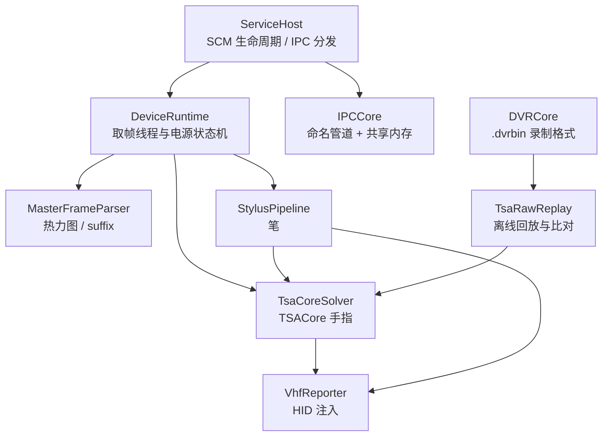
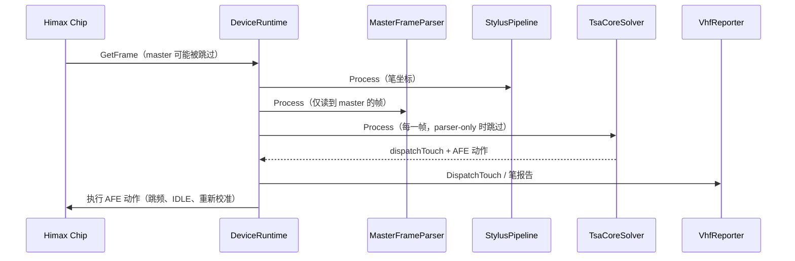

# EGoTouchRev 项目架构总览

## 概念

- **EGoTouchService**：Windows ARM64 原生服务（LocalSystem），负责取帧、解算，再经 VHF 注入 HID 报告。
- **TSACore**：原厂 `TSACore.dll` 的 C++ 复刻，是唯一的手指解算器，见 [tsacore-cpp-rewrite.md](finger_algorithms/tsacore-cpp-rewrite.md)。
- **StylusPipeline**：主动笔（ASA）坐标解算。笔的状态同时送进 TSACore，供手指侧的防误触使用。
- **parser-only 模式**：经 IPC 打开后，只解析帧、不解算手指，用于看原始热力图。

## 架构

| 目录 | 职责 |
| --- | --- |
| [EGoTouchService/source](/EGoTouchService/source) | 服务入口、ServiceHost、运行时配置 |
| [EGoTouchService/Device](/EGoTouchService/Device) | Himax 芯片、BT MCU、VHF、DeviceRuntime |
| [EGoTouchService/Solvers](/EGoTouchService/Solvers) | 帧类型与解析、TSACore（`TouchSolver/TsaCore`）、StylusSolver |
| [EGoTouchService/Host](/EGoTouchService/Host) | 系统状态（屏幕、合盖等）监听 |
| [Common](/Common) | 日志、ConfigStore / Catalog / TLV、DVRCore、IPCCore |
| [Tools/TsaRawReplay](/Tools/TsaRawReplay) | 录制回放、与参考版本比对、Benchmark |
| [Tools/BtMcuTestTool](/Tools/BtMcuTestTool) | BT MCU 协议调试界面 |

## 分点解释

### 1. 每帧数据流

帧解析的结果（`heatmapMatrix`、master / slave suffix）供 IPC 共享内存、DVR 和 VHF 使用；TSACore 自己从原始帧取数据，不读解析结果。接入细节见 [tsacore-raw-integration.md](finger_algorithms/tsacore-raw-integration.md)。

### 2. 配置

服务的默认值完全内建（`WithRuntimeConfigDefaults()`，[ConfigRuntime.cpp](/EGoTouchService/source/ConfigRuntime.cpp)），不读取配置文件；Debug 构建可经 IPC 在当前会话内修改，`PersistConfigV3()` 返回不支持。手指侧没有运行时配置项，TSACore 的参数来自内置的机型参数表；可配置的只有服务开关和笔管线参数。

### 3. 构建与部署

- 构建开关只有一个：`EGO_BUILD_TOOLS`，默认 ON，控制是否编出 BtMcuTestTool 与 TsaRawReplay。发布 CI 会把它关掉。
- 仓库里没有单元测试。验收靠编译，加上 [Compare-Reference.ps1](/Tools/TsaRawReplay/Compare-Reference.ps1) 的逐帧比对。
- 安装目录里只有 `EGoTouchService.exe`；测试版安装包另外附带 `BtMcuTestTool.exe`。

### 4. 正在淘汰的部分

诊断上位机 EGoTouchApp 已经删除。服务端的 IPC 与共享内存帧推送暂时保留，协议见 [api/ipc_protocol.md](api/ipc_protocol.md)。`frame.touch.debug` 里的峰、区域与框不再有人填写，字段只是为了保持格式兼容。
