# 模块 01：原始数据检查、硬件异常、基线管理与差分计算

> 目标程序 `TSACore.dll`（image base `0x6BA40000`）；机型预置 W273AS2700 / Gaokun Himax CSOT；60 列 × 40 行 = 2400 节点；显示 2560×1600。文中所有参数值均取自 `TSAPrmt.dll` 导出表 `g_tsaPrmtFlashGaokunHimaxCSOT.bin`（与运行时 `g_tsaPrmtFlash` 结构偏移 1:1 对应）。

---

## 概念

**Raw**：AFE 每帧送来的互容原始网格，`short[2400]`，行优先（`idx = row*bCols + col`）。**Baseline（BL）**：屏幕无触摸时的静态电容背景快照，与 Raw 同形。**Dif**：差分网格，`Dif = BL - Raw`（正常极性），手指按压处产生正峰。**PreCMF Raw**：进入共模滤波（CMF）之前的 Raw 副本，是基线跟踪与基线重置的唯一数据源。**BLIIR**：基线的定步长跟踪器（名字叫 IIR，实际是带死区的限斜率跟踪，不是一阶低通）。**BLSM**：基线状态机，决定每帧对基线做「跟踪 / 冻结 / 重置」中的哪一种。**BLReset**：重置触发源仲裁，判断是否需要把基线整体拉回 Raw。**Prpt（Property）**：每帧对 Raw / Dif 网格做的统计量集合，存放在全局 `g_tsaPrpt @ 0x6BC4A640`。**SS（Self Sensing）**：AFE 直接送来的自容行/列向量通道，与 **Self**（由互容网格按行列求和算出来的伪自容）是两个不同的东西——本项目 SS 关闭，Self 开启。

---

## 架构

本模块覆盖 `TSA_Processing @ 0x6BA9A443` → `TSA_MSProcess @ 0x6BA90E43` 中从入口到 `Self_Process` 的整段前处理。数据流有三条互斥路径：**空数据/硬复位路径**、**bypass 路径**、**正常路径**；正常路径内部又按宿主控制位 `FLAG_USE_DIF_BUF_PATH (dwSystemFlags bit16)` 分成「Raw 输入」与「Dif 直供」两支。

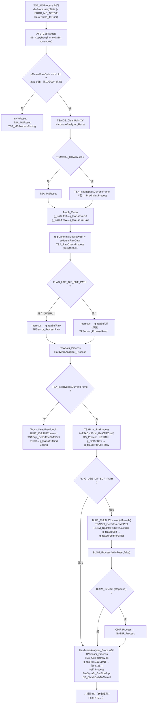

基线子系统内部的分层：

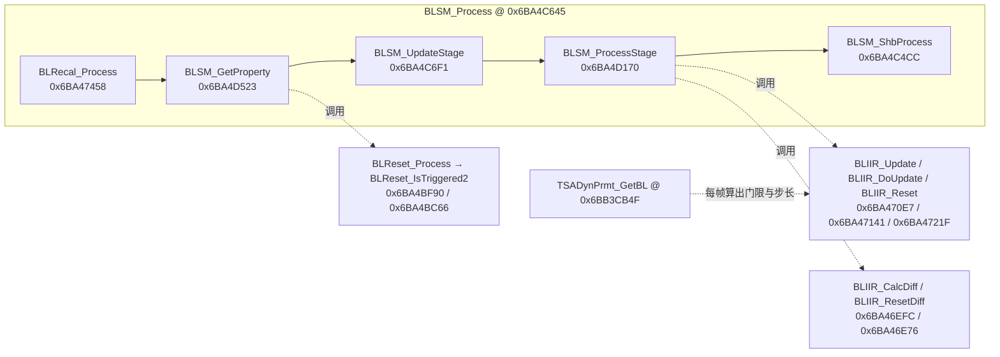

缓冲区与全局符号（指针变量地址，缓冲本体运行时 malloc）：

| 符号 | 指针地址 | 内容 |
|---|---|---|
| `g_tsaBufRaw` | `0x6BB81300` | 当前帧互容 Raw（`short[2400]`） |
| `g_tsaBufPreRaw` | `0x6BC1F380` | 上一帧 Raw 快照 |
| `g_tsaBufPreCMFRaw` | `0x6BB81308` | CMF 之前的 Raw 副本，**基线跟踪与重置的数据源** |
| `g_tsaBufPreHWRaw` | `0x6BB81328` | 上一帧 Raw（HardwareAnalyzer 专用，raw2raw 差分基准） |
| `g_tsaBufBl` | `0x6BB81310` | 当前活跃基线 |
| `g_tsaBufBlNormal` | `0x6BB81358` | Stage 0 正常态基线备份 |
| `g_tsaBufCleanBaseline` | `0x6BB812D8` | 「干净基线」快照（BLReset 状态机 stage 8→0x10 时捕获） |
| `g_tsaBufRawCapture` | `0x6BB812E8` | SHB 影子采样（PreCMF Raw 快照） |
| `g_tsaBufDif` | `0x6BB812F8` | 差分输出 |
| `g_tsaBufPreDif` | `0x6BB81340` | 上一帧 Dif |
| `g_tsaBufRawGrid` | `0x6BB812C0` | Rawdata 归一化的目标缓冲；**除 Rawdata_Process 外无人读取** |
| `g_tsaPrpt` | `0x6BC4A640` | 帧属性聚合体（700 字节） |
| `g_tsaStaticPtr` | `0x6BB4F290` | 运行上下文指针（`TSAStatic`，实际长度 > 1006，本模块用到 `+0x3EE..+0x3F7` 的扩展区） |
| `g_tsaPrmtFlash` | `0x6BB61B70` | Flash 预置参数表（2112 字节） |
| `DAT_6BC4A940 / 0x6BC4A942` | — | CMF 估出的全屏共模正/负漂移 |

---

## 分点解释

### 1. 入口门控与三条路径

`SS_CopyRaw @ 0x6BAFF201` 在任何判断之前执行：它把 AFE 帧 `+0x18` 指向的自容向量（长度 `bRows + bCols` = 100）写进 `g_tsaBufSSPreUnifiedRaw`（原值）和 `g_tsaBufSSRaw`（缩放值）。缩放因子 `iVar = 48000 / flash[0x5B8]`，本项目 `flash[0x5B8] = 0x0BB8 = 3000` → `iVar = 16`，于是 `SSRaw = (raw*16) >> 4 = raw`，**恒等变换**。指针为空或长度不足时置 `g_ssRawValid = 0`。

入口门控是 `pMutualRawData == NULL || (DAT_6BCAB6A4 != 0 && !SS_IsRawValid())`。`DAT_6BCAB6A4` 来自 `TSADynPrmt_Init` 的 `_DAT_6bcab6a4 = g_tsaPrmtFlash._1544_8_`，即 flash `+0x608`，实测字节序列 `00 02 03 00 F4 01 00 06`，首字节 = **0**。所以：

- **SS 通道整体关闭**（见第 9 节），门控退化为 `pMutualRawData == NULL`；
- 空数据分支里会在 `TSAStatic_IsHWReset()` 时调 `TSA_MSReset @ 0x6BA50B16`，然后直接 `TSA_MSProcessEnding`。

`TSA_MSReset` 做的是「保留式重置」：先把 `dwFeatureFlagsMasked`、`field_0xa1`、`g_tsaPrpt[644]`（重置计时器）、`bRecalFrameCount/bRecalBoundaryHitCount`、`field_0x80`（参考时间戳）暂存到栈，调 `TSA_MSInitCommon(0)` + `SS_Reset()` 清空一切，再按 `dwSystemFlags` 的 bit0/bit2/bit3 有选择地还原；最后 `qwBaselineResetReferenceTime = 0`。复刻时必须照抄这套「哪些字段跨复位存活」的规则，否则复位后的重置计时会错。

`TSA_IsToBypassCurrentFrame @ 0x6BA9F720` 直接转发 `HardwareAnalyzer_IsToBypassCurrentFrame @ 0x6BAF14FF`，后者读本帧重建的硬件异常位字 `g_hwAnalyzer @ 0x6BC8C9C0`：`(dwPeakProcessingMode == 3 ∧ 位2 ∧ ¬位1) ∨ 位0x1D ∨ (dwFeatureFlags2 & 0x10 ∧ RFNoise_IsDetected())`。位 1（RF 噪声）与源 C 都挂在 `dwFeatureFlags2 & 0x10`，实测 `0x120` 该位为 0，两者不可达；剩下的位 2（HTI / LTI / 超噪格数超标，或 `isLongTimeRawJumpDetected`）与位 0x1D（`|raw2raw dif| > 9000` 的格数 ≥ 2400/100 = 24）都由第 5 节的 raw2raw 统计产出，**本机可达**。完整判据表见模块 05 第 8 节。bypass 帧不进基线逻辑，只做 `BLIIR_CalcDiffCommon` + `TSAPrpt_GetDifPreCMFPrpt`，并把**上一帧**的 Dif（`g_tsaBufPreDif`）拷到 `g_tsaBufDifGrid` 后结束。

### 2. 差分极性与双缓冲分支

`BLIIR_CalcDiffCommon @ 0x6BA46F4C` 是整个模块唯一的差分公式：

```c
// 逐元素，count = g_tsaPrmtFlash.wBufElementCount = 2400
if (g_tsaStaticPtr->bField_0x11a == 0)  *dif = *bl  - *raw;   // 正常极性
else                                    *dif = *raw - *bl;    // 反相
```

逆运算 `BLIIR_CalcRawCommon @ 0x6BA4701B` 的签名是 `(out, a, b)`，公式为 `bField_0x11a==0 ? out = a - b : out = a + b`——注意它对第二、第三个参数**不是**「基线、差分」的固定语义，而就是简单的 `a-b` / `a+b`，与 `CalcDiffCommon` 严格互逆需要按 `(raw, bl, dif)` 传参。

`BLIIR_CalcDiff @ 0x6BA46EFC` 是固定三元组的包装：`CalcDiffCommon(g_tsaBufDif, g_tsaBufRaw, g_tsaBufBl)`。`HardwareAnalyzer_GetRaw2RawPrpt` 复用同一函数算帧间差：`CalcDiffCommon(g_tsaBufRaw2rawDif, g_tsaBufRaw, g_tsaBufPreHWRaw)`。

**极性标志 `bField_0x11a`（`TSAStatic + 0x11A`）的真实来源**：`TSAStatic_PreProcess @ 0x6BAA1BB0` 每帧执行 `static[0x11A] = static[0x3F1]`（反汇编 `MOVZX EDX,[RDX+0x3F1]` / `MOV [RAX+0x11A],DL`）。`+0x3F1` 的全部写入点共五处，按指令级穷举（`byte ptr [reg+0x3f1]` 的全部 store）：

| 写入点 | 值 | 触发条件 | 本项目可达性 |
|---|---|---|---|
| `BLReset_Init @ 0x6BA47A26` | 0 | 初始化 | 执行一次 |
| `BLReset_Check @ 0x6BA48AF0` | 0 | **每帧**，`nTouchCount != 0x2000` 时无条件清 | 每帧执行 |
| `BLReset_IsTriggered2AfeWakeUp @ 0x6BA4BB37` | 1 | 去抖到期触发重置**且** `nTouchCount == 0x2000` | 条件不成立 |
| `SafeBaseline_ResetCheck @ 0x6BB05907` | 0 | **每帧**，`nTouchCount != 0x2000` 时无条件清 | 每帧执行 |
| `SafeBaseline_IsResetTriggered @ 0x6BB05A3A` | 1 | `SafeBaseline_ResetCheck()` 为真**且** `nTouchCount == 0x2000` | 条件不成立 |

五个写入点的条件表达式里出现的判据只有一个：`g_pPrevTouches->nTouchCount == 0x2000`。两个置 1 点各自挂在一条基线重置路径的末尾，两个清 0 点则分别位于 `BLReset_Check` 与 `SafeBaseline_ResetCheck` 的函数尾部、**每帧无条件执行**。所以它的语义是**「本轮 `0x2000` 异常字已经触发过一次基线重置」的一次性哨兵** —— 作用是防止同一段水下/异常期间反复重置基线，`0x2000` 一消失就被立刻清零，**不是单向锁存，也不是厚覆盖物 / 手套模式标志**。

`0x2000` 是异常字（`g_pPrevTouches->nTouchCount` 被 `Exception_*` 族复用成异常码）的水下取值，本机 `FEAT_UNDERWATER (0x800)` 未置位，异常字取不到 `0x2000`。因此 **`+0x3F1` 在本机恒为 0**，`bField_0x11a` 恒为 0，差分极性固定为正常方向，`Baseline_Compensation` 固定走 `-step` 支。

读 `+0x3F1` 的下游有 `TouchMode_GloveDetect`、`TouchMode_GloveProcess`、`TouchThold_GetTholdBasedOnTouchMode`、`TouchThold_GetPeakThold`、`SS_TouchFilter`、`BLSM_SaveNormalBl`、`TSADynPrmt_GetBL`。这些地方它只是一个**并列的额外触发项**，与真正的手套闩锁 `DAT_6BC4A924` 是「或」关系 —— 它恒 0 并**不会**让手套路径失效，手套门限分支在本机照样成立，详见 [06 §5](06_palm_and_grip_rejection.md) 与 [02 §14](02_cmf_and_grid_filter.md)。

**`FLAG_USE_DIF_BUF_PATH` = `dwSystemFlags` 的 bit16（`0x10000`）**。`dwSystemFlags` 位于 `TSAStatic + 0xBC`，由宿主每帧通过 `TSA_Processing` → `TSAStatic_UpdateCtrlFlags @ 0x6BAA21CB` 直接灌入，**不是 Flash 参数**。置位时的差异：

| 步骤 | bit16 = 0（本项目） | bit16 = 1 |
|---|---|---|
| 输入拷贝 | `pMutualRawData → g_tsaBufRaw` | `pMutualRawData → g_tsaBufDif` |
| `TPSensor_ProcessRaw` | 执行 | 跳过 |
| `Rawdata_Process` | 归一化 `g_tsaBufRawGrid` | 对 `g_tsaBufDif` 整体缩放 |
| `HardwareAnalyzer_Process` 内部 | 执行 SensorBrokenRaw/PreDif/RFNoise/Raw2Raw | 全部跳过 |
| `BLIIR_CalcDiffCommon` / `TSAPrpt_GetDifPreCMFPrpt` / `BLSM_UpdateForRawUnstable` / `SelfForBlRst` 快照 | 执行 | **全部跳过** |
| `BLSM_Process` / `CMF_Process` / `GridIIR_Process` | 执行 | **全部跳过** |
| `TSA_GetPrpt` 内的 `TSA_GetRawPrpt` | 执行 | 跳过（仅 `TSA_GetDifPrpt`） |

也就是说 bit16 置位时整个基线子系统被旁路，Dif 由宿主直接提供。复刻目标只需实现 bit16 = 0 的分支。

### 3. 原始数据检查：`TSA_RawCheckProcess @ 0x6BABCB0B`

只做一件事：`TSA_RawCheckFrozen @ 0x6BAFCA3C` 逐元素比较 `g_pUnnormalizedRawBuf` 与 `g_tsaBufPreUnnormalizedRaw`：

```c
if (完全相同) { if (++g_rawDidNotChange >= 10) { g_rawIsFrozen = 1; g_rawDidNotChange = 9; } }
else          { g_rawDidNotChange = 0; g_rawIsFrozen = 0; }
```

边界细节：计数器饱和在 9（置 `g_rawIsFrozen` 后立刻回写 9，避免溢出），所以「连续 10 帧完全一致」后 frozen 一直保持，直到出现任意一个不同元素。`g_rawIsFrozen` 供 `TSA_RawIsFrozen` 查询，日志等级非 0 时打印异常描述。它**不会**直接触发基线重置。

### 4. `Rawdata_Process @ 0x6BA69581`：本项目下的空操作

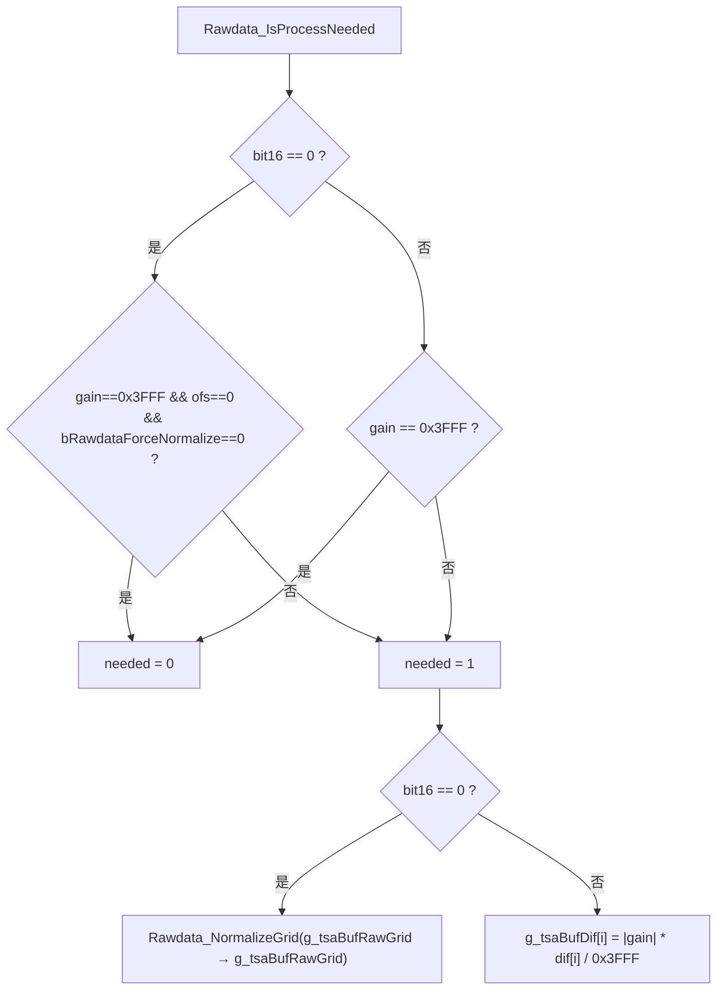

归一化系数在 `TSAConstPrmt_Init @ 0x6BB3C1xx` 算出：

```
DAT_6bcab638 (gain) = (wPeakFilterReferenceThreshold * 0x3FFF) / (flash[0x5FC] - flash[0x600])
DAT_6bcab63c (ofs)  = 0x7FFF - (gain * flash[0x5FC]) / 0x3FFF
```

实测 `flash[0x5B4] = 3000`、`flash[0x5FC] = 0x00007FFF = 32767`、`flash[0x600] = 0x00008BB7 = 35767`，代入得 **gain = (3000×16383)/(−3000) = −16383**，**ofs = 32767 − (−32767) = 65534**。于是：

- `needed = 1`（gain ≠ 0x3FFF），`Rawdata_Process` 会执行；
- bit16 = 0 分支写的是 `g_tsaBufRawGrid`，而该缓冲除 `TSABuffer_Malloc/Free` 外**只有 `Rawdata_Process` 自己引用**（xref 已核实），因此对管线无任何影响；
- bit16 = 1 分支用的是 `|gain| = 16383`，`dif*16383/16383 = dif`，数值上也是恒等。

**结论：`Rawdata_Process` 在 W273AS2700 上两条分支都不改变管线数据。** `Rawdata_NormalizeGridUnit @ 0x6BA69428` 的公式 `out = gain*in/0x3FFF + ofs`（`bRawdataForceNormalize`=flash[0x604]=0 → 输入按 **无符号** 零扩展）留作参考，复刻时可整段省略，但要保留 `Rawdata_IsProcessNeeded` 的判定以便换预置表时行为一致。

### 5. 硬件异常分析

| 函数 | 地址 | 职责 |
|---|---|---|
| `HardwareAnalyzer_Reset` | `0x6BAB2499` | 仅 `TPSensor_Reset()` + `HardwareAnalyzer_SensorBrokenReset()`；每帧无条件在最前面调用，把上一帧的坏点标记清掉 |
| `HardwareAnalyzer_Process` | `0x6BAB19DE` | 主体，见下 |
| `HardwareAnalyzer_ProcessDif` | `0x6BAB1C4E` | 仅 `HardwareAnalyzer_SensorBrokenDifProcess()` |
| `HardwareAnalyzer_SetSoftException` | `0x6BAB0124` | `HardwareAnalyzer_SetException(3)`；所有 `memcpy_s/memset_s` 返回非 0 的断言失败都走这里 |
| `HardwareAnalyzer_PostProcess` | — | 不在本模块（触点上报之后） |

`HardwareAnalyzer_Process` 的顺序：

1. 把 `g_tsaPrpt[0..27]`（本帧 raw2raw 统计）整体搬到 `g_tsaPrpt[28..55]` 作为上一帧备份；
2. `DAT_6BC8C9C4 = g_hwAnalyzer; g_hwAnalyzer = 0;` —— 异常位字每帧重建，旧值留一份；
3. `HardwareAnalyzer_ClearExceptionDescription()`；
4. `HardwareAnalyzer_GetRaw2RawPrpt()`（下述）；
5. 若 `TSAStatic_IsHWReset()` → `HardwareAnalyzer_Init()`；否则若 bit16 = 0 → `SensorBrokenRawProcess` / `SensorBrokenPreDifProcess` / `ProcessRFNoise` / `ProcessByRaw2Raw`；
6. `ProcessProximity` + `ProcessSideTouch`；
7. `g_tsaBufRaw → g_tsaBufPreHWRaw`（**下一帧 raw2raw 的基准**，注意它拷的是 TPSensor 处理后的 Raw）；
8. `HardwareAnalyzer_ReportToTSA()`；
9. 异常位 1 的连续计数：命中则 `wField_0x11E++` 并更新峰值 `wField_0x120`，未命中清零。

`HardwareAnalyzer_GetRaw2RawPrpt @ 0x6BAF10DC` 产出 `g_tsaPrpt[0..27]`，是本模块下游最重要的统计来源：

```
raw2rawDif = CalcDiffCommon(g_tsaBufRaw, g_tsaBufPreHWRaw)      // 极性同样受 0x3F1 影响
raw2rawDifAftCMF = CMF_ProcessDimCommonOnBuf(raw2rawDif, dim= bCmfForceDim1Pass?1:2, clamp=0x7FFF, coef=DAT_6bcab6bc._2_2_)
```

逐节点按 |dif| 与四级门限累加（`thN = DAT_6BC4A910` 当前噪声门限、`wPeakMode3ThresholdMax = 600`、`wPeakFilterReferenceThreshold = 3000`、`3×3000 = 9000`）：

| 字段 | 偏移 | 含义 |
|---|---|---|
| `_0_2_` | +0 | raw2raw 最大值 |
| `_2_2_` | +2 | raw2raw 最小值 |
| `_4_2_` | +4 | `|dif| > thN` 的节点数 —— **下游称之为 numOverNoise** |
| `_6_2_` | +6 | `|dif| > 9000` 的节点数 |
| `_8_2_` | +8 | `HardwareAnalyzer_GetNumOverNoiseAfterCMF()` 的结果 |
| `_10_2_` | +10 | `|dif| > 3000` 的节点数 |
| `_12_2_` | +12 | `|dif| > 600` 的节点数 |
| `_16_4_` | +16 | 超噪正值之和 |
| `_20_4_` | +20 | 超噪负值之和 |
| `_24_1_` | +24 | 各 Rx 分组中「超噪节点占比百分比」的最大值 |

注意计数是**级联**的：只有先满足 `>600` 才判 `>3000`，再判 `>9000`（`if(a){c10++; if(b){c3++; if(c) c6++;}}` 的短路结构），所以三个计数天然单调包含。

`HardwareAnalyzer_SensorBrokenDifProcess @ 0x6BAB3975` 在 Dif 生成之后运行（`HardwareAnalyzer_ProcessDif`）：先 `HardwareAnalyzer_IsSafeForCheckDif()` 放行，门限 `thold = max(wPeakFilterReferenceThreshold/2, nSPeakPositive*90/100)` = `max(1500, 0.9*Ppos)`；对每个 `dif >= thold` 且 `TPSensor_IsSensorValid` 的节点调 `HardwareAnalyzer_CheckCrossAround`；第二轮用 `HardwareAnalyzer_DetectType4` 逐点判型并送 `DebounceBrokenSensorByDif`；最后 `CopyBadChannelList`。附加前置条件 `nSPeakNegative*8 >= -3000`，即负峰不能太深（`Pneg >= -375`），否则整帧跳过坏点判定。

### 6. 基线跟踪：BLIIR 的定点数学

`BLIIR_DoUpdate @ 0x6BA47141`：

```c
ushort *src = (g_tsaPrmtFlash._105_1_ == 0) ? g_tsaBufRaw : g_tsaBufPreCMFRaw;  // flash[0x69]=1 → PreCMF
ushort *bl  = g_tsaBufBl;
for (n = 2400; n--; ++src, ++bl) {
    int d = (int)(uint)(*src) - (int)(uint)(*bl);   // 两侧都零扩展为 16 位无符号后相减
    if (d < step)      { if (d <= -step) *bl -= step; }   // 注意 <= 而非 <
    else               { *bl += step; }
}
g_tsaStaticPtr[1].bField_0x00 = 1;   // static+0x3EE：本帧基线真的被写过
```

要点：

- **零扩展**。Raw / BL 被当成 `uint16` 参与减法，差值落在 `[-65535, 65535]`，不会发生有符号溢出；但如果复刻时用 `int16` 相减就会在跨越 32767/−32768 边界时行为不同。必须照抄零扩展。
- **死区不对称**。上行门限是 `d >= step`，下行门限是 `d <= -step`，死区为 `(-step, step)` 的**开区间**，`d == -step` 属于下行（会减），`d == step-1` 不动。
- **无饱和**。`*bl += step` 直接写回 `ushort`，越界按 16 位回绕。原厂依赖 Raw 与 BL 始终同量级来避免这种情况。
- **步长恒为正**。调用方保证 `step >= 1`。

`BLIIR_Update @ 0x6BA470E7` 是带信号闸门的包装：

```c
short mx = BLSM_GetMaxSig();   // 0x6BA4D41D
short mn = BLSM_GetMinSig();   // 0x6BA4D4A0
if ((bAllowNegOnly || -clamp <= mn) && mx <= clamp)
    BLIIR_DoUpdate(step);
```

`BLSM_GetMaxSig` / `GetMinSig` 在 SafeBaseline 关闭（本项目）时会走 `ToeSyna_PorpertyGetMaxSig/MinSig(局部值)`；其中 `TouchThold_ToeUseSpecialThold()` 为假（见第 8 节）所以局部值就是 `g_tsaPrpt.nSPeakPositive` / `nSPeakNegative`，即**全屏 Dif 的正/负极值**。

`BLIIR_Reset @ 0x6BA4721F` 是硬对齐，三条互斥分支：

```c
if (!AFE_IsRawUnifiedToTargetValue())                             → memcpy(bl, preCMFRaw, 2*N)
else if (dwBaselinePropertyState == 3 || AFE_IsAlwaysNoisy())     → memcpy(bl, preCMFRaw, 2*N)
else  for (i=0;i<N;i++) bl[i] = g_tsaPrmtFlash._1532_2_;          → 全屏填常数（0x7FFF = 32767）
```

随后同步 Proximity 基线，条件是 `(!Proximity_IsDetected() || dwBaselinePropertyState != 5) && g_tsaBufProxBL != NULL`（是 `||` 不是 `&&`，也就是「未检出接近」或「不是 AFE 唤醒重置」两者满足其一即可同步）。

`BLIIR_ResetDiff @ 0x6BA46E76` = `memset(g_tsaBufDif, 0, 2*N)`。

`BLSM_Reset @ 0x6BA4CF23` = `BLIIR_Reset() + Self_Reset() + SS_Reset()`。`Self_Reset` 清 `g_tsaBufSelf`（0x1B80 字节）；`SS_Reset` 清 SS 全族并把 `g_tsaBufSSBaseline` 对齐到 `g_tsaBufSSRaw`。

### 7. BLSM 状态机

`BLSM_Process @ 0x6BA4C645` 的输入合成：

```c
refresh = bForceBaselineProperty || (static[0x3F0] != 0);   // static+0x3F0 = TSA_SetDisableBaselineUpdateFlag
reset   = bHardwareReset         || (static[0x3EF] != 0);   // static+0x3EF = TSA_SetBaselineResetFlag
BLRecal_Process(); BLSM_GetProperty(reset, refresh); BLSM_UpdateStage(); BLSM_ProcessStage(); BLSM_ShbProcess();
```

`TSA_MSProcess` 只在 `TSAStatic_IsHWReset()` 时传 `bHardwareReset = true`，`bForceBaselineProperty` 恒为 `false`。

#### 7.1 属性评定 `BLSM_GetProperty @ 0x6BA4D523`

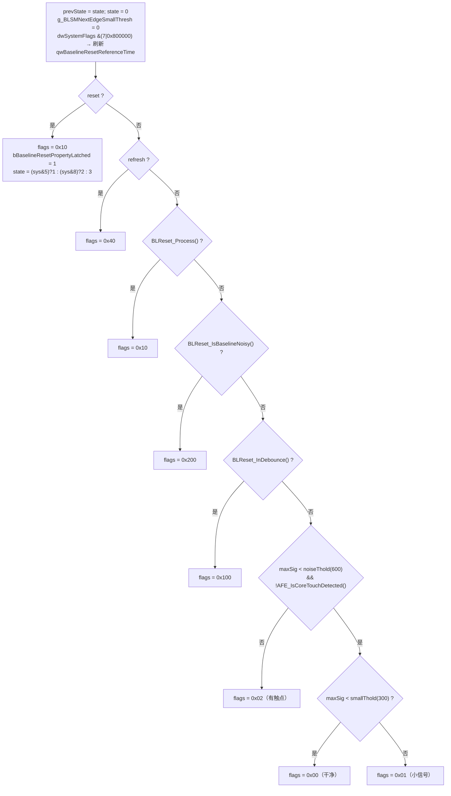

产出的标志位取值集合**只有** `{0x00, 0x01, 0x02, 0x10, 0x40, 0x100, 0x200}`。`g_tsaPrpt.dwBaselinePropertyFlags @ 0x6BC4A8C0` 的写入者经 xref 核实**仅有 `BLSM_GetProperty`**，因此 **`0x80` 永远不会出现**。

`g_BLSMNextEdgeSmallThresh` 只在 `TouchThold_ToeUseSpecialThold()` 为真且 `bSpecialThreshCol` 落在最外两列时置 1 —— 本项目该函数恒假（第 8 节），故此标志恒为 0，配套的 `_DAT_6BCAB6C4` / `_DAT_6BCAB6C8` 边列门限路径全部不走。

`dwBaselinePropertyState`（`g_tsaPrpt + 672`）是「重置原因码」，不参与状态跳转，只用于日志/`BLIIR_Reset` 分支和 `BLReset_IsBaselineNoisy`：

| 码 | 来源 |
|---|---|
| 1 / 2 / 3 | 外部 reset，按 `dwSystemFlags & 5` / `& 8` / 其他 区分 |
| 4 | `BLReset_IsAllFreqsBaselineInitializedDuringTouchLiftOff` |
| 5 / 8 / 9 | AFE 唤醒去抖到期（8 = 同时 `nTouchCount==0x2000`，9 = `prevTouches[1]&0x10`） |
| 6 | `BLReset_IsBaselineNoisy` 计时中 |
| 7 | `BLReset_IsLongTimeRawJumpDetected` |
| 0xA / 0xB / 0xE / 0x15 | SS 相关（本项目不可达） |
| 0xC | SmartCover 开盖（特性位关闭，不可达） |
| 0xD | `AFE_IsFrequentlyHopping` 且距 `field_0x80` < 15000 |
| 0xF | `BLReset_IsBaselineAbnormal` |
| 0x10 | `BLReset_IsAfeRawJump` |
| 0x12 | `ToeSynaBl_IsBaselineAbnormalAftScreenOn` |
| 0x13 | `BLReset_IsCurBaselineDirty` |
| 0x16 | `NotchProtect_IsNotchBaselineDirty` |
| 0x17 | `SensorData_AntiTouchStageTimeout` |

#### 7.2 阶段跳转 `BLSM_UpdateStage @ 0x6BA4C6F1`

优先级自上而下，命中即直接赋值并返回（**不更新计时器**）：

```
flags & 0x10  → Stage 1
flags & 0x200 → Stage 2
flags & 0x100 → Stage 3
flags & 0x80  → Stage 9      （死分支）
flags & 0x40  → Stage 3
否则           → 进入按当前 Stage 的 switch
```

进入 switch 前先累计时间：

```c
g_tsaPrpt.nBaselineStageFrameCount += 1;
g_tsaPrpt.qwBaselineStageReference += (now - prevNow);   // now = static->pFrameBufferPtr（毫秒时间戳）
                                                         // prevNow = static->llField_0xe8
```

每次换阶段则 `nBaselineStageFrameCount = 1; qwBaselineStageReference = static->nBaselineStageInitialSignal`。后者由 `TSAStatic_PreProcess` 算出：`Touch_GetFormattedTimeInterval(now - prevNow)`，即**规整后的本帧时间间隔（毫秒）**——`0` 映射为 `1000/flash[0x38]` = `1000/100` = 10 ms，`|Δ| <= 7` 或刚进/出 IDLE 时钳到 ±8，`|Δ| > 1000` 钳到 ±1000。因此 `qwBaselineStageReference` 的单位是**毫秒**，超时阈值 `DAT_6BCAB6D2._2_2_ = 0x198 = 408` 是 **408 ms**，不是 408 帧。

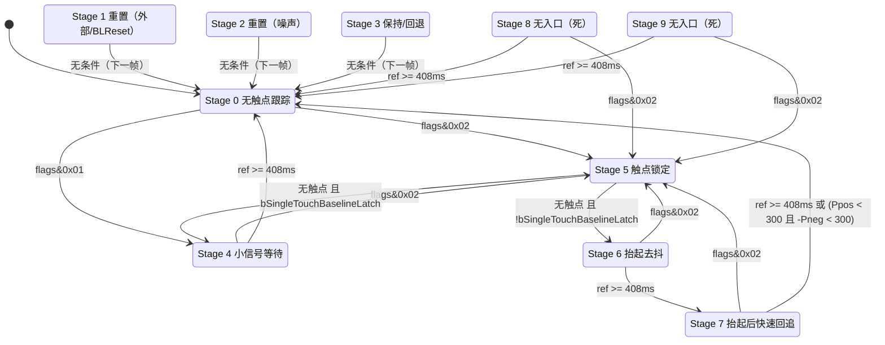

几个易错点：

- **Stage 1/2/3 的「回 0」发生在 `UpdateStage` 里**，即进入 1/2/3 的下一帧无条件变 0；同时 `ProcessStage` 的 `case 3` 还会**在本帧内**把 `dwBaselineStage` 就地改写为 `dwPrevBaselineStage`（若前一阶段是 1/2/3 则改成 0）。两处都要实现，顺序是 UpdateStage 先定 3，ProcessStage 再覆盖。
- **Stage 5 的单指锁存**在每帧末尾无条件重算：`bSingleTouchBaselineLatch = (prevTouchCount == 1 && (prevTouches[0xE] & 0x200) == 0)`，写在「是否离开 Stage 5」判断之后，所以本帧使用的是上一帧的值。
- **Stage 7 的退出**用 `local_e`（=`DAT_6BCAB6C6` 小信号门限，本项目 300）判 `nSPeakPositive < 300 && -nSPeakNegative < 300`；超时判定用 `<` 而不是 `>=`（`if (ref < 408) {峰值判定} else {回 0}`）。

#### 7.3 阶段执行 `BLSM_ProcessStage @ 0x6BA4D170`

每帧开头无条件清三个标志：`bBaselineUpdatedThisFrame(+0x3EB)`、`bResetDiffRequested(+0x3ED)`、`static[0x3EE]`。

| Stage | 动作 |
|---|---|
| 0 | `BLSM_GetNoTouchBlStep(&clamp, &step)` → `BLIIR_Update(0, clamp, step)`；`bBaselineUpdatedThisFrame=1`；`BLSM_SaveNormalBl()` |
| 1 / 2 | `bResetDiffRequested = 1`；`BLSM_Reset()` |
| 3 | `dwBaselineStage = (prev∈{1,2,3}) ? 0 : prev`；不动基线 |
| 4 / 5 / 6 | **无动作**（基线完全冻结） |
| 7 / 8 | `BLIIR_Update(0, clampAftTch, stepAftTch)`；`bBaselineUpdatedThisFrame=1` |
| 9 | 见下（死代码） |

末尾：`bResetDiffRequested ? BLIIR_ResetDiff() : BLIIR_CalcDiff()`。也就是说**每一帧结尾都会重算一次 Dif**（除重置帧外），基线在本帧被步进之后 Dif 立刻同步。

Stage 0 的 `clamp` 初值是调用方给的 `DAT_6BCAB6C6`（小信号门限 300），`BLSM_GetNoTouchBlStep @ 0x6BA4CF9C` 只在边列特判成立时才改写它（本项目不成立）。步长：

```c
byte s = DAT_6bcab6ca._5_1_;                      // = clamp(noiseThold >> 8, 1, 255)
if (static->field_0x3 /* AFE 处于 IDLE */) {
    int m = max(nSPeakPositive, -nSPeakNegative);
    s = (m < 0 ? m + 15 : m) >> 4;                // 向零取整的 /16
    int cap = (clamp < 0 ? clamp + 3 : clamp) >> 2;   // 向零取整的 clamp/4
    if (s > cap) s = cap;
}
```

注意这里的门控是 `static->field_0x3`（`AFE_IsInIDLEMode()` 的本帧缓存），不是 `dwProcessingState & 0x10`。

Stage 7/8 的 `clamp` 选择：`g_BLSMNextEdgeSmallThresh || BLSM_ProcessUseNextSideThold()` 为真取 `DAT_6BCAB6CA._2_2_`（边列，= 边列门限−1），否则取 `(short)DAT_6BCAB6CA`（= 噪声门限−1）。本项目恒走后者。步长恒为 `DAT_6BCAB6D2._0_1_`。

Stage 9（不可达，记录以备换预置）：

```c
int v = -nSPeakNegative;  step = (v < 0 ? v + 15 : v) >> 4;
int cap = (smallThold < 0 ? smallThold + 3 : smallThold) >> 2;
if (step > cap) step = cap;
BLIIR_Update(1, -nSPeakNegative, step);   // allowNegOnly=1 → 只校验 maxSig <= -Pneg
```

`BLSM_SaveNormalBl @ 0x6BA4D0C3`：仅当 `static[0x3F1] == 0`（本轮未因 `0x2000` 异常重置过）且 `g_pPrevTouches->nTouchCount != 0x2000` 时才把 `g_tsaBufBl` 拷进 `g_tsaBufBlNormal`。两个条件在本机恒真，快照每帧都存。

#### 7.4 SHB 影子基线 `BLSM_ShbProcess @ 0x6BA4C4CC`

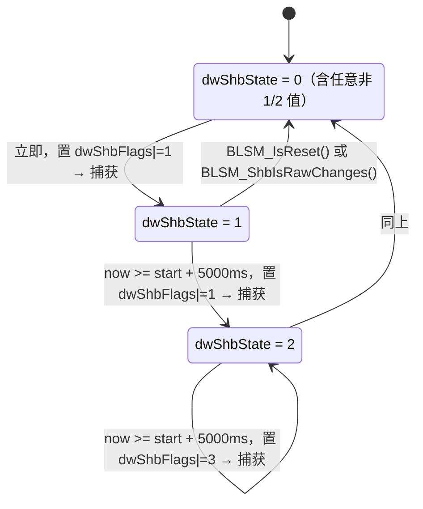

`BLSM_PreProcess @ 0x6BA4C36B` 每帧把 `dwShbFlags` 清零（由 `TSA_Processing` 在更上层调用）。`BLSM_ShbCaptureBl @ 0x6BA4C422` 把 `g_tsaBufPreCMFRaw` 拷进 `g_tsaBufRawCapture` 并记 `qwShbStateStartTime = now`（**注意它拷的是 Raw 不是 BL，函数名有误导**）。`BLSM_ShbIsRawChanges @ 0x6BA4C382` 逐点比较 `g_tsaBufRawCapture` 与 **`g_tsaBufRaw`**（不是 PreCMF），任一 `|Δ| > wPeakMode3ThresholdMax/2 = 300` 即返回 1。`dwShbFlags` 的 bit1 只在 Stage 2 停留超过 5 s 后才置位，供下游判定「长时间稳定」。

#### 7.5 辅助查询

| 函数 | 地址 | 语义 |
|---|---|---|
| `BLSM_IsReset` | `0x6BA4D794` | `dwBaselineStage == 1`（**只认 Stage 1，Stage 2 的噪声重置不算**） |
| `BLSM_IsTouched` | `0x6BA4D7AD` | `dwBaselineStage == 5` |
| `BLSM_IsBaselineOK` | `0x6BA4D7C6` | `flags == 0 || flags == 0x100` |
| `BLSM_IsOKToIDLE` | `0x6BA4D7FD` | `flash[0x44] == 0`（实测 **0**）→ 仅 `stage == 0`；否则 stage ∈ {0,4,6,7} |

`TSA_MSProcess` 用 `BLSM_IsReset()` 决定是否跳过 `CMF_Process` / `GridIIR_Process`，所以 **Stage 2（噪声重置）那一帧仍然会跑 CMF 和 GridIIR，但 Dif 已被 `BLIIR_ResetDiff` 清零**。这是一个真实的非对称行为，必须照抄。

### 8. 动态门限与步长 `TSADynPrmt_GetBL @ 0x6BB3CB4F`

调用链：`TSADynPrmt_Process @ 0x6BB3D12D` →（非 IDLE）`TSADynPrmt_CoreProcess` → `TSADynPrmt_GetSig` + `TSADynPrmt_GetBL`。注意 `TSAPrmt_PreProcess`（`TSA_MSProcess` 里调的那个）只转发 `TSADynPrmt_GetCMFCoef`，**不**刷新基线门限；基线门限由更上层的 `TSADynPrmt_Process` 刷新。

```c
bool special = (DAT_6bc4a924 != 0 /* 手套模式 */
                && ((DAT_6bcab700&4) && (featureFlags&1) || (DAT_6bcab700&8) && (featureFlags&0x10)))
             || (featureFlags & FEAT_SMART_COVER)
             || (static[0x3F1] != 0)
             || static->bFullIncellSignalDisparity;
if (!special) { noise = DAT_6bc4a918; side = (DAT_6bc4a918*3) >> 2; }   // >>2 向零取整
else          { noise = DAT_6bc4a914; side = DAT_6bc4a914; }
if (dwProcessingState & 0x10 /* IDLE */) { noise = DAT_6bcaa0b4; smallThold = (2*noise)/3; }
else                                      TSADynPrmt_UpdateNoiseTholdBfrTch(noise, side);
DAT_6bcab6c2 = noise;  _DAT_6bcab6c4 = side;
TSADynPrmt_UpdateBfrTch(noise, side);
TSADynPrmt_UpdateStepAftTch(noise, side);
DAT_6bcab6d2._6_2_ = flash[0x38] * 5 * 0x28;   // = 100*200 = 20000
DAT_6bcab6da._0_2_ = 20000;
DAT_6bcab6da._2_2_ = wPeakFilterReferenceThreshold;    // 3000
DAT_6bcab6da._4_2_ = -wPeakFilterReferenceThreshold;   // -3000
```

`special` 的四项是**并列的或**：`static[0x3F1]` 与 `FEAT_SMART_COVER` 本机恒 0，`bFullIncellSignalDisparity` 由 Peak 每帧写，第一项的手套门控（`DAT_6BCAB700 & 4` 与 `dwFeatureFlags & 1`）本机**恒真**，因此第一项完全由运行期闩锁 `DAT_6BC4A924` 决定。普通手指场景下 `DAT_6BC4A924 = 0`，`special` 只可能被信号失配拉起。

`DAT_6BC4A914` 与 `DAT_6BC4A918` 都由 `TouchThold_Init @ 0x6BA7C922` 一次性赋为 `g_tsaPrmtFlash.wPeakMode3ThresholdMax`，之后只有 `HandGesture_TouchProcess` / `SideTouch_TouchProcess` 做临时保存-恢复。所以两条分支的噪声门限相同，只有边列门限不同（450 vs 600）。

`TSADynPrmt_UpdateNoiseTholdBfrTch @ 0x6BB3C849`：`TouchThold_ToeUseSpecialThold()` 为假 → `smallThold = noise/2`（C 语义截断除，`param_1/2`）、`_DAT_6BCAB6C8 = side/2`。

`TSADynPrmt_UpdateBfrTch @ 0x6BB3C960`：

```c
step_noTouch = clamp(noise >> 8, 1, 255);    // 负数先 +0xFF 再 >>8，即向零取整
step_side    = clamp(side  >> 8, 1, 255);
DAT_6bcab6ca._4_1_ = 1;
if (dwProcessingState & 0x10) step_noTouch *= 2;    // 直接乘 2，无饱和保护
DAT_6bcab6d2._2_2_ = 0x198;                          // 408 ms 阶段超时，硬编码
```

`TSADynPrmt_UpdateStepAftTch @ 0x6BB3CA49`：

```c
DAT_6bcab6ca._0_2_ = noise - 1;              // Stage 7/8 的 clamp（正常列）
DAT_6bcab6ca._2_2_ = side  - 1;              // Stage 7/8 的 clamp（边列）
step_aftTouch = clamp(noise >> 6, 1, 255);   // 负数先 +0x3F
DAT_6bcab6ca._7_1_ = 1;
if (dwProcessingState & 0x10) step_aftTouch = (step_aftTouch < 0) ? 255 : step_aftTouch*2;
DAT_6bcab6d2._4_1_ = flash[0x38] >> 1;       // 50
DAT_6bcab6d2._5_1_ = flash[0x38];            // 100
```

**W273AS2700 实测数值**（`wPeakMode3ThresholdMax = flash+0x5B6 = 0x0258 = 600`，`flash+0x38 = 0x64 = 100`）：

| 运行时符号 | 含义 | 非 IDLE 值 | IDLE 值 |
|---|---|---|---|
| `DAT_6BCAB6C2` | 噪声门限 noiseThold | **600** | `DAT_6BCAA0B4`（未定，见疑点） |
| `_DAT_6BCAB6C4` | 边列噪声门限 | **450** | 450（IDLE 分支不改 side） |
| `DAT_6BCAB6C6` | 小信号门限 smallThold | **300** | `2/3 × DAT_6BCAA0B4` |
| `_DAT_6BCAB6C8` | 边列小信号门限 | **225** | 225 |
| `DAT_6BCAB6CA._0_2_` | Stage 7/8 clamp | **599** | 599 |
| `DAT_6BCAB6CA._2_2_` | Stage 7/8 边列 clamp | **449** | 449 |
| `DAT_6BCAB6CA._5_1_` | Stage 0 步长 | **2** | 4 |
| `DAT_6BCAB6CA._6_1_` | Stage 0 边列步长 | **1** | 1 |
| `DAT_6BCAB6D2._0_1_` | Stage 7/8 步长 | **9** | 18 |
| `DAT_6BCAB6D2._2_2_` | 阶段超时 | **408 ms** | 408 ms |
| `DAT_6BCAB6D2._6_2_` / `DAT_6BCAB6DA._0_2_` | 重置计数器上限 | **20000** | 20000 |

Stage 7 的步长是 Stage 0 的 4.5 倍（9 vs 2），这就是「抬手后快速回追残余电荷」的实现。

**`TouchThold_ToeUseSpecialThold @ 0x6BA7CD8F` 恒假**：它把 `TSA_GetPrmtName()` 与 `"P116"` / `"P150"` / `"P186"` 逐一 `strncmp(...,4)`，全不匹配返回 0。本项目预置名为 `W273AS2700`，因此返回 **0**。受此影响被彻底关闭的路径：`g_BLSMNextEdgeSmallThresh`、`BLSM_ProcessUseNextSideThold`、`BLSM_GetMaxSig/GetMinSig` 中的 `g_tsaPrpt._192_2_`（core-block 极值）替换、`TSADynPrmt_UpdateNoiseTholdBfrTch` 的 2/3 分支。

### 9. 重置触发源与按压保护

`BLReset_Process @ 0x6BA4BF90` 每帧：

```c
static[0x3F4] = 0;                       // 重置原因位图，每帧清零
if (externalReset) g_tsaPrpt._646_2_ = 0;
static->bBaselineResetCheckEnabled = !BLReset_IsToDisable();   // IsToDisable 恒返回 0 → 恒 1
triggered = externalReset || (enabled && BLReset_IsTriggered());
if (g_tsaPrpt._644_2_ < 20000) g_tsaPrpt._644_2_++;            // 距上次硬复位的帧数
if (g_tsaPrpt._646_2_ < 20000) g_tsaPrpt._646_2_++;            // 距上次基线重置的帧数
if (triggered) g_tsaPrpt._646_2_ = 0;
```

`BLReset_IsTriggered @ 0x6BA4BF6D` 按 `TSAStatic_IsSafeBaselineApplied()` 分流；SafeBaseline 关闭 → 恒走 `BLReset_IsTriggered2 @ 0x6BA4BC66`。

`BLReset_IsTriggered2` **不是短路的**：所有触发源都会被求值（各自维护自己的计时器），最后 OR 起来。`dwBaselinePropertyState` 被后命中的源覆盖，所以原因码取的是**最后一个命中者**。命中者大多同时置 `dwSpecialControlFlags |= 1` 并把 `static[0x3EA]` 清零。

| 触发源 | 地址 | 判据要点 | State | 本项目状态 |
|---|---|---|---|---|
| `BLReset_IsLongTimeRawJumpDetected` | `0x6BA48D9E` | Mode 3 下若 `numOverNoise > 3N/4` 或 `raw2raw 占比 > 90%` 则置 `static[0x30A]`；随后在 `numOverNoise < 40 && preCMF 超噪点数 > N/2` 且 `!IsTouchProtectOnRawJump()` 时按帧间隔累加 `static[0x310]`，超过 84 即触发 | 7 | 开 |
| `BLReset_IsTriggered2BySS` | `0x6BA4B890` | SS 无信号 / 互容-自容失配 / SS 长期负信号 | 0xA/0xB/0xE/0x15 | **不可达**（SS 关） |
| `AFE_IsFrequentlyHopping` | — | 且 `now < static[0x80] + 15000`；**只设 State，不置 `local_9`**，本身不触发重置 | 0xD | 开（但无重置效力） |
| `BLReset_IsTriggered2AfeWakeUp` | `0x6BA4B9D4` | `IsAllFreqsBaselineInitializedDuringTouchLiftOff` 立即触发（State 4）；否则按 `BLReset_IsAbnormalTouchDetected` 累加 `static[0x2F0]`，> 160 触发 | 4/5/8/9 | 开 |
| `BLReset_IsSmartCoverOff` | `0x6BA49D6C` | 特性位 `FEAT_SMART_COVER` 由 1→0 后 250 ms 窗口内累计超噪 > 124 | 0xC | **关**（特性位恒 0） |
| `SensorData_AntiTouchStageTimeout` | — | 防误触阶段超时 | 0x17 | 开 |
| `BLReset_IsBaselineAbnormal` | `0x6BA4B506` | 受 `flash[0x6B]=1` 使能；Type1/2/3 三个独立计时器任一 > 300 即触发 | 0xF | 开 |
| `BLReset_IsCurBaselineDirty` | `0x6BA4AAEE` | 受 `flash[0x6A]=1` 使能；计时器 `static[0x388] > 300` | 0x13 | 开 |
| `ToeSynaBl_IsBaselineAbnormalAftScreenOn` | `0x6BB465B4` | 受 `DAT_6BCAA150` 使能 | 0x12 | 待定 |
| `BLReset_IsAfeRawJump` | `0x6BA4B70A` | AFE 帧标志 `static[0xD8] & 0x20000` 的边沿检测，带触点保护 | 0x10 | 开 |
| `NotchProtect_IsNotchBaselineDirty` | `0x6BB03D4E` | 受 `DAT_6BCAA158` 使能 | 0x16 | 待定 |

最后无条件执行 `BLReset_CheckTouchTrustability()` 和 `BLReset_BaselineStateUpdate(triggered)`，并把结果存入 `static->field_0x2F8`（供 `BLReset_Status` 查询）。

`BLReset_IsBaselineNoisy @ 0x6BA4C0BA`（Stage 2 的来源）：

```c
if (prevState ∉ {0,3,6} && AFE_IsAlwaysNoisy())  static[0x300] = 本帧时间间隔;
if (static[0x300] == 0)              return 0;
else if (numOverNoise < 6)         { static[0x300] = 0; static[0x2F9] = 1; return 1; }
else if (static[0x300] < 167)      { static[0x300] += 本帧时间间隔; state = 6; return 1; }
else                               { static[0x300] = 0; return 0; }
```

`BLReset_InDebounce @ 0x6BA47750` 直接返回 `static->bBaselineResetInDebounce != 0`，该字节由 `BLReset_IsTriggered2AfeWakeUp` 递增/递减。

#### 9.1 按压保护 `BLReset_IsTouchToBeProtected @ 0x6BA47B08`

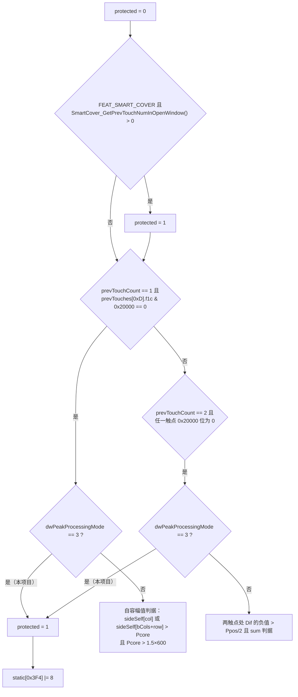

`dwPeakProcessingMode = flash[0x34] = 3`（实测），所以**单指与双指在本项目下无条件受保护**，复杂的自容/互容幅值判据全部走不到。

`BLReset_IsTouchToBeProtected2 @ 0x6BA47E9A`（供 `BLReset_IsAfeRawJump` 与 `BLReset_IsBaselineAbnormal` 用，与上面那个是两套判据）：遍历最多 5 个上帧触点，要求峰值列 ∈ `(0, bCols-1)`、峰值行 ∈ `(0, bRows-1)`（`FEAT` bit15 关闭 → 边界为 0 和 59 / 39）、触点 flag `0x20000000` 置位、`touch[0x1A0] < 13`、`touch[0x1BA] > (440/3)*4 = 584`、`touch[0x1BE]*2 > -nSPeakNegative`，再加两条自容符号条件。满足数 ≥ 1（`param_1==0` 时）即返回 1 并置 `static[0x3F4] |= 1`。

`BLReset_IsTouchProtectOnRawJump @ 0x6BA48BB6`：统计满足「flag bit3 置位、`touch[0x22C] > 256`、`touch[0x22E] > 256`」的上帧触点数 `n`，并记录是否存在 `prevPeak 幅值 > 3000/2 = 1500`（`bVar1`）与是否有触点带 `0x20000` 标记（`bVar2`）。返回 1 的充要条件：

```
1 <= n <= 3  &&  bVar1  &&  !bVar2  &&  3*|DAT_6BC4A940| < 3000  &&  3*|DAT_6BC4A942| < 3000
```

即共模漂移必须 < 1000 LSB。

`BLReset_CheckTouchTrustability @ 0x6BA4A613`：每个上帧触点在 `touch + 0x4EC` 有一个 0..15 的信誉计数。位置在核心区（峰值列 ∈ (0,59)、行 ∈ (0,39)）且满足「flag `0x20000000` 置位 且 `touch[0x1A0] <= 12` 且 `touch[0x1BE]*2 > -nSPeakNegative`」→ `+1`（上限 15）；否则 `-1`（下限 0）。

**坑**：增减两条路径的守卫都是 `counter < 0xF`，因此计数一旦达到 15 就**既不能加也不能减**，成为吸收态。复刻必须保留这个行为。

`BLReset_BaselineStateUpdate @ 0x6BA4A368` + `BLReset_BaselineStateMachine @ 0x6BA49F88` 维护「干净基线」快照：

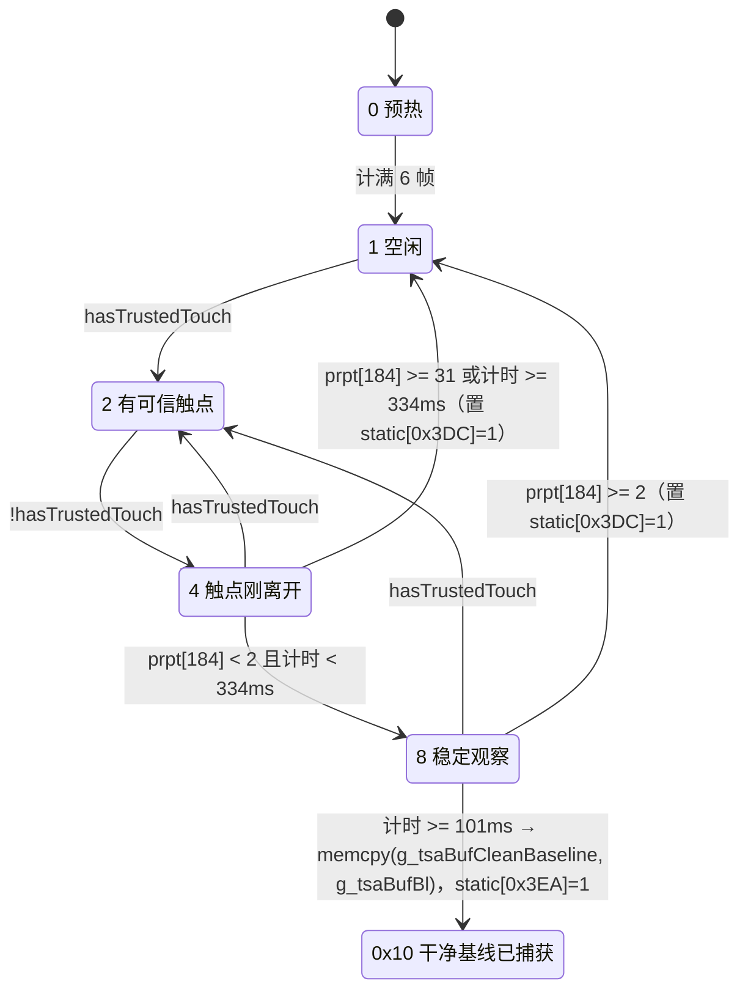

进入前若 `now == static[0x80]`（刚复位）、或本帧触发了重置、或 AFE 帧标志 `0x40000` 由有变无，则整机复位到 state 0。到达 `0x10` 后 `BLReset_IsBaselineClean()` 恒真，且 `BLReset_CheckCleanBaseline @ 0x6BA4A9A3` 可以用 `g_tsaBufCleanBaseline` 与 `g_tsaBufPreCMFRaw` 比较：`|Δ| > 100` 的节点数 < 4 即判「仍然干净」。

#### 9.2 共模漂移补偿 `Baseline_Compensation @ 0x6BA46D00`

```c
short drift = 0;
if (DAT_6bc4a942 < 0)      drift = DAT_6bc4a942;   // 负漂优先
else if (DAT_6bc4a940 > 0) drift = DAT_6bc4a940;
if (abs(drift) > 4 && static->field_0x30a == 0) {
    short s = (drift < 1) ? -5 : 5;
    for (i = 0; i < 2400; i++)
        bl[i] = (bField_0x11a == 0) ? bl[i] - s : bl[i] + s;
    static->dwSpecialControlFlags |= 0x100;
}
```

要点：判据是 `abs(drift) > 4`（严格大于 4，drift = ±5 才动）；步长恒为 ±5，与漂移幅度无关；`field_0x30A`（长时间 raw jump 标志）置位时禁止补偿。该函数由 `CMF_Process` 调用，不属于 BLSM，但直接改写 `g_tsaBufBl`，复刻时不能漏。

#### 9.3 大失稳粗跟 `BLSM_UpdateForRawUnstable @ 0x6BA4C27B`

```c
if (!TSA_IsGameScenario() && (static[0xD8] & 0x40000)) {      // AFE 帧标志位「raw 不稳」
    int limit = TSAStatic_IsSafeBaselineApplied() ? (short)wPeakMode3ThresholdMax : 0x7FFFFFFF;
    for (i = 0; i < 2400; i++) {
        int d = (int)(uint)preCMFRaw[i] - (int)(uint)bl[i];    // 同样零扩展
        if (d < limit) {
            if      (d >= 0x11) bl[i] += 0x11;
            else if (d <  -0x10) bl[i] -= 0x11;                // 注意上下门限不对称！
        }
    }
}
```

**坑**：上行门限 17、下行门限 −17（`d < -16` 等价 `d <= -17`），但写回的步长两边都是 17，且死区是 `[-16, 16]`，比 `BLIIR_DoUpdate` 的 `(-step, step)` 多包含一个点。SafeBaseline 关闭 → `limit = INT_MAX`，上限判定恒真。这一步发生在 `BLSM_Process` **之前**，直接改 `g_tsaBufBl`，且不更新 `bBaselineUpdatedThisFrame`。

### 10. 属性统计 `TSA_GetPrpt` 与 `TSAPrpt_GetDifPreCMFPrpt`

`TSAPrpt_GetDifPreCMFPrpt @ 0x6BAA13BE` 在 Dif 刚算出、CMF 之前跑，扫 `g_tsaBufDif` 全屏：

| 字段（`g_tsaPrpt+`） | 内容 |
|---|---|
| 352 | `max(maxDif, -minDif)`（绝对峰值） |
| 354 | `dif >= thN` 与 `dif <= -thN` 的节点数之和（`thN = DAT_6BC4A910`，当前噪声门限） |
| 356 / 358 | maxDif / minDif |
| 360 / 361 | maxDif 的列 / 行 |
| 362 / 363 | minDif 的列 / 行 |

**坑**：极值更新是 `if (dif > max) {...} else if (dif < min) {...}`——`else if` 意味着同一节点不会同时更新两端；由于 `max` 初值 0、`min` 初值 0，全屏无信号时两者都留 0，位置字段留 (0,0)。

`TSA_GetPrpt @ 0x6BA61353` = `bit16==0 ? TSA_GetRawPrpt(raw, bl) : —` 再加 `TSA_GetDifPrpt()`。

`TSA_GetRawPrpt @ 0x6BAA0Cxx` 输出（全部按 **无符号 16 位** 比较，因为 Raw 是 `ushort`）：

| 字段 | 内容 |
|---|---|
| `wBoundaryPositive` (+146) | 全屏 Raw 最大值（含边界行列） |
| `wBoundaryNegative` (+148) | 全屏 Raw 最小值 |
| `_150_2_` / `_152_2_` | 内区（去掉最外一圈）Raw 的最大 / 最小值 |
| `_154_2_` | 内区 Raw 均值 = `sumRaw / ((bCols-2)*(bRows-2))` = `sum/2204` |
| `_158_2_` | 全屏最小值所在 (列,行) |
| `_666_2_` | 内区 **Baseline** 均值（同一除数） |

`TSA_GetDifPrpt @ 0x6BAA121D` 是分块统计。所谓「块」由 `g_tsaBlockIdx @ 0x6BB81A00`（`bCols × bRows = 2400` 字节，与 Dif 网格同形同序）给出，每个节点存一个 0..6 的块号。这张图由 `TSA_InitBlockIdx @ 0x6BAA0BC2` 在 `TSAPrpt_Malloc` 之后一次性填好，之后只读；填写顺序是「先全 0，再逐层覆盖」，所以后写的层会盖掉先写的：

| 块号 | 覆盖范围（60 列 × 40 行） | 节点数 | 语义 |
|---|---|---|---|
| 0 | `row ∈ [1,38]`，`col ∈ [2,57]` | 2128 | 内区主体 |
| 1 | `col = 0` 与 `col = 59` 的全部 40 行（含四个角） | 80 | 最外侧列 |
| 2 | `col = 1` 与 `col = 58`，`row ∈ [1,38]` | 76 | 次外侧列 |
| 3 | `(row 0, col 1)`、`(row 0, col 58)` | 2 | 顶行次外角 |
| 4 | `(row 39, col 1)`、`(row 39, col 58)` | 2 | 底行次外角 |
| 5 | `row = 0`，`col ∈ [2,57]` | 56 | 顶行主体 |
| 6 | `row = 39`，`col ∈ [2,57]` | 56 | 底行主体 |

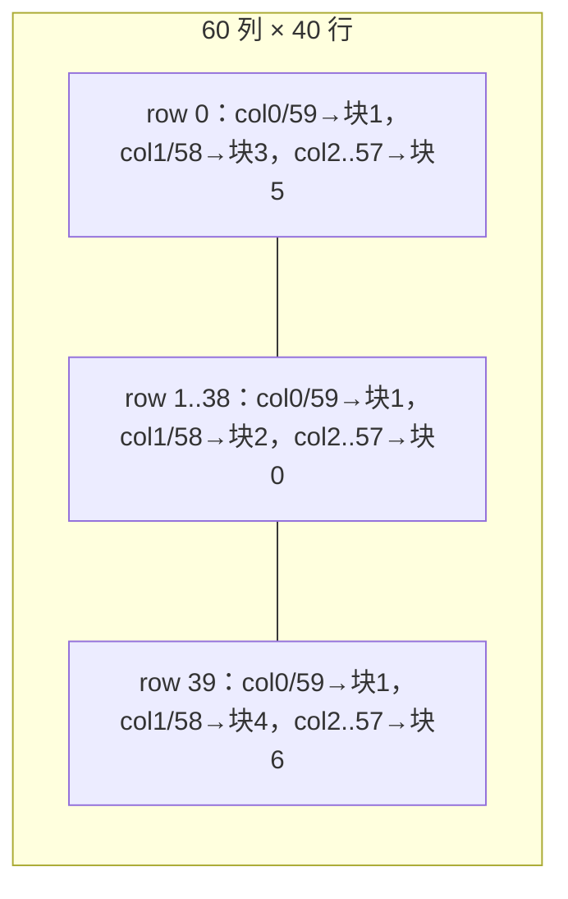

`TSA_InitBlockPrpt()` 把 7 个块记录（每块 28 字节，基址 `g_tsaDifBlockPrpt @ 0x6BC4A980`）初始化为 `max=0x8000, min=0x7FFF`，`TSA_GetDifPrptCommon @ 0x6BAA1035` 按 `g_tsaBlockIdx[i]` 把每个节点归入所属块并累加：

```
+0x00 maxDif  +0x02 minDif  +0x04 maxCol +0x05 maxRow +0x06 minCol +0x07 minRow
+0x08 cntPos(dif >= thN)    +0x0A cntNeg(dif <= -thN)
+0x0C sumNeg                +0x10 sumPos
+0x14 cntAbsOver100
```

然后 `TSA_CombineBlock(dst, mask) @ 0x6BAA0DA1` 把 `mask` 选中的块合并成一条 **32 字节记录**写到 `g_tsaPrpt` 的不同位置。记录布局四处通用，后文所有「区块统计」偏移都按它换算：

| 记录内偏移 | 类型 | 内容 |
|---|---|---|
| `+0x00` | s16 | maxDif |
| `+0x02` | s16 | minDif |
| `+0x04` / `+0x05` | u8 | maxDif 的列 / 行 |
| `+0x06` / `+0x07` | u8 | minDif 的列 / 行 |
| `+0x08` | s32 | **sumAll** = sumPos + sumNeg（代数总和） |
| `+0x0C` | s32 | sumPos（`dif >= thN` 的节点之和） |
| `+0x10` | s32 | sumNeg（`dif <= -thN` 的节点之和） |
| `+0x14` | s16 | cntPos |
| `+0x16` | s16 | cntNeg |
| `+0x18` | s16 | cntPos + cntNeg |
| `+0x1A` | s16 | cntAbsOver100 |

| 调用 | 掩码 | 选中块 | 写入偏移 | 语义 |
|---|---|---|---|---|
| `TSA_CombineBlock(0x6BC4A700, 5)` | `0b0000101` | 块 0 + 块 2 | `g_tsaPrpt + 192` | **核心区** = 内区主体 + 次外侧列，即「去掉最外一圈与上下边行」的区域 |
| `TSA_CombineBlock(0x6BC4A6E0, 0x7F)` | 全 7 块 | 全屏 | `g_tsaPrpt + 160` | 全屏 |
| `TSA_CombineBlock(0x6BC4A720, 1)` | 块 0 | 内区主体 | `g_tsaPrpt + 224` | 中央块 |
| `TSA_CombineBlock(0x6BC4A780, 2)` | 块 1 | 最外侧列 | `g_tsaPrpt + 320` | 侧边（`FEAT` bit15 开时掩码变 0x1E） |

掩码 `0x7F` / `0x1E` 的选择受 `dwFeatureFlags & 0x8000`（本项目 **0**）与 AFE 帧标志 `0x40000` 影响：全屏掩码在 bit15 关闭时恒为 `0x7F`，侧边块掩码恒为 `2`。核心区掩码 `5` 是常量，不受任何标志影响，所以**「核心区」在本机就是块 0 ∪ 块 2 = 行 1..38 × 列 1..58**。

全屏记录写完后、侧边记录写之前，`TSA_GetDifPrpt` 还把 `160..187` 逐字段抄到 `256..283`，得到一份「本帧全屏 Dif 统计」的稳定副本（侧边合并不会污染它）。

合并逻辑的细节：同值时用 `row*bCols + col` 的**线性索引更小者**胜出（稳定选取左上角）；合并前用第一个被选中的块的位置初始化，避免全空时留脏位置。

紧接着 `TSA_MSProcess` 执行 `memcpy(&g_tsaPrpt+364, &g_tsaPrpt+160, 0xC0)`，把 `160..351` 的 192 字节整体快照到 `364..555`。因此 `BLReset_*` 里频繁出现的 `g_tsaPrpt._364_2_` / `._366_2_` / `._376_4_` / `._380_4_` / `._384_2_` / `._386_2_` / `._388_2_` / `._390_2_` 就是**上一次快照时的全屏 Dif 统计**（分别对应 maxDif、minDif、sumPos、sumNeg、cntPos、cntNeg、cntPos+cntNeg、cntAbsOver100）。

下游消费者：`BLSM_GetMaxSig/GetMinSig`（→ `BLIIR_Update` 闸门与 Stage 判定）、`BLRecal_Process`（`wBoundaryPositive/Negative`）、`BLReset_*` 全族、`HardwareAnalyzer_SensorBrokenDifProcess`、以及模块 02 的 Peak/TZ。

#### 10.1 `g_tsaPrpt` 统一字段表

`g_tsaPrpt @ 0x6BC4A640` 共 700 字节，是整条管线唯一的「帧属性 + 全局门限」聚合体。其他模块引用某个偏移时一律回查这张表，不再各自命名。注意偏移在不同模块的文档里有十进制与十六进制两种写法（例如 `+0xA0` 与 `+160`、`+0xC8` 与 `+200` 是同一个字段），表中两种都给出。

| 偏移（十六进制 / 十进制） | 类型 | 含义 | 写入者 | 主要读取者 |
|---|---|---|---|---|
| `+0x00..+0x1B` / 0..27 | — | 本帧 raw2raw 统计（28 字节） | `HardwareAnalyzer_GetRaw2RawPrpt @ 0x6BAF10DC` | `HardwareAnalyzer_*`、`BLReset_*` |
| `+0x1C..+0x37` / 28..55 | — | 上一帧 raw2raw 统计（帧首整块搬运） | `TSA_MSProcess` | 同上 |
| `+0x92` / 146 | u16 | `wBoundaryPositive`：全屏 Raw 最大值 | `TSA_GetRawPrpt @ 0x6BAA0A6E` | `BLRecal_Process` |
| `+0x94` / 148 | u16 | `wBoundaryNegative`：全屏 Raw 最小值 | 同上 | `BLRecal_Process` |
| `+0x96` / 150 | u16 | 内区 Raw 最大值 | 同上 | — |
| `+0x98` / 152 | u16 | 内区 Raw 最小值 | 同上 | — |
| `+0x9A` / 154 | u16 | 内区 Raw 均值（除数 `(bCols-2)(bRows-2) = 2204`） | 同上 | — |
| `+0x9C` / 156..157 | u8×2 | 全屏 Raw 最大值的列 / 行 | 同上 | — |
| `+0x9E` / 158..159 | u8×2 | 全屏 Raw 最小值的列 / 行 | 同上 | — |
| **`+0xA0` / 160** | s16 | `nSPeakPositive` = **全屏 Dif 最大值**。它就是「按下门限的输入信号量」——`TouchThold_Process` 取 `min(nSPeakPositive, flash[0x5B4]=3000)` 作被除数 | `TSA_CombineBlock(…, 0x7F)` | `BLSM_GetMaxSig`、`TouchThold_Process`（模块 02）、`SS_IsChargerNoiseFilterNeeded` |
| `+0xA2` / 162 | s16 | `nSPeakNegative` = 全屏 Dif 最小值 | 同上 | `BLSM_GetMinSig` |
| `+0xA4..+0xBA` / 164..186 | — | 全屏记录其余字段（按上表 32 字节布局换算：`+0xA4` maxCol、`+0xA5` maxRow、`+0xA6` minCol、`+0xA7` minRow、`+0xA8` sumAll、`+0xAC` sumPos、`+0xB0` sumNeg、`+0xB4` cntPos、`+0xB6` cntNeg、`+0xB8` cnt、`+0xBA` cntAbsOver100）。`+0xA4`/`+0xA6` 另有别名 `bSpecialThreshCol` / `bNextSideThreshCol` | 同上 | `BLReset_*`、模块 02 |
| `+0xC0` / 192 | s16 | **核心区** Dif 最大值（`_192_2_`） | `TSA_CombineBlock(…, 5)` | `BLSM_GetMaxSig`（仅 `ToeUseSpecialThold` 为真时，本机恒假 ⇒ 不生效） |
| **`+0xC8` / 200** | s32 | **核心区 Dif 代数总和**（= 核心区 sumPos + sumNeg，区域 = 行 1..38 × 列 1..58） | 同上 | `Peak_IsFullIncellSDDetected`（模块 03：`> wPeakFilterReferenceThreshold × 2 = 6000`） |
| `+0xC2..+0xDA` / 194..218 | — | 核心区记录其余字段 | 同上 | — |
| `+0xE0..+0xFF` / 224..255 | — | 中央块（块 0）记录 | `TSA_CombineBlock(…, 1)` | — |
| `+0x100..+0x11B` / 256..283 | — | 全屏记录的副本（`160..187` 逐字段抄写，在侧边合并之前） | `TSA_GetDifPrpt` | — |
| `+0x140..+0x15F` / 320..351 | — | 侧边块（块 1）记录 | `TSA_CombineBlock(…, 2)` | 侧边门限 |
| `+0x160` / 352 | s16 | pre-CMF 全屏 `max(maxDif, -minDif)` | `TSAPrpt_GetDifPreCMFPrpt @ 0x6BAA13BE` | 模块 02「大屏噪」判据 |
| `+0x162` / 354 | s16 | pre-CMF 超噪节点数 | 同上 | 同上 |
| `+0x164..+0x16B` / 356..363 | — | pre-CMF maxDif / minDif 及其列行 | 同上 | — |
| `+0x16C..+0x22B` / 364..555 | — | **快照区**：`memcpy(+364, +160, 0xC0)`，即 `160..351` 的整块拷贝。`BLReset_*` 读的 `_364_2_`/`_366_2_`/`_376_4_`/`_380_4_`/`_384_2_`/`_386_2_`/`_388_2_`/`_390_2_` 都落在这里 | `TSA_MSProcess`（`TSA_GetDifPrpt` 之后立刻执行） | `BLReset_*` 全族 |
| `+0x278` / 632 | u32 | `dwBaselineStage` | `BLSM_Process` | BLSM |
| `+0x27C` / 636 | u32 | `dwPrevBaselineStage` | 同上 | BLSM |
| `+0x280` / 640 | u32 | `dwBaselinePropertyFlags` | `BLSM_GetProperty`（唯一写入者） | BLSM |
| `+0x284` / 644 | u16 | 距上次硬复位的帧数（上限 20000） | `TSA_MSProcess` | `BLReset_*` |
| `+0x286` / 646 | u16 | 距上次基线重置的帧数 | 同上 | `BLReset_*` |
| `+0x288` / 648 | s16 | `nBaselineStageFrameCount` | BLSM | BLSM |
| `+0x290` / 656 | u64 | `qwBaselineStageReference` | BLSM | BLSM |
| `+0x2A0` / 672 | u32 | `dwBaselinePropertyState`（重置原因码） | `BLReset_*` | `BLIIR_Reset`、`BLReset_IsBaselineNoisy` |
| `+0x2A4` / 676 | u32 | `dwPrevBaselinePropertyState` | 同上 | — |
| `+0x29A` / 666 | s16 | 内区 Baseline 均值 | `TSA_GetRawPrpt` | — |
| `+0x2A8` / 680 | u32 | `dwShbState` | SHB | SHB |
| `+0x2B0` / 688 | u64 | `qwShbStateStartTime` | SHB | SHB |
| `+0x2B8` / 696 | u32 | `dwShbFlags` | SHB | SHB |

`g_tsaPrpt` 尾部 `+0x2D0` 起并不是「帧属性」，而是 **TouchThold 门限组**——它们在反编译里以裸地址出现（`DAT_6BC4A9xx`），实际都是本结构体的字段，同一块内存。写入者集中在 `TouchThold_Init @ 0x6BA7C922`（复位值）与 `TouchThold_Process`（每帧按信号量缩放，细节见模块 02 第 9 节）：

| 偏移 | 裸地址 | 含义 | 稳态实测值 |
|---|---|---|---|
| `+0x2D0` | `DAT_6BC4A910` | 噪声基准（SNR 缩放后）；首帧/复位后为 600 | 125 |
| `+0x2D2` | `DAT_6BC4A912` | 峰值门限 | 600 |
| `+0x2D4` | `DAT_6BC4A914` | 触控/噪声门限 | 600 |
| `+0x2D6` | `DAT_6BC4A916` | 备用触控门限 | 600 |
| `+0x2D8` | `DAT_6BC4A918` | 稳定触控门限（`TouchThold_Process` 不改写） | 600 |
| `+0x2DA` | `DAT_6BC4A91A` | 按下门限 | `max(600, min(nSPeakPositive,3000)/3)` |
| `+0x2DC` | `DAT_6BC4A91C` | `flash[0x38] >> 2` | 25 |
| `+0x2DD` | `DAT_6BC4A91D` | `TouchThold_IsSwitching` | 0 |
| `+0x2DE` | `DAT_6BC4A91E` | 备用 | 600 |
| `+0x2E0` | `DAT_6BC4A920` | 切换步数 | 10 |
| `+0x2E4` | `DAT_6BC4A924` | 手套闩锁（`TouchMode_GloveDetect` 置 / `TouchMode_FingerDetect` 清，见 06 §5） | 0 |
| `+0x2E8..+0x2F3` | `DAT_6BC4A928` | TouchMode 单元 `{mode, data, result}`（模块 06） | — |
| `+0x2F4..+0x2FF` | — | TouchMode 单元的上一帧副本 | — |
| `+0x300` | `DAT_6BC4A940` | CMF 全屏共模最小值 | 每帧重置为 `0x7FFF` |
| `+0x302` | `DAT_6BC4A942` | CMF 全屏共模最大值 | 每帧重置为 `-0x8000` |

模块 02 与 04 把 `DAT_6BC4A910`（`+0x2D0`）当「全局噪声门限」用，来源就在这里：它是 `TouchThold_GetNoiseThold` 的副作用输出，每帧由 `TouchThold_Process` 按当帧 `nSPeakPositive` 重算。

### 11. 自容与传感器通道

| 函数 | 地址 | 本项目状态 |
|---|---|---|
| `SS_CopyRaw` | `0x6BAFF201` | **执行**（无条件），填 `g_tsaBufSSRaw` / `g_tsaBufSSPreUnifiedRaw`，设 `g_ssRawValid` |
| `SS_IsRawValid` | `0x6BAFF0DA` | 返回 `g_ssRawValid` |
| `SS_Process` | `0x6BB00E4E` | **空操作**：首条判断 `if (DAT_6BCAB6A4 != 0)` 不成立 |
| `SS_Reset` | `0x6BAFF430` | 执行（由 `BLSM_Reset` / `TSA_MSReset` 调），清 SSDif/SSPreCMFDif/SSIIRDif/SsDifForBl，`SSBaseline ← SSRaw` |
| `SS_CheckDirtyByMutual` | `0x6BAFFB6D` | 执行，但读到的 `g_tsaBufSSDif` 恒为 0 |
| `Self_Process` | `0x6BA2AEA8` | **执行**：`Self_ProcessDim(1)`（按行聚合出 60 个列向量）+ `Self_ProcessDim(2)`（按列聚合出 40 个行向量）+ `Self_GetProperty()` |
| `TPSensor_ProcessRaw` | `0x6BA2C910` | 执行：`TPSensor_TranslateRaw()` + `NotchCorrect_ProcessRaw()` |
| `TPSensor_Process` | `0x6BA2C929` | 执行：`TPSensor_CompensateBrokenSensor()` + `NotchCorrect_Process()` + `TPSensor_ScalingDif()` |

`SS_CheckDirtyByMutual` 的结果（`DAT_6BC4A974` / `DAT_6BC4A975` 计数、`DAT_6BC4A976` 脏标志）在 SS 关闭时仍会被写：它比较 `g_tsaBufSelf[+0x3C0 起]`（Self 聚合值）与恒 0 的 `g_tsaBufSSDif`，第一条判据 `self > 600 && ssdif < 121` 会因 `ssdif == 0` 恒满足，于是「不匹配」计数按 `self > 600` 的通道数累加，超过区间长度的 2/3 就置 `DAT_6BC4A976 = 1`。这是 SS 关闭下的一个副作用，复刻时按原样实现。

`g_tsaBufSelfForBlRst`（`g_tsaBufSelf` 的 0x1B80 字节快照）在 `BLSM_UpdateForRawUnstable` 之后、`BLSM_Process` 之前拍下，供 `ToeSynaBl_IsBaselineAbnormalAftScreenOn` 使用——它需要的是**本帧基线动作之前**的 Self 值。

`ToeSynaBl_GetSidePrpt @ 0x6BB471B0` 受 `TSAStatic_IsSafeBaselineApplied()` 为假（成立）且 `DAT_6BCAA150 != 0` 双重门控，维护 `g_toeSynaIsExcludeSide`：侧列 Raw 变化时刷新 `g_tsaBufRawCaptureNextSide` 与两个时间戳，只有 `now - static[0x398] < 1001` 且 `now - static[0x3A0] < 2001` 时才 `g_toeSynaIsExcludeSide = 0`。

### 12. 基线重校准 `BLRecal_Process @ 0x6BA47458`

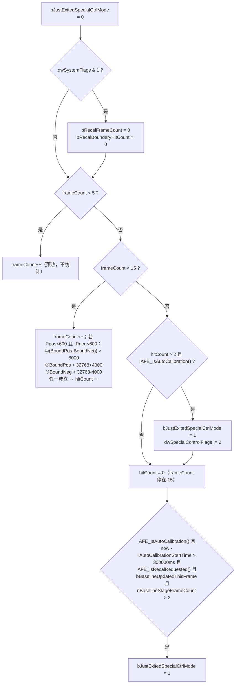

参数来源：`flash+0x48 = 0x8000 = 32768`（中心值）、`flash+0x4A = 0x1F40 = 8000`（窗口宽度，半宽 4000）。`BLRecal_Init` 把 `bRecalFrameCount` 置为 `0xFF`，所以冷启动后要靠 `dwSystemFlags & 1` 清零才会进入 5..15 的统计窗口。

### 13. 配置门控汇总（W273AS2700 实测）

特性字合成：`dwFeatureFlags` 基底 = `flash+0x50 (0x00000101) | flash+0x54 (0x01090020)` = **`0x01090121`**。

| 开关 | 证据（表名 + 偏移 + 实测） | 状态 | 对本模块的影响 |
|---|---|---|---|
| `bCols` / `bRows` / `wBufElementCount` | flash `+0x1D`=`0x3C`、`+0x1E`=`0x28`、`+0x2C`=`0x0960` | 60 / 40 / 2400 | 所有循环长度 |
| `bCmfForceDim1Pass` | flash `+0x19` = `0x01` | 开 | raw2raw CMF 走 dim1；`BLReset_IsRawChanged` 的索引式 |
| `dwPeakProcessingMode` | flash `+0x34` = `3` | Mode 3 | `BLReset_IsTouchToBeProtected` 单/双指无条件保护；`BLReset_IsLongTimeRawJumpDetected` 的 Mode 3 前置判据生效 |
| 帧率基数 `flash[0x38]` | flash `+0x38` = `0x64` = 100 | — | 默认帧间隔 10 ms；重置计数上限 20000 |
| `flash[0x44]` | flash `+0x44` = `0x00` | 关 | `BLSM_IsOKToIDLE` 只认 Stage 0 |
| 重校准中心 / 窗口 | flash `+0x48`=`0x8000`、`+0x4A`=`0x1F40` | 32768 / 8000 | `BLRecal_Process` |
| `bCmfEnabled` | flash `+0x68` = `0x00` | **关** | 跳过 `Rawdata_CMF`，改由 `BLSM_IsReset()==0` 后的 `CMF_Process` 兜底 |
| 基线跟踪源 | flash `+0x69` = `0x01` | 开 | `BLIIR_DoUpdate` 用 `g_tsaBufPreCMFRaw` |
| 脏基线检测 | flash `+0x6A` = `0x01` | 开 | `BLReset_IsCurBaselineDirty` 生效 |
| 异常基线检测 | flash `+0x6B` = `0x01` | 开 | `BLReset_IsBaselineAbnormal` 生效；**副作用：`BLReset_Check` 变死代码** |
| `wPeakFilterReferenceThreshold` | flash `+0x5B4` = `0x0BB8` | 3000 | raw2raw 分级、`IsTouchProtectOnRawJump`、`SensorBrokenDif` |
| `wPeakMode3ThresholdMax` | flash `+0x5B6` = `0x0258` | 600 | **噪声门限基准**、SHB 变化判据、`BLRecal` |
| SS 缩放基准 `flash[0x5B8]` | flash `+0x5B8` = `0x0BB8` | 3000 | `SS_CopyRaw` 缩放因子 = 16（恒等） |
| 目标基线常数 | flash `+0x5FC` = `0x00007FFF` | 32767 | `BLIIR_Reset` 第三分支 |
| 归一化上参考 `flash[0x600]` | flash `+0x600` = `0x00008BB7` | 35767 | `DAT_6BCAB638 = -16383`、`DAT_6BCAB63C = 65534` |
| `bRawdataForceNormalize` | flash `+0x604` = `0x00` | 关 | `Rawdata_NormalizeGridUnit` 输入零扩展 |
| **SS 通道使能** | flash `+0x608` = `0x00` | **关** | `SS_Process` 空操作、`SS_IsDim1/2Valid` = 0、入口 SS 校验短路、`BLReset_IsTriggered2BySS` 全族不可达 |
| `FEAT_SMART_COVER (0x2)` | `0x01090121 & 0x2` | 关 | `IsTouchToBeProtected` 第一条、`IsSmartCoverOff` 不可达 |
| `0x20` | `0x01090121 & 0x20` | 开 | （不在本模块） |
| `FEAT_SIGNAL_DISPARITY_POST (0x40)` | `& 0x40` | 关 | — |
| `FEAT_COORD_FREEZE (0x100)` | `& 0x100` | 开 | 仅 07 §8 的三条坐标冻结分支读它 |
| `FEAT_UNDERWATER (0x800)` | `& 0x800` | 关 | `Exception_CheckUnderWater` 跳过 |
| `0x8000`（侧列偏移） | `& 0x8000` | 关 | `BLReset_CheckTouchTrustability` / `IsTouchToBeProtected2` / `BaselineStateUpdate` 的列边界 = `[1, bCols-1)`；`TSA_GetDifPrpt` 掩码不切换 |
| `FEAT_ASA (0x10000)` | `& 0x10000` | 开 | 手写笔管线（不在本模块） |
| `FEAT_SAFE_BASELINE (0x20000)` | `& 0x20000` | **关** | `TSAStatic_IsSafeBaselineApplied()` 恒假 → `BLReset_IsTriggered` 走 `IsTriggered2`；`BLSM_GetMaxSig/MinSig` 走 ToeSyna 分支；`BLSM_UpdateForRawUnstable` 的 limit = INT_MAX；`SafeBaseline_*` 全族不可达 |
| `0x80000` | `& 0x80000` | 开 | 手写笔 AFT 门控（不在本模块） |
| 预置名特判 | `TSA_GetPrmtName() = "W273AS2700"` | 不匹配 P116/P150/P186 | `TouchThold_ToeUseSpecialThold()` 恒 0 → 边列特殊门限全族关闭 |
| `FLAG_USE_DIF_BUF_PATH` | 宿主 `dwSystemFlags` bit16，非 Flash | 关 | 走完整基线管线 |

表中凡标「宿主」的位，其产生者与实测取值见下一节。

### 14. 宿主输入契约

Flash 预置决定「这块面板能做什么」，宿主每帧灌入的三组标志决定「这一帧实际做什么」。全部模块共用这一套输入，本节是唯一定义处，其余模块引用即可。

宿主是 **`ApDaemon.dll`**（1.4 MB）。`HuaweiThpService.exe` 只有 22 KB，是个服务外壳；`THP_Service.dll` 与 `himax_thp_drv.dll` 的映像里不含任何 `TSA_` 符号。`ApDaemon.dll` 不走导入表，而是用 `GetProcAddress` **按名**解析 TSACore 导出，映像内共有 **211 个 `TSA_*` 名字串**。这给出一条通用的可达性判据：**某个导出若不在这 211 个名字里，它在本机就永远不会被调用**，由它独占写入的字段因此保持初值。本文多处「恒 0 / 恒关闭」的结论都由此得出。

#### 14.1 入口链与合并规则

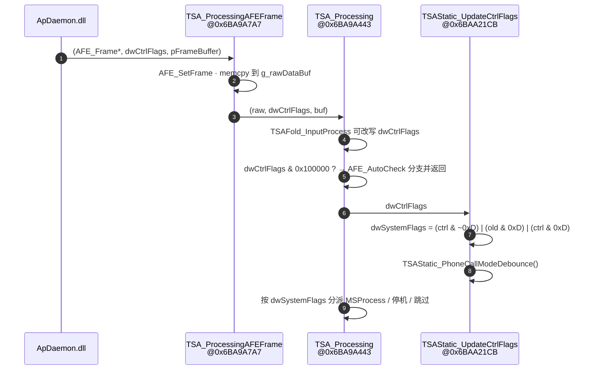

**`dwSystemFlags`（`TSAStatic + 0xBC`）就是 `dwCtrlFlags` 合并后的值，位编号一一对应**。合并只在 `0xD`（bit 0/2/3）这一组上有状态：该组置位时 `field_0xa1 = 3`、`bBaselineResetPropertyLatched = 0`，随后 3 帧内新旧值按位或保持（`field_0xa1` 每帧自减），让一次唤醒/复位脉冲对下游稳定可见 3 帧。bit2 额外把 `pFrameBufferPtr` 记进 `field_0x70` 并从本次输入里清掉 bit3，bit3 则记 `llAutoCalibrationStartTime`。其余位逐帧直通。

TSACore 内部写 `dwSystemFlags` 的只有 7 处（`Touch_SetVolatileFlag @0x6BA710D6`、`Touch_SetPersistFlag @0x6BA72A0D`、`TSA_Processing @0x6BA9A5A5`、`TSAStatic_PhoneCallModeDebounce @0x6BAA21BF`、`TSAStatic_UpdateCtrlFlags @0x6BAA2317`、`RptCoorLock @0x6BAC3186 / 0x6BAC31D8`），**没有任何导出 setter**。

| 位 | 名称 / 语义 | 解码点 |
|---|---|---|
| 0 / 2 / 3（`0xD`） | 硬复位与唤醒组，锁存 3 帧 | `TSAStatic_IsHWReset @0x6BAA2358` = `flags & 0xF`；`BLSM_UpdateStage` 的 reset 分类用 `& 5` / `& 8` |
| 1 (`0x2`) | `FLAG_PROCESSING_ACTIVE`；宿主可设，`TSA_Processing` 在 `TSA_IsInProcess()` 为假时也自置 | `TSA_Processing @0x6BA9A5A5` |
| 4 (`0x10`) | 跳频完成 | `TSAStatic_IsFreqShiftDone @0x6BAA23E0`（与 `AFE_IsFreqShiftDone()` 取或） |
| 5 / 21 (`0x200020`) | 充电器插入；命中时记 `field_0x60` 时间戳 | `TSAStatic_IsChargerPluggedNoDebounce @0x6BAA24C3` |
| 7 (`0x80`) | 屏幕已旋转（与 `nField_0x264 ∈ {1,3}` 取或） | `TSAStatic_IsScreenRotated @0x6BAA2E44` |
| 14 (`0x4000`) | `FLAG_SKIP_MS_PROCESS`，跳过整个 `TSA_MSProcess` | `TSA_Processing` |
| 16 (`0x10000`) | `FLAG_USE_DIF_BUF_PATH`，Dif 直供（见 §2） | `TSA_MSProcess` |
| 17 (`0x20000`) | 大屏显示噪声（与 `AFE_IsAllFreqNoisy()` 取或，另需 Prpt 超阈） | `TSAStatic_IsLargeDisplayNoise @0x6BAA255F` |
| 18 (`0x40000`) | CMF 改用备用幅值/梯度系数组 | `TSADynPrmt_GetCMFCoef @0x6BB3D0BD`（见 02 §4） |
| 20 (`0x100000`) | AFE AutoCheck；**直接用 `TSA_Processing` 的实参判定，不经 `dwSystemFlags`**，整条正常管线被旁路 | `TSA_Processing` |
| 22 / 23 (`0xC00000`) | 场景对：22=1、23=0 通话；22=0、23=1 锁屏 | `TSA_IsPhoneCallScenario @0x6BA8FB46`、`TSA_IsScreenLockScenario @0x6BA8FB8A` |
| 31 | TSA 停机：只跑 `SafeBaseline_SetBuf` + `TSAStatic_PostProcess` 后返回 | `TSA_Processing` |

#### 14.2 `dwFeatureFlags` 与 `dwFeatureFlags2`

`dwFeatureFlags`（`TSAStatic + 0xFC`）不是逐帧量，而是初始化时由 Flash 合成、之后只在宿主显式改特性时变动。`TSAStatic_InitSysModuleEveryTime @ 0x6BAA1628` 的合成式：

```c
dwFeatureFlags        = flash[0x50] | flash[0x54];        // 0x00000101 | 0x01090020 = 0x01090121
dwFeatureFlagsPrev    = dwFeatureFlags;
dwFeatureFlagsMasked  = dwFeatureFlags & 0x4813;          // = 0x0001
dwFeatureFlags2       = flash[0x58] | flash[0x5C];        // 0x00000120 | 0x00000120 = 0x00000120
```

`flash+0x54` 是**强制置位掩码**：`TSA_SetFeatures @ 0x6BA9F179` 在写完宿主给的值之后同样会把它再或回去，所以其中的位宿主关不掉。`0x4813` 是「需要 Flash 许可才能翻转」的受保护组（手套 bit0、皮套 bit1、高灵敏 bit4、水下 bit11、握持滤波 bit14），`TSA_SetGloveFeatures @ 0x6BA9EF6B` 一类的子函数只在宿主真正翻转该位时才动它，否则保持现值 —— 即**粘性**。

实测 `dwFeatureFlags = 0x01090121`：

| 位 | 常量 | 状态 | 影响 |
|---|---|---|---|
| 0 (`0x1`) | 手套 | **开** | 与 `DAT_6BCAB700 & 4` 相与恒真 → 手套门限分支武装（02 §14、06 §5） |
| 1 (`0x2`) | `FEAT_SMART_COVER` | 关 | `IsSmartCoverOff` / `SmartCover_Process` 不可达 |
| 4 (`0x10`) | 高灵敏 | 关 | `cfg & 8` 那条分支关闭 |
| 5 (`0x20`) | — | 开 | 见 07 |
| 6 (`0x40`) | `FEAT_SIGNAL_DISPARITY_POST` | 关 | — |
| 8 (`0x100`) | `FEAT_COORD_FREEZE` 坐标冻结使能 | 开 | 全库仅 3 个读点，都在 `Filter_ModeTouchReportedProcessUnit @ 0x6BA5F1C2`，守着「把上报坐标钉回上一帧」的三条分支（07 §8）。不涉及 IIR / JIT / `Touch_NeedXYFilter` |
| 11 (`0x800`) | `FEAT_UNDERWATER_DETECT` | **关** | `Exception_CheckUnderWater` 跳过 → 异常字取不到 `0x2000` → `+0x3F1` 恒 0 |
| 12 (`0x1000`) | 坐标冻结否决位（兼笔/AFT 门） | 关 | `TouchMode_GloveProcess` / `GloveDetect` / `GetTouchDownThold` 的短路支都不触发；在 07 §8 与 bit8 组成 `(feat & 0x100) && !(feat & 0x1000)` |
| 14 (`0x4000`) | 握持滤波 | 关 | — |
| 15 (`0x8000`) | 侧列偏移 | 关 | 列边界 `[1, bCols-1)` |
| 16 (`0x10000`) | `FEAT_ASA_ENABLED` | **开** | `TSA_ASAProcess` 每帧执行 |
| 17 (`0x20000`) | `FEAT_SAFE_BASELINE` | **关** | `SafeBaseline_*` 全族不可达 |
| 18 (`0x40000`) | `FEAT_AFT_ENABLED` | 关 | `AFT_Process` 跳过；`TSA_RptTouchNum` 走触点池分支 |
| 19 (`0x80000`) | `FEAT_STYLUS_AFT` | **开** | 配合 `dwStylusAftGateFlags & 4 == 0` 触发 `TSA_StylusAftProcess` |
| 20 (`0x100000`) | — | 关 | — |
| 21 (`0x200000`) | DoubleReport | **关** | 报点倍频整条链不可达（08 §7） |
| 22 (`0x400000`) | HotZone | **关** | 热区全族不可达（07） |
| 24 (`0x1000000`) | — | 开 | — |

`dwFeatureFlags2 = 0x120`（bit5 + bit8）。它唯一的宿主入口 `TSA_SetWorkarounds @ 0x6BA9F3B4` **不在 211 个名字里**，所以运行期恒为 `0x120`；其中 bit0（`EdgePeakFilter` workaround）未置位，`TSA_EnableEdgePeakFilterWorkaround` 这条路不生效。

#### 14.3 初始化时序

宿主用两组不同的入口驱动初始化，二者覆盖的参数块不同，复刻时不能混为一谈：

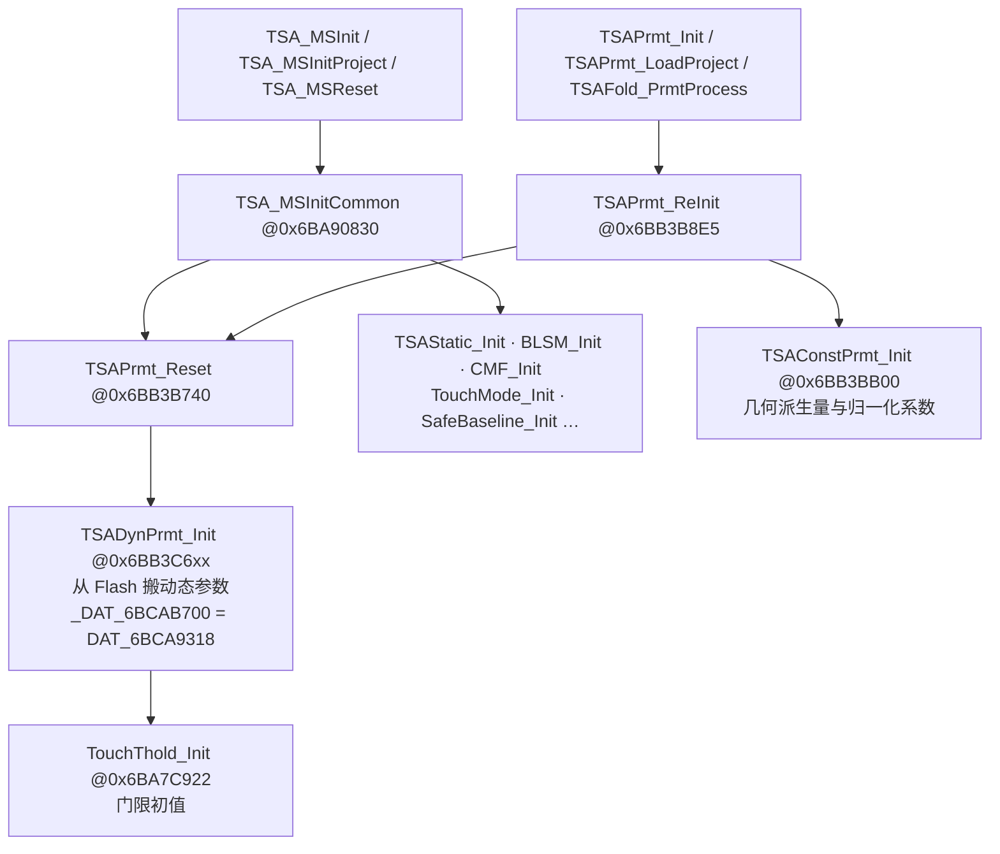

关键差别：**`TSAConstPrmt_Init` 不在主管线上**，也不在 `TSA_MSInitCommon` 里，只由 `TSAPrmt_ReInit` 调用，而 `TSAPrmt_ReInit` 的上游是 `TSAPrmt_Init`、`TSAPrmt_LoadProject` 与翻折状态变化时的 `TSAFold_PrmtProcess`。`TSADynPrmt_Init`（连带 `TouchThold_Init`）则挂在 `TSAPrmt_Reset` 下，每次 `TSA_MSInitCommon` 都重跑。

因此 `DAT_6BCAB624`（列数或行数，按 `bCmfForceDim1Pass` 择一）、`DAT_6BCAB625`、`DAT_6BCAB626`（`flash+0x62C` 起的通道映射表最大值 + 1）这批几何派生量**自工程加载起就固定**，帧内与复位都不会改写。`BLReset_IsRawChanged` 用它们做索引与循环边界，读到的始终是稳定值，复刻时当常量处理即可。

---

## 复刻检查清单

1. Raw / BL 的所有算术按 `uint16` 零扩展后在 `int` 上做，写回按 16 位回绕，不加饱和。
2. `BLIIR_DoUpdate` 死区 `(-step, step)` 开区间；`BLSM_UpdateForRawUnstable` 死区 `[-16, 16]` 闭区间、步长固定 17。
3. 所有 `>>` 都是「负数先加 `2^k - 1` 再算术右移」的向零取整，不是向下取整。
4. `qwBaselineStageReference` 单位为毫秒，换阶段时重置为「规整后的本帧间隔」而不是 0；`Touch_GetFormattedTimeInterval` 的 0→10 / ±8 钳位 / ±1000 钳位必须实现。
5. 首帧特例：`BLRecal_Init` 把 `bRecalFrameCount` 置 `0xFF`；`BLSM_Init` 把 stage=0、frameCount=1、reference=0；`BLReset_Init` 清 `g_tsaBufCleanBaseline`。
6. `BLSM_IsReset` 只认 Stage 1；Stage 2 那一帧 Dif 清零但 CMF/GridIIR 照跑。
7. 信誉计数 `touch+0x4EC` 在 15 处是吸收态。
8. `g_tsaPrpt[364..555]` 是 `[160..351]` 的整块快照，`BLReset_*` 读的是快照不是当帧值。
9. Stage 8 / Stage 9 无入口，属性位 `0x80` 永不产生——可以不实现，但不要为了「补全」而伪造跳转。
10. `Rawdata_Process` 在本预置下无副作用，可省略；`SS_Process` 空操作但 `SS_CopyRaw` / `SS_Reset` / `SS_CheckDirtyByMutual` 仍要实现。
