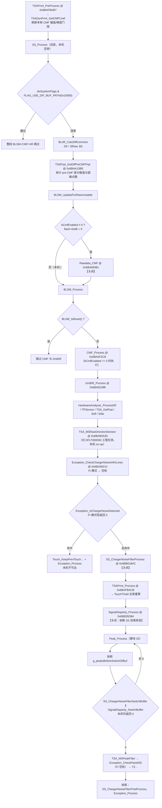
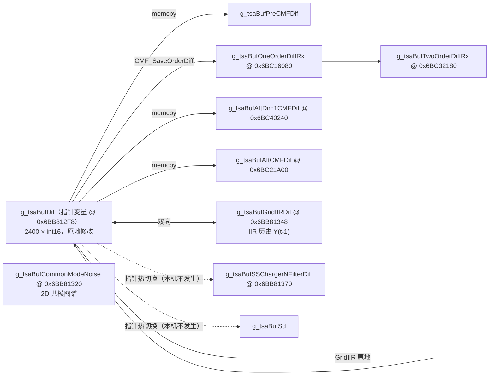
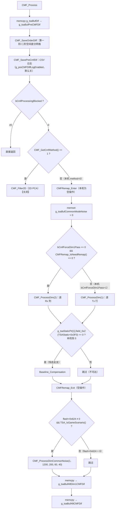
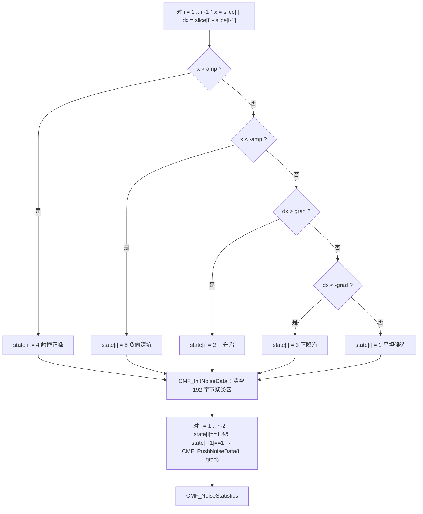
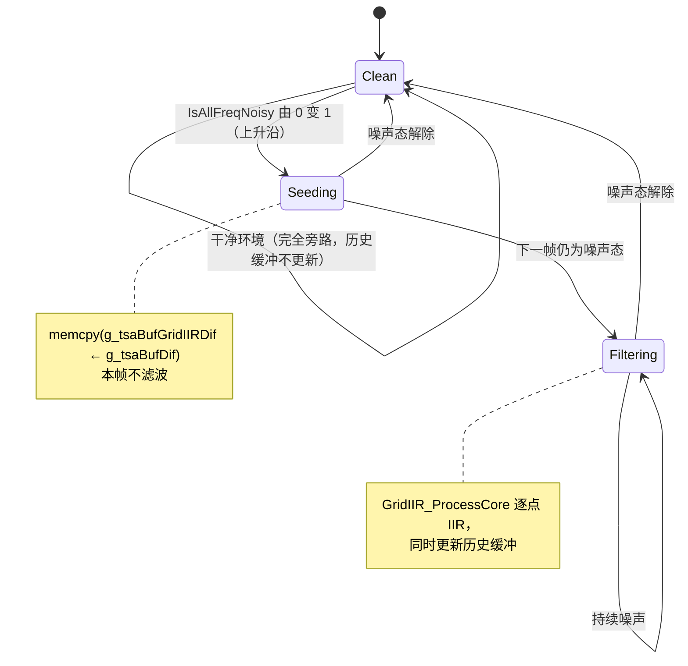
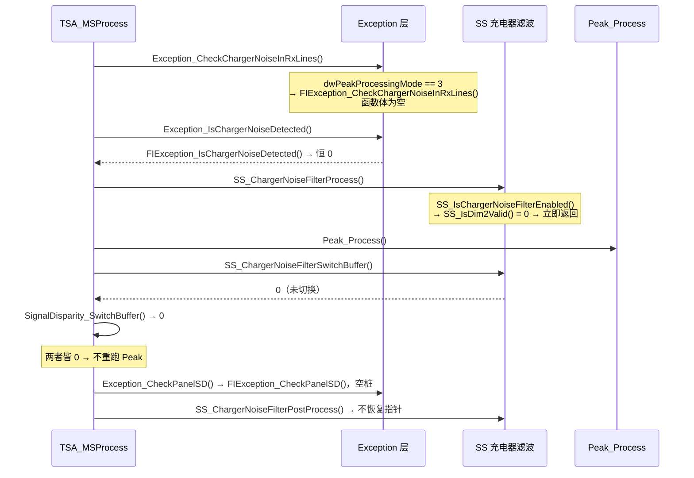
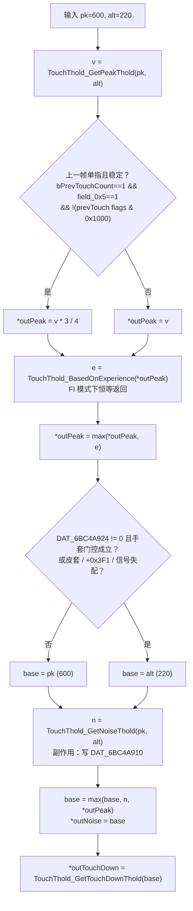

# 模块 02：共模消除、网格 IIR、充电器噪声防护与每帧动态门限

> 目标程序 `TSACore.dll`（image base `0x6BA40000`，x86:LE:64）；预置机型 `W273AS2700`（Gaokun Himax CSOT，60 列 Rx × 40 行 Tx = 2400 互容节点，显示 2560×1600）。所有参数值均取自 `TSAPrmt.dll` 导出的 `g_tsaPrmtFlashGaokunHimaxCSOT.bin`（6288 字节）与 `g_tsaPrmtFlashCmfPcaGaokunHimaxCSOT.bin`（4908 字节）实测。

## 概念

**共模噪声（Common-Mode Noise, CMN）**：Tx 行被激励的那个积分窗口内，60 路 Rx AFE 被同时采样，外界干扰（充电器开关纹波、VCOM 阶跃、人体地电位漂移）在该瞬间对全部 Rx 施加近似同相同幅的电荷偏置，表现为差分网格中「整行整体抬升或下陷」。

**CMF（Common-Mode Filter）**：把每条一维切片（本机固定为一整行 Tx，60 个点）中不属于手指的「平坦段」挑出来，统计出该行的共模标量 $N_{cm}$，再从整行逐点减去。

**GridIIR**：全屏差分的逐节点时域一阶 IIR 低通，只在「全频段大噪」判定成立时才启用。

**SS（Self-Sensing，自容通道）**：与互容并行的自容扫描链路。本机整体关闭（`flash+0x608 = 0x00`），由此派生的 `SS_ChargerNoiseFilter*`、`SignalDisparity_*` 两条链路一并失效。

**动态门限（TouchThold）**：每帧重算的一组门限（峰值门限 / 噪声门限 / 按下门限），由 `TSAPrmt_Process` 驱动，是 Peak 与 TZ 两级的输入，同时反向被 CMF 与基线属性统计读取（跨帧）。

**FI / HI 模式**：`dwPeakProcessingMode` 选择后端算法族。本机 = 3（FI，Full-Incell）。大量 `FIException_*` 函数在 FI 模式下是空桩，而对应的 `HIException_*` 实现只在非 3 模式下被调用。

---

## 架构

### 本模块在 `TSA_MSProcess @ 0x6BA90E43` 中的位置

`TSA_Processing @ 0x6BA9A443` → `TSA_MSProcess @ 0x6BA90E43`。本模块负责下图中加粗的环节；基线/BLSM 属模块 01，Peak 内部属模块 03。



### 关键时序事实：动态门限比 CMF 晚一步

`TSAPrmt_PreProcess` 只做一件事 —— `TSADynPrmt_GetCMFCoef`，刷新 CMF 的两个门限。**整组 TouchThold 门限是在 `TSAPrmt_Process` 里算的，而 `TSAPrmt_Process` 排在 CMF 与 GridIIR 之后**。因此：

| 读取者 | 读取的 TouchThold 值 | 新鲜度 |
|---|---|---|
| `TSAPrpt_GetDifPreCMFPrpt`（超噪点计数） | `DAT_6BC4A910` 噪声基准 | **上一帧** |
| `CMF_ProcessDimUnit`（共模超限标志） | `DAT_6BC4A910` | **上一帧** |
| `Peak_Process` / `TZ_Process` | `DAT_6BC4A912/914/91A` | 本帧 |

复刻时必须保留这一帧延迟，否则首帧行为与稳态收敛轨迹都会偏。首帧使用 `TouchThold_Init` 写入的初值（见后文）。

### 缓冲区拓扑



`g_tsaBufDif` 是**指针变量**而不是数组，充电器滤波与信号失配两条链路靠改写这个指针来「切换缓冲区」，从而复用 `Peak_Process` 的代码。所有网格缓冲按 `TSA_MAX_SENSOR_NUM = 0x1324 = 4900` 元素（9800 字节 = `0x2648`）分配，而非 2400，边界写越出 2400 不会越界到堆外。

### 原厂源码文件对应

| 源文件（断言字符串还原） | 本模块涉及的函数 |
|---|---|
| `../../src/Alg/CMF/CMF.c` | `CMF_Process`、`CMF_ProcessDim`、`CMF_ProcessDimUnit(OnBuf)`、`CMF_ProcessCore(Weight)`、`CMF_NoiseCal`、`CMF_InitNoiseData`、`CMF_PushNoiseData`、`CMF_NoiseStatistics`、`CMF_CopyCommonModeNoise`、`CMF_SaveOrderDiff` |
| `../../src/Alg/CMF/CMFRemap.c` | `CMFRemap_Init/Enter/Exit/IsNeedRemap/Mapping` |
| `../../src/Alg/CMF/CMF_Pca.c` | `CMF_Filter2D` 族（本机全旁路） |
| `../../src/Alg/GridIIR/GridIIR.c` | `GridIIR_Process`、`GridIIR_ProcessCore`、`IIR_Process2` |
| `../../src/Alg/Exception/Exception.c` | `Exception_CheckChargerNoiseInRxLines`、`Exception_CheckPanelSD`、`Exception_Process` |
| `../../src/Extension/SS/SS_Process.c` | `SS_ChargerNoiseFilter*`、`SS_DiffRelatCal`、`SS_FilterChargerNoise` |

---

## 分点解释

### 1. CMF 的两种切入时机与本机选择

`bCmfEnabled`（`flash+0x68`，实测 `0x00`）决定 CMF 在 Raw 域还是 Diff 域生效：

- `≠ 0`：BLSM 更新基线**之前**调 `Rawdata_CMF @ 0x6BA69381`，它先 `BLIIR_CalcDiffCommon` 算一份临时差分，跑 `CMF_Process`，再用 `BLIIR_CalcRawCommon` 从滤波后的差分逆推回 `g_tsaBufRaw`，让基线跟踪的是去共模后的 Raw。
- `== 0`（**本机**）：基线用未去共模的原始数据更新，CMF 挪到 BLSM 之后、直接作用在 `g_tsaBufDif` 上。

两者互斥，`TSA_MSProcess` 里写成 `if (bCmfEnabled) Rawdata_CMF();` … `if (!bCmfEnabled) CMF_Process();`。

**门控边界**：整个 `BLSM + CMF + GridIIR` 段被 `dwSystemFlags & FLAG_USE_DIF_BUF_PATH (bit16)` 整体跳过——该位由宿主每帧经 `TSAStatic_UpdateCtrlFlags` 灌入（`dwSystemFlags` 是整字覆盖，只有低位 `0xD` 有锁存逻辑），不是 Flash 参数。此外 `BLSM_IsReset()` 为真时 CMF 与 GridIIR 都不跑；`BLSM_IsReset()` 只认 Stage 1 → Stage 2 的噪声重置，其余重置帧仍会跑（模块 01 结论）。

`CMF_Process` 自身还有一道 `g_tsaStaticPtr->bCmfProcessingBlocked`（`TSAStatic+0x11C`）开关：置位时整个方法分支被跳过，连 `g_tsaBufAftCMFDif` 快照也不更新（`g_tsaBufPreCMFDif` 与一阶/二阶差分仍会更新）。该字段只由宿主 API `TSA_SetDisableCMFFlag` 写，`TSAStatic_InitSysModuleEveryTime` 在**初始化时**清零一次（不是每帧），所以一旦置位就一直有效直到宿主清除。

### 2. `CMF_Process @ 0x6BA4F2C8` 分支选择



`CMF_GetCmfMethod @ 0x6BA4D903` 的完整判定：

```c
if (!(featureFlags & FEAT_SMART_COVER) || flash[0x814] == 2)
    return flash[0x810];   // dwCmfMethodNormal
else
    return flash[0x814];   // dwCmfMethodSmartCover
```

实测 `flash+0x810 = 0`、`flash+0x814 = 2`。`== 2` 的含义就是「皮套模式下回退用 Normal」，因此**不论是否皮套模式，返回值恒为 0，走 1D 路径**。

2D PCA 侧的双重证据：`g_tsaPrmtFlashCmfPcaGaokunHimaxCSOT.bin`（4908 字节）**全部字节为 0**，而 `CMF_GetNeighborCoef @ 0x6BA511EA` 里有断言 `TSAPrmtCmfPca(...)[pcaDegree-1] > 1e-12`；若强开 2D 会立刻触发软异常。另外 `CMF_Init @ 0x6BA4D8C1` 只在 method 为 1 时才调 `CMF_Init2DFilter`，本机连 PCA 的运行期结构都没初始化。

维度选择由 `bCmfForceDim1Pass`（`flash+0x19` = `0x01`）锁死走 Dim1。物理上也吻合：同一 Tx 激励期内 60 路 Rx 由独立 AFE 同时采样，噪声在行内严格同相；跨 Tx 行之间存在扫描时延，不具备该相关性。

### 3. `CMF_SaveOrderDiff @ 0x6BA4ECAA` —— 一阶/二阶空间差分

按 `bCmfForceDim1Pass` 选定遍历方向（本机：外层 40 行、内层 60 列，沿 Rx 方向做差）：

```
OneOrderDiffRx[r*60 + 0] = 0
OneOrderDiffRx[r*60 + c] = Dif[r*60 + c] - Dif[r*60 + c - 1]     c = 1..59
TwoOrderDiffRx[r*60 + c] = OneOrderDiffRx[r*60 + c + 1] - OneOrderDiffRx[r*60 + c]   c = 1..58
```

**固件缺陷（复刻时按位照抄或显式跳过，但要知道）**：二阶循环的边界清零分支与内层索引用了相反的寻址约定。`bCmfForceDim1Pass == 1` 时清零的是 `TwoOrderDiffRx[a]` 与 `TwoOrderDiffRx[a + 59*60]`（`a = 0..39`），而内层写的是 `r*60 + c`。结果是**每行的 c=0 与 c=59 两列从不被写入，保留上一帧残值**，同时在 `[3540, 3579]` 区间（超出 2400 有效区、但仍在 4900 元素缓冲内）写了两串无用的 0。这两个缓冲只被 `CMF_SaveOrderDiff` 自己和 IDE 抓图读取，不参与判决，所以对报点无影响。

### 4. `CMF_ProcessDim @ 0x6BA4E8B5` —— 切片调度

```c
DAT_6BC4A940 = 0x7FFF;   // 本帧全屏 N_cm 最小值
DAT_6BC4A942 = -0x8000;  // 本帧全屏 N_cm 最大值
unitCount = (dim == 1) ? bRows : bCols;        // 本机 40
ssBase    = (dim == 1) ? bCols : 0;            // 本机 60

// SS_IsValidForCMF() 恒返回 0（函数体就是 return 0），SS 相关分支永不执行
for (u = 0; u < unitCount; ++u) {
    amp = sAmpThold;                            // 600
    if (TouchThold_ToeUseSpecialThold() && !(u > 1 && u < unitCount - 2))
        amp = 200;                              // 仅 P116/P150/P186 工程，本机不触发
    nCm = CMF_ProcessDimUnit(dim, u, amp, sGradThold /*150*/, &draft, bCols, bRows);
    CMF_CopyCommonModeNoise(dim, u, bCols, bRows, nCm);
    DAT_6BC4A940 = min(DAT_6BC4A940, nCm);
    DAT_6BC4A942 = max(DAT_6BC4A942, nCm);
}
```

`sAmpThold` / `sGradThold` 不是直接从 Flash 读的，而是每帧由 `TSADynPrmt_GetCMFCoef @ 0x6BB3D0AF` 打包写进运行期镜像 `DAT_6BCAB6BC`（低 16 位 = 幅值门限，高 16 位 = 梯度门限）：

```c
if (!(dwSystemFlags & 0x40000)) { DAT_6BCAB6BC = flash[0x620..0x623]; DAT_6BCAB6C0 = flash[0x624..0x625]; }
else                            { DAT_6BCAB6BC = flash[0x626..0x629]; DAT_6BCAB6C0 = flash[0x62A..0x62B]; }
```

`0x40000` 是 `dwSystemFlags` 的 bit18，不来自 Flash：宿主每帧把 `dwCtrlFlags` 作为第二个实参传给 `TSA_Processing @ 0x6BA9A443`，`TSAStatic_UpdateCtrlFlags @ 0x6BAA21CB` 原样把该位合并进 `dwSystemFlags`（bit18 不在被锁存的 `0xD` 组里，所以逐帧跟随宿主）。实测两组值：正常组 `(600, 150)`，备用组 `(15000, 200)`。备用组的 15000 远超 int16 差分的正常量程，等效于「关掉幅值剔除、只靠梯度判平坦」。常态录像中未出现该位置位的帧，稳态走正常组。

`CMF_ProcessDimUnit @ 0x6BA4E2AF` 除了转调 `CMF_ProcessDimUnitOnBuf(g_tsaBufDif, g_tsaBufDif, …)` 之外，还有一个副作用：

```c
if (DAT_6BC4A910 < nCm)  g_tsaStaticPtr->dwSpecialControlFlags |= 0x08;
```

`DAT_6BC4A910` 是 TouchThold 的噪声基准（见第 9 节），稳态实测 125。任何一行的共模估计超过它，就给本帧打上「共模噪声偏大」标志。

`CMF_CopyCommonModeNoise @ 0x6BA4E7EE` 把标量填满整行（Dim1）或整列（Dim2）：`CMN[u*bCols + c] = nCm, c = 0..bCols-1`。注意它用 `param_3`（bCols）同时当行长和行步长，在 Dim2 分支里索引是 `bCols*rowIdx + u`，两边一致。

### 5. `CMF_ProcessDimUnitOnBuf @ 0x6BA4E0EC` —— 跨步抽取与回写

```c
if (dim == 1) { base = bCols * lineIdx; stride = 1;     count = bCols; }  // 行切片，本机 60
else          { base = lineIdx;         stride = bCols; count = bRows; }  // 列切片

int slice[256];                      // 栈上，容量 0x100
for (i = 0; i < count; ++i) { slice[i] = (int)(int16)src[base + i*stride]; }
nCm = CMF_ProcessCore(slice, 0x100, count, amp, grad, pOutDraft);
for (i = 0; i < count; ++i) { dst[base + i*stride] = (int16)slice[i]; }
```

**参数传递陷阱**：该函数第 7 个参数在 Ghidra 里被命名为 `pWeight`，但 `CMF_ProcessCore @ 0x6BA4E799` 把它当作 `pOutDraft` 往下传，而权重位置硬编码传 0：

```c
CMF_ProcessCore(buf, cap, n, amp, grad, p6) { return p6 ? CMF_ProcessCoreWeight(buf, 0, n, amp, grad, p6) : 0; }
```

所以 **1D 路径永远是无权重模式**，`CMF_PushNoiseData` / `CMF_NoiseStatistics` 的加权分支在本机（乃至整条 1D 链路）都是死代码。唯一会传非空权重的调用者是 `SS_CMFProcessDim2 @ 0x6BB00803`，属于自容通道，本机关闭。

回写是 `int → int16` 的直接截断，**没有饱和**。切片值本身来自 int16，减去一个 int16 量级的 `N_cm` 后最坏可到 ±65534，会回卷。实践中 `N_cm` 受平坦段约束在小幅值区间，不会触发；复刻时若要位级一致，必须用 `(int16_t)` 截断而不是 clamp。

### 6. `CMF_NoiseCal @ 0x6BA4E376` —— 五态分类与双连续平坦判据



边界细节（复刻必须精确）：

- 分类循环 **从 i = 1 开始**，`state[0]` 从不被赋值，也从不被读（采纳循环 `i = 1 .. n-2` 只读 `state[i]` 与 `state[i+1]`，最小索引 1）。切片首元素 `slice[0]` 因此永远不会被单独采纳为平坦点，但它仍参与后续的整段减法。
- 比较用 `short` 截断：`local_e = (short)slice[i]`，`local_10 = (short)(slice[i] - slice[i-1])`；即先取低 16 位再比较。
- 门限比较是严格不等：`x > amp`、`x < -amp`、`dx > grad`、`dx < -grad`，落在边界上算平坦。
- 「双连续平坦」意味着：最后一个元素 `slice[n-1]` 的状态被计算但只能作为 `i+1` 的确认者，自身不会被推入聚类器。

### 7. `CMF_PushNoiseData @ 0x6BA4DA6A` —— 在线聚类

聚类区是一块 192 字节（`0xC0`）的静态结构，`CMF_InitNoiseData` 每条切片开头整体 memset 后把 `lastIdx` 置 `0xFFFF`：

| 地址 | 含义 |
|---|---|
| `0x6BB7F080`（u16） | `lastIdx`，上一个入桶的切片索引，初值 `0xFFFF` |
| `0x6BB7F082`（u8） | `activeBucket`，当前活跃桶号 |
| `0x6BB7F083`（u8） | `bucketCount`，已开辟桶数，上限 10 |
| `0x6BB7F084 + k*0x10`（i32） | `sum[k]`，$\sum x_i \cdot w_i$ |
| `0x6BB7F088 + k*0x10`（u8） | `count[k]`，样本数 |
| `0x6BB7F08C + k*0x10`（i32） | `last[k]`，最近入桶的原始值 |
| `0x6BB7F090 + k*0x10`（i32） | `wsum[k]`，权重和 |
| `0x6BB7F124`（u8） | 输出：被选中桶的样本数 |
| `0x6BB7F128`（i32） | 输出：$N_{cm}$ |
| `0x6BB7F130`（ptr） | 当前切片首地址 |
| `0x6BB7F138`（ptr） | 权重数组指针，1D 路径恒为 0 |

入桶决策：

1. **空间连续扩展**：`idx == lastIdx + 1` → 直接并入 `activeBucket`（不做值域检查）。
2. **值域邻近合并**：否则从 `k = 0` 起线性扫描已有桶，取第一个满足 `-grad < (short)(x - last[k]) < grad` 的桶并入，并把 `activeBucket` 改为 k。
3. **开新桶**：都不满足且 `bucketCount < 10` → 开第 `bucketCount` 号桶，`bucketCount++`。
4. **桶满兜底**：`bucketCount == 10` 且无匹配 → 强行并入当前 `activeBucket`（不新开、不丢弃）。

每次入桶都无条件更新 `last[k] = x` 与 `lastIdx = idx`。注意步骤 2 的差值先算成 `short` 再比较，与 `CMF_NoiseCal` 的梯度判据共用同一个 `grad`（150）。

### 8. `CMF_NoiseStatistics @ 0x6BA4DEB4` 与 `CMF_ProcessCoreWeight @ 0x6BA4E55B`

无权重路径（`weightPtr == 0`，本机唯一路径）：

```c
minMean = 0x7FFF; minCount = 0;        // 均值最小的桶
zeroMean = 0x7FFF; zeroCount = 0;      // |均值| 最接近 0 的桶
for (k = 0; k < bucketCount; ++k) {
    mean = (short)(sum[k] / count[k]);          // C 语义：向零截断
    if (mean < minMean)  { minMean = mean;  minCount = count[k]; }
    if (abs(mean) < abs(zeroMean)) { zeroMean = mean; zeroCount = count[k]; }
}
if (bucketCount == 0)                 { N_cm = 0;        outCount = 0; }
else if (zeroCount < minCount || minMean > 0) { N_cm = minMean;  outCount = minCount; }
else                                  { N_cm = zeroMean; outCount = zeroCount; }
```

仲裁的物理含义：互容正极性下手指信号恒为正，残留的轻微按压抬升只会把桶均值往正侧推。所以当「最小均值桶本身就 > 0」（说明整行都被抬起来了，最小值就是最可信的基底）或者「最小均值桶样本数更多」时，取最小均值；否则取最靠近 0 的桶，避免被某个偶然的深负值桶过减。

加权路径（死代码，仅 `SS_CMFProcessDim2` 可达）：取 `wsum[k]` 最大的桶，`N_cm = (short)(sum[k] / wsum[k])`。

`CMF_ProcessCoreWeight` 完成减法：

```c
CMF_NoiseCal(buf, weight, n, amp, grad);
// 皮套自适应二次收敛：本机 FEAT_SMART_COVER 不置位 且 flash+0x6D = 0 → 不执行
if ((featureFlags & FEAT_SMART_COVER) && flash[0x6D] &&
    (amp2 = N_cm * 3 / 2) > 0 && amp2 < amp)
    CMF_NoiseCal(buf, weight, n, amp2, grad);
for (i = 0; i < n; ++i) buf[i] -= N_cm;   // int32 域，无饱和
if (pOutDraft) *pOutDraft = outCount;
return N_cm;
```

减法在 int32 域进行，截断到 int16 发生在 `CMF_ProcessDimUnitOnBuf` 的回写循环里。

### 9. `Baseline_Compensation @ 0x6BA46D00` —— 全屏基线整体牵引

```c
drift = 0;
if (DAT_6BC4A942 < 0)      drift = DAT_6BC4A942;   // 全屏 N_cm 上界 < 0 → 整屏负偏，取最靠近 0 的
else if (DAT_6BC4A940 > 0) drift = DAT_6BC4A940;   // 全屏 N_cm 下界 > 0 → 整屏正偏，取最靠近 0 的
if (abs(drift) > 4 && g_tsaStaticPtr->field_0x30A == 0) {
    step = (drift < 1) ? -5 : +5;
    for (i = 0; i < wBufElementCount; ++i)
        g_tsaBufBl[i] += (g_tsaStaticPtr->bField_0x11A ? +step : -step);
    g_tsaStaticPtr->dwSpecialControlFlags |= 0x100;
}
```

三个条件字段的真实语义：

- `g_tsaStaticPtr[1].field_0x2`（= `TSAStatic + 0x3F0`）：`CMF_Process` 里的前置门控，非 0 时整个补偿被跳过。它**本机恒为 0**，因此这道门永远是开的。全程序只有两个写入点：`BLReset_FlagDisableBaselineUpdateInit @ 0x6BA47AF4` 把它清 0，以及导出函数 `TSA_SetDisableBaselineUpdateFlag @ 0x6BA9F869` 按宿主入参写。而宿主 `ApDaemon.dll` 按名解析的 TSACore 导出清单里**没有** `TSA_SetDisableBaselineUpdateFlag`，所以运行期不存在把它置 1 的途径。
- `TSAStatic + 0x30A`：由 `BLReset_IsLongTimeRawJumpDetected` 置位的「长时 Raw 跳变检测中」标志，期间禁止补偿，避免和基线重置逻辑打架。
- `TSAStatic + 0x11A`：**不是「反相极性」**。`TSAStatic_PreProcess @ 0x6BAA1BB0` 每帧执行 `bField_0x11A = g_tsaStaticPtr[1].field_0x3`（= `TSAStatic + 0x3F1`）。`+0x3F1` 是「本轮 `0x2000`（水下）异常字已触发过一次基线重置」的哨兵，只在 `BLReset_IsTriggered2AfeWakeUp @ 0x6BA4BB37` 或 `SafeBaseline_IsResetTriggered @ 0x6BB05A3A` 发生重置且当帧 `g_pPrevTouches->nTouchCount == 0x2000` 时置 1，并由每帧都跑的 `BLReset_Check @ 0x6BA48AF0` / `SafeBaseline_ResetCheck @ 0x6BB05907` 在 `nTouchCount != 0x2000` 时立即清 0。本机不会出现 `0x2000` 异常字，**`+0x3F1` 恒为 0**，于是补偿方向固定为 `g_tsaBufBl[i] -= step`，另一支不可达。

只有 CMF 走 1D 路径时才会调用它（2D PCA 分支里没有），且 `DAT_6BC4A940/942` 必须由 `CMF_ProcessDim` 在同一帧刷新过。步长固定 ±5 LSB/帧，死区 |drift| > 4，与逐点基线 IIR 并行叠加。

### 10. `CMFRemap` —— 本机全旁路

```c
CMFRemap_IsNeedRemap() {
    return !(g_cmfRemapNumRxCombine == 1 && flash[0x6CD] == 0 && flash[0x80E] == 0);
}
```

实测 `flash+0x6CC = 1`（`CMFRemap_Init` 里 `g_cmfRemapNumRxCombine = flash[0x6CC]`）、`flash+0x6CD = 0`、`flash+0x80E = 0` → **返回 0，`CMFRemap_Enter/Exit` 立即返回，不做任何拷贝或重投影**；`CMFRemap_Init` 同时把 `g_cmfRemapMapIdx[k] = g_cmfRemapDifIdx[k] = k` 填成恒等表。传给 `CMFRemap_Enter(&bCols, &bRows)` 的两个尺寸变量保持 60/40 不变，后续 `CMF_ProcessDim` 直接按物理网格处理。

启用时（双 IC 拼接 / Rx 合并 / reshape）的公式，供参考：进入 `Dif[k] = Raw[MapIdx[k]] * Coef[MapIdx[k]] / 1024`（`flash+0x6CD == 0` 时省去系数，纯索引重排），退出 `Dif[i] = Remap[MapIdx[i]] * InvCoef[i] / 1024`，且 `g_tsaBufCommonModeNoise` 同步逆映射。负数除法用 `+0x3FF` 预偏置后算术右移 10 位（向零截断）。

### 11. `GridIIR_Process @ 0x6BA61098` —— 时域一阶 IIR



顶层逻辑（注意：**先判上升沿，命中则只播种、本帧不滤波**）：

```c
if (TSAStatic_IsAllFreqBecomeNoisy())            // cur==1 && prev==0
    memcpy(g_tsaBufGridIIRDif, g_tsaBufDif, wBufElementCount * 2);
else if (TSAStatic_IsAllFreqNoisy())
    GridIIR_ProcessCore(g_tsaBufDif, g_tsaBufDif, g_tsaBufGridIIRDif, wBufElementCount, flash[0x8F8]);
```

`TSAStatic_IsAllFreqBecomeNoisy @ 0x6BAA260A` 自己会先调 `TSAStatic_IsAllFreqNoisy()` 并把结果写回 `field_0xD`，再与 `field_0xE` 比较；`field_0xE` 是 `TSAStatic_PreProcess` 在帧首做的 `field_0xE = field_0xD` 快照，即上一帧的判决。

`TSAStatic_IsAllFreqNoisy @ 0x6BAA2590` 的判据：

```c
if (!TSAStatic_IsChargerPlugged()) {
    field_0xD = TSAStatic_IsLargeDisplayNoise() ? 1 : 0;      // 有清零路径
} else {
    if (dwSystemFlags & 0x20000)   field_0xD = 1;             // 无清零路径 → 粘滞
    if (AFE_IsAllFreqNoisy())      field_0xD = 1;
}
return field_0xD;
```

**坑**：充电器插入时这个函数**只会把 `field_0xD` 置 1，永远不会清 0**。一旦在插充状态下进过噪声态，只有拔掉充电器（走上面那条带 `else` 的分支）才能恢复。复刻必须照抄这个粘滞行为。

`TSAStatic_IsLargeDisplayNoise @ 0x6BAA24F9` 不是「屏噪单独成立」就返回 1：

```c
if ((prpt.maxAbsDif > wPeakFilterReferenceThreshold * 2 && prpt.overCount > wBufElementCount >> 2)
    || field_0xE /* 上一帧已是噪声态 */) {
    if (dwSystemFlags & 0x20000) return 1;
    if (AFE_IsAllFreqNoisy())    return 1;
}
return 0;
```

即「大屏噪」只是进入条件的前半段，**仍必须叠加宿主标志 `0x20000` 或 AFE 全频点受污染**才成立。两个统计量来自 `TSAPrpt_GetDifPreCMFPrpt`（pre-CMF 差分）：`g_tsaPrpt+352` = 全屏 |Dif| 最大值，`g_tsaPrpt+354` = `|Dif| ≥ DAT_6BC4A910` 的节点数。实测门限：`3000 × 2 = 6000` 与 `2400 >> 2 = 600`。`field_0xE` 项让判决有迟滞。

`AFE_IsAllFreqNoisy @ 0x6BB2E281` 读的是 AFE 跳频表当前频点条目的 bit0，需要 AFE 上下文有效且 `[ctx+0x2C] == 1`。

滤波核：

```c
// GridIIR_ProcessCore @ 0x6BA60FD5
for (i = 0; i < n; ++i) {
    y = IIR_Process2((int)(int16)dif[i], (int)(int16)hist[i], alpha /*224*/, 8);
    dif[i] = (int16)y;
    hist[i] = dif[i];                     // 历史即输出
}

// IIR_Process2 @ 0x6BA6021B
int IIR_Process2(int cur, int hist, uint8 alpha, uint8 shift) {
    int y = (alpha * cur + ((1 << shift) - alpha) * hist) / (1 << shift);   // 向零截断
    if      (y < cur) return y + 1;
    else if (y > cur) return y - 1;
    else              return y;
}
```

`alpha = flash+0x8F8 = 224`，`shift = 8` → 当前帧权重 224/256 = 87.5%，历史权重 32/256 = 12.5%。`±1` 的舍入补偿永远把结果朝 `cur` 拉一个 LSB，保证定点截断不会造成永久死区（稳态可精确收敛到 `cur`）。除法是 C 的 `/`，对负数向零截断，**不是**算术右移，复刻时不能用 `>> 8` 替换。

历史缓冲 `g_tsaBufGridIIRDif` 只在上升沿播种和滤波时写；干净环境下完全不更新，所以「干净很久 → 突然噪声」时必然先经过一帧播种，不会拖入陈旧数据。

### 12. 充电器噪声链路：本机整条失活



三重关闭证据：

1. `Exception_CheckChargerNoiseInRxLines @ 0x6BA59214` 在 `dwPeakProcessingMode == 3`（实测 `flash+0x34 = 3`）时只调 `FIException_CheckChargerNoiseInRxLines @ 0x6BA59429`，**该函数体只有一条 `ret`**。`Exception_IsChargerNoiseDetected @ 0x6BA592A7` 同理转到 `FIException_IsChargerNoiseDetected @ 0x6BA5942F`，**恒返回 0**。所以「Rx 线充电器噪声检测 → 冻结报点」这条保护在本机**从不触发**，`bKeepPreviousTouches` 只可能被 `TSA_IsToBypassCurrentFrame()` 置位。完整实现在 `HIException_CheckChargerNoiseInRxLines @ 0x6BA5B9D1`，只在非 FI 模式可达。
2. `SS_IsChargerNoiseFilterEnabled @ 0x6BB0114B` 要求 `SS_IsDim2Valid() && SS_IsDim1Valid() && DAT_6BCAB6B8 && (充电器插入 || noiseLevel == 3)`。`SS_IsDim1Valid/IsDim2Valid` 读的是 `DAT_6BCAB6A4 & 1 / & 2`，而 `TSADynPrmt_Init` 里 `_DAT_6BCAB6A4 = flash[0x608..0x60F]`，实测 `flash+0x608 = 0x00` → 两者皆 0。**这就是模块 01 所说「SS 通道关闭」对本链路的直接后果：`SS_ChargerNoiseFilter*` 随之全部失效。** 即便 SS 打开，`DAT_6BCAB6B8 = flash[0x61C] = 0x00` 仍会独立否决。
3. `Exception_CheckPanelSD @ 0x6BA59325` 在 FI 模式下转到空桩 `FIException_CheckPanelSD @ 0x6BA593BC`。它的作用（在 HI 模式下）是检测面板级信号失配并写入异常状态，本机不产生任何效果。

即便如此，复刻若要保留代码骨架，需要知道这条链路打开后的行为：

- **回归模型** `SS_DiffRelatCal @ 0x6BB00ED5`：对一维自容序列做最小二乘斜率，$K = \dfrac{N\sum X_iY_i - (\sum X_i)(\sum Y_i)}{\big(N\sum X_i^2 - (\sum X_i)^2\big) \gg 10}$，其中 $X$ = `g_tsaBufSSDif`（自容差分，int32），$Y$ = `g_tsaBufSelf`（int32）。分母负数先 `+0x3FF` 再算术右移 10 位；分母右移后为 0 则 $K = 0$。
- **触发判据** `SS_IsChargerNoiseFilterNeeded @ 0x6BB011A4`：要求 `g_tsaPrpt.nSPeakPositive > wPeakMode3ThresholdMax(600)`；所有 notch 位置的差分绝对值不超过 `DAT_6BC4A912`（峰值门限）；四个自容角点中至少一组超 `DAT_6BC4A910`；本帧 $K$ 与滑动均值 `g_ssDiffRelatK` 的比值落在 `[3/5, 7/5]`（`noiseLevel == 3` 时放宽到 `[2/5, 8/5]`）。命中后 `g_ssDiffRelatK = (g_ssDiffRelatK*14 + K*2) / 16`（14:2 的 IIR）。
- **滤波** `SS_FilterChargerNoise @ 0x6BB0179F`：只对自容差分超过 `DAT_6BC4A910 / 2` 的那些线做补偿，`SSChargerNFilterDif[p] = Dif[p] - (((SSDif[j] * Ki) >> 6) * 4 / 5)`，`Ki` 由 `SS_ChargerNoiseFilterKiCal @ 0x6BB01741` 给出：`Ki = clamp((sigSum - sjScaled) * 64 / sjSum, ±cap)`，`cap = (noiseLevel==3 ? 128000 : 38400) / maxAbsSSDif`。$K$ 本身先钳到 `[0x600, 0xC00]`。乘 `4/5` 是 20% 的保守衰减。
- **缓冲切换语义** `SS_ChargerNoiseFilterSwitchBuffer @ 0x6BB01B92`：**不看滤波是否真的改了数据**，只要 `SS_IsChargerNoiseFilterEnabled()` 为真就把 `g_tsaDifBufPtrSsChargerNFilterBackup = g_tsaBufDif; g_tsaBufDif = g_tsaBufSSChargerNFilterDif;` 并返回 1，于是 `Peak_Process` 被**整个重跑一遍**（第一遍的峰值结果已经快照到 `g_peaksBeforeSwitchDifBuf`，后续模块可对比两套峰值）。`SS_ChargerNoiseFilterProcess` 一进门就把 `g_tsaBufDif` 整体 memcpy 到 `g_tsaBufSSChargerNFilterDif`，所以即使没有任何一条线被补偿，切换后的内容也是合法的完整差分。
- **恢复** `SS_ChargerNoiseFilterPostProcess @ 0x6BB01BDF` 在帧尾把指针换回来，条件是 `enabled && backup != 0`。`backup` 是全局且**从不清零**，所以若某一帧 enabled 为真但当帧没切换过，仍会用上一次的 backup 覆盖 `g_tsaBufDif`——本机因为 enabled 恒假而不可达，复刻时若移植这段需要自行加保护。

`TSA_MSRawDirectionDectect` 也在这一段，但它只对工程名等于 `"DFLT000000"` 的默认工程生效（`W273AS2700` 不匹配），实际是 no-op。

### 13. 信号失配 `SignalDisparity`

`SignalDisparity_Process @ 0x6BB35D84` 的第一件事就是 `SS_IsDim1Valid() && SS_IsDim2Valid()`，两者皆 0 → **整个函数体不执行**。即便执行，它也只是取 `min(SignalDisparity_GetSDScalingByScoring(), SignalDisparity_GetSDScalingBySignalRatio())` 写进 `TSAStatic+0x400`，补偿 `SignalDisparity_Compensation` 另受 `FEAT_SIGNAL_DISPARITY_POST` 门控（模块 01 已确认该特性位为 0）。

`SignalDisparity_SwitchBuffer @ 0x6BB35E61` 需要同时满足 `FEAT_SIGNAL_DISPARITY_POST`、`SignalDisparity_IsSignalCompensated()`（读 `TSAStatic+0x404` bit0）、`SignalDisparity_IsOKToProcess()`，本机恒返回 0。

**`bFullIncellSignalDisparity` 不是 `SignalDisparity_*` 写的。** 它位于 `TSAStatic + 0x114`，唯一的运行期写者是 `Peak_Process @ 0x6BA68D87 / 0x6BA68DD0`：FI 模式下 Peak 末尾调 `Peak_Z8Filter` 再调 `Peak_IsFullIncellSDDetected @ 0x6BA689C9`，按结果置 1 或清 0。判据概要（细节属模块 03）：最大峰值持续超过 `wPeakMode3ThresholdMax * 3 = 1800` 满 6 帧后起算 1 秒保护窗；窗外且最大峰值 < `600 * 2` 且 `g_tsaPrpt+200 > wPeakFilterReferenceThreshold * 2` 时，若峰数 > 4 或存在内部峰值 `peakZ * 4 > maxPeak * 3`，判为全屏信号失配。

这个标志的下游全在 TouchThold 里（第 14 节），构成 **Peak(帧 N) → TouchThold(帧 N+1) → Peak(帧 N+1)** 的闭环：一旦判定失配，下一帧峰值门限直接折半 600 → 300。

### 14. 每帧动态门限 `TSAPrmt_Process` → `TouchThold_*`

调用链：

```
TSAPrmt_Process @ 0x6BAFBACB
 └─ TSADynPrmt_Process @ 0x6BB3D12D        （dwProcessingState & 0x10 == 0 → 主屏路径）
     └─ TSADynPrmt_CoreProcess @ 0x6BB3D114
         ├─ TSADynPrmt_GetSig @ 0x6BB3D07D
         │   ├─ TSADynPrmt_GetHTI / GetLTI / GetMFLTI   （三个空桩）
         │   ├─ TSADynPrmt_GetPkThold @ 0x6BB3CD91      ← 门限主体
         │   ├─ TSADynPrmt_GetTZThold @ 0x6BB3D018      （空桩）
         │   └─ TSADynPrmt_GetUnderWaterThold
         └─ TSADynPrmt_GetBL @ 0x6BB3CB4F               ← 基线步长门限
```

`TSADynPrmt_GetPkThold` 调两次 `TouchThold_Process`，产出两套门限：

```c
TouchThold_Process(600 * 0x38 / 0x50 /* = 420 */, flash[0x5DA] /* 220 */,
                   &DAT_6BCAB68A, &DAT_6BCAB68E, &tmp);
TouchThold_Process(flash[0x5B6] /* 600 */,        flash[0x5DA] /* 220 */,
                   &DAT_6BC4A912, &DAT_6BC4A914, &DAT_6BC4A91A);
DAT_6BCAB69C = flash[0x5D0];                      // 48
g_tsaPrmtDynamic = flash[0x5B4];                  // 3000
DAT_6BCAB688 = DAT_6BC4A912;  DAT_6BCAB68C = DAT_6BC4A914;
DAT_6BCAB690 = flash[0x5D0] * DAT_6BC4A914 / 16;  // 48/16 = 3 倍噪声门限
DAT_6BCAB694 = DAT_6BC4A918 * 3;
DAT_6BCAB698 = flash[0x5D0] * DAT_6BC4A91A / 16;
```

`TouchThold_Process @ 0x6BA7D0EE` 的完整流程：



`TouchThold_GetPeakThold @ 0x6BA7CEE9` 决定峰值门限。它的第一个 if 在本机**恒为假**，实际执行的永远是 else 分支，峰值门限由触控模式回拨：

```c
v = pk;                                             // 600
if (!( (cfg & 4 && featureFlags & 1) || (cfg & 8 && featureFlags & 0x10) )
    && !(featureFlags & FEAT_SMART_COVER) && TSAStatic[0x3F1] == 0) {
    // 恒不成立：cfg & 4 == 4 且 featureFlags & 1 == 1（见下）
    if (dwPeakProcessingMode == 3 && bFullIncellSignalDisparity) v = pk / 2;
} else if ( !(mode == TM_FINGER && stage == 2) || !(cfg & 2)
            || (featureFlags & FEAT_SMART_COVER) ) {
    v = alt;                                        // 220
    if (mode == TM_GLOVE && stage == 2 && TouchThold_UseHighTholdAtSensitivityMode())
        v = 0x168;                                  // 360，本机 TouchMode 进不到 Glove 稳态
} else if (dwPeakProcessingMode == 3 && bFullIncellSignalDisparity) {
    v = pk / 2;                                     // 600 → 300
}
```

`cfg` = `DAT_6BCAB700`，实测 `0x0E`（`flash+0x918`，bit1/2/3 置位）；`featureFlags & 1` = 1（`dwFeatureFlags` 基底 `flash+0x50` = `0x00000101`，bit0 恒置）。两者相与为真，所以「普通模式」那一支是死代码。`mode` / `stage` 取自 `DAT_6BC4A928`（低 32 位 = 触控模式，高 32 位 = 阶段），`TM_FINGER = 1`、`TM_GLOVE = 2`、`stage == 2` 表示该模式已确认。

于是峰值门限呈现**迟滞**行为，这是本机的正常工作方式而非异常路径：

| 触控模式状态 | `GetPeakThold` 返回 | 经 `TouchThold_Process` 后的 `DAT_6BC4A912` |
|---|---|---|
| 无触摸 / 手指尚未确认（`stage != 2`） | **220** | 220（上一帧单指稳定时 165） |
| 手指已确认（`mode=1, stage=2`） | **600** | 600；上一帧单指稳定 → ×3/4 = **450** |
| 手指已确认 + `bFullIncellSignalDisparity` | **300** | 300 / 225 |

落指瞬间用 220 抓峰、确认后抬到 600 抑制抖动，复刻时必须把这段模式反馈一起实现，否则触摸起始帧的灵敏度会明显偏低。

`TouchThold_Process @ 0x6BA7D0EE` 的第二段（选 `*outNoise` 的基准）判据与 `GetPeakThold` 并不相同 —— 它在手套门控之前**多一个 `DAT_6BC4A924 != 0` 的前置**：

```c
if ( !(DAT_6BC4A924 && ( (cfg & 4 && featureFlags & 1) || (cfg & 8 && featureFlags & 0x10) ))
     && !(featureFlags & FEAT_SMART_COVER)
     && TSAStatic[0x3F1] == 0
     && bFullIncellSignalDisparity == 0 )
    base = pk;                                      // 600
else
    base = alt;                                     // 220
```

`DAT_6BC4A924` 是运行期手套闩锁，由 `TouchMode_GloveDetect @ 0x6BA79590 / 0x6BA79655 / 0x6BA79698` 置 1、`TouchMode_FingerDetect @ 0x6BA7930B` 在手指连续确认 3 帧后清 0、`TouchMode_Init` 初始化为 0。普通手指场景它一直是 0，因此 `base` 恒为 600 —— 门限组的**下限**不受迟滞影响，只有峰值门限在动。

`DAT_6BCAB700` 不是一次性静态读表：`TSADynPrmt_Init` 首次从 `DAT_6BCA9318`（= `g_tsaPrmtFlash + 0x918`，实测 8 字节 `0E 02 00 00 01 00 00 00`）整体载入后，`Exception_Process @ 0x6BA59150` **每帧**重做一次同样的 8 字节恢复 —— 条件是本帧异常字为 `0` 或 `0x400`；否则改走 `_DAT_6BCAB700 &= ~4`，在异常期间临时摘掉手套分支的许可位。三个许可位的语义：bit1 (`0x2`) 高灵敏度模式许可（`TSA_IsHighSensitivityMode`、`TouchMode_FingerDetect`、`GetPeakThold` 的模式回拨都要它），bit2 (`0x4`) 手套许可（配 `dwFeatureFlags` bit0），bit3 (`0x8`) 厚手套/高灵敏许可（配 `dwFeatureFlags` bit4，本机该特性位为 0）。

`TouchThold_GetNoiseThold @ 0x6BA7CA48`：

```c
c = flash[0x90C];                                   // 100
byte noisy = TouchThold_GetNoisyTouchNum();         // 上一帧中 touch[i]+0x1CC > flash[0x912](6000) 的个数
if      (noisy == 1) c = max(c, flash[0x90E]);      // 150
else if (noisy >= 2) c = max(c, flash[0x910]);      // 200
a = c * flash[0x914] / 16;                          // 20/16 = ×1.25 → 125 / 187 / 250
if (TSAStatic_IsSafeBaselineApplied())              // FEAT_SAFE_BASELINE 关闭 → 恒假
    a = max(a, TouchThold_GetTholdBasedOnTouchMode(pk, alt));
DAT_6BC4A910 = a;                                   // 副作用全局
return a;
```

`TouchThold_GetTouchDownThold @ 0x6BA7CCA5`：

```c
r = noiseThold;
if (dwPeakProcessingMode == 3 && !(dwFeatureFlags & 0x1000)) {
    s = min((short)g_tsaPrpt[0xA0], (short)flash[0x5B4] /* 3000 */);
    r = s / 3;                                      // 有符号除 3
}
return max(r, noiseThold);
```

这里的 `g_tsaPrpt[0xA0]` 就是 `nSPeakPositive`（`+0xA0` = `+160`），即本帧**全屏 Dif 的最大值**，由 `TSA_CombineBlock(0x6BC4A6E0, 0x7F)` 在同一帧的 `TSA_GetDifPrpt` 里写出。门限组自身（`DAT_6BC4A910..0x6BC4A920`）也位于 `g_tsaPrpt` 内部，偏移 `+0x2D0` 起——完整字段表见模块 01 第 10.1 节。

产出字段与消费者：

| 全局 | 含义 | 稳态实测值 | 主要消费者 |
|---|---|---|---|
| `DAT_6BC4A910` | 噪声基准（SNR 缩放后） | 125 | `CMF_ProcessDimUnit`、`TSAPrpt_GetDifPreCMFPrpt`、`TZ_GetSigThold`、`BLReset_GetRawChangedThold`、`HardwareAnalyzer` |
| `DAT_6BC4A912` | **峰值门限** | 600（单指稳定时 450，信号失配时 300） | `Peak_Process`（模块 03） |
| `DAT_6BC4A914` | **触控/噪声门限** | 600 | `TSAMS_GetTouchThold`、`TSADynPrmt_GetBL`、`Thenar` |
| `DAT_6BC4A91A` | 按下门限 | `max(600, min(prpt[0xA0],3000)/3)` | TZ / TouchAction |
| `DAT_6BCAB68A / 68E` | 边缘（side）用的 0.7 倍缩放版 | 420 / 420 | SideTouch 路径 |
| `DAT_6BCAB690 / 698` | 噪声与按下门限的 3 倍（`×48/16`） | 1800 / … | 后端判决 |

**首帧初值** —— `TouchThold_Init @ 0x6BA7C922`（由 `TSADynPrmt_Init` 调用，只在初始化跑一次）：

```c
DAT_6BC4A910 = flash[0x5B6];                         // 600（注意不是 125）
DAT_6BC4A912 = flash[0x910] * flash[0x914] / 16;     // 200 * 20 / 16 = 250
DAT_6BC4A914 = DAT_6BC4A916 = DAT_6BC4A918
             = DAT_6BC4A91A = DAT_6BC4A91E = 600;
DAT_6BC4A91C = flash[0x38] >> 2;                     // 100 >> 2 = 25
DAT_6BC4A920 = 10;
DAT_6BC4A91D = 0;                                    // TouchThold_IsSwitching
TSAStatic[0x3FB] = 0;
```

复刻时第一帧的 CMF 会拿到 `DAT_6BC4A910 = 600`（而不是稳态的 125），`TSAPrpt_GetDifPreCMFPrpt` 的超噪计数因此在首帧偏保守。这个差异必须保留。

这批门限所在的 `0x6BCAB600` 起始区是 **TSACore 自己的 `.bss`**，不是 TSAPrmt 的预置表：`g_tsaPrmtFlashConst @ 0x6BCAB600`、`g_tsaPrmtRamConst @ 0x6BCAB664`、`g_tsaPrmtDynamic @ 0x6BCAB680`（`DAT_6BCAB6BC` / `DAT_6BCAB700` 都落在这一段）、`g_tsaPrmtRam @ 0x6BCAB720`。写入者只有三个：`TSAConstPrmt_Init @ 0x6BB3BB00`（几何派生量与归一化系数）、`TSADynPrmt_Init @ 0x6BB3C6xx`（从 Flash 搬运动态参数）、`TouchThold_Init @ 0x6BA7C922`（门限初值）。两者的调用时机不同 —— `TSADynPrmt_Init` 挂在 `TSAPrmt_Reset` 下，每次 `TSA_MSInitCommon` 都跑；而 `TSAConstPrmt_Init` **不在主管线上**，只由 `TSAPrmt_ReInit` 调用（上溯到 `TSAPrmt_Init` / `TSAPrmt_LoadProject` / 翻折状态变化时的 `TSAFold_PrmtProcess`）。因此 `DAT_6BCAB604`…`DAT_6BCAB660` 这批几何派生量自工程加载起就固定不变，帧内任何逻辑都不会改写它们。

与之相对，`0x6BCAA000` 一带（`DAT_6BCAA050` / `DAT_6BCAA0B4` / `DAT_6BCAA150` 等）**不是 TSACore 的数据**，而是 `g_tsaPrmtFlash @ 0x6BCA8A00` 结构的尾部，由 PE 加载器从 `TSAPrmt.dll` 绑定；TSACore 里对它们只有读、没有任何写入点。换算关系是直接减基址：`flash 偏移 = 绝对地址 - 0x6BCA8A00`，例如 `DAT_6BCAA0B4 = flash+0x16B4`（实测 `0x0258` = 600，IDLE 噪声门限）、`DAT_6BCAA150 = flash+0x1750` = 0（ToeSynaBl 关）、`DAT_6BCAA158 = flash+0x1758` = 0（NotchProtect 关）、`DAT_6BCA9318 = flash+0x918`。

### 15. 游戏场景附加 CMF（本机关闭）

`CMF_Process` 末尾：

```c
if ((char)DAT_6BCAB6C0 != 0 && TSA_IsGameScenario())
    CMF_ProcessDimCommonNoise(1, 0x4B0 /*1200*/, 200, bCols, bRows);
```

`DAT_6BCAB6C0` 来自 `flash+0x624`（或 `0x62A`，取决于 `dwSystemFlags & 0x40000`），两者实测都是 `0x0000` → **关闭**。若启用，它会用 1200/200 这对更宽松的门限对 `g_tsaBufDif` 再跑一遍逐行 CMF（`CMF_ProcessDimUnit` 是原地修改），并把每行的共模值另存到 `g_tsaBufSelf + (0xB40 + row) * 2`，供高刷游戏场景的额外抑制使用。

### 16. W273AS2700 配置门控汇总

| 分支 | 判定表达式 | 参数来源与实测值 | 状态 |
|---|---|---|---|
| Raw 域前置 CMF (`Rawdata_CMF`) | `bCmfEnabled != 0` | `flash+0x68` = `0x00` | **关闭** |
| Diff 域后置 CMF (`CMF_Process`) | `bCmfEnabled == 0` | 同上 | **启用** |
| CMF 全局阻断 | `TSAStatic+0x11C != 0` | 唯一 setter 是导出 `TSA_SetDisableCMFFlag`，不在 `ApDaemon.dll` 的解析清单里 | **恒 0** |
| 2D PCA (`CMF_Filter2D`) | `CMF_GetCmfMethod() == 1` | `flash+0x810` = 0，`flash+0x814` = 2；CmfPca 表 4908 B 全 0 | **关闭** |
| 1D Dim1（逐 Tx 行） | `bCmfForceDim1Pass != 0` | `flash+0x19` = `0x01` | **启用（锁死）** |
| 1D Dim2（逐 Rx 列） | `bCmfForceDim1Pass == 0 && !IsNeedRemap()` | 同上 | 不可达 |
| CMF 幅值/梯度门限（正常） | `!(dwSystemFlags & 0x40000)` | `flash+0x620` = 600、`+0x622` = 150 | 默认路径 |
| CMF 幅值/梯度门限（备用） | `dwSystemFlags & 0x40000`（宿主 `dwCtrlFlags` bit18） | `flash+0x626` = 15000、`+0x628` = 200 | 宿主可切，常态未见置位 |
| CMF 加权模式 | `weightPtr != 0` | 1D 路径硬编码传 0 | **死代码** |
| CMF SS 辅助（`SS_IsValidForCMF`） | 函数体 `return 0` | — | **死代码** |
| 皮套二次收敛 | `FEAT_SMART_COVER && flash[0x6D]` | `flash+0x6D` = `0x00` | **关闭** |
| 边缘特殊门限 200 | `TouchThold_ToeUseSpecialThold()` | 工程名需为 P116/P150/P186 | **关闭** |
| 游戏附加 CMF | `flash[0x624] != 0 && IsGameScenario()` | `flash+0x624` = `0x0000` | **关闭** |
| CMFRemap | `numRxCombine != 1 ∥ flash[0x6CD] ∥ flash[0x80E]` | `flash+0x6CC` = 1、`+0x6CD` = 0、`+0x80E` = 0 | **旁路** |
| 全屏基线补偿 | `TSAStatic+0x3F0 == 0 && \|drift\| > 4 && TSAStatic+0x30A == 0` | `+0x3F0` 恒 0（宿主不调 `TSA_SetDisableBaselineUpdateFlag`），只剩后两项 | **动态** |
| 基线补偿方向 | `TSAStatic+0x11A`（镜像 `+0x3F1`） | `+0x3F1` 是 `0x2000` 水下异常哨兵，本机恒 0 | 固定 `-step` |
| 峰值门限模式回拨 | `cfg & 2 && mode == TM_FINGER && stage == 2` | `flash+0x918` = `0x0E`（bit1 = 1） | **动态**，未确认时 220 |
| 手套分支许可 | `cfg & 4 && dwFeatureFlags & 1` | `flash+0x918` bit2 = 1、`flash+0x50` = `0x00000101` bit0 = 1 | **恒真**（故「普通模式」支为死代码） |
| 厚手套 / 高灵敏分支许可 | `cfg & 8 && dwFeatureFlags & 0x10` | `flash+0x918` bit3 = 1，但 `dwFeatureFlags` bit4 = 0 | **关闭** |
| 手套闩锁 `DAT_6BC4A924` | `TouchMode_GloveDetect` 置 / `TouchMode_FingerDetect` 清 | 运行期，`TouchMode_Init` 初值 0 | **动态**，只影响 `*outNoise` 基准 |
| GridIIR | `TSAStatic_IsAllFreqNoisy()` | `flash+0x8F8` α = 224 | **动态** |
| 充电器噪声检测（Rx 线） | `dwPeakProcessingMode == 3` → FI 空桩 | `flash+0x34` = 3 | **关闭（空实现）** |
| SS 充电器滤波 | `SS_IsDim1/2Valid && DAT_6BCAB6B8 && …` | `flash+0x608` = `0x00`、`flash+0x61C` = `0x00` | **关闭（双重）** |
| 信号失配处理 | `SS_IsDim1Valid && SS_IsDim2Valid` | `flash+0x608` = `0x00` | **关闭** |
| 信号失配缓冲切换 | `FEAT_SIGNAL_DISPARITY_POST` | 特性位 = 0（模块 01） | **关闭** |
| `Exception_CheckPanelSD` | `dwPeakProcessingMode == 3` → FI 空桩 | `flash+0x34` = 3 | **关闭（空实现）** |
| `bFullIncellSignalDisparity` | `Peak_IsFullIncellSDDetected()` | 运行期，由 Peak 写 | **动态** |

### 17. Clean-room 复刻要点清单

1. **执行顺序**：`GetCMFCoef`（帧首）→ 差分 → pre-CMF 属性统计 → BLSM → CMF → GridIIR → …… → `TouchThold` 重算 → Peak。门限对 CMF 是跨帧的。
2. **首帧/复位**：`DAT_6BC4A910` 初值 600（非 125）；`g_tsaBufGridIIRDif` 依赖上升沿播种，不需要显式清零；`DAT_6BC4A940/942` 每次 `CMF_ProcessDim` 进入时重置为 `0x7FFF / -0x8000`；聚类区每条切片 memset 192 字节并把 `lastIdx` 置 `0xFFFF`。
3. **定点细节**：`N_cm` 的桶均值用 C 的 `/`（向零截断）；`IIR_Process2` 的分母用 `/ (1<<shift)` 而非右移；CMFRemap 与 SS 侧的 `/1024`、`/64` 除法都用「负数先加 `0x3FF` / `0x3F` 再算术右移」的编译器惯用式，等价于向零截断。
4. **截断与饱和**：切片减法在 int32 域，回写时直接 `(int16)` 截断，**无饱和**。`GridIIR` 输出同样直接截断。
5. **缓冲寿命**：`g_tsaBufDif` 是可被改写的指针；所有网格缓冲按 4900 元素分配；`g_tsaBufGridIIRDif` 跨帧存活；`g_tsaDifBufPtrSsChargerNFilterBackup` / `g_tsaDifBufPtrSdBackup` 从不清零。
6. **粘滞位**：充电器插入状态下 `TSAStatic->field_0xD`（全频噪声态）只置不清；`TSAStatic->field_0xE` 是帧首快照。
7. **`CMF_SaveOrderDiff` 的二阶边界缺陷**如实保留或显式标注，两个缓冲不参与判决。
8. **基线补偿符号**由 `0x2000` 水下异常哨兵（`TSAStatic+0x3F1` → 每帧拷到 `+0x11A`）决定，不是极性反转；本机该哨兵恒 0，固定走 `-step`。
9. **峰值门限的模式迟滞**必须实现：`TouchThold_GetPeakThold` 的「普通模式」分支在本机是死代码，门限在手指确认前为 220、确认后为 600（单指稳定再 ×3/4）。少了这段，落指首帧的峰值检出会偏严。选 `*outNoise` 基准时则要额外带上 `DAT_6BC4A924` 前置，普通手指下基准恒为 600。
10. **空桩不要补实现**：`FIException_CheckChargerNoiseInRxLines`、`FIException_IsChargerNoiseDetected`、`FIException_CheckPanelSD`、`SS_IsValidForCMF`、`TSADynPrmt_GetHTI/GetLTI/GetMFLTI/GetTZThold` 在本配置下都是空操作，照抄成空函数即可。
