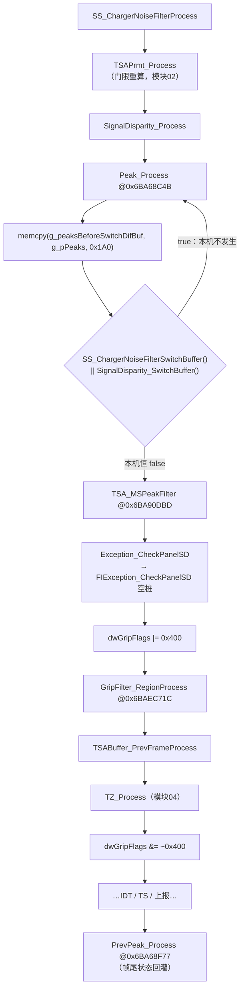
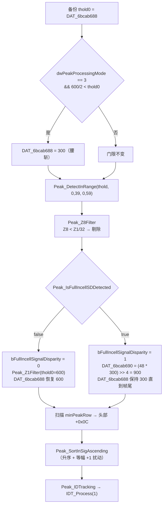
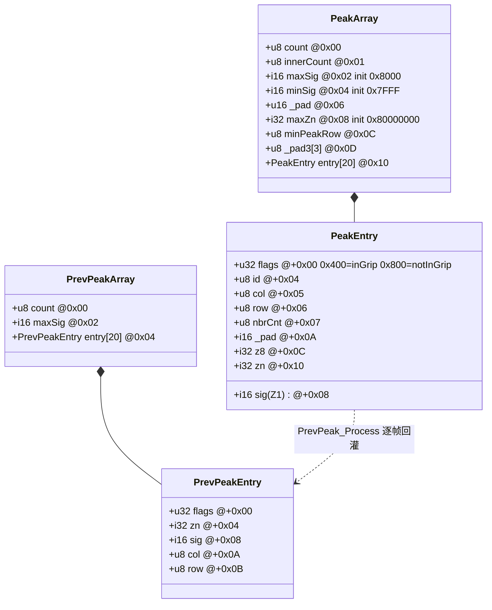
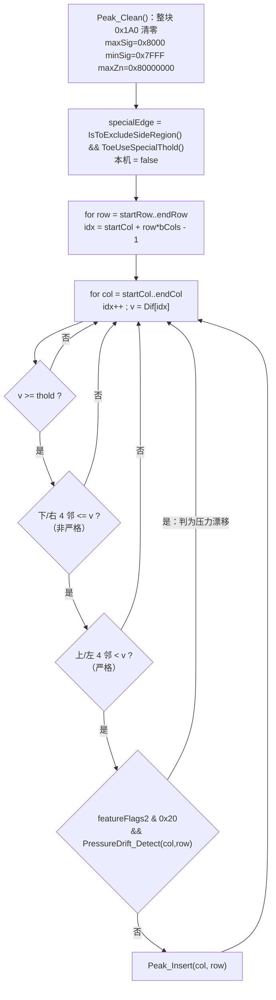
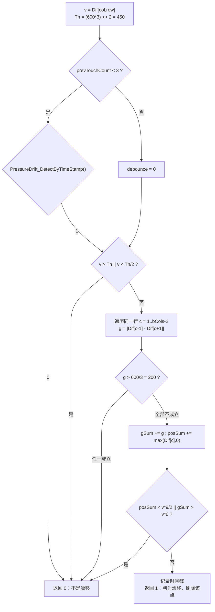
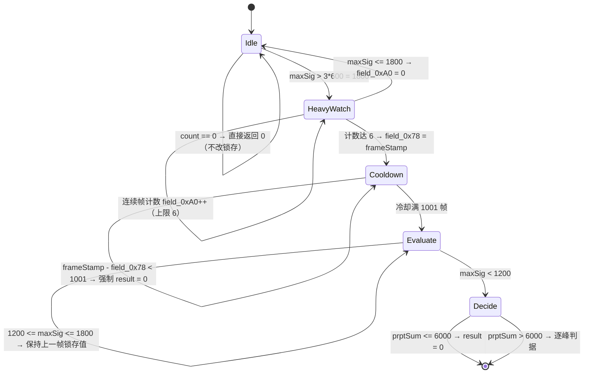
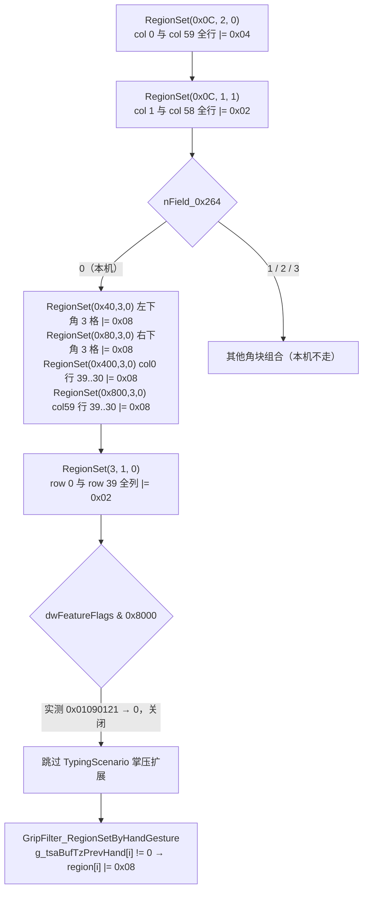

# 峰值检索与握持区域掩码预处理

目标程序 `TSACore.dll`（image base `0x6BA40000`，x86:LE:64），预置表 W273AS2700 (Gaokun Himax CSOT)，60 列 × 40 行 = 2400 互容节点，显示 2560×1600。本文只描述手指互容管线（`TSA_MSProcess`）中从差分网格到候选峰列表、以及进入 TouchZone 聚类前的握持掩码生成这一段。

## 概念

**Dif 网格**：`g_tsaBufDif`，`int16[2400]`，行优先线性索引 `idx = row * bCols + col`，由模块 01/02 产出（基线扣除 → CMF → GridIIR）。

**Peak（候选峰）**：Dif 网格上满足门限且在 3×3 邻域内取极大的节点，记录在 `g_pPeaks` 指向的 0x1A0 字节结构里，最多 20 个。

**Z1 / Z8 / Z9 / Zn**：Z1 = 峰中心节点的 Dif 值；Z8 = 峰的合法邻居（最多 8 个，网格边界处裁剪）Dif 代数和，**不含中心**；Z9 = Z1 + Z8；Zn = 四个含中心的 2×2 象限和与一个十字（plus）五点和中的最大值。

**FI (Full In-cell) 模式**：`dwPeakProcessingMode == 3` 的峰值处理分支。它先用腰斩门限做推测式探测，再用 SD（Signal Disparity，信号摊平）判决决定是否回退。

**SD 锁存位**：`g_tsaStatic->bFullIncellSignalDisparity`，由 `Peak_Process` 写、由模块 02 的 TouchThold 在**下一帧**读，构成一条跨帧反馈回路。

**Grip Region（握持掩码）**：`g_tsaBufGripRegion`，`uint8[2400]`，与 Dif 网格 1:1。每格是一个"握持等级"位掩码，最高置位的位序号即等级（0..3）。

**dwGripFlags**：`g_tsaPrmtFlash + 0x83C` 的 32 位运行期开关字，控制 TouchZone 的多种行为。主管线中它恒为 0，仅在 `GripFilter_RegionProcess` + `TZ_Process` 期间临时置 `0x400`。

## 架构

本模块在 `TSA_MSProcess @ 0x6BA90E43` 中的位置与调用顺序（地址取自反编译）：



`Peak_Process` 内部的数据流与判决链：



峰列表与相关缓冲的结构关系：



关键全局：`g_pPeaks @ 0x6BB4F100`（指针，`DataSwitch_ToGrid` 指向 `g_peaksGrid @ 0x6BBC0980`），`g_prevPeaksPtr @ 0x6BB4F110`（0xF4 字节），`g_peaksBeforeSwitchDifBuf @ 0x6BBC0B40`（0x1A0 字节快照），`g_tsaBufGripRegion @ 0x6BB813D0`（指针），`g_tsaPrmtFlash @ 0x6BCA8A00`，运行期门限 `g_tsaPrmtFlashConst @ 0x6BCAB600`。

## 分点解释

### 1. Peak_Process 顶层调度 @ 0x6BA68C4B

```c
void Peak_Process(void)
{
    short thold0 = DAT_6bcab688;                       // 本帧动态峰门限（模块02 GetPeakThold 产出）
    if (flash.dwPeakProcessingMode == 3 &&
        (short)flash.wPeakMode3ThresholdMax / 2 < DAT_6bcab688)
        DAT_6bcab688 = (short)flash.wPeakMode3ThresholdMax / 2;   // 600/2 = 300

    char excl = Peak_IsToExcludeSideRegion();          // 恒 0
    char lastCol = excl ? flash.bCols - 2 : flash.bCols - 1;      // = 59
    char lastRow = flash.bRows - 1;                               // = 39
    Peak_DetectInRange(DAT_6bcab688, 0, lastRow, (excl != 0), lastCol);

    if (flash.dwPeakProcessingMode == 3) {
        Peak_Z8Filter();
        if (Peak_IsFullIncellSDDetected() == 0) {
            g_tsaStatic->bFullIncellSignalDisparity = 0;
            Peak_Z1Filter(thold0);                     // 用未腰斩的原门限回退
            DAT_6bcab688 = thold0;                     // 恢复
        } else {
            g_tsaStatic->bFullIncellSignalDisparity = 1;
            int v = (uint)DAT_6bcab69c * (int)DAT_6bcab688;
            if (v < 0) v += 0xf;
            DAT_6bcab690 = v >> 4;                     // TouchDownThold 改按峰门限重算
        }                                              // 注意：这一支不恢复 DAT_6bcab688
    }

    if (flash.dwPeakProcessingMode == 2) { /* 关闭：本机 mode = 3 */ }

    byte minRow = flash.bRows;                         // 初值 40
    for (i = 0; i < g_pPeaks->count; i++)
        if (entry[i].row < minRow) minRow = entry[i].row;
    g_pPeaks->minPeakRow = minRow;                     // 无峰时写入 40

    if (Peak_needUDFPLargeFingerWorkaround() == 0) Peak_SortInSigAscending();
    else                                              Peak_SortInSigDescending();
    Peak_IDTracking();
}
```

**分支实测状态**

| 分支 | 条件 | 本机状态 | 证据 |
|---|---|---|---|
| Mode 3 腰斩 | `dwPeakProcessingMode == 3` | **开** | flash+0x34 = `03 00 00 00` |
| Mode 2 分支 | `dwPeakProcessingMode == 2` | **关**（永不进入） | 同上 |
| 侧边排除 | `Peak_IsToExcludeSideRegion()` | **关** | `@0x6BA685AC` 函数体是 `return 0;` |
| 降序排序 | `Peak_needUDFPLargeFingerWorkaround()` | **关** | `@0x6BA68BC6` 首条判据 `strncmp(TSA_GetPrmtName(), "P115", 4) == 0`，本机预置名为 W273AS2700 |

因为侧边排除恒 0，扫描范围恒为整屏 `row ∈ [0,39]`、`col ∈ [0,59]`，且 `Peak_DetectInRange` 里的边列专用门限分支（下文）永远不会生效。

**门限来源**：`DAT_6bcab688 = g_tsaPrmtFlashConst + 0x88` 是 `TSADynPrmt_GetPkThold @ 0x6BB3CF0B` 用 `TouchThold_Process(wPeakMode3ThresholdMax=600, flash+0x5DA=220, …)` 算出的动态峰门限（模块 02）。同一函数还产出 `DAT_6bcab68a`（边列专用门限，基数 `600*0x38/0x50 = 420`）、`DAT_6bcab68c`（噪声门限）、`DAT_6bcab690 = (flash[0x5D0] * NoiseThold) >> 4`（TouchDown 门限）、`DAT_6bcab69c = flash[0x5D0] = 48`。

**易踩的坑**：SD 检出分支**不恢复** `DAT_6bcab688`。检出 SD 的那一帧，后续 `TZ_TraversalNeighbor` 里的 `DAT_6bcab688 * 3 < sig * 4` 判据用的是 300 而不是 600，泛洪吸纳节点的条件被放宽。复刻时必须保留这个副作用。

### 2. 极值探测 Peak_DetectInRange @ 0x6BA685D7

签名为 `(short thold, byte startRow, byte endRow, byte startCol, byte endCol)`，主管线实参 `(thold, 0, 39, 0, 59)`。



**邻域形状与比较符**。八个邻居全部参与，但比较符不对称，且越界判定用的是**扫描范围边界**而不是网格边界：

```
atLeft   = (col <= startCol)   atRight  = (col >= endCol)
atTop    = (row <= startRow)   atBottom = (row >= endRow)
```

| 邻居 | 条件（成立才继续） |
|---|---|
| 右下 (+1,+1) | `atBottom \|\| atRight \|\| Dif[idx+cols+1] <= v` |
| 正下 (+1, 0) | `atBottom \|\| Dif[idx+cols] <= v` |
| 左下 (+1,−1) | `atBottom \|\| atLeft \|\| Dif[idx+cols-1] <= v` |
| 正右 ( 0,+1) | `atRight \|\| Dif[idx+1] <= v` |
| 正左 ( 0,−1) | `atLeft \|\| Dif[idx-1] < v` |
| 右上 (−1,+1) | `atTop \|\| atRight \|\| Dif[idx-cols+1] < v` |
| 正上 (−1, 0) | `atTop \|\| Dif[idx-cols] < v` |
| 左上 (−1,−1) | `atTop \|\| atLeft \|\| Dif[idx-cols-1] < v` |

门限比较是 `thold <= v`，即 `v >= thold` 才是候选。

**破平规则**：行优先扫描下，"下/右非严格、上/左严格"保证任意等值连通平顶中只有字典序最小（最上、最左）的那个节点被选中，既不分裂也不漏检。复刻时比较符方向不能改。

**边界越界行为**：`atLeft/atRight/atTop/atBottom` 短路了所有越界访问，索引 `idx` 是 `ushort`，即使 `row=0` 时 `idx - cols` 会回绕也不会被求值。但请注意这些标志绑定的是**扫描范围**：若把 `startCol` 传成非 0（本机不会发生），第 `startCol` 列会被当成"左边界"从而免除左邻比较。

**边列专用门限（关闭）**：代码里存在

```c
if (specialEdge && (col == 1 || col == bCols - 2 || row == bRows - 1))
    thold = DAT_6bcab68a;
```

`specialEdge` 需要 `Peak_IsToExcludeSideRegion()`（恒 0）与 `TouchThold_ToeUseSpecialThold() @ 0x6BB3CD8F`（仅对 P116 / P150 / P186 返回 1）同时成立，本机两项都不满足，**该分支关闭**。即：本机中心区与边列/边行**使用同一个门限**，不存在分区门限。

**`min(thold, 600/2)` 钳位**：真实存在，但发生在 `Peak_Process` 里对全局 `DAT_6bcab688` 的一次性赋值，不是每个候选峰各算一次。整数除法 `(short)600 / 2 = 300`。

### 3. 压力漂移抑制 PressureDrift_Detect @ 0x6BB441C9

`dwFeatureFlags2 & 0x20`（实测 `0x120`，**开启**）时，每个通过邻域判决的候选峰还要过这一关；返回 1 则该峰被丢弃。它识别的是"整行被均匀抬起"的假象（大面积压迫导致的基线漂移带）。



`PressureDrift_DetectByTimeStamp @ 0x6BB44172`：当 `frameStamp - lastDriftStamp < 25` 时把去抖计数 +1，计数 < 51 返回 1。即触点数少于 3 时，只在上一次判定漂移后的短窗口内、且连续不超过 50 帧允许继续判漂移；超时或超次数则关闭该保护。

注意 `PressureDrift_GradientCalUnit @ 0x6BB440D0` 的卷积核是 `[-1, 0, +1]`，取绝对值；它访问 `Dif[row*cols + c - 1 .. c + 1]`，`c` 从 1 到 `bCols-2` 所以不会越行。

### 4. 峰数据层：Clean / Fill / CalcZn / Insert / Remove

**`Peak_Clean @ 0x6BA659B0`**：`memset(g_pPeaks, 0, 0x1A0)`，然后写入 `maxSig = 0x8000`（−32768）、`minSig = 0x7FFF`、`maxZn = 0x80000000`。每次 `Peak_DetectInRange` 开头调用，所以每帧峰列表（含 `PeakEntry.flags`）都是全新的。

**`Peak_Fill @ 0x6BA65CB8`(slot, col, row)**：写 `sig = Dif[row*cols+col]`、`col`、`row`，调 `Peak_CalcZn(slot)`，然后用 `sig` 刷新头部 `maxSig`/`minSig`、用 `zn` 刷新头部 `maxZn`。

**`Peak_CalcZn @ 0x6BA67C89`**：以**网格边界**（不是扫描范围）裁剪邻居，一次遍历同时算出

- `z8`（写 `+0x0C`）：所有合法邻居 Dif 代数和，不含中心；
- `nbrCnt`（写 `+0x07`）：合法邻居个数，内部 8、边 5、角 3；
- 四个含中心的 2×2 象限和 `TL/TR/BL/BR` 与十字五点和 `plus`；
- `zn`（写 `+0x10`）：`dwProcessingState & 0x10`（SideTouch 通道）为 0 时取 `max(TL,TR,BL,BR,plus)`；置位时只取 `plus`，且 `plus` 里不加左右邻。主管线走前者。

**`Peak_Insert @ 0x6BA65E68`(col,row) → slot**：

```c
if (count < 20) {
    Peak_Fill(count, col, row);
    if (!Peak_IsOnOuterEdge(count)) innerCount++;   // 头部 +0x01
    count++;
    return count - 1;
}
// 溢出：打印 "Peak Buffer Overflow!!!"（需 TSALog_RtEnable）
min = 0; for (i = 1; i < 20; i++) if (entry[i].sig < entry[min].sig) min = i;
if (entry[min].sig < Dif[row*cols+col]) { Peak_Fill(min, col, row); return min; }
return 20;                                          // 新峰被丢弃
```

溢出替换路径**不更新 `innerCount`**，也不会重新计算头部 `minSig`（头部只做单调刷新），这是原厂代码的既有行为，复刻时照抄。`Peak_IsOnOuterEdge @ 0x6BA66A9D` 的定义是 `col == 0 || col == bCols-1 || row == 0 || row == bRows-1`。

**`Peak_Remove @ 0x6BA65B60`(idx)**：先把 `count` 钳到 20（超过则报断言 `PeaksPrpt(num) <= TSA_MAX_PEAK_NUM`），然后用 `memcpy_s` 把 `idx` 之后的条目整体前移 0x14 字节，`count--`。不修补头部统计量。所有滤波器都**从高索引向低索引**遍历，正是为了配合这种前移删除。

### 5. Z8 二次抑制 Peak_Z8Filter @ 0x6BA68502

```c
for (i = count - 1; i >= 0; i--) {
    short s = entry[i].sig;
    if (s < 0) s += 31;                 // 负数向零取整补偿
    if (entry[i].z8 < (int)(s >> 5)) Peak_Remove(i);
}
```

判据是 `Z8 < Z1 / 32`（向零取整）。物理含义：真实手指按压的邻域必然被抬起，`Z8` 与 `Z1` 同量级；而单点脉冲毛刺经 CMF/IIR 后邻域常出现负向振铃，`Z8` 会塌到接近 0 甚至为负。门限只取 1/32，说明这一关只用来杀极端孤立尖峰，不参与正常强弱峰取舍。

本机只在 `dwPeakProcessingMode == 3` 下执行（恒成立）。

### 6. FullIncell SD 判决 Peak_IsFullIncellSDDetected @ 0x6BA689C9

这是本模块唯一一处跨帧状态机，它的输出 `g_tsaStatic->bFullIncellSignalDisparity` 被模块 02 的 TouchThold 在下一帧读取，使峰门限在 600 与 300 之间来回切换。



判决细节：

```c
if (count == 0) return 0;
result = g_tsaStatic->bFullIncellSignalDisparity;          // 以上一帧状态为初值（锁存）

if (maxSig > (short)wPeakMode3ThresholdMax * 3)            // > 1800
     { if (field_0xA0 < 6) field_0xA0++; else field_0x78 = frameStamp; }
else   field_0xA0 = 0;

if ((u64)(frameStamp - field_0x78) < 1001) result = 0;     // 重压释放恢复期
else if (maxSig < (short)wPeakMode3ThresholdMax * 2) {     // < 1200
    if ((int)g_tsaPrpt[+0xC8] > (short)wPeakFilterReferenceThreshold * 2) {   // > 6000
        for (i = 0; i < count; i++) {
            if (count > 4) result = 1;
            if (Peak_IsFullIncellInsideSensor(i) && maxSig * 3 < entry[i].sig * 4) result = 1;
        }
    } else result = 0;
}
return result;
```

- `maxSig` 取头部 `+0x02`，即本帧最强峰。
- `g_tsaPrpt + 0xC8` 由 `TSA_GetDifPrpt @ 0x6BAA121D` 中的 `TSA_CombineBlock(0x6BC4A700, 5)` 写入。掩码 5 = 块 0 ∪ 块 2，按 `g_tsaBlockIdx` 的划分就是**行 1..38 × 列 1..58**（全屏去掉最外一圈列与上下两条边行），语义是这块区域上 Dif 的**代数总和**（正和 + 负和）。区块划分与 32 字节记录布局见模块 01 第 10 节。
- `Peak_IsFullIncellInsideSensor @ 0x6BA68944` 的判据是 **`Z1 < Z8 / 5`**（`+0x0C` 存的是 Z8，不含中心；`Peak_GetZ9 @ 0x6BA65A72` 才是 `Z8 + Z1`）。即中心能量不到邻域和的 1/5，说明电荷被摊平。
- 第二条判据 `maxSig * 3 < sig[i] * 4` 等价于 `sig[i] > 0.75 * maxSig`，要求这个摊平峰本身接近主峰强度。

**两个必须复刻的边界**：
1. `field_0x78` 初值为 0，而 `frameStamp`（`g_tsaStatic + 0xE0`）从 0 开始递增，因此**开机后前 1001 帧 SD 恒为 0**，门限恒为 600。
2. `1200 <= maxSig <= 1800` 区间两个 `else if` 都不进，`result` 保持上一帧锁存值——这是有意的迟滞带。

### 7. Z1 回退滤波 Peak_Z1Filter @ 0x6BA6848B

```c
for (i = count - 1; i >= 0; i--)
    if (entry[i].sig < cutoff) Peak_Remove(i);
```

未检出 SD 时以 `thold0`（未腰斩的动态门限，典型 600）回扫，把 300~600 之间的推测式弱峰全部清掉，并把 `DAT_6bcab688` 恢复为 `thold0`。检出 SD 时不调用它，弱峰得以保留。

### 8. 排序与等幅扰动 Peak_SortInSigAscending @ 0x6BA66013

选择式双重循环，按 `sig` **升序**（弱峰在前）。两条分支：

```c
for (i = 0; i < (char)count - 1; i++)
  for (j = i + 1; j < count; j++) {
      if (entry[j].sig < entry[i].sig)  swap20(entry[i], entry[j]);   // memcpy_s 三步交换
      else if (entry[i].sig == entry[j].sig) {
          entry[j].sig += 1;                                          // 结构体里 +1
          Dif[entry[j].row * cols + entry[j].col] += 1;               // 同步改写原始网格！
      }
  }
```

等幅时对**后项**同时抬高结构体信号与 `g_tsaBufDif` 中的原始值各 1，打破简并。副作用是 Dif 网格被就地修改，后续 TZ 泛洪、质心解算读到的就是被扰动过的值；复刻必须同步写回网格，否则后级坐标会有 LSB 级偏差。注意 `entry[i].z8`/`zn` 不随之更新。

降序版 `Peak_SortInSigDescending @ 0x6BA66412` 在本机不会被调用（见第 1 节表格）。

### 9. 跟踪准备 Peak_IDTracking @ 0x6BA68167

```c
g_touches->count = 0;
for (t = 0, p = 0; p < peakCount && t != 20; t++, p++) {
    touch[t].x = entry[p].col * 256 + 128;      // +0x15E，1/256 亚像素
    touch[t].y = entry[p].row * 256 + 128;      // +0x160
    g_touches->count++;
}
IDT_Process(1);                                  // 模式 1：峰级预匹配
for (t = 0; t < g_touches->count && t != 20; t++)
    entry[t].id = touch[t].id;                   // 写回 +0x04
```

把每个峰的格点中心当作一个临时触点交给追踪器（模块 05）做一次预匹配，再把分配到的 Track ID 回写到峰条目。注意回写循环用的是**排序后的顺序**，与 `IDT_Process` 内部是否重排一致；`entry[i].age` 这类字段并不存在——峰本身没有年龄，年龄信息在 `g_tsaBufTzAge`（TZ 节点级）和 Touch 结构里。

### 10. TSA_MSPeakFilter 与边框暗影抑制（关闭）

```c
void TSA_MSPeakFilter(void)
{
    if ((g_tsaStatic->dwFeatureFlags2 & 1) != 0) EdgePeakFilter_WorkAround();
}
```

`dwFeatureFlags2` 由 `TSAStatic_InitSysModuleEveryTime @ 0x6BAA16C0` 计算为 `flash[0x58] | flash[0x5C] = 0x120 | 0x120 = 0x120`，**bit 0 = 0**。`TSA_SetWorkarounds @ 0x6BA9F3B4` 是唯一能置位的入口（导出函数 `TSA_EnableEdgePeakFilterWorkaround @ 0x6BA9F33F`），需要宿主主动传入 `param & 1`，本机不调用。

结论：**`TSA_MSPeakFilter` 在本机是空操作，`Peak_Process` 的输出原样进入 TZ**。作为参考，若开启，`EdgePeakFilter_WorkAround @ 0x6BB438F6` 会按 `flash + 0x1A`（实测 `0x00`）走"列"分支：对第 0 列和第 59 列各求整列 Dif 最大值 `m`（`EdgePeakFilter_GetMaxSig @ 0x6BB43820`，初值 −32768；负数先 `m += 7` 再 `(m >> 3) * 5`），把落在该列上（`Peak_IsOnLine(2, col, i)` 比较 `entry[i].col`）且 `sig < (m >> 3) * 5` 的峰删掉，即低于该边最大值 5/8 者视为走线串扰暗影。`flash + 0x1A` 非 0 时对第 0 行和第 39 行做同样处理。

### 11. 缓冲切换与 g_peaksBeforeSwitchDifBuf

`Peak_Process` 之后立刻 `memcpy(&g_peaksBeforeSwitchDifBuf, g_pPeaks, 0x1A0)` 做快照，随后判断是否需要在切换后的 Dif 缓冲上重跑一次 `Peak_Process`。本机 SS 自容通道整体关闭（flash+0x608 = 0），`SS_ChargerNoiseFilterSwitchBuffer()` 与 `SignalDisparity_SwitchBuffer()` 恒返回 0，**第二次 `Peak_Process` 永不发生**。

但快照本身**始终被使用**：`TZ_BeforeSDCompensationPeakInfoRetrieval @ 0x6BA8ADEC` 无条件读取它，按 `g_peaksBeforeSwitchDifBuf` 的 count/col/row/sig 统计落入当前 TZ 的"补偿前峰"个数与最强者索引（写 TZ 单元 `+0x2B4`/`+0x2B5`），并用 `g_pkBeforeSDCAccessedFlag` 位图去重。在本机它与 `g_pPeaks` 内容一致（`TSA_MSPeakFilter` 为空操作），但结构必须保留。

`Exception_CheckPanelSD @ 0x6BA59325` 在 `dwPeakProcessingMode == 3` 下调用 `FIException_CheckPanelSD @ 0x6BA593BC`，后者函数体为空，**空桩**。

### 12. 跨帧回灌 PrevPeak_Process @ 0x6BA68F77

帧尾（`TouchReport_Process` 之后）执行，把本帧峰列表压缩成 12 字节/条目的历史表 `g_prevPeaksPtr`（0xF4 字节 = 4 + 20×12）：

```c
prev->count  = peaks->count;
prev->maxSig = peaks->maxSig;
for (i = 0; i < peaks->count; i++) {
    prev->e[i].flags = entry[i].flags;   // +0x00 四字节，含 TZ 打的 0x400/0x800 握持标记
    prev->e[i].zn    = entry[i].zn;      // +0x10 → +0x04
    prev->e[i].sig   = entry[i].sig;     // +0x08 → +0x08
    prev->e[i].col   = entry[i].col;
    prev->e[i].row   = entry[i].row;
}
```

历史条目的 stride 是 `0x0C`，条目 `i` 的基址 = `g_prevPeaksPtr + 4 + 0x0C·i`。反编译里出现的 `g_prevPeaksPtr + i*0xC + 8` 这类写法是把 4 字节表头算进了位移，换算关系见下表右列：

| 条目内偏移 | 类型 | 物理量 | 来源（当前 `PeakEntry`） | 反编译中的裸位移 |
|---|---|---|---|---|
| `+0x00` | u32 | 握持标志（`0x400` in-grip / `0x800` not-in-grip） | `+0x00` | `+ i*0xC + 4` |
| `+0x04` | s32 | **Zn** —— 四个含中心的 2×2 象限和与一个十字五点和里的最大值，由 `Peak_CalcZn` 产出。它是「峰邻域的最大聚合能量」，**不是** Z4、也不是 Z8 | `+0x10`（zn） | `+ i*0xC + 8` |
| `+0x08` | s16 | **Z1** —— 峰中心节点的 Dif 值，即峰幅本身 | `+0x08`（sig） | `+ i*0xC + 0xC` |
| `+0x0A` | u8 | 列 | `+0x05` | `+ i*0xC + 0xE` |
| `+0x0B` | u8 | 行 | `+0x06` | `+ i*0xC + 0xF` |

表头：`+0x00` u8 count、`+0x02` s16 maxSig。**Z8（`PeakEntry +0x0C`）与邻居数（`PeakEntry +0x07`）都不回灌**，所以任何跨帧判据都只能用 Zn 和 Z1。

**峰 ID 不回灌**。峰的持续 ID 每帧由 `Peak_IDTracking` 经 `IDT_Process(1)` 重新分配，历史继承由 IDT（模块 05）持有，不靠 `g_prevPeaksPtr`。

`PeakEntry.flags`（条目 `+0x00`）由 TZ 阶段的 `TZ_GetPeakGripFlag @ 0x6BA84485` 写：`0x400` = 该峰判为握持内，`0x800` = 判为非握持（`TZ_MovePeakNotInGripToEnd @ 0x6BA85249` 据此把非握持峰挪到 TZ 峰列表末尾）。`Peak_Clean` 每帧把它清零。

历史表的消费者：`Touch_SetVolatileFlagSigSum @ 0x6BA6F7AF`（用 `prev.zn` / `prev.sig` 作分母算本帧与上帧的信号比，`(cur << 5) / prev`，饱和到 255，结果写触点 `+0x1DD` / `+0x1DE`，详见模块 07）、`PrevPeak_IsOnOuterEdge*`、`Touch_IsLiftOffDueToMerged`、`GripFilter_IsMerged`。

注意 `HandGesture_GripDetection @ 0x6BAEF865` 在 `DataSwitch_ToHand()` 生效期间也会调 `Peak_Clean()` / `PrevPeak_Process()`，但此时 `g_pPeaks`/`g_prevPeaksPtr` 已被切到 hand 缓冲（`g_peaksHand @ 0x6BC86D00` / `g_prevPeaksHand @ 0x6BC84E40`），不影响主 grid 峰表。

### 13. 握持掩码生成 GripFilter_RegionProcess @ 0x6BAEC71C

```c
void GripFilter_RegionProcess(void)
{
    GripFilter_RegionReset();                             // memset_s(region, gridBufSize, 0, wBufElementCount=2400)
    if      (flash[0x8C4] == 4) GripFilter_RegionSetByScreenRotationPad();
    else if (flash[0x8C4] == 5) GripFilter_RegionSetByScreenRotationFold();
    else                        GripFilter_RegionSetByScreenRotation();   // 本机：flash[0x8C4] = 2
    GripFilter_RegionSetByHandGesture();
}
```

**`flash + 0x8C4` 是设备形态枚举**，不是握持开关。全库 11 个读点（`get_field_access_context` 穷举）只做 `== 4` 与 `== 5` 两种比较，没有任何一处区分其它取值：

| 读点 | 作用 |
|---|---|
| `GripFilter_IsPad @ 0x6BAE1E1C` | 整个函数体就是 `return flash[0x8C4] == 4` |
| `GripFilter_RegionProcess @ 0x6BAEC71C` | 4 → Pad 掩码、5 → Fold 掩码、其余 → 通用旋转掩码 |
| `GripFilter_GetCoreDistance @ 0x6BAE6171` | 5 → 取 dim1 距离，其余 → dim2 |
| `GripFilter_GetCtdDistToEdge @ 0x6BAE61B9` / `GripFilter_GetScreenRotatedCtdDistToEdge @ 0x6BAE6220` | 5 时把 `touch+0x22C`（dim1 边距）与 `touch+0x22E`（dim2 边距）互换 |
| `GripFilter_RegionSetByScreenRotation @ 0x6BAEBDE9`（×2） | `!= 4` 才在横屏时同时涂另一侧的角块 |
| `GripFilter_RegionSetByScreenRotationPad @ 0x6BAEC121`（×2） | Pad 专用掩码内部再分支 |
| `GripFilter_GetEdgeClickRatioThold @ 0x6BAECAD0` | `!= 4` 才做角点点击抑制加档 |

把 `TSAPrmt.dll` 里 453 张预置表的 `+0x8C4` 全部取出统计，取值只有三种：**2（430 张，手机/通用直板）、4（17 张：Debussy / Goethe / Hemingway / Teton / Wagner 系列，即 Pad）、5（6 张：Palau 系列，即折叠屏）**。所以枚举语义是 `2 = 直板（默认）`、`4 = Pad`、`5 = Fold`，`0/1/3` 在任何预置表里都不出现，代码里也没有任何分支能把 2 与 0/1/3 区分开。本机取 2，走通用分支，`GripFilter_IsPad()` 恒假、边距不互换、角点点击抑制加档生效。

**写入原语 `GripFilter_RegionSet @ 0x6BAEBAD8(regionMask, level, margin)`**：写入值恒为 `1 << level`（`level` 是等级，不是固定语义位）。`regionMask` 选择要涂哪些几何区域：

| regionMask 位 | 涂覆范围 |
|---|---|
| `0x01` | 第 `margin` 行，全列 |
| `0x02` | 第 `bRows-1-margin` 行，全列 |
| `0x04` | 第 `margin` 列，全行 |
| `0x08` | 第 `bCols-1-margin` 列，全行 |
| `0x10`/`0x20`/`0x40`/`0x80` | 左上 / 右上 / 左下 / 右下 三格角块 |
| `0x100`/`0x200` | 第 `margin` / `bCols-1-margin` 列的**顶部** 10 行 |
| `0x400`/`0x800` | 第 `margin` / `bCols-1-margin` 列的**底部** 10 行 |
| `0x1000`/`0x4000` | 第 `margin` / `bRows-1-margin` 行的**左侧** 10 列 |
| `0x2000`/`0x8000` | 第 `margin` / `bRows-1-margin` 行的**右侧** 10 列 |

前 8 位在 `GripFilter_RegionSet` 里处理（角块由 `GripFilter_RegionSetTopLeftCorner @ 0x6BAEAF42` 等四个函数各涂 3 格：角点 + 同行相邻 + 同列相邻），高 8 位由函数尾部无条件调用的 `GripFilter_RegionSetPalm @ 0x6BAEB512` 处理。所有写入都是 `|=`。

**本机实际执行路径**（`GripFilter_RegionSetByScreenRotation @ 0x6BAEBDE9`，屏幕旋转 `g_tsaStatic->nField_0x264 = 0`，由 `TSA_SetScreenRotateState @ 0x6BA9FEA4` 设置、`TSAStatic_InitSysModuleEveryTime` 初始化为 0）：



于是本机 60×40 掩码的最终形态（未叠加手势层时）：

| 区域 | 值 | 等级 |
|---|---|---|
| 内部（col 2..57 且 row 1..38） | `0x00` | 0 |
| row 0 / row 39 的 col 2..57 | `0x02` | 1 |
| col 1 / col 58（row 1..38） | `0x02` | 1 |
| col 0 / col 59（row 1..29） | `0x04` | 2 |
| (0,0) (0,59) 等边角交叠 | `0x06` | 2 |
| col 0 / col 59 的 row 30..38 | `0x0C` | 3 |
| 左下 / 右下角块与底行边列交叠 | `0x0E` | 3 |

**等级读取**：`GripFilter_GetGripLevel @ 0x6BAEA5A5(mask)` 返回 `mask` 中最高置位的位序号（从 3 往下试 `mask >= 1<<k`），无置位返回 0。所以 `0x02→1`、`0x04/0x06→2`、`0x08/0x0A/0x0C/0x0E→3`。bit 0（值 1）在本机任何路径都不会被写入。

**手势叠加层**：`GripFilter_RegionSetByHandGesture @ 0x6BAEC611` 对 `g_tsaBufTzPrevHand` 非零的格子 `|= 0x08`（硬编码等级 3）。`g_tsaBufTzPrevHand` 由 `HandGesture_PostProcess @ 0x6BAEED20` 在上一帧从 `g_tsaBufTzHand` 拷入，而这只在 HandGesture 子管线真正跑完触点处理（`HandGesture_GripDetection` 中 `DAT_6bc86ca4 & 4`）且 `HandGesture_CheckValidity` 通过时才发生。无手掌握持时该层为全 0。

**消费方（模块 04/06）**：`TZ_TraversalNeighbor @ 0x6BA88709` 在纳入每个节点时做两件事——`unit[+0x32A] = max(unit[+0x32A], region[idx])` 记录触点触及的最高握持掩码；`region[idx] != 0 && sig > 0` 时把该节点信号累加进握持能量槽 `unit[+0x24]`，供后续握持占比判定使用。`GripFilter_GetCenterLevel @ 0x6BAEA5FB` 则直接按触点整数坐标查掩码取等级。

### 14. dwGripFlags 位图与 0x400 的真实作用

`dwGripFlags` 位于 `g_tsaPrmtFlash + 0x83C`（绝对地址 `0x6BCA923C`），预置表实测值 **0**。运行期有四个写入者，其中三个是保存—修改—恢复的子管线：

| 写入者 | 写入值 | 是否恢复 |
|---|---|---|
| `TSA_MSProcess @ 0x6BA9151C` | `\|= 0x400` | 是，`@0x6BA9154A` 清除 |
| `TZ_NormalTraversal @ 0x6BA8BC33/0x6BA8BCB2` | 边缘峰临时 `&= ~0x400` | 是，函数尾恢复整字 |
| `Proximity_RefreshTZPrmt @ 0x6BAFA914` | `= 0x7F` | 是，由 `Proximity_DiffToTouch` 恢复 |
| `HandGesture_TouchProcess @ 0x6BAEF4F7` | `= 0x17F` | 是 |
| `SideTouch_TouchProcess @ 0x6BB0A32E` | `= 0x7B` | 是 |

所以**主手指管线中 `dwGripFlags` 的取值只有两种：0，以及 `GripFilter_RegionProcess` ~ `TZ_Process` 期间的 `0x400`**。前序"整字为 0"的说法在时间窗上不完整，但在本模块窗口外确实成立。

逐位语义（由各读点处的 `AND imm` 反推）：

| 位 | 读点 | 语义 | 主管线状态 |
|---|---|---|---|
| `0x001` | `TZ_GetType @ 0x6BA83828` | 整个类型判决短路成 `unit[0x08] = 1`（NF），连 `TZ_MultiFatFingerCheck` 都不跑 | 关 |
| `0x002` | `TZ_VPProcess @ 0x6BA8D424` | 禁用虚拟峰插入 | 关 |
| `0x004` | `TZ_GetSigThold @ 0x6BA8A935` | 门限直接取 `flash+0x81C`，跳过 Common/Charger/AFT/SideTouch 分支 | 关 |
| `0x008` | `TZ_UnitToTouch @ 0x6BA81392` | 跳过 `unit[0x350]` 异常路由，直接 `TZ_RegisterTouch` | 关 |
| `0x010` | `TZ_IsLO @ 0x6BA83487` | **切换 LO 面积来源**：置位用本 TZ 长短轴，清零用最大子区长短轴 | 关（清零支才是生效支） |
| `0x020` | `TZ_GetProperty @ 0x6BA8B19C` | 跳过 `Exception_ProcessTouchZone`（即不产出 `unit[0x350]`） | 关 |
| `0x040` | `TZ_TraversalNeighbor @ 0x6BA887B2` | 泛洪时对节点信号取绝对值。**注意**：MS 模式下该局部变量在循环内被 `col < 2 \|\| col >= bCols-2` 重新赋值覆盖，位本身不起作用 | 无效 |
| `0x080` | `TZ_PeakBasedProcess @ 0x6BA8C388` | 用 `TZ_CentrodToTouch` 取代泛洪 | 关 |
| `0x100` | `TZ_PeakBasedProcess @ 0x6BA8C35D` | 用 `TZ_SimpleTraversal` 取代 `TZ_NormalTraversal` | 关 |
| `0x200` | `TZ_PeakBasedProcess @ 0x6BA8C3F8`、`TZ_Process @ 0x6BA8CA25/0x6BA8CA52`、`TZ_IsGripWall @ 0x6BA87CF4` | **启用握持阻断墙与 `TZ_UpdateGripFlag`** | **关** |
| `0x400` | `TZ_TraversalNeighbor @ 0x6BA88805` | 质心加权时扣除 `flash+0x884` / `flash+0x886` | 开（窗口内），但两个扣除量实测为 0 → **实际无效果** |

**「位为 0」是否等于「整段不实现」**：这四个位的读点语义不同，复刻时的处理方式也不同——

| 位 | 置位分支做什么 | 清零分支做什么 | 清零时有无字段被漏写 | 复刻结论 |
|---|---|---|---|---|
| `0x001` | `unit[0x08] = 1` 后直接 `return` | 跑完 `TZ_IsLO` / 单峰二选一 / 多峰九级分支 / `TZ_MultiFatFingerCheck` | 无——置位分支是纯短路，它自己不写任何别的字段 | 置位分支可整段省略 |
| `0x008` | `TZ_RegisterTouch(unit)` | `unit[0x350] == 0 \|\| (flags & 0x1000000)` → `TZ_UnitToTouchNormal`，否则 `TZ_ExceptionProcess` | 无——两支最终都落到 `TZ_RegisterTouch`，只是路由不同；`unit[0x2EA] = unit[0x2EC]` 与 `hdr[+0x02]++` 在分支之前无条件执行 | 置位分支可整段省略 |
| `0x010` | `area = unit[0x2EE] · unit[0x2EC]` | `area = subTZ[DAT_6bbc8686].minorMM · .majorMM` | 无字段写入，纯取数分歧 | **清零支是生效支，必须实现**；置位支可省略 |
| `0x020` | 不调 `Exception_ProcessTouchZone` | 调用它，写 `unit[0x348] / 0x34C / 0x350 / 0x354`、`unit[0x33C..0x346]` 六个比值、`unit[0x10]` 水膜格数，并可能改写全局异常字 `prevHdr+0x20` | **有**：置位会让上述字段全部停在 0，`unit[0x350]` 恒 0 ⇒ SubTZ 永不切 SD 图、`TZ_ExceptionProcess` 永不进入 | **清零支是生效支，必须实现**（细节见模块 04 §6.2） |

一句话：`0x001` 与 `0x008` 是「简化开关」，关闭 = 走完整路径，置位分支可以不实现；`0x010` 与 `0x020` 是「二选一开关」，关闭时被选中的恰恰是完整分支，**不能当成死枝跳过**。

**`0x400` 的确切作用**：

```c
int sub1 = 0, sub2 = 0;
if (flash.dwGripFlags & 0x400) { sub1 = (i16)flash[0x884]; sub2 = (i16)flash[0x886]; }
...
int w1 = sig - sub1;  if (w1 < 0) w1 = 0;
int w2 = sig - sub2;  if (w2 < 0) w2 = 0;
unit[+0x1C] += w1;    // Dim1 质心权重
unit[+0x20] += w2;    // Dim2 质心权重
// w1/w2 同时参与 unit[+0x2C4]/[+0x2C8] 的 tpSensor 偏移加权
```

`TZ_NormalTraversal @ 0x6BA8BBD5` 在泛洪前判断峰是否落在外两圈（`col < 2 || col + 2 >= bCols || row < 2 || row + 2 >= bRows`），是则对该触点临时清掉 `0x400`（边缘触点不扣除底噪），泛洪结束后整字恢复。

实测 `flash + 0x884 = 0x0000`、`flash + 0x886 = 0x0000`，**因此本机上整条 `0x400` 通路是恒等变换，置位与否不改变任何质心结果**。复刻时可以保留结构但不必实现数值效果。

**握持阻断墙（关闭）**：`TZ_IsGripWall @ 0x6BA87CC5` 的第一个条件就是 `dwGripFlags & 0x200`，主管线该位为 0，函数**恒返回 0**，泛洪不会被阻断。其内部逻辑（仅供参考）是：节点位于第 0 列或最后一列时，若 `|curAge − g_tsaBufTzAge[idx]| >= 201` 则成墙；若该节点 Dif 为负也成墙。同理 `TZ_PeakBasedProcess` 末尾的 `TZ_UpdateGripFlag` 也因 `0x200 == 0` 不执行。

### 15. 配置门控汇总（W273AS2700 实测）

参数一律取自 `TSAPrmt.dll` 的 `g_tsaPrmtFlashGaokunHimaxCSOT`（`TSAFlashPrmt_LoadProject("W273AS2700")` 加载的同一份），偏移相对表首。

| 偏移 | 字段 | 原始字节 | 值 | 本模块中的作用 |
|---|---|---|---|---|
| `+0x1A` | 边框滤波朝向 | `00` | 0 | `EdgePeakFilter_WorkAround` 走"列"分支（该滤波器本身关闭） |
| `+0x1D` | `bCols` | `3C` | 60 | 列数 |
| `+0x1E` | `bRows` | `28` | 40 | 行数 |
| `+0x2C` | `wBufElementCount` | 运行期算 | 2400 | 掩码清零长度、网格遍历长度 |
| `+0x34` | `dwPeakProcessingMode` | `03 00 00 00` | 3 | FI 模式，启用腰斩 + Z8 + SD 判决 |
| `+0x50` | `dwFeatureFlagsBase1` | `01 01 00 00` | `0x00000101` | — |
| `+0x54` | `dwFeatureFlagsBase1_or` | `20 00 09 01` | `0x01090020` | — |
| — | `dwFeatureFlags`（合成） | — | `0x01090121` | bit15 = 0 → 掌压扩展区关闭；bit5 = 1 → TZ 边缘合并/GripStage 统计开启 |
| `+0x58` | `dwFeatureFlagsBase2` | `20 01 00 00` | `0x00000120` | — |
| `+0x5C` | `dwFeatureFlagsBase2_or` | `20 01 00 00` | `0x00000120` | — |
| — | `dwFeatureFlags2`（合成） | — | `0x00000120` | bit0 = 0 → EdgePeakFilter **关**；bit5 = 1 → PressureDrift **开** |
| `+0x5B4` | `wPeakFilterReferenceThreshold` | `B8 0B` | 3000 | SD 判决能量门限 ×2 = 6000 |
| `+0x5B6` | `wPeakMode3ThresholdMax` | `58 02` | 600 | 腰斩门限 300；SD 冷却门限 1800；迟滞上界 1200；PressureDrift 的 450 / 200 |
| `+0x5D0` | TouchDown 比例 | `30` | 48 | SD 分支 `DAT_6bcab690 = (48 × 300) >> 4 = 900` |
| `+0x5D8` | — | `E8 03` | 1000 | 模块 02 TouchThold 输入 |
| `+0x5DA` | — | `DC 00` | 220 | `TouchThold_Process` 的噪声输入 |
| `+0x81C` | TZ 基础门限 | `DC 00 40 40` | 220 / … | `dwGripFlags & 4` 时的 TZ 门限（本机不走） |
| `+0x83C` | `dwGripFlags` | `00 00 00 00` | 0 | 见第 14 节 |
| `+0x884` | `wGripDim1SigSub` | `00 00` | 0 | `0x400` 扣除量，为 0 → 无效 |
| `+0x886` | `wGripDim2SigSub` | `00 00` | 0 | 同上 |
| `+0x8C4` | 设备形态枚举 | `02 00 00 00` | 2 = 直板（4 = Pad，5 = Fold） | 11 个读点只判 `==4` / `==5`；本机走 `GripFilter_RegionSetByScreenRotation`，见第 13 节 |

按预置名 `strncmp` 门控的分支一律关闭：`Peak_needUDFPLargeFingerWorkaround`（P115）、`TouchThold_ToeUseSpecialThold`（P116/P150/P186）、`TSA_SetScreenRotateState` 的旋转重映射（P167/W157）、`GripFilter_RegionSetByScreenRotation` 中的双层边列（P212）。

### 16. clean-room 复刻要点

1. **扫描顺序**：行 0→39 外层，列 0→59 内层，线性索引递增。破平依赖此顺序，不可换成列优先或并行归约。
2. **比较符**：右下/正下/左下/正右用 `<=`，正左/右上/正上/左上用 `<`；门限用 `>=`。
3. **钳位**：`thold = min(thold, 600/2)` 只做一次、作用于全局门限变量；`Peak_Insert` 溢出时用最小峰替换且要求严格 `<`。
4. **饱和/初值**：`maxSig` 初值 `0x8000`、`minSig` 初值 `0x7FFF`、`maxZn` 初值 `0x80000000`、`minPeakRow` 初值 `bRows`；`EdgePeakFilter_GetMaxSig` 初值 `-32768`。
5. **首帧特例**：`field_0x78 = 0` 使开机前 1001 帧 SD 恒为 0；`bFullIncellSignalDisparity` 初值 0。
6. **锁存**：`maxSig ∈ [1200, 1800]` 时 SD 结果沿用上一帧；`count == 0` 时直接返回 0 且不触碰锁存与冷却计数。
7. **副作用**：SD 检出时 `DAT_6bcab688` 停留在 300 直到下一帧被 `TSAPrmt_Process` 重算；`Peak_SortInSigAscending` 会就地修改 `g_tsaBufDif`。
8. **数组上限**：峰上限 20，超出时打印 `Peak Buffer Overflow!!!` 并做"替换最弱峰"，被替换掉的峰直接消失且 `innerCount` 不回滚；`Peak_Remove` 前移式删除要求所有滤波器倒序遍历。
9. **越界**：所有邻域访问由边界布尔短路保护，索引类型为 `uint16`，理论回绕不会被求值；`Peak_CalcZn` 用网格边界裁剪，`Peak_DetectInRange` 用扫描范围边界裁剪，两者不可混用。
10. **掩码**：`g_tsaBufGripRegion` 每帧完全重建（先清 2400 字节再 OR 涂覆），不存在跨帧累积；唯一的跨帧来源是 `g_tsaBufTzPrevHand`。
