# 模块 04：触控区域提取、子区域细分、加权质心解算与边缘补偿

目标程序 `TSACore.dll`（image base `0x6BA40000`，x86:LE:64）；机型预置 W273AS2700（Gaokun Himax CSOT，60 列 × 40 行 = 2400 互容节点，显示 2560×1600）。本文引用的每个参数值均取自 `TSAPrmt.dll` 的 `g_tsaPrmtFlashGaokunHimaxCSOT` 表实测。

---

## 概念

**Peak（峰）**：模块 03 产出的局部极大值候选，存放在 `g_pPeaks`。头部 16 字节（`+0x00` = `bPeakCount`），其后每条记录 20 字节，记录基址 = `g_pPeaks + 0x10 + 0x14·i`，字段为 `+0x00` u32 握持标志（`0x400` in-grip / `0x800` not-in-grip）、`+0x05` 列、`+0x06` 行、`+0x07` 合法邻居数、`+0x08` s16 峰信号 Z1、`+0x0C` s32 Z8（不含中心；Z9 = Z1 + Z8 要另调 `Peak_GetZ9`）、`+0x10` s32 Zn。

**Touch Zone（TZ）**：以一个未被认领的峰为种子、在差分网格 `g_tsaBufDif` 上做门限受控扩散得到的连通域。认领图 `g_tsaBufTz`（2400 字节，s8）每格存**带符号标签**：幅值 = `tagBase + class`，符号 = 该格差分值的符号。

**tagBase**：全局变量 `DAT_6bbc8969`，每帧初值 `0x10`，每完成一个 TZ 加 8。第 k 个 TZ 占用标签幅值区间 `[0x10+8k, 0x10+8k+8)`。

**Unit（TouchZoneUnit）**：`0x370` 字节的栈上工作结构体，承载一个 TZ 的全部统计量（矩、包围盒、峰列表、轴、类型、标志）。`TZ_PeakBasedProcess` 的局部数组被逐个 TZ 复用。

**SubTZ（子区域）**：在一个已成型 TZ 内部，对该 TZ 圈入的每个峰再做一次更高门限的扩散所得的细分块。认领图 `g_tsaBufSubTZ`，标签基 `DAT_6bbc8979`，特征数组 `g_subTZ`（`DAT_6bbc8688`，步长 `0x48`，上限 10）。

**CTD**：Centroid。坐标统一为 **Q8 定点电极坐标**（1 电极 = 256）。

**EC（Edge Compensation）**：`CTD_ECProcess`，用「最外圈电极与次外圈电极的信号比」查 256 项对数表，把贴边触点的坐标沿法向外推。

**PosnSpecial**：本模块唯一的遍历容器。名为队列，实为**两个共享同一缓冲区、相向生长的 LIFO 栈**（正差分一侧 / 负差分一侧）。

---

## 架构

管线位置（`TSA_MSProcess @ 0x6BA90E43` 内）：

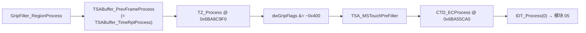

`TZ_Process` 内部的完整数据流：

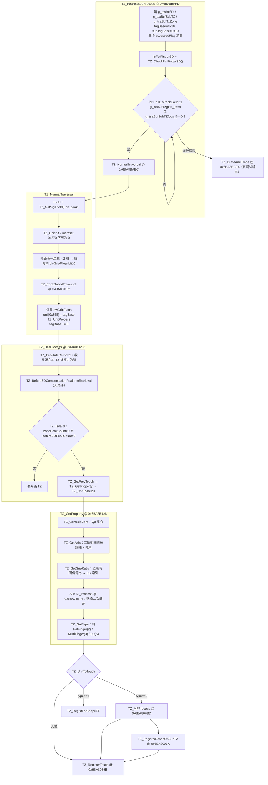

缓冲区职责：

| 缓冲 | 元素 | 写者 | 语义 |
|---|---|---|---|
| `g_tsaBufDif` | s16 | 模块 02 | 差分信号，本模块只读 |
| `g_tsaBufTz` | s8 | `TZ_TraversalNeighbor` / `TZ_PeakBasedTraversal` | TZ 认领标签（带符号） |
| `g_tsaBufSubTZ` | s8 | `SubTZ_TraversalNeighbors` | SubTZ 认领标签（带符号） |
| `g_tsaBufTzZone` | u8 | `TZ_TraversalNeighbor` / `SubTZ_SetExtraFlag` | 强信号格的 tagBase，供下一帧 `g_tsaBufTzZonePrev` 使用 |
| `g_tzBuffer` | s16 | `TZ_TraversalNeighbor` | 本 TZ 扫描到的差分拷贝（每个 TZ 开头清零） |
| `g_tsaFlagAfterDilate/Erode` | u8 | `TZ_DilateAndErode` | **仅注册进 `g_ideGridData` 调试网格，算法不消费** |
| `g_tsaDistanceMapBuf` | s8 | `TZ_Transform` | 曼哈顿距离变换中间量 |

---

## 分点解释

### 1. `TZ_Process` 顶层与缓冲初始化

```c
void TZ_Process(void) {
    if (g_tsaPrmtFlash.dwGripFlags & 0x200) TZ_UpdatePeakTzAge();   // 关闭
    *g_touchesPtr = 0;                                              // 本帧触点数归零
    TZ_PeakBasedProcess();
    if (g_tsaPrmtFlash.dwGripFlags & 0x200) TZ_AgeProcess();        // 关闭
}
```

`dwGripFlags` 位于 `flash+0x83C`（u32），实测 `00 00 00 00` → **全字为 0**，`TZ_UpdatePeakTzAge` / `TZ_AgeProcess` / `TZ_UpdateGripFlag` 三条 bit9 通路在本机全部不执行。

`TZ_PeakBasedProcess` 的初始化序列（顺序不可换）：

1. `dwFeatureFlags & 0x100000` → `TZ_SSLoProcess()`（自容 LO 预处理，运行期特性位，非 Flash 参数）；实测 `dwFeatureFlags = 0x01090121`，bit20 = 0 ⇒ **本机不执行**，`g_isSSLo` / `g_isSSLoSD` 恒为 0（见 §6.8）；
2. 局部 unit 数组 `memset(0, 0x370)`；
3. `memset_s(g_tsaBufTz, 0x1324, 0, wBufElementCount)`，`wBufElementCount = 2400`；
4. **仅当 `PROC_MS_ACTIVE`**（手指管线恒真）再清 `g_tsaBufSubTZ` 与 `g_tsaBufTzZone`；
5. `DAT_6bbc8969 = 0x10`（TZ 标签基）、`DAT_6bbc8979 = 0x10`（SubTZ 标签基）；
6. `g_tzAccess = g_tsaBufTz`，`g_ptrAccess = &g_tzAccess`，`g_subTZAccess = g_tsaBufSubTZ`；
7. `g_pkAccessedFlag = g_pkAccessedFlagSubTZ = g_pkBeforeSDCAccessedFlag = 0`（32 位位图，标记某个峰已被某个 TZ 领走）；
8. `isFatFingerSD = TZ_CheckFatFingerSD()`。

峰遍历顺序就是 `g_pPeaks` 的自然索引 0→`bPeakCount-1`（模块 03 已按强度排序）。**跳过条件由两张认领图共同判定**：

```c
pos = peak[i].col + peak[i].row * bCols;
if (g_tsaBufTz[pos] == 0 && (!MS_ACTIVE || g_tsaBufSubTZ[pos] == 0)) { ... }
```

`g_tsaBufSubTZ` 这一项容易漏：上一个 TZ 的 SubTZ 细分可能已经把本峰所在格认领掉，即使它在 `g_tsaBufTz` 里属于已处理的 TZ 也一样跳过。

分支选择（三选一）：`dwGripFlags & 0x100` → `TZ_SimpleTraversal`（**关闭**）；否则 `dwGripFlags & 0x80` → `TZ_CentrodToTouch`（**关闭**，直接 3×3 `CTD_General` 出坐标，`unit[0x334]=unit[0x335]=0x10` 即 EC 中性值）；否则 → `TZ_NormalTraversal`（本机唯一生效路径）。

`g_tsaBufTz` 每格取值语义（`class` 为标签低位偏移）：

| 值 | 含义 | 写入位置 |
|---|---|---|
| `0` | 未访问 | 帧初清零 |
| `±(base+1)` | 入域格：`abs(sig) ≥ thold`，已入栈继续扩散 | `TZ_TraversalNeighbor` |
| `±(base+2)` | 终止边缘格：`abs(sig) < thold` 且非 grip 段，**不入栈但计入矩** | `TZ_TraversalNeighbor` |
| `±(base+3)` | 孤立尖峰格：邻域超门限数 < 2 且邻域能量和 < 2×自身 | `TZ_PeakBasedTraversal` |
| `±(base+4)` | 弱格：`thold ≤ sig < nSPeakPositive/2` | `TZ_PeakBasedTraversal` |
| `±(base+5)` | 强格：`sig ≥ nSPeakPositive/2` | `TZ_PeakBasedTraversal` |
| `±(base+6)` | 实心核：4 个对角邻居全部 `> nSPeakPositive/2` | `TZ_PeakBasedTraversal` |

符号取自 `g_tsaBufDif[pos] < 0 ? -1 : +1`，负差分格拿到负标签。后续所有判定（`SubTZ_IsInCurrTZ` 用有符号比较、碰撞检测用绝对值）必须按各自原样复刻。

`class 3..6` 由 `TZ_PeakBasedTraversal` 在该格**出栈后**覆盖写入，覆盖的正是入栈时写下的 `class 1`。`class 2` 的格子永不出栈，因此永远保持 2。

### 2. 泛洪引擎

#### 2.1 `PosnSpecial` 容器

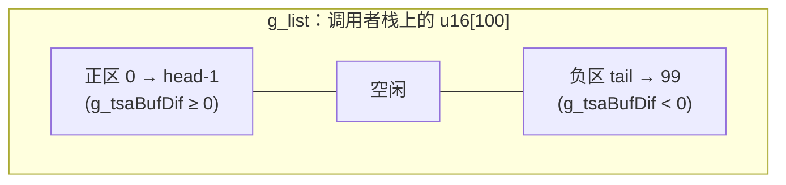

- `PosnSpecial_Init(buf, 100)`：先 `memset` 内部 `0x98` 字节控制块，再 `g_list = buf`、`head = 0`、`tail = capacity = 100`、`mode = 0`（正）、`prevMode = 1`、`zoneIdx = 0`。**控制块是全局单例**，SubTZ 复用它，所以 `SubTZ_Process` 进入时 `memcpy` 备份这 `0x98` 字节、退出时还原。
- `Put(pos)`：`if (head < tail)` 才压入 —— 满了**静默丢弃**，无断言、无溢出标志。`g_tsaBufDif[pos] < 0` → `list[--tail] = pos`；否则 `list[head++] = pos`。
- `Get()`：先 `UpdateSign()`，再按 `mode` 弹出。`mode==0`：`val = list[--head]`；`mode==1`：`val = list[tail++]`。**两侧都是 LIFO**，扩散顺序是深度优先，不是广度优先。
- `UpdateSign()`：当前极性一侧空了就 `NextZone()` 并翻转 `mode`。即**先把正差分格全部吃干净，再整体切到负差分格**；每次切换推进一个 zone 统计槽（最多 10 槽，`zoneIdx == 9` 时饱和）。
- `IsEmpty()` = 两侧都空。
- `AddCellInZone(pos)`：每次出栈时把该格差分累进当前 zone 槽的 max/min/sum/count。
- `ReBase()`：`TZ_PeakBasedTraversal` 在每次 `Get()` **之前**调用，清空「本次邻域扫描」的四个统计量 `numSignChange / numValidSensor / numEdgeSensor / sumEdgeSensor`，并置 `lastSign = 0xFF`。
- `Record(sig, halfRef, isDiagonal)`（`TZ_TraversalNeighbor` 内调用）：`sig > halfRef && isDiagonal` → `numValidSensor++`；同时按 `sig` 符号位统计跨邻居的符号翻转次数 `numSignChange`。
- `Record2(sig, thold)`（**仅 MS 模式**，对全部 8 个邻居无条件调用）：`sig > thold` → `numEdgeSensor++`；`sumEdgeSensor += sig`。
- `GetPosMarker()`：返回「正侧被抽空并切换极性」的累计次数，下限 1，被 `TZ_GetType` 用作多指旁证。

#### 2.2 邻域形状

`TZ_TraversalNeighbor` 与 `SubTZ_TraversalNeighbors` 共用同一张 9 元步进表，索引 0 是**中心格自身**：

```c
const int8_t dCol[9] = { 0,  1, 1, 1, 0, -1, -1, -1,  0 };
const int8_t dRow[9] = { 0, -1, 0, 1, 1,  1,  0, -1, -1 };
```

奇数索引 `{1,3,5,7}` 为四个对角，偶数索引 `{2,4,6,8}` 为四个正交。**是 8 连通**。索引 0 只在种子首次出栈时落到「未认领」分支（此时给种子打标签并计入矩）；之后每次出栈索引 0 都命中「已认领」分支，走碰撞检测（与自身标签比较必然落在 `[base, base+8)` 内，不置位）。

越界判据是 `(uint8_t)(col + dCol) < bCols && (uint8_t)(row + dRow) < bRows` —— **用无符号字节回绕代替下界检查**：`col = 0` 时 `col-1 = 0xFF ≥ 60` 自动排除。复刻时类型必须是 `uint8_t`。

#### 2.3 `TZ_PeakBasedTraversal` 主循环

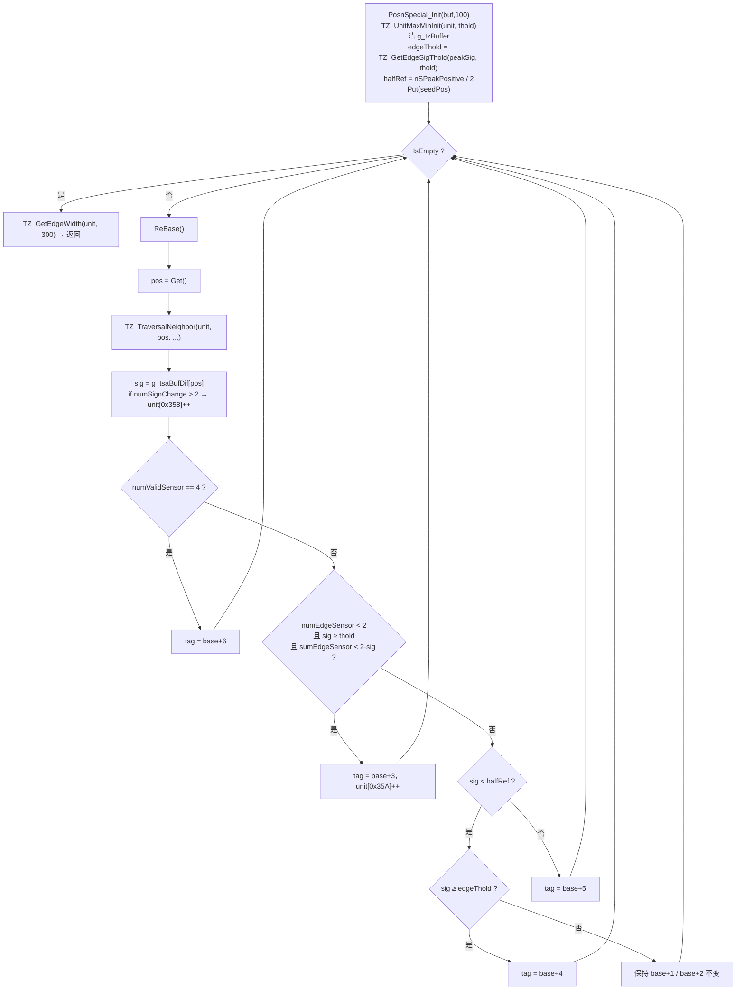

比较符方向：`numValidSensor == 4`（严格等于）、`numEdgeSensor < 2`、`thold <= sig`、`sumEdgeSensor < sig*2`、`sig < halfRef`、`edgeThold <= sig`。这里的 `sig` 一律是 `g_tsaBufDif[pos]` 的**原始有符号值**，不取绝对值。

非 MS 模式下 `Record2` 从不调用，`numEdgeSensor`/`sumEdgeSensor` 恒 0，`class 3` 会吞掉几乎所有格；手指管线 MS 恒开，不受影响。

#### 2.4 `TZ_TraversalNeighbor` 单邻居处理

预备量：

```c
gripSubX = gripSubY = 0;
if (dwGripFlags & 0x400) { gripSubX = DAT_6bca9284; gripSubY = DAT_6bca9286; }  // flash+0x884/0x886 实测均为 0
useSigned = dwGripFlags & 0x40;                                                  // 实测 0
```

对每个合法邻居 `nb`：

```c
sig = g_tsaBufDif[nb];                 // s16 原值
g_tzBuffer[nb] = sig;
if (MS_ACTIVE) {
    useSigned = (nb.col > 1 && nb.col < bCols-2) ? 0 : 1;   // ★ 完全覆盖 dwGripFlags bit6
    if (k != 0) PosnSpecial_Record2(sig, thold);
}
mag = useSigned ? sig : abs(sig);      // 屏内取绝对值，最外两列取有符号值
```

**这是本模块最易复刻错的一处**：MS 模式下「取绝对值还是取有符号值」完全由列号决定，与 `dwGripFlags bit6` 无关。最外两列（col 0/1/58/59）保留符号，那里的负差分格 `mag < 0 < thold`，必然落进 `class 2` 终止层；屏内则负格取绝对值后可能 `≥ thold` 而被当成入域格继续扩散。

随后按 `g_tsaBufTz[nb] == 0` 二分。**已认领分支**：

```c
if (k != 0 && mag >= thold) PosnSpecial_Record(sig, halfRef, k & 1);
t = abs(g_tsaBufTz[nb]);
if (t != 0 && (t >= tagBase + 8 || t < tagBase)) unit.flags |= 0x4000;   // 跨 TZ 碰撞
```

认领冲突的裁决规则是**先到先得、不可抢占**：一旦某格写了非零标签，任何后续 TZ 都不会改写它，只会给自己置 `0x4000`。这个标志后续只作为形态学特征，不触发重分割。

**未认领分支**：

```c
if (MS_ACTIVE) {
    if (DAT_6bcab688 * 3 < sig * 4) {                 // sig > 0.75 × SD 峰门限
        g_tsaBufTzZone[nb] = tagBase;
        if (TZ_IsIDMerged(unit, c, r)) unit.flags |= 0x200000;
        if (dwFeatureFlags & 0x20) {
            if (TZ_IsEdgeMerged(unit, c, r)) unit.flags |= 0x100000;
            if (g_tsaBufGripStage[nb] == 1) {
                unit.flags |= 0x2000000;
                unit[0x364] = min(unit[0x364], g_tsaBufGripTime[nb]);
            }
        }
    }
    unit[0x362] = min(unit[0x362], g_tsaBufTimeHand[nb]);
}
if (TZ_IsGripWall(c, bCols, nb, peakAge, sig)) continue;      // 本机恒 0
inGrip = MS_ACTIVE && (g_tsaBufGripStage[nb] == 1);

if (mag < thold && !inGrip) {
    g_tsaBufTz[nb] = (tagBase + 2) * sgn(sig);
    if (sig > 0) TZ_UpdateEdgeInfo(unit, sig, c, r, 0);
    g_tsaBufSelf[0x640 + c]++;  g_tsaBufSelf[0x640 + bCols + r]++;
} else {
    g_tsaBufTz[nb] = (tagBase + 1) * sgn(sig);
    if (MS_ACTIVE) {
        unit[0x32A] = max(unit[0x32A], g_tsaBufGripRegion[nb]);   // 等级位取最大
        unit[0x336] = max(unit[0x336], g_tsaBufMinSigOff[nb]);
        unit[0x33A] = min(unit[0x33A], g_tsaBufTimeRpt[nb]);
    }
    if (sig < 1) unit[0x0E]++;
    else { unit[0x0C]++; TZ_UpdateEdgeInfo(unit, sig, c, r, 7); }
    TZ_UpdateDimMaxMin(unit, c, r);
    if (k != 0) { PosnSpecial_Record(sig, halfRef, k & 1); PosnSpecial_Put(nb); }
}

/* ↓↓↓ 两个分支共用的累加块：class 2 终止层同样计入所有矩 ↓↓↓ */
unit[0x14] += sig;
g_tsaBufSelf[0x500 + c] += sig;  g_tsaBufSelf[0x500 + bCols + r] += sig;
if (mag > 0) TZ_UpdateMValue(unit, mag, c, r);
if (sig < 1) {
    if (sig < unit[0x2C]) { unit[0x2C] = sig; unit[0x30] = c; unit[0x31] = r; }
    unit[0x28] += sig;
} else {
    unit[0x2E] = max(unit[0x2E], sig);
    if (g_tsaBufGripRegion[nb] != 0) unit[0x24] += sig;
    d1 = max(0, sig - gripSubX);
    d2 = max(0, sig - gripSubY);
    unit[0x1C] += d1;                      // M0x
    unit[0x20] += d2;                      // M0y
    unit[0x18] += sig;
    unit[0x2C4] += trunc7((c * 128 + g_tpSensorDim1Offset[nb]) * d1);   // M1x
    unit[0x2C8] += trunc7((r * 128 + g_tpSensorDim2Offset[nb]) * d2);   // M1y
    TouchZone_InnerCornerHandler(unit, c, r);
}
```

三个坑：

- **终止层计入质心**。`class 2` 的格子虽停止扩散，却完整参与零阶矩/一阶矩累加，质心积分域比「超门限连通域」大一圈。
- **`TZ_UpdateMValue` 收到的是 `mag`**。屏内负差分格 `mag = |sig| > 0`，负电荷在二阶矩张量里被当作**正质量**累加，会撑大椭圆轴。这是原厂行为，必须照抄。
- `trunc7(x)` 是 `x < 0 ? (x + 0x7F) >> 7 : x >> 7`，即**向零截断的 /128**，不是四舍五入；且是逐格截断后再求和，累积舍入误差属于行为的一部分。

`TZ_UpdateMValue @ 0x6BA87890`：

```c
unit[0x2F8] += s;                       // M00 (int32)
unit[0x2FC] += s * x;                   // M10 (int32)
unit[0x300] += s * y;                   // M01 (int32)
unit[0x308] += (int64)(y * (s * x));    // M11
unit[0x310] += (int64)(x * (s * x));    // M20
unit[0x318] += (int64)(y * s * y);      // M02
```

三个 64 位累加器的加数先做 **32 位乘法**再符号扩展，溢出按 32 位截断，复刻时不能提前提升到 64 位。

`TouchZone_InnerCornerHandler @ 0x6BA88419` 只在四个「内角」格 `(1,1) / (bCols-2,1) / (1,bRows-2) / (bCols-2,bRows-2)` 上生效，取该格与两个对应外角邻格的比值写 `unit[0x36C]`，三者均需 `> 0` 才写。

### 3. 扩展门限

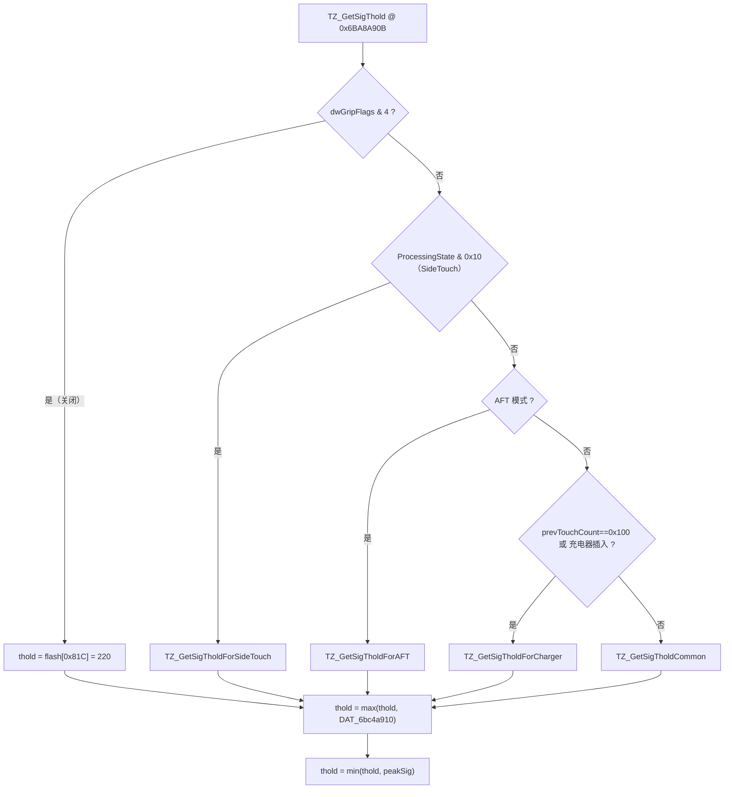

`TZ_GetSigTholdCommon @ 0x6BA8A7E4`（主路径）：

```c
ref = min(peakSig, wPeakFilterReferenceThreshold);          // flash+0x5B4 = 0x0BB8 = 3000
if (dwFeatureFlags & 0x1000)                      k = flash[0x81F];
else if (Peak_IsOnOuterEdge(i) && !TZ_IsSD(unit)) k = flash[0x81F];
else                                              k = flash[0x81E];
thold = (uint32)(k * ref) >> 7;                              // 无符号移位，无舍入
```

实测 `flash[0x81E] = flash[0x81F] = 0x40 = 64`，两支等价 → **`thold = min(peakSig, 3000) / 2`**，再被 `DAT_6bc4a910`（`g_tsaPrpt+0x2D0`，模块 02 产出的全局噪声门限）托底，最后被 `peakSig` 封顶。

`TZ_IsSD @ 0x6BA8A67E` 判据：先要 `wPeakFilterReferenceThreshold * 2 ≥ nSPeakPositive * 3`（即 `nSPeakPositive ≤ 2000`）；再满足 `prevTouchCount == 8`，或「有前帧关联触点 ∧ 该触点 `+0x228 ≥ 0x14` ∧ `+0x1E0 == 2`（FatFinger）∧ `+0x1F4 & 0x1000` ∧ `prevZ*3 < g_tsaPrmtDynamic*2`」。由于 `flash[0x81E] == flash[0x81F]`，`TZ_IsSD` 在本机对门限**无任何数值影响**。

`TZ_GetEdgeSigThold @ 0x6BA87E84`：

```c
e = nSPeakPositive;
if (e < 0) e += 3;
e >>= 2;                       // 向零截断的 /4
if (peakSig / 2 < e) e = peakSig / 2;
if (e < thold)       e = thold;
return e;                      // = max(thold, min(nSPeakPositive/4, peakSig/2))
```

因为主路径下 `thold = peakSig/2`（`peakSig ≤ 3000` 时），`min(...) ≤ peakSig/2 = thold`，所以 **`edgeThold` 恒等于 `thold`**；只有 `peakSig > 3000`（`thold` 被封顶为 1500）或走 Charger/AFT/SideTouch 分支时两者才分离。这导致 `class 4` 与 `class 1` 在正常工况下判据重合。

泛洪停止判据只有两条：`mag < thold && !inGrip` 时该格成为终止层（不入栈）；`head == tail` 时队列满导致静默丢弃。**没有距离上限、面积上限或访问次数上限**，唯一的收敛保证是认领图的单调填充。

`TZ_GetEdgeWidth(unit, 300)`（`flash+0x838 = 0x012C = 300`）在栈排空后执行，沿 `unit[0x37..0x3A]` 记录的极值行/列向两侧延伸，统计连续 `dif ≥ 300` 的跨度写入 `unit[0x43]`（dim1）、`unit[0x44]`（dim2）、`unit[0x45]`（和）。若 `unit[0x38] == -0x80` 或 `unit[0x37] == 0x7F`（`TZ_UnitMaxMinInit` 的哨兵未被覆盖，即本 TZ 没有触及最外两圈）则宽度写 0。

### 4. 形态学 `TZ_DilateAndErode`

```c
memcpy_s(g_tsaFlagAfterDilate, 0x1324, g_tsaBufTz, 2400);
TZ_Transform(g_tsaFlagAfterDilate, 20, 0, 1);      // 膨胀
memcpy_s(g_tsaFlagAfterErode,  0x1324, g_tsaBufTz, 2400);
TZ_Transform(g_tsaFlagAfterErode,  20, 1, 1);      // 腐蚀
```

`TZ_Transform(buf, T=20, erode, R=1)` 是标准两趟 city-block 倒角距离变换：

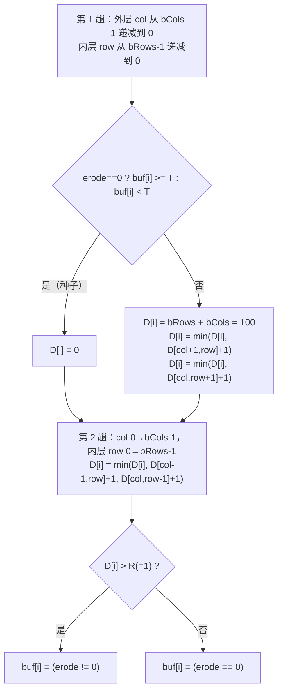

外层是**列**、内层是**行**（列优先），与常见行优先实现相反；距离图元素是 `int8_t`，初值 100 不溢出。输出被改写成 0/1 布尔图，原标签被销毁 —— 所以它工作在拷贝上。

**本机是否启用**：`TZ_Transform` 无条件执行，但 `g_tsaFlagAfterDilate` / `g_tsaFlagAfterErode` 的唯一消费者是 `TSA_GridDataAfterDilateInit @ 0x6BA94D50`（把指针挂进 `g_ideGridData` 调试网格并命名 `"AfterDilate"`）。**算法链路不读取这两张图，纯属 IDE/DVR 遥测**。clean-room 复刻可整段省略，不影响任何输出。

需要注意门限 `T = 20` 与标签基 `0x10` 的耦合：第 0 个 TZ 的标签是 17..22，其中 `class 1/2/3`（17/18/19）**低于** 20 因而不算种子；从第 1 个 TZ 起（base 24）所有标签都 ≥ 20。这是原厂的一处不对称，若要复刻遥测图必须照抄。

### 5. 质心数学

#### 5.1 积分与定点

零阶矩 `M0x = Σ max(0, sig - gripSubX)`、`M0y = Σ max(0, sig - gripSubY)`，只累加 `sig ≥ 1` 的格。本机 `gripSubX = gripSubY = 0`（`flash+0x884/0x886`），两者恒等于 `Σ sig`。

一阶矩使用**非均匀电极几何偏置表**：每格物理中心在 7 位定点下是 `x·128 + g_tpSensorDim1Offset[pos]`（`int8_t`，单位 1/128 电极距），累加式 `M1x += trunc7(Xphy · d1)`。

#### 5.2 `CTD_BasicCalculation @ 0x6BA551E0`

```c
int64_t CTD_BasicCalculation(int32_t m1, int32_t m0) {
    if (m0 == 0) return 0;                        // 除零保护：返回 0，不是无效标记
    int64_t v = ((int64_t)m1 << 8) / m0 + 0x80;   // C 语义：向零截断
    return v < 0 ? 0 : v;                          // 只有下钳位，无上钳位
}
```

`<< 8` 把结果放进 Q8（1 电极 = 256 级）；`+ 0x80` 把原点从电极栅格顶点平移到电极几何中心（半格）；返回值被调用方截成 `uint16` 存进 `unit[0x2AE]/[0x2B0]`。`m0 == 0` 返回 0 而非「无效」，下游 `TZ_RegisterTouch` 会把它当成合法坐标 0 上报。

`TZ_CentroidCore @ 0x6BA7F363` 就是两次调用：`X = CTD_BasicCalculation(unit[0x2C4], unit[0x1C])`，`Y = CTD_BasicCalculation(unit[0x2C8], unit[0x20])`。

`CTD_General @ 0x6BA5523C` 是不带电极偏置的窗口质心，供 3×3 回退与旁路分支使用：

```c
void CTD_General(uint8_t c0, uint8_t r0, uint8_t w, uint8_t h, uint16_t *px, uint16_t *py) {
    int sx = 0, sy = 0, s = 0;
    for (int c = c0 - (w>>1); c <= c0 + (w>>1); c++) {
        if ((uint8_t)c >= bCols) continue;                 // 无符号回绕兼作下界检查
        for (int r = r0 - (h>>1); r <= r0 + (h>>1); r++) {
            if ((uint8_t)r >= bRows) continue;
            int16_t v = g_tsaBufDif[r*bCols + c];
            if (v <= 0) continue;                           // 只吃正信号
            sx += v*c;  sy += v*r;  s += v;
        }
    }
    *px = CTD_BasicCalculation(sx, s);
    *py = CTD_BasicCalculation(sy, s);
}
```

#### 5.3 椭圆张量 `TZ_GetAxis @ 0x6BA7F08D`

`M00/M10/M01/M11/M20/M02` 转 `double` 送入 `TZ_GetAxisInternal @ 0x6BA7EC90`：

```c
m   = (M00 == 0) ? 1.0 : M00;
xb  = M10/m;  yb = M01/m;
u20 = M20/m - xb*xb;   u02 = M02/m - yb*yb;   u11 = M11/m - xb*yb;
d   = sqrt(4*u11*u11 + (u20-u02)*(u20-u02));
a   = sqrt(max(0, 6*(u20+u02+d)));                  // 长轴半径
b   = sqrt(max(0, 6*(u20+u02-d)));                  // 短轴半径
th  = atan2(2*(M11*m - M10*M01), -((M02-M20)*m - M01*M01 + M10*M10));
unit[0x2F0] = (a >= 0.5) ? (int16)(a*256) : 0x80;   // Q8，下限固定 0x80
unit[0x2F2] = (b >= 0.5) ? (int16)(b*256) : 0x80;
unit[0x2F4] = (int8)(th * 57.29577957855229 / 2.0); // 度/2，向零截断
```

随后 `TS_PixelToMM` 把 Q8 轴长换成毫米写入 `unit[0x2EC]/[0x2EE]`。这是**双精度浮点**实现，不是定点。

#### 5.4 `TZ_RegisterTouch @ 0x6BA8039B` 的钳位与注册

```c
if (*g_touchesPtr >= 0x14) return;                     // 上限 20 个触点，超出静默丢弃
unit[0x2AE] = min(unit[0x2AE], DAT_6bcab620 - 1);      // = bCols*256 - 1 = 15359
unit[0x2B0] = min(unit[0x2B0], DAT_6bcab622 - 1);      // = bRows*256 - 1 = 10239
```

只有上钳位；下界由 `CTD_BasicCalculation` 的 `v < 0 → 0` 保证。触点结构体步长 `0x168`，本阶段写入的关键字段：

| 触点偏移 | 来源 | 含义 |
|---|---|---|
| `+0x15E/+0x160` | `unit[0x2AE]/[0x2B0]` | Raw X/Y（若 `dwFeatureFlags & 0x1000` 先过 `TZ_StylusXYCorrection`） |
| `+0x162/+0x164` | 同上 | Working X/Y（EC 的输入输出） |
| `+0x170/+0x172` | 同上 | Filtered X/Y |
| `+0x196/+0x197` | `unit[0x334]/[0x335]` | EC 的对数表索引（grip ratio，钳到 255） |
| `+0x1A8/+0x1AA` | `unit[0x326]/[0x328]` | grip ratio 原值（未钳，16 位） |
| `+0x1AC/+0x1AD` | 包围盒 | `maxCol-minCol+1`、`maxRow-minRow+1` |
| `+0x1B0/+0x1B1/+0x1B2` | `unit[0x43]/[0x44]/[0x45]` | edge width |
| `+0x1E0` | `unit[0x08]` | 区域类型 |
| `+0x204` | `TZ_CentroidEdgeFlag` | 贴边标志，EC 的总开关 |
| `+0x28C` | `DAT_6bbc8969` | 本 TZ 的标签基 |
| `+0x154` | `TZ_GetId` | 临时 ID（模块 05 会重分配） |

最后 `(*g_touchesPtr)++` 与 `g_touchesPtr[1]++`。

`TZ_CentroidEdgeFlag @ 0x6BA7F3CB` 决定 `+0x204` 的四个贴边位，`flash[0x90..0x93]` 实测 `00 3B 00 27`（= 0/59/0/39，全屏有效）：

```c
if (unit.maxCol == 59 && X > (59-1)*256) flags |= 2;    // 右
if (unit.minCol ==  0 && X < (0 +2)*256) flags |= 1;    // 左
if (unit.maxRow == 39 && Y > (39-1)*256) flags |= 8;    // 下
if (unit.minRow ==  0 && Y < (0 +2)*256) flags |= 4;    // 上
```

比较符是严格大于/小于，且要求包围盒真正压到最外一圈。

### 6. 子区域细分与多指判决

#### 6.1 调度

`SubTZ_Process @ 0x6BA7E646` 由 `TZ_GetProperty` 在 `PROC_MS_ACTIVE` 下**无条件**调用（不是「峰数 ≥ 2 才挂载」），对本 TZ 的每一个峰各跑一次扩散。进入时 `memcpy` 备份 PosnSpecial 控制块并把 `g_ptrAccess` 切到 `&g_subTZAccess`，退出时还原。

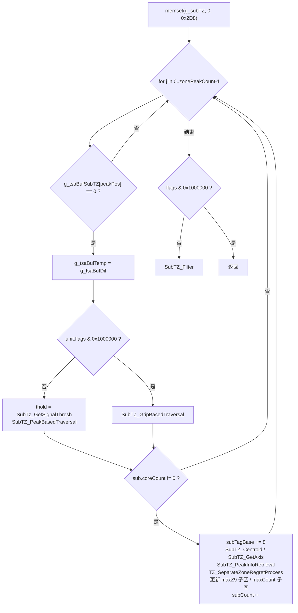

`DAT_6bbc8979` **只在子区域非空时才 +8**，空扩散会让下一个峰复用同一标签。

子区域记录（`0x48` 字节）：

| 偏移 | 类型 | 含义 | 初值 |
|---|---|---|---|
| `+0x00` | s16 | maxSig | `0x8000` |
| `+0x02` | u8 | 代表峰索引（`0x14` = 无效） | 0 |
| `+0x04` | u16 | coreCount（超门限格数） | 0 |
| `+0x06/+0x08` | u16 | Q8 质心 X/Y | 0 |
| `+0x0C` | s32 | M0 | 0 |
| `+0x10/+0x14` | s32 | M1x/M1y | 0 |
| `+0x18/+0x20/+0x28` | s64 | M11/M20/M02 | 0 |
| `+0x30..+0x38` | — | 长短轴、角度（`SubTZ_GetAxis`） | 0 |
| `+0x39..+0x3C` | u8 | minCol/maxCol/minRow/maxRow | `FF/00/FF/00` |
| `+0x3D` | u8 | 最大 gripRegion 等级位 | 0 |
| `+0x40` | u32 | 淘汰原因位（bit0 幅值不足、bit1 质量不足） | 0 |

#### 6.2 两个前置开关：`unit[0x34B]`（FatFingerSD）与 `unit[0x350]`（区域异常字）

下面两节的门限选择与「是否允许越出父 TZ」全都挂在这两个字段上，它们的产出都在子区域细分之前完成。

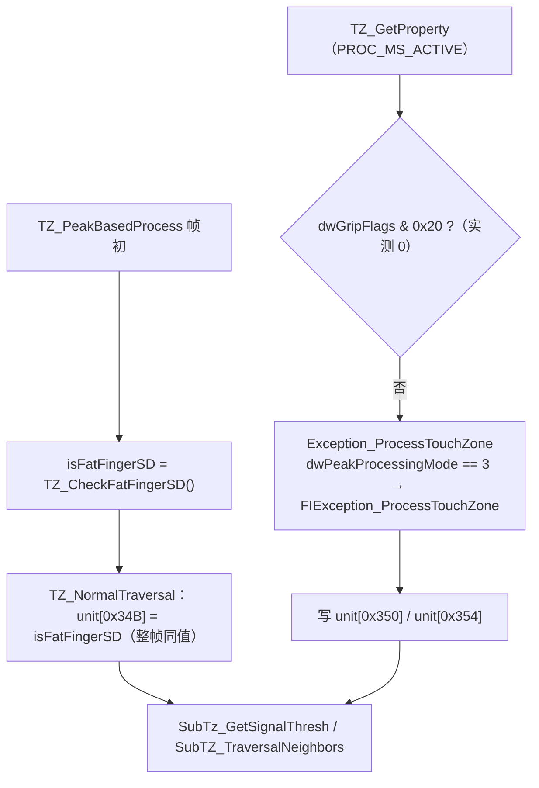

**`unit[0x34B]` = `TZ_CheckFatFingerSD @ 0x6BA8B4F9` 的返回值**，每帧只算一次、写进本帧所有 TZ 单元（`TZ_NormalTraversal` 的第三个参数）。它是一串 and 门，任何一条不满足立即返回 0：

| # | 判据 | 数据来源 | 本机可达性 |
|---|---|---|---|
| 1 | `SS_IsDim1Valid() && SS_IsDim2Valid()` | `DAT_6bcab6a4 & 1` / `& 2`，该字节由 `TSADynPrmt_Init` 从 flash `+0x608` 拷入，实测 `00` | **恒假** |
| 2 | `static[1].field_0x12 (s32) >= 0` | SD 相关计数 | — |
| 3 | `SignalDisparity_IsSignalCompensated()` | 本帧已做信号摊平补偿 | — |
| 4 | `g_pPeaks->bPeakCount != 0` | 本帧有峰 | — |
| 5 | `!TSAStatic_IsChargerPlugged()` | 未插充电器 | — |
| 6 | `prevHdr+0x05 <= 1` | 上一帧最多上报 1 个触点 | — |
| 7 | 异常字 `prevHdr+0x20 < 8` 或 `== 0x8000` | 无严重帧异常 | — |
| 8 | 所有峰都落在 `TZ_GetTouchZoneRange` 给出的包围盒内 | 自容 dif > 200 或 Self > 600 的连续段 | — |
| 9 | 包围盒宽 `w ∈ [4, 10]`、高 `h ∈ [4, 10]`、`w·h ∈ [16, 81]` | 同上 | — |

判据 1 是硬门：它读的是自容通道使能位，W273AS2700 关闭 SS（模块 01 概念段，flash `+0x608 = 0x00`），因此 **`TZ_CheckFatFingerSD` 在本机恒返回 0，`unit[0x34B]` 恒为 0**。剩下的判据刻画的是「单指按压、无充电器噪声、包围盒 4..10 格见方且面积 16..81 格」——即一根手指压得很扁、自容上看是一块方形大斑，需要用 SD 图重新分割。复刻可以整段保留结构并让它恒返回 0。

**`unit[0x350]` 是区域异常字**，唯一写入链是 `TZ_GetProperty → Exception_ProcessTouchZone @ 0x6BA591D1`，前置门 `dwGripFlags & 0x20 == 0`（实测 0 ⇒ 照常执行）。`dwPeakProcessingMode == 3` 选中 `FIException_ProcessTouchZone @ 0x6BA59BDB`，另一支 `HIException_ProcessTouchZone` 本机不可达：

```c
static[1].+0x56 = 0;                       // wetFinger 标志
TZ_GetExceptionRatio(unit);                // 填 unit[0x33C..0x346] 六个比值
if (static[1].+0x5A == 0x100) {            // 全局充电器噪声态
    unit[0x350] |= 0x100;  unit[0x354] = 0x100;  unit[0x348] = 1;
} else {
    if (FIException_CheckAbnormalTouchZoneBaseline(unit)) {      // 峰数 == 全帧峰数 且 unit[0x33C] > 200
        unit[0x350] |= 0x200;  unit[0x354] = 0x200;  unit[0x34C] = 1;
    } else if (FIException_CheckWetFinger(unit)) {               // 见下
        static[1].+0x56 = 1;  unit[0x350] |= 0x80;  unit[0x354] = 0x80;
    }
    FIException_DebounceTouchZone(unit);                          // ★ 唯一写出 8 的地方
}
FIException_Recording(unit[0x350]);
```

- `unit[0x33C]` = `TZ_GetAbsRatio(unit[0x28] /* M02 */, unit[0x18] /* M0 */)`，即「二阶矩相对零阶矩」的离散度；超过 200 且本 TZ 吃掉了全帧所有峰 ⇒ 判为基线异常（`0x200`）。
- `FIException_CheckWetFinger @ 0x6BA59919`：要求本 TZ 有对应的历史轨迹、Proximity 未启用、`nSPeakPositive >= wPeakMode3ThresholdMax = 600`；然后遍历该轨迹的历史 FIFO 用 `FIException_GetWaterSize` 累计水膜格数写 `unit[0x10]`，在「水膜格数 ≥ `DAT_6bca933C`」且「长短轴比 `10·major/minor ≥ 20`」且「`flags & 0x20 == 0`」时判湿手指（`0x80`）。
- **`FIException_DebounceTouchZone @ 0x6BA59471` 是 `unit[0x350] == 8` 的唯一来源**：读全局异常字 `prevHdr+0x20` 与本 TZ 对应历史轨迹的 `+0x1EC`（上一帧的区域异常字），

  ```c
  e = unit[0x350];  ePrev = (unit[0x324] != 0x14) ? prev[+0x1EC] : 0;
  if ((prevHdr+0x20 & 0xC0) == 0) {
      if (prevHdr+0x20 == 8) {                       // 全局已判 SD
          if (e == 0 && ePrev == 0)      e = 0;
          else if (!static[1].+0x56 || prevHdr+0x05 > 2) e = 8;
          else prevHdr+0x20 = e;                     // 单/双指湿手指反过来改写全局异常字
      } else if (e == 2) {                           // 本机 e 取不到 2
          if (ePrev == 0x40 || ePrev == 0x80) e = 0x80;
          else if (ePrev == 8) e = 8;
      }
  } else if (e == 0 && ePrev == 0) e = 0;
    else e = prevHdr+0x20;                           // 0x40/0x80 类全局异常直接下发
  if (prevHdr+0x05 > 4 && e != 0) e = 8;             // 五指以上一律降级成 SD
  unit[0x350] = e;
  ```

取值集合与语义：`0`（正常）、`8`（SD / 信号摊平，去抖出口）、`0x40`（水，只能从全局异常字继承）、`0x80`（湿手指）、`0x100`（充电器噪声）、`0x200`（区域基线异常）。`0xC8` 掩码 = `0x80 | 0x40 | 0x08`，即「水膜类异常」三个取值的并集，`SubTz_GetSignalThresh` 与 `SubTZ_TraversalNeighbors` 正是用它来放行 SD 图与越界扩散。

**本机可达性**：`0x100` 需要 `static[1]+0x5A == 0x100`，其来源是充电器噪声检测，而 FI 模式下 `FIException_IsChargerNoiseDetected` 恒返回 0（模块 02 第 4 节），**不可达**；`0x40` 只能由 `HIException_*` 或全局异常字产出，同样不可达。真正活着的是 `0x200`（区域基线异常）、`0x80`（湿手指）与去抖出口 `8`——后者最容易被触发的一条是末尾那句「上一帧上报 ≥ 5 个触点且本区已有任何异常 ⇒ 一律降级成 `8`」。由于 `unit[0x34B]` 恒 0，**`SubTz_GetSignalThresh` 的 SD 图切换与 `SubTZ_TraversalNeighbors` 的越界扩散在本机只能由 `unit[0x350] & 0xC8`（即 `8` 或 `0x80`）触发**，即「湿手指 / 信号摊平」两种工况；干燥单指场景下两者都不会发生。

#### 6.3 统一门限 `SubTz_GetSignalThresh @ 0x6BA7DE91`

```c
if (AFT_enabled) th = unit[0x00];                        // 直接沿用父 TZ 门限
else if ((unit[0x34B] != 0 || (unit[0x350] & 0xC8) != 0)
         && SD_compensated && (dwFeatureFlags & FEAT_SIGNAL_DISPARITY_POST)) {
    *pBuf = g_tsaBufSd;                                  // ★ 信号源整体切到 SD 图
    th = g_tsaBufSd[maxPeakPos] / 2;
}
else if (unit.flags & 2)      th = mul7(flash[0x81F], peakSig[minPeakIdx]);
else if (unit[0x350] == 8)    th = mul7(flash[0x820], peakSig[minPeakIdx]);
else if (maxPeak 在最外一圈)  th = mul7(flash[0x81F], peakSig[minPeakIdx]);
else                          th = mul7(flash[0x81F], peakSig[maxPeakIdx]);
th = max(th, unit[0x00]);                                // 父 TZ 门限托底
```

`mul7(k, s)` = `(k*s < 0 ? k*s + 0x7F : k*s) >> 7`。实测 `flash[0x81F] = flash[0x820] = 0x40 = 64` → 系数 50%。

**全区域共享一个门限**是关键：所有子区域在同一水平面切割，分水岭不会偏向强峰。主峰贴最外一圈（`col ∈ {0,59}` 或 `row ∈ {0,39}`）时改用**最弱峰**作参考，因为边缘峰幅值被电容截断失真、不可信。

第二分支会把 `g_tsaBufTemp` 整体切到 `g_tsaBufSd`，此后 `SubTZ_TraversalNeighbors` 读的是 SD 图而非 `g_tsaBufDif`，但标签符号仍取自 `g_tsaBufDif`。

#### 6.4 扩散 `SubTZ_PeakBasedTraversal @ 0x6BA7D838` / `SubTZ_TraversalNeighbors @ 0x6BA7D5A5`

容器同样是 `PosnSpecial`（容量 100、LIFO 双栈），邻域同样是 9 元 8 连通表。单邻居处理：

```c
if (g_tsaBufSubTZ[nb] != 0) continue;                        // 已被认领 → 跳过
bool allowOutside = (unit[0x34B] != 0) || (unit[0x350] & 0xC8);
if (!allowOutside && !SubTZ_IsInCurrTZ(unit, nb)) continue;  // 不得越出父 TZ

sig = g_tsaBufTemp[nb];
SubTZ_SetExtraFlag(nb, sig, sub);          // 记 g_tsaBufTzZone、取最大 gripRegion
if (sig < thold) {
    if ((unit[0x34B] != 0 || (unit[0x350] & 8)) && sig > 0)
        SubTZ_UpdateUnit(sub, sig, c, r);  // 仅 FatFingerSD / 异常态下才计矩
} else {
    sub.coreCount++;
    sub.maxSig = max(sub.maxSig, sig);
    SubTZ_UpdateUnit(sub, sig, c, r);
    if (k != 0) PosnSpecial_Put(nb);
}
g_tsaBufSubTZ[nb] = (subTagBase + 1) * sgn(g_tsaBufDif[nb]);  // ★ 核心与亚门限一律认领
```

**没有独立的「光晕图」**：`g_tsaBufSubTZ` 是唯一一张认领图，亚门限格同样被打上标签，只是不入栈、（正常工况下）不计矩。两峰之间的鞍部格因此被先到的子区域锁死，成为天然水坝；后到的子区域在水坝处停住。若第二个峰的种子格恰好被先前子区域的亚门限扩散吃掉，`SubTZ_Process` 的 `g_tsaBufSubTZ[peakPos] == 0` 判据会直接跳过它，该峰不产生子区域。这是原厂行为，复刻时不要「修正」。

`SubTZ_IsInCurrTZ @ 0x6BA7D35D`：`g_tsaBufTz[nb]` 必须落在 `[unit[0x35E], unit[0x35E]+8)` 内，**有符号比较**，负标签一律出局。

`SubTZ_UpdateUnit @ 0x6BA7D3CD` 的矩累加与 `TZ_UpdateMValue` 同构，但用**原始行列号、不含电极几何偏置**，并额外维护包围盒。因此子区域质心与主 TZ 质心的定点基准略有差异。

#### 6.5 过滤 `SubTZ_Filter @ 0x6BA7DA00`

```c
wholePeakSig = peakSig[unit[0x2B6]];                        // 父 TZ 最强峰
strongest    = DAT_6bbc8682;                                 // Peak_GetZ9 最大的子区索引
massGate     = trunc3(g_subTZ[strongest].M0);                // /8，向零截断
keptNum = 0;
for (k = 0; k < subCount; k++) {
    bool keep = (g_subTZ[k].maxSig > wholePeakSig/2 && g_subTZ[k].M0 > massGate)
                || SubTZ_IsGrip(&g_subTZ[k]);
    if (keep) {
        keptNum++;
        if (k != strongest) {
            r = TZ_GetAutoCentToMinPkRatio(unit, g_subTZ[k].peakIdx,
                                                 g_subTZ[strongest].peakIdx);
            DAT_6bbc8683 = max(DAT_6bbc8683, r);             // 取所有配对中最浅的鞍部
        }
    } else {
        if (g_subTZ[k].maxSig <= wholePeakSig/2) g_subTZ[k].rejectFlags |= 1;
        if (g_subTZ[k].M0     <= massGate)       g_subTZ[k].rejectFlags |= 2;
    }
}
DAT_6bbc8681 = keptNum;
```

「最强子区」`DAT_6bbc8682` 是按 **`Peak_GetZ9` 最大**选出的（在 `SubTZ_Process` 里边扩散边更新），不是按 M0。`SubTZ_IsGrip` 是旁路豁免：子区触及最外列（`minCol == 0 || maxCol == bCols-1`）且 `+0x30 > 0x13` 时无条件保留。

#### 6.6 鞍部比 `TZ_GetAutoCentToMinPkRatio @ 0x6BA82E3C`

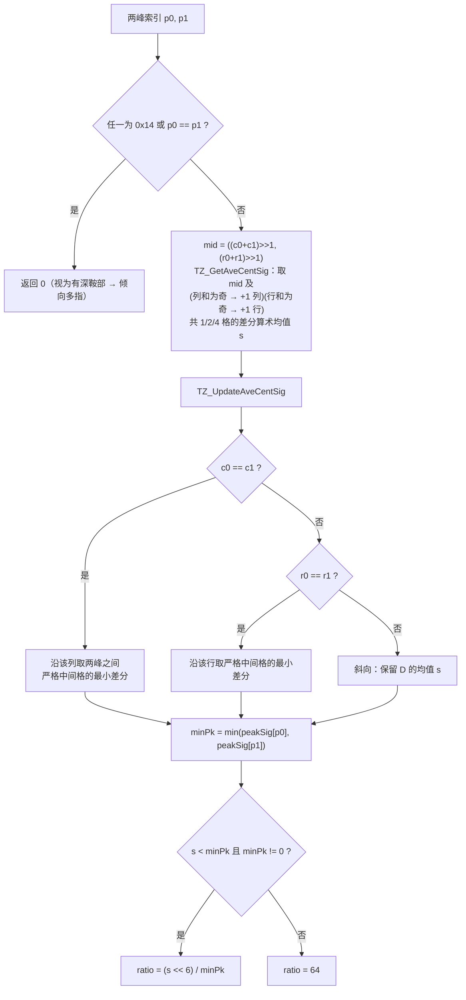

同行/同列且两峰**相邻**（间距 1）时 while 循环体一次都不执行，返回哨兵 `0x7FFF`，随即 `s >= minPk` 落到 `ratio = 64` —— 相邻双峰永远判不出鞍部，与「网格距离 ≥ 2 才可分」的物理下界自洽。`ratio` 取值 `[0, 64]`，64 表示完全没有凹陷。

#### 6.7 多指判决 `SubTZ_IsMF @ 0x6BA7EC1D`

```c
bool isMF = false;
if (SubTZ_GetNumAftFilter() > 1) {
    isMF = (DAT_6bbc8683 < flash[0x833]);                     // flash+0x833 = 0x30 = 48 → 75%
    if (g_pPrevTouches->bPrevTouchCount == SubTZ_GetNumAftFilter()
        && DAT_6bbc8684 > 10)                                 // 最大子区 coreCount > 10
        isMF = true;                                          // 跨帧滞回，强制放行
}
return isMF;
```

`DAT_6bbc8684` 是所有子区 `coreCount` 的最大值。滞回条件保证双指捏合时鞍部被肉垫填平（ratio ≥ 48）也不会突然坍塌成单点。

调用点在 `TZ_GetType @ 0x6BA837F8` 的最深处：

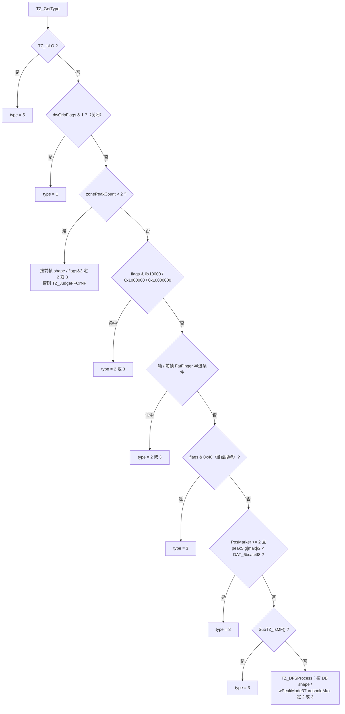

#### 6.8 三个类型仲裁器：`TZ_IsLO` / `TZ_JudgeFFOrNF` / `TZ_GetDBShape`

`unit[0x08]` 的取值集合是 `{1 NF 普通手指, 2 FF 胖手指, 3 MF 多指/大面积, 5 LO 大物体}`（`0` 只在中间态出现），下游消费者是 `TZ_UnitToTouchNormal @ 0x6BA8126F`：`3 → TZ_MFProcess`（子区域拆分）、`2 → TZ_RegistForShapeFF`、`1 / 5 → TZ_RegisterTouch`（整块登记一个触点）。上面流程图里的三个叶子仲裁器展开如下。

**`TZ_IsLO @ 0x6BA83474`（是否大物体）** —— 它不看 TZ 自身，而是看**最大子区域**的椭圆面积：

```c
uint16_t area;
if (!(flash.dwGripFlags & 0x10))                       // 实测 0 ⇒ 走这支
    area = subTZ[maxIdx].minorMM * subTZ[maxIdx].majorMM;   // maxIdx = 面积最大的子区（DAT_6bbc8686）
else
    area = unit[0x2EE] * unit[0x2EC];                  // 本 TZ 的短轴 × 长轴
uint32_t exc = unit[0x350];

if (!(exc < 9 || g_isSSLoSD || g_isSSLo)) return 0;                    // 门 G0
bool ssBig = (g_isSSLoSD && exc >= 8) || (g_isSSLo && exc <= 7);
if (ssBig && (area >= 701 || (g_pPeaks->bPeakCount >= 6 && area >= 501))) return 1;   // 快速判定
if (area > DB_LOSize()) {                                              // 回退判定
    if (subTZ[maxIdx].majorMM <= flash[0x836])  return 1;              // 实测 30 mm
    if (unit[0x2F5] > 5)                        return 1;
}
return 0;
```

- `subTZ + 0x30 / +0x32` 是 `SubTZ_GetAxis` 用 `TS_PixelToMM` 换算后的长轴 / 短轴（毫米），所以 `area` 的单位是 mm²，`701 / 501` 约相当于 26.5 mm / 22.4 mm 见方。
- `DB_LOSize @ 0x6BA55E20` = `flash[0x836]² = 30² = 900` mm²，若上一帧有被握持通道拒报的触点（`prevHdr+0x03 != 0`）则收紧到 `900·3/4 = 675`。
- `unit[0x2F5]` 由 `TZ_GetShapeRatio @ 0x6BA833CB` 产出：`denom = (minor·major·256) / flash[0x1B] / flash[0x1C]`（实测 `0x45 = 69` / `0x42 = 66`，即把 mm² 折算成格数），`ratio = min(255, (coreCount << 4) / denom)`，`denom == 0` 时直接 255。它衡量的是「实际超门限格数 / 椭圆折算格数」的 16 倍，手指与掌根形态下量级都在 10 以上，**`ratio > 5` 在本机近似恒真**，所以回退判定实际退化为「最大子区面积 > 900（或 675）mm²」。
- `g_isSSLo` / `g_isSSLoSD` 由 `TZ_SSLoProcess @ 0x6BA8BE08` 在 `TZ_PeakBasedProcess` 帧首产出，判据是自容行/列向量 `g_tsaBufSSDif` 中超过 600（LO）/ 400（LO-SD）的连续段长度 `c1`、`c2`：`c1 ≥ 14 && c2 ≥ 14 && c1 + c2 ≥ 34`（SD 支门限 13 / 13 / 28），或峰数 ≥ 8 且任一维 ≥ 26。**它的前置门是 `dwFeatureFlags & 0x100000`（bit20），实测 `dwFeatureFlags = 0x01090121` 该位为 0，函数整帧不执行**，两个标志停在初值 0。于是门 G0 退化为 `unit[0x350] < 9`、`ssBig` 恒假，`TZ_IsLO` 只剩「异常字不是 `0x100 / 0x200` 且最大子区面积超过 900（或 675）mm²」这一条通路。

**`TZ_JudgeFFOrNF @ 0x6BA8D1ED`（单峰区域的胖瘦二选一）** —— 只在 `unit[0x2B2] < 2`（区域内只有 0 或 1 个峰）且前帧形态既非 2 也非 3 时调用，函数体只有一句：

```c
return (DAT_6bbc8684 > 9) ? 2 /* FF */ : 1 /* NF */;
```

`DAT_6bbc8684` 是 `SubTZ_Process` 在本 TZ 内逐子区更新的**最大子区 `coreCount`**（同时把该子区下标记进 `DAT_6bbc8686`，供上面的 `TZ_IsLO` 取轴）。也就是说：单峰区域只要最大子区覆盖超过 9 个超门限格，就判胖手指。注意这个全局在 `SubTZ_Process` 里**不按 TZ 清零**，跨 TZ 累积取最大值——同一帧里前一个 TZ 的大子区会把后一个单峰 TZ 也推成 FF，这是原厂行为，复刻照抄。

**`TZ_GetDBShape @ 0x6BA8A24F`（跨帧形态继承）** —— 按区域内每个峰回查上一帧轨迹的形态，做投票：

```c
for (i = 0; i < unit[0x2B2]; i++) {
    p = unit[0x2B9 + i];                       // 峰索引
    s = TZ_GetPrevShape(p);  a = TZ_GetPrevAge(p);
    maxAge = max(maxAge, a);
    cnt[s]++;                                  // s ∈ {0 未知, 1 NF, 2 FF, 3 MF}
}
if (cnt[1] == peakCnt && peakCnt == prevHdr.bPrevTouchCount)          return 3;   // 全是老 NF 且数目对得上
if (cnt[3] != 0 && cnt[1] + cnt[3] == peakCnt && maxAge >= 5)         return 3;   // 含老 MF
if (cnt[0] + 1 == peakCnt && cnt[2] + cnt[1] == 1 && maxAge > 4)      return 2;   // 只有一个峰有前世且是 NF/FF
return 0;                                                                          // 无结论
```

- `TZ_GetPrevShape @ 0x6BA8A030` 读 `peak[+0x04]`（该峰继承的 Tracking ID）→ `PrevTouch_GetIdxBasedOnID` → 历史 `+0x1E0`，且**要求历史 `+0x1F8 & 8`（上一帧真的上报过）**，否则返回 0；`TZ_GetPrevAge @ 0x6BA8A186` 同路取历史 `+0x156`（轨迹年龄，帧）。首帧与刚按下的手指一律落在 `cnt[0]`。
- 第一条规则看起来反直觉——「上一帧全是普通手指」却判 MF——实际含义是「这些峰各自都有独立轨迹，且轨迹总数与本区峰数相等」，即本 TZ 是多根已分开的手指被重新粘到一起，必须拆。
- 消费者有三个：`TZ_DFSProcess @ 0x6BA832D9`（返回非 0 时，除非 `TZ_IsAbsFatFinger` 另判为 2，否则直接采纳并 `TZ_LogDbShape`；返回 0 时转 `TZ_JudgeFFOrMF`）、`TZ_VPProcess @ 0x6BA8D348`（返回 3 是插入虚拟峰的前置条件之一）、以及 `TZ_ShapeDebounce @ 0x6BA8A3CF`。**`TZ_ShapeDebounce` 全库没有调用者**（只有导出表与重定位引用），它的 `unit[0x2E8] > (flash[0x830] + flash[0x831]) / 2 = (60 + 40) / 2 = 50 ? 2 : 3` 那条鞍部比兜底规则因此不可达，复刻可以整段省略。

`TZ_DFSProcess` 的完整出口：`TSAStatic_IsAllFreqNoisy()` 为真直接判 2；否则先在「前帧轨迹数 < 本帧峰数」时跑一次 `TZ_PeakFilter`，若最强峰幅 `< wPeakMode3ThresholdMax = 600` 判 2，再走上面的 DB shape，仍为 0 才落到 `TZ_JudgeFFOrMF @ 0x6BA8D12D`（依次尝试 `unit[0x350] > 8 → 2`、短轴、中心传感器、长轴、鞍部比五个判据）。

**本机可达性小结**：`TZ_JudgeFFOrNF`、`TZ_GetDBShape`、`TZ_DFSProcess`、`TZ_JudgeFFOrMF` 全部可达且每帧参与判决；`TZ_IsLO` 可达但只剩「面积 > 900 mm²」一条通路（`g_isSSLo*` 恒 0）；`TZ_ShapeDebounce` 不可达。

#### 6.9 出口 `TZ_MFProcess @ 0x6BA80FBD`

```c
if (!(unit.flags & 0x800) && !(unit.flags & 0x1000000) && unit[0x34B] == 0) {
    /* 浅鞍部回退：形态学没能切开，用每个峰的 3×3 局部质心硬分 */
    unit[0x0C] /= zonePeakCount;                 // 正格数均分（无符号除）
    unit[0x18] /= zonePeakCount;                 // 正信号和均分
    unit[0x2F4] = 0;                             // 角度清零
    unit[0x2EC] = unit[0x2EE] = DAT_6bcab6ec;    // 长短轴统一设成固定 mm
    unit[0x2F0] = unit[0x2F2] = TS_MMToPixel(DAT_6bcab6ec);
    for (j = 0; j < zonePeakCount; j++) {
        p = unit.peakList[j];
        CTD_General(peak[p].col, peak[p].row, 3, 3, &unit[0x2AE], &unit[0x2B0]);
        unit[0x2B6] = p;
        TZ_GripLevelProcess(unit, peak[p].col, peak[p].row);   // 按子区包围盒回填 gripRegion
        TZ_RegisterTouch(unit);
    }
} else {
    TZ_RegisterBasedOnSubTZ(unit, 1);            // 形态学分割成功：逐个存活子区注册
}
```

`TZ_RegisterBasedOnSubTZ(unit, 1)` 遍历所有 `rejectFlags & 3 == 0` 的子区，把子区的 M0、coreCount、轴、Q8 质心、gripRegion、代表峰逐个覆盖进同一个 unit 后调用 `TZ_RegisterTouch`；`param2 == 0` 的变体只注册 `DAT_6bbc8682` 那一个（退化为单点）。

**本机是否启用**：`SubTZ_Process` 始终运行；`SubTZ_IsMF` 的静态判据 `flash[0x833] = 48` 生效；`TZ_MFProcess` 两条出口都可达。只有 `SubTZ_GripBasedTraversal` 属于握持分离专用路径 —— 它要求 `flags & 0x1000000`，该位由 `TZ_CheckToSeparateZone` 置位，而后者的前置门是运行期特性位 `dwFeatureFlags & 0x20`，与 Flash 参数无关。

### 7. 边缘补偿

#### 7.1 `CTD_ECProcess @ 0x6BA55CA0`

```c
for (i = 0; i < *g_touchesPtr; i++) {
    t[i].workX = t[i].rawX;   t[i].workY = t[i].rawY;    // +0x162/+0x164 ← +0x15E/+0x160
    CTD_ECProcessUnit(i);     // = Touch_SetEdgeDist(i); CTD_ECProcessDim1(i); CTD_ECProcessDim2(i);
    t[i].fltX  = t[i].workX;  t[i].fltY  = t[i].workY;   // +0x170/+0x172 ← +0x162/+0x164
    Touch_SetEdgeDist(i);                                 // 用补偿后坐标重算边距
}
```

`Touch_SetEdgeDist @ 0x6BA72B19` 写 `+0x22C/+0x22E`：`dim1EdgeDist = min(X - xMin, xMax - X)`、`dim2EdgeDist = min(Y - yMin, yMax - Y)`，其中 `xMin = DAT_6bcab62a = flash[0x90]<<8 = 0`、`xMax = DAT_6bcab62c = (flash[0x91]+1)<<8 = 15360`、`yMin = 0`、`yMax = 10240`（`TSAConstPrmt_Init @ 0x6BB3BBBB`）。判据写成 `(int)(xMax - X) < (int)(X - xMin)` 后取小者，相等时取 `X - xMin`。

#### 7.2 查找表与参数（实测）

EC 描述符位于 `flash+0x840`，**步长 17 字节，共 4 张**：

| 表 | Flash 偏移 | 实测字节 | 解析 |
|---|---|---|---|
| dim1 min（左） | `0x840` | `01 07 00 10 E0` + 12×`00` | N=1，key=7，lnLo=16，lnHi=224 |
| dim1 max（右） | `0x851` | `01 07 00 10 E0` + 12×`00` | N=1，key=7，lnLo=16，lnHi=224 |
| dim2 min（上） | `0x862` | `01 07 00 10 60` + 12×`00` | N=1，key=7，lnLo=16，lnHi=96 |
| dim2 max（下） | `0x873` | `01 07 00 10 60` + 12×`00` | N=1，key=7，lnLo=16，lnHi=96 |

布局：`byte[0] = N`（段数，最多 4），其后每段 4 字节 `{key, 保留, lnLo, lnHi}`，段 `i` 在 `+1+4i`。`CTD_ECProcessDim1/2` 把选中的表按 3 个 `undefined8` 拷 24 字节到 RAM 暂存 `g_tsaPrmtRam`（`0x6BCAB720`），尾部越界读入的是无害的 0。

`g_ctd256Ln @ 0x6BB51D80`：256 项 u16，`g_ctd256Ln[i] = round(256 · ln(i+1))`。实测样点 `[0]=0, [1]=177, [2]=281, [3]=354, [16]=725, [255]=1418`。

#### 7.3 `CTD_ECGetOffset @ 0x6BA553A6`

```c
int16_t CTD_ECGetOffset(uint8_t ratio, uint8_t key) {
    int i = 0;
    while (i < tbl[0] - 1 && tbl[1 + 4*i] < key) i++;      // N==1 → 循环永不执行，i=0
    uint16_t lo = ln[tbl[4*i + 3]];
    uint16_t hi = ln[tbl[4*i + 4]];
    int off = (hi == lo) ? 0 : (int)((ln[ratio] - lo) * 0x100) / (int)(hi - lo);
    if (off > 0xFF) off = 0xFF;                            // 只有上钳位
    return (int16_t)off;
}
```

`ratio` 来自 `touch[+0x196]/[+0x197]`，即 `TZ_GetGripRatio @ 0x6BA81F2F` 算出的**边缘两圈信号比**：

```c
r = TZ_CentroidGripRatio(unit[0x2CC], unit[0x2D0]);   // 最外圈信号和 / 次外圈信号和
unit[0x326] = r;
unit[0x334] = (r > 0xFE) ? 0xFF : (uint8_t)r;

uint32_t TZ_CentroidGripRatio(int outer, uint32_t inner) {
    if (inner == 0 && outer == 0) return 0;
    if (inner == 0)               return 0xFFFF;
    if (outer == 0)               return 0;
    uint32_t v = (uint32_t)(outer << 4) / inner;          // ×16 定点
    return v > 0xFFFF ? 0xFFFF : v;
}
```

`unit[0x2CC]/[0x2D0]`（dim1）与 `unit[0x2D4]/[0x2D8]`（dim2）由 `TZ_UpdateEdgeInfo` 在泛洪过程中累加：前者收集落在最外一圈（`col == flash[0x90] || col == flash[0x91]`）的信号和，后者收集次外圈（`col == flash[0x90]+1 || col == flash[0x91]-1`）。

于是 `ratio = 16` 表示外圈与次外圈等强；对应 `lnLo = 16`，`off = 0` —— **16 是补偿中性点**。`ratio > 16` → `off > 0`，坐标被推向边框；`ratio < 16` → `off < 0`（**没有下钳位**），`256 - off > 256`，坐标反被推向屏内，极端情形 `ratio = 0` 时 `off = (0-725)*256/661 = -280`，输出 536（≈2.1 电极）。复刻必须保留这个无下限行为。

饱和点：dim1 的 `hi = ln[224] ≈ 1386`，`off` 在 `ratio ≈ 223` 处达到 255；dim2 的 `hi = ln[96] ≈ 1171`，`ratio ≈ 95` 即饱和 —— **行方向的补偿曲线陡得多**。

`key`（`touch[+0x194]`）是**段选择键**：段搜索循环写作 `while (i < N-1 && table[i].key < key) i++`，`N == 1` 时循环条件立刻为假，`i` 恒为 0，`key` 取什么值都不影响结果。四张 EC 表（`0x840/0x851/0x862/0x873`）实测首字节全是 `01`，即 `N == 1`，所以**这个参数在本机彻底无效，复刻时可以直接传 0**。

全库唯一写 `+0x194` 的是 `TS_ProcessUnit @0x6BA7C1D7`（模块 05 的 TS 阶段）：`+0x194 = max(TS_UpdateCurSizeInMM(本帧), prev[+0x194])`，两者皆 0 时取 `DAT_6BCAB6EC`，即触点尺寸 mm 的生命周期单调锁存。但 TS 排在 `CTD_ECProcess` **之后**，而当前池每帧被 `Touch_Clean`（`TSA_MSProcess` 无条件调用）整体清零，所以 EC 读到的 `+0x194` 在正常帧里就是 0 —— 即便某天 EC 表出现多段，这里也只会永远命中段 0。两重保险都指向同一结论：段选择在本机不构成差异。

#### 7.4 `CTD_ECGetFinalOffset @ 0x6BA554F7` 与作用方向

```c
int CTD_ECGetFinalOffset(int dist, int target) {      // target = 0x100 - off
    int k = dist - 0x100;
    if (k <= 0)      return target;                                  // ①
    if (k < 0x40) {                                                  // ②
        int v = dist * k * 4 + (0x100 - 4*k) * target;
        if (v < 0) v += 0xFF;
        return v >> 8;
    }
    return dist;                                                     // ③
}
```

**是线性混合，不是三次样条**：权重 `w = 4k/256 = (dist-256)/64`，结果 `= w·dist + (1-w)·target`。

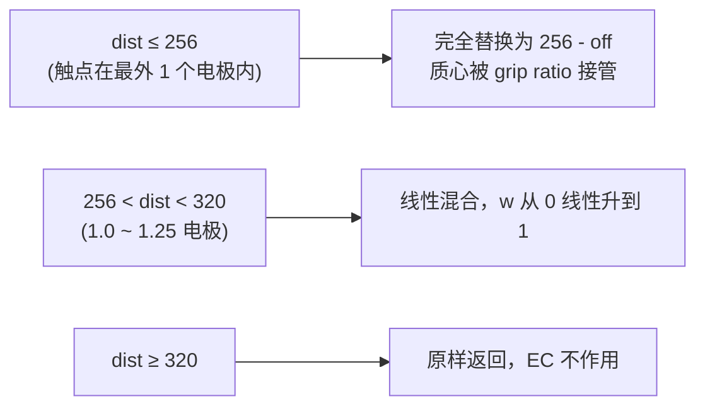

作用方向由调用侧决定（`CTD_ECProcessDim1`，dim2 同构）：

```c
touch.flags1F0 &= ~0x100;
if (touch.flags204 & 2) {                       // 贴右边（优先）
    载入 flash+0x851 表;
    off = CTD_ECGetOffset(touch[0x196], touch[0x194]);
    d   = CTD_ECGetFinalOffset(xMax - rawX, 0x100 - off);
    touch.workX = xMax - d;
    if (d != xMax - rawX) touch.flags1F0 |= 0x100;
} else if (touch.flags204 & 1) {                // 贴左边
    载入 flash+0x840 表;
    off = CTD_ECGetOffset(touch[0x196], touch[0x194]);
    d   = CTD_ECGetFinalOffset(rawX - xMin, 0x100 - off);
    touch.workX = xMin + d;
    if (d != rawX - xMin) touch.flags1F0 |= 0x100;
}
```

右优先于左（`else if`），dim2 同理下（`0x8`）优先于上（`0x4`）；`0x100`/`0x200` 是「本帧 dim1/dim2 发生了 EC 修正」的标记位。输入是 `rawX`（`+0x15E`）而非 `workX`，因此 dim1 与 dim2 相互独立、不会级联。

### 8. 跨帧输入

- **`TSABuffer_PrevFrameProcess @ 0x6BA8F540`** 只是 `TSABuffer_TimeRptProcess()` 的薄壳，为 TZ 准备的是 `g_tsaBufTimeRpt`（每格的连续上报时长），由 `TZ_TraversalNeighbor` 取最小值写入 `unit[0x33A]`。它**不**准备认领图或年龄图。
- **`TZ_CheckToSeparateZone @ 0x6BA855B7`** 读的 `prevTouch[+0x218] bit0` 是「该前帧触点处于握持分离态」的粘滞标记。命中且本 TZ 同时含 not-in-grip 峰（`flags & 0x800000`）时置 `flags |= 0x10000000` 并强制 `TZ_TryMergePeak`；再配合 `flags & 0x400000`（含 in-grip 峰）最终置 `flags |= 0x1000000`，把本 TZ 标记为「需按握持切分」，从而让 `SubTZ_Process` 改走 `SubTZ_GripBasedTraversal`、`TZ_GetType` 直接判 type=3、`TZ_MFProcess` 走 `TZ_RegisterBasedOnSubTZ`。整条链的前置门是 `dwFeatureFlags & 0x20`。
- **`TZ_IsSD @ 0x6BA8A67E`** 见 §3；本机因 `flash[0x81E] == flash[0x81F]` 而无数值影响。
- **`TZ_BeforeSDCompensationPeakInfoRetrieval @ 0x6BA8ADEC`** 无条件执行，遍历 `g_peaksBeforeSwitchDifBuf`（SD 切换前的峰表，布局同 `g_pPeaks`，字段基址 `DAT_6bbc0b55/56/58`），统计落在本 TZ 标签内的峰数写 `unit[0x2B4]`、最强者索引写 `unit[0x2B5]`。`TZ_IsValid` 在 MS 模式下要求 `unit[0x2B4] != 0`，**所以一个只含 SD 后新增峰的 TZ 会被整体丢弃**。

### 9. 配置门控总表

`dwGripFlags`（`flash+0x83C`）实测 `0x00000000`，逐位核实其在本模块内的读点：

| 位 | 读点 | 生效内容 | 本机 |
|---|---|---|---|
| `0x001` | `TZ_GetType @ 0x6BA83828` | 置位则整个类型判决被短路成 `type = 1`，`TZ_MultiFatFingerCheck` 也不执行 | 关闭 → 全套判决照常运行，**无任何副作用字段被漏写** |
| `0x002` | `TZ_VPProcess @ 0x6BA8D424` | 置位则禁止插入虚拟峰 | 关闭 → 虚拟峰通路可达 |
| `0x004` | `TZ_GetSigThold` | 门限固定为 `flash[0x81C] = 220` | 关闭 |
| `0x008` | `TZ_UnitToTouch @ 0x6BA81392` | 置位则跳过 `unit[0x350]` 路由，直接 `TZ_RegisterTouch(unit)` | 关闭 → 走 `unit[0x350] == 0 ? TZ_UnitToTouchNormal : TZ_ExceptionProcess`，**无副作用字段被漏写**（被跳过的只是两个纯分发函数） |
| `0x010` | `TZ_IsLO @ 0x6BA83487` | **切换面积来源**：置位用本 TZ 的 `unit[0x2EC]·unit[0x2EE]`，清零用最大子区的 `subTZ[maxIdx]` 长短轴 | 关闭 → **清零分支才是生效分支，必须实现**（见 §6.8） |
| `0x020` | `TZ_GetProperty @ 0x6BA8B19C` | 置位则**跳过** `Exception_ProcessTouchZone` | 关闭 → 异常处理照常运行，`unit[0x350]` 每帧被写（见 §6.2） |
| `0x040` | `TZ_TraversalNeighbor` | 决定用有符号还是绝对值；MS 模式下被列号判据整体覆盖 | 无效果 |
| `0x080` | `TZ_PeakBasedProcess` | 旁路泛洪，直接 3×3 质心 | 关闭 |
| `0x100` | `TZ_PeakBasedProcess` | `TZ_SimpleTraversal` 简化扩散 | 关闭 |
| `0x200` | `TZ_Process` / `TZ_IsGripWall` / `TZ_PeakBasedProcess` | 峰年龄跟踪与握持阻断墙 | 关闭 → **`TZ_IsGripWall` 恒返回 0，阻断墙对泛洪无作用** |
| `0x400` | `TZ_NormalTraversal` / `TZ_TraversalNeighbor` | 质心背景偏置扣除 | 关闭；且 `flash+0x884/0x886` 实测均为 0，即使开启也是恒等变换 |

运行期特性位（`g_tsaStaticPtr->dwFeatureFlags` / `dwProcessingState`，非 Flash 参数）：

| 位 | 读点 | 作用 |
|---|---|---|
| `PROC_MS_ACTIVE` | 遍布全模块 | 手指管线恒真；控制 SubTZ 缓冲清零、`Record2`、`SubTZ_Process`、`TZ_IsValid` 第二道校验、`mag` 的取值方式 |
| `dwProcessingState & 0x10` | `TZ_GetSigThold` | SideTouch 门限 |
| `dwFeatureFlags & 0x20` | `TZ_TraversalNeighbor` / `TZ_GetProperty` | EdgeMerge 与握持分离链 |
| `dwFeatureFlags & 0x1000` | `TZ_GetSigTholdCommon` / `TZ_RegisterTouch` | 强制用 `flash[0x81F]`；坐标过 `TZ_StylusXYCorrection` |
| `dwFeatureFlags & 0x100000` | `TZ_PeakBasedProcess` | `TZ_SSLoProcess` 自容 LO 预处理；实测该位为 0 ⇒ **关闭**，`TZ_IsLO` 的 `ssBig` 快速判定不可达 |

Flash 参数汇总（均已实测）：

| 名称 | 偏移 | 字节 | 值 | 用途 |
|---|---|---|---|---|
| `bCols` / `bRows` | `0x1D` / `0x1E` | 1/1 | `0x3C` / `0x28` = 60 / 40 | 网格尺寸 |
| 有效区 col/row min-max | `0x90..0x93` | 4 | `00 3B 00 27` = 0/59/0/39 | 贴边判据、EC 边界、`TZ_UpdateEdgeInfo` 内外圈定义 |
| `wPeakFilterReferenceThreshold` | `0x5B4` | 2 | `0x0BB8` = 3000 | 门限参考上限、SD 判据 |
| 固定门限（bit2 用） | `0x81C` | 2 | `0x00DC` = 220 | 关闭分支 |
| 门限系数 A / B | `0x81E` / `0x81F` | 1/1 | `0x40` = 64 | `/128` → 50% |
| SubTZ 异常态系数 | `0x820` | 1 | `0x40` = 64 | 50% |
| 节距折算常数 dim1 / dim2 | `0x1B` / `0x1C` | 1/1 | `0x45` / `0x42` = 69 / 66 | `TZ_GetShapeRatio` 把 mm² 折算成格数 |
| SS 通道使能位 | `0x608` | 1 | `0x00` | `SS_IsDim1Valid` / `SS_IsDim2Valid` 恒假 ⇒ `TZ_CheckFatFingerSD` 恒 0 |
| 鞍部比去抖门限 A / B | `0x830` / `0x831` | 1/1 | `0x3C` / `0x28` = 60 / 40 | `TZ_ShapeDebounce` 的 `(60+40)/2 = 50`（函数无调用者） |
| MF 鞍部比门限 | `0x833` | 1 | `0x30` = 48 | `48/64` = 75% |
| LO 面积边长 | `0x836` | 1 | `0x1E` = 30 | `DB_LOSize = 900` mm²（有握持拒报触点时 675）；同时是 `TZ_IsLO` 的「紧凑」长轴门限 |
| edge width 门限 | `0x838` | 2 | `0x012C` = 300 | `TZ_GetEdgeWidth` |
| `dwGripFlags` | `0x83C` | 4 | `0x00000000` | 见上表 |
| EC 表 ×4 | `0x840/0x851/0x862/0x873` | 17 each | `01 07 00 10 E0/E0/60/60` | 见 §7.2 |
| 质心背景偏置 X/Y | `0x884` / `0x886` | 2/2 | `0` / `0` | 恒等 |

### 10. clean-room 复刻要点清单

1. 峰记录基址 `g_pPeaks + 0x10 + 20·i`；峰按索引升序遍历；跳过条件 `tz[pos] != 0 || subTz[pos] != 0`。
2. `PosnSpecial` 是**双向 LIFO 栈**（DFS），不是 FIFO；容量 100，满即静默丢弃；先抽干正差分侧再整体切负差分侧。
3. 邻域 9 元表含中心，8 连通；越界判据靠 `uint8_t` 回绕。
4. MS 模式下 `mag = (col ∈ {0, 1, bCols-2, bCols-1}) ? sig : abs(sig)`。
5. 终止层（`mag < thold`）不入栈但**计入全部矩**。
6. 二阶矩累加器收到的是 `mag`（绝对值），零阶/一阶矩只收正信号。
7. 定点除法一律 `x < 0 ? (x + (2^n - 1)) >> n : x >> n`（向零截断）；唯一例外是 `TZ_GetSigTholdCommon` 用无符号 `>> 7`。
8. `CTD_BasicCalculation`：`m0 == 0 → 0`；`+0x80` 半格偏移；只钳下界 0。
9. 坐标上钳位 `bCols*256-1` / `bRows*256-1`；触点上限 20 且超出静默丢弃。
10. `TZ_UnitInit` 全零 + `TZ_UnitMaxMinInit` 的哨兵（`0xFF / 0x7F / 0x80 / 0x8000 / 0x7FFF`）必须照抄，`TZ_GetEdgeWidth` 与 `TZ_GetTzEdgeWidthDim*` 靠哨兵识别「未触及」。
11. 标签基 `0x10`、步进 8、符号跟随差分符号；碰撞只置 `0x4000`，先到先得不可抢占。
12. SubTZ 只有一张认领图，亚门限格同样认领；扩散不得越出父 TZ 标签区间（有符号比较）。
13. 鞍部比 64 表示无凹陷；相邻双峰（间距 1）必然返回 64。
14. EC 仅在贴边标志置位且 `dist < 320` 时作用；`ratio = 16` 是中性点；`off` 无下钳位。
15. `TZ_DilateAndErode` 可整段省略（仅遥测）。
16. 首帧特例：`bPrevTouchCount == 0` 时 `SubTZ_IsMF` 的滞回分支不可能命中，多指完全依赖 `ratio < 48`；`TZ_IsIDMerged` / `TZ_IsEdgeMerged` 因 `g_tsaBufTzID` / `g_tsaBufTzZonePrev` 全零而恒返回 0；`TZ_GetDBShape` 的三条规则也全部落空（所有峰的前世形态都是 0）。
17. `DAT_6bbc8684`（最大子区 `coreCount`）与 `DAT_6bbc8686`（该子区下标）**跨 TZ 累积、整帧只在 `TSA_MSProcess` 级别复位**，`SubTZ_Process` 不会按 TZ 清零。`TZ_JudgeFFOrNF`、`SubTZ_IsMF`、`TZ_MultiFatFingerCheck`、`TZ_IsLO` 四处都读它，复刻必须保留这个「污染」语义。
18. `unit[0x34B]`（FatFingerSD）与 `unit[0x350]`（区域异常字）决定子区域是否改用 SD 图、是否允许越出父 TZ 标签区间。本机 `unit[0x34B]` 恒 0，`unit[0x350]` 只可能取 `0 / 8 / 0x80 / 0x200`；复刻保留结构即可，但 `8` 与 `0x80` 是真会发生的，不能当死枝删掉。
