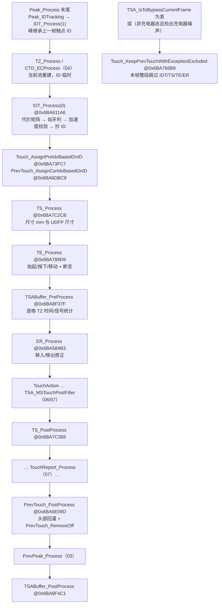
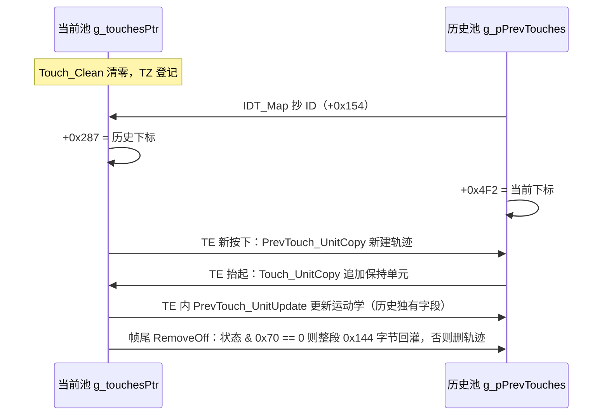
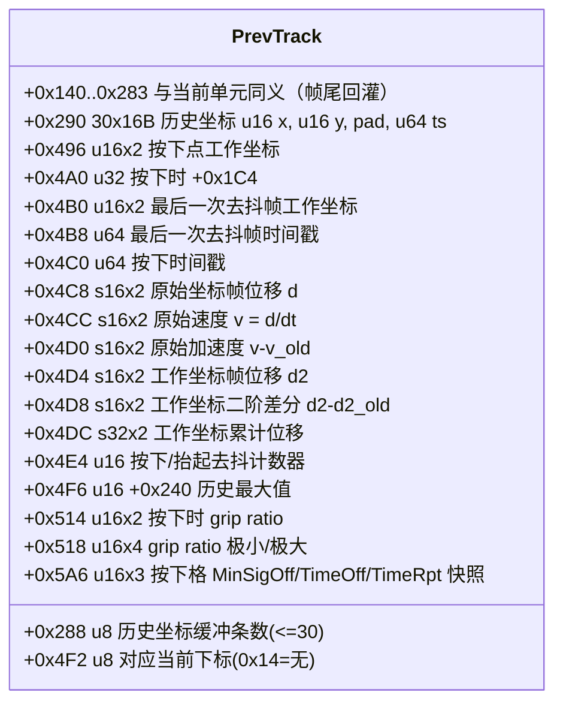
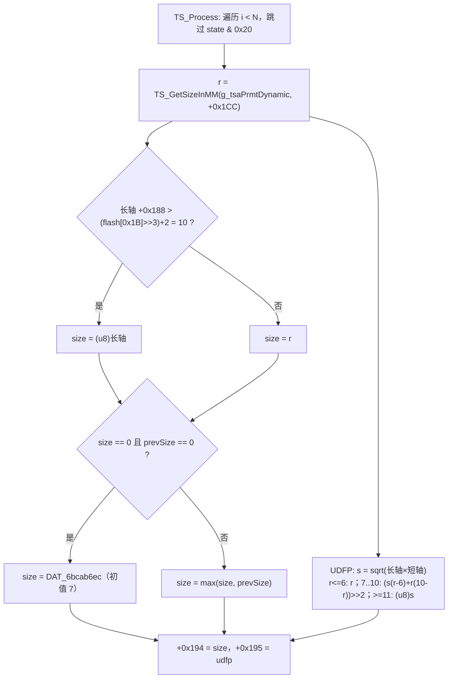
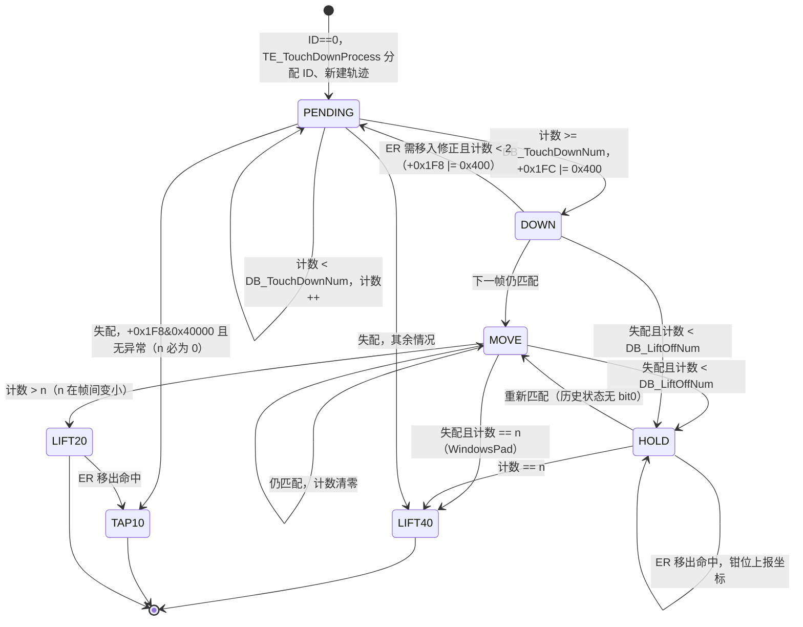
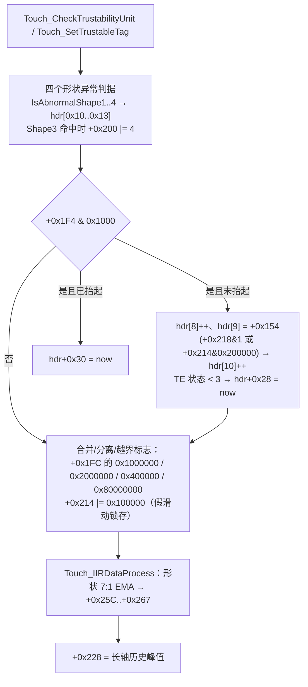
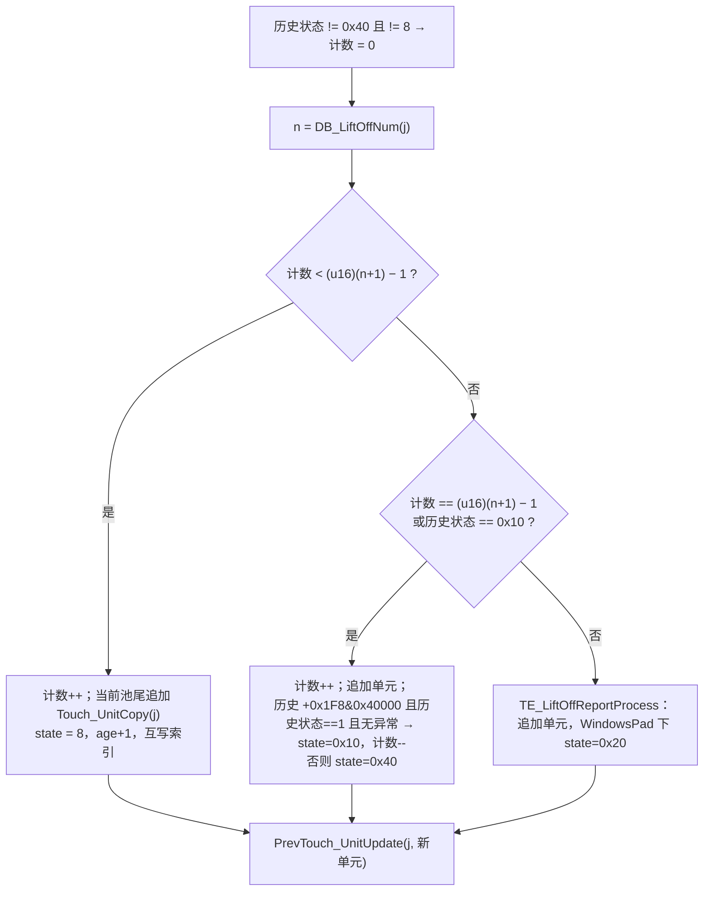
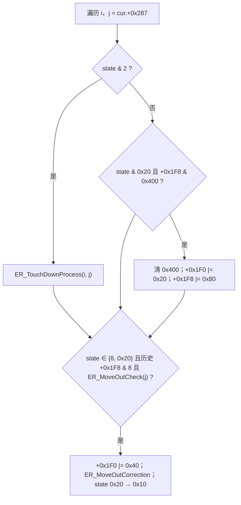

# 05 多目标追踪、触点尺寸与触控事件生命周期

基于 `TSACore.dll`（image base `0x6BA40000`）反编译与 `TSAPrmt.dll` 中 W273AS2700（Gaokun Himax CSOT，60 列 × 40 行，显示 2560×1600）预置表实测值；文中偏移一律为「代码偏移」，即 `base + i*stride + off`，已含 `0x140` 字节的数组头。

## 概念

| 术语 | 含义 |
|---|---|
| 当前帧触点池 | `g_touchesPtr`：`0x140` 字节头 + 20 × `0x168` 单元，总 `0x1D60`（`Touch_Clean` 的清零长度） |
| 历史触点池 | `g_pPrevTouches`：`0x140` 字节头 + 20 × `0x478` 单元，总 `0x5AA0`（`PrevTouch_Release` 的清零长度）；每个单元是一条「轨迹」 |
| Q8 坐标 | 1 个感应格 = 256；`+0x15E/+0x160` 为 EC 前原始质心，`+0x162/+0x164` 为 EC 后工作坐标，`+0x170/+0x172` 为待滤波/上报坐标 |
| `TS_MMToPixel(mm)` | `mm × DAT_6bcab61a`，`DAT_6bcab61a = 4096/flash[0x1B] + 1 = 4096/69 + 1 = 60`，即 1 mm = 60 Q8 |
| 帧间隔 `dt` | `Touch_GetFormattedTimeInterval` 处理后的毫秒数；静态区 `static+0xF8`（Ghidra 误名 `nBaselineStageInitialSignal`）存本帧间隔，触点 `+0x150` 存该触点本帧间隔 |
| 异常字 | 头部 `+0x20`（Ghidra 在历史池把它误名为 `nTouchCount`）：`0x100` 充电器噪声、`0x2000` 水下、`0x4000` 出水、`0x400` 硬件异常、`0x200` 基线复位、`0x80` 湿手指、`0x1000` 重校准 |
| IDT | ID Tracking：当前触点与历史轨迹的二分图最小代价匹配 |
| TE | Touch Event：逐轨迹的生命周期状态机，状态字在触点 `+0x21C` |
| ER | Edge Rejection：边缘移入/移出修正 |

## 架构

本模块夹在 `CTD_ECProcess`（04）与 `TouchAction_Process`（06）之间，另在帧尾与 `Peak_Process` 内各有一个挂点。核心思想是「当前池每帧从零重建，历史池才是轨迹的真身」：TZ 每帧重新登记触点，IDT 只负责把历史 ID 抄到当前触点上，TE 根据匹配结果推进每条轨迹的状态并在历史池里新建/保持轨迹，帧尾 `PrevTouch_RemoveOff` 再把当前池整段回灌历史池或删除已结束的轨迹。



两个池之间的数据流：



## 分点解释

### 1. 触点池布局

#### 1.1 数组头（两池同构）

`PrevTouch_PostProcess` 按相同偏移把当前头抄进历史头，所以两池头部语义一致：

| 偏移 | 类型 | 语义 | 写入者 / 读者 |
|---|---|---|---|
| `+0x00` | u8 | 当前池：本帧触点数（含 TE 追加的抬起单元）；历史池：轨迹数 `bPrevTouchCount` | TZ_RegisterTouch、TE 追加；RemoveOff 删轨迹时减 |
| `+0x01` | u8 | TZ 本帧登记数 | TZ_RegisterTouch 自增 |
| `+0x02` | u8 | `TZ_UnitToTouch` 的调用次数（含被 `TZ_ExceptionProcess` 分流、最终未登记为触点的 TZ） | TZ_UnitToTouch 自增 |
| `+0x03` | u8 | 被握持通道拒报的触点数 | TouchReport_ToBeReported（`+0x1F0 & 0x2000`）自增 |
| `+0x05` | u8 | 本帧实际上报触点数 | TouchReport_ProcessUnit 自增 |
| `+0x08` | u8 | 本帧「`+0x1F4 & 0x1000` 且未抬起」的触点数，每帧由 `Touch_ProcessAftTouchEvent` 清零后重算 | Touch_ProcessAftTouchEventUnit |
| `+0x09` | u8 | 上述集合中**最后一个**触点的 Tracking ID（`+0x154`），不是计数 | 同上 |
| `+0x0A` | u8 | 上述集合中又满足「`+0x218 & 1`（区域被握持分离）或 `+0x214 & 0x200000`」的个数 | 同上 |
| `+0x0D` | u8 | 握持抑制计数（处于握持 stage 1/2 的触点数） | 06 |
| `+0x10` | u8 | `Touch_IsAbnormalShape` 或 `+0x200 & 4` 的触点数 | Touch_ProcessAftTouchEventUnit |
| `+0x11` | u8 | `Touch_IsAbnormalShape2` 的触点数 | 同上 |
| `+0x12` | u8 | `Touch_IsAbnormalShape3` 的触点数（同时给该触点的 `+0x200` 置上 bit2） | 同上 |
| `+0x13` | u8 | `Touch_IsAbnormalShape4` 的触点数 | 同上 |
| `+0x04`、`+0x06`、`+0x07`、`+0x0B`、`+0x0C`、`+0x0E`、`+0x0F`、`+0x14`(u16) | — | 其余逐帧计数器 | 06/07 |
| `+0x18` | u32 | 全局标志；`+0x1C = +0x18 & ~prev.+0x18`（上升沿） | PrevTouch_PostProcess |
| `+0x20` | u32 | **异常字**（见概念表）；历史池回灌时清 `0x400` | Exception_UpdatePrevException、HardwareAnalyzer_ReportToTSA |
| `+0x24` | u32 | 全局状态：bit0 `Touch_UpdateGlobalState`；bit1 = `[3]` 由非零变零；bit2 = `[3]` 由零变非零；bit3/bit4 由 TZ 区域标志置 | PrevTouch_PostProcess 重算 bit1/bit2 |
| `+0x28` | u64 | 最近一次出现「`+0x1F4 & 0x1000` 且 TE 状态 < 3」的帧时间戳 | Touch_ProcessAftTouchEventUnit；帧首从 prevHdr 复位 |
| `+0x30` | u64 | 最近一次出现「`+0x1F4 & 0x1000` 且已抬起」的帧时间戳 | 同上 |
| `+0x38` | u64 | 最近一次出现 `+0x1F0 & 0x2000` 触点的时间戳（非零才回灌） | Touch_UpdateGlobalState |
| `+0x40..` | — | Thenar 单元 | Thenar_UnitCopy |
| `+0x138` | u32 | 透传 | — |

**`+0x08/+0x09/+0x0A/+0x28/+0x30` 在本机恒为 0**：这五个字段的写入全部包在 `if (touch+0x1F4 & 0x1000)` 里，而全库对 `+0x1F4` 的置位只有 `0x20`（`DB_TouchDownTholdCheck`）、`0x4`（`Proximity_TouchPostProcess`）、`0x100`（`SafeBaseline_CheckTouch`）三处，**没有任何代码写 `0x1000`**。后果见模块 06 的 `GripFilter_IsGripMergeAllowed`。

**哨兵值**：`== 0x100`、`== 0x2000` 这类比较针对的都是 `+0x20` 异常字，不是触点数。`0x2000`（水下）在全库只有 `Exception_CheckUnderWater @0x6BA589C1` 会写入挂起异常，而它只在 `dwFeatureFlags & FEAT_UNDERWATER_DETECT` 下被 `TSA_MSProcess` 调用；本机特性字 `0x01090121` 不含该位，所以 `prev.+0x20 == 0x2000` **在本机不可达**，模块 01 里依赖它的手套锁存置位条件（`BLReset_IsTriggered2AfeWakeUp` 的 `dwBaselinePropertyState = 8` 分支）与 `BLSM_SaveNormalBl` 的排除条件都不会命中。`0x100` 同理：FI 模式（`dwPeakProcessingMode == 3`）下 `FIException_IsChargerNoiseDetected` 恒 0，`FIException_Recording` 只在挂起值已为 `0x100` 时才会再写 `0x100`，初值为 0，所以 `0x100` 也不可达。本机实际可见的异常字只有 `0`、`0x80`、`0x200`、`0x400`、`0x1000` 及其组合。

#### 1.2 当前触点单元（stride `0x168`，本模块读写的字段）

`PrevTouch_UnitCopy` / `Touch_UnitCopy` 在两池间搬运的是 `+0x140..+0x283` 共 `0x144` 字节，所以这一段在两池中同偏移同义；`+0x284..+0x2A7` 只存在于当前池。

| 偏移 | 类型 | 语义 | 写入者 | 读取者（本模块） |
|---|---|---|---|---|
| `+0x148` | u64 | 帧时间戳（`static+0xE0`） | TZ_RegisterTouch | Touch_UnitUpdate（算 `+0x150`） |
| `+0x150` | s16 | 本帧 `dt`（ms），= `Fmt(cur.ts − prev.ts)` | Touch_UnitUpdate | IDT_PopulateDistanceMap（取历史的）、PrevTouch_UnitUpdate |
| `+0x152` | s16 | 上一帧 `dt` | Touch_UnitUpdate | — |
| `+0x154` | u8 | Tracking ID，1..20，0 = 未分配 | TZ（临时）、IDT_Map、TE_TouchDownProcess | 全模块 |
| `+0x156` | u16 | 年龄（帧），新轨迹为 0，每帧 +1 | TE | IDT（历史的）、IDT_GetAcc |
| `+0x158` | s32 | 自最后一次按下确认以来的毫秒数（`now − prev.+0x4B8`），去抖期间恒 0 | TE | 06/07 |
| `+0x15E/+0x160` | u16 | 原始质心 X/Y（EC 前） | TZ | IDT 全部距离、PrevTouch_UnitUpdate 原始速度 |
| `+0x162/+0x164` | u16 | 工作坐标 X/Y（EC 后） | TZ、CTD_EC | PrevTouch_UnitUpdate 工作位移、TSABuffer_TZIDProcess |
| `+0x170/+0x172` | u16 | 待滤波/上报坐标 | TZ、ER_MoveOutCorrection | ER |
| `+0x188/+0x18A` | u16 | 椭圆长轴/短轴（mm，整数） | TZ_RegisterTouch（unit `+0x2EC/+0x2EE`） | TS、DB、ER |
| `+0x18C/+0x18E` | u16 | 椭圆长轴/短轴（**像素**，即 mm 换算前的原值） | TZ_RegisterTouch（unit `+0x2F0/+0x2F2`） | Touch_IIRDataProcess |
| `+0x192` | s8 | 主轴角（`TSA_RptTouchAxisAngle` 的源） | TZ_RegisterTouch（unit `+0x2F4`） | 08、Touch_IIRDataProcess |
| `+0x194` | u8 | 尺寸 mm（**生命周期内单调锁存**） | TS_ProcessUnit | TS（历史的）、TS_PostProcess、CTD_ECGetOffset（04） |
| `+0x195` | u8 | UDFP 尺寸 mm（不锁存） | TS_ProcessUnit | 06 |
| `+0x1A0/+0x1A2` | s16 | 主轴角 / 其 7/8 EMA | TZ / Touch_UnitUpdate | — |
| `+0x1A6` | s16 | 最小椭圆率 = `min(+0x1A0, +0x1A4)` | TZ_RegisterTouch（`TZ_GetMinEllipseRate @0x6BA7FDA8`） | Touch_IIRDataProcess |
| `+0x1A8/+0x1AA` | u16 | grip ratio 原值（外/内侧信号比 ×16） | TZ_RegisterTouch（unit `+0x326/+0x328`） | PrevTouch_UnitUpdate 极值、Touch_IIRDataProcess |
| `+0x1CC` | s32 | 本帧信号总量（TZ 零阶矩） | TZ_RegisterTouch（unit `+0x18`） | Touch_SetVolatileFlagSigSum、TS、DB |
| `+0x1DC/+0x1DD/+0x1DE` | u8 | 与上一帧的信号比 ×32（饱和 255）：信号总量 / 峰 Zn / 峰 Z1 | Touch_SetVolatileFlagSigSum | 07 |
| `+0x22A` | u16 | **原始长轴 mm**：`TZ_UnitToTouch` 入口对 unit `+0x2EC` 的快照（unit `+0x2EA`），未经后续 FF/MF 修正 | TZ_RegisterTouch | Touch_IsAbnormalShape/4、Touch_ProcessAftTouchEventUnit |
| `+0x228` | u16 | `+0x22A` 在本条轨迹生命周期内的**历史最大值** | Touch_ProcessAftTouchEventUnit | 06 的 GripFilter 全族、TZ_IsSD、StylusAft |
| `+0x25C` | u8 | 形状 IIR 快照有效标志，`Touch_IIRDataProcess` 进入即置 1 | Touch_IIRDataProcess | 06 |
| `+0x25E/+0x260` | u16 | 长轴/短轴 mm 的 7:1 EMA（源 `+0x188/+0x18A`） | 同上 | 06 |
| `+0x262/+0x264` | u16 | 长轴/短轴 **像素**的 7:1 EMA（源 `+0x18C/+0x18E`）；`+0x264` 为 0 时钳到 1 | 同上 | 06、`+0x267` 的分母 |
| `+0x266` | s8 | 主轴角的 7:1 EMA（源 `+0x192`） | 同上 | 06 |
| `+0x267` | u8 | 长短轴比 ×16 = `(+0x262 << 4) / +0x264` | 同上 | 06 的 ratio 判据 |
| `+0x268` | s16 | 最小椭圆率的 7:1 EMA（源 `+0x1A6`） | 同上 | 06 |
| `+0x26A/+0x26C` | u16 | grip ratio 外/内的 7:1 EMA（源 `+0x1A8/+0x1AA`） | 同上 | 06 |
| `+0x1E0` | s32 | TZ 区域类型 | TZ | DB |
| `+0x1EC` | u32 | 触点级异常（FIException 的 `+0x350`） | TZ | Touch_IsException、DB |
| `+0x1F0` | u32 | **易失标志**（逐帧重算）：`0x10` 按下被阻断、`0x20` 移入修正、`0x40` 移出修正，其余见 04/06 | TZ、DB、ER | DB、ER |
| `+0x1F4` | u32 | 抑制标志（`0x20` = 峰值低于按下门限） | DB_TouchDownTholdCheck | 07 |
| `+0x1F8` | u32 | **持久标志**（`Touch_SetPersistFlag` 每帧 OR 上历史值）：`8` 已上报过、`0x80` 移入修正需回放历史、`0x400` 移入延后确认、`0x40000` 快速点击候选、`0x200000` 强制断开 ID、`0x20000000` 见 08 | TouchReport、DB_FastClickProcess、ER、07 | TE、DB、ER、IDT |
| `+0x1FC`/`+0x200`/`+0x214` | u32 | 持久标志（同样 OR 继承）；`+0x1FC & 0x400` = 按下已确认；`+0x214 & 0x200` = 握持取消了 ID 关联 | TE、IDT_AccCheck | IDT_IsToIncAccThold（`+0x1FC`） |
| `+0x204` | u32 | 边缘标志：低 4 位贴边（TZ）、`0x100..0x8000` 峰在内/外沿（Touch_SetEdgeFlag）、`0x10/0x20/0x40/0x80` 移出方向（ER，写在历史单元） | TZ、ER | ER |
| `+0x208` | u32 | 触控模式抑制位（06 的 TouchMode） | 06 | 07 |
| `+0x210` | s32 | 握持阶段 | 06 | IDT_IsToIncAccThold（历史的） |
| `+0x218` | u32 | 握持标志，bit0 参与 ID 取消判据 | 06 | GripFilter_IsToCancelIDMapping |
| `+0x21C` | u32 | **TE 状态字**（见第 5 节） | TE、ER、07 | 全模块 |
| `+0x238` | u16 | 按下去抖帧数下限 | ER_TouchDownProcess | DB_TouchDownNum（历史的） |
| `+0x23C` | u8 | 所属峰下标 | TZ | DB、IDT_IsToIncAccThold |
| `+0x240` | u16 | 本帧移动距离平方（mm²，工作坐标） | Touch_GetSQDistMMFromPrevPos | PrevTouch_UnitUpdate（取最大值） |
| `+0x24C` | u16 | 距按下点距离平方（mm²） | Touch_GetSQDistMMFromStartPos | DB_FastClickProcess |
| `+0x287` | u8 | 对应历史下标，`0x14` = 无（**仅当前池**） | Touch_AssignPreIdxBasedOnID、TE | TS、TE、ER、RemoveOff |
| `+0x28C` | u8 | TZ 标签基（**仅当前池**） | TZ | 06 |
| `+0x2A4` | u8 | TZ 附加位（**仅当前池**） | TZ | DB |

#### 1.3 历史单元独有字段（stride `0x478`，`+0x284` 以后）



### 2. IDT 引擎

#### 2.1 调度与两种模式

`IDT_Process(mode) @0x6BA611A6`：清零 20 字节 `scratch`，依次调用 `IDT_HMProcess(scratch,20)`、`IDT_AccCheck(mode,scratch,20)`、`IDT_Map(scratch,20)`。`scratch[j]` 以**历史下标** `j` 为索引，值为匹配到的当前下标，`0xFF` 为未匹配。`IDT_Init` 是空函数，引擎无任何跨帧静态状态。

两种模式共用同一引擎，差别只有三点：

| | `IDT_Process(0)`（TSA_MSProcess） | `IDT_Process(1)`（Peak_IDTracking @0x6BA68167） |
|---|---|---|
| 「当前」集合 | TZ 登记的触点 | 峰：把第 i 个峰写成伪触点，`+0x15E = col*256+0x80`、`+0x160 = row*256+0x80`，最多 20 个；其余字段是 `Touch_Clean` 后的 0（`+0x23C` 恒指向峰 0，`+0x148` 为 0） |
| 「历史」集合 | 上一帧轨迹 | 同一个 `g_pPrevTouches`，即峰直接与**上一帧触点**匹配 |
| 加速度门限 | 基准门限（仍可能被 `IDT_IsToIncAccThold` 放宽） | `mode != 0` 无条件 ×4 |
| 结果去向 | 当前触点 `+0x154` | 峰单元 `+0x14`（峰 ID = 继承的触点 ID，未匹配为 0） |

`Peak_IDTracking` 在 `Peak_Process` 末尾无条件执行；缓冲区切换导致 `Peak_Process` 重跑时它也重跑。它留在当前池槽位里的 `+0x154` 会被随后的 `TZ_RegisterTouch` 作为 `TZ_GetId` 的输入读到（04 的范畴），但 `IDT_Map` 在 `IDT_Process(0)` 开头会把所有当前 ID 清零，所以对最终 ID 没有影响。

#### 2.2 代价矩阵 `IDT_PopulateDistanceMap @0x6BA623E4`

矩阵为 `int32[400]`（`0x640` 字节，`IDT_HMProcess` 栈上清零）。设 N = 当前数、M = 历史数：

- `N < M` 时 `transpose = 1`：行 = 当前、列 = 历史，下标 `cur + prev*20`；
- 否则 `transpose = 0`：行 = 历史、列 = 当前，下标 `cur*20 + prev`。

即元素 `[row][col]` 永远在 `row + col*20`，矩阵按列主序存放。遍历顺序为外层当前 `i = 0..N-1`、内层历史 `j = 0..M-1`。

```c
thr  = TS_MMToPixel(flash[0x888]);            // 5 mm → 300
ageE = (static.dwProcessingState & 0x10) ? 0 : 5;   // 0x10 为 SideTouch 处理中，MS 管线恒 5
for i, j:
    dx = cur.X15E - prev.X15E;  dy = cur.Y160 - prev.Y160;      // uint 相减再当 int
    cost = dx*dx + dy*dy;
    dt = prev.dt150;                                         // 历史轨迹上一帧的 dt
    if (prev头.+0x20 == 0x100) dt = (short)(cur.ts ? cur.ts : static.now) - (short)prev.ts;  // 本机不可达
    px = dt*prev.v4CC;  py = dt*prev.v4CE;                   // 预测位移
    predX = dt*(prev.a4D0/2) + px + prev.X;                  // a/2 为 C 截断（向零）
    predY = dt*(prev.a4D2/2) + py + prev.Y;
    if (thr < |dx|+|dy|  ||  (u16)prev.age156 <= ageE  ||  thr < |px|+|py|) {
        if (|predX-cur.X| + |predY-cur.Y| <= thr && !IDT_IsEdgeTouch(i) && nCand < 20)
            cand[nCand++] = {i, j};                          // AlwaysMatch 候选
    } else {
        cost = -0x3FFFFFFF;                                  // 近、老、慢：直接锚定
    }
    if (N < M) cost += 2*((dx - prev.v4CC)^2 + (dy - prev.v4CE)^2);
    mat[idx] = cost;
IDT_AlwaysMatchProcess(mat, transpose, cand, nCand);
```

要点：

- 预测模型是一阶外推加「半个加速度乘 dt」：`pred = x + dt·v + dt·⌊a/2⌋`，不是 `½·a·dt²`；`v`、`a` 来自历史单元 `+0x4CC/+0x4D0`（原始坐标，单位 Q8/ms 与 Q8/ms/帧），`dt` 用的是**历史轨迹自己上一帧的** `+0x150`。
- 「近」的判据是三条同时满足：本帧曼哈顿位移 ≤ 300（5 mm）、轨迹年龄 > 5 帧、预测位移曼哈顿 ≤ 300。满足即把代价**整格改写**为 `-0x3FFFFFFF`，欧氏项被丢弃；因此两条都「近」的轨迹竞争同一触点时代价相同，只剩下面的速度罚项（仅 `N < M`）或求解器的平局规则区分。
- 不「近」的格保留欧氏距离平方，**没有**「超距即禁连」的无穷大代价：远距离配对照样可能被匈牙利选中，拦截完全交给 `IDT_AccCheck`。
- 罚项把位移 `dx` 与速度 `v`（位移/dt）直接相减，量纲不一致，复刻按原样实现。
- `IDT_IsEdgeTouch @0x6BA622E9`：`col = X>>8`、`row = Y>>8`，本机 `dwFeatureFlags & 0x8000 == 0`，故 `col == 0 || col >= 59 || row == 0 || row >= 39` 即为边缘；边缘触点不进候选表。

#### 2.3 强制匹配 `IDT_AlwaysMatchProcess @0x6BA620AC`

门限 `T = (TS_MMToPixel(flash[0x88A]) >> 4)^2 = (960>>4)^2 = 3600`。对候选 `k = {c, p}` 按收集顺序：

```c
blocked = false;
for (j = 0; j < M; j++) {                    // 这个当前触点对所有轨迹
    acc = IDT_GetAcc(c, j); t = IncAcc(c,j) ? T<<2 : T;
    if (j == p) { if (acc > t) { blocked = true; break; } }   // 自身配对必须合理
    else if (acc <= t) blocked = true;                         // 别的轨迹也合理 → 不唯一
}
if (!blocked) for (i = 0; i < N; i++) if (i != c) {  // 这条轨迹对其他当前触点
    acc = IDT_GetAcc(i, p); t = IncAcc(i,p) ? T<<2 : T;
    if (acc <= t) blocked = true;
}
if (!blocked) mat[(uint8_t)(p*s1 + c*s2)] = 0xC0000001;   // = -0x3FFFFFFF
```

其中 `s1 = transpose ? 20 : 1`、`s2 = transpose ? 1 : 20`（与 2.2 的布局一致）。**下标被截成 `uint8_t`**（`0x6BA622B0` 处 `MOV byte ptr [RBP-0x35],AL`）：当当前下标 ≥ 13（非转置）或历史下标 ≥ 13（转置）时下标越过 255 而回绕，写到错误的格子。复刻必须保留这一截断。比较一律为 64 位有符号，`acc > t` 为断开、`acc <= t` 为合理。

#### 2.4 求解器 `IDT_HM @0x6BA61BA2`

这是带势函数的最短增广路匈牙利算法（Kuhn–Munkres 的 O(n²m) 实现，结构与常见的 e-maxx 版本一致），**不是** JV：没有列归约与增广行归约初始化，逐行增广。`IDT_HMProcess @0x6BA61323` 以 `dim1 = min(N,M)` 为行数、`dim2 = max(N,M)` 为列数调用（`N < M` 时 `dim1 = N`，否则 `dim1 = M`），断言 `dim2 >= dim1`。

```c
match[0..19] = 0xFF;                  // 以列为下标，值为行
u[0..dim2-1] = 0; v[0..dim2-1] = 0;   // 行势、列势（int32）
for (r = 0; r < dim1; r++) {
    for (c < dim2) { way[c] = -1; slack[c] = 0x7FFFFFFF; used[c] = 0; }
    last = 0xFF (即 -1); row = r;
    while (row != 0xFF) {
        best = 0xFF;
        for (c = 0; c < dim2; c++) if (!used[c]) {
            red = mat[row + c*20] - u[row] - v[c];
            if (red < slack[c]) { slack[c] = red; way[c] = last; }
            if (best == 0xFF || slack[c] < slack[best]) best = c;   // 严格 <，同值取小下标
        }
        if (best == 0xFF) { 断言; best = 0; }
        d = slack[best];
        for (c < dim2) if (!used[c]) slack[c] -= d;
                       else { u[match[c]] += d; v[c] -= d; }
        u[r] += d;
        used[best] = 1; last = best; row = match[best];
    }
    for (c = last; way[c] != -1; c = way[c]) match[c] = match[way[c]];
    match[c] = r;
}
```

`IDT_HMProcess` 把结果统一成以历史下标为索引：`N < M` 时列是历史，`scratch[j] = match[j]`（非 `0xFF` 才写）；否则列是当前，`scratch[match[i]] = i`（`match[i] != 0xFF && match[i] < 20` 才写）。由于 `dim1 <= dim2`，较小一侧的每个元素都一定被匹配。

**势函数会真的溢出 int32，不是理论担忧。** 代价矩阵的取值范围是确定的：

- 正项上界：`dx² + dy²`，`dx` 最大 `bCols·256 − 1 = 15359`、`dy` 最大 `bRows·256 − 1 = 10239`，故 `Cmax₀ = 15359² + 10239² = 340 736 002 ≈ 3.41 × 10⁸`。`N < M` 时再加速度罚项 `2((dx − vx)² + (dy − vy)²)`；`v` 是上一帧的 `位移/dt`，`dt ≈ 8 ms` 时 `dx − vx ≈ 7/8 · dx`，罚项约 `1.53 × (dx² + dy²)`，所以 `Cmax ≈ 8.6 × 10⁸`（极端构造下 `v` 反向可再翻倍，但那要求轨迹上一帧朝反方向跨了整屏）。
- 负项下界：强制锚定值 `Cmin = −0x3FFFFFFF = −1 073 741 823`。
- 单帧跨度 `S = Cmax − Cmin ≈ 1.41 × 10⁹`（无罚项）到 `1.93 × 10⁹`（含罚项），本身还塞得进 int32。

问题出在增广路径上的**累加**：算法维持 `red = a[r][c] − u[r] − v[c] ≥ 0`，`u` 单调增、`v` 单调减，一条长度 > 1 的增广路径会把 `v` 再往下压一个 `S`。把这段代码按原样（64 位无溢出）跑蒙特卡洛，矩阵元素按上述分布生成、35% 的格子取 `−0x3FFFFFFF`：

| `dim1 = dim2` | 出现 \|中间量\| > `0x7FFFFFFF` 的比例 |
|---|---|
| 2 | 0 |
| 3 | 2.5% |
| 4 | 7.6% |
| 5 | 12.4% |
| 6 | 14.0% |

`dim1 = 2` 永远安全（一次增广最多压一个 `S`）；**从三指开始就会溢出**。最小反例（三条轨迹、三个触点，其中两对被锚定在同一列）：

```
a = [[142308882, 288854210, -0x3FFFFFFF],
     [161929917,  55901620, -0x3FFFFFFF],
     [-0x3FFFFFFF, 129542917, 97191341]]
```

第 2 行增广后 `u = [55901620, 55901620, 0]`、`v = [0, 0, −1 129 643 443]`；第 3 行算 `slack[2]` 时得到 `2 300 576 607`，超出 `INT32_MAX`，x86 上回绕成 `−1 994 390 689`，于是这一列反而成了「最小 slack」，`best` 选错列，最终匹配与无溢出实现**不同**。也就是说溢出不是无害的数值噪声，它会改变配对结果。

另外要注意：`dx`、`dy` 都是 `uint16` 相减后当 `int` 用，`cost = dx*dx + dy*dy` 本身也在 int32 里算，全屏对角的 `3.41 × 10⁸` 还有 6 倍余量，这一步不会溢出；只有势函数累加会。

复刻结论：**必须用 wrapping 32-bit 算术**。把 `mat`、`u`、`v`、`slack`、`red`、`d` 全部声明为 `int32_t`，加减用 `(int32_t)((uint32_t)a + (uint32_t)b)` 形式（Rust 用 `wrapping_add` / `wrapping_sub`，C 用 `uint32_t` 中转避免 UB），比较仍按有符号。**不要**改成 int64 或饱和运算——那会在三指以上的部分帧里给出与原厂不同的 ID 分配。

#### 2.5 物理合理性校验 `IDT_AccCheck @0x6BA619A3`

遍历 `j = 0 .. min(max(M,N),20)-1`，只处理 `scratch[j] != 0xFF`：

1. `acc = IDT_GetAcc(c, j)`，`t = 3600`，若 `IDT_IsToIncAccThold(c,j)` 或 `mode != 0` 则 `t <<= 2`（14400）。
2. `acc > t` → `scratch[j] = 0xFF`，`static.dwSpecialControlFlags |= 4`（日志 "IDT: ACC(%d) too large..."）。
3. 否则若 `GripFilter_IsToCancelIDMapping(c, j)` → `scratch[j] = 0xFF`，当前 `+0x214 |= 0x200`。
4. 不论前两步结果，若历史 `+0x1F8 & 0x200000` → `scratch[j] = 0xFF`。该位由 07 的 `TouchReport_IsHistoryBufferApplied` 在「移入回放期间手指已抬起」时置位，并把状态改回 4 让轨迹多活一帧；下一帧这里强制断开，轨迹随即走抬起流程。

被断开的一对，当前触点在 TE 中作为新手指按下、领新 ID，历史轨迹作为无匹配轨迹走抬起流程；不存在「拆开后重新分配」之类的二次匹配。

`IDT_GetAcc(c, j) @0x6BA61704`：

```c
dt = |static.dt|;  (异常字 0x100 时改用时间戳差，本机不可达)  if (dt == 0) dt = 1;
vx = (int)(cur.X15E - prev.X15E) / dt;  vy = 同理;          // C 截断除法
ax = vx - prev.v4CC;  ay = vy - prev.v4CE;
v2 = vx*vx + vy*vy;
return (prev.age156 == 1) ? v2 >> 2 : min(ax*ax + ay*ay, v2);
```

即只有「速度与加速度都大」才判为不合理；轨迹第二帧（年龄 1）没有可靠速度，只看速度并除以 4。换算：`t = 3600` 对应 `v = 60 Q8/ms = 1 mm/ms = 1 m/s`。

`IDT_IsToIncAccThold(c, j) @0x6BA615C7`：

```c
if (!PeakAbsGrip(cur.peak23C) && prev.grip210 == 1) return 0;
if (prev.1FC & 0x1000000 || prev.1FC & 0x2000000) return 0;
if (Touch_IsException(c, j) || static.bField_0x111 >= 2) return 1;
return prev.maxSqMove4F6 >= 25;          // 这条轨迹曾有单帧位移 ≥ 5 mm
```

`static.bField_0x111` 由 `Exception_Process` 维护（异常字 `0x100` → 2、`0x8000` → 3，否则计时归零），本机取值恒 < 2。

#### 2.6 抄 ID `IDT_Map @0x6BA6122E`

先把所有当前触点 `+0x154` 清零，再对 `j < min(M,20)`、`scratch[j] != 0xFF` 执行 `cur[scratch[j]].id = prev[j].id`。未匹配的当前触点 ID 保持 0，交给 TE 分配。

### 3. 双向索引

`Touch_AssignPreIdxBasedOnID @0x6BA73FC7`：对每个当前触点按 ID 线性查找历史池，命中写 `+0x287 = j`，否则 `0x14`。`PrevTouch_AssignCurIdxBasedOnID @0x6BA6DBC9`：对每条轨迹反查当前池，写历史 `+0x4F2 = i` 或 `0x14`。两者都是首个命中即停，O(N·M)。访问器：`PrevTouch_GetIdxBasedOnCurIdx(i)` 读 `cur.+0x287`，`Touch_GetIdxBasedOnPreIdx(j)` 读 `prev.+0x4F2`，`PrevTouch_GetIdxBasedOnID` 按 ID 查历史池。

下游：TS（取历史尺寸）、TE（`+0x4F2 == 0x14` 即抬起、`+0x287` 取历史状态）、ER、`PrevTouch_RemoveOff`（回灌目标）、`TE_AssertProcess`。TE 追加抬起单元与新建轨迹时会就地维护这两个索引；`PrevTouch_RemoveOff` 每删一条轨迹就重跑一次 `Touch_AssignPreIdxBasedOnID`，因为后续轨迹整体前移了。

### 4. 触点尺寸 TS



- `TS_GetSizeInMM(gain, sig) @0x6BA7C692`：`sig >= 0x200000` 返回 `0xFFFFFFFF`（截成 u8 为 255）；否则 `r` 从 1 起，当 `(uint)(gain*43*(u8)(r+r*r)) <= (uint)(sig<<10)` 时 `r++`，到 15 停。结果为 `[1,15]`，是满足 `K·(r²+r) > sig·1024` 的最小 r（全不满足时为 15）。全程无符号比较，负的 `sig` 左移后变成大数，会得到 15。`43 = DAT_6bcab61e = (0x32400/69)/69`；`gain = g_tsaPrmtDynamic`，初值 `flash[0x5D8] = 1000`，运行时由 `TSADynPrmt_GetPkThold` 改写（03 的动态门限）。
- 尺寸是**整条轨迹的单调最大值锁存**，不衰减；因为 `r >= 1`，默认值分支对有效下标实际不可达，只有 `prevIdx == 0x14` 且 `r` 为 0 的情况才会走到，而这不会发生。
- 历史尺寸只在 `prevIdx < 0x14` 时读取，新手指的 `prevSize = 0`。
- UDFP 融合**没有任何配置门控**，每帧对每个触点都算，结果只写 `+0x195`、不锁存。插值是 `(uint)` 运算后右移 2 位再截 u8。
- `TS_PostProcess @0x6BA7C368`（在 `TSA_MSTouchPostFilter` 之后）：对 `state & 0x20` 的触点把 `DAT_6bcab6ec = min(prev.+0x194, 9)`，即「最近一次按非 Windows 方式抬起的手指尺寸」成为新的默认尺寸。WindowsPad 模式下 `0x20` 极少出现（见 5.6），所以本机 `DAT_6bcab6ec` 基本停留在初值 `flash[0x8F9] = 7`；它的读者还有 `TSAMS_GetTouchSize` 与 `TZ_MFProcess`。

### 5. 事件状态机 TE

#### 5.1 状态字

| 值 | 名称 | 何时写入 | 是否作为接触上报（`TouchReport_ToBeReported` 以 `state & 0x21` 拒报） | 帧尾轨迹 |
|---|---|---|---|---|
| `1` | PENDING | 按下去抖未满；ER 延后移入确认 | 否 | 保留 |
| `2` | DOWN | 去抖满足的那一帧 | 是 | 保留 |
| `4` | MOVE | 已确认轨迹的后续帧 | 是 | 保留 |
| `8` | HOLD | 轨迹失配后的抬起去抖，坐标冻结为历史值 | 是 | 保留 |
| `0x40` | LIFT（Windows） | WindowsPad 抬起帧 | 过闸；`TSA_RptIsLiftOff` 在 WindowsPad 下检查 `& 0x40` | 删除 |
| `0x10` | 快速点击补报 / 移出保持 | 快速点击候选消失；ER 移出把 `0x20` 改写 | 过闸，`TSA_RptIsLiftOff` 为假 | 删除，ID 进黑名单一帧 |
| `0x20` | LIFT（通用） | `TE_LiftOffReportProcess` | 否；非 WindowsPad 下 `TSA_RptIsLiftOff` 检查 `& 0x20` | 删除 |

`Touch_IsOffEvent` 只把 `8/0x10/0x20` 视为「离开」，`0x40` 不算；TSABuffer 的逐格统计据此把 Windows 抬起帧当作仍在接触。



#### 5.2 `TE_Process @0x6BA789D9` 的遍历

```c
N0 = cur.count;                                    // 先记下，追加的抬起单元不进第二轮
for (j = 0; j < M; j++)                            // M 为进入时的轨迹数
    if (prev[j].curIdx4F2 == 0x14)
        WindowsPad ? TE_WindowsLiftOffProcess(j) : TE_LiftOffProcess(j);
for (i = 0; i < N0; i++)
    if (cur[i].id == 0) TE_TouchDownProcess(i);
    else { j = cur[i].prevIdx287;
           (prev[j].state21C & 1) ? TE_TouchDownDebounce(i, j) : TE_MoveProcess(i, j); }
if (TE_AssertProcess()) { Touch_Clean(); PrevTouch_Release(); }
if (static.dwProcessingState & PROC_MS_ACTIVE) { Touch_ProcessAftTouchEvent(); TSAStatic_ProcessAftTouchEvent(); }
```

抬起单元按历史下标升序追加到当前池尾部（下标 `N0, N0+1, …`），新轨迹追加到历史池尾部，所以 TE 之后两池数量相等、一一对应。

#### 5.4 TE 收尾 `Touch_ProcessAftTouchEvent @0x6BA75AF5`

名字里的 AFT 指的是「After Touch Event」而不是 AntiFalseTouch。它在 MS 模式下每帧跟在 TE 后面跑，先把头部 `+0x08`、`+0x0A` 清零、把 `+0x28`/`+0x30` 从历史头取回，再对每个触点调 `Touch_ProcessAftTouchEventUnit @0x6BA7542A`。这个 Unit 函数是若干个「只有它一个写入者」的字段的产出方，复刻时不能跳过：



**形状 IIR 快照 `Touch_IIRDataProcess @0x6BA7474F`**：把 8 个形状量从「本帧原值」滤成「跨帧平滑值」，写到 `+0x25E..+0x26C`（对应关系见 1.2 的字段表），并把 `+0x25C` 置 1 表示快照有效。滤波器 `Touch_IIRProcess(prev, cur) @0x6BA746ED` 是 7:1 的 EMA 再加一步朝 `cur` 的 ±1 修正：

```c
int v = (prev * 7 + cur);  if (v < 0) v += 7;  v >>= 3;   // 向零取整
return v + (v < cur ? +1 : v > cur ? -1 : 0);              // 保证每帧至少走 1 LSB，不会卡死区
```

**首帧直通**：当 TE 状态 `+0x21C < 3`（按下/去抖阶段），或者 TZ 区域类型 `+0x1E0` 从非 3 变成 3 时，跳过滤波直接拷原值——所以按下的第一帧快照就等于原值，不存在爬升延迟。收尾再算 `+0x267 = (+0x262 << 4) / +0x264`，即长短轴比 ×16；分母先被钳到至少 1。`P116` 预置额外把 `+0x1A8/+0x1AA` 钳到 100，本机预置名为 `W273AS2700`，该分支不生效。

**长轴历史峰值 `+0x228`**：`+0x22A` 是 `TZ_UnitToTouch` 入口拍下的原始长轴 mm（unit `+0x2EA ← +0x2EC`），`Touch_ProcessAftTouchEventUnit` 把它与历史单元的 `+0x228` 取大写回当前 `+0x228`。MS 模式下多一条例外：TE 状态 `== 2`（本帧按下确认）时无条件重置为当帧 `+0x22A`，即每次新按下重新起算。这是模块 06 里 GripFilter 一整族「这个触点有多大」判据的唯一输入。

#### 5.3 ID 分配 `TE_GetNextID @0x6BA77536`

```c
for (k = 1; k <= 20; k++) {
    id = k + prevOccupiedID;  if (id > 20) id -= 19;
    if (!PrevTouch_IsValidId(id)) continue;       // 被某条轨迹占用或在黑名单
    if (任一 cur[x].id == id, x < cur.count) continue;
    return id;
}
return 0;
```

静态变量 `prevOccupiedID.10025 @0x6BB80F90` 位于未初始化段且全库只有这一处读、没有写，恒为 0，所以回绕分支是死代码：**分配规则是 1..20 中最小的空闲 ID**，不是循环递增。`PrevTouch_IsValidId` 还排除 `g_prevTouchInvalidID[0..DAT_6bbc68f4-1]`，这张黑名单由上一帧 `PrevTouch_RemoveOff` 收集状态含 `0x10` 的轨迹 ID，每个 MS 帧清空重建，所以以 `0x10` 结束的 ID 在下一帧不能复用。ID 在轨迹被删除的那一帧帧尾释放（`PrevTouch_RemoveOff`）。

返回 0（全部占用）时 `TE_TouchDownProcess` 什么也不做：触点 ID 仍为 0、没有轨迹，随后 `TE_AssertProcess` 因数量不等而失败，**整个触点池与历史池被清空**。历史池已满 20 条时也一样：ID 已写入但不建轨迹，同样触发断言复位。

#### 5.4 按下与去抖

`TE_TouchDownProcess(i) @0x6BA779F3`（ID 非零且历史数 < 20 时）：`j = M`；`PrevTouch_UnitCopy(j, i)` 以当前单元为模板新建轨迹；写 `+0x496/+0x498 = 工作坐标`、`+0x4A0 = +0x1C4`、`+0x514/+0x516 = +0x1A8/+0x1AA`、`+0x1A2 = +0x1A0`、`+0x4F2 = i`、`+0x156 = 0`、`+0x4C0 = now`、`+0x58C = +0x58D = 0`；`cur.+0x287 = j`；调用 `TE_TouchDownDebounce(i, j)`；最后 `M++`。

`TE_TouchDownDebounce(i, j) @0x6BA7772B`：

```c
prev.4B0 = cur.工作坐标; prev.4B8 = now;
Touch_UnitUpdate(i, j);                            // 见 5.7
n = DB_TouchDownNum(j, i);
if (prev.cnt4E4 < n) { prev.cnt4E4++; cur.state = 1; }
else                 { cur.state = 2; cur.1FC |= 0x400; }
cur.age = prev.age + 1;  cur.158 = now - prev.4B8;  // 恒为 0
PrevTouch_UnitUpdate(j, i);
```

新手指首帧计数为 0，所以 `n == 0` 时当帧即确认为 2。

`DB_TouchDownNum(j, i) @0x6BA5681C` 按以下顺序求 `n`（`max` 表示取大，`0xFFFF` 表示永久阻断）：

1. `n = (峰数 − 上帧峰数 > 1) ? 1 : 0`（有符号差）。
2. `+0x1EC & 0x80` → `max(n,2)`；`+0x1EC & 8` 且 `n == 0` → 1；`+0x1EC & 0x200` → `+0x1D8 < 1` 则 `0xFFFF`，否则 `max(n,3)`。
3. `static.bField_0x111 != 0` → `max(n,2)`；`cur.+0x2A4 != 0` → `max(n,3)`。
4. 以下任一 → `0xFFFF`：`+0x1EC & 0x40`；`DB_TouchDownTholdCheck` 失败；`+0x1F0` 含 `0x400 / 0x80000000 / 0x40000000 / 0x1000000 / 0x2000000`。
5. `DB_GetNumBySignalSum`：峰信号和 `< (dyn[+6]·dyn[+0x14])>>4`（初值 `48·440>>4 = 1320`）时，轨迹年龄 0 或 `Touch_ValidComparison` 为假 → `n == 0` 则 1；否则若 `cur.sig − prev.sig > prev.sig/4`（有符号、向零）且 `n < 3` → 3。
6. `DB_GetNumBySideTouch`（MS 分支）：长轴 > 14 mm 且 `n < 2` → 2；`+0x1F0 & 4 == 0` 且 `n == 0` → 1。
7. 区域类型 `+0x1E0 == 2` 或 `== 3` → `max(n,3)`；`+0x1F0 & 0x800` → `max(n,2)`。
8. `+0x1F8 & 0x2000` 或 `+0x1F0 & 0x400000` → `0xFFFF`。
9. `n == 0xFFFF` → `+0x1F0 |= 0x10`；否则若历史 `+0x1F0 & 0x10`（上一帧被阻断）→ 历史计数清零。
10. `DB_FastClickProcess`：历史计数 < 4 且 `+0x24C < 31` 时，若两帧 `+0x1A6` 都 < 11 且 `+0x1F0 & 0x800` 不同时成立，则「`+0x1F0 & 2` 且当前长轴 < 16」或「`+0x1F0 & 1` 且历史长轴 < 16」置 `+0x1F8 |= 0x40000`；历史计数 > 5 时清该位。
11. `n = max(n, prev.+0x238)`。
12. 帧间隔 `static.dt > 14` → `n = (n+1)/2`（int 运算，`0xFFFF` 会变成 `0x8000`，仍等价于阻断）。
13. `flash[0x818] != 0` 时按噪声抬高——本机为 0，**关闭**。

`DB_TouchDownTholdCheck`：门限 `dyn[+0xC]`（初值 440），特殊 Toe 门限条件下改用 `dyn[+0xE]`；峰幅值 < 门限时置 `+0x1F4 |= 0x20` 并返回假。SideTouch 分支需要 `dwProcessingState & 0x10`，MS 管线下**不进入**。

#### 5.5 移动

`TE_MoveProcess(i, j) @0x6BA775FA`：`Touch_UnitUpdate`、历史计数清零、`state = 4`、`age = prev.age + 1`、`+0x158 = now − prev.+0x4B8`、`PrevTouch_UnitUpdate`。历史状态为 8（HOLD）的轨迹重新匹配上时同样走这里，恢复为 4 且 ID 不变。

#### 5.6 抬起

本机 `dwFeatureFlags & 0x1000000`（WindowsPad）= 1，走 `TE_WindowsLiftOffProcess(j) @0x6BA78033`；`TE_LiftOffProcess @0x6BA78511` **关闭**。



- 追加只在当前数 < 20 时发生；否则该轨迹本帧没有当前单元，`+0x4F2` 留 `0x14`，断言失败导致整池复位。
- `(u16)(n+1) − 1` 的写法使 `n = 0xFFFF` 时门限为 −1，两条比较都不成立，直接进 `TE_LiftOffReportProcess`。
- `DB_LiftOffNum(j) @0x6BA55E79`：历史 `+0x1F8 & 8`（曾上报）为 0 → 0；`+0x1F8 & 0x80`（移入修正轨迹）→ 0；否则 `n = (+0x1E0 == 3) ? 3 : 0`，`+0x1F0 & 0x10000000` 时至少 2，`static.bField_0x111 > 2` 时至少 2。**普通手指 `n = 0`**，失配当帧直接出 `0x40`，不经过 HOLD。
- 由于 `0x10/0x20/0x40` 在帧尾即删除轨迹，「历史状态 == 0x10/0x40」在 TE 入口实际不会出现（除非 07 改写），对应分支是防御代码。
- `TE_LiftOffReportProcess @0x6BA77D4B` 还维护 `static.wField_0x122`：当 `dwSystemFlags & 0xC00000 == 0`、峰幅值 `+0x1BE > 2·wPeakMode3ThresholdMax`、`+0x1F8 & 0x80 == 0`、`+0x228 < 21` 时自增（上限 5），否则在未达 5 时清零——到 5 即锁住。
- 从未确认（状态 1）的轨迹消失时 `n = 0`，也会产出一个 `0x40` 帧；它是否真的向主机发出抬起，由 07/08 的上报闸门决定。

#### 5.7 逐帧运动学 `Touch_UnitUpdate @0x6BA760DA` / `PrevTouch_UnitUpdate @0x6BA6D5ED`

`Touch_UnitUpdate(i, j)`：`+0x1A2 = (prev.+0x1A2·7 + cur.+0x1A0) / 8`（有符号，向零）；`+0x23A` 取历史；`+0x152 = prev.+0x150`；`+0x150 = Fmt((short)(cur.ts − prev.ts))`；再依次算 `+0x240`（本帧位移平方 mm²）、`+0x244`（像素平方）、`+0x24C`（距按下点 mm²）、`+0x242`（加速度平方 mm²）并调用边缘/区域/易失/持久标志等设置函数（04/06/07 的范畴）。

`Fmt(x)`（`Touch_GetFormattedTimeInterval @0x6BA76329`）：`x == 0` → `flash[0x38] ? 1000/flash[0x38] : 8`，本机 `flash[0x38] = 100` 得 10；`0 < x <= 7` 或刚退出 IDLE → 8；`x > 7` → `min(x, 1000)`；`x < 0`：帧计数为 0 → 0，`x < −7` 且非刚进 IDLE → `max(x, −1000)`，否则 −8。

`PrevTouch_UnitUpdate(j, i)`：先 `PrevTouch_UnitUpdateCommon`（轨迹年龄为 0 时把按下峰格的 `g_tsaBufMinSigOff/TimeOff/TimeRpt` 快照存入 `+0x5A6/+0x5A8/+0x5AA`）；当前状态为 8 或 `0x20` 时**不更新运动学**，否则：

```c
d  = (short)(cur.X15E - prev.X15E);  dt = cur.dt150 ? cur.dt150 : 1;
v  = d / dt;                                   // short 截断除法
prev.4C8 = d;  prev.4D0 = v - prev.4CC;  prev.4CC = v;      // Y 同理
d2 = (short)(cur.X162 - prev.X162);
prev.4D8 = d2 - prev.4D4;  prev.4D4 = d2;  prev.4DC += d2;  // Y 同理
prev.4F6 = max(prev.4F6, cur.240);
prev.518/51A = 非零最小(+0x1A8/+0x1AA)；prev.51C/51E = 最大；
if (cur.1C0 <= peak.sum*100/70) prev.520 = now;
```

注意：历史坐标本身（`+0x15E`、`+0x162` 等）要到帧尾回灌才更新，所以同一帧内 IDT、TE、ER 看到的历史坐标都是上一帧的值。

#### 5.8 一致性断言 `TE_AssertProcess @0x6BA7872D`

四项检查，任一失败返回 1：`prevCount != curCount`；存在 `prev.+0x4F2 >= 20`；`{prev.+0x4F2}` 未覆盖 `0..prevCount-1`；存在 `cur.+0x287 >= 20` 或 `{cur.+0x287}` 未覆盖 `0..curCount-1`（用 20 字节位图，覆盖范围分别以 prevCount / curCount 为界）。失败后 `Touch_Clean` + `PrevTouch_Release`：本帧不输出任何触点，所有 ID 在下一帧从 1 重新分配。`PrevTouch_Release` 还会按 `DAT_6bb4f2a4 == 4/8` 在历史头 `+0x18` 置 `2/4`。

#### 5.9 与 Windows PTP 的对应

本模块只产出状态字，打包在 07/08。对应关系：状态 1 不出报文；2/4/8 以接触（Tip=1）上报，8 的坐标是冻结的历史值；WindowsPad 下 `0x40` 是唯一被 `TSA_RptIsLiftOff` 认作抬起的状态，对应 PTP 要求的「一帧 Tip=0」；`0x10` 在最后一帧仍以接触上报，其后 ID 消失且进黑名单一帧；`0x20` 在两种模式下都被 `ToBeReported` 拒报。

### 6. 边缘修正 ER

`ER_Process @0x6BA584B3` 对当前池（含 TE 追加的抬起单元）逐个处理：



#### 6.1 移出 `ER_MoveOutCheck @0x6BA57BD3` / `ER_MoveOutCorrection @0x6BA57E7D`

外推用历史单元的工作坐标：`ex = (short)(prev.X162 + prev.d4D4 + prev.dd4D8) = x + 2·d − d_old`（short 回绕加法，int 比较）。`ex <= Xmin` → 历史 `+0x204 |= 0x10`；否则 `ex >= Xmax−1` → `|= 0x20`。Y 同理置 `0x40/0x80`，但**Y 下界误用了 `DAT_6bcab62a`（X 下界）**，本机两者都是 0，结果不变，复刻换整定表时要留意。边界来自 `TSAConstPrmt_Init`：`Xmin = flash[0x90]·256 = 0`，`Xmax = (flash[0x91]+1)·256 = 15360`，`Ymin = flash[0x92]·256 = 0`，`Ymax = (flash[0x93]+1)·256 = 10240`。

修正只把上报坐标 `+0x170/+0x172` 钉到 `Xmin`、`Xmax−1`、`Ymin`、`Ymax−1`，并把 `0x20` 改成 `0x10`；方向位写在历史单元 `+0x204`，帧尾回灌时被当前值覆盖，不跨帧保留。

触发范围很窄：只看 `8/0x20` 两种状态，而本机普通手指抬起直接出 `0x40`（5.6），`0x40` 不在检查之列。所以在 WindowsPad 下，移出修正只对 HOLD 帧（区域类型 3、`+0x1F0 & 0x10000000` 或 `bField_0x111 > 2` 的轨迹）以及少见的 `0x20` 帧生效。另外 HOLD 帧不更新运动学，外推用的是最后一个真实运动帧的 `d/dd`。

#### 6.2 移入 `ER_TouchDownProcess @0x6BA57FFD`

只在确认帧（`state & 2`）执行：

```c
if (!(cur.1F8 & 0x400)) {
    if (ER_BottomMoveInCorrection(i, j)) 标记;                         // 本机关闭，恒假
    else if (ER_IsTouchNeedMoveInCorrection(i)) {
        if (prev.cnt4E4 < 2) { cur.1F8 |= 0x400; cur.state = 1; prev.cnt4E4++; cur.238 = max(cur.238, 2); }
        else if (ER_MoveInCheck(i, j)) 标记;
    }
} else {
    cur.1F8 &= ~0x400;
    if (ER_BottomMoveInCorrection(i, j) || ER_MoveInCheck(i, j)) 标记;
}
// 标记 = cur.1F0 |= 0x20; cur.1F8 |= 0x80
```

- `ER_IsTouchNeedMoveInCorrection`：用 `+0x170/+0x172` 找最近边（`TSA_GetDimEdge`，左右与上下比距离，平局偏向 1/4），取该边参数 `(lo, hi)`；`lo == 0` 视为该边关闭；`NotchCorrect_IsNoMoveInCorrection` 本机刘海参数 `flash[0xA09..0xA0C]` 全 0，恒假；满足 `lo < dist < hi` 且长轴 < 30 mm 即需要修正。
- 边参数：`flash[0x924 + 6k]` 为 `lo`、`+2` 为 `hi`，单位 0.1 mm，经 `TS_MMToDisplayPixel`（`v·2560·16/flash[0x2E]=2640`，再 `>>4`，减 5 显示像素）后用 `TSAOut_RevertDimXPos` 换回 Q8。`flash[0x1A] = 0` 时边序为 k=0 上、1 下、2 左、3 右。实测：

| 边 | 表偏移 | lo / hi（0.1 mm） | Q8 门限 lo / hi | 底边加强开关 |
|---|---|---|---|---|
| 上 | `0x924/0x926` | 64 / 160 | 365 / 960 | — |
| 下 | `0x92A/0x92C` | 32 / 96 | 166 / 563 | `flash[0x928] = 0` → `ER_BottomMoveInCorrection` **关闭** |
| 左 | `0x930/0x932` | 64 / 160 | 342 / 900 | — |
| 右 | `0x936/0x938` | 64 / 160 | 342 / 900 | — |

- 第一次命中时把确认**推迟**：状态退回 1、去抖下限至少 2 帧、计数 +1；下一次确认帧（带 `0x400`）再做 `ER_MoveInCheck`。
- `ER_MoveInCheck @0x6BA57A07`：历史坐标缓冲至少 2 条；取 `p0 = hist[n−2]`、`p1 = hist[n−1]`、`c = (+0x170,+0x172)`；要求 `|p0p1|² >= 2500`、`|p1c|² >= 2500`、`|p0c|² >= 10000`，且 `|p0c|² >= Touch_GetSQDistPixelToEdge(p0,p1)`（从 p0 以步长 `p1−p0` 反向走到边界的距离平方）；平方距离溢出时饱和为 `0xFFFFFFFF`。通过后调用 `ER_MoveInCorrection`。
- `ER_MoveInCorrection @0x6BA57786`：弹出缓冲直到只剩 2 条；以 `h0 = hist[0]`、`step = hist[1] − hist[0]`（含时间戳差），当 **step 的 x、y 都非零**且缓冲未满 30 条时，反复 `h0 −= step`、钳位到 `[min, max−1]`、插入缓冲头部，碰到任一边界即停。纯水平或纯垂直滑入不会生成任何外推点。
- 生成的点由 07 的 `TouchReport_IsHistoryBufferApplied` 依据 `+0x1F8 & 0x80` 逐帧回放（见 2.5 第 4 条）。历史缓冲的写入也在 07：状态 `& 0x38 == 0` 的帧把工作坐标与时间戳压入。

### 7. 跨帧缓冲

#### 7.1 `TSABuffer_PreProcess @0x6BA8F37F`（TE 之后）

逐格（`wBufElementCount` 从高到低）按 `g_tsaBufTzZone`（本帧格→TZ）与 `g_tsaBufTzZonePrev` 维护：

| 当前在 TZ | 上帧在 TZ | 动作 |
|---|---|---|
| 是 | 否 | `TimeDown = 0`，`MaxSigDown = dif`；若 `prevCount < curCount` 则 `SilentTouchNum++`（TE 之后两者相等，**不可达**） |
| 是 | 是 | `TimeDown += dt`（饱和到 ±0x7FFF），`MaxSigDown = max` |
| 否 | 是 | `TimeOff = dt`，`MinSigOff = dif` |
| 否 | 否 | `TimeOff != 0x7FFF` 时 `+= dt`（饱和），`MinSigOff = min` |

随后 `TzZonePrev = TzZone`；`SafeBaseline_IsSignalStable()`（`DAT_6bc8d062 > 4`）为假时清零 `g_tsaBufSilentTouchNum`——该计数器只由 `SafeBaseline_StableStateProcess` 写，调用链止于 `BLReset_IsTriggered` 的 SafeBaseline 分支，本机 `FEAT_SAFE_BASELINE` 关闭，所以**每帧清零**。最后 `TSABuffer_TZIDProcess`：对每个非离开（`Touch_IsOff` 假）的触点，以其工作坐标所在格的 `g_tsaBufSubTZ` 标签建立「标签→ID」表（标签 0 强制映射 0），再把 `g_tsaBufTzID[格] = 表[SubTZ[格]]`。

#### 7.2 `TSABuffer_PostProcess @0x6BA8F4C1` 与 `TSABuffer_PrevFrameProcess`

`PostProcess` 只做 `g_tsaBufTzPrev = g_tsaBufTz`。`PrevFrameProcess`（TZ 之前）只调用 `TSABuffer_TimeRptProcess`：落在「带 `+0x1F8 & 0x20000000` 的在场轨迹」所属 TZ 的格清零，其余格 `TimeRpt += dt`（饱和）。

#### 7.3 `PrevTouch_PostProcess @0x6BA6E09D`

先重算当前头 `+0x24` 的 bit1/bit2（见 1.1），再把头部 `[1..5]`、`[7..0x13]`、`+0x14`、`+0x18`、`+0x1C`（已改为上升沿）、`+0x20 & ~0x400`、`+0x24`、`+0x28`、`+0x30`、`+0x38`（非零时）、`+0x138` 抄进历史头，最后 `PrevTouch_RemoveOff @0x6BA6DE46`：

```c
if (MS 活跃) blackCnt = 0;
for (i = 0; i < cur.count; i++) {
    j = cur[i].prevIdx287; if (j >= 20) continue;
    if (MS 活跃 && cur[i].state & 0x10 && blackCnt < 20) black[blackCnt++] = cur[i].id;
    if (!(cur[i].state & 0x70)) PrevTouch_UnitCopy(j, i);            // 0x144 字节回灌
    else {
        if (cur[i].1F8 & 0x20000000) { static.+0x90 = now; static.+0x98/+0x9A = 工作坐标; }
        PrevTouch_UnitRemove(j);                                     // 后续轨迹前移，计数 -1
        Touch_AssignPreIdxBasedOnID();                               // 重建 +0x287
    }
}
for (j = prevCount; j < 20; j++) PrevTouch_UnitRelease(j);           // 清零空槽
```

#### 7.4 复刻必须保留的跨帧状态

- 历史池全部：`+0x140..+0x283` 回灌段（坐标、ID、年龄、dt、时间戳、尺寸、状态、持久标志 `+0x1F8/+0x1FC/+0x200/+0x214`、边缘 `+0x204`、`+0x238`、`+0x240` 等），以及独有段：运动学 `+0x4C8..+0x4E0`、去抖计数 `+0x4E4`、`+0x4F6`、按下点与时间 `+0x496/+0x498/+0x4B0/+0x4B8/+0x4C0`、历史坐标缓冲 `+0x288/+0x290`、`+0x514..+0x520`、`+0x5A6..+0x5AA`。
- 历史头：轨迹数、异常字 `+0x20`、`+0x18/+0x1C/+0x24/+0x38` 及各计数。
- ID 黑名单 `g_prevTouchInvalidID[20]` 与其计数 `DAT_6bbc68f4`。
- 默认尺寸 `DAT_6bcab6ec`、`static.wField_0x122`。
- 逐格缓冲：`g_tsaBufTzZonePrev`、`g_tsaBufTzPrev`、`TimeDown/MaxSigDown/TimeOff/MinSigOff/TimeRpt`。
- 不需要保留：IDT 的代价矩阵、scratch、势函数（全在栈上）；`prevOccupiedID`（恒 0）。但势函数的**算术宽度**必须照抄：`IDT_HM` 的 `u / v / slack / red` 一律是 32 位回绕运算，三指以上会真的溢出并改变配对（§2.4）。

### 8. 异常保持 `Touch_KeepPrevTouchWithExceptionExcluded @0x6BA766B9`

在 `TSA_IsToBypassCurrentFrame` 为真（两个位置）或「历史异常字 != 0x100 且检出充电器噪声」（本机 FI 模式恒不检出）时调用，此前 `Touch_Clean` 已清空当前池。

`TSA_IsToBypassCurrentFrame @0x6BA9F720` 是 `HardwareAnalyzer_IsToBypassCurrentFrame @0x6BAF14FF` 的薄壳，后者读的是**本帧重建的硬件异常位字 `g_hwAnalyzer @0x6BC8C9C0`**（`TSA_MSProcess` 帧首先把旧值存到 `DAT_6BC8C9C4` 再清零，随后由 `HardwareAnalyzer_*` 族按检测结果逐位 OR 回去），共三个触发源：

```c
bool bypass = false;
if (dwPeakProcessingMode == 3 && HW(2) && !HW(1))  bypass = true;   // 源 A
if (HW(0x1D))                                      bypass = true;   // 源 B
if ((dwFeatureFlags2 & 0x10) && RFNoise_IsDetected()) bypass = true; // 源 C
```

| 源 | 异常位的产出者与判据 | 本机 |
|---|---|---|
| A | **位 2 = 大面积噪声**，三个产出点：`HardwareAnalyzer_ProcessByRaw2Raw @0x6BAF173A` 的 `numOverHTI (g_tsaPrpt+0x0A) > 2400/4 = 600`、`numOverLTI (g_tsaPrpt+0x0C) > 2400/2 = 1200`、`numOverNoise (g_tsaPrpt+0x04) > 1200 且 sumPos < −4·sumNeg 且 −sumNeg < 4·sumPos`（正负能量同量级 ⇒ 是噪声不是手指），以及 `HardwareAnalyzer_PostProcessRaw @0x6BAF2005` 的 `static.field_0x318`（`isLongTimeRawJumpDetected`）。三者都被 `prevHdr+0x20 ∉ {0x2000, 0x4000}` 包住。**位 1 = RF 噪声**，唯一产出点 `HardwareAnalyzer_ProcessRFNoise @0x6BAF15EE`，前置门 `dwFeatureFlags2 & 0x10` | `dwPeakProcessingMode = 3` 成立；`dwFeatureFlags2 = 0x120`，bit4 = 0 ⇒ **位 1 恒为 0**，`!HW(1)` 恒真 ⇒ **源 A 退化成「位 2 被置位」，可达** |
| B | **位 0x1D = 极大噪声**，唯一产出点同样在 `ProcessByRaw2Raw`：`numOverBigNoise · 100 >= wBufElementCount`，其中 `numOverBigNoise = g_tsaPrpt+0x06`（帧间跳变绝对值超过 9000 的格数）、`wBufElementCount = 2400`，即**全屏有 ≥ 24 格的帧间跳变超过 9000** | **可达** |
| C | `RFNoise_IsDetected` | `dwFeatureFlags2 & 0x10 = 0` ⇒ **不可达** |

所以本机只剩两条通路，都源自 `HardwareAnalyzer_ProcessByRaw2Raw` / `PostProcessRaw` 的 raw2raw 统计（模块 01 第 5 节），与触点内容无关，是纯粹的「这一帧的原始数据不可信」判决。`TSA_MSProcess` 里一共查它三次（`0x6BA90F7E` 门控 `Proximity_Process`，`0x6BA9118A` 与 `0x6BA91471` 各门控一次 `Touch_KeepPrevTouchWithExceptionExcluded`），`SideTouch_Process @0x6BB0ACBB` 另查一次。异常位字每帧由 `TSA_MSProcess` 帧首清零后重建，所以它反映的永远是**本帧**的原始数据质量。复刻若不实现 raw2raw 统计，这条通路就恒假，代价是强噪声帧会照常出点而不是保持上一帧。

回到保持动作本身：

1. 从历史头恢复当前头 `[1..5]`、`[7]`、`[0xB..0x13]`、`+0x14`、`+0x18`、`+0x1C`、`+0x24`、`+0x38`、`+0x138` 与 Thenar 单元；**不恢复** `[6]`、`[8..0xA]`、`+0x28`、`+0x30`。
2. **异常字不恢复**：当前 `+0x20` 仍是清零后的 0，只由 `HardwareAnalyzer_ReportToTSA` 按硬件异常置/清 `0x400`；随后 `prev.+0x20 = cur.+0x20 & ~0x400`，即历史异常字被**清成 0**。函数名里的「ExceptionExcluded」指的就是这一点：保持上一帧的一切，唯独不保持异常状态。它不按触点类别做任何排除。
3. 对每条轨迹 `Touch_UnitCopy(k, k)`：`0x144` 字节整段拷回，`+0x1D4`、`+0x1DC..+0x1DE`、`+0x200` 保留当前值（均为清零后的 0）；当前数 = 轨迹数。`+0x287` 不写（为 0）。

本帧不跑 IDT/TS/TE/ER，也不跑 `PrevTouch_PostProcess`，所以历史池（除异常字外）原封不动：输出的是上一帧触点的原样拷贝，状态字仍是上一帧的值；下一帧 IDT 面对的是同一批轨迹，只是 `dt` 变大。

### 9. 配置门控与实测参数

特性字 `dwFeatureFlags = flash[0x50] | flash[0x54] = 0x00000101 | 0x01090020 = 0x01090121`。

| 分支 | 条件 | 本机 | 证据 |
|---|---|---|---|
| WindowsPad 抬起 | `dwFeatureFlags & 0x1000000` | **开** | flash `0x54..0x57` = `20 00 09 01` |
| `TE_LiftOffProcess` | 同上取反 | 关 | 同上 |
| 边缘判定内缩一列 | `& 0x8000` | 关 | 同上 |
| TZ 笔坐标校正 | `& 0x1000` | 关 | 同上 |
| 水下检测（`0x2000` 异常来源） | `FEAT_UNDERWATER_DETECT` | 关 | 01 已核实，`TSA_MSProcess` 跳过 `Exception_CheckUnderWater` |
| SafeBaseline（SilentTouchNum 保留） | `FEAT_SAFE_BASELINE = 0x20000` | 关 | 同上，`g_tsaBufSilentTouchNum` 每帧清零 |
| 充电器异常 `0x100` 路径（IDT dt 改用时间戳） | 异常字 `== 0x100` | 不可达 | FI 模式 `FIException_IsChargerNoiseDetected` 恒 0 |
| 去抖按噪声抬高 | `flash[0x818] != 0` | 关 | `flash[0x818] = 0x00` |
| 底边移入加强 | `flash[0x928] != 0` | 关 | `flash[0x928] = 0x00` |
| 刘海区不做移入 | `flash[0xA09..0xA0C]` 构成的区间 | 关（区间为空） | 全 0 |
| 各边移入修正 | 该边 `lo != 0` | 四边都开 | 见 6.2 表 |
| UDFP 尺寸 | 无门控 | 恒开 | `TS_UpdateCurSizeInMMForUdfp` 无条件执行 |
| SideTouch 分支（年龄门限 0、DB 侧边门限） | `dwProcessingState & 0x10` | 关 | 仅 `SideTouch_Process` 置该位 |

| 参数 | 表 + 偏移 | 实测值 | 派生值 |
|---|---|---|---|
| 节距因子 | flash `0x1B` | `0x45` = 69 | 1 mm = 60 Q8；面积常数 43；TS 长轴门限 `69>>3 + 2 = 10` |
| 边序映射开关 | flash `0x1A` | 0 | 边序 上/下/左/右 |
| 报点率 | flash `0x38` | `0x64` = 100 | `dt` 缺省 10 ms |
| 匹配距离 | flash `0x888`（u16） | 5 | 300 Q8 |
| 加速度 | flash `0x88A`（u16，取低字节） | 16 | 960 → 60² = 3600（放宽 14400） |
| 动态门限初值 | flash `0x5D8`（→ `g_tsaPrmtDynamic`） | 1000 | TS 增益；运行时由 `TSADynPrmt_GetPkThold` 改写 |
| 去抖信号和门限 | flash `0x5DE` / `0x5EC` | 48 / 440 | `48·440>>4 = 1320` |
| 按下门限 | flash `0x5E4` / `0x5E6` | 440 / 440 | `DB_TouchDownTholdCheck` |
| 默认尺寸 | flash `0x8F9` | 7 | `DAT_6bcab6ec` 初值 |
| 有效区 | flash `0x90..0x93` | `00 3B 00 27` | X 0..15360，Y 0..10240 |
| 显示尺寸 / 宽度 | flash `0x5A6`、`0x5A8`、`0x2E` | 2560、1600、2640（0.1 mm） | ER 门限换算 |
| ER 边参数 | flash `0x924..0x939` | 见 6.2 | — |
