# 06 握持抑制、触控模式与大鱼际识别

结论基于 `TSACore.dll`（base 0x6BA40000）与 `g_tsaPrmtFlashGaokunHimaxCSOT`（W273AS2700）；flash 偏移 = 运行时地址 − 0x6BCA8A00，数值均经 tsaprmt-table-reader 实测。

## 概念

- **触点单元 / 历史单元**：当前帧触点池 `g_touchesPtr` 为 0x140 头 + 20×0x168 单元；上一帧历史池为 0x140 头 + 20×0x478 单元。下文 `+0xNNN` 均指触点单元（0x168 布局），`prev +0xNNN` 指历史单元，`hdr+0xNN` 指当前帧 0x140 头，`prevHdr` 指历史池头。字段总表见 05。
- **TE 状态字 +0x21C**：1 新建 / 2 / 4 持续 / 8 / 0x10 / 0x20 抬起报告（强制终止）/ 0x40 正常抬起（WindowsPad 下）。本模块会主动把触点改成 0x20 来“杀掉”它。
- **握持阶段（Grip Stage）+0x210**：GripFilter 每触点的 0..4 阶段，0/1/2 视为“握持”（抑制输出），3 为待定，4 为安全。
- **握持等级（grip level）**：03 生成的 GripRegion 掩码中触点中心所在格的等级 0..3（内部 0，第 0/39 行与第 1/58 列 1，第 0/59 列 1..29 行 2，第 0/59 列 30..38 行及底角 3）。GripFilter 用它选参数行。
- **边距 d1/d2**：+0x22C/+0x22E，触点到最近 dim1/dim2 边的 Q8 距离（60 Q8 = 1 mm）。
- **比值 ratio**：+0x1A8/+0x1AA，外/内侧信号比×16，内侧为 0 时取 0xFFFF（见 04）。
- **ExtToInt(d)**：`TSAOut_ExtToIntDist`，d·65536/10922 ≈ 6·d，把显示像素换算为 Q8。
- **功能字**：`dwFeatureFlags` = 0x01090121（flash+0x50=0x101 | flash+0x54=0x01090020）。本模块相关位：bit0 手套 =1，0x2 SmartCover =0，0x10 =0，0x20 握持 =1，0x1000 =0，0x4000 接近 =0，0x8000 SideTouch =0，0x1000000 WindowsPad =1。`dwFeatureFlagsMasked` = &0x4813 = 1，故手套位在 `TSA_MSReset` 后仍保留；宿主 `ApDaemon.dll` 既不解析 `TSA_DisableGloveFeature` 也不解析 `TSA_EnableGloveFeature`，而 `TSA_SetFeatures` 路径上的 `TSA_SetGloveFeatures` 是粘性的，所以 bit0 在整个运行期恒为 1（见 5.1）。
- **cfg 字** `DAT_6bcab700` = flash+0x918 = 0x0E，由 `TSADynPrmt_Init` 装载；`Exception_Process` 每帧在异常字为 0 或 0x400 时重新装载，否则 `&= ~4`。它不是恒零。

## 架构

本模块横跨 MS 管线后半段与 MS 之外的外层处理。MS 内部各子模块按固定顺序作用在同一帧触点上；外层 Thenar 在 MS 之后运行（即使本帧 MS 被跳过也运行），其结果一部分同帧经 TSAOut 导出，一部分写进历史头供下一帧读取。

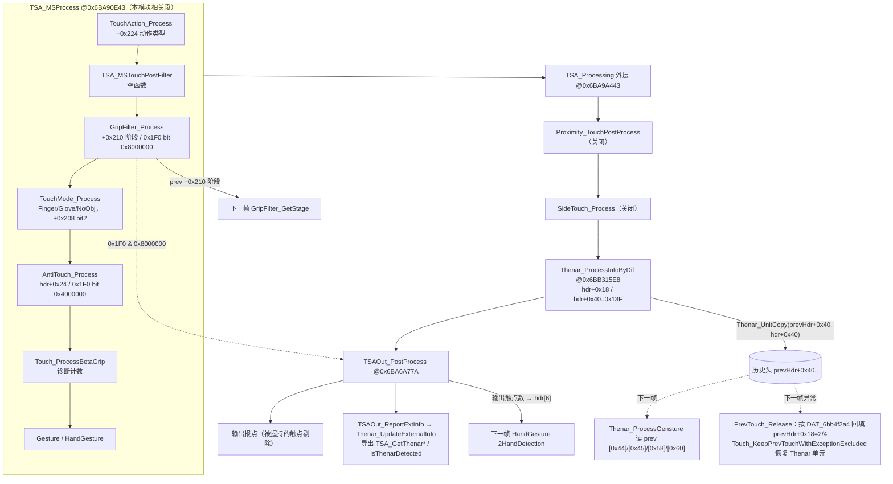

要点：

- 真正改变报点的只有两处：GripFilter 通过 0x1F0 bit 0x8000000 让 TSAOut 剔除触点（以及 BackToGrip 把 TE 状态改为 0x20）；TouchMode 通过 +0x208 bit2 让 07 的报告门限把弱信号触点拒掉。
- AntiTouch、BetaGrip、Gesture、Thenar 在本机配置下只产生导出状态或诊断值，不影响手指报点。
- 当前帧头每个 MS 帧被 `Touch_Clean` 清零，所以手指报点路径不消费 Thenar 判决；Thenar 的跨帧闭环只在自身（ProcessGensture 的时间状态）和导出接口之间。

## 分点解释

### 1. 配置门控总表

| 分支 | 判据 | 实测 | 结果 |
|---|---|---|---|
| GripFilter 主体（Report/IDLE/Merge） | feat & 0x20 | 1 | 开 |
| GripFilter MergeHandler / `TSABuffer_GripStageProcess` | flash+0x8D0/0x8DC/0x8E8/0x8F4（4 边合并使能 u32） | 全 0 | 关闭；`g_tsaBufGripStage`、GripTime、GripTimeOff 永不写入，恒 0 |
| GripFilter 动态死区 | flash+0x8C0 (u16) | 0 | 关闭；`IsInDynamicDeadZone` 恒 0 |
| GripFilter IDLE 全握持 | flash+0x8C2 (u16) | 0 | 关闭；`g_isOKToIDLE` 恒 false |
| GripFilter Pad 模式 | flash+0x8C4 | 2 | 非 Pad |
| 边缘 ratio 阈值表 | flash+0x8C8 + edge·0xC：+0 u32 / +4..+6 u8 | 0 / 0xFF,0xFF,0xFF（4 边相同） | 等级 0–2 阈值 0xFFFF，等级 ≥3 阈值 16 |
| NegSig 旁路 | flash+0x94A | 0 | 关闭 |
| AFT（AntiTouch 后报点等） | flash+0x60 掩码 | 0 | 关闭 |
| UDFP 放宽 | flash+0x1741 | 0 | 关闭 |
| TouchMode Finger 检测 | cfg & 2 且 !(feat & 0x1000) | 0x0E&2 ≠ 0，feat&0x1000 = 0 | 开 |
| TouchMode Glove 检测 | (cfg & 4 且 feat & 1) 或 SmartCover 或 +0x3F1 | `flash+0x918 = 0x0E`，&4 ≠ 0；`flash+0x50 = 0x00000101`，feat&1 = 1（后两项恒 0，但第一项已足够） | **开，`TouchMode_Glove*` 全族可达** |
| TouchMode 优先级切换 | cfg & 8 且 feat & 0x10 | feat&0x10 = 0 | 关闭，优先级表固定 |
| TouchMode Stylus | Stylus Detect 恒返回 1 | — | 不可达 |
| Proximity | feat & 0x4000 | 0 | 关闭 |
| SideTouch | feat & 0x8000 | 0 | 关闭 |
| `Thenar_ProcessInfoByTouch` / `Thenar_EventUpdateNoDebounce` | 无调用者 | — | 死代码；hdr+0x50 位置恒 0 |

### 2. TouchAction（动作类型 +0x224）

`TouchAction_Process` @0x6BA7733C 对每个 state & 0x20 为 0 的触点调用 `TouchAction_ProcessUnit` @0x6BA77226。动作值只有 1（默认动作）和 2（已移动/长按）两种，不是 Tap/Hold 语义枚举。

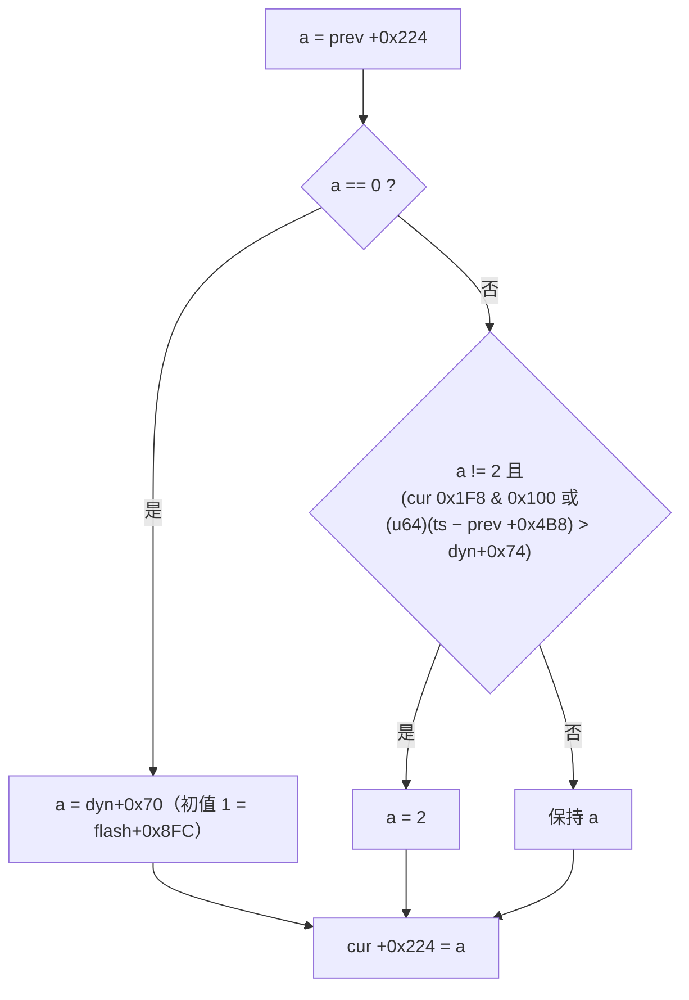

- dyn+0x74 = flash+0x900 = 0xEA60 = 60000 ms，实际上只有“移动超过 20 px”这一条会把动作升为 2。
- 0x1F8 & 0x100 由 `Touch_SetPersistFlag` @0x6BA72776 设置：当 prev 0x1F8 & 8 且 prev +0x1E8 != 6 时，与 prev +0x4A4 起点距离平方 > ExtToInt(flash+0x904 = 20)²。同函数还设置：0x8000 = 与 prev +0x49A 距离 > ExtToInt(flash+0x906 = 60)²；0x1000 = 与 prev +0x4AC 距离 > ExtToInt(flash+0x908 = 50)²；4 = +0x24C ≥ 15²（flash+0x920 = 15，mm²）；0x80000 = +0x240 > 16 或 +0x1EC != 0 或 +0x1BE > 1200 或触点数 > 1；age 0 时出现原始跳变则 0x214 |= 0x10000000。之后把历史的 0x1F8/0x1FC/0x200/0x214 按位 OR 合并进当前单元（持久位只置不清）。
- `TouchAction_PostProcess` @0x6BA773EB：对 state & 0x20 且 0x1F8 & 8 的抬起触点，dyn+0x70 = (0x1F8 & 0x1000) ? 2 : 1，即下一个新触点的默认动作继承本次是否为 flick；若 !(0x1F8 & 0x80) 且 +0x250 < 20，则 `g_flickTestFailed` = 1。该锁存永不清零，只有导出 `TSA_IsFlickCheckPassed` 读取。
- +0x224 仅被 `EventAnalyzer_GetEventValue` 读取，不影响报点。

### 3. TSA_MSTouchPostFilter

空函数，直接返回。

### 4. GripFilter（握持抑制）

#### 4.1 主流程

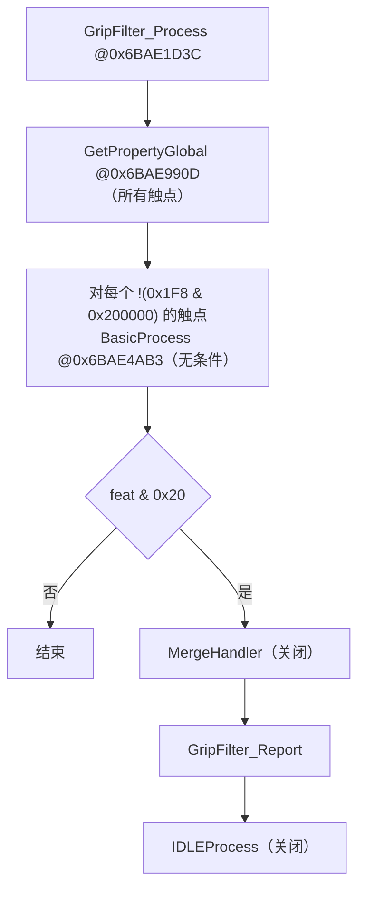

`BasicProcess` 每触点顺序：

1. 若刚进入 typing 或已识别双手，`DAT_6bc84e22` = 0。
2. 设置 g_grip 上下文、prevIdx、edge（`TSA_GetTouchSide` 结果经 `GetEdge` 映射：1 上→0，2 下→1，4 左→2，8 右→3）。
3. `GetPrmt`：按中心握持等级取 `gripPrmt`（0x6BB4F900，4×0x18）行，见 4.4。
4. `GetProperty`（4.2）→ `GetQuality`（4.3）→ `GetStage`（4.5）→ `UpdateDeadzone`（关闭）。
5. 阶段由非 1 变为 1 且 e22 != 0xFF → e22++。
6. 阶段为 1 或 2 → hdr[0xD]++（本帧被握持抑制的触点计数，TouchMode 的 NoObj/Glove 判定会用到）。
7. 当前 0x1F8 & 0x100000（`TouchReport_ProcessUnit` 在触点已上报时置位）且 prev 阶段 ∈ {0,1,2} → 0x1FC |= 0x40000000（“曾被握持后又放行”，供 Report 回填）。

#### 4.2 属性检测（GetPropertyGlobal + GetProperty）

`GetPropertyGlobal` @0x6BAE990D，每触点：

- +0x1C4 = `TSA_GetTouchSide`（1/2/4/8）。
- age < 4 且 `IsInMultiGripRegion` → 0x214 |= 4。`IsInMultiGripRegion` = 0x1F0 & 0x4000，或（边距 < 0x101 且 IsRatioOK(3)），或旋转变体。
- `IsGripMergeAllowed @0x6BAE1EDA` = hdr[8] − hdr[10] < 1。**本机恒真**：这两个计数只在 `Touch_ProcessAftTouchEventUnit` 的 `if (touch+0x1F4 & 0x1000)` 分支里自增，而全库没有任何代码对 `+0x1F4` 置 `0x1000`（只写过 `0x4`/`0x20`/`0x100`），于是 `0 − 0 = 0 < 1` 永远成立。同源的 `IsGripMergeAllowedBeforTZ @0x6BAE1F16` 读历史头的同两个字段，同样恒真。下面的「为假」分支是死路径，复刻时可以保留结构但永不执行。为假时：若 0x218 & 1 或 0x214 & 0x200000，置 0x218 |= 0x10 并清 0x214 的 0x800；随后清 0x218 的 1 与 0x214 的 0x200000。为真且 0x218 & 1、触点未离开、峰标志为 0x800 → 0x214 |= 0x200000。
- 中心等级 != 0 或 +0x1CC < 2·+0x1D0 → 0x214 |= 0x80000。
- 未离开、+0x1AC == 1、+0x1AD > 2 且 `Peak_IsOnInnerEdgeDim1` → 0x218 |= 8。

`GetProperty` 顺序执行 8 个检测器：

| 检测器 | 条件 | 置位 |
|---|---|---|
| GrapDetect | m = 所有触点 +0x158 最小值；计数满足：未离开、+0x158 − m < 250、+0x158 < 500、3·flash+0x5B4(3000) < +0x1BA·10、中心等级 != 0 的触点；计数 > 3 且全部满足 | 全部触点 0x214 \|= 0x4000000 |
| AboveGripDetect | 两触点均有 0x214 & 4，核心 dim2 距离 < 6，另一触点 Y < 本触点 Y | 0x214 \|= 0x20000000 |
| CloseGripDetect | 不在手掌区（`IsTouchInHeavyRegion`：region[cell] > 7）→ 0x214 \|= 0x20；有 0x20 则清 0x218 的 8 与 0x10；否则 `CloseGripOnCore`：存在另一触点 `IsSignalOK(8,1)` 且 dim2 距离 < 6 → 0x218 \|= 4，该触点在手掌区 → 0x10，其按下时间 < 200 ms → 8；Side 分支因 `g_touchesSide` = 0 不可达 | 见左 |
| MultiGripDetect | !(0x214 & 2) 且 0x214 & 4 → `CheckMultiGripOnCore`（及角落、旋转变体） | 0x214 \|= 2 或 0x100 |
| NewTouchDetect | 窗口 = 200 ms（触点数 > 2 时 300 ms）；另一非 ghost 触点距离平方 < 0x1C39 mm² 且在窗口内 → bit1；`IsHigherPriorityTouch` → 0x20000；对方 0x1F8 & 0x20000000 且本触点有 0x20000 → 0x2000000；存在任何未离开的其他触点 → 0x40 | 0x214 |
| FastMoveDetect | +0x248 > 0xFFFF 且 !(0x1F0 & 0x40000) 且 +0x1C0/2 < 峰 zn | 0x214 \|= 0x1000 |
| HeavyGripRegionDetect | 角落区 → 0x214 \|= 0x800000，age 1 再 0x1000000，state & 1 且 prev +0x4E4 > 4 再 0x10000；手掌区 → 0x1FC \|= 0x4000000，同时在角落 → 0x8000000，age 1 → 0x10000000，已离开 → 0x20000000；`IsHeavyCornerTouched` → 0x218 \|= 2 | 见左 |
| SafeTouchDetect | 任一：+0x199（TZ 最大握持掩码，unit+0x32A）== 0 且 age > 1；`BasicIsFlick`；0x214 & 0x200000；`IsInExcludedRegion`；0x1F8 & 0x20000000 且 IsRatioOK(0xF) | 0x214 \|= 0x800（绝对非握持） |

`IsInExcludedRegion`（非旋转，阈值 0x200/0x100）：Major < 20 且 d1 > 0x200 且 d2 > 0x100 且 IsRatioOK(0xF)（+0x1A8 ≤ 8 且 +0x1AA ≤ 8）；或 d1 > 0x400 且 d2 > 0x300。因此远离边缘的触点第一帧即为安全，直接进入阶段 4。

`IsFlickDetected`：thr = max(flash+0x8B8 = 10, 3·+0x228/4)，prev +0x250 > thr² 为真。

#### 4.3 质量 GetQuality @0x6BAE42BC

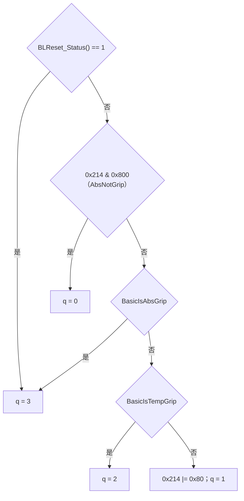

`BasicIsAbsGrip` @0x6BAE3FC1，任一为真：

- AbsGripPrmt：中心等级 != 0，且（+0x25C 非零或已离开），且 +0x25E > abs 阈值（参数行的 abs 字段，视频模式取 20）。
- 被 HandGesture 或 CoreTouch 全局抑制（SuppressedGlobally / SuppressedGlobally2）。
- 0x214 & 2（多握持）。
- 0x218 & 1 且峰标志 0x400；或 0x218 & 0x10。
- CornerGripClick；AbsGripAbnormal。
- LongPress 且 !(0x1F8 & 0x20000000) 且非双手，并且（(OnDim2 或 NearbyCorner) 且 0x214 & 0x40000000，或 角落且旋转且 0x214 & 1）。
- NegSigBypass（关闭）。

`BasicIsTempGrip`：先排除 MinSigOff 判定的 ghost、`IsGlobalSuppressedClick`、`IsRatioOK(0xD)`；随后任一为真：非 LongPressAllowed 时 LongPress；0x214 & 0x100 且 IsRatioOK(0x11)；0x1FC & 0x8000000 且 2·+0x1BC > 3·+0x1BA；0x1FC & 0x10000000 且 +0x24E ≥ 10；长按与否分别用 IsRatioOK(0xC)/IsRatioOK(0xE)；0x400000 且 IsRatioOK(5)；TempGripAbnormal；NegSig（关闭）。

`IsLongPress`：+0x158 > 299，视频模式或 0x214 & 0x10000 时 > 199。

`IsRatioOK`：阈值来自边缘表（全 0xFF），`GetEdgeClickRatioThold` 在等级 0–2 返回 0xFFFF、等级 ≥ 3 返回 16。结果是只有 ratio = 0xFFFF 的纯边缘细条（内侧无信号）才能通过比值条件，普通边缘触点的比值条件基本不成立。

#### 4.3.1 形状判据读的到底是什么

`BasicIsAbsGripPrmt`、`BasicIsTempGripPrmt`、`GetShapeFlag`、`GetEdgeClickRatioThold`、`GetRatioTholdLevelExtra` 这一组只读不写 `+0x228` 与 `+0x25C..+0x26C`，产出方都在模块 05 的 TE 收尾里（`Touch_ProcessAftTouchEvent → Touch_ProcessAftTouchEventUnit → Touch_IIRDataProcess`），不在本模块。**这些字段都是有效的、非零的**，不是死字段：

| 本模块读的偏移 | 物理量 | 产出方 |
|---|---|---|
| `+0x228` | 本条轨迹生命周期内**长轴 mm 的历史最大值**（源 `+0x22A` = `TZ_UnitToTouch` 入口拍下的原始长轴；MS 模式下按下帧 `+0x21C == 2` 时重新起算） | `Touch_ProcessAftTouchEventUnit @0x6BA7542A` |
| `+0x25C` | 形状 IIR 快照有效标志，`Touch_IIRDataProcess` 一进入就置 1 —— 所以 `AbsGripPrmt` 的「`+0x25C` 非零或已离开」这一项在 AFT 跑过之后**恒成立** | `Touch_IIRDataProcess @0x6BA7474F` |
| `+0x25E` / `+0x260` | 长轴 / 短轴 **mm** 的 7:1 EMA（源 `+0x188` / `+0x18A`） | 同上 |
| `+0x262` / `+0x264` | 长轴 / 短轴 **像素**的 7:1 EMA（源 `+0x18C` / `+0x18E`），`+0x264` 钳到 ≥ 1 | 同上 |
| `+0x266` | 主轴角的 7:1 EMA（源 `+0x192`） | 同上 |
| `+0x267` | **长短轴比 ×16** = `(+0x262 << 4) / +0x264`；`GetShapeFlag` 的 `> 0x20`、`GetEdgeClickRatioThold` 的 `> 0x2F`、`GetRatioTholdLevelExtra` 的 `> 0x1F` 都是拿它和 2.0 / 3.0 / 1.9 倍的长短轴比在比 | 同上 |
| `+0x268` | 最小椭圆率 `min(+0x1A0, +0x1A4)` 的 7:1 EMA（源 `+0x1A6`） | 同上 |
| `+0x26A` / `+0x26C` | grip ratio 外 / 内的 7:1 EMA（源 `+0x1A8` / `+0x1AA`） | 同上 |

`TempGripPrmt` 用的 `DAT_6bc84e30` 参数行与这些字段一一对应：`+0x08` 比 `+0x25E`（长轴 mm）、`+0x0A` 比 `+0x267`（轴比）、`+0x0C` 比 `+0x268`（椭圆率）、`+0x0E` 比 `+0x26A`、`+0x10` 比 `+0x26C`。

**执行次序的坑**：`Touch_ProcessAftTouchEvent` 只在 `dwProcessingState & PROC_MS_ACTIVE` 时调用，并且排在 TE 之后、本模块的 `TouchAction_Process` / `GripFilter` 之前。因此 GripFilter 读到的 `+0x228` / `+0x25C..+0x26C` 是**本帧**刚算出来的值，不是上一帧的；而 `+0x228` 的比较对象是历史单元的同名字段，跨帧单调不减。

#### 4.4 参数表 gripPrmt（0x6BB4F900）

按中心握持等级索引，每行 0x18 字节。`GetAbsThold(x)` = x + (x >> 2)。

| 等级 | 类型 | 字段 1 | 字段 2 | 延时 | abs | 3 | 4 | 5 | 6 | 7 | u32 |
|---|---|---|---|---|---|---|---|---|---|---|---|
| 0 | 0 | 0 | 0 | 0 | 0 | 0 | 0 | 0 | 0 | 0 | 0（全零，跳过 `BasicIsAbsGripPrmt`） |
| 1 | 1 | 500 | 500 | 0 | 25 | 40 | 15 | 200 | 200 | 0 | 0 |
| 2 | 2 | 500 | 500 | 30 | 20 | 40 | 15 | 200 | 200 | 0 | 2 |
| 3 | 3 | 500 | 500 | 100 | 20 | 36 | 12 | 200 | 200 | 0 | 6 |

#### 4.5 阶段机 GetStage @0x6BAE492D

输入为 prev +0x210（新触点为 0）与本帧 quality。`StageOnQuality`：q0→4，q3→1，q2→2，q1→3。

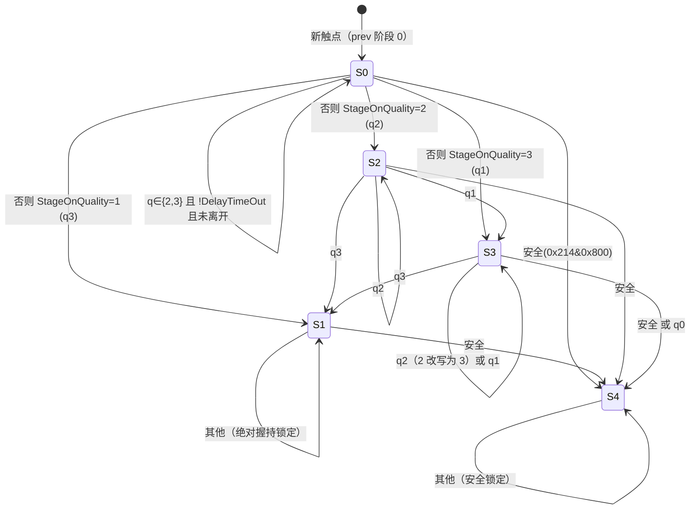

- 阶段 0 本身算握持（`IsGrip(stage)` = stage ∈ {0,1,2}），新触点在延时内一律不上报。
- `IsDelayTimeOut`：state < 2 返回 0；否则 +0x158 ≥ `GetDelayTime`（WindowsPad 下固定 50 ms）时 0x214 |= 0x40000000 并返回 1。参数行里的延时字段（0/30/100）在 WindowsPad 路径下不被采用。
- 阶段 3 的 q2 被改写为 3，即 3 不会退回到 2；阶段 1 只能通过“安全”离开；阶段 4 只能通过 BackToGrip 终止。
- 结果写 +0x210，下一帧作为 prev 阶段。

`IsBackToGrip`（阶段 3/4 检查）：

- StuckSide 分支恒假（GripTime 永不写入，死区关闭）。
- Allowed（0x214 & 0x200000，或 0x214 & 0x100000——后者由 `Touch_GetMergedInfo` 设置）且 Satisfied（信号 < prev +0x1BA / 3 且峰在外沿，或 d1 / d2 < 0x20）。
- 或 +0x242 ≥ 26 且（d1 ≤ 63 或 d2 ≤ 63）直接返回 1。
- 否则 `IsSeparated`。

`GripFilter_BackToGrip` @0x6BAE24A1（参数未用）：TE 状态 +0x21C = 0x20，cur +0x162/+0x164 = prev 值（坐标冻结到上一帧），调用 `PrevTouch_HistoryBufferClean`。阶段值不变，触点以“抬起报告”方式结束，由 TE 在后续帧回收。

#### 4.6 Report 与 TSAOut 阻断

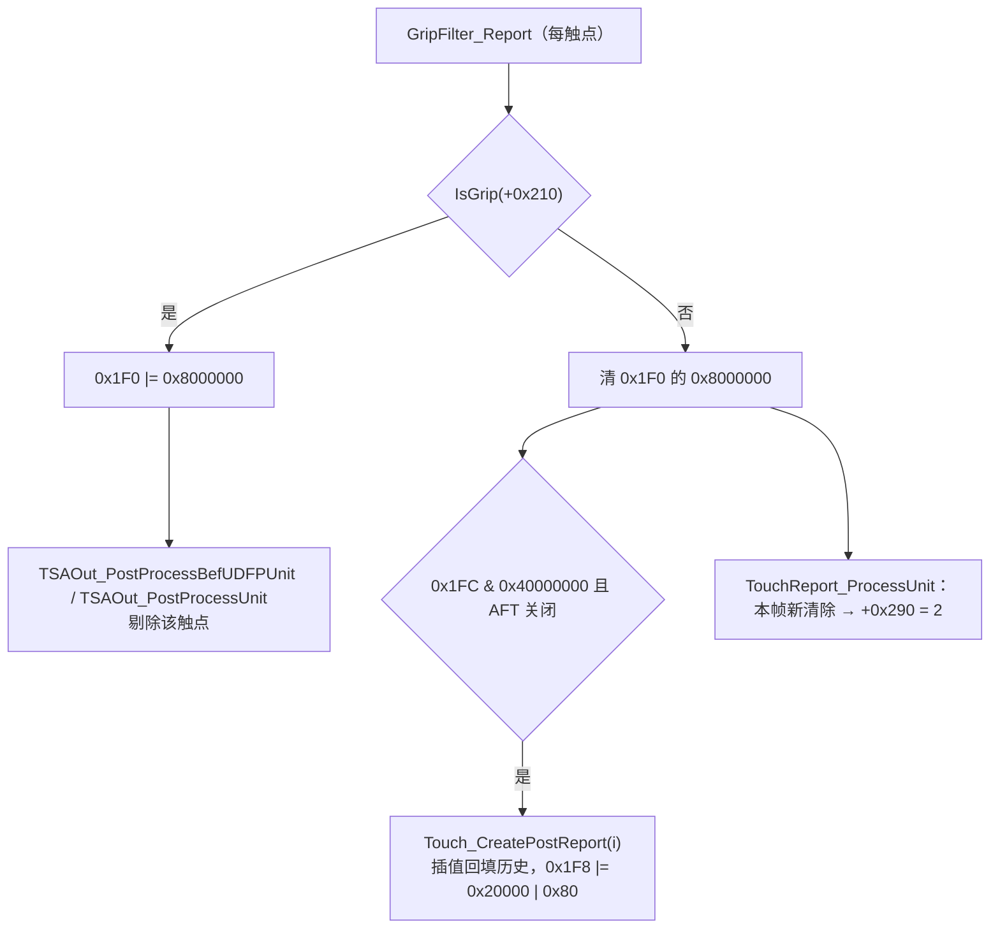

阻断点在 TSAOut（见 08），不在 TouchReport；TouchReport 只在该位新清除时标记 +0x290 = 2。

#### 4.7 死路径

`GripFilter_IDLEProcess`（flash+0x8C2 = 0）、MergeHandler 与 `TSABuffer_GripStageProcess` / `GripTimeProcess`（4 边合并使能全 0）、`UpdateDeadzone` / `IsGripCriteriaDeadzone`（flash+0x8C0 = 0）、NegSig 相关（flash+0x94A = 0）均为「关闭」。

### 5. TouchMode（触控模式）

`TouchMode_Process` @0x6BA78DDE。模式单元 {mode, data, result} 位于 g_tsaPrpt+0x2E8（0x6BC4A928），上一帧副本在 +0x2F4，手套锁存在 g_tsaPrpt+0x2E4（0x6BC4A924）。处理函数表 `g_tmHandlerTable` @0x6BB52A40：0 NoObj，1 Finger，2 Glove，3 Stylus（Stylus Detect 恒返回 result 1，不可达）。

优先级表 `g_tmSwitchPriority` @0x6BB4F240（u32 [prev][4]，因 feat&0x10 = 0 不会被改写）：

| prev | 检测顺序 |
|---|---|
| NoObj | Finger, Stylus, Glove, NoObj |
| Finger | Finger, Stylus, Glove, NoObj |
| Glove | Finger, Glove, Stylus, NoObj |
| Stylus | Stylus, Finger, Glove, NoObj |

去抖表 `g_tmSwitchDebounce` @0x6BB4F200（u16 [prev][next]，单位帧计数，`TouchMode_Init` 之后；Finger→NoObj 的 60 由 flash+0x44 = 0 选取）：

| prev \ next | NoObj | Finger | Glove | Stylus |
|---|---|---|---|---|
| NoObj | 0 | 0 | 20 | 0xFFFF |
| Finger | 60 | 0 | 0xFFFF | 0xFFFF |
| Glove | 200 | 0 | 0 | 0xFFFF |
| Stylus | 0xFFFF | 0xFFFF | 0xFFFF | 0 |

Finger→Glove 为 0xFFFF，所以手指模式下不会直接切到手套，必须先回 NoObj 再经 20 帧去抖进入 Glove。

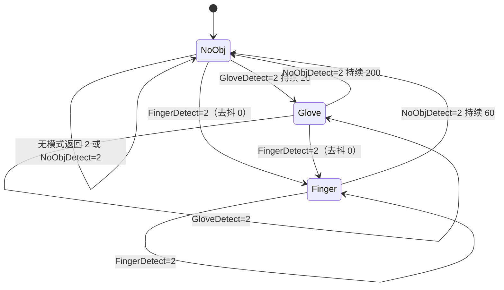

主循环：

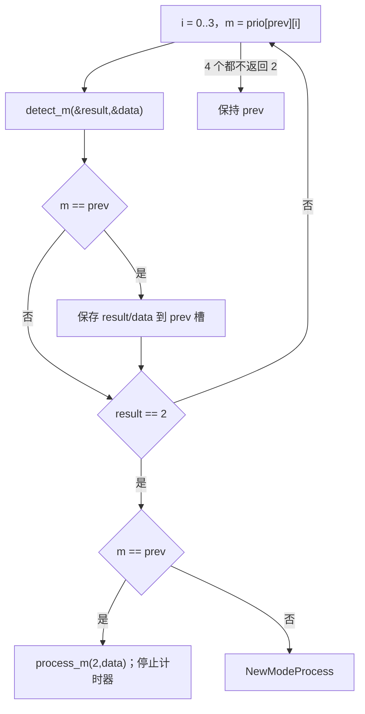

`NewModeProcess`（只有 prev.result < 2 分支可达，== 4 分支死）：先调用 next.process(next.result, next.data)；去抖 = (prev.data == 1 且 next != NoObj) ? 0 : 表值；`SWTimer_Start(frameCounter)` 仅在计时器停止时起算；(now − start) ≥ 去抖 视为到期 → 停止计时器并接受新模式，否则回退到 prev（prev.result == 0 时用保存值）。

各模式：

- **NoObjDetect**：result 1、data 2；触点数 == hdr[0xD]（全部被握持抑制或无触点）→ result 2。
- **FingerDetect**：任一 !(0x1F0 & 0x800) 且峰值 ≥ `DAT_6bcab68c`（**实测 600**，见下）的触点 → result 2。静态计数 static+0x3FA 统计峰值 + 8 > 3·flash+0x5D8（= 3000）的帧，mode != Finger 时清零，处于 Finger 且 data == 2 时不再更新；计数 > 2 → data 2 并清手套锁存。
- **FingerProcess**：data == 2 或锁存为 0 时，对 0x1F0 & 0x800（FingerZFailed：峰 zn < `DAT_6bcab694`，**实测 1800**）且无 FullIncellSD 的触点置 +0x208 |= 2。

**`DAT_6bcab68c` / `DAT_6bcab694` 的产出方**是 `TSADynPrmt_GetPkThold @0x6BB3CD91`，它挂在 `TSADynPrmt_Process → TSADynPrmt_CoreProcess → TSADynPrmt_GetSig` 下面，每帧在门限刷新阶段执行一次，不是初始化常量：

```c
TouchThold_Process(wPeakMode3ThresholdMax, flash[0x5DA],
                   &prpt+0x2D2 /*DAT_6bc4a912*/, &prpt+0x2D4 /*DAT_6bc4a914*/, &prpt+0x2DA /*DAT_6bc4a91A*/);
DAT_6bcab688 = prpt+0x2D2;                       // 峰值门限，600
DAT_6bcab68c = prpt+0x2D4;                       // 触控门限，600
DAT_6bcab690 = flash[0x5D0] * (prpt+0x2D4) / 16; // 48 * 600 / 16 = 1800
DAT_6bcab694 = (prpt+0x2D8) * 3;                 // 600 * 3 = 1800
DAT_6bcab698 = flash[0x5D0] * (prpt+0x2DA) / 16;
```

`prpt+0x2D4` 由 `TouchThold_Process` 每帧按当帧信号量重算（模块 02 第 9 节），稳态为 600；`prpt+0x2D8` 只在 `TouchThold_Init` 里被赋成 600，之后无人改写，所以 `DAT_6bcab694` 稳定在 1800。侧边管线走的 `TSADynPrmt_SideProcess @0x6BB3CF6E` 会把这两个值改成 `param` 与 `3·param/2`，但那条路径在本机不激活（`dwProcessingState & 0x10` 恒 0），可以不复刻。字段地址见模块 01 的 `g_tsaPrpt` 统一字段表。
- **GloveDetect**：门控成立（cfg&4 且 feat&1）；触点数 != hdr[0xD] → result 2。锁存为 0 且无 SmartCover/+0x3F1 时遍历触点：0x1F8 & 4、mode != Finger、!(0x1F8 & 0x80000) → 锁存 = 1、data = 2、`Touch_CreatePostReport(i,5)`；已锁存则 data = 2。
- **GloveProcess**：feat & 0x1000 = 0 且手套已使能，不走 StylusSuppression；data == 1 → 所有触点 +0x208 |= 2；否则 `GloveFilter`：!(+0x208 & 1) 且 +0x1C8 > 0x40 的触点 |= 2。

#### 5.1 手套闩锁 `DAT_6BC4A924` 与门控的真实状态

手套路径的状态位是 **`DAT_6BC4A924`（`g_tsaPrpt + 0x2E4`）**，不是 `TSAStatic + 0x3F1`。两者在所有下游判据里是**并列的或**，`+0x3F1` 恒 0 并不会让手套路径失效 —— 它是「本轮 `0x2000` 水下异常已触发过基线重置」的一次性哨兵，本机取不到该异常字，详见 [01 §2](01_baseline_and_diff.md)。

闩锁的完整生命周期：

| 动作 | 位置 | 条件 |
|---|---|---|
| 初始化 = 0 | `TouchMode_Init @0x6BA78BA2` | 复位 |
| 置 1 | `TouchMode_GloveDetect @0x6BA79590 / 0x6BA79655 / 0x6BA79698` | 见下 |
| 清 0 | `TouchMode_FingerDetect @0x6BA7930B` | `cfg & 2` 且 !(feat & 0x1000) 前提下，计数器 `static[1].field_0xC > 2` —— 该计数器在 `g_pPeaks+0x8`（当帧峰值总量）超过 `3 × flash+0x5D8`（实测 `0x03E8` = 1000，即 3000）时逐帧自增、否则清零，且仅在模式尚未稳定在 Finger 时统计 |

**门控在本机恒真**：`DAT_6BCAB700 = flash+0x918 = 0x0E`（bit1 高灵敏许可、bit2 手套许可、bit3 厚手套许可）与 `dwFeatureFlags bit0 = 1`（`flash+0x50 = 0x00000101`，见 [01 §14.2](01_baseline_and_diff.md)）相与为真。宿主 `ApDaemon.dll` 的 211 个 `TSA_*` 解析名里**没有** `TSA_EnableGloveFeature` / `TSA_DisableGloveFeature`，只有只读的 `TSA_IsGloveFeatureEnabled` 与 `TSA_SetFeatures`；而 `TSA_SetGloveFeatures @0x6BA9EF6B` 是粘性的 —— 只有宿主在 `TSA_SetFeatures` 实参里真正翻转 bit0 时才改写它，否则保持现值。所以 **bit0 恒 1，手套门控常开，`TouchMode_Glove*` 全族在真机上是活的**。

置 1 的三个条件合起来描述的是「弱信号的单指长距离拖动」：`0x1F8 & 4` 由 `Touch_SetPersistFlag @0x6BA72776` 在 `+0x24C ≥ 15²`（`flash+0x920 = 15`，mm²）时置位，即触点已从按下点移动 15 mm 以上（见 4.2）；排除位 `0x80000` 同函数置位，条件是 `+0x240 > 16 或 +0x1EC != 0 或 +0x1BE > 1200 或触点数 > 1`，也就是排除掉强峰值（> 1200）、有异常、多触点的情况；再加上 `mode != Finger` —— 裸指拖动时模式机已在 Finger 态，不会误锁。戴手套时峰值弱、`FingerDetect` 的 3 帧确认过不去，模式停在 NoObj，拖满 15 mm 即锁存。

下游：`+0x208 & 2` 在 07 的报告门限中表示「若 `+0x1BA < 1500` 则拒报」。闩锁还被 `TouchThold_GetPeakThold`、`TouchThold_Process`、`TouchThold_GetTholdBasedOnTouchMode`、`TSADynPrmt_GetBL`、`Touch_SetVolatileFlagLiftOffZFailed`、`TZ_VPProcess`、`TSA_IsHighSensitivityMode` 读取。它对整组门限的具体作用（峰值门限的模式迟滞、噪声基准的 600/220 择一）见 [02 §14](02_cmf_and_grid_filter.md)，此处不重复。

### 6. AntiTouch

`AntiTouch_Process` @0x6BAD7BBB = CommonProcess + AFT 分支（关闭）。

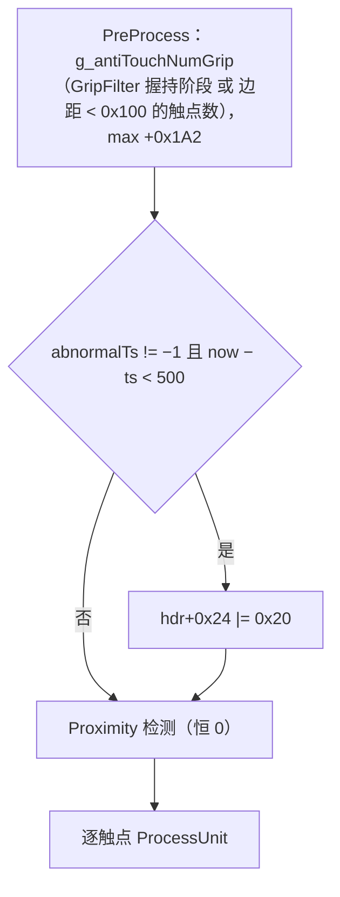

`ProcessUnit`：

1. +0x188 > 50 且非握持 → hdr+0x24 |= 0x20，CheckProximityFlag（Y 中心 ≤ flash+0x168C = 10 → hdr+0x24 |= 0x80），记录 abnormalTs。
2. ProximityUnit：长驻留、小长轴高椭圆率、顶部区域大块等条件 → hdr+0x24 |= 0x80 且 0x1F0 |= 0x4000000；`IsToProtectProximity`：state > 1 的非握持触点（除非在顶部区域且 ratio > 16）→ 0x1F8 |= 0x400000，hdr+0x24 |= 0x100，绝大多数触点都会命中。
3. !(0x214 & 0x200000) 且 (+0x196 > 8 或 +0x197 > 8) 且 +0x1A2 > 15 → 0x1F0 |= 0x4000000。
4. `GetPersistFlag` @0x6BAD6B3D 为真 → prev +0x4E6 计数 < 10 时 +1；为假且计数非零且 < 10 → −1。否则分支：prev +0x4E7 计数 < 10 时，若 +0x1A2 < 10 且 1600 < 3·Y（显示坐标）→ +1，否则清零。

`GetPersistFlag` 任一为真：驻留 > 1500 ms 且 +0x24C < 100；非握持触点数 > 1 且 +0x1A2 ≥ 椭圆阈值（10 或 15）且类型 != 3；非握持触点数 > 3；长轴 > 阈值（30/30/25，UDFP 的 40 关闭）；5·短轴 < 2·长轴且长轴 > 15（6·短轴 < 2·长轴 时才持久）。

效果：0x1F0 bit 0x4000000 唯一的 AND 读者是 `AntiTouch_PostReportUnit`（AFT，关闭），主路径上无消费者。`AntiTouch_Report` 由 `Touch_ProcessExtInfo` 调用，按 hdr[3] 设置 hdr+0x18 |= 0x1000000 / 0x2000000 并导出。整个 AntiTouch 对手指报点无影响。

### 7. BetaGrip（Touch_ProcessBetaGrip @0x6BA76EE8）

`Touch_IsBetaGrip` 条件：未接充电器、峰值 ≥ 1500、state == 4、无异常、显示 X ≤ 8 或 X ≥ Xres − 9、Y ≥ Yres − 1 − mm(15)、prev 0x1F8 无 0x1000000。结果 4 = 左，8 = 右；prev +0x4E8 计数 > 1 → 0x1F8 |= 0x1000000，全局计数 `DAT_6bb4f2b0` / `DAT_6bb4f2b4` 加一，经 `TSA_GetBetaGripStatusCommand` 导出。仅诊断用途，无其他读者。

### 8. Gesture / HandGesture / SideTouch / Proximity

- **Gesture_Process**：只跑 `Gesture_NormalProcess`（触控笔路径关闭）。恰有一个 0x204 & 0xF000 为 0 的触点时，state 4 采样，state 0x20 解码写入 +0x278。不影响报点。
- **HandGesture_Process** @0x6BAEF9FC：TimeStep → 2HandDetection：prev hdr[6]（TSAOut 输出触点数）> 1，或带触控笔标志的触点在 static+0x98 附近 100 ms 内且距离 ≥ 20 mm → handGesture |= 2；存在握持阶段触点且已过 4 s 时清除。GripDetection 子管线在 state 0x20 且 prev +0x5A5 置位的触点上触发，可达但罕见，输出到 `g_tsaBufTzPrevHand`。handGesture 被 GripFilter 的 SuppressedGlobally 与 BasicProcess 的双手判断读取。
- **SideTouch**：「关闭」（feat & 0x8000 = 0）。
- **Proximity**：「关闭」（feat & 0x4000 = 0）；`Proximity_Process` 只做 memset/清零，`Proximity_TouchPostProcess` 要求 `IsEnabled`，不可达。

### 9. Thenar（大鱼际识别）

`Thenar_ProcessInfoByDif` @0x6BB315E8 = Traditional → EventUpdate → `Thenar_UnitCopy(prevHdr+0x40, hdr+0x40)`。

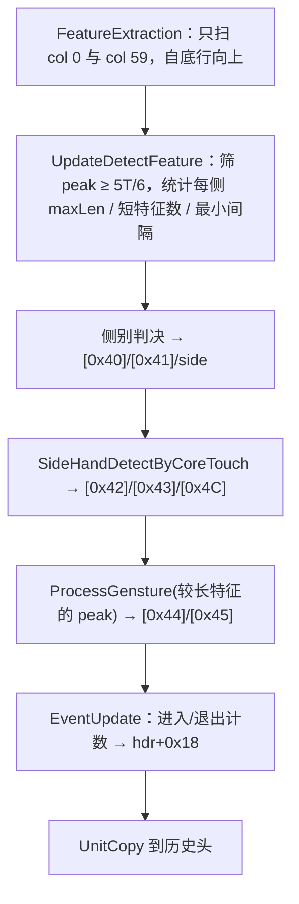

**特征提取**：阈值 T = `_DAT_6bcab6c4` = 3/4·prpt+0x2D8（通常 450），进入阈值 T/2（225）。每列按三状态扫描；梯度核 [[1,2,1],[0,0,0],[−1,−2,−1]] 以 k[e·3+c] 取值（c 沿 dim1、e 沿 dim2）。梯度 < −1000 进入状态 2，≥ 1001 开始新特征。宽度 = 沿 dim1 两侧连续 > `DAT_6bc4a914`（600）的格数。特征记录 10 字节存于 hdr+0x68：coord、len、width、edge、peak；最多 20 个，计数在 hdr+0x130。edge = (col != 59)，即 1 表示左列。

**判决**（长度阈值 LT：flash+0x836 = 30，按 30·16 / flash+0x1B(69) = 480/69 取整为 6 格；[0x41] = 1）。间隔 gap 以该侧第一个特征为基准：(first.coord − first.len) − cur.coord，按 u16 计算。

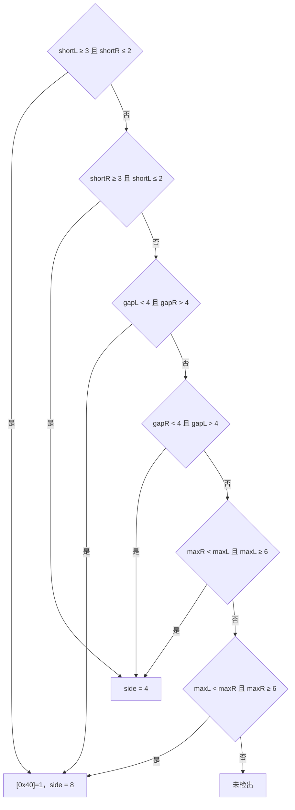

**SideHandDetectByCoreTouch**：对 state 0x20 且 0x1F8 & 1 的触点写 [0x42]/[0x43]/[0x4C]，只被导出 `TSA_GetHandSide` 读取。

**ProcessGensture**：检出、!(hdr+0x24 & 1) 且 peak > 2000 → [0x44] = 1；结合 prev 的 [0x44]、[0x58]（起始时间）、[0x45]、[0x60]，持续 ≥ 801 ms → [0x45] = 1，保持 100 ms。

**EventUpdate**：u32 计数 `g_sideHandEnterCnt[2]` / `g_sideHandExitCnt[2]`，初值 15。

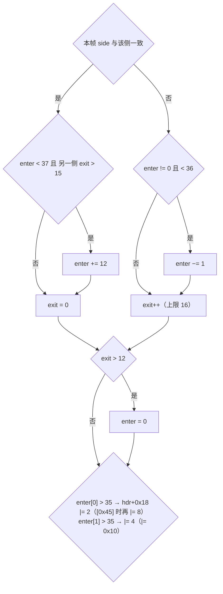

**跨帧与消费**：同帧 `TSAOut_PostProcess` 拷贝 static+0x27C = hdr+0x18、static+0x280 = 上升沿；`TSAOut_ReportExtInfo` → `SideTouch_UpdateExternalThenarInfo`（side 池为零）→ `Thenar_UpdateExternalInfo` 设置 `DAT_6bb4f2a4`（侧别）、`DAT_6bb4f2ac`、`DAT_6bb4f2a1`（手势）、`g_tsaInitOnce`（检出），供 `TSA_GetThenar*` / `TSA_IsThenarDetected` 导出。下一帧 `Thenar_ProcessGensture` 读历史头 Thenar 单元；TE 断言失败时 `PrevTouch_Release` 按 `DAT_6bb4f2a4` 把 prevHdr+0x18 回填为 2/4，`Touch_KeepPrevTouchWithExceptionExcluded` 恢复 Thenar 单元。手指报点路径不读取 Thenar 结果。

### 10. 标志位速查

| 字段 | 位 | 含义 | 写者 |
|---|---|---|---|
| +0x1F0 | 0x800 | FingerZFailed（峰 zn < `DAT_6bcab694`） | Touch 属性 |
| +0x1F0 | 0x4000000 | AntiTouch 异常（主路径无读者） | AntiTouch |
| +0x1F0 | 0x8000000 | 握持抑制，TSAOut 剔除 | GripFilter_Report |
| +0x1F8 | 4 / 0x100 / 0x1000 / 0x8000 / 0x80000 | 位移 ≥15²mm² / >20px / >50px / >60px / 多触点或大块 | Touch_SetPersistFlag |
| +0x1F8 | 0x100000 | 已上报 | TouchReport_ProcessUnit |
| +0x1F8 | 0x20000 \| 0x80 | 已回填后报 | Touch_CreatePostReport |
| +0x1F8 | 0x400000 | 接近保护 | AntiTouch |
| +0x1F8 | 0x1000000 | BetaGrip | Touch_ProcessBetaGrip |
| +0x1FC | 0x4000000/0x8000000/0x10000000/0x20000000 | 手掌区 / 手掌角落 / 手掌角落首帧 / 手掌角落已离开 | HeavyGripRegionDetect |
| +0x1FC | 0x40000000 | 握持后放行，需回填 | BasicProcess |
| +0x208 | 2 | 模式过滤：弱信号拒报 | FingerProcess / GloveProcess |
| +0x210 | 0..4 | 握持阶段 | GetStage |
| +0x214 | 1 / 2 / 4 / 0x20 / 0x40 / 0x80 | 新近邻 / 多握持 / 多握持区 / 非手掌区 / 有其他触点 / 质量 1 | 各检测器 |
| +0x214 | 0x100 / 0x800 / 0x1000 | 多握持弱 / 绝对非握持 / 快速移动 | 各检测器 |
| +0x214 | 0x10000 / 0x20000 / 0x80000 | 角落驻留 / 高优先级 / 边缘或窄形 | 各检测器 |
| +0x214 | 0x200000 / 0x800000 / 0x1000000 | 合并允许 / 角落 / 角落首帧 | GetPropertyGlobal / Heavy |
| +0x214 | 0x2000000 / 0x4000000 / 0x20000000 / 0x40000000 | 优先级冲突 / 抓握 / 上方握持 / 延时到期 | 各检测器 |
| +0x218 | 1 / 2 / 4 / 8 / 0x10 | 合并 / 手掌角落 / 近邻握持（或内沿峰）/ 近邻新按下 / 合并失效或近邻在手掌区 | GetPropertyGlobal / CloseGrip |
| +0x224 | 1/2 | 动作类型 | TouchAction |
| hdr+0x0D | — | 本帧阶段 1/2 触点数 | BasicProcess |
| hdr+0x18 | 2/4/8/0x10；0x1000000/0x2000000 | Thenar 左/右/手势；AntiTouch 报告 | Thenar EventUpdate / AntiTouch_Report |
| hdr+0x24 | 0x20 / 0x80 / 0x100 | 异常 / 接近 / 接近保护 | AntiTouch |
| hdr+0x40.. | [0x40]..[0x60]、特征 +0x68、计数 +0x130 | Thenar 单元 | Thenar |
