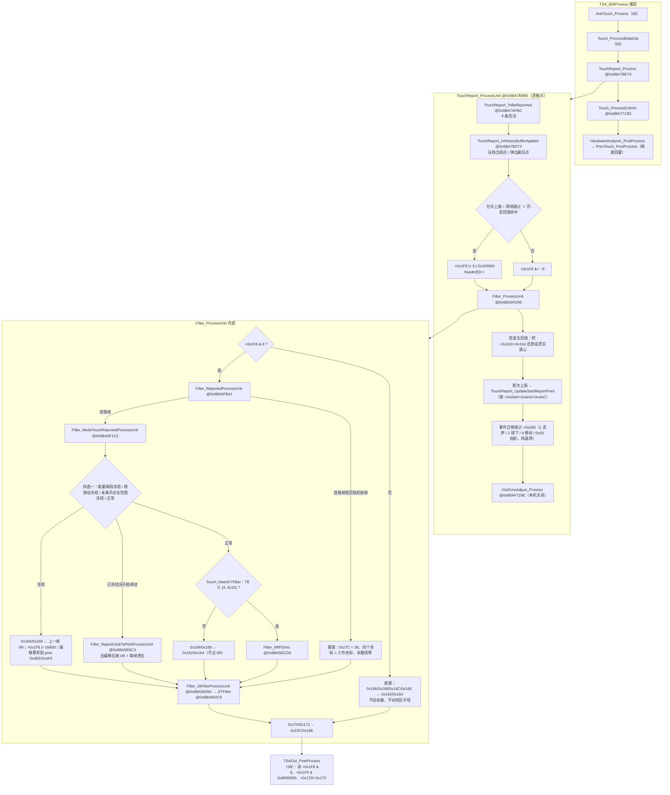
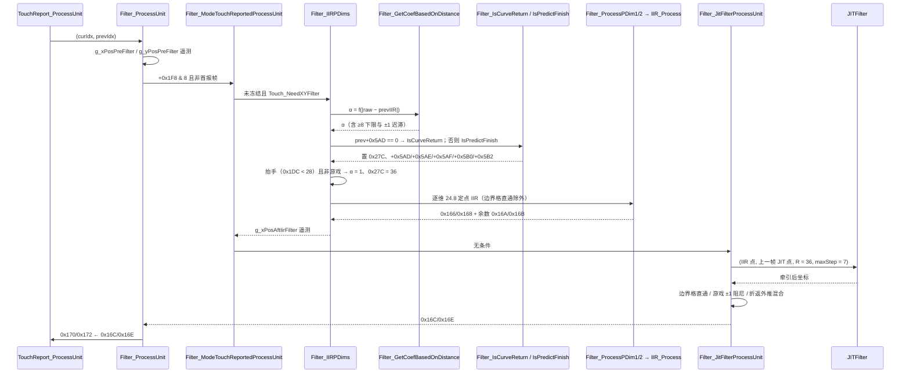
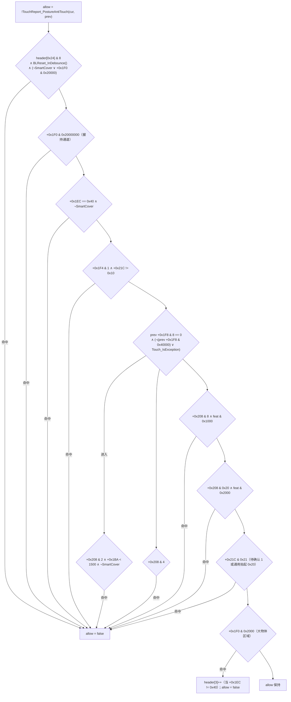
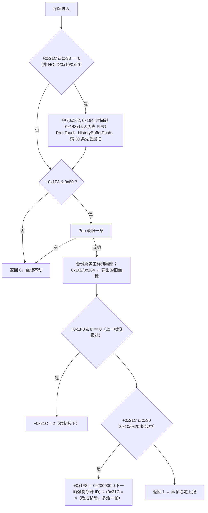
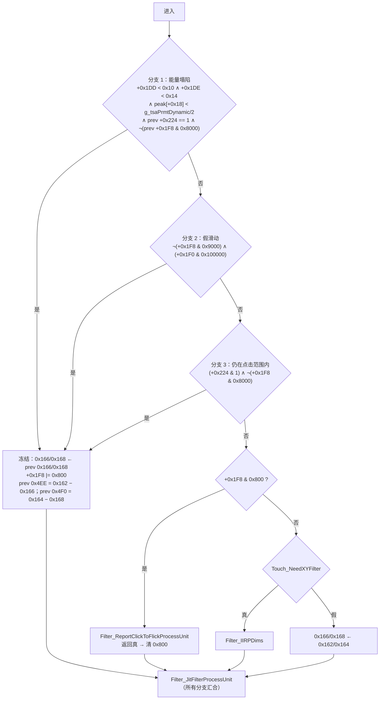
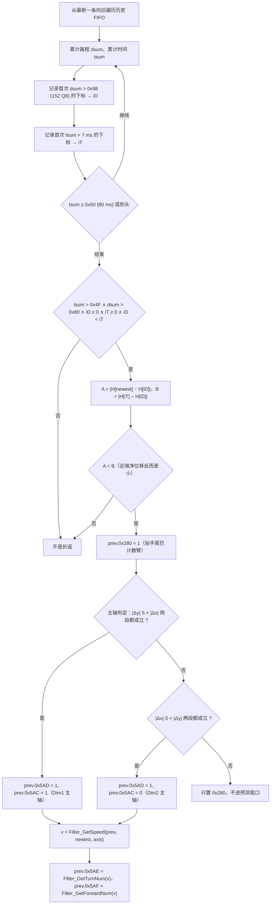
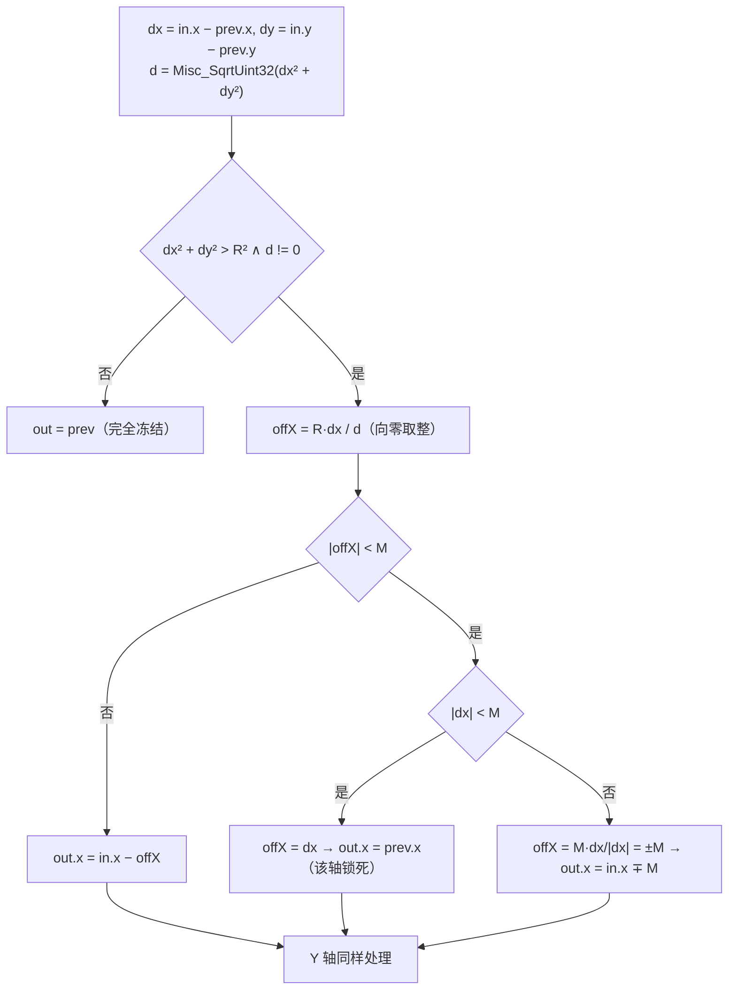

# 触控上报决策、速度自适应 IIR、迟滞防抖与扩展信息（TouchReport / Filter / JIT / HotZone / ExtInfo）

> 目标程序 `TSACore.dll`（image base `0x6BA40000`），整定表 W273AS2700（Gaokun Himax CSOT，60 列 × 40 行，显示 2560 × 1600）。本篇覆盖 `TSA_MSProcess` 尾段的 `TouchReport_Process` 与其内嵌的 `Filter_*` / `JITFilter` / `HotZoneAdjust_*`，以及紧随其后的 `Touch_ProcessExtInfo`。最终坐标的输出、缩放与握持剔除在外层 `TSAOut_PostProcess`，属模块 08。

---

## 概念

| 术语 | 含义 |
|---|---|
| 工作坐标 `+0x162/+0x164` | EC 之后的当前帧质心坐标，Q8 定点（1 格 = 256，`1 mm = 60 Q8`），是本模块所有滤波的输入 |
| IIR 坐标 `+0x166/+0x168` | 自适应 IIR 的输出，同时是下一帧 IIR 的状态；配套小数余数 `+0x16A/+0x16B`（各 1 字节） |
| JIT 坐标 `+0x16C/+0x16E` | 迟滞死区（含游戏阻尼与折返混合）的输出，也是下一帧 JIT 的"上一次输出"参考点 |
| 上报坐标 `+0x170/+0x172` | `Filter_ProcessUnit` 结尾从 `+0x16C/+0x16E` 复制而来，交给 08 的 `TSAOut_PostProcess` |
| TE 状态 `+0x21C` | 事件码：`1` 待确认、`2` 按下、`4` 移动、`8` HOLD、`0x10` 快速点击补报/移出保持、`0x20` 通用抬起、`0x40` WindowsPad 抬起帧 |
| 死区半径 `+0x27C` | JIT 死区半径（Q8），常态等于 `DAT_6bcab612 = 36`（= 6 显示像素） |
| 点击冻结 `+0x1F8 bit11 (0x800)` | 触点尚未"成为滑动"，坐标被钉在上一帧 IIR 值，真实位移被累积到历史单元 `+0x4EE/+0x4F0` |
| 回放缓冲 | 历史单元 `+0x288`（条数，≤ 30）+ `+0x290` 起 16 字节/条的 FIFO（`x, y, _, 时间戳`）；`+0x1F8 bit7 (0x80)` 打开时每帧弹一条，形成整条轨迹的延迟回放 |
| 折返预测 | `+0x5AD` 预测帧计数、`+0x5AE` 折返总帧数、`+0x5AF` 前瞻帧数、`+0x5B0/+0x5B2` 外推点、`+0x5AC` 主轴（1 = Dim1） |

单元偏移一律相对 `g_touchesPtr + i*0x168`（当前池，头 `0x140`）与 `g_pPrevTouches + j*0x478`（历史池，头 `0x140`）。两池的 `0x140..0x283` 段语义相同：帧首 `Touch_UnitCopy` 把历史整段拷进当前（仅 `+0x1D4`、`+0x1DC..+0x1DE`、`+0x200` 保留当前值），帧尾 `PrevTouch_RemoveOff` 把当前整段拷回历史。因此 `+0x166/+0x168/+0x16A/+0x16B/+0x16C/+0x16E/+0x1F8/+0x27C` 都是**跨帧自持**的滤波状态；`+0x28C` 之后（`+0x288` 历史条数、`+0x4EE`、`+0x4F3`、`+0x4F4`、`+0x58E`、`+0x594`、`+0x5AC..+0x5B2`）只存在于历史池，本模块**直接写历史单元**。

---

## 架构

本模块是 `TSA_MSProcess` 的倒数第四、第三步。上报判决、滤波、死区被压在同一个单元函数里，原因是历史回放会临时篡改输入坐标，必须在同一上下文内注入与还原。



边界划分：**本模块决定"这个触点这一帧算不算上报"以及"上报的坐标长什么样"**；08 的 `TSAOut_PostProcess` 才把 `+0x170/+0x172` 换算成显示像素、执行握持剔除（`+0x1F0 & 0x8000000`）、pitch 重映射与双报文构造。握持抑制不在 `ToBeReported` 里。

滤波链的调用时序（一个已确认、正在移动、处于折返窗口的触点）：



---

## 分点解释

### 1. 主调度 `TouchReport_Process @0x6BA7BE73`

职责三件事：清帧级计数、按**当前池下标顺序**逐点调用 `TouchReport_ProcessUnit`、尾部处理"全部触点已回退完毕"的批量吸附。

```c
g_touchesPtr[5]  = 0;          // 本帧上报触点数
g_touchesPtr[0xb]= 0;          // 本帧手掌触点数
g_zValPrevToCurRatio = 0;      // 抬手 Z 衰减遥测
for (i = 0; i < header[0]; i++)
    TouchReport_ProcessUnit(i, PrevTouch_GetIdxBasedOnCurIdx(i));
if (TouchReport_IsMultStepBackEnable() && TouchReport_IsAllTouchBack())
    for (i ...) if (prevIdx < 20) { touch[i].0x170 = prev[j].0x594; touch[i].0x172 = prev[j].0x596; }
```

- 遍历顺序就是当前池顺序，没有优先级排序；`header[0]` 含 TE 在本帧追加的抬起单元。**每个触点都会进入 `ProcessUnit`，没有前置条件**，包括被判死的 `0x20` 抬起单元。
- `header[5]` 由 `ProcessUnit` 每上报一个自增，帧尾 `PrevTouch_PostProcess` 抄进历史头，下一帧被 TouchThold 当作"上一帧是否单指稳定"使用。
- `header[0xB]` 统计 `+0x1EC & 0x40`（位测试），与网闸判据 4 的 `+0x1EC == 0x40`（等值比较）口径不同，两者不可互相代替。
- 尾部批处理依赖 `DAT_6bcaa14c & 2`，**本机关闭**（见第 5 节），整段不执行。

### 2. 上报网闸 `TouchReport_ToBeReported @0x6BA7AFBC`

初值来自 `TouchReport_PostureAntiTouch`（返回真即否决），随后十条独立的 `if` 只会把结果往"假"推，没有任何一条能把已经为假的结果翻回真。



| # | 判据 | 读的字段 / 写入者 | 本机 |
|---|---|---|---|
| 1 | `TouchReport_PostureAntiTouch(cur, prev)` | 三个触发源：`SensorData_IsAntiTouchStage`（折叠屏时间戳 + `DAT_6bcaa14c`）、`TouchReport_IsAnyTouchCancelByPosture`（要多步回退）、prev `+0x200 bit0`（只由自己置位） | **不可能成立**：三源恒假 |
| 2 | `header[0x24] & 8` ∧ `BLReset_InDebounce()` ∧（SmartCover 关 ∨ `+0x1F0 & 0x20000`） | `header[0x24] bit3` 与 `+0x1F0 bit17` 同由 `TZ_UpdateTouchFlag`（区域标志 `0x1000` 大形态）置；`bBaselineResetInDebounce` 由 BLSM 阶段推进后锁存 | **可成立**：SmartCover 位为 0，等价于"基线复位去抖窗口内且本帧出现过大形态区域即全体拒报" |
| 3 | `+0x1F0 & 0x20000000` | `TZ_UpdateTouchFlag`（区域标志 `0x40000`，相邻线噪声压过峰能量）与若干 `GripFilter_*` 检测器 | **可成立**（区域通道可达，握持通道不可达） |
| 4 | `+0x1EC == 0x40` ∧ SmartCover 关 | `+0x1EC` 是 `zone+0x350` 的拷贝；`0x40` 只由 `HIException_*` 产出，FI 模式（`dwPeakProcessingMode == 3`）不可达 | 不可能成立 |
| 5 | `+0x1F4 & 1` ∧ `+0x21C != 0x10` | `Touch_SetVolatileFlagLiftOffZFailed` 写 bit0 | **可成立**；`0x10` 被放行，`0x40`（WindowsPad 抬起帧）同样不被这条拦下 |
| 6a | `+0x208 & 2` ∧ `+0x1BA < wPeakFilterReferenceThreshold/2 = 1500` ∧ SmartCover 关 | `+0x208 bit1` 来自 `TouchMode_GloveFilter` / `TouchMode_FingerProcess`；`+0x1BA` 是被钳在 3000 内的历史最大重心信号 | **可成立**（手套位 = 1，Glove 模式可达） |
| 6b | `+0x208 & 4` | `TouchMode_StylusSuppression` | 惰性：调用前置条件与手套模式互斥 |
| 7 / 8 | `+0x208 & 8` ∧ `feat & 0x1000` / `+0x208 & 0x20` ∧ `feat & 0x2000` | `StylusAft_SuppressBaseContext` | 惰性：`dwFeatureFlags = 0x01090121`，两位皆 0 |
| 9 | `+0x21C & 0x21` | TE | **可成立**：状态 `1`（未确认）与 `0x20`（通用抬起）被拒；`2/4/8/0x10/0x40` 放行 |
| 10 | `+0x1F0 & 0x2000` | `TZ_UpdateTouchFlag`（区域类型 5 = 大物体） | **可成立**，并在 `+0x1EC != 0x40` 时自增 `header[3]` |

判据 6a/6b 只在 `prev +0x1F8 & 8 == 0`（上一帧没上报过）且「`prev +0x1F8 & 0x40000`（快速点击候选）不成立，或 `Touch_IsException` 为真」时才被检查，即**只在触点第一次尝试上报的那一帧生效**；一旦报出去过，握持/手套弱信号判据就不再有机会拦截它。`Touch_IsException` 的判据是当前或历史 `+0x1EC != 0`、或当前/历史头 `+0x20` 异常字非零。

握持抑制（`+0x1F0 & 0x8000000`）不在这张表里，它在 08；`BackToGrip` 是通过把 TE 状态改成 `0x20` 走判据 9 杀掉触点的。

### 3. 历史回放：网闸的旁路通道 `TouchReport_IsHistoryBufferApplied @0x6BA7B373`

这是本模块唯一真正在用的"坐标回退"机制，也是 `ProcessUnit` 里唯一能让被网闸否决的触点照样上报的路径：`允许上报 = ToBeReported() ∨ IsHistoryBufferApplied()`。



- **缓冲的写入也在这里**：只要触点不处于 `8/0x10/0x20`，每帧都压一条工作坐标 + 时间戳。`+0x288` 同时被 `Filter_IsCurveReturn`、`Filter_IsPredictFinish`、`Filter_GetSpeed`、`DB` 用作"轨迹已存活帧数"。
- **回放触发位 `+0x1F8 bit7` 有三个产出方**，都经由 `Touch_CreatePostReport @0x6BA76A03`：`GripFilter_Report`（握持延迟放行，`+0x1FC & 0x40000000`，WindowsPad 下延迟 50 ms）、`TouchMode_GloveDetect`（手套锁存首帧）、`AntiTouch_PostReportUnit`（AFT，关闭）。此外 `ER_*` 入边修正也会置 `+0x1F8 |= 0x80`。`Touch_CreatePostReport` 先 `HistoryBufferClean`，再以 `L = clamp(max(|dx|,|dy|) / TS_MMToPixel(2), 2, 5)` 为段数，从按下锚点（未报过用 `prev+0x496/+0x498`，报过用 `prev+0x49A/+0x49C`）线性插值压入 `L−1` 个点，并置 `+0x1F8 |= 0x20000 | 0x80`（`0x20000` 同时是 `Filter_ReportedProcessUnit` 的重初始化触发）。
- **回放条目的时间戳是递减的，这是原厂缺陷，但必须照抄**。FIFO 条目是 16 字节 `{u16 x; u16 y; pad4; s64 ts}`（`prev + 0x290 + 0x10·i`），`Touch_CreatePostReport` 的循环体是

  ```c
  dt = (int)(cur.ts0x148 − prev.ts0x148);                 // 本帧与上一帧的时间差
  for (k = 0; k < L − 1; k++) {
      e.x  = (short)(anchorX + k·stepX);                  // 位置：锚点 → 当前点，递增
      e.y  = (short)(anchorY + k·stepY);
      e.ts = cur.ts0x148 − (s64)(k · dt);                 // 时间：now, now−dt, now−2dt …，递减
      PrevTouch_HistoryBufferPush(preIdx, &e);
  }
  ```

  位置按「旧 → 新」排列而时间戳按「新 → 旧」排列，两者方向相反；正确写法应是 `ts = now − (L−1−k)·dt`。此后 `TouchReport_IsHistoryBufferApplied` 每帧在队尾压入一条真实样本（`ts = now`，递增）、从队头弹出一条，于是回放期间队列里是「一段递减的补插段 + 一段递增的实时段」。
- **唯一受影响的消费者是 `Filter_IsCurveReturn`**：`Filter_GetSpeed @0x6BA5CF7A` 与 `Filter_IsPredictFinish @0x6BA5D662` 只读条目的 `x/y`，`ER_MoveInCheck` / `ER_*MoveInCorrection` 同样只读坐标，全部不碰 `ts`。`Filter_IsCurveReturn` 的时间累计 `tsum` 声明为 `uint32`，遇到负的 `ts[k] − ts[k−1]` 会立即回绕成 `0xFFFFFFxx`，于是 `while (tsum < 0x50)` 当场退出、`iT` 被钉在第一步，`iD < iT` 不成立 ⇒ 函数在补插段进入 80 ms 窗口的那几帧里**直接判「不是折返」**。效果是保守的（抑制预测），不会产生错误的折返，但与「时间戳写对」的版本行为不同。补插段最多 4 条、每帧弹出 1 条，所以失真窗口不超过 4 帧。
- 判定：这是缺陷（符号写反 + 无符号累加器），不是设计意图——同一份数据的位置维度明确按旧→新排列，且 `ts` 的用途只有「往回累计时间」。**复刻照抄**：保留 `now − k·dt` 的写法与 `tsum` 的 32 位无符号语义，否则在握持延迟放行 / 入边修正之后的几帧里，折返预测的开关时机会与原厂不一致。
- 位 `0x80` 属持久位（`Touch_UnitCopy` 每帧继承、`Touch_SetPersistFlag` 再 OR 一次），没有清除者，所以一旦回放开启，**该触点余生每帧都是"压一条、弹一条"，上报坐标永久滞后 L−1 帧**。抬起帧（WindowsPad 的 `0x40`）仍走压入 + 弹出，队列里剩余的点被丢弃；若抬起走的是 `0x10/0x20`，则只弹不压，并把状态改回 `4` 再活一帧。
- 回放期间 `0x162/0x164` 被替换成旧点，`Filter_ProcessUnit` 吃的是旧点（滤波状态因此沿回放轨迹平滑推进），返回后 `ProcessUnit` 立刻把真实质心写回 `0x162/0x164`，供 05/06 的跨帧量与帧尾回灌使用。这就是滤波必须嵌在 `TouchReport_ProcessUnit` 内的原因。

### 4. 单元收尾：起报锚点与事件迁移统计

`ProcessUnit` 在滤波之后还做四件事：

1. 首次上报（当前 `+0x1F8 & 8` 且历史 `+0x1F8 & 8 == 0`）→ `TouchReport_UpdateStartReportPoint @0x6BA7B657`：把**上报坐标** `+0x170/+0x172` 写进历史的 `+0x49A/+0x49C`（起报点）、`+0x4A4/+0x4A6`（点击抑制基准）、`+0x4AC/+0x4AE`（假滑动基准），`+0x49E` 存 `+0x156`。这三个锚点是 `Touch_SetPersistFlag` 判 20 / 60 / 50 外部像素位移的参照，直接决定点击冻结何时释放。
2. 已上报 → `Touch_GetRptSQDistMMFromStartPos` / `FromPrevPos` / `GetRptSQDistDisplayPixelFromPrevPos`，之后无条件 `Touch_GetFltSQDistPixelFromPrevPos`：纯统计量。
3. 事件迁移分类写 `+0x290`：两帧都没报 → `1`；本帧报、上帧没报 → `2`；两帧都报且上一帧带 `+0x1F0 & 0x8000000`、本帧没有 → `2`（握持放行视作重新按下），其余 → `4`；本帧没报、上帧报过 → `0x20`。`+0x290` 在 `0x284` 之外，不回灌历史，只有 `EventAnalyzer` 读，属遥测。
4. `HotZoneAdjust_Process`（第 11 节，关闭）。

### 5. 姿态回退与多步后退：整链关闭

`TouchReport_IsMultStepBackEnable` = `DAT_6bcaa14c & 2`。`DAT_6bcaa14c` 位于未初始化数据段，全库三处读引用（`SensorData_IsAntiTouchStage` ×2、`IsMultStepBackEnable` ×1）、**零写入者**，恒为 0。由此：

- `TouchReport_IsAnyTouchCancelByPosture`、`TouchReport_IsAllTouchBack`、`TouchReport_GoBackMultiStep`、`TouchReport_IsReadyToCancel`、历史 `+0x58E/+0x590..+0x596` 回退状态机整套不可达；
- `TouchReport_PostureAntiTouch` 的三个触发源同时为假（折叠屏 `TSAFold_GetTimeStampRegionChange` 为 0；`DAT_6bcaa14c & 1/2` 为 0 使 `SensorData_IsAntiTouchStage` 恒返回 0；prev `+0x200 bit0` 只由该函数自身置位），于是 `TouchReport_GoBackReport` 与 `TouchReport_GoBackOneStep`（会把 `0x162/0x164` 拉回 `prev+0x496/+0x498`、`+0x4B0/+0x4B2` 或 `+0x49A/+0x49C`）同样不可达，网闸判据 1 与 `+0x1F8 bit16 (0x10000)` 也永不置位；
- `TouchReport_Process` 尾部与 `ProcessUnit` 中段那两处从 `prev+0x594/+0x596` 覆盖 `+0x170/+0x172` 的代码不执行。

复刻可以直接省略这一整套，只保留 `allow` 的初值为真。

### 6. `Filter_ProcessUnit @0x6BA5FD96`：分发与坐标落点

```c
g_xPosPreFilter = TSAOut_Dim1PosInternal(touch.0x162, flash._1440_2_);   // 遥测
g_yPosPreFilter = TSAOut_Dim2PosInternal(touch.0x164, flash._1440_2_);
if ((touch.0x1F8 & 8) == 0) { touch.0x166 = touch.0x168 = ... = 0x162/0x164; }  // 直通
else Filter_ReportedProcessUnit(cur, prev);
touch.0x170 = touch.0x16C;  touch.0x172 = touch.0x16E;
```

要点：

- **滤波对所有触点都跑**，不是只对通过网闸的触点跑。被拒的触点走直通分支：`0x166/0x168/0x16C/0x16E` 全部被当前工作坐标覆盖，**余数 `0x16A/0x16B` 与死区半径 `0x27C` 不动**（保留继承值），`+0x1F8 & 0x800` 点击冻结位也不动。效果是滤波器状态被"硬复位到当前点"而不是冻结：一旦这个触点之后重新获准上报，`Filter_ReportedProcessUnit` 又会因为 `prev +0x1F8 & 8 == 0` 命中首报分支再彻底重置一次。
- `0x170/0x172` 无条件从 `0x16C/0x16E` 复制，因此即便触点不上报，上报坐标字段也是"最新的"，08 只靠 `+0x1F8 & 8` 判断要不要用它。

### 7. 首报重置 `Filter_ReportedProcessUnit @0x6BA5FB41`

命中条件（二选一）：`prev +0x1F8 & 8 == 0`（上一帧没报过），或 `+0x1F8 & 0x20000` 的上升沿（`Touch_CreatePostReport` 刚建立回放）。动作：

```c
touch.0x27C = DAT_6bcab612;                  // 死区半径 = 36 Q8
touch.0x166 = touch.0x16C = touch.0x162;     // IIR/JIT 状态置为当前点
touch.0x168 = touch.0x16E = touch.0x164;
touch.0x16A = touch.0x16B = 0;               // 余数清零
```

注意这里**不清 `+0x1F8 & 0x800`、不清历史 `+0x4EE/+0x4F0`、不清 `+0x4F4`（α 迟滞锁存）与 `+0x5AD`（折返状态）**，这些状态在新的一次按下里由历史单元的生命周期（`PrevTouch_UnitRelease`）负责归零。其余帧走 `Filter_ModeTouchReportedProcessUnit`。

### 8. 冻结四分支 `Filter_ModeTouchReportedProcessUnit @0x6BA5F1C2`

整个手指"点击不飘、抬手不甩尾"的行为都在这里，全部挂在 `dwFeatureFlags & 0x100` 且 `& 0x1000 == 0` 之下。

**`dwFeatureFlags` bit8 就是「坐标冻结使能」`FEAT_COORD_FREEZE`，语义可以定死**：全库对 `dwFeatureFlags`（= `g_tsaStaticPtr[0] + 0xFC`）做 `& 0x100` 的地方**只有三处，全部在本函数内**（`0x6BA5F2FB`、`0x6BA5F569`、`0x6BA5F7D6`；按字节序列 `8B 80 FC 00 00 00 25 00 01 00 00` 全程序穷举，`TEST` 形式与其它目标寄存器形式均无匹配）。三处分别守着下面流程图的分支 1、分支 2 和分支 3 的取反条件，而三条分支的动作完全相同——把上报前坐标 `0x166/0x168` 钉回上一帧的值、置 `+0x1F8 |= 0x800`、把被吞掉的位移记进 `prev+0x4EE/+0x4F0`。所以这一位既不控制 IIR、也不控制 JIT、更与 `Touch_NeedXYFilter` 无关，它只有一个作用：**允不允许「把上报坐标冻结在上一帧」这件事发生**。伴生位 bit12（`0x1000`）是它的否决位，三处判据都写成 `(feat & 0x100) && !(feat & 0x1000)`；bit12 另有 20 余处读点（笔 / 手套 / AFT 相关），在本机为 0。

实测 `dwFeatureFlags = flash[0x50] | flash[0x54] = 0x00000101 | 0x01090020 = 0x01090121`，bit8 = 1、bit12 = 0 ⇒ **三条冻结分支全部使能**。



- **分支 1（抬手能量塌陷）**：三个比值都由 `Touch_SetVolatileFlagSigSum @0x6BA6F7AF` 在 `Touch_UnitUpdate` 内算出，统一形式为 `min(255, (本帧量 << 5) / 上帧量)`，分母为 0 时直接取 255。分子取本帧峰表 `g_pPeaks` 的条目 `touch+0x23C`，分母取上帧峰表 `g_prevPeaksPtr` 的条目 `prevTouch+0x23C`；反编译里的裸位移 `g_pPeaks + i*0x14 + 0x20` / `+0x18` 与 `g_prevPeaksPtr + j*0xC + 0x8` / `+0xC` 都含表头（当前表头 `0x10`、历史表头 `0x04`），换算到条目内偏移后是——
  - `+0x1DC` = 触点信号总量比：当前 `touch+0x1CC` ÷ 历史 `prevTouch+0x1CC`（TZ 零阶矩，不是峰）；
  - `+0x1DD` = **Zn 比**：当前 `PeakEntry+0x10` ÷ 历史 `PrevPeakEntry+0x04`。两端都是 `Peak_CalcZn` 产出的 Zn，即「含中心的 2×2 象限和 / 十字五点和取最大」，物理量是**峰邻域的聚合能量**，既不是 Z4 也不是 Z8（Z8 根本不回灌，见模块 03 第 12 节）；
  - `+0x1DE` = **Z1 比**：当前 `PeakEntry+0x08` ÷ 历史 `PrevPeakEntry+0x08`，两端都是峰中心节点的 Dif，物理量是**峰幅**。

  前置条件是 `prevTouch+0x23C < prevPeaks->count`，否则 `+0x1DD/+0x1DE` 直接置 255（视为无塌陷）。`+0x1DC` 顺带驱动 `+0x1F0` 的两个位：`< 0x18` 置 bit1（信号骤降），`> 0x28` 置 bit0（信号骤增）。阈值 `+0x1DD < 0x10 ∧ +0x1DE < 0x14` 即"峰邻域能量掉到 50% 以下且峰幅掉到 62.5% 以下"，再要求峰幅低于动态增益的一半（`g_tsaPrmtDynamic` 初值 flash `0x5D8` = 1000）、这个触点还没被判为"已移动"（`prev +0x224 == 1`）、也没有过快速移动（`prev +0x1F8 & 0x8000`）。这才是本机实际生效的抬手甩尾抑制：手指刚离开屏幕、质心开始被不对称残余电荷拉扯的那一两帧，坐标被钉死。
- **分支 2（假滑动 / 手指滚动）**：`+0x1F0 & 0x100000` 由 `Touch_SetVolatileFlagFalseFlickDetected @0x6BA723C9` 置位——当「上报位移平方 `+0x244` 超过 (px/mm)²/2」但「椭圆中心 `+0x188/+0x18A` 的帧间位移换算成像素平方后的四分之一仍大于上报位移」时，判定为手指形变/滚动而非平移，同时把起点锚点 `+0x4A4/+0x4A6` 重置到当前点、把差值累进 `+0x4AC/+0x4AE`。此时若触点还没走出 60 / 50 外部像素（`+0x1F8 & 0x9000` 为 0），坐标冻结。
- **分支 3（点击死区）**：`+0x224` 是 `TouchAction` 动作字（1 = 尚未移动超过 20 外部像素且未超时，2 = 已移动/长按）。也就是说，**按下后只要位移没超过 20 显示像素（= 120 Q8）且没触发 `0x1F8 & 0x8000`（离按下点 60 像素），上报坐标一律钉在第一帧的 IIR 值上**。这是一个非常大的点击死区，抬手前的所有微动被吞掉，真实位移全部积在 `prev+0x4EE/+0x4F0`。
- 三个冻结分支写的偏移量是 `原始工作坐标 − 冻结坐标`，每帧覆盖（不是累加）。
- **释放路径 `Filter_ReportClickToFlickProcessUnit @0x6BA5E6C3`**：先把 `0x162/0x164` 临时减去残余偏移（不足则钳到 0），用"去偏移后的输入"跑一遍 `Filter_IIRPDims`，恢复输入，然后逐维调用 `Filter_ReportClickToFlickDim1/2OffsetCheck`。每维的步长 `step = min(ExtToIntDist(flash 0x90A = 3) = 18 Q8, |0x166 − prev 0x166| >> 2)`，按残余偏移符号把 `0x166` 推 `±step`、把偏移收 `∓step`；当 `−step < offset < step` 时该维返回真。两维都返回真才清 `+0x1F8 & 0x800`。也就是说位移积压是以"本帧 IIR 位移的 1/4、每帧至多 3 个显示像素"的速度渗出的，不会一次性跳字。

`Touch_NeedXYFilter @0x6BA342DC` = `prev +0x1F8 & 0x40` ∨ `+0x21C & 0x14`。**`+0x1F8 bit6` 在整个 DLL 里没有写入者**（全库 `OR …,0x40` 的 89 处没有一处落在 `+0x1F8`），所以判据退化成"TE ∈ {4 移动, 0x10 补报}"。后果：TE = `2`（按下帧）、`8`（HOLD）、`0x40`（WindowsPad 抬起帧）**都不过 IIR**，直接把工作坐标搬进 `0x166/0x168`，只经过 JIT。

### 9. 自适应 IIR

#### 9.1 系数选表 `Filter_GetCoefBasedOnDistance @0x6BA5C99C`

先按模式把四个整定量拷进一组运行时全局：

| 模式 | 触发 | lightDelta / heavyDelta | lightCoef / heavyCoef | 斜率 `DAT_6bcab666` | 本机 |
|---|---|---|---|---|---|
| 正常 | 默认 | `DAT_6bca928e` = 0 / `DAT_6bca9290` = 384 | `DAT_6bca9292` = 0 / `DAT_6bca9293` = 32 | `DAT_6bcab60c` = 85 | 主用 |
| 重阻尼 | `Filter_NeedHeavyCoef` 为真 | `DAT_6bca9294` = 0 / `DAT_6bca9296` = 512 | `DAT_6bca9298` = 0 / `DAT_6bca9299` = 12 | `DAT_6bcab60e` = 24 | 可达 |
| 特性 0x1000 | `dwFeatureFlags & 0x1000` | `DAT_6bca929a` = 0 / `DAT_6bca929c` = 512 | `DAT_6bca929e` = 8 / `DAT_6bca929f` = 32 | `DAT_6bcab610` = 48 | **关闭**（特性位为 0） |

`Filter_NeedHeavyCoef @0x6BA5C240`：区域类型 `+0x1E0 == 3`（多指合并区）或帧异常字 `header[0x20] != 0`（湿手指 `0x80`、基线复位 `0x200`、硬件异常 `0x400`、重校准 `0x1000`）→ `+0x1F8 |= 0x10`；而 `+0x1F8 & 0x10` 一旦置位就随 `Touch_UnitCopy` 粘住，**该触点余生都走重阻尼表（α 上限 12）**。

`Filter_GetCoefBasedOnDistance` 末尾还有一段指数恢复：`prev +0x1F8 & 0x40` 时把 `prev+0x4F3` 按 `0 → 2 → 4 → 8 → 16 → 32` 倍增并直接作为 α 返回。由于 `+0x1F8 bit6` 无写入者，**这段是死代码**，`+0x4F3` 恒为 0。

#### 9.2 距离映射 `AIIR_GetCoef @0x6BA60040`

输入 `dist = Misc_SqrtUint32(Δx² + Δy²)`，其中 `Δx = |touch.0x162 − prev.0x166|`、`Δy = |touch.0x164 − prev.0x168|`（**当前原始工作坐标对上一帧 IIR 输出**，不是两帧原始坐标之差）。`Misc_SqrtUint32` 是逐位试探整数平方根，结果向下取整。

$$\alpha(d)=\begin{cases}\alpha_{lo} & d \le D_{lo}\\ \alpha_{lo} + \left\lfloor \dfrac{(d-D_{lo})\cdot R}{1024}\right\rfloor & D_{lo} < d < D_{hi}\\ \alpha_{hi} & d \ge D_{hi}\end{cases},\qquad R=\left\lfloor\frac{(\alpha_{hi}-\alpha_{lo})\cdot 1024}{D_{hi}-D_{lo}}\right\rfloor$$

正常模式代入 `D_lo = 0, D_hi = 384, α_lo = 0, α_hi = 32, R = 85`：`α = min(32, (d*85) >> 10)`，且 `α == 0 ∧ d != 0` 时钳到 1。于是

| `dist`（Q8） | 位移（显示像素） | α | 行为 |
|---|---|---|---|
| 0 | 0 | **0** | 输出完全等于上一帧（含余数），真正的零位移锁死 |
| 1 – 12 | ≤ 2 | 1 | 每帧只吸收 1/32 |
| 13 – 24 | ≈ 2–4 | 2 | |
| 12k+1 – 12(k+1) | | k | 线性段（`α = ⌊d·85/1024⌋`） |
| ≥ 384 | ≥ 64（= 6.4 mm/帧） | 32 | 全直通，零延迟 |

重阻尼表：`α = min(12, (d*24) >> 10)`，`d ≥ 512`（85 显示像素/帧）才封顶 12，等效时间常数是正常表的近三倍。

函数头部的断言校验 `(D_hi − D_lo) * R < 0xFFFE`（`../../src/Alg/Filter/IIRFilter/AIIR_Filter.c:21`），两张表分别是 32640 与 12288，均通过。

#### 9.3 迟滞 + 下限 `Filter_GetAdaptiveCoef @0x6BA5C690`

```c
α = AIIR_GetCoef(dist);
if (prev.0x279 == 1) { cur.0x279 = 1; if (α < 8) α = 8; }               // 快速移动锁存后的最低直通度
else if ((cur.0x1F8 & 0x8000) && !Filter_IsHandLift(cur)) cur.0x279 = 1;
if (prev.0x4F4 == 0) prev.0x4F4 = α;                                     // 0 视为未初始化
if (prev.0x4F4 + 1 < α)      { α = α − 1; prev.0x4F4 = α; }              // 只许靠近 1 步
else if (α + 1 < prev.0x4F4) { α = α + 1; prev.0x4F4 = α; }
else                           α = prev.0x4F4;                           // |α − 上帧| ≤ 1 时保持上帧
```

这不是斜率限制器而是**带 ±1 死带的一步逼近器**：目标值与上帧差 ≤ 1 时直接沿用上帧（滤掉临界抖动），差更大时向目标走一步——注意走的是"目标 ∓ 1"而不是"上帧 ±1"，在 α 跳变很大时一帧就能跟上大半。`+0x4F4` 存在历史单元，跨帧自持，值 0 被当作未初始化。

`+0x279` 是"本次按下曾经快速移动过"的锁存（`+0x1F8 & 0x8000` 即离按下点超过 60 外部像素，且此刻不在抬手），一旦置位，α 下限抬到 8（≥ 25% 直通），避免滑动中途手速放慢时被强阻尼拖住；它也是 `Filter_IsCurveReturn` 的前置条件。`Filter_IsHandLift @0x6BA5C644` = `+0x1DC < 0x1C`，即本帧信号总量掉到上帧的 87.5% 以下。

#### 9.4 `Filter_IIRPDims @0x6BA5DCD4` 的四道覆盖

```c
α = Filter_GetCoefBasedOnDistance(cur, prev);
if (prev.0x5AD == 0) Filter_IsCurveReturn(cur, prev);     // 还没在预测窗口 → 检测折返
if (prev.0x5AD != 0) Filter_IsPredictFinish(cur, prev);   // 已在窗口 → 推进窗口
if ((prev.0x280 || prev.0x5AD) && Filter_IsHandLift(cur) && !TSA_IsGameScenario()) {
    Filter_IsHandLiftFinish(cur, prev);                   // 0x280 计数 0..5 后归零
    α = 1;  cur.0x27C = 36;
}
if (Filter_IsTouchLiftOff(cur, prev)) { α = 1; cur.0x27C = 36; }   // 关闭，见下
// 逐维：边界格大跳变直通，否则 IIR
```

- `Filter_IsTouchLiftOff @0x6BA5C363` 的总开关 `DAT_6bca92a2`（flash `0x8A2`）实测为 **0**，函数恒返回 0；`Filter_IsTouchLiftOffJitterSuppressEnable` 同样被这个开关短路，所以 `Filter_JitFilterProcessUnit` 里那次"二次 JIT"调用也不执行，`+0x282/+0x283` 与 `g_zValPrevToCurRatio` 恒为 0。本机的抬手保护完全由第 8 节的分支 1 承担。
- 折返窗口内或折返刚结束（`prev+0x280` 非 0）时若检出抬手且非游戏场景，α 被强制成 1 并把死区半径复位，同时 `+0x280` 在 0..5 之间递增、到 5 归零，给出约 5 帧的强阻尼尾。
- **边界格直通**：若 `0x162 == DAT_6bcab620 − 1 (15359)` 或 `== 0`，且 `|0x162 − prev.0x162| > 0x31`（49 Q8 ≈ 8 显示像素），则 `0x166 = 0x162` 直接写入，跳过 `Filter_ProcessPDim1`。Dim2 同理用 `DAT_6bcab622 − 1 = 10239`。这条是为 `ER` 把坐标钉到物理边框那一跳准备的，**该帧不更新余数字节**（`0x16A` 保留继承值）。

#### 9.5 定点核 `IIR_Process @0x6BA601B0` 与 24.8 余数累加器

```c
int IIR_Process(int x, int y, byte a, byte s)  // 调用处 s 恒为 5
{ return (int)(a * x + (((1 << s) & 0xFF) - a) * y) / (1 << s); }
```

`Filter_ProcessPDim1 @0x6BA5CC76`（Dim2 是 `@0x6BA5CD9C`，字段换成 `0x164/0x168/0x16B`）：

```c
r = IIR_Process(touch.0x162 << 8,  (prev.0x166 << 8) + prev.0x16A,  α, 5);
touch.0x166 = (short)((uint)(r < 0 ? r + 0xFF : r) >> 8);
touch.0x16A = (byte)r;                       // = r & 0xFF
```

复刻要点：

- 状态量是 **16.8 定点**：整数部分在 `0x166`（u16，Q8 坐标），小数部分在 `0x16A`（u8）。输入先左移 8 位对齐，输出右移 8 位落回。
- 中间量位宽：`α ≤ 32`，`x ≤ 15359 << 8 = 3.93e6`，`α·x ≤ 1.26e8`，加上 `(32−α)·y` 仍在 `int32` 内，**用 32 位有符号即可，不需要 64 位**。
- 除法是 C 的截断除（向零），坐标恒为非负，等价于 `>> 5`；再取整时对负值加 `0xFF` 后右移 8（向零取整），非负路径直接 `>> 8`。余数取低 8 位（`(byte)r`），**不是 `r - (int<<8)`**，在 r 为负时两者不同，但实际取不到负。
- `α = 0` 时输出恒等于上一帧的 16.8 状态，包括余数，完全静止；`α = 32` 时 `r = x << 8`，余数被清成 0。
- 余数只在 `Filter_ReportedProcessUnit` 的首报/重建分支被显式清零；边界直通分支与非上报直通分支都不写它。
- 这套余数累加把截断误差留到下一帧，等效一阶噪声整形：α = 1、每帧真实位移 0.2 Q8 时，坐标不会长时间卡死后突跳 1 个单位，而是按比例缓慢推进。

末尾把 `0x166/0x168` 换算成显示坐标写入 `g_xPosAftIirFilter/g_yPosAftIirFilter`，纯遥测。

### 10. 折返检测与前向预测

#### 10.1 `Filter_IsCurveReturn @0x6BA5D178`

前置：`Filter_IsNeedCurve`（`0x162`、`0x164` 都离两侧各 `0x180 = 384` Q8 以上，即离边 1.5 格）、历史条数 `+0x288 != 0`、`cur+0x279 == 1`（本次按下曾快速移动）。



- `tsum` 是 `uint32`，累加的却是有符号差 `ts[k] − ts[k−1]`。正常压入的条目时间戳单调递增，这没有问题；但 `Touch_CreatePostReport` 补插的条目时间戳是**递减**的（第 3 节），一旦窗口扫到补插段，`tsum` 立刻回绕成接近 `2³²` 的值，循环当场终止且 `iT` 停在首步，`iD < iT` 判假 ⇒ 折返检测在回放后的最多 4 帧内被静默关闭。复刻要保留无符号语义。
- `Filter_GetSpeed @0x6BA5CF7A`：取最近 6 个历史间隔，主轴分量的 `|Δ|` 求平均，再按首尾净位移的符号定号；不足 6 条返回 0。单位 Q8/帧。**它完全不读条目的时间戳**——名字叫 speed，量纲实际是「每样本位移」，`Filter_GetTurnNum` / `Filter_GetForwardNum` 的 `660 / |v|`、`60 / |v|` 也据此标定。
- `Filter_GetTurnNum @0x6BA5D0DC`：`|v| ≤ 4` → 0，否则 `min(12, 660 / |v|)`。`Filter_GetForwardNum @0x6BA5D12A`：`|v| ≤ 4` → 0，否则 `min(2, 60 / |v|)`。速度越快，预测窗口越短。
- `+0x5AE == 0` 时窗口在下一步立刻关闭，等于没有预测。

#### 10.2 `Filter_IsPredictFinish @0x6BA5D662`（`DAT_6bca92a3 = 0` 分支）

`DAT_6bca92a3`（flash `0x8A3`）实测为 0，走的是"外推 + 混合"分支，另一条按 `0x5AD` 分三段缩放死区半径的分支（`0x5AD < 3` 时把 `0x27C` 抬高、3..5 归零、6..11 逐步恢复）**不执行**。

```c
if (prev.0x5AD < prev.0x5AE) {
    cur.0x27C = 36;
    n = prev.0x288;
    if (n > 1) {                                   // 用最后两条历史做一阶外推
        H1 = history[n-1];  H2 = history[n-2];
        prev.0x5B0 = prev.0x16C + (H1.x − H2.x);
        prev.0x5B2 = prev.0x16E + (H1.y − H2.y);
    }
    prev.0x5AD++;
} else { prev.0x5AD = 0;  cur.0x27C = 36;  prev.0x5B0 = prev.0x5B2 = 0; }
```

外推点 = 上一帧 JIT 输出 + 上一段历史速度。混合发生在 JIT 之后（第 11.3 节）。由于这条分支每次都把 `0x27C` 写回 36，**本机 `+0x27C` 恒为 36**，JIT 里"用 `DAT_6bcab612` 还是用 `+0x27C`"的二选一在数值上没有区别。

### 11. 迟滞死区 JIT

#### 11.1 `JITFilter @0x6BA602C6`

入参是一个 6 × int32 的数组：`[0][1]` 当前 IIR 点、`[2][3]` 上一帧 JIT 输出、`[4]` 半径 R、`[5]` 单轴最小步长上限 M（进函数先 `M = min(M, R)`）。



数学上这是**绳索/牵引模型**而不是"越界即放行"：输出点始终落在以输入点为圆心、半径 R 的圆上，方向指向上一次输出。

$$P_{out}=\begin{cases}P_{prev}, & \lVert\Delta\rVert \le R\\ P_{in}-R\cdot\dfrac{\Delta}{\lVert\Delta\rVert}, & \lVert\Delta\rVert > R\end{cases}$$

因此稳态滑动时上报点恒滞后真实点 R = 36 Q8 = 6 显示像素，跨越死区边界时连续（`‖Δ‖→R⁺` 时 `P_out→P_prev`），不会跳字。附加的 M 逻辑是对"分量太小"的轴做补偿：分量牵引量不足 M 时，要么该轴整体锁死（`|dx| < M`），要么强制牵引 M，避免斜向慢移时弱轴上出现半像素级的爬行。

#### 11.2 `Filter_JitFilterProcessUnit @0x6BA5E994` 的组装

```c
in   = (touch.0x166, touch.0x168);
prevP= (prev.0x16C,  prev.0x16E);
M    = (flash._1446_2_ ? DAT_6bcab620 / 2560 + 1 : 2) = 15360/2560 + 1 = 7;
R    = (prev.0x5AD == 0) ? DAT_6bcab612 : touch.0x27C;      // 两者本机都是 36
JITFilter({in, prevP, R, M}, &outX, &outY);
if (Filter_IsTouchLiftOffJitterSuppressEnable(cur)) JITFilter(... R = 36 ...);   // 关闭
// 逐维落盘
if (touch.0x166 == DAT_6bcab620 − 1 || touch.0x166 == 0) touch.0x16C = touch.0x166;  // 边界直通
else { touch.0x16C = outX;  if (TSA_IsGameScenario()) { 向 prev.0x16C 方向收 1; } }
// Dim2 同理，用 DAT_6bcab622 − 1 与 prev.0x16E
```

- 死区半径两轴同值：`TSAConstPrmt_Init` 算出的 Dim2 死区 `DAT_6bcab614 = 38` **全库只有写、没有读**，实际死区是各向同性的 36 Q8（Dim1 的 6 像素换算），在 Y 方向上等于 5.6 显示像素。
- 边界格（坐标恰为 0 或最大值 − 1）直接绕过死区，保证贴边坐标不被牵引回来。

#### 11.3 游戏微操阻尼与折返混合

游戏阻尼（`TSA_IsGameScenario` = `TSA_IsHighRateGameScenario ∨ TSA_IsNormalRateGameScenario`，由主机场景位 `dwStylusAftGateFlags & 0x04 / 0x40` 且非打字场景决定；不打开游戏场景时不生效）：

```c
if (prev.0x16C < touch.0x16C) touch.0x16C -= 1;
if (touch.0x16C < prev.0x16C) touch.0x16C += 1;      // 顺序执行，等价于"向上一帧收 1 个 Q8"
```

两条语句顺序执行且互不触发（先减 1 后不会低于 prev），净效果是**每帧朝上一帧输出方向再收 1 个 Q8（1/256 格 ≈ 0.17 显示像素）**，宏观滑动几乎无感，静止微瞄时增加一点粘滞。

折返混合（`DAT_6bca92a3 == 0` 且 `prev.0x5AF < prev.0x5AD − 1`，即越过前瞻帧数之后）：

```c
w   = ((prev.0x5AD − 1) * 0x100) / prev.0x5AE;          // 0..255
tmp = (0x100 − w) * prev.0x5B0 + touch.0x16C * w;
touch.0x16C = (short)((uint)(tmp < 0 ? tmp + 0xFF : tmp) >> 8);   // Dim2 用 0x5B2 / 0x16E
```

即在折返窗口内，上报点从"纯外推点"按 `w = (step−1)/turnNum` 线性过渡到"纯 JIT 点"。前 `0x5AF`（0–2）帧完全不混合（直接用 JIT 输出），之后开始以外推为主、逐帧交还控制权。窗口长度 `0x5AE = min(12, 660/|v|)` 帧。

### 12. HotZone：本机关闭

`HotZoneAdjust_Process @0x6BAF729E` 首行 `HotZoneAdjustIsFeatureOn()` = `dwFeatureFlags & 0x400000`。实测 `dwFeatureFlags = 0x01090121`（flash `0x50` = `0x00000101` | flash `0x54` = `0x01090020`），该位为 0；全库没有任何代码把 `g_tsaStatic + 0xFC` 的 bit22 置起来（只有调试命令 `TSA_EnableFeatureCommand → TSA_SetFeatures` 能从外部灌入任意位）。因此 `HotZoneAdjustScenario`、`HotZoneAdjustProcessFirst/After`、`CalculateExpandZone/TargetZone`、`CalculateNewPosition @0x6BAF4EEF`、`AdjustByHistory @0x6BAF540D`、`HotZoneRecord` 全链**不执行**，触点 `+0x174/+0x178` 吸附偏移恒为 0。复刻不需要实现。

（若整定表换到开启该位的机型：`ProcessFirst` 在首报帧把落入扩展区的点用 `CalculateNewPosition` 做 `X' = Xt + (X − Xe)·Wt/We` 的轴向线性压缩映射到目标区，后续帧由 `AdjustByHistory` 沿用首帧偏移并钳在 `[0, DAT_6bcab620 − 1]`；抬起帧做 `IsNeedRecord/HotZoneRecord` 统计后 `ClearHotZone`。）

### 13. `Touch_ProcessExtInfo @0x6BA7713D`

它不写任何逐触点扩展量（没有压力/面积/椭圆/置信度），只往**帧头 `g_touchesPtr + 0x18`** 叠加全局标志，再调两个子过程：

| 位 | 条件 |
|---|---|
| `0x20` | `TSA_IsUnderWaterDetected()`（水下特性位为 0，恒假） |
| `0x40` | `TSA_IsOutOfWaterDetected()`（同上） |
| `0x80` | `Proximity_IsDetected()`（接近特性位为 0，恒假） |
| `0x100` | `!SensorGesture_IsProximityPickUpGestureTimeOut(DAT_6bcaa084)` |
| `0x200` | `!SensorGesture_IsProximityPutDownGestureTimeOut(DAT_6bcaa088)` |

随后 `Posture_UpdatePostureType()` 更新姿态分类，`AntiTouch_Report()` 按 `header[3]`（被拒报触点数）再往 `+0x18` 叠 `0x1000000 / 0x2000000`。帧头 `+0x18` 由 `PrevTouch_PostProcess` 抄进历史头，并算出上升沿 `+0x1C = +0x18 & ~prev.+0x18`；这两个字是给主机侧帧信息用的，**不进入逐触点上报包**，对手指坐标没有任何影响。触点的尺寸/压力等字段由 `TS_Process`（05）与 08 的输出层负责。

### 14. TE 状态在本模块的闭环

| TE `+0x21C` | 网闸 | 回放缓冲 | 滤波路径 | 上报坐标来源 |
|---|---|---|---|---|
| `1` 待确认 | **拒**（判据 9 `& 0x21`） | 压入（`& 0x38 == 0`） | 直通分支（`+0x1F8 & 8` 已被清） | `0x16C = 0x162`，但 08 不发 |
| `2` 按下 | 放行 | 压入 | `Touch_NeedXYFilter` 为假 → 不过 IIR，只过 JIT | 首报帧走 `Filter_ReportedProcessUnit` 重置，坐标 = 质心 |
| `4` 移动 | 放行 | 压入 | 冻结判定 → IIR → JIT 全链 | 滤波后坐标 |
| `8` HOLD | 放行 | **不压**（`& 0x38`） | 不过 IIR，只过 JIT | 坐标是 TE 冻结的历史值，JIT 因位移为 0 输出上一帧 |
| `0x10` 快速点击补报 / 移出保持 | 放行（`& 0x21 == 0`，且判据 5 特判放行） | 不压；若 `+0x1F8 & 0x80` 则弹出并把状态改写成 `4`、置 `+0x1F8 |= 0x200000` 让 IDT 下一帧断开 | 过 IIR（`& 0x14` 命中）+ JIT | 滤波后坐标 |
| `0x20` 通用抬起 | **拒** | 不压；同上可被回放改写成 `4` | 直通 | 不发 |
| `0x40` WindowsPad 抬起帧 | 放行 | 压入（`0x40 & 0x38 == 0`） | 不过 IIR，只过 JIT | 上一帧 JIT 点 + 本帧质心的牵引结果；这是主机看到的唯一 Tip = 0 帧 |

`0x40` 帧仍然会压入历史并消费一条回放点，队列里没放完的点在轨迹被删除时一并丢弃。

### 15. 本模块读写的控制位

| 字段 · 位 | 语义 | 写入者 | 本模块读者 |
|---|---|---|---|
| `+0x1F8` `0x8` | 本帧获准上报 | `TouchReport_ProcessUnit`（置/清） | `Filter_ProcessUnit`、`Filter_ReportedProcessUnit`、`HotZoneAdjust_Process`、`IsHistoryBufferApplied`、08 |
| `+0x1F8` `0x10` | 重阻尼锁存（粘滞） | `Filter_NeedHeavyCoef` | `Filter_NeedHeavyCoef` 自身 |
| `+0x1F8` `0x40` | 系数指数恢复 | **无写入者** | `Filter_GetCoefBasedOnDistance`、`Touch_NeedXYFilter`（两处均成死枝） |
| `+0x1F8` `0x80` | 需要历史回放 | `Touch_CreatePostReport`、`ER_*` | `TouchReport_IsHistoryBufferApplied` |
| `+0x1F8` `0x100 / 0x1000 / 0x8000` | 距起报点 / `+0x4AC` / 按下点分别超过 20 / 50 / 60 外部像素 | `Touch_SetPersistFlag`（06） | 冻结分支 2、3，`Filter_GetAdaptiveCoef` |
| `+0x1F8` `0x800` | 点击冻结中 | `Filter_ModeTouchReportedProcessUnit` 置，`ClickToFlick` 完成时清 | 同函数 |
| `+0x1F8` `0x20000` | 已建立回放（重初始化触发） | `Touch_CreatePostReport` | `Filter_ReportedProcessUnit`、`HotZoneAdjust_Process` |
| `+0x1F8` `0x100000` | 本帧已通过上报判决 | `TouchReport_ProcessUnit` | `GripFilter_BasicProcess`（下一帧决定是否回填） |
| `+0x1F8` `0x200000` | 回放期间遇到抬起，强制断 ID | `TouchReport_IsHistoryBufferApplied` | IDT（05） |
| `+0x1F8` `0x10000 / 0x800000` | 姿态取消 / 回退活跃 | `TouchReport_PostureAntiTouch` / `GoBack*` | 不可达 |
| `+0x1F0` `0x100000` | 假滑动（手指滚动） | `Touch_SetVolatileFlagFalseFlickDetected` | 冻结分支 2 |
| `+0x1F0` `0x2000 / 0x20000 / 0x20000000` | 大物体 / 大形态 / 噪声压过峰 | `TZ_UpdateTouchFlag` | 网闸判据 2、3、10 |
| `+0x224` | 动作字（1 未移动 / 2 已移动或长按） | `TouchAction_ProcessUnit`（06） | 冻结分支 1、3 |
| `+0x279` | 曾快速移动锁存 | `Filter_GetAdaptiveCoef` | 自身 + `Filter_IsCurveReturn` |
| `+0x27C` | 死区半径 | `Filter_ReportedProcessUnit`、`Filter_IIRPDims`、`Filter_IsPredictFinish` | `Filter_JitFilterProcessUnit` |
| `+0x280 / +0x282 / +0x283` | 折返尾计数 / 抬手抑制标志 / 抬手抑制帧数 | `Filter_IsHandLiftFinish` / `Filter_IsTouchLiftOff`（后两者关闭） | `Filter_IIRPDims` |
| 历史 `+0x4EE/+0x4F0` | 冻结期累积偏移 | 冻结分支 | `ClickToFlick*` |
| 历史 `+0x4F3 / +0x4F4` | 指数恢复值（死）/ α 迟滞锁存 | `Filter_GetCoefBasedOnDistance` / `Filter_GetAdaptiveCoef` | 同 |
| 历史 `+0x5AC..+0x5B2` | 主轴 / 预测步 / 折返帧数 / 前瞻帧数 / 外推点 | `Filter_IsCurveReturn`、`Filter_IsPredictFinish` | `Filter_IIRPDims`、`Filter_JitFilterProcessUnit` |
| 历史 `+0x288`、`+0x290..` | 回放 FIFO 条数与条目 | `IsHistoryBufferApplied`、`Touch_CreatePostReport` | 折返检测、速度、`Filter_IsTouchLiftOff` |

### 16. W273AS2700 实测参数与门控状态

偏移相对导出的 `g_tsaPrmtFlashGaokunHimaxCSOT.bin`（= 运行时 `g_tsaPrmtFlash`，映射基址 `0x6BCA8A00`）。

| 符号 | 表内偏移 | 实测 | 用途 / 结论 |
|---|---|---|---|
| `bCols / bRows` | `0x1D` / `0x1E` | 60 / 40 | `DAT_6bcab620 = 15360`、`DAT_6bcab622 = 10240` |
| 显示分辨率 | `0x5A6` / `0x5A8` | 2560 / 1600 | 偏移量 `0x5AE..0x5B1` 全 0 → `DAT_6bcab604 = 10922`，`ExtToIntDist(x) ≈ 6x` |
| `dwFeatureFlagsBase1 / _or` | `0x50` / `0x54` | `0x00000101` / `0x01090020` | `dwFeatureFlags = 0x01090121`：bit0 手套开、bit5 握持开、**bit8 = `FEAT_COORD_FREEZE` 坐标冻结使能，开（全库仅 3 个读点，都在 `Filter_ModeTouchReportedProcessUnit`）**、bit12 冻结否决位 关、bit22 HotZone 关、bit24 WindowsPad 开；`0x2 / 0x2000 / 0x400000` 全关 |
| `DAT_6bca928e/90/92/93` | `0x88E/0x890/0x892/0x893` | 0 / 384 / 0 / 32 | 正常 IIR 表，`DAT_6bcab60c = 85` |
| `DAT_6bca9294/96/98/99` | `0x894/0x896/0x898/0x899` | 0 / 512 / 0 / 12 | 重阻尼表，`DAT_6bcab60e = 24` |
| `DAT_6bca929a/9c/9e/9f` | `0x89A/0x89C/0x89E/0x89F` | 0 / 512 / 8 / 32 | 特性 0x1000 表，`DAT_6bcab610 = 48` —— **关闭** |
| `DAT_6bca92a0` | `0x8A0` | 50 | 派生 `DAT_6bcab616/618 = 300/320`，**全库无读者** |
| `DAT_6bca92a1` | `0x8A1` | 6 | 死区 `DAT_6bcab612 = 6·60·256/2560 = 36`（用）、`DAT_6bcab614 = 38`（无读者） |
| `DAT_6bca92a2` | `0x8A2` | 0 | 抬手 Z 衰减滤波开关 —— **关闭** |
| `DAT_6bca92a3` | `0x8A3` | 0 | 折返处理选择：0 = 外推 + 混合分支（生效），非 0 = 死区缩放分支（不生效） |
| 点击抑制半径组 | `0x904 / 0x906 / 0x908` | 20 / 60 / 50 | `+0x1F8` bit8 / bit15 / bit12 的外部像素门限（换算 120 / 360 / 300 Q8） |
| ClickToFlick 步长上限 | `0x90A` | 3 | `ExtToIntDist(3) = 18` Q8/帧 |
| `wPeakFilterReferenceThreshold` | — | 3000 | 网闸判据 6a 的一半 = 1500 |
| `g_tsaPrmtDynamic` 初值 | `0x5D8` | 1000 | 冻结分支 1 的峰幅门限 = 500（运行时被动态门限改写） |
| `DAT_6bcaa14c` | `.bss` | 0（无写入者） | 多步回退与姿态回退整链 —— **关闭** |

分支开关速查：正常 IIR 表 **开**；重阻尼表 **开**（区域类型 3 或帧异常时粘滞进入）；特性 0x1000 表 **关**；点击冻结三分支 **开**（`feat & 0x100 = 1`）；ClickToFlick **开**；JIT 死区 **开**；游戏阻尼 **随主机场景**；折返预测 **开**；抬手 Z 衰减 **关**；HotZone **关**；姿态/多步回退 **关**；历史回放 **开**（握持延迟放行、手套锁存、入边修正三条路径）。

### 17. 复刻要点清单

1. **执行顺序不可换**：`ToBeReported` → `IsHistoryBufferApplied`（压栈 + 可能改写 `0x162/0x164` 与 TE）→ 置/清 `+0x1F8 bit3` → `Filter_ProcessUnit` → 还原坐标 → 起报锚点 → `+0x290`。网闸的判据 9 用的是**未被回放改写前**的 TE 值。
2. **允许上报 = 网闸 ∨ 回放**，回放能越过全部十条否决。
3. **所有触点都跑滤波**；未上报时把四个坐标字段硬同步到工作坐标，但不动余数、死区半径与冻结位。
4. **首帧初始化**：`0x27C = 36`、四坐标 = 工作坐标、两个余数 = 0；触发条件是"上一帧未上报"或"`0x20000` 上升沿"。
5. **α 计算次序**：选表 → `AIIR_GetCoef(|raw − prevIIR|)`（`dist = 0` 给 0，`0 < dist ≤ 12` 钳 1）→ `0x279` 锁存后下限 8 → ±1 死带迫近（状态存历史 `+0x4F4`，0 视为未初始化）→ 抬手/折返尾强制 1。
6. **IIR 定点**：32 位有符号中间量，`(α·(x<<8) + (32−α)·(y<<8|rem)) / 32` 用截断除，整数部 `>> 8`（负值先 `+0xFF`），余数取低 8 位；`α = 0` 表示完全保持。
7. **边界直通**：任一维坐标等于 0 或维度上限 − 1，且与上一帧原始坐标差 > 49 Q8 → 该维跳过 IIR；JIT 侧则是坐标等于 0 或上限 − 1 就跳过死区。
8. **JIT 是绳索模型**：输出永远滞后输入 R = 36 Q8，两轴同半径；单轴牵引量不足 `M = 7` 时按 `|dx| < M ? dx : ±M` 补偿；未越界时输出完全等于上一帧。
9. **点击死区很大**：按下后位移不超过 20 显示像素时坐标全程冻结，释放靠 ClickToFlick 以「本帧 IIR 位移/4、上限 3 显示像素」每帧渗出，两轴都收敛才清冻结位。
10. **游戏阻尼是 ±1 Q8**（不是 ±1 显示像素），顺序执行两条 if。
11. **折返窗口**：`0x5AD` 在 `IsPredictFinish` 里自增后才被 JIT 的混合条件读取，`w = ((0x5AD − 1)·256)/0x5AE`，混合式 `((256 − w)·pred + w·jit + (负值补 0xFF)) >> 8`。
12. 可以整段省略：姿态回退 / 多步回退 / HotZone / `Filter_IsTouchLiftOff` / `+0x1F8 bit6` 指数恢复 / 特性 0x1000 系数表 / `DAT_6bcab614/616/618`。
