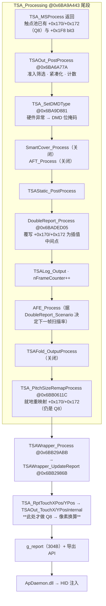
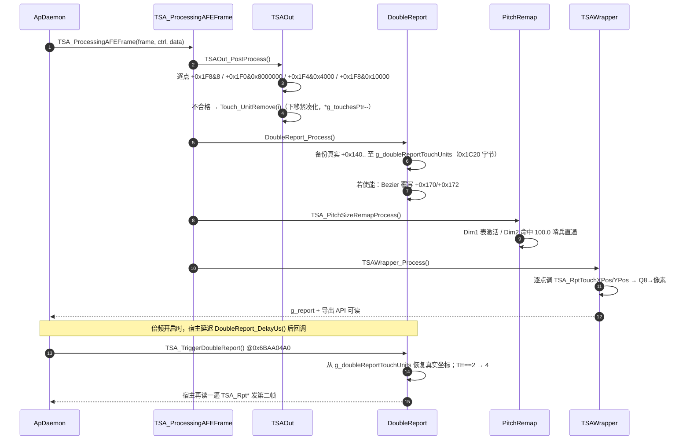
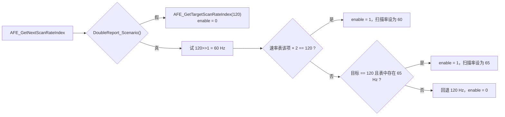
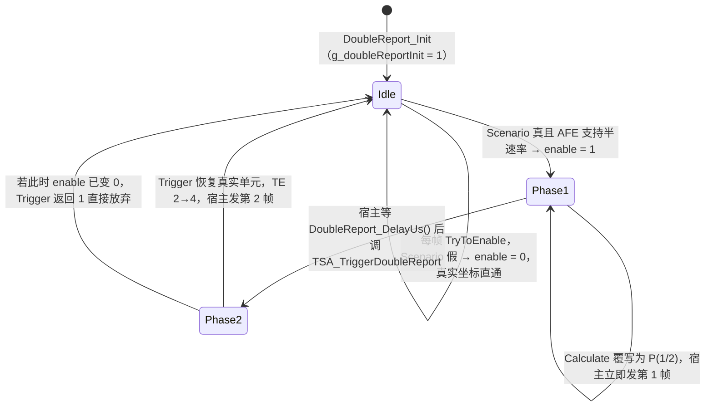
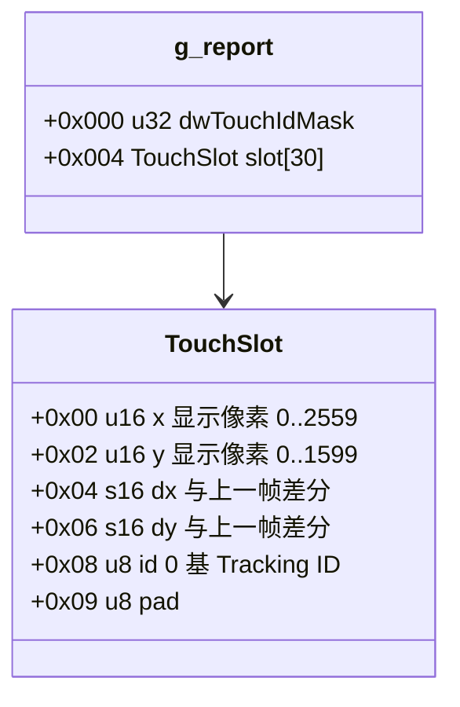

# 08 · 输出层：TSAOut、报点倍频、走线间距重映射与对外交付

> 目标程序 `TSACore.dll`（image base `0x6BA40000`，x86:LE:64）；机型 W273AS2700（Gaokun Himax CSOT，60 Cols × 40 Rows，显示 2560 × 1600）。参数实测取自 `TSAPrmt.dll` 的 `g_tsaPrmtFlashGaokunHimaxCSOT`（长度 `0x1890`），下文所有 `flash +0x…` 均指该表偏移。
> 前置：[05 跟踪与事件](05_tracking_and_events.md)、[06 手掌与握持](06_palm_and_grip_rejection.md)、[07 滤波与防抖](07_filtering_and_jitter.md)。

## 概念

- **Q8 网格坐标**：算法内部坐标，单位是传感器电极格，`1 格 = 256`。整个 Dim1 量程 `[0, 60·256−1] = [0, 15359]`，Dim2 `[0, 40·256−1] = [0, 10239]`。触点单元里 `+0x170`（Dim1）/`+0x172`（Dim2）是「待上报坐标」，由 07 的 JIT 滤波写入。
- **Dim1 / Dim2 与 X / Y**：Dim1 是列方向（60 通道），Dim2 是行方向（40 通道）。它们到屏幕 X/Y 的绑定由整定表的转置位与翻转位决定，本机为恒等绑定。
- **reportScale**（`flash +0x5A0` = 1）：上报坐标的倍率。对外 API 用它，内部裁剪判定固定用 1。取 1 表示「1 单位 = 1 物理像素」。
- **上报准入位 `+0x1F8 bit3`**：07 的 `TouchReport_ProcessUnit` 每帧置/清的唯一放行开关。TSAOut 只认它，不认 TE 状态字。
- **TE 状态 `+0x21C`**：触点生命周期字（`1/2/4/8/0x10/0x20/0x40`，日志串分别为 `DD/D/M/LD/OD/O` 与默认 `0`）。它在本模块**不被读取**，只通过准入位间接生效，外加导出 API `TSA_RptTouchEvent` 原样透传给宿主。
- **走线间距表 PitchMap**：80 项 `double` 的一维标定表，把「理想等距电极索引」映射到「实际物理电极位置」，补偿边框扇出导致的间距压缩。
- **DoubleReport（报点倍频）**：把 AFE 硬件扫描率**降半**（120 → 60/65 Hz），用二次插值补出中间帧，使上报率维持原值。它是省电特性，不是把 120 Hz 提到 240 Hz。
- **g_report**：`0x6BBAA300` 处 304 字节的对外报文快照，`g_preReport`（`0x6BBAA1C0`）是上一帧副本，用于算位移差分。

## 架构

`TSA_ProcessingAFEFrame @0x6BA9A7A7` 是宿主调用的帧入口，它先跑 `TSA_Processing @0x6BA9A443`，再跑 `TSAWrapper_Process @0x6BB29ABB`。本模块覆盖 `TSA_MSProcess` 返回之后的全部尾段。



**这张图要读出的关键一点**：`TSAOut_PostProcess` 并不产出像素坐标，触点池里从头到尾存的都是 Q8 网格坐标。像素换算是**惰性**的，发生在 `TSA_RptTouchXPos` / `TSA_RptTouchYPos` 被调用的那一刻。所以 `TSA_PitchSizeRemapProcess` 虽然排在 TSAOut 之后，它改的 `+0x170/+0x172` 仍然是后续像素换算的输入 —— 顺序上没有任何矛盾，重映射完整生效于交付的每一个包。TSAOut 在这条链上的角色是「谁能进包 + 网格域的核心区裁剪」，不是「坐标变换」。



---

## 分点解释

### 1. TSAOut_PostProcess @0x6BA6A77A —— 谁能进包

```c
local_a = 0;                          // 计数：+0x1F0 & 4 的触点数
g_touchesPtr[5] = 0;                  // 本帧上报触点数
g_touchesPtr[6] = 0;                  // 同上，副本
if (g_touchesPtr[3] != 0 && (FeatureFlags & FEAT_SMART_COVER) == 0) {
    if (TSA_IsGameScenario() == 0) { *g_touchesPtr = 0; goto AFTER_BEFUDFP; }
}
for (i = *g_touchesPtr - 1; i >= 0; i--) TSAOut_PostProcessBefUDFPUnit(i);
AFTER_BEFUDFP:
UDFPEvent_Process();                  // 关闭
for (i = *g_touchesPtr - 1; i >= 0; i--) TSAOut_PostProcessUnit(i, &local_a);
g_pPrevTouches->field_0x6 = g_touchesPtr[6];
g_tsaStaticPtr->bField_0x00 = local_a;
g_tsaStaticPtr->field_0x27c = *(u32*)(g_touchesPtr + 0x18);            // 帧标志快照
g_tsaStaticPtr->nField_0x280 = field_0x27c & ~nField_0x278;            // 上升沿
if (TSAStatic_IsHWResetPrev() && !TSAStatic_IsHWReset()) nField_0x280 |= 0x200000;
SideTouch_Report(); TSAOut_ReportExtInfo();
```

**整帧封杀分支**：`header[3]` 是 07 中「区域类型 5（大物体）被拒报」的触点计数。只要本帧有任何一个触点因大物体被拒，而 `FEAT_SMART_COVER`（`0x2`）关闭且不在游戏场景，就 `*g_touchesPtr = 0` —— **整帧所有触点被丢弃**，且跳过 `BefUDFP` 预筛。本机 `dwFeatureFlags = 0x01090121`，`& 0x2 == 0`，所以这条路是**武装状态**，是「掌根压上屏幕 → 全屏失灵一帧」的直接成因。

**遍历方向**：两个循环都是从 `n−1` 递减到 `0`。这是必须的，因为剔除走 `Touch_UnitRemove`（下节），它把后面的单元整体前移；倒序遍历时尚未访问的下标都在当前下标之前，不会被移动，所以既不漏也不重。复刻时必须保持倒序。

**两轮筛选的差别**：`TSAOut_PostProcessBefUDFPUnit @0x6BA6A6F3` 只查两条（`+0x1F8 & 8 == 0` 或 `+0x1F0 & 0x8000000`）就剔除；它存在的唯一理由是让 `UDFPEvent_Process` 看到一个已经清过一遍的池。本机 UDFP 关闭（`flash +0x1740 = 0`，`UDFPEvent_Process @0x6BB3392C` 整体被 `if (DAT_6bcaa140 != 0)` 包住），所以这轮预筛在功能上是冗余的 —— 但它**真的会删触点**，必须照抄，否则 `*g_touchesPtr` 的中间值对不上。

**SideTouch_Report @0x6BB1A7A5 会反向追加触点**：它把侧边通道里 `+0x1F8 & 8` 的单元通过 `SideTouch_UnitCopyToOutReport` 追加到主池尾部，同时 `g_touchesPtr[5]++` 与 `*g_touchesPtr++`，上限 20。也就是说 `TSAOut_PostProcessUnit` 跑完之后触点数还会再涨。其中 `(DAT_6bcaa0a4 & 3)` 那一段回填（`flash +0x16A4 = 0`）**关闭**。

### 2. TSAOut_PostProcessUnit @0x6BA6A3EF —— 逐条判据与紧凑化

四条否决判据，任一成立即 `Touch_UnitRemove(i)`：

| # | 判据 | 含义 | 本机可达性 |
|---|---|---|---|
| 1 | `(+0x1F8 & 0x8) == 0` | 07 的 `TouchReport_ProcessUnit` 本帧没有放行 | 常态可达 |
| 2 | `(+0x1F0 & 0x8000000) != 0` | 06 的 GripFilter 置的握持完全抑制位 | 可达 |
| 3 | `(+0x1F4 & 0x4000) != 0` | 反编译写作 `+ 500`，即触点单元 `+0x1F4`，异常接触 | **不可达** |
| 4 | `(+0x1F8 & 0x10000) != 0` | 姿态取消（`TouchReport_PostureAntiTouch`） | 07 已证不可达 |

判据 3 的 `+0x1F4` 是**触点单元**内的字（基址 `g_touchesPtr + i*0x168`），不是 `TSAStatic` 的偏移 —— `TSAStatic` 结构长 `0x3EE`，并无 `0x1F4` 字段，全程序以 `TSAStatic` 为基址访问 `+0x1F4` 的只有 `Proximity_TouchPostProcess` 与两处 `SideTouch_*`，与逐点否决无关。按 [06 §4.2](06_palm_and_grip_rejection.md) 对该字段写入者的穷举，触点单元 `+0x1F4` 全库只被置过 `0x4` / `0x20` / `0x100` 三个位，**`0x4000` 没有任何写入者**，所以判据 3 在本机恒不成立。复刻时保留结构即可，不必实现对应的异常来源。

判据 2 就是 06 说的「握持抑制在本模块执行」：GripFilter 只负责置 `+0x1F0 bit27`，触点照样走完全部滤波，直到这里才被物理删除。注意它和判据 1 是**或**关系而不是先后关系 —— 一个被握持抑制但准入位仍为 1 的触点（GripFilter 延迟放行期间可能出现）同样被删。

`Touch_UnitRemove @0x6BA763F4` 的紧凑化语义：
```c
if (*g_touchesPtr > 20) { assert; *g_touchesPtr = 20; }
if (i < *g_touchesPtr) {
    for (k = i; k < *g_touchesPtr - 1; k++)
        memcpy_s(base + 0x140 + k*0x168, 0x168, base + 0x140 + (k+1)*0x168, 0x168);
    *g_touchesPtr -= 1;
}
```
整段 `0x168` 字节搬移，**Tracking ID（`+0x154`）随单元一起走**，不重排、不重编号。所以「池下标」在本模块之后与 ID 完全解耦：下标连续 `0..n−1`，ID 是 `1..20` 的稀疏集合。

通过的分支做四件事：

1. **核心区裁剪**（网格域）：
   ```c
   if (TSAOut_DisplayXPos(i) < static->wField_0x2e0)  TSA_SetXPos(i, static->wField_0x2e0);
   else if (static->nXResMax < TSAOut_DisplayXPos(i)) TSA_SetXPos(i, static->nXResMax);
   ```
   `wField_0x2e0` / `nXResMax` 由 `TSAStatic_Init @0x6BAA1A42` 初始化为 `0` 和 `TSA_GetXRes() − 1 = 2559`，只有宿主命令 `TSA_SetXCoreAreaCommand @0x6BB23EE9` 能改。`TSAOut_DisplayXPos` 返回的是 `u16` 且内部已被钳在 `[0, 2559]`，所以**默认配置下这两条分支都恒不成立，一次都不会触发**。它存在的意义是给「X 方向可用区被宿主收窄」的场景做回投影。注意只裁 X，Y 方向没有对应代码。
   `TSA_SetXPos @0x6BA6A355` 做的是反向投影：按转置位选维度，调 `TSAOut_RevertDim1Pos` / `RevertDim2Pos` 把像素值换回 Q8 再写 `+0x170`/`+0x172`。
2. `g_touchesPtr[5]++`、`g_touchesPtr[6]++`。
3. `(+0x1F0 & 4)` 成立则 `*pContactCount++`，最终写进 `static->bField_0x00`。
4. 与历史池握手：`static->field_0x70 = static->pFrameBufferPtr`；再用 `PrevTouch_GetIdxBasedOnID(+0x154)` 找到历史槽，若槽号 < 20 且历史 `+0x1F8 & 0x20000000 == 0`，则写 `历史+0x598 = pFrameBufferPtr` 并置 `历史 +0x1F8 |= 0x20000000`。这个位是「该轨迹已首次上报」的一次性锁存，05 的 `TSABuffer_TimeRptProcess` 用它区分在场轨迹。

### 3. Q8 → 显示像素的映射数学

#### 3.1 比例常数（`TSAConstPrmt_Init @0x6BB3BB00`）

```c
DAT_6bcab604 /*K1*/ = ((int8)flash[0x5AF] + (u16)flash[0x5A6] + (int8)flash[0x5AE]) * 0x10000 / (bCols << 8);
DAT_6bcab608 /*K2*/ = ((int8)flash[0x5B1] + (u16)flash[0x5A8] + (int8)flash[0x5B0]) * 0x10000 / (bRows << 8);
DAT_6bcab620 = bCols << 8;   // 15360
DAT_6bcab622 = bRows << 8;   // 10240
DAT_6bcab61a = 4096 / flash[0x1B] + 1;   // 每毫米的 Q8 数
```
实测：`flash +0x5A6 = 0x0A00 = 2560`，`+0x5A8 = 0x0640 = 1600`，四个 margin（`+0x5AE..+0x5B1`）全 `0`，`bCols = 0x3C = 60`（`flash +0x1D`），`bRows = 0x28 = 40`（`flash +0x1E`），`flash +0x1B = 0x45 = 69`（Dim1 电极间距，单位 1/16 mm → 4.3125 mm）。于是：

- `K1 = 2560·65536 / 15360 = 10922`（整数除法截断，精确值 10922.667）
- `K2 = 1600·65536 / 10240 = 10240`（整除）
- `DAT_6bcab61a = 4096/69 + 1 = 59 + 1 = 60` Q8/mm，与前序模块一致

K1 被截断 0.667 意味着全程有约 `−6.1e-5` 的相对压缩，最右端累计不足 1 像素，被后面的钳位吸收。复刻必须用同样的整数截断，不能用浮点比例。

#### 3.2 Dim1：`TSAOut_Dim1PosInternal @0x6BA69A50`

```c
u32 v = ((u32)q8 * K1 * (u32)scale + 0x8000) >> 16;   // 无符号右移
v -= (u32)scale * (int8)flash[0x5AE];                 // 减低侧 margin（本机 0）
if ((int)v < 0) v = 0;
if ((int)(scale * 2560 - 1) < (int)v) v = scale * 2560 - 1;
return TSAFold_Dim1PosOutRemap(v & 0xFFFF, scale);    // 折叠屏，关闭，直通
```
即 `X = round(q8 · K1 / 65536) − M_left`，再钳到 `[0, 2560·scale − 1]`。`+0x8000` 是 Q16 域的 0.5，四舍五入方向为**向上取半**（`.5` 进位）。注意这里用的是**逻辑右移**，负中间值不会出现（`q8` 与 `K1` 都非负）。

#### 3.3 Dim2：`TSAOut_Dim2PosInternal @0x6BA69CCB`

比 Dim1 多两段边缘拉伸，且舍入处理不同：

```c
u32 p = q8;
if (q8 < 0x100 && (int8)flash[0x5B0] < 0) {                       // 顶部：首格内
    p = TSAOut_EdgeScale(TSAOut_Display2Pixel(flash[0x5B0] - flash[0x5B2]), q8);
} else if (q8 > (bRows-1)*256 && (int8)flash[0x5B1] < 0) {        // 底部：末格内
    int e = TSAOut_EdgeScale(TSAOut_Display2Pixel(flash[0x5B1] - flash[0x5B3]), bRows*256 - q8);
    p = bRows*256 - e;
}
int t = (int)(scale * K2 * p);
int r = t + 0x8000; if (r < 0) r = t + 0x17FFF;      // 负数向零舍入修正
u32 v = (r >> 16) - scale * (int8)flash[0x5B0];      // 算术右移
if ((int)v < 0) v = 0;
if ((int)(scale * 1600) <= (int)v) v = scale * 1600 - 1;
return TSAFold_Dim2PosOutRemap(v & 0xFFFF, scale);
```
`TSAOut_EdgeScale(a, v) = a + (((256 − a)·v) >> 8)`（负数先 `+0xFF` 修正），是把首/末一格内的坐标从 `[0,256]` 线性重映射到 `[a,256]` 的「边缘外推」。触发条件是对应 margin 字节为**负数**；本机 `flash +0x5B0 = +0x5B1 = 0`，`0 < 0` 不成立 → **两段边缘拉伸都关闭**。

Dim1 没有这段代码 —— 原厂只给 Dim2 实现了边缘外推，这是一个真实的实现不对称，不是反编译丢失（`Dim1PosInternal` 223 字节 vs `Dim2PosInternal` 494 字节）。

#### 3.4 反向投影与距离换算

- `TSAOut_RevertDim1Pos @0x6BA69B2F`：`q8 = clamp((px + M_left)·65536 + K1/2) / K1, ≤ 15359)`；低侧先钳 `≥ 0`。Dim2 版本同构，上限 `DAT_6bcab622 − 1 = 10239`。
- `TSAOut_ExtToIntDist @0x6BA69BC3`：`(px << 16) / K1`，**不加半个 LSB**，向下取整。
- `TSAOut_IntToExtDist @0x6BA69BFB`：取绝对值 → `(|d|·K1 + 0x8000) >> 16` → 恢复符号。这是长短轴换算的实现。
- `TS_MMToPixel @0x6BA7C416`：`return DAT_6bcab61a · mm = 60·mm`，返回的其实是 **Q8**，函数名有误导。串起来 `TSA_RptTouchAxisMajor(mm) = IntToExtDist(60·mm) ≈ round(mm · 9.9976)`，约 10 px/mm。
- `TSAOut_Pixel2DisplayDim1/2 @0x6BA69B0B/…`：`Dim1PosInternal(q8, 1)` 的薄包装，只有 UDFP 用（关闭）。

### 4. 轴向变换、镜像与椭圆角

`TSAOut_TouchXPosInternal @0x6BA69F4D` / `TouchYPosInternal @0x6BA6A0C7`：

```c
if ((flash[0x18] ^ flash[0x19]) == flash[0x5A4]) {        // 不转置
    X: flash[0x5A2] ? (2560*scale − Dim1Pos − 1) : Dim1Pos
    Y: flash[0x5A3] ? (1600*scale − Dim2Pos − 1) : Dim2Pos
} else {                                                   // 转置
    X: flash[0x5A3] ? (1600*scale − Dim2Pos − 1) : Dim2Pos
    Y: flash[0x5A2] ? (2560*scale − Dim1Pos − 1) : Dim1Pos
}
```

实测 `flash +0x18 = 1`、`+0x19 = 1`、`+0x5A4 = 0`：`1 ^ 1 = 0 == 0` → **不转置**。`+0x5A2 = +0x5A3 = 0` → **不翻转**。因此 W273 上 Dim1 → X（0..2559），Dim2 → Y（0..1599），原点在左上角，`TSA_GetXRes()` 走 `TSA_GetDim1Res()` 返回 2560、`TSA_GetYRes()` 返回 1600。

`TSAOut_Angle @0x6BA6A305`：判据是 `flash[0x18] == flash[0x19]`（注意是**相等**，不是异或），本机成立 → `angle ≤ 0 ? angle + 90 : angle − 90`，即把 `[−90, 90]` 折进 Windows 的轴向约定；转置机型走 `−angle`。

`TSAFold_Dim1PosOutRemap @0x6BB28420 / TSAFold_Dim2PosOutRemap @0x6BB284E2`：门控 `TSAFold_IsSupported() = (DAT_6bcaa1cc > 1)`，`DAT_6bcaa1cc` 即 `flash +0x17CC = 1` → `1 > 1` 为假 → **折叠屏重映射关闭**，两函数原值透传。

### 5. TE 状态 → 输出包的完整闭环

TSAOut **不读 `+0x21C`**。TE 的全部影响都已经在 07 的 `TouchReport_ProcessUnit` 里折叠进 `+0x1F8 bit3`。因此 05/07 遗留的问题在这里的答案是：

| TE `+0x21C` | 07 置 `+0x1F8 bit3` | TSAOut 处置 | 在 `g_report` 中 | 主机看到的语义 |
|---|---|---|---|---|
| `1` 待确认 | 否 | `Touch_UnitRemove` | ID 从掩码中消失 | 无此触点 |
| `2` 按下 | 是 | 进包 | X/Y 有效，`dX/dY = 0` | Tip=1，首帧 |
| `4` 移动 | 是 | 进包 | X/Y 有效，`dX/dY` 为差分 | Tip=1 |
| `8` HOLD（冻结保持） | 是 | 进包 | 坐标与上一帧相同，`dX/dY ≈ 0` | Tip=1，位置不动 |
| `0x10` 快速点击补报 / 移出保持 | 是 | 进包 | 正常 | **Tip=1**，就是一个普通移动帧 |
| `0x20` 通用抬起 | 否 | `Touch_UnitRemove` | **ID 直接从掩码消失** | 主机靠掩码缺失推断抬起 |
| `0x40` WindowsPad 抬起帧 | 是 | 进包 | 坐标 = 最后一次牵引结果 | 由 `TSA_RptTouchEvent` 返回 `0x40`，宿主据此发 **Tip=0** |

结论：**`0x10` 不是抬起，它以 Tip=1 正常进包；`0x20` 不产生任何包，ID 直接消失**。唯一能让主机收到显式 Tip=0 的路径是 `0x40`（WindowsPad 抬起帧），而识别它必须走导出 API `TSA_RptTouchEvent @0x6BA9B3CC`（原样返回 `+0x21C`）—— `g_report` 的 10 字节槽里**没有事件字段**，光看 `g_report` 无法区分 `0x40` 与 `4`。这解释了为什么宿主必须同时用 `g_report` 和 `TSA_Rpt*` 两套取数口径。

### 6. TSA_SetDMDType @0x6BA9D881 —— 不只是日志

它有副作用。流程：`HardwareAnalyzer_GetDetectedException()` 取异常码（0..0x1F），查表映射成一个位掩码（`1/2/4/8/0x20/0x40/…/0x8000000`，码 5 与 0x1F 同映射 `0x8000`，码 6/7 同映射 `4`，码 0x14 与 0x1E 同映射 `1`），非 0 时还会调 `HardwareAnalyzer_GenerateExceptionDescription()`。若掩码为 0，则调 `BigData_ReportProcess()`，并在 `BigData_IsReportReady()` 为真时把掩码置为 `0x10`。最后 **`g_tsaStaticPtr->nField_0x138 = 掩码`** 并返回。`TSA_Processing` 只在返回非 0 且日志开启时打一行 `"TSA Set DMD type = %d"`。所以：返回值是给日志用的，但写 `nField_0x138`、驱动 BigData 统计推进是实打实的副作用，复刻时不能整体省掉。`BigData_*` 是设备健康度打点，与坐标无关。

### 7. DoubleReport —— 降频扫描 + 二次插值补帧

#### 7.1 使能路径：`Scenario` 决定的是「下一帧扫描率」，不是「本帧要不要插值」

```c
bool DoubleReport_Process(void) {            // @0x6BADED05
    DoubleReport_TryToEnable();              // g_doubleReportIsEnable = 0; AFE_GetNextScanRateIndex(&idx, &g_doubleReportIsEnable)
    CaculateInterval();                      // g_uSTimeInterval = frame->nUnixTimeSubSec − g_prevUsTimeStamp
    if (DoubleReport_IsEnabled()) DoubleReport_Calculate();
    return !DoubleReport_IsEnabled();
}
```
`DoubleReport_IsEnabled @0x6BADE611` 读的是 `g_doubleReportIsEnable`，它**只由 `AFE_GetNextScanRateIndex @0x6BB2D8A1` 写**。`DoubleReport_Scenario @0x6BADE4A6` 在整个 DLL 里也只有这一个调用点。链路是：



所以倍频的真实语义是：**AFE 以 60 Hz（或 65 Hz）扫描，软件在每个硬件帧里插出一个中间点先发，再延迟半个周期把真实点发出去，对上层维持 120 Hz 报点**。目标扫描率 `DAT_6bca3a8c` 由 `AFE_ScanInit` 置为 `DAT_6bcaa09e = flash +0x169E = 0x0078 = 120`。原分析所称的「120 → 240」不成立。

`DoubleReport_Scenario` 的七道闸（全部为真才返回 1）：

| # | 判据 | 本机实测 |
|---|---|---|
| 0 | `DAT_6bca928c != 0`（`flash +0x88C = 0`）时直接返回 1 | 旁路**未开**，走下面全部判据 |
| 1 | `dwFeatureFlags & 0x200000` | `0x01090121 & 0x200000 = 0` → **整条链恒关闭** |
| 2 | `g_doubleReportStatus != 0` | 由 `TSA_SetAfeWorkMode @0x6BAA0490` 转调 `DoubleReport_SetDaemonStatus @0x6BADE62E` 设置；该导出在宿主解析清单里，但被判据 1 挡在前面 |
| 3 | `g_doubleReportInit != 0` | `DoubleReport_Init` 置 1 |
| 4 | `(dwSystemFlags & 0xC00000) == 0` | 噪声/异常阻断 |
| 5 | `!TSA_IsGameScenario()` | 游戏场景互斥 |
| 6 | `TSA_ASAAFEStatus() < 0` 或 `abs(status) & 3 == 0` | 笔在屏时禁用 |
| 7 | `!TSA_IsOKToEnterIDLEMode() && !TSA_IsTypingScenario()`（后者 = `dwStylusAftGateFlags & 2`） | 休眠/打字禁用 |
| 8 | `DAT_6bca928d == 0`（`flash +0x88D = 0`）→ 冷却计时器旁路，恒放行 | 恒真 |

判据 1 是硬门，且**本机无法被打开**：`dwFeatureFlags` 的合成式是 `TSAStatic_InitSysModuleEveryTime @0x6BAA1628` 的 `flash+0x50 | flash+0x54`（`0x00000101 | 0x01090020`），bit 21 两边都是 0；唯一能改写它的导出是 `TSA_SetFeatures @0x6BA9F179`，而它每次都会把 `flash+0x54` 再或回去，且 bit 21 不在 `0x4813` 保护掩码里 —— 宿主可以置位，但宿主 `ApDaemon.dll` 的调用清单里并没有携带该位的场景。因此 **W273AS2700 上倍频恒关闭**，`DoubleReport_Process` 每帧只做 `TryToEnable` + `CaculateInterval` 两件无副作用的事，`DoubleReport_Calculate` / `Trigger` / 插值逻辑全部不可达。7.2、7.3 两小节记录的是这条链打开后的行为，供将来移植参考，本项目复刻可整体跳过。

值得注意的是**硬件侧其实具备降频能力**，挡住倍频的纯粹是特性位。AFE 速率能力表由 `AFE_Init @0x6BB2CB21` 指向 `g_thpInternalCaps` 后，`AFE_Simulation @0x6BB2C924` 按工程名分流；W273AS2700 不匹配 `ALPS491000` / `ALPS491600` / `JHSN*`，走 `AFE_SimulationForDefaultProj @0x6BB2C7D5`，填出的表是：

```c
DAT_6BBAA798 = 6;                       // 速率项数（caps + 0x18）
g_simuScanRate = { 0x78, 0xB4, 0x3C, 0x46, 0x41, 0x5A };   // 120 / 180 / 60 / 70 / 65 / 90 Hz
DAT_6BBAA7A0 = &g_simuScanRate;         // caps + 0x20，AFE_GetNextScanRateIndex 查的就是它
g_simuAFEFrame.wScanRateIndex = 0x78;   // 默认 120 Hz
```

即 `120 >> 1 = 60` 与 `65` 两项**都在表里**，`AFE_GetNextScanRateIndex` 的两条降频判据本可满足。DVR 录像实测帧率 **119.03 Hz**（480 帧跨 4.024 s，`receiveSystemEpochUs` 差值），与默认 120 Hz 一致、无半速率痕迹，从运行期侧佐证倍频未启用。宿主注入表的入口 `TSA_SetAFECaps`（经 `AFE_SetCaps @0x6BB2CB53`）也不在 `ApDaemon.dll` 的解析清单里，运行期用的就是上面这张内置表。

#### 7.2 插值：`DoubleReport_Calculate @0x6BADE84B`

历史缓冲 `g_prevTouchesDoubleReportUnits @0x6BC76FC0` 是两段各 `0xA4` 字节（41 槽 × 4 字节 `{u16 dim1, u16 dim2}`，按 **Tracking ID** 索引）：前段是 `t−2`，后段（`+0xA4`，即索引 `id + 0x29`）是 `t−1`。

```c
memcpy_s(&g_doubleReportTouchUnits, 0x1C20, g_touchesPtr + 0x140, 0x1C20);  // 备份 20×0x168 真实单元
for (i = 0; i < *g_touchesPtr; i++) {
    id = unit[i].+0x154;
    p1x = prev[id + 0x29].x; p1y = prev[id + 0x29].y;   // t−1
    p2x = prev[id].x;        p2y = prev[id].y;          // t−2
    if (p2x && p2y && p1x && p1y) {
        bx = Bezier(p2x, p1x, cur.x);  by = Bezier(p2y, p1y, cur.y);
        if (MIN(p1x,cur.x) <= bx && bx <= MAX(p1x,cur.x) &&
            MIN(p1y,cur.y) <= by && by <= MAX(p1y,cur.y)) { cur.x = bx; cur.y = by; }
        else { cur.x = (cur.x + p1x) >> 1; cur.y = (cur.y + p1y) >> 1; }   // 降级线性中点
    } else if (!p2x && !p2y && p1x && p1y) {
        cur.x = (cur.x + p1x) >> 1; cur.y = (cur.y + p1y) >> 1;            // 只有一帧历史
    }
    // 两帧历史都缺（按下首帧）→ 完全不动，直接发真实点
}
DoubleReport_UpdatePrevTouch();
```

`Bezier @0x6BA6595D`（名字是原厂的，数学上是三点等距二阶拉格朗日多项式在 `t = 1/2` 的取值，不是贝塞尔曲线）：
```c
int Bezier(int p2 /*t−2*/, int p1 /*t−1*/, int p0 /*t*/) {
    int v = p0*3 + p1*6 - p2;
    if (v < 0) v += 7;
    return v >> 3;
}
```
以 `P_{t−2}@t=−1`、`P_{t−1}@t=0`、`P_t@t=1` 构造抛物线，`P(1/2) = (3P_t + 6P_{t−1} − P_{t−2}) / 8`，权重和 `(3+6−1)/8 = 1`。`+7` 是负数向零取整补偿（本场景坐标非负，实际不触发，但复刻要保留）。

单调性护栏用的是 `[min(P_{t−1}, P_t), max(P_{t−1}, P_t)]` 的**闭区间**，X 与 Y 必须**同时**落在各自区间内才采用二阶结果；任一越界则**两个轴一起**降级为线性中点。

`DoubleReport_UpdatePrevTouch @0x6BADE6DE`：`memcpy(base, base+0xA4, 0xA4)` 把 `t−1` 挪成 `t−2`，`memset(base+0xA4, 0, 0xA4)` 清空，然后从 **`g_doubleReportTouchUnits`（备份的真实坐标）**而不是已被覆写的触点池里取 `+0x170/+0x172` 填 `t−1`。所以历史链存的始终是真实采样点，插值点不会污染下一次插值。ID 为 0 或坐标为 0 的槽天然表示「无历史」，抬起后槽位靠 `memset` 自动过期。

#### 7.3 两阶段呈报与时序



- `DoubleReport_DelayUs @0x6BADE643`：`d = 1000000 / AFE_Frame->wScanRateIndex + 1000`；`d < g_uSTimeInterval ? (d >> 1) : (g_uSTimeInterval >> 1)`，即 `min(周期+1000μs, 实测帧间隔) / 2`。60 Hz 扫描下 `d = 16666 + 1000 = 17666`，实测间隔约 16666 → 取 `16666 >> 1 = 8333 μs`。
- `DoubleReport_Trigger @0x6BADEE02`：先查 `IsEnabled`，为 0 直接返回 1；否则 `memcpy_s(g_touchesPtr + 0x140, 0x1C20, &g_doubleReportTouchUnits, 0x1C20)` 整池恢复，再把所有 `+0x21C == 2` 改成 `4`（防止主机在同一次按下里收到两次 PointerDown），最后 `DoubleReport_Log`。
- **一个真实的时序漏洞**：备份发生在 `DoubleReport_Calculate` 里，也就是 `TSA_PitchSizeRemapProcess` **之前**。`Trigger` 恢复出来的是**未经走线重映射**的坐标，而第一帧（插值点）是经过重映射的。倍频开启且 Dim1 表激活时，两帧之间会带上一个最多约 ±1.5% 格距的系统性偏差。本机因倍频默认关闭而不暴露，复刻若打算开倍频必须在 `Trigger` 之后补跑一次重映射。
- `TSA_TriggerDoubleReport @0x6BAA04A0`（序号 2324）在 DLL 内**无调用者**，纯粹由宿主定时回调；它与 `TSA_GetDoubleReportDelayUs @0x6BAA04C6` 都出现在 `ApDaemon.dll` 的符号解析清单里，说明宿主确实实现了这套两阶段回调，只是被特性位挡住不会触发。`TSA_IsEnableDoubleReport @0x6BAA04B3` 是查询封装（注意三者在反编译里丢了返回值传递，实际是尾调用返回）。

### 8. TSA_PitchSizeRemapProcess @0x6BB0611C —— 走线间距重映射

```c
for (i = 0; i < (u8)*g_touchesPtr; i++) {
    int d1 = SensorPitchSizeMapDim1(unit[i].+0x170, 0x100);
    int d2 = SensorPitchSizeMapDim2(unit[i].+0x172, 0x100);
    unit[i].+0x170 = (s16)d1;
    unit[i].+0x172 = (s16)d2;
}
```
`SensorPitchSizeMapDim1 @0x6BB060B4` → 表 `0x6BCA8AA0` = `g_tsaPrmtFlash + 0xA0`；`Dim2 @0x6BB060E8` → `0x6BCA8D20` = `+0x320`。两者都传 `scale = 0x100`（Q8）。同一个核也被笔的 `TX1CoordinateProcess` 用 `scale = 0x400`（Q10）复用。

`SensorPitchSizeMap @0x6BB05FC0`：
```c
int SensorPitchSizeMap(int c, const double *P, u16 S) {
    if (*P == 100.0) return c;              // 哨兵：严格的 UCOMISD 相等比较（NaN 走插值分支）
    if (S == 0) return 0;
    u16 k = (u16)(c / (int)S);
    if (k >= 0x4F) return 0;                // 注意是归零，不是钳位
    int r = (c % (int)S) & 0xFFFF;
    return (int)( P[k + 1] * (double)r + P[k] * (double)(int)(S - r) );   // CVTTSD2SI 向零截断
}
```
数学上就是 `C_out = trunc((S − r)·P[k] + r·P[k+1])`。由于权重是 `S − r` 与 `r` 而非归一化的 `1 − τ` 与 `τ`，结果天然带 `S` 倍增益，输入输出同定点格式，因此同一份代码对 Q8 与 Q10 都成立。

边界：`k ≤ 78` 才插值，访问到 `P[79]` 正好是数组末项，**没有越界**；`k ≥ 79` 返回 `0`（把坐标打到原点，不是钳到端点）。上游坐标已被钳在 `< 15360`，`k ≤ 59`，够不到这条路。

#### 实测表内容（`flash +0xA0` / `+0x320`，各 80 个 `double`）

| | Dim1（`+0xA0`） | Dim2（`+0x320`） |
|---|---|---|
| `P[0]` | `0.0` | **`100.0`（哨兵）** |
| 节点 0→10 | 步长 `0.984375 = 1 − 1/64`，`P[10] = 9.84375` | 全 `0.0` |
| 节点 10→50 | 步长 `1.0078125 = 1 + 1/128`，`P[50] = 50.15625` | 全 `0.0` |
| 节点 50→60 | 步长 `0.984375`，`P[60] = 60.0` | 全 `0.0` |
| `P[61]` | `60.0`（哨兵之后的闭合冗余项） | `0.0` |
| `P[62..79]` | `0.0` | `0.0` |

跨度校验：`10×0.984375 + 40×1.0078125 + 10×0.984375 = 9.84375 + 40.3125 + 9.84375 = 60.0`，严格闭合。物理含义：左右各 10 根电极因边框扇出被压缩约 1.56%，中间 40 根相应拉伸 0.78%，重映射把「几何等距的解算坐标」纠正回「真实物理等距」。

Dim2 首项 `100.0`（`0x4059000000000000`）命中哨兵，`SensorPitchSizeMap` 在 `UCOMISD` 之后立刻 `RET`，**Y 轴完全旁路**，每帧省掉每触点两次双精度乘法。原分析对这一点的结论经实测确认无误。

映射的**值域自洽性**：输入 `c ∈ [0, 15359]` → `k ≤ 59`，输出上界在 `k=59, r=255` 处为 `1×59.015625 + 255×60.0 = 15359.015…` → 截断 `15359`。输入 0 → 输出 0。因此重映射不会把坐标推出量程，后续像素换算无需额外防护。

### 9. 对外交付：g_report 与导出 API

#### 9.1 `TSAWrapper_UpdateReport @0x6BB2986B`

```c
*(u32*)0x6BBAA300 = TSAWrapper_GetTouchId();     // 活跃 ID 位掩码
u32 prevMask = *(u32*)0x6BBAA1C0;
for (idx = 0; idx < TSA_RptTouchNum(); idx++) {
    u8 id = TSA_RptTouchID(idx);                 // 注意：返回 +0x154 − 1，0 基
    slot(id).id = id;
    slot(id).x  = TSA_RptTouchXPos(idx);
    slot(id).y  = TSA_RptTouchYPos(idx);
    if ((prevMask & (1u << (id & 31))) == 0) { slot(id).dx = 0; slot(id).dx = 0; }   // 见下
    else { slot(id).dx = slot(id).x − preSlot(id).x; slot(id).dy = slot(id).y − preSlot(id).y; }
}
memcpy(&g_preReport, &g_report, 0x130);
```

- `TSA_RptTouchNum @0x6BA9B09C` = `*g_touchesPtr`（`FEAT_AFT_ENABLED = 0x40000` 在 `0x01090121` 中为 0，走此分支）。
- `TSA_RptTouchID @0x6BA9B256` = `+0x154 − 1`，取值 `0..19`；`TSAWrapper_GetTouchId @0x6BB29819` 用 `1 << (id & 31)` 拼掩码。
- `TSA_RptTouchXPos/YPos @0x6BA9B428/0x6BA9B482` → `TSAOut_RptXPos/RptYPos` → `TSAOut_TouchX/YPosInternal(idx, flash[0x5A0] = 1)`。**Q8→像素的唯一发生点**。
- **实现缺陷（已在汇编 `0x6BB29964` / `0x6BB29989` 确认）**：新触点首帧时连写两次 `+0x08`（`dx`），`+0x0A`（`dy`）被漏掉，保留着上一个占用该槽的触点留下的旧值。复刻若要位级对齐需照抄；若要修正，把第二次写改成 `+0x0A`。
- 抬起的触点**不清槽**，只是掩码里那一位变 0。消费方必须先读掩码。

#### 9.2 布局


`g_report @0x6BBAA300`，`g_preReport @0x6BBAA1C0`，各 `0x130 = 304 = 4 + 30×10` 字节，由 `TSAWrapper_Init @0x6BB29760` 清零。槽数 30 但 ID 只用到 `0..19`（`TSA_MAX_TOUCH_NUM = 20`），后 10 槽恒空。

#### 9.3 宿主取数的两条口径

1. **`TSAWrapper_*` 导出族**：`TSAWrapper_GetTouchXVelocity/YVelocity`（读 `slot.dx/dy`，经 `TSAWrapper_idxToId` 把池下标转 ID）。轻量，但只有坐标与差分。
2. **`TSA_Rpt*` 导出族**（`0x6BA9B09C..0x6BA9C4BA`，共 40 余个），按**池下标**取数，覆盖包里没有的全部字段：

| 导出 | 源字段 | 变换 |
|---|---|---|
| `TSA_RptTouchNum` | `*g_touchesPtr` | 上限 20（+SideTouch 追加） |
| `TSA_RptTouchID` | `+0x154` | `−1` 转 0 基 |
| `TSA_RptTouchXPos/YPos` | `+0x170/+0x172` | Q8 → 像素，含转置/翻转/钳位 |
| `TSA_RptTouchEvent` | `+0x21C` | 原样；**Tip 位的唯一来源** |
| `TSA_RptTouchPressure` | `+0x15C` | 原样 u16 |
| `TSA_RptTouchAxisMajor/Minor` | `+0x188/+0x18A`（mm） | `TSAOut_Axis(TS_MMToPixel(mm))` → 像素 |
| `TSA_RptTouchAxisAngle` | `+0x192` | `TSAOut_Angle` ±90° |
| `TSA_RptTouchXWidth/YWidth` | `+0x1AC/+0x1AD` | 按转置位选维，钳到 ≤ 15 |
| `TSA_RptTouchShape/Object/Hand` | `+0x1E0/+0x1E8/+0x1E4` | 分类字，Hand 由 `bit2/bit3` 译成 `1/2` |
| `TSA_RptTouchException` | `+0x1EC` | 异常码 |
| `TSA_RptTouchSuppressFlag` | `+0x208` | 抑制掩码 |
| `TSA_RptTouchToBeGoBack` | `+0x1F8 & 0x800000` | 布尔 |

TSACore **不生成 HID 报文**。宿主是 **`ApDaemon.dll`**（1.4 MB），不是 `HuaweiThpService.exe` —— 后者只有 22 KB，是个服务壳；`THP_Service.dll` 与 `himax_thp_drv.dll` 二进制里不含任何 `TSA_` 符号。`ApDaemon.dll` 通过 `GetProcAddress` **按名**解析 TSACore 导出（映像内含 211 个 `TSA_*` 名字串），HID 打包在它里面完成。

**宿主走的是 `TSA_Rpt*` 导出族，不直接读 `g_report`**：解析清单里 `TSA_RptTouchNum / TouchID / TouchXPos / TouchYPos / TouchPressure / TouchAge / TouchHand / TouchAxisMajor / AxisMajorExtend / AxisMinor / AxisAngle / TouchXWidth / TouchYWidth / TouchXCenter / TouchYCenter / TouchXEdgeWidth / TouchYEdgeWidth / TouchXGripRatio / TouchYGripRatio / TouchDim1Peak / TouchDim2Peak / IsTouchDown / IsLiftOff / IsMatchWithROI / IsExistExtROIPeak / ExtROIPeakDim1 / ExtROIPeakDim2 / LONum / VirtualKeyCode / VirtualKeyAction / VitualKeyEventNum` 一应俱全，另有 `RptBaselinePtr / RptDiffPtr / RptCMNPtr / RptSSBaselinePtr / RptSSDiffPtr / RptSafeBaselinePtr` 六个网格指针导出供诊断通路取图；`g_report` 与 `TSAWrapper_*` 族只在少量速度查询上使用。

字段对应关系：`ContactID ← TSA_RptTouchID`、`X/Y ← TSA_RptTouchXPos/YPos`（像素域，与面板分辨率同量程）、`Tip Switch ← TSA_RptTouchEvent != 0x40`、`Width/Height ← TSA_RptTouchAxisMajor/Minor`、`Scan Time ← AFE_Frame->nUnixTimeSubSec`。

**Confidence 位的来源未确定。** 已排除的途径：TSACore 导出表里没有任何含 `Confidence` 的符号；`TSA_Rpt*` 全族（含上列 31 个）没有对应项；`g_report` 的槽结构（`x / y / dx / dy / id / pad`，共 10 字节）也没有留位置。最可能的实现是宿主按「触点是否出现在 `TSA_RptTouchNum` 的返回列表中」直接合成 —— 被握持/大物体抑制的点已在 `TSAOut_PostProcessUnit` 里被 `Touch_UnitRemove` 删除，TSACore 侧本就不存在「进包但 Confidence = 0」的形态。确证需反编译 `ApDaemon.dll` 的 HID 打包函数。本仓库 `EGoTouchService/Device/vhf/VhfReporterTouchPacketHelper.h` 里的 32 字节 VHF 包（每包 5 触点、状态字 `0x03`/`0x02`、Y 在前 X 在后、逻辑量程 16000/25600）即宿主侧的实际落地格式。

### 10. 本模块门控矩阵（W273AS2700 实测）

| 分支 | 判据 | 实测值 | 状态 |
|---|---|---|---|
| 皮套整帧封杀 | `header[3] != 0 && !(flags & 0x2) && !IsGame` | `dwFeatureFlags = 0x01090121`（`flash +0x50 = 0x00000101`，`+0x54 = 0x01090020`，按位或） | **武装** |
| `UDFPEvent_Process` 主体 | `DAT_6bcaa140 != 0` | `flash +0x1740 = 0x00` | 关闭 |
| X 核心区裁剪 | `disp < 0` 或 `disp > 2559` | `wField_0x2e0 = 0`、`nXResMax = 2559`（`TSAStatic_Init`） | 恒不触发 |
| Dim2 顶/底边缘外推 | `(int8)flash[0x5B0] < 0` / `[0x5B1] < 0` | 均 `0x00` | 关闭 |
| 轴向转置 | `flash[0x18] ^ flash[0x19] != flash[0x5A4]` | `1 ^ 1 = 0`，`[0x5A4] = 0` | 不转置 |
| Dim1/Dim2 镜像 | `flash[0x5A2]` / `[0x5A3]` | 均 `0x00` | 不翻转 |
| 椭圆角 ±90° | `flash[0x18] == flash[0x19]` | `1 == 1` | **生效** |
| `TSAFold_*OutRemap` | `DAT_6bcaa1cc > 1` | `flash +0x17CC = 0x01` | 关闭 |
| `FEAT_DOUBLE_REPORT` | `dwFeatureFlags & 0x200000` | `flash +0x50 = 0x00000101`、`+0x54 = 0x01090020`，或出 `0x01090121`，bit 21 = 0 | **恒关闭** → 整条倍频链不可达 |
| 倍频调试旁路 / 冷却计时 | `DAT_6bca928c` / `DAT_6bca928d` | `flash +0x88C = 0x00` / `+0x88D = 0x00` | 旁路关、冷却关（恒放行） |
| AFE 速率能力表 | `AFE_SimulationForDefaultProj @0x6BB2C7D5` 内置，宿主不调 `TSA_SetAFECaps` | 6 项 `{120, 180, 60, 70, 65, 90}` Hz，默认 `0x78` | 含 60/65，**硬件支持降频** |
| 实际报点率 | DVR 录像 `receiveSystemEpochUs` | 480 帧 / 4.024 s = **119.03 Hz** | 与默认 120 Hz 一致，无降频 |
| `g_doubleReportStatus` | `TSA_SetAfeWorkMode @0x6BAA0490` → `DoubleReport_SetDaemonStatus` | 宿主可设，被判据 1 短路 | 无效 |
| `FEAT_AFT_ENABLED` | `dwFeatureFlags & 0x40000` | `= 0` | 关闭 → 全部 `TSA_Rpt*` 走触点池分支 |
| `SmartCover_Process` / `AFT_Process` | `flags & 0x2` / `& 0x40000` | 均 0 | 关闭 |
| SideTouch 回填 | `DAT_6bcaa0a4 & 3` | `flash +0x16A4 = 0x0000` | 关闭（追加本体仍执行） |
| Dim1 走线重映射 | `pDim1PitchMap[0] != 100.0` | `= 0.0` | **激活** |
| Dim2 走线重映射 | `pDim2PitchMap[0] != 100.0` | `= 100.0` | 哨兵旁路 |
| 目标扫描率 | `DAT_6bca3a8c` | `flash +0x169E = 0x0078 = 120 Hz` | — |

### 11. 复刻要点清单

1. **坐标始终在 Q8 域流转**，像素只在取数时算一次。复刻不要提前把触点池转成像素，否则 `TSA_SetXPos` 的反投影与 PitchRemap 的顺序都会错。
2. **常数按整数除法截断**：`K1 = 2560·65536 / 15360 = 10922`（不是 10922.667），`K2 = 10240`，`px/mm = 4096/69 + 1 = 60`。
3. **舍入方向**：Dim1 用 `(q8·K1·scale + 0x8000) >> 16` 无符号右移；Dim2 负中间值先 `+0x17FFF` 再算术右移；`IntToExtDist` 先取绝对值再 `+0x8000 >> 16` 再恢复符号；`ExtToIntDist` 不加半位，向下取整；`SensorPitchSizeMap` 用 `CVTTSD2SI` 向零截断；`Bezier` 负值 `+7` 后算术右移 3。
4. **钳位边界**：Dim1 `[0, 2560·scale − 1]`；Dim2 `[0, 1600·scale − 1]`；反投影上限 `bCols·256 − 1 = 15359` / `bRows·256 − 1 = 10239`；`XWidth/YWidth` 上限 15；PitchMap `k ≥ 79` 返回 **0** 而非端点。
5. **遍历与紧凑化**：TSAOut 两个循环都倒序；`Touch_UnitRemove` 整块 `0x168` 前移并 `*g_touchesPtr--`；ID 随单元搬移不重排。
6. **首帧特例**：倍频历史两帧都缺 → 不插值，发真实点；只缺 `t−2` → 线性中点；`g_report` 新触点 `dx = 0`（`dy` 原厂漏写）。
7. **上限与溢出**：触点池 20；`g_report` 槽 30；SideTouch 追加时再查一次 `g_touchesPtr[5] < 20`；`Touch_UnitRemove` 入口把 `> 20` 的计数强行截到 20 并报断言。
8. **倍频若要启用**：`Trigger` 恢复的是未重映射坐标，需在恢复后补跑 `TSA_PitchSizeRemapProcess`，否则两个半帧之间存在 ±1.5% 的系统偏差。
9. **PitchMap 可定点化**：把 `P[k]` 预乘 `65536` 存成 `int64`，`C_out = ((S − r)·Pf[k] + r·Pf[k+1]) >> 16`；但要注意原厂是**向零截断**而非四舍五入，加 `0x8000` 会引入 1 LSB 差异。
10. **`TSA_SetDMDType` 不可省**：它写 `static->nField_0x138` 并推进 BigData 打点，虽不影响坐标，但影响宿主读到的设备状态字。
