# TSACore 原厂手指解算算法架构深度分析报告 (修订版)

> **分析对象**：`TSACore.dll` (PE x64) / `TSAPrmt.dll`  
> **硬件/项目配置**：`W273AS2700` (Gaokun Himax CSOT, 60 Cols × 40 Rows, 2560 × 1600 分辨率)  
> **入口点**：`TSA_Processing` (`0x6ba9a443`) $\rightarrow$ `TSA_MSProcess` (`0x6ba90e43`)  
> **分析工具**：Ghidra MCP Server 反编译分析 + `tsaprmt-table-reader` 算法预置参数表读取

---

## 1. 算法架构与运行时管线图 (Runtime Pipeline Diagram)

经过对 `TSA_Processing` 及 `TSA_MSProcess` 反编译源码与 `g_tsaPrmtFlashGaokunHimaxCSOT` 配置表逐行核对，对原流程图做出重大修正：
1. **剥离实际未启用的旁路**：标记并剔除折叠屏区域变换（`TSAFold`）、纵向电极校准（`Dim2 Pitch`）、智能皮套（`SmartCover`）、安全基线（`SafeBaseline`）、水下模式（`UnderWater`）等；
2. **补全此前遗漏的关键步骤**：补充 `GripFilter_RegionProcess`（握持掩码构建）、`TS_Process`（触控尺寸估算）、`TE_Process`（事件状态机）、`ER_Process`（边缘移出修正）；
3. **纠正层级与调用归属**：厘清 `TSA_Processing` 外层与 `TSA_MSProcess` 内层的明确边界，纠正 `Filter_ProcessUnit`（实际嵌套在 `TouchReport_ProcessUnit` 内部）与 `Thenar_ProcessInfoByDif`（实际在外层执行）的执行时序。

```mermaid
flowchart TD
    classDef active fill:#2b5797,stroke:#1e395b,stroke-width:2px,color:#fff;
    classDef inactive fill:#666,stroke:#444,stroke-width:1px,stroke-dasharray: 4 4,color:#ccc;
    classDef outer fill:#3e6b5c,stroke:#254238,stroke-width:2px,color:#fff;

    subgraph OuterStart["外层输入调度 (TSA_Processing)"]
        A0["AFE 原始数据输入 pMutualRawData"]:::outer --> A0_Check{"TSAFold_IsSupported?"}:::inactive
        A0_Check -- "No (W273返回0, 绕过)" --> A2["Proximity_FilterExtraWakeup"]:::outer
        A0_Check -. "Yes (仅折叠屏设备)" .-> A1["TSAFold_InputProcess"]:::inactive
        A2 --> A3["TSAStatic_PreProcess / BLSM_PreProcess"]:::outer
    end

    subgraph MS_S1["阶段一：信号调理与差分计算 (TSA_MSProcess)"]
        A3 --> B1["双缓冲拷贝 (g_tsaBufRaw / g_tsaBufPreRaw / PreDif)"]:::active
        B1 --> B2["BLIIR_CalcDiffCommon (计算差分: Dif = Baseline - Raw)"]:::active
        B2 --> B3["BLSM_Process (基线状态机跟踪与重校准)"]:::active
        B3 --> B4["CMF_Process [回退1D分支: CMF_ProcessDim(1)]"]:::active
        B4 --> B5["GridIIR_Process (网格空域/时域平滑滤波)"]:::active
    end

    subgraph MS_S2["阶段二：峰值检索与聚类准备"]
        B5 --> C1["Exception_CheckChargerNoise (充电器共模噪声检测)"]:::active
        C1 --> C2["Peak_Process [Mode 3: 门限钳位<=300 + Z8/Z1滤波]"]:::active
        C2 --> C3["TSA_MSPeakFilter (边缘极值微调)"]:::active
        C3 --> C4["GripFilter_RegionProcess (构建2D边缘握持掩码图)"]:::active
    end

    subgraph MS_S3["阶段三：触控区域提取与重心解算"]
        C4 --> D1["TZ_Process / TZ_PeakBasedTraversal (4连通BFS队列泛洪)"]:::active
        D1 --> D2["TZ_CentroidCore -> CTD_BasicCalculation (8-bit定点加权重心CoG)"]:::active
        D2 --> D3["CTD_ECProcess (边缘电容形变多项式外扩补偿)"]:::active
    end

    subgraph MS_S4["阶段四：多目标追踪与生命周期管理"]
        D3 --> E1["IDT_Process (匈牙利算法二分图最优匹配 + 加速度校验)"]:::active
        E1 --> E2["TS_Process (物理接触尺寸计算 mm)"]:::active
        E2 --> E3["TE_Process (Down / Move / Lift-off / Debounce 事件机)"]:::active
        E3 --> E4["ER_Process (边缘移出检测与向内牵引修正)"]:::active
        E4 --> E5["TouchAction_Process / GripFilter_Process (握持防误触)"]:::active
        E5 --> E6["AntiTouch_Process (大面积误触/掌压快速抑制)"]:::active
    end

    subgraph MS_S5["阶段五：坐标滤波与报文构建"]
        E6 --> F1["TouchReport_Process / TouchReport_ProcessUnit"]:::active
        subgraph InlineFilter["TouchReport 内部嵌套滤波"]
            F1 --> F2["Filter_IIRPDims (自适应位移速度 IIR 滤波)"]:::active
            F2 --> F3["Filter_JitFilterProcessUnit (JITFilter 迟滞防抖死区)"]:::active
            F3 --> F4["HotZoneAdjust_Process (热区微调)"]:::active
        end
        F4 --> F5["TouchReport 状态回填与完成"]:::active
    end

    subgraph OuterEnd["外层后处理与最终上报 (TSA_Processing)"]
        F5 --> G1["Thenar_ProcessInfoByDif (大鱼际手掌形态识别)"]:::outer
        G1 --> G2["TSAOut_PostProcess (显示分辨率映射 2560x1600 & 边界截断)"]:::outer
        G2 --> G3["DoubleReport_Process (条件启动: 报点率倍频插值 120Hz->240Hz)"]:::outer
        G3 --> G4["TSA_PitchSizeRemapProcess (非均匀走线插值校准)"]:::outer
        subgraph PitchDetail["走线校准细节"]
            G4 --> G4_X["SensorPitchSizeMapDim1 (pDim1PitchMap 80阶样条插值)"]:::active
            G4 --> G4_Y["SensorPitchSizeMapDim2 (标记100.0, 直接透传绕过)"]:::inactive
        end
        G4_X --> G5["HID 触控帧最终分发"]:::outer
    end
```



---

## 2. 运行状态与配置核对表 (Active vs Inactive Audit)

通过反编译比对汇编指令与 `g_tsaPrmtFlashGaokunHimaxCSOT`，明确区分**实际执行的管线**与**被配置/硬件旁路的死代码**：

| 管线模块/函数 | 源码判定条件 | W273AS2700 实际状态 | 判定依据与底层细节 |
|---|---|:---:|---|
| **`TSAFold_InputProcess`** | `TSAFold_IsSupported()` | <font color="red">**未开启 (Bypassed)**</font> | 汇编 `CMP AL, 1; JA ...`。配置表 `+0x17cc` 为 `1`，`1 > 1` 为假，函数在入口处直接 `RET`。W273 为直板平板，非折叠屏。 |
| **`TSAFold_OutputProcess`** | `TSAFold_IsSupported()` | <font color="red">**未开启 (Bypassed)**</font> | 同上，直接 `RET`。 |
| **`Rawdata_CMF`** | `g_tsaPrmtFlash.bCmfEnabled != 0` | <font color="red">**未开启 (Bypassed)**</font> | 配置表中 `bCmfEnabled = 0`，前置 CMF 跳过，走后置 `CMF_Process`。 |
| **`CMF_Process`** | `bCmfEnabled == 0` 回退分支 | <font color="green">**实际开启 (Active)**</font> | 走 `CMF_ProcessDim(1)` 一维行/列消噪，不启用 2D CMF。 |
| **`SafeBaseline_Process`** | `dwFeatureFlags & 0x20000` | <font color="red">**未开启 (Disabled)**</font> | 设备特征掩码中未置位 `FEAT_SAFE_BASELINE`。 |
| **`Exception_CheckUnderWater`**| `dwFeatureFlags & 0x800` | <font color="red">**未开启 (Disabled)**</font> | 未置位 `FEAT_UNDERWATER_DETECT`（无水下防误触）。 |
| **`SmartCover_Process`** | `dwFeatureFlags & 0x2` | <font color="red">**未开启 (Disabled)**</font> | 未置位 `FEAT_SMART_COVER`（皮套窗口模式关闭）。 |
| **`AFT_Process`** | `dwFeatureFlags & 0x40000` | <font color="red">**未开启 (Disabled)**</font> | 未置位 `FEAT_AFT_ENABLED`。 |
| **`SignalDisparity_Post`** | `dwFeatureFlags & 0x40` | <font color="red">**未开启 (Disabled)**</font> | 未置位 `FEAT_SIGNAL_DISPARITY_POST`。 |
| **`Peak_Process (Mode 3)`** | `dwPeakProcessingMode == 3` | <font color="green">**实际开启 (Active)**</font> | 动态门限严格被截断在 `wPeakMode3ThresholdMax / 2 = 300`，执行 Z8/Z1 滤波。 |
| **`GripFilter_RegionProcess`**| `TZ_Process` 前置 | <font color="green">**实际开启 (Active)**</font> | 原图遗漏！负责在聚类前标记 `g_tsaBufGripRegion`，作为 BFS 泛洪停止条件。 |
| **`TS_Process / TE_Process`** | 触控对象遍历 | <font color="green">**实际开启 (Active)**</font> | 原图遗漏！负责毫米级尺寸计算与 Windows Precision Touchpad 抬手/按下状态机。 |
| **`Filter_ProcessUnit`** | `TouchReport_ProcessUnit` | <font color="green">**实际开启 (Active)**</font> | 嵌套在 `TouchReport` 内部，非独立后置。 |
| **`Thenar_ProcessInfoByDif`**| `TSA_Processing` 外层 | <font color="green">**实际开启 (Active)**</font> | 位于 `TSA_MSProcess` 外部，根据整屏差分特征识别手掌大鱼际。 |
| **`DoubleReport_Process`** | 动态频率判断 | <font color="orange">**条件动态开启 (Conditional)**</font> | 当 AFE 支持且处于高速划动场景时激活，产生 2x 插值报点。 |
| **`Pitch Remap Dim1 (X)`** | `pDim1PitchMap[0] != 100.0` | <font color="green">**实际开启 (Active)**</font> | 加载 80 阶浮点插值表，校正 X 方向非均匀电极走线。 |
| **`Pitch Remap Dim2 (Y)`** | `pDim2PitchMap[0] != 100.0` | <font color="red">**未开启 (Bypassed)**</font> | 首项为 `100.0` 哨兵值，汇编检测直接跳过，Y 坐标直接透传。 |

---

## 3. 关键修正点与技术机理详析

### 3.1 为什么折叠屏逻辑 (`TSAFold`) 虽有调用却完全不运行？
在反编译 `TSA_Processing` 入口与出口处，均能看到 `TSAFold_InputProcess` 和 `TSAFold_OutputProcess`。但在其实际汇编入口：
```assembly
6bb2680a  MOV  RAX, qword ptr [g_tsaPrmtFlash]
6bb26811  MOVZX EAX, byte ptr [RAX + 0x17cc] ; 读取配置表 0x17cc 偏移处支持标志
6bb26818  CMP  AL, 0x1
6bb2681a  JA   0x6bb26823                   ; 仅当大于 1 时才跳转返回 true
6bb2681c  MOV  EAX, 0x0
6bb26828  RET                               ; W273 此处 AL=1, 直接返回 false
```
在华为统一触控固件架构中，Mate X 系列折叠屏与直板平板公用同一套 `TSACore.dll` 代码基，通过 `TSAPrmt.dll` 的二进制参数表区分。W273（MateBook E Go / MatePad 2-in-1）该项参数写入为 `1`，代表标准单屏模式，使得折叠屏展开/折叠裁切与投影逻辑在第一行就早退返回。

### 3.2 坐标滤波与防抖的真实嵌套关系 (`TouchReport` 内部)
在原始架构设计中，坐标平滑（IIR）与防抖死区（Jitter）并不是在所有触点全部提取后进行全局批处理，而是**由上报决策驱动**：
1. `TouchReport_Process` 遍历每个触点；
2. 只有当触点满足上报条件（`TouchReport_ToBeReported`，未被判定为 palm、未被 grip 完全吸收、且越过 down debounce 计数）时，才触发调用 [`Filter_ProcessUnit`](file:///C:/Program%20Files/Huawei/HuaweiThpService/TSACore.dll#L0x6ba5fd96)；
3. `Filter_ProcessUnit` 计算自适应速度阻尼系数 $\alpha = \text{Filter\_GetCoefBasedOnDistance}(...)$，将新坐标带入定点 IIR 公式；
4. 随后调用 `Filter_JitFilterProcessUnit` 校验滞后死区窗口，如果处于悬停死区内则锁死为历史坐标；
5. 滤波后的坐标直接写回当前触点的上报坐标槽位（`g_touchesPtr[i].xPosReported`）。

### 3.3 物理走线非对称矫正 (`SensorPitchSizeMap`) 的单向激活机理
在 `TSA_PitchSizeRemapProcess` 中：
```c
// Dim1 (横向 / 60 通道):
SensorPitchSizeMap(sensorCoordX, 0x6bca8aa0, 0x100); // 传入 pDim1PitchMap

// Dim2 (纵向 / 40 通道):
SensorPitchSizeMap(sensorCoordY, 0x6bca8d20, 0x100); // 传入 pDim2PitchMap
```
核心插值函数实现：
```c
int SensorPitchSizeMap(int coord, double *pTable, ushort scale) {
    if (*pTable != 100.0) { // 哨兵值校验！
        // 只有当表头不是 100.0 时，才执行分段样条线性插值
        ...
        return remappedCoord;
    }
    return coord; // 首项为 100.0 时直接返回原坐标！
}
```
通过 `tsaprmt-table-reader` 读取二进制表：
- `flash 0xa0 8` $\rightarrow$ `0.0, 0.984375, 1.96875...`（有效非线性矫正曲线）；
- `flash 0x320 8` $\rightarrow$ `100.0`（哨兵值）。  
这证明该硬件屏幕的**纵向电极间距是完全均匀制造的，无需校准**；而**横向电极在屏幕边缘处间距非均匀，专门挂载了 80 阶修正表**。

---

## 4. 架构总结

修订后的架构清晰呈现了 TSACore 针对该硬件设备的精简执行路径：
- **剥离了**通用驱动中冗余的折叠屏（Fold）、皮套（SmartCover）、水下（UnderWater）和纵向电极补偿；
- **保留并强化了**基于 4 连通队列泛洪 + 8-bit 定点重心的质心计算，结合匈牙利算法的最优目标追踪；
- **展示了真实的代码调用顺序**：即由 `TouchReport` 驱动的内联速度自适应 IIR / JIT 滤波，以及外层后置的大鱼际手掌检测与横向单向走线 Pitch 校准。

---

## 5. 子模块深度逆向工程技术文档索引

本项目针对 TSACore 原厂手指解算全流程的 8 大功能模块已逐一完成反编译逆向与算法文档化输出：

| 模块序号 | 模块名称与核心职责 | 对应深度技术文档路径 |
|:---:|---|---|
| **01** | **基线管理与差分计算** (Baseline & Signal Conditioning)<br>双极性差分、10阶段基线状态机、有限斜率跟踪与按压锁定保护 | [01_baseline_and_diff.md](file:///d:/source/repos/EGoTouchRev/docs/finger_algorithms/01_baseline_and_diff.md) |
| **02** | **共模噪声消除与网格滤波** (CMF & Grid Filter)<br>1D 切片五态投影聚类滤波、`bCmfForceDim1Pass` 物理选向机理、全频段网格时域滤波 | [02_cmf_and_grid_filter.md](file:///d:/source/repos/EGoTouchRev/docs/finger_algorithms/02_cmf_and_grid_filter.md) |
| **03** | **峰值检索与握持区域预处理** (Peak Detection & Grip Region Mapping)<br>Mode 3 门限腰斩推测式探针 (300 LSB)、8邻域破平扫描、Z8/Z1滤波、2D握持阻断掩码 | [03_peak_and_grip_region.md](file:///d:/source/repos/EGoTouchRev/docs/finger_algorithms/03_peak_and_grip_region.md) |
| **04** | **触控区域提取、质心解算与边缘补偿** (Touch Zone, Centroid & Edge Compensation)<br>4连通 BFS 队列泛洪、自适应扩展门限、8-bit 定点小数重心加权积分、自然对数边缘外扩拉伸补偿 | [04_touch_zone_and_centroid.md](file:///d:/source/repos/EGoTouchRev/docs/finger_algorithms/04_touch_zone_and_centroid.md) |
| **05** | **多目标追踪与触控事件生命周期** (Hungarian Tracking & Touch Event FSM)<br>匈牙利二分图最优匹配、人体运动学加速度物理防串号校验、接触面积估算、Windows PTP 生命周期状态机、边缘滑出惯性牵引修正 | [05_tracking_and_events.md](file:///d:/source/repos/EGoTouchRev/docs/finger_algorithms/05_tracking_and_events.md) |
| **06** | **手掌抑制、大鱼际识别与握持防误触** (Palm Rejection, Thenar & Grip Filtering)<br>外层全屏差分热图大鱼际识别、法向衰减斜率判决、持握手侧几何识别、大面积接近感应抑制、握持五态时序衰减网闸 | [06_palm_and_grip_rejection.md](file:///d:/source/repos/EGoTouchRev/docs/finger_algorithms/06_palm_and_grip_rejection.md) |
| **07** | **触控上报决策、速度自适应滤波与防抖迟滞** (Touch Report, Adaptive Filtering & Jitter)<br>上报准入网闸、嵌套式滤波调度、5-bit 定点速度自适应 IIR 滤波模型、小数余数噪声整形、向量迟滞防抖死区、点击转滑动平滑释放 | [07_filtering_and_jitter.md](file:///d:/source/repos/EGoTouchRev/docs/finger_algorithms/07_filtering_and_jitter.md) |
| **08** | **显示映射、走线插值与报点倍频** (Display Mapping, Sensor Pitch Remap & Double Report)<br>80阶浮点样条分段插值 (Dim1 激活 vs Dim2 哨兵值旁路)、Q16 仿射映射 (2560x1600)、二阶拉格朗日抛物线运动外推倍频 (120Hz->240Hz)、HID/PTP 数据包封装移交 | [08_display_and_pitch_remap.md](file:///d:/source/repos/EGoTouchRev/docs/finger_algorithms/08_display_and_pitch_remap.md) |

