# 复刻手指管线与 TSACore 原版的差异核对

> 核对对象：`EGoTouchService/Solvers/TouchSolver/` 九级复刻管线 ↔ `TSACore.dll` `TSA_Processing` / `TSA_MSProcess`
> 配置基准：`g_tsaPrmtFlashGaokunHimaxCSOT`（项目 `W273AS2700`，60 Cols × 40 Rows）
> 手写笔分支 `TSA_ASAProcess` 不在核对范围内。

## 概念

- **静态整定值 vs 运行时整定值**：`g_tsaPrmtFlash` 里的数值只是**上电初值**。`TSAPrmt_Process()` 每帧都会调用 `TSADynPrmt_Process` → `TSADynPrmt_GetPkThold`，用当前噪声、前一帧触点数、异常状态把一批门限**整体重算并覆盖**。读 Flash 得到的数不等于该帧生效的数。
- **`DAT_6bcab688` 家族**：一组运行时门限寄存器。`+688` 峰值门限、`+68c` 信号门限、`+690` 按下 Z 门限、`+694` 稳定触控门限、`+698` 次级 Z 门限、`+69c` 比例因子。
- **`bFullIncellSignalDisparity`（`g_tsaStatic + 0x114`）**：全互感信号分散锁存位。`Peak_Process` 写它，`TouchThold_GetPeakThold` 下一帧读它 —— 构成一个跨帧闭环。
- **自容通道（Self-Sensing / SS）**：`g_tsaBufSelf` 与 `SS_*` 系列。是否有效由 `DAT_6bcab6a4`（= `flash[0x608]`）决定。
- **Z 幅度准入门（Z Gate）**：`Touch_SetVolatileFlag*` 家族，用峰邻域能量（`peak + 0x20`）与 `DAT_6bcab690/694/698` 比较，给触点打上 `0x400` / `0x40000000` / `0x1000` / `+0x1f4 bit0` 标记。前两个标记被 `DB_TouchDownNum` 消费（防抖帧数钳成 `0xffff`，触点无法转成已确认触点），最后一个被 `TouchReport_ToBeReported` 消费。
- **inert（惰性代码）**：函数被调用，但在 W273 配置下所有实际动作都被门限/空表短路，等价于空实现。

## 架构

### 原版真实调用序列（反编译核对，非文档推测）

```mermaid
flowchart TD
    classDef act fill:#2b5797,stroke:#1e395b,color:#fff;
    classDef inert fill:#666,stroke:#444,stroke-dasharray:4 4,color:#ccc;
    classDef gap fill:#8c3b3b,stroke:#5c2323,color:#fff;

    subgraph OUT1["TSA_Processing 前段"]
        P1["TSAFold_InputProcess"]:::inert --> P2["Proximity_FilterExtraWakeup"]:::act
        P2 --> P3["TSAStatic_PreProcess / BLSM_PreProcess"]:::act
    end

    subgraph MS["TSA_MSProcess"]
        P3 --> M1["Touch_Clean + PreDif/PreRaw 双缓冲"]:::act
        M1 --> M2["TSA_RawCheckProcess 冻结帧检测"]:::gap
        M2 --> M3["Rawdata_Process 仿射归一化<br/>N = 65534 − rawU"]:::act
        M3 --> M4["HardwareAnalyzer_Process"]:::act
        M4 --> M5["TSAPrmt_PreProcess / SS_Process"]:::act
        M5 --> M6["BLIIR_CalcDiffCommon → BLSM_Process"]:::act
        M6 --> M7["CMF_Process → GridIIR_Process"]:::act
        M7 --> M8["TPSensor_Process"]:::inert
        M8 --> M9["TSA_GetPrpt / Self_Process / SS_CheckDirtyByMutual"]:::inert
        M9 --> M10["Exception_CheckChargerNoiseInRxLines"]:::act
        M10 --> M11["TSAPrmt_Process<br/>★ 每帧重算全部门限"]:::act
        M11 --> M12["SignalDisparity_Process"]:::inert
        M12 --> M13["Peak_Process"]:::act
        M13 --> M14["SwitchBuffer 二次 Peak_Process"]:::inert
        M14 --> M15["TSA_MSPeakFilter"]:::inert
        M15 --> M16["Exception_CheckPanelSD"]:::gap
        M16 --> M17["GripFilter_RegionProcess"]:::act
        M17 --> M18["TZ_Process"]:::act
        M18 --> M19["TSA_MSTouchPreFilter"]:::inert
        M19 --> M20["CTD_ECProcess → IDT_Process"]:::act
        M20 --> M21["TS_Process → TE_Process<br/>★ 内含 Z 幅度准入门"]:::act
        M21 --> M22["ER_Process"]:::act
        M22 --> M23["TouchAction_Process / TS_PostProcess"]:::act
        M23 --> M24["Exception_Process / Gesture_Process"]:::gap
        M24 --> M25["GripFilter_Process"]:::gap
        M25 --> M25b["TouchMode_Process<br/>四态模式 FSM"]:::act
        M25b --> M26["AntiTouch_Process"]:::act
        M26 --> M27["Touch_ProcessBetaGrip"]:::gap
        M27 --> M28["TouchReport_Process<br/>(内嵌 Filter_ProcessUnit)"]:::act
        M28 --> M29["PrevTouch/PrevPeak/TSABuffer 收尾"]:::act
    end

    subgraph OUT2["TSA_Processing 后段"]
        M29 --> Q1["Proximity_TouchPostProcess / SideTouch_Process"]:::gap
        Q1 --> Q2["Thenar_ProcessInfoByDif"]:::act
        Q2 --> Q3["TSAOut_PostProcess"]:::act
        Q3 --> Q4["DoubleReport_Process"]:::act
        Q4 --> Q5["TSA_PitchSizeRemapProcess"]:::act
    end
```

蓝 = 复刻已覆盖；灰虚线 = 原版调用但在 W273 上惰性，复刻不实现是正确的；红 = 真实差异。

### 复刻侧的编排

`TouchPipeline::Process` 是线性调度：`frameParser → hwAnalyzer → baseline → cmf → dynThold → peakDet → touchZone → tracker → palmGrip → reportFilter → displayRemap`，随后 `LatchPrevTouchInputs` 回灌跨帧输入、再补一次 `ProcessThenarPostReport`。其中 `dynThold`（Stage 2.5）对位 `TSAPrmt_Process`，每帧把整组门限重算后挂到 `TouchBigFrame::tholds` 上，下游各级不再持有编译期硬编码门限。

---

## 分点解释

### 1. 惰性代码判定 —— 复刻不实现是对的

这一组在管线序列里存在，但在 W273 配置下不产生任何效果。逐项给出短路证据，避免后续再被当成缺口补实现。

| 原版函数 | 短路点 | 证据 |
|---|---|---|
| `TSA_MSTouchPreFilter` | `RxLineFilter_Process` + `SigSumFilter_ReserveTouch` | 两个门限全局量 `DAT_6bca92a4` / `DAT_6bca92b4` 都在未初始化 `.bss`（`read_memory` 报无法读取），恒为 0。`RxLineFilter_IsZ8Failed(idx, 0)` 里判据退化为 `local_14<<7 < local_10*0` 恒假；`SigSumFilter_ReserveTouch(0)` 首行 `if (param_1 != 0)` 直接返回。 |
| `TSA_MSTouchPostFilter` | 函数体 | 反编译即 `{ return; }`。 |
| `SS_*` / `Self_Process` / `SignalDisparity_*` | `SS_IsDim1Valid/Dim2Valid` | 二者都返回 `DAT_6bcab6a4 & 1/2`；`TSADynPrmt_Init` 里 `_DAT_6bcab6a4 = g_tsaPrmtFlash._1544_8_`，即 `flash[0x608]`。实测 `flash 0x608 = 0x00` → **自容通道整体关闭**。连带 `SS_ChargerNoiseFilterSwitchBuffer` 恒返回 0。 |
| `SignalDisparity_SwitchBuffer` | `FEAT_SIGNAL_DISPARITY_POST` | 特征位未置位，恒返回 0。与上一行合并 ⇒ `TSA_MSProcess` 里那次条件性的**第二次 `Peak_Process` 永不发生**，复刻只跑一次是正确的。 |
| `TPSensor_Process` | notch / 坏点 / 缩放三张表 | 三张表都位于 `DAT_6bca934c` 起的 0x13c 字节块，唯一写入者是 `TSAFold_NotchPrmtProcess`，而其数据源 `DAT_6bca2a0c` 本身也在未初始化 `.bss`。于是 `NotchCorrect_GetNotchNum()=0`、`DAT_6bca940d=0`、`DAT_6bca9486=0`，三个子步骤全部空转。 |
| `TSA_MSRawDirectionDectect` | 项目名比对 | `strcmp(TSAPrmt_GetProjectName(), "DFLT000000") == 0` 才执行，本机是 `W273AS2700`。 |
| `TSADynPrmt_GetTZThold` | 函数体 | 空实现。 |
| `TSAFold_*` / `SmartCover` / `UnderWater` / `SafeBaseline` / `AFT` | 特征位 | 与既有架构报告结论一致，不再重复。 |

### 2. `Rawdata_Process` 与复刻的 `wire ^ 0x8000` —— 数学等价

`MasterFrameParser` 的注释把 `wire ^ 0x8000` 说成是"对应 `Rawdata_NormalizeGridUnit`"，措辞不准确但**结论正确**，这里补全推导。

`Rawdata_IsProcessNeeded` 在本机返回真（因 `DAT_6bcab638 ≠ 0x3fff`），所以归一化实际执行：

```c
N = (K * rawU) / 0x3fff + B
```

`TSAConstPrmt_Init` 给出 K、B：

```c
K = DAT_6bcab638 = wPeakFilterReferenceThreshold * 0x3fff / (flash_1532 - flash_1536)
B = DAT_6bcab63c = 0x7fff - (K * flash_1532) / 0x3fff
```

代入实测值 `wPeakFilterReferenceThreshold = 3000`（`flash 0x5b4`）、`flash_1532 = 0x7FFF = 32767`（`flash 0x5fc`）、`flash_1536 = 0x8BB7 = 35767`（`flash 0x600`）：

$$K = \frac{3000 \times 16383}{32767 - 35767} = -16383,\qquad B = 32767 + 32767 = 65534$$

$$N = -\text{rawU} + 65534$$

物理含义清晰：无触摸参考点 `rawU = 32767` 映射到 `N = 32767`，满量程触摸 `rawU = 35767` 映射到 `N = 32767 - 3000`。即**归一化把"一次满量程手指"定标成恰好 `wPeakFilterReferenceThreshold` 个计数的下降**，随后 `Dif = Baseline − N` 对手指为正。

复刻走的是 `S = (int16)(wire ^ 0x8000) = rawU − 32768`，且 `Dif = S − Baseline`。设原版基线跟踪 N、复刻基线跟踪 S，则 `N = 32766 − S`，于是

$$\text{Dif}_{orig} = BL_N - N = (32766 - BL_S) - (32766 - S) = S - BL_S = \text{Dif}_{ours}$$

两条路径在 int16 环上逐位等价。**不是缺陷**，但要记一笔：复刻把 `K = -16383, B = 65534` 这两个整定常数硬编码进了一次异或，换项目表时不会自动跟随。

### 3. 动态门限子系统 —— 本次核对的核心结论

原复刻把 Flash 上电初值当成了运行时生效值，这是全部差异的根源。`TSA_MSProcess` 在 `Peak_Process` 前一行调用 `TSAPrmt_Process()`，链路为：

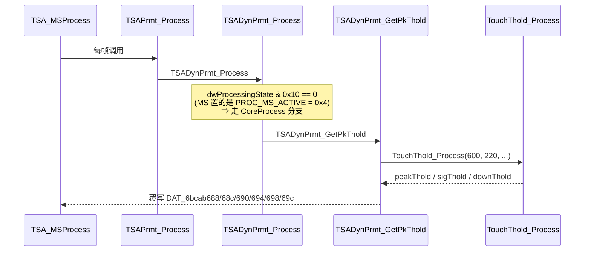

`PROC_MS_ACTIVE` 的取值由汇编确认为 `0x4`（`6ba90e8f: OR EDX,0x4`），与 `TSADynPrmt_Process` 检查的 `0x10` 不冲突，因此 MS 路径中这条重算链**确实每帧执行**。

#### 3.1 峰值门限：600 / 300 / 450 / 225，不是 220

`TSADynPrmt_GetPkThold` 传入的两个参数是 `wPeakMode3ThresholdMax = 600`（`flash 0x5b6`）与 `flash[0x5da] = 220`。`TouchThold_GetPeakThold(600, 220)` 的判决（汇编 `6ba7cee9`）：

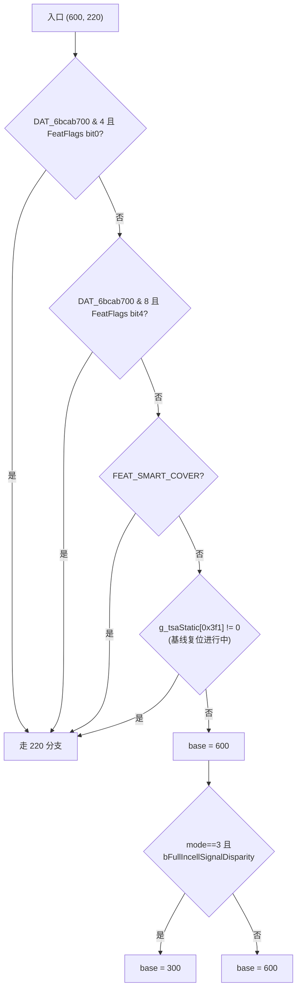

三条旁路条件在本机的实际状态：

- `DAT_6bcab700` 的源 `DAT_6bca9318` 是只读 `.bss`，恒为 0；`Exception_Process` 只会把它清零或清位 —— 所以 bit2/bit3 永不置位。
- `FEAT_SMART_COVER` 关闭。
- `g_tsaStatic + 0x3f1` 是**基线复位触发标志**：`BLReset_IsTriggered2AfeWakeUp` 置 1，`BLReset_Init` / `BLReset_Check` 清 0（`SafeBaseline_IsResetTriggered` 也写它，但 SafeBaseline 关闭）。这是一个短暂瞬态位。

结论：**稳态下峰值门限基准是 600**；`220` 只在基线复位进行中的那几帧生效。复刻的 `PeakAndGripRegion::m_threshold = 220` 把这个瞬态值当成了常态。

`TouchThold_Process` 之后还有两级修饰：

1. 若上一帧恰好是**单个稳定触点**（`bPrevTouchCount == 1 && field_0x5 == 1 && !(flag & 0x1000)`），门限降为 `base × 3 / 4`。
2. `TouchThold_BasedOnExperience` 在 `dwPeakProcessingMode == 3` 时整体短路，直接返回原值 —— 这一级本机惰性。

于是该帧的 `DAT_6bcab688` 取值只有四种：

| 场景 | 基准 | 单指折扣后 |
|---|---:|---:|
| 常态 | 600 | 450 |
| `bFullIncellSignalDisparity` 锁存 | 300 | 225 |

#### 3.2 探测门限与 Z1 回退门限是两个不同的数

`Peak_Process` 里：

```c
nOriginalPeakThreshold = DAT_6bcab688;            // 600 / 450 / 300 / 225
if (mode==3 && 300 < DAT_6bcab688)
    DAT_6bcab688 = 300;                           // 探测用，钳到 300
Peak_DetectInRange(DAT_6bcab688, ...);            // 用钳后值扫描
Peak_Z8Filter();
if (!Peak_IsFullIncellSDDetected()) {
    Peak_Z1Filter(nOriginalPeakThreshold);        // ★ 用钳前值回退
    DAT_6bcab688 = nOriginalPeakThreshold;
}
```

这就是"腰斩推测式探针"的完整形态：**先按 300 宽松探测，若没检出信号分散就用 600（或 450）把弱峰全部撤销**。复刻两处都用 220，等于把探针门限和回退门限一起压到了原版的 1/3 ~ 1/2，会显著多出弱峰。

#### 3.3 下游门限也一并被重算

`TSADynPrmt_GetPkThold` 同时覆写：

```c
DAT_6bcab69c = flash[0x5D0] = 48;
DAT_6bcab68c = sigThold;                       // TouchThold_Process 的第二输出，≥ base
DAT_6bcab690 = (48 * sigThold) >> 4 = 3 * sigThold;   // 按下 Z 门限，常态 ≈ 1800
DAT_6bcab694 = DAT_6bc4a918 * 3;                      // 稳定触控门限
DAT_6bcab698 = (48 * downThold) >> 4;                 // 次级 Z 门限
```

复刻里对应位置的 `440`（Flash 0x5E4/0x5E8 初值）同样是上电初值，运行时被替换为 `3 × sigThold`。

#### 3.4 `bFullIncellSignalDisparity` 的跨帧闭环缺失

该位由 `Peak_Process` 写入，由**下一帧**的 `TouchThold_GetPeakThold` 读取以决定 600 还是 300。复刻的 `IsFullIncellSDDetected()` 是纯函数，返回值只在当帧内用于决定是否跑 Z1，不回写任何跨帧状态，闭环断开。

### 4. `Peak_IsFullIncellSDDetected` 的滞回判决器

这不是一个即时判决，而是一个带记忆的状态机，三个状态量对位 `g_tsaStatic`：`m_sdLatched`(+0x114)、`m_sdStrongCount`(+0xa0)、`m_sdStrongTsUs`(+0x78)。

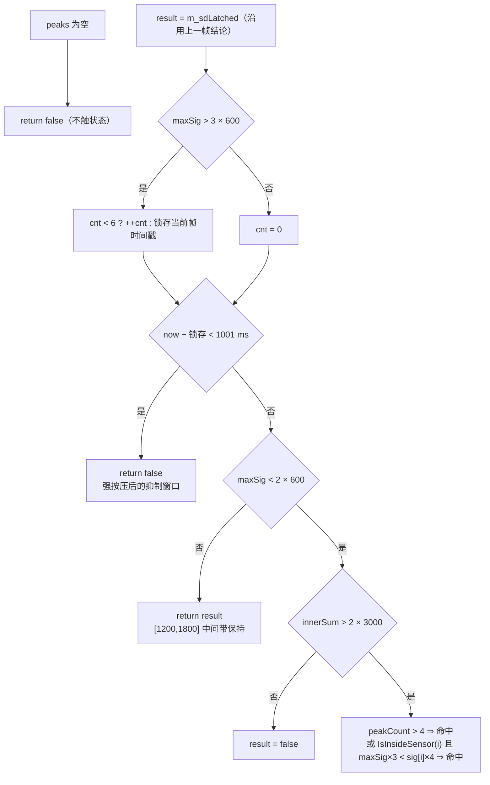

两个容易搞错的量：

- **`maxSig` 与 `peakCount` 取样时机不同**。`maxSig` 对位 `g_pPeaks + 2`，是 **Z8 滤波前**全体候选峰的最大 sig（`Peak_Remove` 不回退该量）；`peakCount` 则是 Z8 **之后**的存活数。
- **能量量 `g_tsaPrpt._200_4_` 不是全屏正差分和**。追 `g_tsaPrpt` 基址 `0x6bc4a640` + offset 200，是 `TSA_CombineBlock(0x6bc4a700, 0b101)` 记录的 `+8` 字段 = 所选分块的"正和 + 负和"。按 `TSA_InitBlockIdx` 的分块定义，block 0 ∪ block 2 = 行 `1..R-2` × 列 `1..C-2`，即**去掉最外一圈行列的内区带符号总和**。
- `Peak_IsFullIncellInsideSensor` @0x6BA68944 的判据是 `peak.sig(+0x18) < peak.nZ8(+0x1c) / 5`。

命中 SD 时原版就地改写 `DAT_6bcab690 = (48 × 300) >> 4 = 900` 且不复原 —— 按下 Z 门限从 ≈1800 降到 900，与峰值门限 600→300 构成"大面积平缓按压"场景的成对放宽。该改写发生在 Peak 阶段、本帧生效，直到下一帧 `TSAPrmt_Process` 重算。

其余细节逐行一致：`Peak_Z8Filter` 的 `nZ8 < (z + (z<0 ? 31 : 0)) >> 5`、`Peak_Z1Filter` 的 `z < thold`、`Peak_DetectInRange` 的不对称破平与四条边界短路、`Peak_SortInSigAscending` 的交织破平并同步抬 diff、默认升序（`Peak_needUDFPLargeFingerWorkaround` 为假）。峰容量上限是 `TSA_MAX_PEAK_NUM = 0x14`（20），不是 32。

两处看似缺口、实则不必补：`Peak_Process` 尾部写入 `g_pPeaks[0xc]` 的全峰最小行号，唯一消费者 `Peak_needUDFPLargeFingerWorkaround` 要求项目名前缀 `P115`，本机恒不成立；`Exception_CheckPanelSD` → `FIException_CheckPanelSD` @0x6ba593bc 在 TSACore 里**函数体只有 `return`**，详见 6.6 节。

### 5. TZ 泛洪门限的下界应为 0

`TZ_GetSigThold` 的完整式子：

$$\text{thold} = \min\Big(\text{peakSig},\ \max\big(\underbrace{\tfrac{64 \cdot \min(\text{peakSig},\,3000)}{128}}_{\text{TZ\_GetSigTholdCommon}},\ \text{DAT\_6bc4a910}\big)\Big)$$

比例系数 `flash[0x81E] = flash[0x81F] = 0x40 = 64`，内沿外沿同值，复刻已对齐。

下界 `DAT_6bc4a910` 来自 `TouchThold_GetNoiseThold`：

```c
local_c = DAT_6bca930c;                       // 只读 .bss ⇒ 0
local_a = (DAT_6bca9314 * local_c) >> 4;      // ⇒ 0
DAT_6bc4a910 = local_a;                       // SafeBaseline 关闭，不取 max
```

`DAT_6bca930c` / `930e` / `9310` / `9314` 全部只有读引用、无写引用，位于未初始化 `.bss`。**`DAT_6bc4a910` 恒为 0，下界不存在。**

复刻取 `bigFrame.tholds.noiseThold`（Stage 2.5 每帧产出，恒 0）作为下界，不再使用静态保底常数。

`TZ_GetSigThold` 的外层是一个五路分发，复刻按原版结构逐路还原：

| 分支 | 判据 | 门限式 | 本机状态 |
|---|---|---|---|
| 固定门限 | `dwGripFlags & 4` | Flash 0x081C = 220 | 惰性（`dwGripFlags` 实测全 0） |
| SideTouch | `dwProcessingState & 0x10` | `min(peakSig, 3000) >> 1` | 惰性（MS 路径置的是 `PROC_MS_ACTIVE = 0x4`） |
| AFT | `dwAftModeFeatureMask & dwAftRuntimeModeMask` | `min(peakSig, 3000) >> 2`（UDFP 大手指时 `>> 1`） | 惰性（运行时掩码由上层 API 置位，复刻无此通道） |
| Charger | `IsChargerPlugged()` ∨ `prevTouchCount == 0x100` ∨ `bField_0x111 == 2` | mode 3: `(64 × peakSig) >> 7`，**无 3000 上限** | **激活** |
| Common | 其余 | `(ratio × min(peakSig, 3000)) >> 7` | **激活** |

Charger 分支与 Common 的差别只在丢掉了 3000 的参考钳位：峰值超过 3000 后门限继续随峰值线性抬升，泛洪范围被收紧。复刻把"充电器已插入"建模为 `TouchBigFrame::chargerPlugged`（默认 false，待电源状态通道接上后由 Stage 0 填写），另外两条由 `Exception_Process` 维护的判据合并为模块标志 `m_forceChargerSigThold`。

`TZ_GetSigTholdCommon` 的比例选择与直觉相反：**外沿峰且非 SD** 才用 Flash 0x081F，其余（含内沿峰、以及外沿峰但 `TZ_IsSD` 命中）用 Flash 0x081E；`dwFeatureFlags` bit12 置位时强制走 0x081F。本机两个比例同为 64，该分支只影响结构不影响数值。`TZ_IsSD` 的前两条判据（`nSPeakPositive × 3 > 6000` 即非 SD、上一帧八指即 SD）可复刻，尾部三条依赖上一帧触点的 `+0x228 / +0x1e0 / +0x1f4 / +0x1ba` 字段，Tracking 未导出，按原版默认出口取假。

泛洪之外还有一个与门限并列、同样按"贴不贴边"分档的量：**重心矩的握持扣减**。`TZ_TraversalNeighbor` 在累加 `m0x/m0y/m1x/m1y` 前先做 `d = max(0, sig − sub)`，两个扣减量取自 `DAT_6bca9284 / 0x9286`（`flash 0x884 / 0x886`），而它们只在 `dwGripFlags & 0x400` 置位时才非零。开关由 `TZ_NormalTraversal` @0x6BA8BAEC 逐区域临时改写：

```c
uVar1 = dwGripFlags;                       // 存档
if (peakCol < 2 || Cols <= peakCol + 2 ||
    peakRow < 2 || Rows <= peakRow + 2)
    dwGripFlags &= ~0x400;                 // 峰**贴边** ⇒ 关掉扣减
TZ_PeakBasedTraversal(...);
dwGripFlags = uVar1;                       // 还原
```

（`TSA_MSProcess` 在 `GripFilter_RegionProcess` 前置上 `0x400`、`TZ_Process` 后清掉，所以 TZ 阶段的缺省状态是"开"。）

即：**内部区域做扣减，贴边区域不做**——贴边时能量本就残缺，再扣一刀会把重心进一步拽离边框。复刻 `TouchZoneAndCentroid` 一度把这个条件写反（`applyGripSub` 直接等于"峰贴边"），现已改成 `applyGripSub = !nearBorderPeak`。本机 `flash 0x884/0x886` 实测为 `00 00`，两个扣减量恒 0，反向与否都不改数，但换整定表时它会直接表现为贴边重心偏内。

### 6. 事件层的 Z 幅度准入门

原版在按下/移动路径上给每个触点打四个幅度标记，它们决定触点能否转成"已确认触点"、能否被上报。复刻已在 `TrackingAndEvents` 上按原版结构还原。

#### 6.1 比较量 `peak + 0x20`

三个 `Touch_SetVolatileFlag*` 比较的都不是峰中心值，而是 `Peak_CalcZn` 在 `Peak_Fill` 插入峰时算出的**峰邻域能量**：

$$\text{nZ4} = \max\big(\underbrace{Q_{TL},\,Q_{TR},\,Q_{BL},\,Q_{BR}}_{\text{四个含中心的 }2\times2\text{ 象限和}},\ \underbrace{C+U+D+L+R}_{\text{十字形五格和}}\big)$$

同一个函数还产出 `+0x1c`（`nZ8`，**不含中心**的 8 邻域代数和，`Peak_Z8Filter` 与 `Peak_IsFullIncellInsideSensor` 用它）与 `+0x18`（`sig`，中心 Dif 值）。三者时点相同、语义不同，不可混用。`dwProcessingState & 0x10`（SideTouch）时 `+0x20` 退化为只取十字形且不计左右，本机走 MS 路径不涉及。

物理含义：nZ4 对"能量摊开的弱按压"远比中心值敏感 —— 一根悬空手指的中心值可能过得了 600 的峰门限，但四象限能量凑不够 1800。

#### 6.2 四条判据与调用时机

调用链：`TE_Process` → `TE_TouchDownDebounce` / `TE_MoveProcess` → `Touch_UnitUpdate` → `Touch_SetVolatileFlag` @6ba70fdd，后者按顺序调四个子函数。

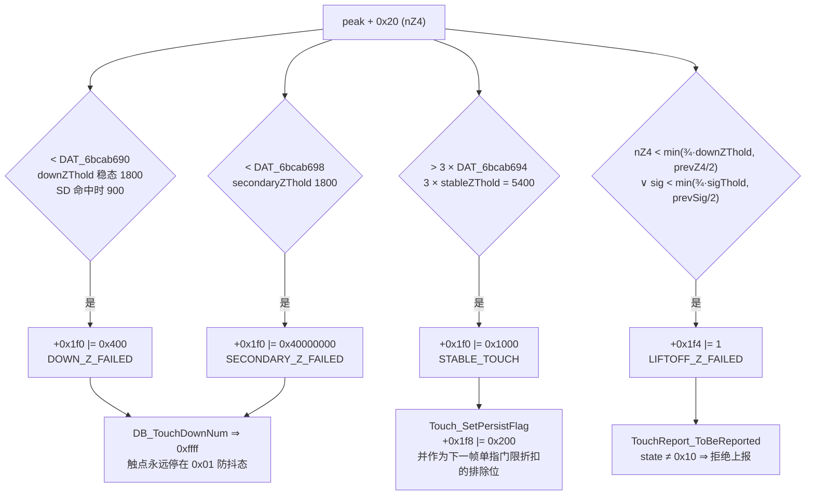

几处容易踩的点：

- **`0x20000000` 与 `0x40000000` 无关**。`TouchReport_ToBeReported` 读的 `+0x1f0 & 0x20000000` 由 `TZ_UpdateTouchFlag`（区域标志 `0x40000`）与几个 `GripFilter_*` 检测器置位，属握持通道；次级 Z 不足的 `0x40000000` 的唯一消费者是 `DB_TouchDownNum` @6ba56a81。
- **按下 Z 不足不是"拒绝上报"，而是"拒绝确认"**。`DB_TouchDownNum` 在 `+0x1f0` 命中 `0x400` / `0x80000000` / `0x40000000` / `0x1000000` / `0x2000000` 任一位时直接返回 `0xffff`，于是 `TE_TouchDownDebounce` 的 `debounceCount < num` 永远成立，状态字 `+0x21c` 被钉死在 `1`，永远走不到 `2`。
- **`Touch_SetVolatileFlagLiftOffZFailed` 的两条大分支**由 `DAT_6bc4a928`（TouchMode）与 `DAT_6bcab700 & 2` 选择，后者恒 0 ⇒ 必走第一条。该分支里第三个参数未被使用，且带一个前置门 `prevTouch + 0x156 < 0x3d ∨ (prevTouch + 0x1f8 & 4) == 0`；`+0x1f8` bit2 由 `Touch_SetPersistFlag` 在累计位移超过 `DAT_6bcab708²` 时置位，复刻未建模该持久标志 ⇒ 前置门恒成立。
- **第三个参数 `param_3`** 来自 `Touch_NeedNextEdgeLowThresh` @6ba6fe4f，只在项目名为 `P116` / `P150`（`Touch_ToeUseSpecialZ4TholdEdge` 另收 `B206` / `B20Y`）或 `DAT_6bcab69d` / `DAT_6bcab69e` 非零时为真。本机项目名是 `W273AS2700`，而这两个字节紧邻 `DAT_6bcab69c` —— `TSADynPrmt_GetPkThold` 只以 `MOV byte ptr [RAX+0x1c], DL` 写一个字节，它们无任何写入者 ⇒ 恒 0。**本机 `param_3` 恒假，3/4 折扣分支不可达。**
- `Touch_SetVolatileFlagStableTouch` 的门限在噪声 / SmartCover / 基线复位期间改取 `DAT_6bcab690`；前两条在本机不可达，只剩基线复位一条真旁路。

#### 6.3 复刻现状

`TrackingAndEvents` 增加了 `TOUCH_FLAG_*` 五个位常量与 `InternalTrack::volatileFlags / volatileFlags2`，`ApplyZAdmissionGate` 在每个匹配区域的状态迁移**之前**重算四个标志（对位 `Touch_UnitUpdate` 的位置），`ComputeTouchDownDebounceNum` 复刻 `DB_TouchDownNum` 的 `0xffff` 钳制，`ApplyLiftOffZReportVeto` 复刻 `TouchReport_ToBeReported` 对 `+0x1f4 bit0` 的拒绝 —— 但放行 `0x20`（最终 Up）与 `0x10`（边界保持），吞掉 Up 会让系统侧触点永久滞留。比较量由 `PeakAndGripRegion::CalcZ4` 在 `Peak_DetectInRange` 内产出，落在 `PeakCandidate::nZ4`；`nZ8` 同时导出。

跨帧输入由 `TouchPipeline::LatchPrevTouchInputs()` 在帧尾回灌，对位 `PrevTouch_PostProcess` @6ba6e09d：`prevTouchCount` / `TouchZoneAndCentroid::m_prevTouchCount` 取本帧轨迹数，`prevTouchStable` 取"本帧实际上报触点数 == 1"（原版 `g_touchesPtr[5]` 由 `TouchReport_ProcessUnit` 每上报一个触点自增一次），`prevSingleTouchExcluded` 取轨迹 0 的 `STABLE_TOUCH` 位（原版 `g_pPrevTouches[0xd].field_0x1c` 展开后即 `prevTouch[0] + 0x1f0`）。

尚未复刻的同族判据：`Touch_SetVolatileFlagFingerZFailed`（`nZ4 < stableZThold` ⇒ `+0x1f0 |= 0x800`，效果是把按下防抖帧数抬到 ≥ 2）。

#### 6.4 上报准入网闸 `TouchReport_ToBeReported`

`TouchReportAndFilter` 已按原版顺序逐条复刻这十条否决项，初值来自 `TouchReport_PostureAntiTouch`：

| # | 原版判据 | 复刻接线 | 本机状态 |
|---|---|---|---|
| 1 | `TouchReport_PostureAntiTouch(cur, prev)` | `lifeFlags & (0x20000000 \| 0x10000)` | 惰性（见下） |
| 2 | `g_touchesPtr[0x24] & 8` ∧ `BLReset_InDebounce()` ∧ (SmartCover 关 ∨ `+0x1f0 & 0x20000`) | `TouchBigFrame::touchGlobalFlags` / `baselineResetInDebounce` | **激活**（`TZ_UpdateTouchFlag` 已补，见 6.5） |
| 3 | `+0x1f0 & 0x20000000`（握持通道） | `isGrip` / `LifeGripSuppressed` / `volatileFlags` 原位 | **激活** |
| 4 | `+0x1ec == 0x40` ∧ SmartCover 关 | `exceptionType` / `isPalm` / `LifePalmSuppressed` | 产出方已补，但 `0x40` 在 FI 分支不可达（见 6.6）；等价的 `isPalm` 通道**激活** |
| 5 | `+0x1f4 & 1` ∧ `+0x21c != 0x10` | 与 Stage 5 `ApplyLiftOffZReportVeto` 同判据，幂等重算 | **激活** |
| 6a | `+0x208 & 2` ∧ `+0x1ba < peakFilterRef/2` ∧ SmartCover 关 | `suppressFlags` / `minSigLatched` | **激活**（产出方 `TouchMode_GloveFilter` 已补，见第 10 节；命中窗口限于基线复位帧） |
| 6b | `+0x208 & 4`（`TouchMode_StylusSuppression`） | `suppressFlags` | 惰性：产出方已补但调用前置条件与手套模式进入条件互斥（见 10.4） |
| 7 | `+0x208 & 8` ∧ `dwFeatureFlags & 0x1000` | `suppressFlags` / `m_feature0x1000` | 惰性：特征位为 0 |
| 8 | `+0x208 & 0x20` ∧ `dwFeatureFlags & 0x2000` | `suppressFlags` / `m_feature0x2000` | 惰性：特征位为 0 |
| 9 | `+0x21c & 0x21` | `state == EventIdle ∨ debounce > 0` | **激活**（见事件码口径） |
| 10 | `+0x1f0 & 0x2000` ⇒ 拒绝并累加 `g_touchesPtr[3]` | `volatileFlags` 原位 / `m_cancelledTouchCount` | **激活**（区域 type == 5，见 6.5） |

几处关键结论：

- **特征位实测**。`TSAStatic_InitSysModuleEveryTime` 里 `dwFeatureFlags = dwFeatureFlagsBase1 | dwFeatureFlagsBase1_or`；W273 整定表 `flash[80] = 0x00000101`、`flash[84] = 0x01090020` ⇒ `dwFeatureFlags = 0x01090121`。`FEAT_SMART_COVER`(0x2)、`0x1000`、`0x2000` 三位皆为 0；`0x01000000`（Windows Precision Touchpad）为 1。
- **事件码口径**。Windows PTP 模式下 `TSA_RptIsLiftOff` 读的是 `+0x21c & 0x40`，即**最终 Up 的事件码是 0x40**，`& 0x21` 与 `!= 0x10` 都不会命中它；`0x20` 在该模式下是中间态。复刻把最终 Up 编码成 `EventUp = 0x20`，因此判据 5 与 9 都必须额外放行 `0x20`，否则会吞掉 Up 报文。
- **多步回退整条链路在本机不可达**。`TouchReport_IsMultStepBackEnable` = `(DAT_6bcaa14c & 2)`，而 `DAT_6bcaa14c` 在整个 DLL 里只有三处读引用、**零写入者**（`SensorData_IsAntiTouchStage` ×2、`IsMultStepBackEnable` ×1）。由此 `TouchReport_IsAnyTouchCancelByPosture`、`TouchReport_IsAllTouchBack`、`TouchReport_GoBackMultiStep`、`TouchReport_IsReadyToCancel` 全部不可达；`TouchReport_GoBackReport` 恒走 `GoBackOneStep`，而它的唯一调用方 `TouchReport_PostureAntiTouch` 三个触发源同时为假（折叠屏时间戳恒 0、`DAT_6bcaa14c` 恒 0、`+0x200 bit0` 只由自己置位），故 `GoBackOneStep` 同样不可达。复刻把 `m_multiStepBackEnabled` 置为 `false`，并按原版语义（只统计带姿态阻断标记且回退步数 ≥ 7 的触点）重写了 `TouchReport_IsAllTouchBack`，替掉了原先"全部 `EventUp`"的近似。
- **`TouchReport_IsHistoryBufferApplied`** 结构保留，触发位 `+0x1f8 bit7` 无产出方 ⇒ 恒假。**`TouchReport_UpdateStartReportPoint`** 是激活的，已实现为槽位上的起报锚点锁存。

`TouchReport_ProcessUnit` 的整体结构也已对齐：上报计数 `g_touchesPtr[5]` ↔ `m_reportedTouchCount`、手掌计数 `g_touchesPtr[0xb]` ↔ `m_palmTouchCount`（原版在准入分支之外无条件累加）、取消计数 `g_touchesPtr[3]` ↔ `m_cancelledTouchCount`，`Filter_ProcessUnit` 嵌在准入分支内。原版被拒的点也会走一遍 `Filter_ProcessUnit`（坐标回退由不可达的 `GoBackReport` 负责），复刻在该分支用同语义的回退状态机顶替。距离统计 `Touch_GetRptSQDist*` 与事件迁移分类 `+0x290` 是纯遥测，没有下游消费者，不实现。

网闸本身不再需要改动。十条判据里 **6 条激活**（2 / 3 / 4 的等价通道 / 5 / 6a / 9 / 10 —— 其中 6a 只在基线复位窗口内可能命中），**4 条惰性**：1（`DAT_6bcaa14c` 零写入者）、6b（产出方的调用前置条件不可达）、7 / 8（特征位为 0）。`+0x208` 的三个产出方里，`TouchMode_GloveFilter` 与 `TouchMode_StylusSuppression` 已随第 10 节的 FSM 落地，只剩手写笔通道的 `StylusAft_SuppressBaseContext` 不在复刻范围内。

#### 6.5 区域标志 → 触点标志的转换器 `TZ_UpdateTouchFlag`

上报网闸里那几条"结构就位但恒假"的判据，源头都是同一个函数：`TZ_UpdateTouchFlag` @6ba7fe99。它由 `TZ_RegisterTouch` @6ba8039b 在"把一个 TZ 区域注册成一个触点"的尾段调用（紧接 `TZ_CentroidEdgeFlag`、紧邻 `TZ_UpdateInsideSensor` 之前），输入只有区域结构的两个字段：标志字 `zone + 0x4` 与类型字 `zone + 0x8`。

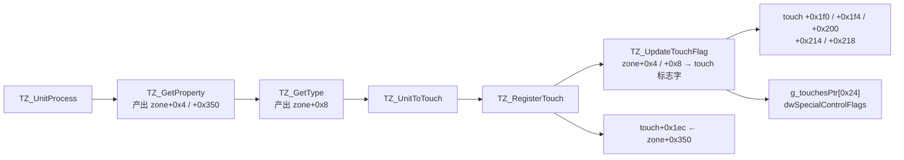

区域标志字 `zone + 0x4` 的位含义与写入方（对 W273 的可达性一并标出）：

| 位 | 含义 | 写入方 | W273 可达 |
|---|---|---|---|
| `0x2` | 重心落在握持区 | `TZ_CentroidGripRatio` | 否（`dwGripFlags` 整字为 0） |
| `0x20` | 包围盒贴到面板物理边框 | `TZ_GetEdgeTouchedFlag` @6ba81544 | 是 |
| `0x40` | 区域内插入过虚拟峰 | `TZ_VPProcess` | 否（`TZ_IsVirtualPeakAllowed` 要握持通道） |
| `0x100` | 面积 > 4 × 区域峰数 | `TZ_GetHTIValidFlag` @6ba81626 | 是 |
| `0x800` | 多胖指 | `TZ_MultiFatFingerCheck` @6ba836a1 | 是 |
| `0x1000` | 大形态（长轴 > 45 mm、长短轴比 > 3、跨度达到 5 节点、边沿能量比 > 19，任一） | `TZ_GetShapeFlag` @6ba81fdb | 是 |
| `0x8000` | 四邻被包围 | `TZ_GetSurroundingStatusFlag` @6ba81efd | **否**：`TZ_GetSurroundingStatus` 的四条判据全部以 `6 < g_tsaBufSelf[...]` 开头，自容通道在本机整体关闭（`flash[0x608] = 0`）⇒ 恒返回 0 |
| `0x10000` | 握持强制合并 | `TZ_CheckToSeparateZone` @6ba855b7 | 否（`TZ_IsGripMergeAllowed` 依赖握持通道） |
| `0x20000` | 峰信号 + 本地共模噪声仍低于信号门限 | `TZ_GetCMFFlag` @6ba82694 | 是 |
| `0x40000` | 相邻线噪声压过峰能量 | `TZ_GetCMFFlag` | 是（需先命中 `0x1000` 或 `0x8000`） |
| `0x80000` | 包围盒离边框不足 2 格 | `TZ_GetEdgeTouchedFlag` | 是 |
| `0x200000` | 绝对握持 | `GripFilter_IsPeakAbsGrip` | 否 |
| `0x400000` / `0x800000` | 区域内存在握持峰 / 非握持峰 | `TZ_GetPeakGripFlag` @6ba84485 | 是（本机无握持掩码 ⇒ 只会命中 `0x800000`） |
| `0x1000000` | 区域被握持分离 | `TZ_CheckToSeparateZone` | 否 |
| `0x8000000` | 整区判为握持 | `GripFilter_RegionProcess` | 否 |
| `0x20000000` | 存在非握持且不贴外沿的峰 | `TZ_GetPeakGripFlag` | 是 |

类型字 `zone + 0x8` 由 `TZ_GetType` @6ba837f8 定，取值 `1` = 握持、`2` = 形态胖指、`3` = 多指、`5` = 大物体（`TZ_IsLO` @6ba83474）、`0` 走不到（`TZ_JudgeFFOrNF` 返回的是 1 / 2 而非 0 / 2）。

转换表本身是十三条独立的 if，注意前两条是**反相**的：

| 区域输入 | 触点输出 | 附带全局副作用 |
|---|---|---|
| **¬**`0x20`（没贴边框） | `+0x1f0 \|= 4` | |
| **¬**`0x80000`（离边框 ≥ 2 格） | `+0x1f4 \|= 0x1000` | |
| `0x10000` | `+0x1f0 \|= 0x10000000` | |
| `0x1000` | `+0x1f0 \|= 0x20000` | `g_touchesPtr[0x24] \|= 8` ← **判据 2** |
| `0x8000` | `+0x1f0 \|= 0x2000000` | `[0x24] \|= 0x10`、`dwSpecialControlFlags \|= 0x800` |
| `0x20000` | `+0x1f0 \|= 0x1000000` | `dwSpecialControlFlags \|= 0x20` |
| `0x40000` | `+0x1f0 \|= 0x20000000` ← **判据 3** | `dwSpecialControlFlags \|= 0x20` |
| type `== 5` | `+0x1f0 \|= 0x2000` ← **判据 10** | `dwSpecialControlFlags \|= 0x800` |
| `0x100000` | `+0x1f4 \|= 0x2000` | |
| `0x1000000` | `+0x218 \|= 1` | |
| `0x8000000` | `+0x214 \|= 0x400` | |
| `0x20000000` ∧ ¬`0x1000000` | `+0x214 \|= 0x80000000` | |
| `0x800` | `+0x200 \|= 2` | |

复刻落点：区域标志与类型由 `TouchZoneAndCentroid::ClassifyZone` 在区域装配与 SubTZ 拆分之后逐区域产出（`ZoneCluster::zoneFlags / zoneType / exceptionState / centSig / shapeRatio`），转换器 `TrackingAndEvents::ApplyZoneTouchFlags` 挂在 Stage 5 每条轨迹拿到本帧源区域的那一刻，紧跟 `ApplyZAdmissionGate` 之后。原版的顺序是"`Touch_Clean` 清零 → `TZ_RegisterTouch` 置区域位 → `Touch_UnitUpdate` 置 Z 位"，复刻里清零由 `ApplyZAdmissionGate` 承担，两个来源写的是互不相交的位，先后无影响。两个全局字在帧内累加后由 `Process` 统一写回 `TouchBigFrame::touchGlobalFlags` 与 `specialControlFlags`。

#### 6.6 异常通道 `FIException_*` 与 `+0x1ec`

触点的异常类型字 `+0x1ec` 不来自任何独立检测器，而是 `TZ_RegisterTouch` 把区域的 `zone + 0x350` 原样拷过来的一份副本。`zone + 0x350` 的唯一写入方是 `FIException_ProcessTouchZone` @6ba59bdb（由 `TZ_GetProperty` 经 `Exception_ProcessTouchZone` @6ba591d1 在 `dwPeakProcessingMode == 3` 时选中）：

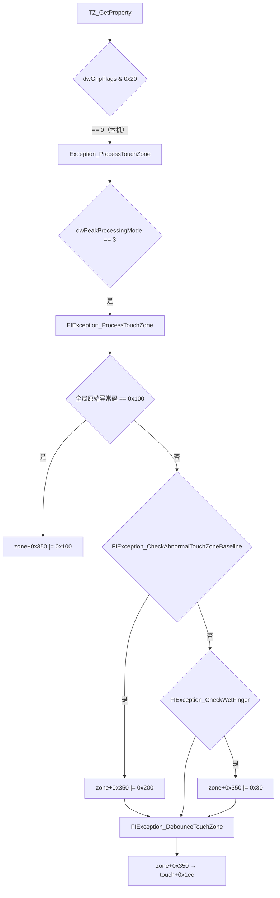

**这里有一处必须更正的前序结论**：`Exception_CheckPanelSD` @6ba59325 在 `dwPeakProcessingMode == 3` 时调的 `FIException_CheckPanelSD` @6ba593bc 在 TSACore 里是一个**空函数体**，同族的 `FIException_CheckChargerNoiseInRxLines` @6ba59429 同样是空壳。FI 模式下没有任何东西写全局原始异常码（`Exception_InitVariable` 在 mode 3 下指向 `g_tsaStatic[1] + 0x5a`，零写入者），于是 `Exception_UpdatePrevException` @6ba58c5c 只剩 `BLReset_Status() == 1 ⇒ 0x200` 这一条真路径 —— **整个全局异常状态机在 W273 上近乎空转**。原先"mode 3 分支的面板 SD 检测缺失导致异常帧不被识别"的判断是错的：原版在这台机器上也不做这件事。

由此 `zone + 0x350` 在本机的可达取值只有 `0`、`0x80`（湿手指）、`0x200`（区域基线异常）、`0x8`（`FIException_DebounceTouchZone` 的收敛值）。上报网闸判据 4 要的 `0x40`（手掌）只由 `HIException_*` 家族产出，**FI 分支不可达**；复刻仍保留该判据，实际拒绝手掌走的是 Stage 6 的 `isPalm` 通道。

复刻落点在 `TouchZoneAndCentroid::FIExceptionProcessTouchZone` / `CheckAbnormalTouchZoneBaseline` / `CheckWetFinger` / `DebounceTouchZone`。两处按依据短路：`FIException_CheckWetFinger` 的水膜泛洪要沿"上一帧同 ID 触点的 16 深位置历史队列"（`prevTouch + 0x474..0x486`）逐点做，复刻没有维护该队列 ⇒ 水膜格数恒 0；`zone + 0x28`（基线异常比的分子）的写入方在 Ghidra 里没有定位到，按语义取区域内负 Dif 的绝对和。

#### 6.7 跨帧信号锁存 `Touch_UnitUpdateMaxMin`

由 `Touch_UnitUpdate` @6ba760da 调用，维护十来对 max/min 跨帧量，下游真正读的只有一项：

```
touch+0x1ba ← (prev+0x1ba < cur+0x29e) ? min(cur+0x29e, wPeakFilterReferenceThreshold)
                                       : prev+0x1ba
```

`cur + 0x29e` 是 `TZ_RegisterTouch` 从 `zone + 0x2e`（`TZ_GetAveCentSig` @6ba82b60 求得的重心邻域平均 Dif）拷来的。递推结果是**钳在 `peakFilterRef` = 3000 以内的历史最大重心信号** —— 函数名里的 Min 指的是那个 `min` 钳位，不是取小锁存。唯一消费者是上报网闸判据 6a 的 `+0x1ba < peakFilterRef / 2`（即 1500）。

复刻落点 `TrackingAndEvents::ApplyUnitUpdateMaxMin`，接 `TrackingSlot::minSigLatched`；`ZoneCluster::centSig` 由 `TouchZoneAndCentroid::ComputeAveCentSig` 产出。该项已接通，但判据 6a 的另一半 `+0x208 bit1` 仍缺 `TouchMode_Process`，整条判据依旧不命中。

### 7. 其余真实缺口（按影响排序）

| 原版函数 | 作用 | 复刻状态 | 影响 |
|---|---|---|---|
| `Exception_Process` 全局状态机 | 维护 `g_touchesPtr+0x20` 异常码、`bField_0x110/0x111`、`DAT_6bcab700` | 缺失 | 本机影响极小：FI 分支的两个检测器在原版里就是空壳，全局异常码只剩 `BLReset_Status` 那一条来源（见 6.6） |
| `TouchMode_Process` | 4 态触控模式 FSM（含手套检测），带优先级表与切换定时器 | 已复刻（`TouchModeFsm.hpp`，第 10 节） | 本机只有 NoObject ↔ Glove 两态可达；产出 `+0x208` bit1 与手套锁存位 |
| `Touch_ProcessBetaGrip` | `Touch_IsBetaGrip` 连续 2 帧命中即置 `touch + 0x1f8 |= 0x1000000` | 缺失 | 一类握持误触标记丢失 |
| `Touch_ProcessExtInfo` | 触点扩展信息填充 | 缺失 | 上层扩展字段为空 |
| `Proximity_Process` / `Proximity_TouchPostProcess` / `SideTouch_Process` | 接近感应与侧边触控旁路通道 | 缺失 | 非主坐标通道，可接受 |
| `Gesture_Process` / `HandGesture_Process` | 手势识别 | 缺失（另有 `m_legacyGesture` 自建实现） | 非坐标通道 |
| `TS_PostProcess` | 仅把某触点尺寸写入全局统计 `DAT_6bcab6ec` | 缺失 | 纯遥测，无坐标影响 |
| `TSA_RawCheckProcess` | 冻结帧检测（`TSA_RawCheckFrozen`） | 部分被 `HardwareAnalyzerAndHold` 覆盖 | 建议核对判据是否一致 |

### 8. 编排顺序的一处偏差

原版 `TSA_Processing` 的后段顺序是：

```
TSA_MSProcess → Proximity_TouchPostProcess → SideTouch_Process
              → Thenar_ProcessInfoByDif → TSAOut_PostProcess
              → DoubleReport_Process → TSA_PitchSizeRemapProcess
```

即 **`Thenar_ProcessInfoByDif` 在显示映射之前**。复刻 `TouchPipeline::Process` 的顺序是 `reportFilter → displayRemap → ProcessThenarPostReport`，把 Thenar 放到了映射之后。

由于 Thenar 的判决只供**下一帧** Stage 6 消费，而 `TSAOut_PostProcess` / Pitch Remap 不读写 Thenar 状态，当前这个顺序在功能上无害。但若将来 Thenar 需要读取尚未被映射覆写的坐标，就会出问题 —— 建议调整为与原版一致。

`TSAOut_PostProcess` 与 `TSA_PitchSizeRemapProcess` 的相对次序则是另一回事：原版先跑 `TSAOut_PostProcess`（边界硬裁剪 + 反向投影，经 `TSA_SetXPos` 写回 `+0x170`），再跑重映射，最终像素由报文打包时的 `TSAOut_DisplayXPos` 现算；复刻把重映射放在显示映射之前。两者都在同一个每帧输出槽上工作，而只要坐标落在合法域内裁剪分支就不会触发（`Dim1Pos(15360) = 2560`，恰好是唯一的越界点，且重映射不会把域内值推出域外），因此次序差异在本机没有实质影响，不做调整。

### 9. 边缘坐标链路：合法域、EC 原点、ER 边界保持与上报单位

这一节回答"手指走到最外一列/行会发生什么"，四个环节各自的口径必须一致，任何一处走样都表现为边缘断触或坐标回绕。

#### 9.1 传感器坐标的合法域是 `[0, Cols·256]`，左右对称

`TSAConstPrmt_Init` @0x6BB3BB00 由整定表算出四个边界常量：

| 常量 | 计算式 | W273 实测 |
|---|---|---:|
| `DAT_6bcab62a` Dim1 左原点 | `flash[0x90] << 8` | 0 |
| `DAT_6bcab62c` Dim1 右原点 | `(flash[0x91] + 1) << 8` | 15360 |
| `DAT_6bcab62e` Dim2 上原点 | `flash[0x92] << 8` | 0 |
| `DAT_6bcab630` Dim2 下原点 | `(flash[0x93] + 1) << 8` | 10240 |

（`flash 0x90..0x93 = 00 3B 00 27`，即 Dim1 用第 0..59 列、Dim2 用第 0..39 行。）

右原点看上去比"最外一列中心 59×256 = 15104"多出整整一格，容易误判成左右不对称。真相在重心约定上：`CTD_BasicCalculation` @0x6BA551E0 算的是 `(m1 << 8) / m0 + 0x80`，**第 c 列的中心落在 `c·256 + 128`**，面板整体占据 `[0, Cols·256]`，两端各比最外一列中心多出半格 —— 完全对称。`CTD_ECProcessDim1` 的左分支量 `cogX − 0`、右分支量 `15360 − cogX`，复刻 `TouchZoneAndCentroid::ApplyEdgeCompensation` 的 `rawDist = cogX_q8` / `rawDist = kCols*256 − cogX_q8` 与之逐字一致，**原点与量程不需要修正**；真正走样的是喂给 `CTD_ECGetOffset` 的那个自变量，见 9.2。走线间距表 `P[0..60]` 也正是按这个域标定的（`P[60] = 60.0`，`P[61] = 60.0` 是守卫，`P[62..79]` 全零）。

由此得到贯穿下游的不变量：**坐标恒在 `[0, Cols·256]` / `[0, Rows·256]` 内**。`SensorPitchSizeMap` 的 `gridNode < 0x4F` 边界与原版逐字一致，但它本身并不安全 —— 真正挡住 `P[62..79]` 全零段的是这条不变量。复刻在 `ApplyPitchRemap` 入口显式把坐标钳回合法域，把不变量从"约定"变成"强制"。

#### 9.2 EC 的外扩量由**贴边能量比**驱动，复刻错喂成了次轴坐标

`CTD_ECProcessDim1` @0x6BA5555B 的形状是"选表 → 查偏移 → 混合 → 写回"四步，四条边各一张 17 字节整定表：

```c
// 右边缘分支（+0x204 bit1），左边缘分支（bit0）结构对称
g_tsaPrmtRam = <该边整定表 17B>;                      // 0x851 / 0x840 / 0x862 / 0x873
sVar2 = CTD_ECGetOffset(touch[0x196],  touch[0x194]); // Dim1 用 0x196，Dim2 用 0x197
iVar3 = CTD_ECGetFinalOffset(DAT_6bcab62c - cogX, 0x100 - sVar2);
touch[0x162] = DAT_6bcab62c - iVar3;
if (iVar3 != DAT_6bcab62c - cogX) touch[0x1f0] |= 0x100;   // Dim2 置 0x200
```

两个自变量的真实身份，逐跳追到底：

| 自变量 | 产出链 | 本机取值 |
|---|---|---|
| `touch + 0x194` | 全程**无写入者**（`Touch_Clean` 清零后没人碰） | 恒 0 |
| `touch + 0x196` | `TZ_RegisterTouch` ← `zone + 0x334` ← `TZ_GetGripRatio` @0x6BA81F82 ← `TZ_CentroidGripRatio(zone+0x2cc, zone+0x2d0)` | Dim1 贴边能量比 |
| `touch + 0x197` | 同上，走 `zone + 0x335` ← `TZ_CentroidGripRatio(zone+0x2d4, zone+0x2d8)` | Dim2 贴边能量比 |

而 `zone + 0x2cc / 0x2d0` 正是 `TZ_UpdateEdgeInfo` @0x6BA87A01 在泛洪时分开累加的**最外一列能量和**与**次外一列能量和**（Dim2 对应最外/次外一行），比值定义为

$$	ext{ratio}_{	ext{dim}} = \operatorname{clamp}_{0}^{255}\!\left(rac{16 \cdot \Sigma_{	ext{outer}}}{\Sigma_{	ext{inner}}}
ight)$$

`ratio = 16` 表示最外列与次外列能量相等（手指刚好压在最外列中心），`ratio → 255` 表示能量整体塌在最外列（手指一半已经悬出面板）。**这是一个纯信号量，衡量"手指究竟外挂了多少"，与触点坐标无关。**

四张整定表（`flash 0x840 / 0x851 / 0x862 / 0x873`，各 17 字节）实测：

```
左 01 | 07 00 10 E0 | 00×12      右 01 | 07 00 10 E0 | 00×12
上 01 | 07 00 10 60 | 00×12      下 01 | 07 00 10 60 | 00×12
```

首字节 `numSegments = 1`，于是 `CTD_ECGetOffset` 里那个按 `param_2` 选段的 `while` 循环一次都不转 —— 分段机制在本机整体退化，恒取 0 号段。有效参数只剩 `lower/upper`：长轴 `16 → 224`，短轴 `16 → 96`。`04_touch_zone_and_centroid.md` 4.4 把两个入参记成"触点尺寸 / 峰值强度"，那是当时只看函数签名的推测，按上表应更正为"贴边能量比 / 恒零段选择子"。

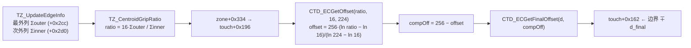

复刻 `ApplyEdgeCompensation` 在这一步喂进去的是**次轴归一化坐标**：

```cpp
const uint8_t crossIdx = clamp(cogY_q8 * 255 / (kRows * 256), 0, 255);  // ← 错
const int offset = ECGetOffset(crossIdx, m_leftEdgeLower, m_leftEdgeUpper);
```

`crossIdx` 与 `ratio` 恰好同为 `[0,255]` 值域，所以算出来的数"看着像样"，但物理含义被整体替换成了"手指在另一根轴上处在屏幕哪个位置"。把 LUT 代入可以直接读出后果：

| 自变量取值 | 长轴 offset (16,224) | 长轴 `compOff` | 短轴 offset (16,96) | 短轴 `compOff` |
|---:|---:|---:|---:|---:|
| 4 | −134 | 390 (1.52 格) | −198 | 454 (1.77 格) |
| 16 | 0 | 256 (1.00 格) | 0 | 256 (1.00 格) |
| 32 | 67 | 189 (0.74 格) | 98 | 158 (0.62 格) |
| 64 | 134 | 122 (0.48 格) | 198 | 58 (0.23 格) |
| 128 | 201 | 55 (0.21 格) | 255 | 1 (贴死边框) |
| 224 | 255 | 1 (贴死边框) | 255 | 1 |

原版读这张表时，行方向是"外挂程度"：手指越是悬出面板，`compOff` 越小，坐标被越用力地推向边框；手指其实还在面板内（`ratio` 接近甚至低于 16），`compOff ≥ 256`，坐标被推回一格开外，相当于否决这次补偿。这是一条**闭环**——补偿强度由触发补偿的那个物理原因自己决定。

复刻读同一张表时，行方向变成了"次轴坐标"，于是：

- 沿左边缘从屏幕顶端滑到底端，`crossIdx` 从 0 扫到 255，上报的 X 被这张表拖着从"边内 1.0 格"一路压到"贴死边框"——**一次纯 Y 方向的滑动凭空制造出接近一整格（≈ 42 显示像素）的 X 漂移**；
- 短轴更糟：`upper = 96` 意味着 `crossIdx ≥ 96`（即 X 超过屏宽 38%）时 offset 直接饱和到 255，上下边缘的 Y 被无条件钉死在 0 或 10240，只有屏幕最左 6% 那一条才走"推回一格"分支；
- 补偿量与信号完全脱钩：一个老老实实压在最外列正中、`ratio` 只有 16~20 的触点，会因为它恰好落在屏幕中部而被按 `compOff = 55` 强行外推。

断触由此而来，两条路径叠加：

1. **跟踪层**。`ecX_q8 / ecY_q8` 是 `TrackingAndEvents` 写进 `trk.x_q8 / trk.y_q8` 的值，也是 `IDT` 匈牙利代价矩阵与二阶运动学预测 `predX = x + vx + ax/2` 的输入。贴边滑动时这条链路每帧被注入一个与真实运动无关的整格量级抖动，预测残差 `predErr` 被顶穿，最优匹配失配 → 触点释放重建。
2. **边界保持层**。9.4 的 `ER_Process` 保命链路的触发前提是外推坐标**越过** `0 / 15359 / 0 / 10239`。当 `crossIdx` 落在小值区（触点靠近次轴另一端）时复刻给出 `compOff ≥ 256`，坐标被**推离**边框整整一格，`ER_MoveOutCheck` 恒不成立，边界保持根本不起步，抬手 Z 准入门照常执行 → 直接断触。这解释了"进入边缘极易断触"为什么是**位置相关**的：屏幕四角与边缘中段的表现并不一致。

还有三处同源的次级偏差：

| 环节 | 原版 | 复刻 | 影响 |
|---|---|---|---|
| 进入判据 | `TZ_CentroidEdgeFlag` @0x6BA7F3CB：`minC == 0 ∧ cogX < 2·256`（右：`maxC == 59 ∧ cogX > 58·256`） | `minC == 0 ∧ cogX < 3·256` | **惰性**。多出来的 `[512, 768)` 区间里 `d ≥ 320`，`ECGetFinalOffset` 原样返回，不改坐标 |
| 左右优先级 | 先判右（bit1），否则判左（bit0） | 先判左 | **惰性**。需要区域横跨全屏才可能同时置位 |
| offset 下界 | 无下界，`ratio < 16` 时 offset 为负、`compOff > 256`，坐标被推回边内 | `if (val <= lo) return 0`，`compOff` 封顶 256 | 丢掉"否决补偿"的那一档，贴边误判时坐标仍被拉到 1.0 格 |
| 求值时序 | `TZ_GetProperty → TZ_GetGripRatio`（区域属性阶段）早于 `TZ_RegisterTouch`，EC 在 `CTD_ECProcess` 里读的是已经算好的比值 | `ApplyEdgeCompensation` 在 `TouchZoneAndCentroid.hpp:457`，`FinalizeGripRatio` 在 `:503` | 即使改喂 `gripRatioDim1/2`，也必须先把 `FinalizeGripRatio` 提到 EC 之前 |

以上五条已全部落地。`ApplyEdgeCompensation` 现在接收该维的贴边能量比，四条边共用一个 `CompensateEdge(cog, bound, farSide, ratio, lower, upper)`；比值在补偿之前由 `EdgeRatio(edgeSum, innerSum)` 就地求出（`FinalizeGripRatio` 随后把同一对值原样写回 `ZoneCluster`，对位原版"属性阶段算、EC 阶段读"的时序）；`ECGetOffset` 只钳上界；进入判据收回 2 格且每维先判远端。`SubAccum` 补上了 `edgeSum1/innerSum1/edgeSum2/innerSum2`，拆分出的子区域按自己的贴边情况各算一份比值，不再从母区域借。`EdgeRatio` 的除法也按原版改回无符号，最外一列整体为负时判成满值而非 0。

`CompensateEdge` 一度还留着三处原版没有的伪自由度 —— 补偿强度系数 `m_ecStrength`、输出 `clamp(coord, 0, bound − 1)`、以及 `ECGetFinalOffset` 开头的 `d < 0 ⇒ 0` 出口（原版 `d − 0x100 < 1` 一支把负距离也算作"完全补偿"）。三者在本机取值下都不改数，但强度系数一旦被调成 0.8 就会直接表现为"补不到真边缘"，已全部删除；`0x100` / `0x40` 两个立即数也内联回 `ECGetFinalOffset`，不再冒充整定项。

`CTD_BasicCalculation` 同样收敛到原版：`m0 == 0 ⇒ 0`，否则 `(m1 << 8) / m0 + 0x80` 只钳下界。原先多出来的 `upperClamp = Cols·256 − 1` 与"回退到峰值坐标"兜底都已去掉 —— `m1x = Σ c·d` 决定商的上限是 `256·59 + 128 = 15232`，钳位本就够不着，多一层只会掩盖上游的真实异常。

实测数值（右边缘，`bound = 15360`，`lower/upper = 16/224`）：

| cog | d | ratio | ec | Δ |
|---:|---:|---:|---:|---:|
| 15300 | 60 | 200 | 15349 | +49（推向边框） |
| 15300 | 60 | 64 | 15238 | −62 |
| 15300 | 60 | 16 | 15104 | −196（否决补偿，推回边内） |
| 15100 | 260 | 128 | 15293 | +193（样条过渡区） |
| 14900 | 460 | 128 | 14900 | 0（`d ≥ 320` 原样透传） |

`TouchSolver/EdgeCompensation.hpp` 里的 `EdgeCompensator` / `EdgeRejector` 是切换前自建算法的残留：`ECGetOffset` 的 `param_1` 同样喂的是次轴归一化坐标，`EdgeRejector` 更是原版完全没有的"贴边未补偿就拒绝上报"网闸。两个类与 `tests/unit/touch/TouchEdgeCompensationTest.cpp` 已删除，该头文件现在只留 `TZ_UpdateEdgeInfo` / `TZ_GetEdgeTouchedFlag` / `TZ_GetCentroidEdgeFlags` / `TZ_GetEdgeWidth` 四个仍被 `ZoneExpander` 使用的自由函数。

#### 9.3 重映射的落点是每帧临时槽 `+0x170/+0x172`

`CTD_ECProcess` @0x6BA55CA0 的循环体每帧做三件事：把 `+0x15e/+0x160`（原始重心）拷进 `+0x162/+0x164`（EC 工作槽）→ 跑 `CTD_ECProcessUnit` → 把 `+0x162/+0x164` 拷进 `+0x170/+0x172`。此后 `ER_MoveOutCorrection`、`TSA_SetXPos` 的裁剪反向投影、`TSA_PitchSizeRemapProcess` 读写的全都是 `+0x170/+0x172` —— **一个每帧重新播种的临时槽，重映射不跨帧累积**。

复刻原先把这三件事全写在 `TrackingSlot::fltX_q8`（对位 `+0x162` 的跨帧滤波坐标）上。当前 Stage 7 每帧无条件重写该字段，所以尚未真的累积起来，但语义已经错位，且裁剪反向投影会污染滤波器的输入。现已按原版补上 `TrackingSlot::outX_q8/outY_q8`，Stage 8 入口的 `SeedOutputSlots` 对位那两行拷贝，倍频、重映射、裁剪反向投影一律只改输出槽。

#### 9.4 原版在最外一列维持触点靠的是 `ER_Process`，不是门限折扣

先排除两个常见误判：

- `Peak_IsToExcludeSideRegion()` @0x6BA285AC **函数体就是 `return 0`**，扫描范围恒为全屏 0..59 / 0..39，边框专用低门限 `DAT_6bcab68a` 的另一半条件 `TouchThold_ToeUseSpecialThold()` 又要求项目名 `P116/P150/P186` —— 本机**两条都不成立**，最外一列的峰照常检出，也**没有**任何低门限。复刻的 `m_excludeSideRegion = false` / `m_edgeThresholdEnabled = false` 是对的。
- `Touch_NeedNextEdgeLowThresh` @0x6BA6FE4F 的四条触发源（`TSA_GetPrmtName()` 前缀 `P116`/`P150`、`Touch_ToeUseSpecialZ4TholdEdge` 要的 `B206`/`B20Y`、以及零写入者 `DAT_6bcab69d`/`69e`）在 W273 上全假。**T4 判定它恒假是正确的，Z 幅度准入门在边缘确实没有 3/4 折扣可言。**

`Peak_CalcZn` 本身已经部分吸收了边缘能量损失：nZ4 取的是**四个含中心 2×2 象限和与十字五格和的最大值**，而贴到右边框时左上、左下两个象限完整落在面板内，`max` 会自动挑中它们。但只要手指有一半真的悬出面板，nZ4 仍会掉到 `downZThold ≈ 1800` 以下。

真正的保命机制是 `ER_Process` @0x6BA584B3。它对每个触点先按事件码分岔成**入边**与**出边**两条互不相干的链路，复刻目前只有出边那一半：

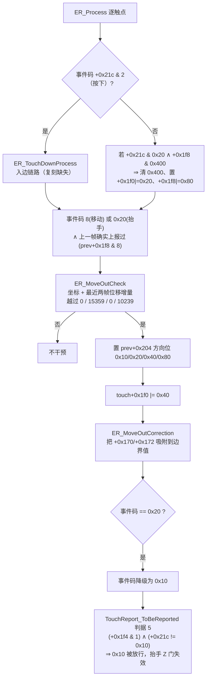

也就是说：**贴边外推的触点被强制吸到边界并改挂 `0x10` 边界保持态，从而整体豁免抬手 Z 准入门**。这条链路与门限无关，是纯状态机层面的保护。

入边链路 `ER_TouchDownProcess` @0x6BA57FFD 处理的是另一件事：**手指从边框外划进来的那一下按下**。原版认为这种按下的首帧坐标天然不可信 —— 手指刚跨过最外一列时，能量只有一小半在面板内，重心还压在边内一格多的位置，等下一帧能量补齐时坐标会猛地朝边框跳一格。它给出两级处置：

```c
ER_TouchDownProcess(cur, prev):
  if (!(touch[0x1f8] & 0x400)) {                       // 本帧才第一次进入边缘带
    if (ER_BottomMoveInCorrection(cur, prev)) → 置 +0x1f0|=0x20、+0x1f8|=0x80
    else if (ER_IsTouchNeedMoveInCorrection(cur)) {
      if (prev[0x4e4] < 2) {                           // 该槽位延后次数还没用满
        touch[0x1f8] |= 0x400;  touch[0x21c] = 1;      // 事件码 1 ⇒ 本帧不作为按下上报
        prev[0x4e4]++;  touch[0x238] = max(touch[0x238], 2);
      } else if (ER_MoveInCheck(cur, prev)) → 置 +0x1f0|=0x20、+0x1f8|=0x80
    }
  } else { ... 清 0x400 后直接走 ER_MoveInCheck ... }
```

两个判据的口径：

| 函数 | 判据 |
|---|---|
| `ER_IsTouchNeedMoveInCorrection` @0x6BA5719B | 由 `TSA_GetDimEdge(x, y)` 定出离哪条边最近，`ER_GetPrmt` 取该边的 `[lower, upper]`（`DAT_6bcab640 + side*3`，由 `ER_MMPrmtToPixelPrmt` 从 mm 换算）；要求 `lower < Touch_GetDistToLogicEdge(...) < upper` 且 `touch[0x188] < 30`。`lower == 0` 时置 `g_flagMoveInCorrectedButDisabled` 并直接返回假 |
| `ER_MoveInCheck` @0x6BA57A07 | 取 `PrevTouch_HistoryBuffer` 最后两个历史点 `p0`、`p1` 与本帧输出 `p2`，要求 `d²(p0,p1) ≥ 2500` ∧ `d²(p1,p2) ≥ 2500` ∧ `d²(p0,p2) ≥ 10000` ∧ `d²(p0,p2) ≥ Touch_GetSQDistPixelToEdge(p0,p1)` —— 即"确实在快速、直线地朝边框方向运动"。命中后调 `ER_MoveInCorrection` |
| `ER_MoveInCorrection` @0x6BA57786 | 先把历史缓冲弹到只剩 2 个点，再以 `p1 − p0` 为固定步长**朝反方向逐点外推并 `Insert(0, …)` 回历史缓冲**，每步钳进 `[DAT_6bcab62a, DAT_6bcab62c−1] × [DAT_6bcab62e, DAT_6bcab630−1]`，一旦某维碰到边界值立即停止 |

补齐出来的点不会一次性生效，而是由上报层逐帧回放：`TouchReport_IsHistoryBufferApplied` @0x6BA7B373 在事件码不属于 `{8, 0x10, 0x20}` 时把本帧坐标压进缓冲，并在 `+0x1f8 & 0x80` 置位时每帧弹出**最旧**的一个点覆盖 `+0x162/+0x164` —— 首次弹出还把事件码改写成 2（按下）。于是整笔笔画被整体延后若干帧，换来一个真正落在物理边框上的起点；抬手段不再压栈，剩余的点自然排空，笔尾追上实时坐标。

净效果是：**划入边框的笔画，其起点被沿着运动方向反向补齐到物理边框上**，而不是停在按下那一帧的重心处；确实贴到边框的按下则被 `touch[0x21c] = 1` 延后一帧再报（每个槽位最多延后 2 次，由 `prev[0x4e4]` 计数）。缺了这一半时，第一帧报一个偏内的点，第二、三帧随能量补齐一路朝边框滑，观感上就是入边瞬间的抖动与拖影 —— 这正是"**进入边缘时坐标不稳定**"的直接来源。

复刻 `TrackingAndEvents::ApplyEdgeRegionProcess` 现在按原版分岔：按下帧走 `ErTouchDownProcess`，其余帧走出边链路，帧尾统一跑 `ErHistoryBufferApply`。`InternalTrack` 补上了 30 项的 `histX/histY` 环形缓冲（对位 `PREVTOUCH_HISTORY_BUFFER_SIZE = 0x1e`）、延后计数 `erMoveInCount`（对位 `prev + 0x4e4`）与 `erDeferPending / erHistoryPending / erCorrected` 三个标志位；`debounceLimit` 对位 `touch + 0x238`，延后一次按下时抬到至少 2。四条边的带宽由 `ErGetPrmt` 给出固化值 —— 原版 `ER_Init` 把 flash 0x924 起的四组 `(lowerMM, upperMM, flags)` 经 `TS_MMToDisplayPixel → (px >> 4) − 5 → TSAOut_RevertDimNPos` 换算成 Q8 传感器坐标，W273 的四组入参 `(0x40,0xA0) (0x20,0x60) (0x40,0xA0) (0x40,0xA0)` 按 `TSA_DimEdgeToSide / TSA_SideToEdge` 归位后得：

| dimEdge | 边 | lower | upper |
|---:|---|---:|---:|
| 1 | 左 (Dim1 近端) | 342（1.34 格） | 900（3.52 格） |
| 2 | 右 (Dim1 远端) | 342 | 900 |
| 4 | 上 (Dim2 近端) | 365（1.43 格） | 960（3.75 格） |
| 8 | 下 (Dim2 远端) | 166（0.65 格） | 563（2.20 格） |

两条支路照原版短路：`ER_BottomMoveInCorrection` 的使能字 `flash[0x928] == 0`、`TPSensor_IsNoMoveInCorrection` 的挖孔区参数 `flash 0xC09..0xC0C` 全为 0，都恒假，不复刻。历史回放的落点是**跟踪坐标**而非 Stage 7 的输出槽 —— 与出边吸附保持同一处偏差口径（原版写的也是 `+0x162/+0x164`，只是时机在 Stage 7）。`+0x1f8 bit3`（"上一帧确实上报过"）在复刻里由 `InternalTrack::reportAdmitted` 自行锁存：Stage 7 写的是 `TrackingSlot`，每帧都会被 Stage 5 的回写覆盖，读不回来。

复刻 `TrackingAndEvents::ApplyEdgeEscapeCorrection` 原先偏离原版三处，合起来正是边缘断触的成因：进入条件没有限制事件码与"上一帧已上报"、外推式子写成二阶泰勒 `x + 2v − v_prev`（原版是 `坐标 + 两个存档增量`）、以及最关键的一条 —— `0x20 → 0x10` 的降级额外附加了 `missingFrames <= 1`，于是峰在边缘闪断两帧以上时边界保持根本不触发，触点直接释放。现已按原版三段重写。坐标吸附落在跟踪坐标而非输出槽，是复刻的一处有意偏差：Stage 7 的滤波器吃的是跟踪坐标，吸附输出槽的话滤波输出永远到不了边界。

#### 9.5 上报单位：坐标回绕的真正来源

`VhfReporterTouchPacketHelper::ToVhf` 原先用 `gridValue > gridMax` 猜单位 —— 大于 60/40 当显示像素除以 2560/1600，否则当节点坐标除以 60/40。而 Stage 8 交付的 `TouchContact::x/y` **始终是显示像素**，于是落在 `(0, 60]`（X）或 `(0, 40]`（Y）的小像素值会被当成节点坐标放大约 42.7 / 40 倍。

两轴的暴露程度天差地别，正好解释了实测现象只出现在长轴：

| 轴 | 死区宽度 | 一格对应像素 | 结果 |
|---|---:|---:|---|
| 长轴 X | 60 px | 2560/60 ≈ 42.7 px | 死区比一整列还宽 ⇒ **整个最外一列都落在死区里**，报点跳到屏幕另一侧再逐步走回中央 |
| 短轴 Y | 40 px | 1600/40 = 40 px | 死区恰好等于一行，重心一旦贴边 EC 直接把它压到 0 ⇒ **跳不进死区**，只剩断触 |

数值复现（修复前，手指沿 X 走向最外一列，`invertX` 默认为真所以视觉上是另一侧）：

```
disp=61 → vhf=610      （正常）
disp=57 → vhf=24320    ← 跳到对侧
disp=42 → vhf=17920
disp=26 → vhf=11093
disp=16 → vhf=6827     ← 逐步走向中央
```

`ToVhf` 现已改为由调用方显式给定像素量程（`kTouchPixelMaxX = 2560`、`kTouchPixelMaxY = 1600`），不再推断单位。

#### 9.6 `GripFilter_IsBackToGrip`：把已放行的贴边触点重新收回握持

边缘坐标链路对齐之后，实机重放（`dvr20260912_040237_158008.dvrbin`，单指从屏中央匀速划向右边框）仍然在第 393 帧断触，而 EC 本身工作正常：`cogX = 15045 → ecX = 15047`，比值 11，坐标毫无异常。断的是上报网闸判据 3（握持通道），上游是 Stage 6 的握持阶段机把触点从 `SafeTouch` 一把打回 `HardGrip`。

`GripFilter_GetStage` @0x6BAE492D 的五态迁移表复刻是对的，问题出在 `GripFilter_IsBackToGrip` @0x6BAE237B。按反汇编（0x6BAE237B..0x6BAE24A0）它是三段：

```c
if ((dwFeatureFlags & 0x20) && GripFilter_IsStuckSideTouch()) return 1;
if (GripFilter_IsBackToGripAllowed() && GripFilter_IsBackToGripSatisfied()) return 1;
if (touch[0x242] <= 0x19)  return GripFilter_IsSeparated(cur, prev);   // JBE 0x2469
if (touch[0x22c] <= 0x3f)  return 1;                                   // JBE 0x2462
if (touch[0x22e] >  0x3f)  return GripFilter_IsSeparated(cur, prev);   // JA  0x2469
return 1;
```

三个字段的身份：

| 字段 | 产出方 | 含义 |
|---|---|---|
| `touch + 0x242` | `Touch_GetSQAccMMFromPrevPos` @0x6BA7380C → `TS_SQPixelToSQMM` @0x6BA7C4A0 | **位移加速度模方**，mm²。加速度向量是"本帧位移 − 上一帧位移"（`cur − prev − prev.vel`） |
| `touch + 0x22c` | `Touch_SetEdgeDist` @0x6BA72B19 → `Touch_GetDim1EdgeDist` | 补偿后重心到 Dim1 两条边界中较近那条的距离，量程 `[0, Cols·256]` |
| `touch + 0x22e` | 同上，`Touch_GetDim2EdgeDist` | Dim2 同义 |

本机只有第 3 段活着：第 1 段的 `IsStuckSideTouch` 两条支路都拿不到输入（逐格驻留时间图 `g_tsaBufGripTime` 由 `GripFilter_RegionProcess` 维护，`dwGripFlags` 整字为 0 ⇒ 全零；`GripFilter_IsInDynamicDeadZone` 的总开关 `DAT_6bca92c0` = `flash 0x8c0` 实测为 `0x00` ⇒ 首行返回 0），第 2 段的 `IsBackToGripAllowed` 只看 `touch + 0x214` 的 bit20/bit21，同样挂在 `dwGripFlags` 上恒假。

于是原版的真实语义是：**贴到边框 0.25 格（`0x3f`）以内、并且刚刚发生过一次量级 ≥ 26 mm² 的位移加速度突变，才收回握持。** 匀速划向边缘的手指加速度接近 0，落进 `sqAcc <= 0x19` 分支走 `IsSeparated`（本机恒假）⇒ 不回退。加速度门限是这条判据的命门——它把"手掌突然拍到边框"和"手指平稳划到边框"分开。

复刻原先写成：

```cpp
if (track.gripEdgeFlags != 0) {
    dx = |curX − startX|; dy = |curY − startY|;
    if (dx < 0x20 || dy < 0x20) return true;     // ← 原版没有这一段
}
distX = min(curX, (kCols−1)·256 − curX);         // ← 量程少了半格
distY = min(curY, (kRows−1)·256 − curY);
return !(distX > 0x3f && distY > 0x3f);
```

三处偏差叠加，第一处是决定性的：它把加速度门限换成了"起报点位移"，而且是 `∨` —— 沿边框划动时垂直方向位移天然很小，`dy < 0x20` 一旦成立就整片判成握持。触发时刻取决于 `gripEdgeFlags` 何时变非零，也就是最外一列的核心最大信号何时越过峰值的一半，于是表现为"手指一进最外一列就断"。第二处把量程写成"最外一列中心"（`59·256 = 15104`）而非面板边界（`60·256 = 15360`），让右/下半边的距边距离整体少算半格，把本来在窗口外的触点推进窗口。第三处缺了加速度分支与 `IsSeparated` 出口。

复刻现按反汇编三段重写，`ZoneCluster` / `TrackingSlot` 补上 `edgeDistDim1_q8` / `edgeDistDim2_q8`（`Touch_SetEdgeDist` 的等价物，紧跟 EC 之后从补偿坐标算出，主路径与 SubTZ 路径各一份），加速度模方由 `TrackingSlot::ax_q8 / ay_q8` 经同一个 `K = 1092` 换算到 mm²。`IsStuckSideTouch` / `IsBackToGripAllowed` / `IsSeparated` 按"结构保留 + 注明为何恒假"落地，不用近似判据顶替——那正是这次故障的成因。

同一段录制重放对比：

| | 跟踪帧数 | 未上报帧数 | 握持判定帧数 |
|---|---:|---:|---:|
| 修复前 | 228 | 87 | 87 |
| 修复后 | 228 | 0 | 0 |

修复后触点一路贴到最外一列，`dispX` 平滑走到 2550 / 2560，全程无断触。重放工具落在 `Tools/DvrReplay`，喂法与 `DeviceRuntime::OnFrame` 一致（`rawPtr` / `rawLen` + `masterWasRead`），可直接复现上表。

#### 9.7 贴边区域的跨帧黏滞：`g_tsaBufGripTime` / `g_tsaBufGripStage`

前六小节都在管"这一帧的坐标怎么算"。原版还有一条**跨帧**的保命回路，决定的是"这一帧的区域还能不能泛到最外一列"，复刻完全没有，它才是极边缘跳动与补不到边的主因。

回路在 `TSABuffer_GripStageProcess` @0x6BA8F274（由帧尾的 `GripFilter_Process` 调用）与 `TZ_TraversalNeighbor` @0x6BA88709 之间闭合：

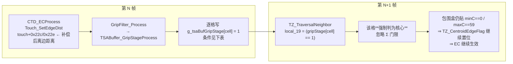

`TSABuffer_GripStageProcess` 先按触点算出一张"区域 ID → 是否黏滞"的小表，命中任一条即为 1：

| 条件 | 字段 |
|---|---|
| 握持判定为真 | `touch + 0x210 == 1` |
| 侧边标志 ∧ 单指 | `(touch + 0x214) & 0x200` ∧ `touch + 0x156 == 1` |
| 触点长/短轴不足半格 | `touch + 0x234 < 0x80` ∨ `touch + 0x236 < 0x80` |
| **补偿后离边距离不足 0.125 格** | `touch + 0x22c < 0x20` ∨ `touch + 0x22e < 0x20` |

然后逐格落地，`g_tsaBufTzZone[cell]` 为 0 的格子清零并推进离开计时 `g_tsaBufGripTimeOff`；非 0 的格子在**该格驻留时间 `g_tsaBufGripTime[cell] > DAT_6bca92ba`（`flash[0x8BA] = 0xC8 = 200`）**且该触点没有被 `touch + 0x218 & 1` 排除时，写入上表的结论。

第四条正是边缘链路自己的输出：`Touch_SetEdgeDist` 写的 `+0x22c/+0x22e` 来自 **EC 之后**的重心。于是一旦某帧的补偿把坐标推到了边框 0.125 格以内，**该触点整片区域的格子在下一帧就被免除门限**——最外一列即使信号塌到泛洪门限以下，仍然算核心格，包围盒继续贴住 `minC == 0`，`TZ_CentroidEdgeFlag` 继续置位，EC 继续生效，`Σouter/Σinner` 也继续按完整的一列算。

缺了这条回路时后果可以直接推出来，恰好就是实测的两个现象：

- **极边缘跳动**。手指压到最外一列时，该列信号在噪声上下摆动。掉到门限以下的那一帧，最外一列整列变成外壳格，包围盒退到 `minC == 1`，`maxC == kCols-1` 的判据不再成立 ⇒ EC 整帧不触发 ⇒ 坐标从 `compOff ≈ 1`（贴框）弹回原始重心 `≈ 1.4 格`，下一帧信号回来又弹回去。一格 ≈ 42.7 显示像素，肉眼就是来回跳。
- **补不到真正的边缘**。即使 EC 触发，`Σouter` 只统计"过了门限的最外列格子"；缺了黏滞，边缘那一圈被门限削掉一部分，`ratio = 16·Σouter/Σinner` 系统性偏低，按 9.2 的表，`ratio` 从 128 掉到 64 就意味着 `compOff` 从 55 涨到 122 —— 上报点离边框永远差着 0.2~0.5 格。

复刻现在在 `TouchBigFrame` 上挂了 `gripTime[40][60]` 与 `gripStage[40][60]` 两张跨帧锁存图（`ResetPerFrame` 不清它们）。写侧落在 `PalmAndGripRejection::ProcessGripStageMap`，对位 `GripFilter_Process` 尾段的调用位置；读侧落在 `TouchZoneAndCentroid` 泛洪里的 `isCore = (cmpSig >= baseThold) || stickyCore`，对位 `TZ_TraversalNeighbor` 的 `local_19`。四条判据里第 (a)(d) 两条完整落地（握持阶段机判绝对握持、补偿后离边不足 `0x20`），第 (b) 条 `(touch + 0x214 & 0x200) ∧ 首帧` 结构保留但本机 `0x200` 位无产出方恒假；第 (c) 条 `touch + 0x234 / 0x236 < 0x80` 的字段身份在 Ghidra 里追不到写入方（落在 `TZ_RegisterTouch` 的整块拷贝里），因此由 `m_gripStageSizeGateEnabled` 默认关闭 —— 坐实它到底是触点尺寸还是别的距离量之前不要打开，猜错会让所有小触点都变黏。注意这条回路的**驻留门限是 200 ms**：它不是每帧立刻生效的，而是"某格被同一个触点连续占住足够久"之后才黏滞。快速划入边框那一段由 9.4 的 `ER_TouchDownProcess` 负责，停在边框上不动或沿边框慢滑时才轮到黏滞 —— 两条机制各管一段。

`PalmAndGripRejection` 里那组同名的 `GripStage0..4` 是**逐触点**的握持阶段机，与这张逐格图同名但不同物，不要混起来读。

### 10. 四态触控模式状态机 `TouchMode_Process`

`TouchMode_Process` @0x6BA78DDE 在 `TSA_MSProcess` 里紧跟 `GripFilter_Process`（调用点 0x6BA915C3），位于 `AntiTouch_Process` / `TouchReport_Process` 之前。它维护一个四态模式字，并在进入/维持某个模式时调用该模式的"应用器"去改写触点的抑制标志。复刻落在 `TouchSolver/TouchModeFsm.hpp`，接线点是 Stage 6 与 Stage 7 之间的 `TouchPipeline::RunTouchModeFsm()`。

#### 10.1 模式单元与状态存储

模式状态是一个三字段结构（原版落在 `g_tsaPrpt + 0x2E8 / 0x2EC / 0x2F0`，帧首会整份备份到 `+0x2F4 / 0x2F8 / 0x2FC`）：

| 偏移 | 字段 | 含义 |
|---|---|---|
| +0 | `mode` | 0 = NoObject、1 = Finger、2 = Glove、3 = Stylus |
| +4 | `data` | 模式私有载荷，决定应用器走哪条分支 |
| +8 | `result` | 检测器判决：0 未评估 / 1 不成立 / 2 成立 / 4 强制保持 |

另有一个独立的字节 `DAT_6bc4a924`（手套锁存位），由 `TouchMode_GloveDetect` 置位、`TouchMode_FingerDetect` 清零。它才是门限层真正读到的"模式"信号 —— 详见 10.5。

#### 10.2 每帧流程

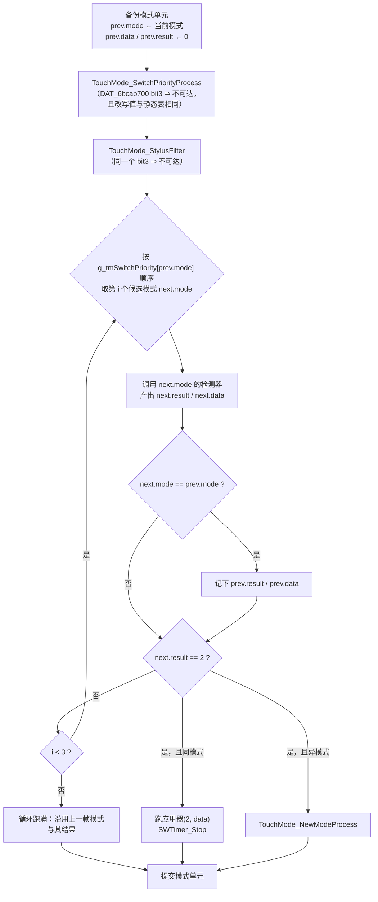

`TouchMode_NewModeProcess` @0x6BA78C16 是切换的实际把关者。关键点是**应用器在防抖判定之前就被无条件调用** —— 也就是说抑制标志在整个防抖窗口里每帧都会被打上，只是模式字还没改：

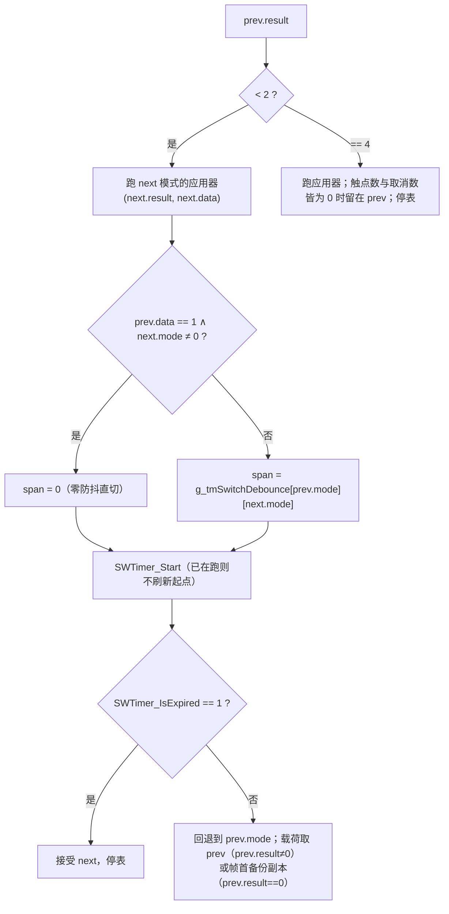

#### 10.3 两张表的实测内容

`g_tmSwitchPriority` @0x6BB4F240（4 × 4 `uint32`，行 = 上一帧模式，列 = 尝试顺序）。NoObject 永远排在最后一位：

| prev \ 顺序 | 0 | 1 | 2 | 3 |
|---|---|---|---|---|
| NoObject | Finger | Stylus | Glove | NoObject |
| Finger | Finger | Stylus | Glove | NoObject |
| Glove | Finger | Glove | Stylus | NoObject |
| Stylus | Stylus | Finger | Glove | NoObject |

`TouchMode_SwitchPriorityProcess` 会改写其中 `[0][1] / [0][2] / [1][0] / [1][1]` 四格，但一来它挂在 `DAT_6bcab700 & 8` 上不可达，二来 `DAT_6bcab701 & 8 == 0` 分支写回的值与静态表逐格相同 —— 双重无操作。

`g_tmSwitchDebounce` @0x6BB4F200（4 × 4 `uint16`，单位帧）。映像里除对角线为 0 外全是 `0xFFFF`（等价"永不切换"），`TouchMode_Init` @0x6BA78B60 再覆写其中五格：

| prev \ next | NoObject | Finger | Glove | Stylus |
|---|---:|---:|---:|---:|
| NoObject | 0 | 0 | **20** | 65535 |
| Finger | **60 或 0** | 0 | 65535 | 65535 |
| Glove | **200** | 0 | 0 | 65535 |
| Stylus | 65535 | 65535 | 65535 | 0 |

`[Finger][NoObject]` 取 60 还是 0 由 `g_tsaPrmtFlash` 第 68 字节是否为 0 决定；该字节未实测，而 Finger 行在本机不可达，不影响行为。

#### 10.4 四对处理器与可达性判定

`g_tmHandlerTable` @0x6BB52A40 是 4 × 2 的函数指针数组（偶数项检测器、奇数项应用器）：

| 模式 | 检测器 | 应用器 | 检测器在 W273 上能否返回 2 |
|---|---|---|---|
| 0 NoObject | `TouchMode_NoObjDetect` @0x6BA790AE | `TouchMode_NoObjProcess` @0x6BA79113（空函数） | **能**：`g_touchesPtr[0] == g_touchesPtr[0xd]` |
| 1 Finger | `TouchMode_FingerDetect` @0x6BA7911F | `TouchMode_FingerProcess` @0x6BA79318 | **不能** |
| 2 Glove | `TouchMode_GloveDetect` @0x6BA793FE | `TouchMode_GloveProcess` @0x6BA797A7 | **能**（条件苛刻） |
| 3 Stylus | `TouchMode_StylusDetect` @0x6BA798B8 | `TouchMode_StylusProcess` @0x6BA7991A（空函数） | **不能** |

逐条依据：

- **`g_touchesPtr[0xd]` 是握持抑制触点计数**。唯一产出方 `GripFilter_BasicProcess` @0x6BAE4C29 在触点的握持阶段字 `+0x210` 为 1 或 2 时自增；本机 `dwGripFlags` 整字为 0、握持通道整体关闭 ⇒ 该计数恒为 0。于是 `NoObjDetect` 的判据退化成"本帧一个触点都没有"，`GloveDetect` 的对偶判据退化成"本帧至少有一个触点"。
- **`FingerDetect` 整个函数体挂在 `DAT_6bcab700 & 2` 上**。`DAT_6bcab700` 的源 `DAT_6bca9318` 位于只读 `.bss`、全 DLL 零写入者，`Exception_Process` 只会清零或清位 ⇒ 恒 0。函数因此只剩开头两句赋值，恒返回 `(result = 1, data = 1)`，**Finger 模式永不可达**；连带 `DAT_6bc4a924` 的清零路径与那个 `g_tsaStatic[1].field_0xc` 连续计数器一并空转。
- **`StylusDetect` 的函数体只有两句赋值**，没有任何判据，恒返回 `(1, 1)`。**Stylus 模式在任何整定表下都不可达** —— 笔态是由 `TouchMode_StylusFilter` 那条旁路通道处理的，不走模式字。
- **`GloveDetect` 的外层门是四选一析取**：`(DAT_6bcab700 & 4 ∧ feat & 1) ∨ (DAT_6bcab700 & 8 ∧ feat & 0x10) ∨ (feat & FEAT_SMART_COVER) ∨ (g_tsaStatic[0x3f1] ≠ 0)`。前两项被恒零的 `DAT_6bcab700` 掐掉，第三项 `dwFeatureFlags = 0x01090121` 的 bit1 为 0 ⇒ **只剩"基线复位进行中"这一条**。进门后立刻重做同一次析取，成立就置手套锁存位、`data = 2` 并返回 —— 所以后面那段遍历触点、依赖 `touch + 0x1f8 bit2` 与特征位 `0x1000` 的循环在本机同样不可达。

合并起来，W273 上的模式字只在 **NoObject(0)** 与 **Glove(2)** 之间往返：

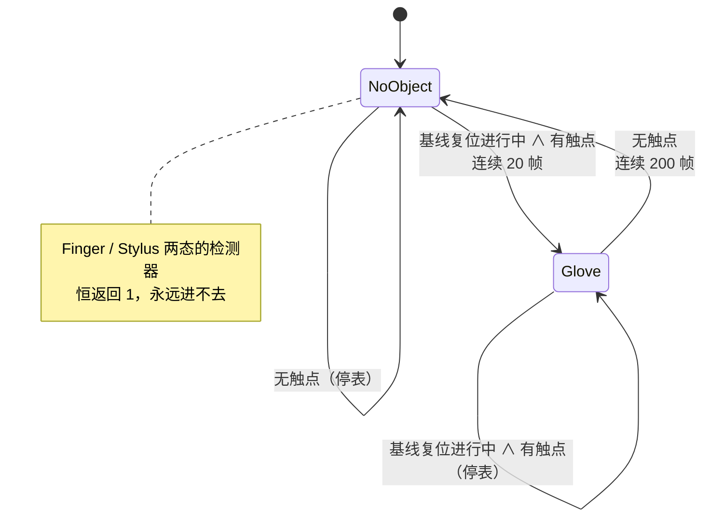

条件在防抖窗口中途消失时，优先级循环会跑满而不重置定时器（原版只在"同模式命中"与"切换落定"两处停表），复刻照抄了这个行为。

#### 10.5 `touch + 0x208` bit1 / bit2 的最终结论

`TouchMode_GloveProcess` 是三选一，`param_2` 是模式载荷 `data`：

```c
if (dwFeatureFlags & 0x1000) return;                 // 本机为 0，不短路
if ( ¬特殊灵敏度判据 )  TouchMode_StylusSuppression();  // 全点 |= 4
else if (data == 1)     全点 |= 2;
else                    TouchMode_GloveFilter();       // 条件性 |= 2
```

其中"特殊灵敏度判据"与 `GloveDetect` 的进入条件**是同一个析取**。能走到 `GloveProcess` 就说明该析取成立，于是：

- **bit2（判据 6b）不可达**：`TouchMode_StylusSuppression` 的分支条件是那个析取的否定，与进入条件互斥。上报网闸判据 6b 在本机**没有产出方**，这一点无法通过补 FSM 修复。
- **`data == 1` 分支不可达**：`GloveDetect` 进门后必然把 `data` 置成 2。
- **bit1（判据 6a）可达**：只剩 `TouchMode_GloveFilter` @0x6BA796D1 一条路，判据是 `¬(+0x208 & 1) ∧ (byte)(touch + 0x1c8) > 0x40`。`touch + 0x1c8` 是 `TZ_UpdateGripRatio` @0x6BA7FB15 写的**第二个**边沿能量比，与 `touch + 0x198` 同出 `TZ_CalcGripRatio`，只是方向掩码取 `_DAT_6bcab704` 而非 `0xC` / `0xF`；该整定量在 Ghidra 里没有写入方（由整定表整块拷贝填充），复刻沿用 `ZoneCluster::gripRatio` 作为等价量。

因此判据 6a 的完整命中窗口是：**基线复位进行中的那几帧里，边沿能量比超过 64、且历史最大重心信号不足 1500 的触点**。窄，但真实存在。

`TouchMode_FingerProcess` 是 bit1 的第二个产出方（对 `+0x1f0 bit11` 手指 Z 不足且未锁存全互感 SD 的触点置位），因 Finger 模式不可达而不会被调用；即便调用，`Touch_SetVolatileFlagFingerZFailed` 复刻侧也尚未实现。结构保留。

#### 10.6 与门限层的真实耦合点

任务书与本文档此前都写着"`TouchThold_GetTholdBasedOnTouchMode` 依赖当前模式"，Ghidra 核对后需要**两处更正**：

1. `TouchThold_GetTholdBasedOnTouchMode` @0x6BA7C7A5 **不读** `DAT_6bc4a928`（模式字）。它读的是手套锁存位 `DAT_6bc4a924`、`DAT_6bcab700`、`dwFeatureFlags`、`g_tsaStatic[0x3f1]` 与全互感 SD 锁存位。
2. 它的返回值在 `TouchThold_GetNoiseThold` 里只有 `TSAStatic_IsSafeBaselineApplied()` 为真时才参与 `max`，而 SafeBaseline 在本机关闭 ⇒ **返回值被整体丢弃**，这个函数是惰性的。

模式对门限的真实耦合发生在另外两处，且用的是同一条判据：

| 消费点 | 判据成立（常态） | 判据不成立 |
|---|---|---|
| `TouchThold_Process` @0x6BA7D0EE 选 `sigThold` 基准 | 高基准 600 | 低基准 220 |
| `Touch_SetVolatileFlagStableTouch` @0x6BA70825 选 Z 门限 | `DAT_6bcab694`（稳定 Z 门限） | `DAT_6bcab690`（按下 Z 门限） |

判据本身是 `¬[ (手套锁存 ∧ (DAT_6bcab700 & 4 ∧ feat&1 ∨ DAT_6bcab700 & 8 ∧ feat&0x10)) ∨ feat & FEAT_SMART_COVER ∨ g_tsaStatic[0x3f1] ]`。本机 `DAT_6bcab700` 恒 0 使手套锁存那一项被中和掉、SmartCover 关闭，于是它**退化成 `baselineResetInProgress` 单项** —— 也就是说手套模式本身对门限没有影响，影响门限的是同一个触发源（基线复位）。

复刻侧据此把 `BaselineAndDiff::IsResetInProgress()`（BLSM 阶段落在 `ResetHw` / `ResetNoise` 之一）每帧回灌给 `TouchThold::m_inputs.baselineResetInProgress` 与 `TouchModeFsm::Inputs::baselineResetInProgress`。`Touch_SetVolatileFlagStableTouch` 那一路 Stage 5 仍按常态分支取 `stableZThold`，是一个已知的小偏差。

---

## 修复优先级建议

动态门限层（第 3 节）、`IsFullIncellSDDetected` 的滞回与跨帧锁存（第 4 节）、TZ 门限五路分发与下界归零（第 5 节）、事件层 Z 幅度准入门与跨帧输入回灌（第 6 节）、上报准入网闸十条判据与 `TouchReport_ProcessUnit` 结构（第 6.4 节）、区域标志到触点标志的转换器 `TZ_UpdateTouchFlag` 与其上游的区域标志/类型/异常三件套（第 6.5 ~ 6.7 节）、四态触控模式状态机（第 10 节）均已落地。边缘坐标链路（第 9 节）现已全部落地，含单帧的 EC 自变量与 `GripFilter_IsBackToGrip`、跨帧的逐格握持驻留图（9.7）与 `ER_TouchDownProcess` 入边链路（9.4）。上报网闸现在 **6 条激活 / 4 条惰性**。剩余按影响排序：

1. **`Touch_SetVolatileFlagFingerZFailed`**（第 6.3 节）。与已有四条同源，只差一个 `0x800` 位与 `DB_TouchDownNum` 的 `max(num, 2)`；它同时是 `TouchMode_FingerProcess` 的输入，虽然 Finger 模式不可达。
2. **`Touch_SetVolatileFlagStableTouch` 的门限二选一**（第 10.6 节）。Stage 5 尚未接基线复位标志，复位帧里应改取 `downZThold` 而仍在用 `stableZThold`。
3. **`GripFilter_RegionProcess` / `TZ_IsGripMergeAllowed` 一族**。本机 `dwGripFlags` 整字为 0，区域标志 `0x2 / 0x40 / 0x200000 / 0x400000 / 0x1000000 / 0x8000000`、区域类型 1 以及 `g_touchesPtr[0xd]` 握持抑制计数因此全部不可达 —— 复刻保留了结构与短路实现，**不需要补**，除非将来换到开握持通道的整定表。
4. **`Touch_ProcessBetaGrip`**、**`Touch_ProcessExtInfo`**，其余按第 7 节表格顺序补齐。

以下几条经 Ghidra 核对确认**不可修复也不需要修复**，不要再当成缺口：上报网闸判据 6b（`TouchMode_StylusSuppression` 的调用前置条件与手套模式进入条件互斥）、判据 7 / 8（特征位为 0）、判据 1（`DAT_6bcaa14c` 零写入者）、以及 `TouchThold_GetTholdBasedOnTouchMode`（返回值被 SafeBaseline 开关整体丢弃）。

另有两处需要留意的**不确定项**，不影响当前行为但会限制精度：

- `touch + 0x234 / 0x236`（`TSABuffer_GripStageProcess` 的第三条判据 `< 0x80`）在 Ghidra 里没有定位到写入方 —— 它们落在 `TZ_RegisterTouch` 的整块拷贝里，反汇编只能看到以 `touch + 0x228` 为基址的读。复刻把这条判据做成默认关闭的开关 `m_gripStageSizeGateEnabled`，坐实身份前不要打开。
- `zone + 0x28`（`FIException_CheckAbnormalTouchZoneBaseline` 的异常比分子）在 Ghidra 里没有定位到写入方，复刻按"区域内负 Dif 的绝对和"取值。
- `DAT_6bca92b9`（`TZ_GetPeakGripFlag` 的离边距离门限）、`DAT_6bca933c..e`（湿手指水膜参数）、`DAT_6bcab69d/69e` 等一批 `.bss` 整定量全 DLL 零写入者，实际由整定表整块拷贝填充，Ghidra 追不到。复刻把它们做成带默认值的成员并在注释里标了出处。

第 2 节（Rawdata 归一化）与第 1 节（惰性代码）**不需要改动**，仅建议在代码注释里更正措辞、并记录 `K/B` 常数的来源。
