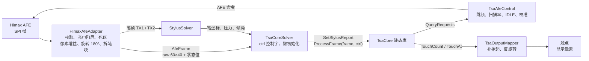
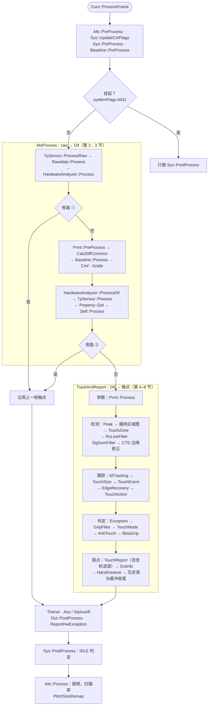
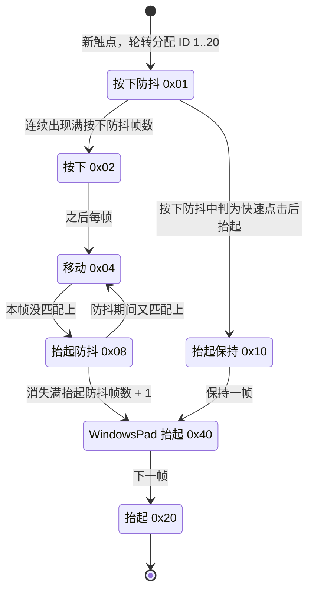
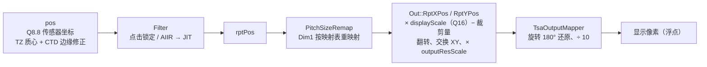
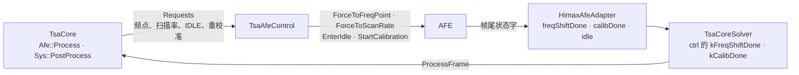

# TSACore 算法架构：每帧流程与模块职责

本文按当前代码（`feat/linux-port`，2026-10-26）梳理 TsaCore 的算法架构：宿主怎样喂帧，一帧在库里按什么顺序处理，每个模块负责什么，以及 W273 上哪些分支真正在跑。代码里每个函数上方的 `// 原名 @ 地址` 注释对应 Ghidra 里 `TSACore.dll` 的原函数。状态布局、比对方法与改写规则见 [tsacore-cpp-rewrite.md](/docs/finger_algorithms/tsacore-cpp-rewrite.md)，宿主接入见 [tsacore-raw-integration.md](/docs/finger_algorithms/tsacore-raw-integration.md)。

## 概念

- **TsaCore**：原厂 `TSACore.dll` 的 C++ 复刻，命名空间 `Solvers::Tsa::Core`，源码在 [TsaCore/src](/EGoTouchService/Solvers/TouchSolver/TsaCore/src)，编成静态库 `TsaCore`。[TsaCore](/EGoTouchService/Solvers/TouchSolver/TsaCore) 根目录下的 `HimaxAfeAdapter`、`TsaCoreSolver`、`TsaAfeControl`、`TsaOutputMapper` 是宿主侧的适配层，不属于原 DLL。
- **单例**：全库只有一份状态：`g_bss`（按原 DLL .bss 排布的 `BssLayout`）、带初值的模块全局对象、`Buffer::InitProject` 一次性分配的堆缓冲。接口没有句柄，一个进程只能跑一个实例。
- **MS 主流程**：互容（mutual-cap）手指管线，原名 `TSA_MSProcess`，从 raw 一直做到报点。笔的坐标不在 TsaCore 里解：业务侧的 StylusSolver 解出笔报告，每帧经 `Core::SetStylusReport` 送进来，TsaCore 只拿它判断笔模式、做笔防误触。
- **Dim1 / Dim2**：传感器阵列的两个方向。W273 上 Dim1 是 60 列，对应显示 X（2560 px）；Dim2 是 40 行，对应显示 Y（1600 px）。格下标 = dim1 + dim2 × 60，共 2400 格。位置一律用 Q8.8 传感器坐标（一个传感器 256 份）。
- **raw / BL / Dif**：raw 是 AFE 读数，宿主送来时零点在 0x7ffe，手指使其增大；Rawdata 把它归一化成 raw'（W273 上 raw' = 0xFFEE − raw）。BL 是基线，Dif = BL − raw'，手指处为正。preCmfRaw 是 CMF 之前的 raw，preDif 是上一帧的 Dif。
- **峰与几种和**：峰是 Dif 上的局部极大格。Z1 = 峰格的 Dif；Z8 = 周围 8 格之和；Z9 = 3×3 之和；Zn = 四个 2×2 象限和与十字五点和中的最大者。
- **触摸区域（TZ）与区域图**：TZ 是从峰出发做区域生长得到的一块格子。区域图每格一个 int8：0 表示不属于任何区域；否则为（区域基值 + 位置类型）× sign(Dif)，基值从 0x10 起每个区域加 8，低 3 位是格在区域里的位置类型，(|编码| − 16) / 8 是区号。SubTZ 是区域内以各峰为种子再拆出的子区域。
- **触点表**：当前帧 `TouchTable` 与历史 `PrevTouchTable`，各 20 个单元；历史单元另带 30 个带时间的轨迹点与 16 格的网格轨迹队列。ID 取 1..20，宿主接口上减 1。
- **数据集**：区域图、触点表、峰表各有 grid（屏幕网格）与 hand（握持手势）两套，触点表另有 side；`DataSwitch` 切换当前指针，模块只经访问函数取“当前”那一套。
- **ctrl 与 systemFlags**：宿主每帧传给 `ProcessFrame` 的控制字 ctrl 原样成为 `TsaStatic::systemFlags`，两者是同一套位。
- **featureFlags / featureFlags2**：特性开关位图，由机型表的默认值、强制位与宿主 `SetFeatures` 合成，决定哪些模块启用（第 4、11 节）。

## 架构

TsaCore 分两层：根目录的适配层把 Himax AFE 的帧整理成原 DLL 期望的输入，再把 TSACore 输出的请求和触点交还宿主；`src/` 下是原 DLL 本身。宿主每帧调一次 `Core::ProcessFrame`，之后查询请求与触点。



库内每帧的处理（`Tsa::Processing`）分三段：外层维护系统状态与闭环；`MsProcess` 把 raw 做成 Dif；`TrackAndReport` 从 Dif 找出触点、跟踪并决定报什么。HardwareAnalyzer 判出整帧不可信时，两处旁路点直接沿用上一帧的触点。



源码按原厂目录分层。括号里是带 `// 原名 @ 地址` 注释的函数数（全库 1113 个），能看出复杂度集中在哪里：TouchZone、App、GripFilter、Touch 四块占了近一半。

| 目录 | 模块（函数数） | 职责 |
|---|---|---|
| [App](/EGoTouchService/Solvers/TouchSolver/TsaCore/src/App) | Tsa、Sys、Afe、Buffer、DataSwitch、Property、Scenario、Report、TsaOut（共 145） | 入口与每帧主流程；系统状态与 IDLE 判定；AFE 跳频与扫描率；网格缓冲与逐格计时；数据集切换；全局属性统计；场景与特性开关；对宿主的报点接口；输出清理与坐标换算 |
| [Prmt](/EGoTouchService/Solvers/TouchSolver/TsaCore/src/Prmt) | TsaPrmt、ProjectTables、TtPrmt、RtPrmt、ConstPrmt、DynPrmt（共 26） | 机型参数表的装入；调参表、运行时参数、常量与动态门限的刷新 |
| [Alg](/EGoTouchService/Solvers/TouchSolver/TsaCore/src/Alg) · 信号 | Rawdata（6）、TpSensor（18）、Sensor（13）、Baseline（69）、Cmf（18）、GridIir（1）、SelfData（2） | raw 归一化与按格修正；基线跟踪与 Dif；共模噪声；全频噪声下的时间滤波；扫描线统计 |
| Alg · 检测 | Peak（45）、TouchZone（155）、CTD（6） | 找峰；区域生长、属性与形状；质心边缘修正 |
| Alg · 跟踪 | IDTracking（10）、Touch（103）、TouchSize（11）、TouchEvent（9）、Debounce（7）、EdgeRecovery（13）、TouchAction（4） | ID 配对；当前 / 历史触点表维护；尺寸；事件与防抖；边缘轨迹修正；点击 / 滑动 |
| Alg · 门限、模式与报点 | TouchThold（13）、TouchMode（16）、Exception（20）、Filter（27）、HotZoneAdjust（21） | 门限；触控模式；全局 / 区域异常；坐标滤波及扫描线串扰、信号和两个触点过滤；热区 |
| [Rejection](/EGoTouchService/Solvers/TouchSolver/TsaCore/src/Rejection) | TouchReport（14）、GripFilter（134）、AntiTouch（13）、Asa（16）、StylusAft（18） | 报点判定；握持过滤；防误触；笔模式；笔防误触 |
| [Extension](/EGoTouchService/Solvers/TouchSolver/TsaCore/src/Extension) | HardwareAnalyzer（47）、Thenar（13）、HandGesture（24） | 硬件异常与整帧旁路；侧边手掌；握持手势 |
| [WorkAround](/EGoTouchService/Solvers/TouchSolver/TsaCore/src/WorkAround) | BadChannel（10）、PressureDrift（3）、RfNoise（11）、ToeSynaBl（23） | 针对具体硬件问题的补丁，各有开关，W273 只开了 PressureDrift |
| [Tool/PosnList](/EGoTouchService/Solvers/TouchSolver/TsaCore/src/Tool/PosnList) | PosnSpecial（16） | TZ 遍历用的、按 Dif 符号分流的格子列表 |
| [Common](/EGoTouchService/Solvers/TouchSolver/TsaCore/src/Common) | Bss、Memory、Morphology、Profile、TsaMath、Types、Assert（共 13） | .bss 布局、缓冲分配、形态学、分段计时、定点数学 |

## 分点解释

### 1. 宿主边界：TsaCore.h 与适配层

[TsaCore.h](/EGoTouchService/Solvers/TouchSolver/TsaCore/TsaCore.h) 是宿主能看到的全部接口，把原 DLL 的导出包成类型化的函数：

| 用途 | 接口 |
|---|---|
| 初始化 | `Init`：按机型名装入参数表，登记 `AfeCaps`（列数、行数、扫描频点与扫描率列表、`freqHopMode`（1 = 由 TSACore 跳频）、`calibrationMode`（2 = 自动校准））。TsaCoreSolver 没有填后两项，两者都是 0（第 9 节） |
| 每帧 | `ProcessFrame(frame, ctrl)`：`AfeFrame` 带时间戳、2400 个 u16 的 raw（零点 0x7ffe；为空表示本帧没读主帧）、扫描频点、扫描率、状态位与笔帧 |
| 闭环 | `QueryRequests` → `Requests`：扫描频点 / 扫描率下标（-1 为不变）、`okToEnterIdle`、`reCalibNeeded` |
| 触点 | `TouchCount`、`TouchAt` → `ReportedTouch`（`id` 从 0 起、`down`、`liftOff`、`x`、`y`、`pressure`）；`DiffGrid` 返回当前 Dif |
| 配置 | `GetFeatures` / `SetFeatures`、`SetResolution`、`PrmtName` |
| 笔 | `SetStylusReport`（`StylusReport`：status bit0 悬停、bit1 笔尖，坐标、倾角、压力）、`SetBtConnectStatus`、`SetBtPenStatus`、`OnBtPressure`、`EnableScenario` / `DisableScenario`、`SetScreenRotateState`；查询 `InStylusMode`、`StylusInRange` |
| 诊断 | `StateBlocks`（.bss 与堆块，供状态比对）、`ProfileEntries` / `ProfileSteps`（分段计时） |

适配层的几个文件：

- **[HimaxAfeAdapter](/EGoTouchService/Solvers/TouchSolver/TsaCore/HimaxAfeAdapter.cpp)**：复刻驱动里 `thp_afe_get_frame` 对帧的处理。依次是：从第 5 字节起做 Checksum16 校验，连续 5 次出错报 SOS；充电时的阻尼（跳变大的格标记 10 帧，其余格向上一帧拉回一半）；每条 TX 行以该行最大值的 15% 做死区；按像素的百分比增益（CSOT / BOE 两套表 × 两个频点槽，小信号分档衰减，阻尼时增益再乘 110%）；零点附近的偏移压缩；最后整帧倒序，即旋转 180°。帧尾状态字换成 `AfeStatus`：idle 0x01、valid 0x02、freqShiftDone 0x04、calibDone 0x08、chargerNoise 0x20、SOS 0x40；扫描频点按帧尾字取 {75, 113} 之一。笔帧的两个 9×9 从块拆成整屏的 TX1 / TX2，status 0x12 为活动、0x06 为空闲。
- **[TsaCoreSolver](/EGoTouchService/Solvers/TouchSolver/TsaCore/TsaCoreSolver.cpp)**：替代 ApDaemon 的 TsaFrame，见下文。
- **[TsaAfeControl](/EGoTouchService/Solvers/TouchSolver/TsaCore/TsaAfeControl.h)**：把 `Requests` 变成 AFE 动作（`ClearStatus`、`ForceToFreqPoint`、`ForceToScanRate`、`EnterIdle`、`StartCalibration`）。没生效的命令每 12 帧重发；校准后 240 帧内不再校准；IDLE 请求每 5 帧发一次。换频点、换扫描率两项在当前配置下用不上（第 9 节）。
- **[TsaOutputMapper](/EGoTouchService/Solvers/TouchSolver/TsaCore/TsaOutputMapper.h)**：把 `TouchAt` 的结果转成宿主触点。`down` 取 `TSA_RptIsTouchDown`；`liftOff` 只对之前活动过的 ID 有效；本帧消失的 ID 补一个抬起。最多 10 个触点，只收 ID < 32，ID 加 1。坐标按 v = res × 10 − 1 − scaled 反旋转回来再除以 10，得到浮点的显示像素。
- **[PanelProfile](/EGoTouchService/Solvers/TouchSolver/TsaCore/PanelProfile.h)**：机型名到增益表的对应：W273AS2700 / 2710 用 CSOT 表，W273AS1300 / 1310 用 BOE 表，缺省 W273AS2700。

`TsaCoreSolver` 第一次收到帧时才初始化（`InitCore`）：能力填 60 列 × 40 行、扫描频点 {75, 113}、扫描率只有 120 一档，`freqHopMode` 与 `calibrationMode` 不填；`Core::Init(机型名)`；`SetResolution(2560, 1600, 10)`；取 `GetFeatures()` 清掉低 6 位后 `SetFeatures`；ctrl 初值 0x40003，充电时再或上充电位。之后每帧：

1. 应用笔会话状态；读到主帧时整理成 `AfeFrame`，笔帧总是整理；没有主帧时，只在笔处于活动状态时才处理本帧；
2. 无效帧与 SOS 帧不送进 TSACore；
3. 更新 ctrl → `SetStylusReport` → `ProcessFrame`；
4. ctrl 与 `kPersistMask`（0xf0ffffe0）相与，去掉一次性位，再 `SetFeatures` 一次；
5. `QueryRequests` → `TsaAfeControl::Step` → `TsaOutputMapper::Collect`；有触点或刚有过触点时返回 true。

笔报告由 `MakeStylusReport` 生成：StylusSolver 的坐标每个节点 1024 份，换成像素并翻转两个轴。ctrl 的位如下：

| 位 | 名字 | 说明 |
|---|---|---|
| 0 | `kFirstFrame` | 一次性 |
| 1 | `kResetBaseline` | 一次性 |
| 2 | `kSosReset` | 由 `OnAfeSos` 置位 |
| 3 | `kCalibDone` | 只在上升沿置位：ctrl 低 4 位任一置位都会让 TSACore 停在硬件复位状态 |
| 4 | `kFreqShiftDone` | 跳频完成 |
| 5 | `kCharger` | 常驻 |
| 8 | `kScreenOff` | 灭屏 |
| 17 | `kChargerNoise` | 充电器噪声 |
| 18 | `kAlways` | 常驻；在 TSACore 里就是 systemFlags bit18，让 CMF 用备用门限（第 3 节） |

### 2. 外层流程、跳过与旁路

`Core::ProcessFrame` 先经 `ProcessAfeFrame` 把宿主的帧交给 AFE 模块：帧覆盖整个网格时直接读宿主的帧；缺省表 DFLT000000 的 AFE 尺寸是 16 × 32，只拷前 512 格。然后进入 [Tsa.cpp](/EGoTouchService/Solvers/TouchSolver/TsaCore/src/App/Tsa.cpp) 的 `Processing`（`TSA_Processing` @ 0x6ba9a443）：

| 步 | 调用 | 作用 |
|---|---|---|
| 1 | `Afe::PreProcess` | AFE 扫描的帧前处理 |
| 2 | — | 记 `curTimeMs` |
| 3 | `Sys::UpdateCtrlFlags` | ctrl 写成 systemFlags；复位类的位（0xd，即 bit0、bit2、bit3）保持 3 帧 |
| 4 | `Sys::PreProcess` | 取 AFE 的 IDLE 状态、帧间隔 `frameIntervalMs`、`afeStatus` |
| 5 | `Baseline::PreProcess` | 清 SHB 标志 |
| 6 | — | systemFlags bit31（`kSysSuspended`）置位时只做 `Sys::PostProcess` 就返回 |
| 7 | `MsProcess` | 互容主流程；systemFlags 0x200（`kSysSkipMs`）置位时跳过 |
| 8 | `Thenar::ProcessInfoByDif` | 侧边手掌检测（第 7 节） |
| 9 | `Asa::Process(ctrl)`、`StylusAft::Process` | featureFlags 0x10000（ASA）时做；笔防误触另要 featureFlags 0x100 且 `aftGateFlags & 4` 为 0 |
| 10 | `Out::PostProcess` | 清掉不报的触点并统计（第 8 节） |
| 11 | `ReportHwException` | 把硬件异常码报给宿主 |
| 12 | `Sys::PostProcess` | 本帧状态存为“上一帧”；IDLE 判定（第 9 节） |
| 13 | — | `frameDone = 1`，`frameCounter` 加 1 |
| 14 | `Afe::Process` | 跳频与扫描率选择（第 9 节） |
| 15 | `PitchSizeRemap` | 按 pitch 映射表修正报点坐标（第 8 节） |

`MsProcess`（`TSA_MSProcess` @ 0x6ba90e43）把 raw 做成 Dif：

1. `ToGrid` 切到屏幕网格数据集；raw 为空（宿主本帧没读主帧）或机型表 `msSkip` 置位时到此为止，本帧不更新 Dif 与触点；
2. `HardwareAnalyzer::Reset`；有待处理的硬件复位时 `MsReset`：重新初始化各模块，外部特性开关、复位保持帧数、基线复位计数、各频点初始化次数、重校准计数、互容初始化时间跨复位保留；
3. `Touch::Clean` 清空当前触点表，`preDif ← dif`；
4. 拷入 raw → `TpSensor::ProcessRaw` → `Rawdata::Process` → `HardwareAnalyzer::Process`；
5. **旁路 ①**：`HardwareAnalyzer::IsToBypassCurrentFrame()` 为真时，`KeepPrevTouchWithExceptionExcluded` 沿用上一帧中没有异常的触点，照常算一遍 Dif 与 CMF 前属性（`CalcDiffCommon`、`GetDifPreCmf`）并拷出 Dif，结束；
6. `Prmt::PreProcess` 刷新 CMF 门限，`preCmfRaw ← raw`；
7. Dif 段：`CalcDiffCommon` → `Property::GetDifPreCmf` → `Baseline::UpdateForRawUnstable` → 拷出 `SelfForBlReset`；`cmfEnabled` 时做 raw 域的 `Rawdata::Cmf`；featureFlags 0x800 时 `Exception::CheckUnderWater`；`Baseline::Process`；本帧基线没有复位时，再做 Dif 域的 `Cmf::Process`（`cmfEnabled` 为 0 时）与 `GridIir::Process`；
8. `HardwareAnalyzer::ProcessDif` → `TpSensor::Process` → `Property::Get` → 拷出 ms* 属性 → `Self::Process` → `ToeSynaBl::GetSidePrpt` → `CheckRawDirection`；
9. **旁路 ②**：再查一次，为真时 `KeepPrevTouches` 沿用上一帧触点，结束；
10. `TrackAndReport`，`MsEnd`。

旁路条件在 [HardwareAnalyzer.cpp](/EGoTouchService/Solvers/TouchSolver/TsaCore/src/Extension/HardwareAnalyzer/HardwareAnalyzer.cpp)：Full Incell 下检出 raw2raw 噪声且不是射频噪声；或检出大噪声；或 featureFlags2 打开了射频噪声检测且 RfNoise 检出。W273 关着射频噪声检测，实际起作用的是前两条。

`TrackAndReport` 是从 Dif 到报点的 33 步，按用途分组：

| 组 | 步骤 | 详见 |
|---|---|---|
| 参数 | 1 `Prmt::Process` | 第 4 节 |
| 检测 | 2 `Peak::Process` → 3 峰表拷到 `PeaksBeforeSwitchDif` → 4 置 gripFlags 0x400 → 5 `GripFilter::RegionProcess` → 6 `Buffer::PrevFrameProcess` → 7 `TouchZone::Process` → 8 清 gripFlags 0x400 → 9 `RxLineFilter::Process` → 10 `SigSumFilter::ReserveTouch` → 11 `Ctd::EcProcess` | 第 5 节 |
| 跟踪 | 12 `IdTracking::Process(false)` → 13 `Touch::AssignPreIdxBasedOnId` → 14 `PrevTouch::AssignCurIdxBasedOnId` → 15 `TouchSize::Process` → 16 `TouchEvent::Process` → 17 `Buffer::PreProcess` → 18 `EdgeRecovery::Process` → 19 `TouchAction::Process` → 20 `TouchSize::PostProcess` → 21 `TouchAction::PostProcess` | 第 6 节 |
| 判定 | 22 `Exception::Process` → 23 `GripFilter::Process` → 24 `TouchMode::Process` → 25 `AntiTouch::Process` → 26 `Touch::ProcessBetaGrip` | 第 7 节 |
| 报点 | 27 `TouchReport::Process` → 28 `Touch::ProcessExtInfo` | 第 8 节 |
| 收尾 | 29 `HardwareAnalyzer::PostProcess` → 30 `HandGesture::Process` → 31 `PrevTouch::PostProcess` → 32 `PrevPeak::Process` → 33 `Buffer::PostProcess` | 第 6、7 节 |

### 3. 信号调理：raw → Dif

**Rawdata**（[Rawdata.cpp](/EGoTouchService/Solvers/TouchSolver/TsaCore/src/Alg/Rawdata/Rawdata.cpp)）：raw' = raw × rawScale / 0x3fff + rawOffset，截成 16 位。W273 的 rawScale = −16383、rawOffset = −196626，截断后正好是 raw' = 0xFFEE − raw，即单位增益、反号：零点 0x7ffe 变成 0x7ff0，手指 +600 变成 0x7d98，+3000 变成 0x7438。走 Dif 缓冲路径（systemFlags bit16）时只缩放 Dif。`CheckRawDirection` 只对缺省机型生效：第一次出现大信号且为负向时，把 raw 的零点翻到另一侧并重算常量参数。

**TpSensor 与 Sensor**：[TpSensor](/EGoTouchService/Solvers/TouchSolver/TsaCore/src/Alg/TpSensor/TpSensor.cpp) 做三种按格修正：平移表（个别格的 raw 加平移量，Dif 按 difScale / 1024 缩放）、偏移表（个别格的传感器中心偏移，供 TZ 求质心）、坏点表（BadChannel / HardwareAnalyzer 报上来的坏点，用邻格线性外推补偿 Dif）。W273 的平移表、偏移表都是空的，坏点补偿 `brokenSensorCompensation` 也关着，所以 TpSensor 在这台机器上不改数据。[Sensor](/EGoTouchService/Solvers/TouchSolver/TsaCore/src/Alg/Sensor/Sensor.cpp) 只是查询工具：两格间的距离，某格在区域图里属于哪个区域。

**Baseline**（[Alg/Baseline](/EGoTouchService/Solvers/TouchSolver/TsaCore/src/Alg/Baseline)，69 个函数）维护每格的基线并算出 Dif。`Baseline::Process(hwReset, refresh)` 每帧依次：

1. **BaselineRecal**：系统复位后第 5..14 帧里，无触摸而 raw 的上下边界越出 [center − range/2, center + range/2]（或上下边界之差超过 range，center / range 来自机型表）的帧数达到 3 帧时，在非自动校准方式下请求重新校准（宿主没有声明自动校准，W273 上这条生效）；
2. **BaselineStateMachine** 求本帧的基线属性（GetProperty），优先级为：复位 > 刷新 > BLReset 触发 > 防抖 > 最大信号检查；其中 **BaselineReset** 判断要不要复位基线；
3. 按属性推进阶段并执行该阶段：IIR 步进、复位或保持；
4. 算 Dif，维护 SHB 抓取（状态每 5 s 一轮）。

| 值 | 阶段 | 行为 |
|---|---|---|
| 0 | NoTouch | 无触摸：按小步长跟踪 |
| 1 | Reset | 复位（硬件复位或 BLReset 触发） |
| 2 | NoisyReset | 噪声期间复位（只有常噪声的 ALPS 机型会进入） |
| 3 | Hold | 保持：回到上一阶段 |
| 4 | SmallSig | 小信号：等超时回到无触摸 |
| 5 | Touched | 有触摸：不更新 |
| 6 | LiftOff | 抬起：等超时 |
| 7 | AfterTouch | 抬起后跟踪 |
| 8 | Stage8 | 未命名 |
| 9 | Negative | 负信号跟踪 |

- **IIR 步进**（BaselineIir）：每格的基线朝 raw 走一步。W273 的 `blUpdateFromPreCmfRaw` 为 1，朝 CMF 之前的 raw 走。另有整体补偿（`Baseline_Compensation`）：负向偏移优先，偏移超过 4 且没有 raw 跳变时，整幅基线向偏移方向移 5。
- **参数**：由 `DynPrmt::GetBl` 每帧给出。noise 一般取手指触点门限（侧边取 3/4），smallThold = noise / 2，stepNoTouch = noise / 256，stepAfterTouch = noise / 64，clampAfterTouch = noise − 1，阶段超时 408 ms。
- **复位原因码**（BLReset）：4 AllFreqInit、5 WakeUp、6 Noisy、7 RawJump、8 WakeUpException、9 WakeUpState、0xc SmartCoverOff、0xd FreqHopping、0xf Abnormal、0x10 AfeRawJump、0x12 ToeAftScreenOn、0x13 Dirty。
- **脏基线与异常基线**：W273 的 `blDirtyCheck`、`blAbnormalCheck` 都开着。脏基线要经干净基线状态机确认（`cleanState` 1 → 2 → 4 → 8 → 0x10，0x10 为完成）才复位；AFE 状态带 `kAfeNoDirtyCheck` 时不查。

**CMF**（[Cmf.cpp](/EGoTouchService/Solvers/TouchSolver/TsaCore/src/Alg/Cmf/Cmf.cpp)，共模噪声滤波）沿每条扫描线去掉公共噪声。W273 的 `cmfMethod` 为 0（1D），`dim1Axis` 为 1，所以逐行做：40 条线，每条 60 格。

1. 每格按 Dif 分为高、低（超过 ±amp）、升、降（与前一格之差超过 ±grad）和平坦五类；
2. 连续两格都平坦时，前一格进入聚类：紧接上一格的归入同一簇，否则归入最近值与之相差不到 grad 的簇，都不是就开新簇，最多 10 簇；
3. 取最可信的一簇的均值作为该线的公共噪声，从整线减去，并记入 `commonModeNoise`。

门限由 `Prmt::PreProcess` 每帧按 systemFlags bit18 选：常态组 amp 600 / grad 150，备用组 amp 15000 / grad 200。宿主的 `kAlways` 就是 bit18，所以 W273 一直用备用组。amp 15000 远高于实际 Dif，“高 / 低”两类基本不会出现，聚类实际只看相邻格差是否在 ±200 内。`cmfEnabled` 为 0，raw 域的 `Rawdata::Cmf` 不做，改在基线之后对 Dif 做；本帧基线复位时跳过。2D（PCA）CMF 只在 `cmfMethod` 为 1 时用，已裁掉。

**GridIir**（[GridIir.cpp](/EGoTouchService/Solvers/TouchSolver/TsaCore/src/Alg/GridIir/GridIir.cpp)）：只在全频噪声（`Sys::IsAllFreqNoisy`）时工作，W273 上要宿主报充电器噪声才会出现（第 9 节）。刚进入全频噪声时以当前 Dif 为起点；此后每格 Dif 换成时间 IIR 的结果（权重 `gridIirWeight` = 224，移位 8，即当前帧占 7/8），并记作下一帧的起点。

**Property**（[Property.cpp](/EGoTouchService/Solvers/TouchSolver/TsaCore/src/App/Property.cpp)）：每帧的全局属性 `TsaPrpt`。包括 raw 的极值与内圈平均，以及 Dif 按区块（内部、四边、角）统计后组合成的几组 DifPrpt（`dif`、`difCore`、`difInner` 等），计数门限是 `Prpt().noiseThold`。`GetDifPreCmf` 在 CMF 之前取一份同样的统计。基线复位、异常和 IDLE 判定都读这些属性。

**SelfData**（[SelfData.cpp](/EGoTouchService/Solvers/TouchSolver/TsaCore/src/Alg/SelfData/SelfData.cpp)）：互容 Dif 的扫描线统计，每条线一组和、极值与强信号统计。下标 [0, 60) 是各列（沿 Dim2 求和），[60, 100) 是各行（沿 Dim1 求和）。基线复位判定读的是 MsProcess 每帧拷下的副本 `SelfForBlReset`。名字里的 Self 不是自容：自容（SS）模块已裁掉。

**HardwareAnalyzer**（[Extension/HardwareAnalyzer](/EGoTouchService/Solvers/TouchSolver/TsaCore/src/Extension/HardwareAnalyzer)，47 个函数）是硬件异常分析，分 raw 段（`Process`）与 Dif 段（`ProcessDif`）。

- 检测内容：统计 raw2raw Dif（相邻两帧 raw 之差），查坏点与 raw 越限（SensorBroken；W273 的 `difBrokenCheck` 开着），以及 AFE 报的 raw 跳变、不稳定。
- 输出：检出的异常记成位图，按优先级挑一个经 `ReportHwException` 报给宿主（DMD 码），并在 `TouchTable::exceptionFlags` 上置 0x400；上面的整帧旁路也由它判定。
- 已裁掉：异常的文字描述原本靠 StrPrintf 拼写，本机型 StrPrintf 被裁，描述串为空。

**ToeSynaBl::GetSidePrpt**：Toe 机型的侧边基线保护。W273 的 `toeSynaBl` 为 0，函数一进来就返回。

### 4. 参数与门限

参数分五层（[TsaPrmt.h](/EGoTouchService/Solvers/TouchSolver/TsaCore/src/Prmt/TsaPrmt.h)，布局见 [Prmt.h](/EGoTouchService/Solvers/TouchSolver/TsaCore/src/Prmt/Prmt.h)）：

| 层 | 内容 | 何时更新 |
|---|---|---|
| FlashPrmt | 机型参数表，0x1890 字节；字段偏移由 `static_assert` 钉住 | `Init` 时从 [ProjectTableData.inc](/EGoTouchService/Solvers/TouchSolver/TsaCore/src/Prmt/ProjectTableData.inc) 整块复制（连同 CMF PCA 表与 ASA 表）；之后由 TtPrmt、RtPrmt 每帧写回可调字段 |
| TtPrmt | 调参表，107 项：可调字段的当前值、上下限与说明 | 每帧写回 FlashPrmt |
| RtPrmt | 运行时参数，16 个键，由场景处理按键名改写 | 每帧从 FlashPrmt 重建，跑 `Scenario::Process`，再写回并镜像到 DynPrmt |
| ConstPrmt | 由机型参数推导的换算常数：raw 比例与偏移、显示比例、`jitRadius`、`q8PerMm` 等 | 初始化及分辨率变化时 |
| DynPrmt | 动态门限：峰门限、触点门限、按下门限、基线参数等 | 每帧 |

每帧的顺序：MsProcess 里的 `Prmt::PreProcess` 只刷新 CMF 门限组；TrackAndReport 开头的 `Prmt::Process` 依次跑 `TtPrmt::Process` → `RtPrmt::Process`（内含 `Scenario::Process`）→ `DynPrmt::Process`。最后这步先经 TouchThold 算峰门限（`sigThold = Prpt().peakThold`），再由 `GetBl` 算基线参数。DynPrmt 在 TrackAndReport 开头才刷新，所以 MsProcess 里的基线读到的是上一次刷新的值，旁路帧不刷新。

**TouchThold**（[TouchThold.cpp](/EGoTouchService/Solvers/TouchSolver/TsaCore/src/Alg/TouchThold/TouchThold.cpp)）：由手指 / 手套门限算出峰门限、触点门限与按下门限，并按噪声触点数与 SNR 换算噪声门限，写入 `TsaPrpt::noiseThold`。

**Scenario**（[Scenario.cpp](/EGoTouchService/Solvers/TouchSolver/TsaCore/src/App/Scenario.cpp)）：宿主告知的应用类型、通话 / 锁屏状态决定当前场景（`aftGateFlags` 与 `scenarioMask`），每帧按场景改写运行时参数：打字 / 游戏下的设置、扫描率上限、进 IDLE 的防抖时间。手套只在 systemFlags 0x80000 未置位、`strongTapCount` < 5、且 aftGateFlags 带 0x8（温度检查）或机型名前 4 个字符为 HIMA 时允许。`SetFeatures` 只采纳外部可改的位（0x4813），并始终或上机型表的强制位。

featureFlags 的合成：机型默认 0x101，强制位 0x1090020。宿主清掉低 6 位后 `SetFeatures`，手套位 0x1 被 `KeepIfUnchanged` 清掉后不再打开，最终生效值是 **0x1090120**：

| 位 | 代码里的名字 | 作用 |
|---|---|---|
| 0x20 | `kFeatGripPost` | 握持触点转为可报后补报；TZ 的 `CheckToSeparateZone` 也看这一位 |
| 0x100 | `kFeatStylusAft`；Filter.cpp 里叫 `kFeatClickSuppress` | 笔防误触；坐标滤波的点击锁定 |
| 0x10000 | ASA | 主动笔模式 |
| 0x80000 | — | 没找到读它的代码 |
| 0x1000000 | `kFeatWindowsPad` / `kFeatAltEvents` | WindowsPad 的抬起流程与对外事件掩码；ASA、StylusAft 的另一套行为 |

featureFlags2 为 0x120：0x20 打开 PressureDrift；0x100 没找到读它的代码。坏通道（0x08）、射频噪声（0x10）、Bali 坏点（0x80）都关着。

W273AS2700（CSOT）表里与管线分支相关的值：

| 类别 | 字段 | 值 | 含义 |
|---|---|---|---|
| 阵列 | `dim1Len` × `dim2Len`（AFE 同） | 60 × 40 | 2400 格 |
| | `sensorPitchX16` / `sensorPitch2X16` | 69 / 66 | 传感器间距 4.31 / 4.13 mm |
| 显示 | `dim1Axis`、`displayXAxis` | 1、1 | Dim1 是显示 X；CMF 逐行做 |
| | `dim1Res` / `dim2Res`、`outputResScale` | 2560 / 1600、1 | 宿主 `SetResolution` 把倍率改成 10 |
| 架构 | `sensorArchitecture` | 3 | Full Incell |
| | `reportRateHz`、`maxScanRate` | 100、120 | |
| CMF | `cmfEnabled`、`cmfMethod` | 0、0 | Dif 域 1D CMF |
| | `cmfTholdNormal` / `cmfTholdAlt`（amp / grad） | 600 / 150、15000 / 200 | 实际用备用组 |
| 基线 | `blUpdateFromPreCmfRaw`、`blDirtyCheck`、`blAbnormalCheck` | 1、1、1 | |
| 门限 | `fingerThold`、`gloveThold`、`gloveExitThold` | 600、220、1000 | 手套模式实际不开 |
| | `peakFilterReferenceThreshold` | 3000 | TZ 生长门限的封顶值，BetaGrip 等也用 |
| 区域 / 握持 | `gripFlags`、`gripDevice` | 0、2 | TZ 走 NormalTraversal；握持区域按手机布局 |
| | `sigMult` | 64 | TZ 生长门限 = 50% × min(峰值, 3000) |
| | `largeObjectSizeMm` | 30 | 大物体面积门限 30² mm² |
| 跟踪 | `accThold`、`idtSnapDistMm` | 16、5 | IDT 加速度门限、锚定距离 |
| 报点 | `defaultTouchAction` | 1 | 新触点开机默认按点击 |
| | `jitRadiusDisplay`、`noCurvePredict` | 6、0 | 抗抖半径；保留曲线预测 |
| | `dim1PitchMap` / `dim2PitchMap` | 0, 0.984375, …, 60 / 100 | 只重映射 Dim1 |
| 滤波 | `gridIirWeight` | 224 | |
| IDLE | `idleEnterDelayMs`、`dbEnterIdle`（常规 / 游戏 / 打字）、`idleAfterInitMs` | 60、3000 / 10000 / 600、4167 | 单位 ms |
| 为 0 的开关 | `sigSumReserveTouch`、`noisyTouchDownDebounce`、`toeSynaBl`、`touchReportFlags`、`antiTouchScenarios`、`proximityScenarios`、`gripDeadzoneEdges`、`gripIdleEnabled`、`sensorOffsetNum`、`sensorTranslateNum`、`brokenSensorCompensation` | 0 | 对应功能不生效（第 11 节） |

[ProjectTableData.inc](/EGoTouchService/Solvers/TouchSolver/TsaCore/src/Prmt/ProjectTableData.inc) 里共四套表，`Init` 按机型名选，名字不在表里时用 DFLT：

| 表 | 机型名 | 与 W273AS2700 的差别 |
|---|---|---|
| GaokunHimaxCSOT | W273AS2700 | 即上表 |
| GaokunHimaxBOE | W273AS1300 | 只差 `sensorPitchX16`（72，即 4.5 mm）、`dim1PitchMap` 第 1–59 项、一个保留字节（`reserved030`）和侧边音量键区的两个端点（侧边触摸未启用，不生效）；ASA 表差 1 字节，CMF PCA 表相同 |
| GaokunHimaxBOE_NewMapping | W273AS1310 | 三张表除机型名外与 W273AS1300 逐字节相同 |
| Default | DFLT000000 | 16 × 32、`dim1Axis` 0、1080 × 2244、强制位 0、两张 pitch 映射表都不映射；阵列尺寸取自 AFE |

### 5. 检测：峰 → 区域 → 触点

**Peak**（[Peak.cpp](/EGoTouchService/Solvers/TouchSolver/TsaCore/src/Alg/Peak/Peak.cpp)，含 PeakData、PrevPeak，45 个函数）：

1. 门限取 `DynPrmt::sigThold`（由 TouchThold 给出）；Full Incell 下检测时先压到不超过 finger / 2（W273 为 300），原门限留给 Z1 过滤；
2. 找峰：Dif 上的局部极大格。对下方、右方邻格取 ≥，对上方、左方邻格取 >，平台上只留一格。PressureDrift（featureFlags2 0x20）把整行按压造成的大片平缓抬高识别为漂移，不当作峰；
3. 算 Z8、Zn 等和；Z8 过滤去掉 z8 < sig / 32 的峰；
4. 整屏信号失衡（SD）检测。最大峰连续 6 帧以上超过 3 倍 finger 门限并持续 1 s 后，若最大峰回落到 2 倍 finger 以下而全屏信号和仍高，且峰多或八邻域远大于峰值，判为失衡。失衡时不做 Z1 过滤，改把 Zn 按下门限设为 `sdZnTholdScaleX16 × sigThold / 16`；不失衡时按原门限做 Z1 过滤。Hybrid Incell 的失衡分支依赖已裁掉的 SignalDisparity；
5. 排序，交给 IdTracking 的 strict 模式给峰预编号。

PeakData 管峰表的增删与查询；PrevPeak 在帧末把峰表拷成上一帧峰表；第 3 步的 `PeaksBeforeSwitchDif` 是检测完成时峰表的副本。

**握持区域图**（`GripFilter::RegionProcess`，[GripRegion.cpp](/EGoTouchService/Solvers/TouchSolver/TsaCore/src/Rejection/GripFilter/GripRegion.cpp)）：按屏幕旋转与机型生成握持区域图，每格一个字节，bit n 表示该格属于等级 n 的握持区域。`gripDevice` 4 为平板、5 为折叠屏，W273 的 2 走缺省的手机布局。死区按四条边各记 0x50 格，表示握持触点沿边缘覆盖、不报点的范围；W273 的 `gripDeadzoneEdges` 为 0，不启用。接着 `Buffer::PrevFrameProcess` 更新每格的报点计时。

**TouchZone**（[Alg/TouchZone](/EGoTouchService/Solvers/TouchSolver/TsaCore/src/Alg/TouchZone)，155 个函数，全库最大的模块）：每帧以每个尚未被覆盖的峰为起点做区域生长，触点表从 0 开始重建。

| 文件 | 内容 |
|---|---|
| StateMachine.cpp | 每帧流程、区域图的膨胀 / 腐蚀、握持年龄、区域生长门限 |
| Traversal.cpp | 区域生长（逐格累计）与峰过滤 |
| Common.cpp | 质心 / 椭圆轴、区域属性、登记成触点 |
| Shape.cpp | 形状判定（DFS、形状消抖、大物体） |
| GripMerge.cpp | 握持区域的合并与拆分 |
| VirtualPeak.cpp | 虚拟峰 |
| Contour.cpp | 轮廓与圆度 / 椭圆度 |
| SubTouchZone.cpp | 子区域：以区域内每个尚未覆盖的峰为种子再生长一次 |
| InnerCorner.cpp | 峰落在离屏幕角各一格处时，记边缘格相对它的信号比 |

- **生长门限**：峰值 × sigMult / 128（W273 为 50%）；峰值超过 peakRef（3000）时按 3000 算；结果夹在 [`Prpt().noiseThold`, 峰值] 之间。
- **遍历**：`gripFlags` 为 0 时走 NormalTraversal，用 [PosnSpecial](/EGoTouchService/Solvers/TouchSolver/TsaCore/src/Tool/PosnList/PosnSpecial.cpp) 列表做 8 邻域 BFS。Dif 非负的格从列表前端压入、负的从后端压入，先取完一种符号再换另一种，每换一次开一个统计区间（最多 10 个）。
- **属性**：信号矩给出质心（叠加 TpSensor 的偏移表）与椭圆长短轴（Q8.8，√(6λ)）及长轴方向，另有外接框、贴边信息、握持比（×16）。轮廓用双三次插值放大 4 倍，得到圆度与椭圆度。六个区域异常比值交给 [FiException](/EGoTouchService/Solvers/TouchSolver/TsaCore/src/Alg/Exception/FiException.cpp) 判基线异常与湿手指。
- **形状**：手指 1、大手指 2、多指 3、大物体 5，带形状消抖。多指区域按峰拆开（MfProcess）；SubTZ 用来判多指与握持拆分，拆出的子区域形状异常或含多个峰时撤回拆分。
- **握持**：GripMerge 合并 / 拆分握持区域，featureFlags 0x20 时 `CheckToSeparateZone` 尝试拆开。子区域生长遇到握持格时把它当作虚拟峰并入（每个区域一次）。HandGesture 记下的每格时间（TimeHand）参与判握持合并。
- **登记**：区域登记成触点；大物体置 volatileFlags 0x2000（第 12 节）。

**RxLineFilter**（[RxLineFilter.cpp](/EGoTouchService/Solvers/TouchSolver/TsaCore/src/Alg/Filter/RxLineFilter.cpp)）：只在噪声等级 `noiseLevel` ≥ 2 时工作，按 Z8 比值（`rxLineZ8Ratio`）判出扫描线串扰造成的假触点并移除。噪声等级由 `Exception::Process` 设定。

**SigSumFilter::ReserveTouch(keep)**：触点按区域信号和 `sigSumAll` 从大到小排序，只留前 keep 个。keep 取 `sigSumReserveTouch`，W273 为 0，不处理。

**CTD**（[Ctd.cpp](/EGoTouchService/Solvers/TouchSolver/TsaCore/src/Alg/CTD/Ctd.cpp)）：`EcProcess` 对挨着阵列边缘的触点做质心边缘修正。边缘外没有传感器，质心会被拉向阵列内侧，这里按触点尺寸与边缘信号比（经 ln 表）把坐标往边缘推回去。

### 6. 跟踪与生命周期

**IdTracking**（[IdTracking.cpp](/EGoTouchService/Solvers/TouchSolver/TsaCore/src/Alg/IDTracking/IdTracking.cpp)）把当前表的触点与历史表配对，当前触点继承配上的历史 ID，没配上的 ID 清零，由 TE 当作新触点：

1. 代价矩阵是位置差的平方。位移小（≤ `idtSnapDistMm`，5 mm）、外推也小、轨迹够老（超过 5 帧）的配对直接锚定为极小代价；在加速度门限下一对一相容的候选配对同样锚定；
2. 匈牙利算法求总代价最小的配对；
3. 加速度校验：加速度超门限、GripFilter 要求取消、或历史触点禁止配对的，拆掉。

峰检测也借它给峰编号（strict 模式，加速度门限一律放大 4 倍）。配对后 `Touch::AssignPreIdxBasedOnId` 与 `PrevTouch::AssignCurIdxBasedOnId` 建立两表的下标对应。

**TouchSize**（[TouchSize.cpp](/EGoTouchService/Solvers/TouchSolver/TsaCore/src/Alg/TouchSize/TouchSize.cpp)）：对没抬起的触点按区域信号和与触点门限估算尺寸（mm）；`PostProcess` 在触点抬起时把它的尺寸记为下一个触点的默认尺寸。这里也提供传感器坐标、mm、显示像素之间的换算，系数由 ConstPrmt 按传感器间距推导。

**TouchEvent 与 Debounce**（[TouchEvent.cpp](/EGoTouchService/Solvers/TouchSolver/TsaCore/src/Alg/TouchEvent/TouchEvent.cpp)、[Debounce.cpp](/EGoTouchService/Solvers/TouchSolver/TsaCore/src/Alg/Debounce/Debounce.cpp)）决定每个触点本帧的事件。W273 开着 WindowsPad（featureFlags 0x1000000），主路径如下：



- **按下**：新触点轮转分配 ID（1..20），并在历史表里开一项。按下防抖帧数由 Debounce 给出：按区域异常、峰门限、信号增长、侧边、噪声等逐项取较大值；任一否决条件成立时为 `kNoTouchDown`，本帧不允许按下。W273 的 `noisyTouchDownDebounce` 为 0。
- **抬起**：报过点的触点消失后先经抬起防抖。WindowsPad 下防抖多算一帧，最后一帧记 `kWindowsPadLiftOff`，下一帧再记 `kLiftOff`。按下防抖期间判出快速点击（`kPersistFastClick`）且无异常的触点，抬起时先以 `kLiftOffHold` 保持一帧。报抬起时统计 `strongTapCount`，Scenario 判手套时会用到。
- **收尾**：TE 之后跑 `Touch::ProcessAftTouchEvent`（统计异常形状与报点数，判可信度与合并 / 分离）与 `Sys::ProcessAftTouchEvent`。最后检查当前表与历史表的下标是否一一对应，不一致时两张表都清空。
- **对外语义**：`Report::IsTouchDown` = event & (WindowsPad ? 0x1e : 0x02)，`IsLiftOff` = event & (WindowsPad ? 0x40 : 0x20)。所以 W273 上“按下”包括按下、移动、抬起防抖与抬起保持；抬起在 `kWindowsPadLiftOff` 那一帧报，随后的 `kLiftOff` 帧对外既不是按下也不是抬起。

**Buffer**（[Buffer.cpp](/EGoTouchService/Solvers/TouchSolver/TsaCore/src/App/Buffer.cpp)）维护每格的计时，指针表见 [TsaBuffer.h](/EGoTouchService/Solvers/TouchSolver/TsaCore/src/App/TsaBuffer.h)：

- `PreProcess` 逐格更新计时。不在区域里的格：刚离开时抬起计时取一个帧间隔，抬起后最小信号取当前 Dif；否则计时推进，最小信号取较小者。在区域里的格：刚进入时按下计时清零，否则推进。
- 其余的逐格量：报点计时 `timeRpt`、握持计时与阶段（`gripTime`、`gripStage`），以及每格所属的触点 ID（TzIdProcess）。
- `PostProcess` 把区域图存成上一帧副本 `tzPrev`。
- 所有缓冲都在 `Buffer::InitProject` 里一次分配。

**EdgeRecovery**（[EdgeRecovery.cpp](/EGoTouchService/Solvers/TouchSolver/TsaCore/src/Alg/EdgeRecovery/EdgeRecovery.cpp)）在 TE 之后修正靠近逻辑边缘的轨迹：

- **move-in**：从屏外滑入的触点刚报按下时，把它的历史轨迹按首两点的步长向边缘外推补齐，让轨迹从边缘开始。底边另有一种判定（从底部区域上划）。离边缘在修正区间内、但历史还不够时，先压回按下防抖等一帧。
- **move-out**：报过点的触点抬起时，若按位移外推会越过逻辑边缘，就把上报坐标贴到边缘上，并多保持一帧。

**TouchAction**（[TouchAction.cpp](/EGoTouchService/Solvers/TouchSolver/TsaCore/src/Alg/TouchAction/TouchAction.cpp)）：决定每个触点按点击还是按滑动处理。新触点沿用 `DynamicPrmt::defaultTouchAction`（W273 开机为 1，点击）。`PostProcess` 在报过点的触点抬起时更新这个默认值：persistFlags bit12 置位则下一个按滑动，否则按点击。

**帧末**：`PrevTouch::PostProcess` 把当前表并入历史表（单元前 `kTouchCommonSize` 字节整段拷贝），并维护每个历史触点的 30 点轨迹与 16 格网格轨迹队列；`PrevPeak::Process` 拷峰表；`Buffer::PostProcess` 存区域图。

### 7. 异常、模式与误触抑制

**Exception**（[Exception.cpp](/EGoTouchService/Solvers/TouchSolver/TsaCore/src/Alg/Exception/Exception.cpp)）是全局异常（水下、噪声、湿手指、基线异常等）的状态机，分三处工作：MsProcess 里的 `CheckUnderWater`（featureFlags 0x800，W273 关），TZ 逐区域的 FiException，以及 TrackAndReport 里的 `Process`。`Process` 先处理上一帧的异常：噪声异常在手动跳频未完成时保留，否则清掉；上一帧水下而本帧检出信号反向时也清掉。然后把本帧检出的异常消抖成 `TouchTable::exceptionFlags`，据此设噪声等级（RxLineFilter 用）与手套参数。exceptionFlags 里能对上用途的位：0x100 噪声（手动跳频时 Afe 据此换频点）、0x400 硬件异常（HardwareAnalyzer）、0x1000 需要重校准。Hybrid Incell 的检测 HIException 已裁掉。

**GripFilter**（[Rejection/GripFilter](/EGoTouchService/Solvers/TouchSolver/TsaCore/src/Rejection/GripFilter)，134 个函数）逐个触点判断它是不是握持屏幕边缘的手掌 / 手指造成的：

| 文件 | 内容 |
|---|---|
| GripDetect.cpp | 属性检测：形状、抓握、多指握持、附近的握持 / 新触点、快速移动、角落与手掌区域、安全触点 |
| GripCriteria.cpp | 判据：本帧的绝对 / 临时握持、边缘比例门限、长按、异常与被抑制的点击；边缘比例是触点在边缘一列 / 一行上的信号占比 |
| GripFilter.cpp | 主流程：属性 → 质量 → 阶段迁移，握持触点的报点标记，对外查询 |
| GripRegion.cpp | 握持区域图与死区（第 5 节） |

- **质量与阶段**：质量有 0 绝对非握持、1 无、2 临时握持、3 绝对握持四档；阶段（`TouchUnit::gripStage`）有 0 待定、1 绝对握持、2 临时握持、3 正常、4 安全。
- **补报**：握持中的触点先压住不报（volatileFlags 0x8000000），转为可报后由 `Touch::CreatePostReport` 从首报点或起点补报一段轨迹。
- **对其他模块的影响**：GripFilter 可以要求 IDT 取消配对。`gripIdleEnabled` 为 0，所以有握持触点时不进 IDLE。

**TouchMode**（[TouchMode.cpp](/EGoTouchService/Solvers/TouchSolver/TsaCore/src/Alg/TouchMode/TouchMode.cpp)）在无物体、手指、手套、指关节四种模式间切换，并按当前模式给触点打抑制标记 `suppressFlags`。每帧从上一帧的模式出发，按优先级表依次试各模式的 Detect，第一个检出的模式胜出。与上一帧相同时直接执行它的 Process；不同时先按切换防抖计时（手指 → 无物体 60 帧，无物体 → 手套 20 帧，手套 → 无物体 200 帧），防抖未到就退回上一帧的模式。W273 的手套位被清掉、指关节位未置位，实际只在无物体与手指之间切换。

**AntiTouch**（[AntiTouch.cpp](/EGoTouchService/Solvers/TouchSolver/TsaCore/src/Rejection/AntiTouch/AntiTouch.cpp)）有两部分：

- **一直做的**：按触点的尺寸、椭圆度、握持比与停留时间标出可疑触点（volatileFlags 0x4000000），在屏幕上部判接近（stateFlags 0x80）。
- **W273 上不做的**：防误触模式（AFT）由 `antiTouchScenarios & scenarioMask` 打开，W273 为 0，所以长期可疑触点的坐标回退与补报都不做。

`AntiTouch::Report` 由 ProcessExtInfo 调用，按大物体计数报接近 / 接近解除（第 12 节）。

**BetaGrip**（`Touch::ProcessBetaGrip`）判侧握，条件是：触点在屏幕左右边缘（显示 X 9 像素内）、底部 15 mm 以内，处于移动、无异常，峰值 ≥ peakRef / 2，且未充电。左侧记 4、右侧记 8；连续 2 帧以上时置 persistFlags 0x1000000，并累计 Thenar 对外信息里的左右计数。

**Thenar**（[Thenar.cpp](/EGoTouchService/Solvers/TouchSolver/TsaCore/src/Extension/Thenar/Thenar.cpp)）做大鱼际 / 侧握手掌检测。`ProcessInfoByDif`（外层第 8 步）沿屏幕两条侧边扫 Dif，把超门限的连续段记成 ThenarPoint。按两边短段的个数、段间距与最长段判断手掌贴在哪一侧，按段的信号强度判断手势；持续判在同一侧时置 extFlags 0x2 / 0x4，带手势时再置 0x8 / 0x10。`UpdateExternalInfo` 在 `Out::PostProcess` 末尾更新对外的那一份。

**HandGesture**（[HandGesture.cpp](/EGoTouchService/Solvers/TouchSolver/TsaCore/src/Extension/HandGesture/HandGesture.cpp)）处理握持手势。一只手握持屏幕边缘、另一处有关联的握持触点抬起时，它以当时的 raw 为基线，另算两侧边缘几列的 Dif，切到 hand 数据集（`DataSwitch::ToHand`）跑一遍峰检测到触点跟踪，得到手掌在边缘的区域。结果记成每格的时间（TimeHand，供 TZ 判握持合并）与上一次的区域图（供 GripFilter 用），另外判断是否双手握持。

**Asa 与 StylusAft**（[Asa.cpp](/EGoTouchService/Solvers/TouchSolver/TsaCore/src/Rejection/Asa/Asa.cpp)、[StylusAft.cpp](/EGoTouchService/Solvers/TouchSolver/TsaCore/src/Rejection/StylusAft/StylusAft.cpp)）：

- **Asa**：ASA 解算本体没有还原，笔的坐标、压力、倾角由 StylusSolver 解出。这里只保留手指管线要读的一层：笔模式状态机、蓝牙状态、本帧的笔报告、HPP2 / HPP3 模式，以及笔来时清掉触点（`IsTouchNull`）。
- **StylusAft**：书写时把手掌、笔附近的手指撤下（withdraw，整条轨迹不再报），或压住若干帧（suppress）。判据是触点的手掌等级（最大长轴、椭圆度）、离笔尖的扇形区域、与其它手掌的距离、贴边程度，以及蓝牙报告的笔状态。

### 8. 报点与坐标

**TouchReport**（[TouchReport.cpp](/EGoTouchService/Solvers/TouchSolver/TsaCore/src/Rejection/TouchReport/TouchReport.cpp)）逐个触点决定本帧是否对外报点（persistFlags bit3），并处理历史缓冲的回放。被姿态判为误触后的坐标回退（一步回到按下 / 首报位置，或分 6 步退回）在本版本不会触发：姿态误触恒为假。对每个触点，它先调 `Filter::ProcessUnit` 做坐标滤波，再调 `HotZoneAdjust::Process`，并算出报点位移（mm、像素）供后续模块用。

**Filter**（[Filter.cpp](/EGoTouchService/Solvers/TouchSolver/TsaCore/src/Alg/Filter/Filter.cpp)、[IirFilter.cpp](/EGoTouchService/Solvers/TouchSolver/TsaCore/src/Alg/Filter/IirFilter.cpp)）对每个触点的位置做三级处理，结果依次写进 `iirPos`、`jitPos`、`rptPos`：

```text
pos ──► 点击锁定 / 自适应 IIR（AIIR，带曲线预测）──► iirPos ──► 抗抖动（JIT）──► jitPos ──► rptPos
```

- 未报过点（或刚重新开始报点）的触点不滤波，直接取 pos。
- 点击锁定（featureFlags 0x100）：点击类触点按下后坐标锁在按下点，转为滑动后把锁定期间积累的偏移逐帧收回。
- AIIR 是一阶 IIR：out = (weight · current + (2^shift − weight) · previous) / 2^shift，权重随运动自适应。W273 的 `noCurvePredict` 为 0，保留曲线预测。
- JIT 的半径由 `jitRadiusDisplay`（6）经 ConstPrmt 换算成传感器坐标。

**HotZoneAdjust**（[HotZoneAdjust.cpp](/EGoTouchService/Solvers/TouchSolver/TsaCore/src/Alg/HotZoneAdjust/HotZoneAdjust.cpp)）按上层下发的应用控件热区，把落在扩展范围内的点击拉进热区。只在 featureFlags 0x400000 打开、不是输入法场景、屏幕未旋转时工作；W273 没打开。

**Touch::ProcessExtInfo** 给触点表的 extFlags 置位：水下 0x20、出水 0x40；拿起 0x100 与放下 0x200 恒置位，因为姿态模块已裁掉；最后调 `AntiTouch::Report` 报接近。

**Out::PostProcess**（[TsaOut.cpp](/EGoTouchService/Solvers/TouchSolver/TsaCore/src/App/TsaOut.cpp)）在报点前清理触点表：

- 大物体计数 `liftOffCount` 非零、且不在智能皮套或游戏模式时，令 `tt.count = 0`，整帧一个点都不报；
- 否则移除没报点或被抑制的单元（volatileFlags 0x8000000、volatileFlags2 0x4000、persistFlags 0x10000）；
- 夹紧坐标，更新计数，调 `Thenar::UpdateExternalInfo`。

**PitchSizeRemap**（外层最后一步）修正传感器间距不均造成的坐标偏差：映射表首项为 100.0 时不映射；格号 ≥ 0x4f 时取 0；否则 `rptPos` = map[cell + 1] × frac + map[cell] × (256 − frac)，其中 cell 为整数格、frac 为 Q8.8 的小数部分。W273 只映射 Dim1。

对外坐标的换算链：



宿主把 `outputResScale` 设成 10，所以 `TouchAt` 给出的坐标量程是 25600 × 16000，与 HID 逻辑量程一致；TsaOutputMapper 再把适配层转过的 180° 转回来，除以 10 得到像素。

### 9. 闭环：跳频、扫描率、IDLE 与重校准



**Afe**（[Afe.cpp](/EGoTouchService/Solvers/TouchSolver/TsaCore/src/App/Afe.cpp)）选扫描频点与扫描率。TSACore 自己调度频点要 `AfeCaps::freqHopMode` 为 1，而 TsaCoreSolver 没有填这个字段，所以在当前宿主配置下（实机测试正常）：

- **不跳频**：`GetNextScanFreqIndex` 总是返回当前频点，噪声异常 0x100 不会引起换频，TsaAfeControl 的 `ForceToFreqPoint` 用不上。频点由 AFE 自己切换，适配层从帧尾读出当前是 75 还是 113。
- **不换扫描率**：Full Incell 下大物体计数非零、或全频噪声时想降到 60 Hz，否则取上限内最高的一档。宿主只声明了 120 Hz 一档，取不到别的档，结果总是当前档。
- **全频噪声**：Afe 自己的判断（`Afe::IsAllFreqNoisy`）也要求手动跳频，恒为假。Sys 的全频噪声（`Sys::IsAllFreqNoisy`，GridIir 与 TZ 形状判定用）因此只能由宿主的 `kChargerNoise`（ctrl bit17）引出：充电时见到即置位；未充电时还要 CMF 前的最大 |Dif| 超过 2 × peakRef、且超限格数超过 1/4 屏。
- **freqHopMode 为 1 时**（供参考）：exceptionFlags 带噪声位 0x100 时换到下一个有效频点，切换超时 2 s，并检测频繁跳频；所有频点都有噪声时降扫描率，连续 250 帧无噪声后升回。
- **已裁掉**：AFE 自检模式（控制位 0x100000）和模拟 AFE，宿主从不触发。

**IDLE**（[Sys.cpp](/EGoTouchService/Solvers/TouchSolver/TsaCore/src/App/Sys.cpp)、Tsa.cpp）：`Sys::PostProcess` 更新全频噪声状态（GridIir 用），再沿下面这条链判断能否进 IDLE：

1. `IsMsReadyForIdle`：握持、触控模式、基线状态、exceptionFlags（0 与 0x400 以外的值都阻止）、BL 复位防抖、门限切换都允许；
2. 初始化后已过 `idleAfterInitMs`（4167 ms），离上次有笔超过 3 s；
3. 以上条件持续满足 `dbEnterIdle` 毫秒（常规 3000、游戏 10000、打字 600，由场景改写），任一条件不满足即重新计时（`UpdateIdleMode`）；
4. 再过 `idleEnterDelayMs`（60 ms）发出 IDLE 请求。

Sys 还维护几个保持计时：充电状态 2 s、通话 1.2 s、AFE 退出 IDLE 后 100 ms、IDLE 超时 4 s。它另外跟踪可信触点的信号强度 HTI：上升立即跟上，下降按 15/16 的 IIR；`GetSigThold(1)` 取其 2/5。

**重校准**（`IsReCalibNeeded`）：第一次系统复位（ctrl 带 `kFirstFrame`）且 AFE 不是自动校准时，或 exceptionFlags 带 0x1000 时请求；HPP2 笔模式下从不请求。宿主没有声明 `calibrationMode` = 2，所以 W273 开机第一帧就会请求一次，BaselineRecal 的越界检查也按非自动校准生效。宿主收到后由 TsaAfeControl 发 `StartCalibration`，校准完成的 calibDone 经 ctrl 的 `kCalibDone`（只取上升沿）回到 TSACore。

### 10. 状态与内存

全库状态分三类：.bss 里的模块状态（`g_bss`，按原 VA 排布，模块经 `Slot<T>()` 取用）、带初值的模块全局对象、`Buffer::InitProject` 经 `Mem::MallocAndInit` 一次分配的堆缓冲（登记后可由 `Core::StateBlocks` 转储）。网格缓冲的指针集中在 `TsaBufferTable`（原地址 0x6bb81280），grid / hand / side 数据集的切换由 DataSwitch 改指针完成。原代码有依赖排布的越界读写，所以 .bss 整体保持原排布。细节与改写规则见 [tsacore-cpp-rewrite.md](/docs/finger_algorithms/tsacore-cpp-rewrite.md)。

构建时打开 `EGO_TSACORE_PROFILE` 可以按步骤计时。那篇文档记录的耗时约每帧 30 µs，其中 TrackAndReport 约 14 µs、TouchZone 约 5.7 µs、CMF 约 4.8 µs、Property 约 3.9 µs、Self 约 2.0 µs。

### 11. 本机型实际在跑什么

TSACore 是多机型通用库，很多分支在 W273 上被开关关掉。按开关列出：

| 功能 | 开关 | W273 | 结果 |
|---|---|---|---|
| 握持补报、区域拆分 | featureFlags 0x20 | 强制位 | 生效 |
| 笔防误触、点击锁定 | featureFlags 0x100 | 默认位 | 生效；笔防误触另看场景 `aftGateFlags` |
| 主动笔 ASA | featureFlags 0x10000 | 强制位 | 生效 |
| WindowsPad 事件 | featureFlags 0x1000000 | 强制位 | 生效 |
| 按压漂移 | featureFlags2 0x20 | 默认位 | 生效 |
| TSACore 调度频点与扫描率 | `AfeCaps::freqHopMode` = 1 | 宿主没填（0） | 不做；频点由 AFE 自己切换，扫描率固定 120 Hz |
| 自动校准 | `AfeCaps::calibrationMode` = 2 | 宿主没填（0） | 按非自动校准处理：开机第一帧请求重校准，BaselineRecal 越界时也请求 |
| 手套模式 | featureFlags 0x1 | 被清掉 | 不进手套模式 |
| 指关节模式 | featureFlags 0x10 | 未置位 | 不进指关节模式 |
| 水下检测 | featureFlags 0x800 | 未置位 | 不做 |
| 侧边触摸 / 音量键 | featureFlags 0x8000 | 未置位 | 不做 |
| 热区调整 | featureFlags 0x400000 | 未置位 | 不做 |
| 坏通道、射频噪声、Bali 坏点 | featureFlags2 0x08、0x10、0x80 | 未置位 | 不做 |
| raw 域 CMF | `cmfEnabled` | 0 | 改走 Dif 域 `Cmf::Process` |
| 信号和保留触点 | `sigSumReserveTouch` | 0 | 不做 |
| 噪声下的按下防抖 | `noisyTouchDownDebounce` | 0 | 不做 |
| Toe 基线工作区 | `toeSynaBl` | 0 | `GetSidePrpt` 直接返回 |
| 防误触模式 AFT | `antiTouchScenarios` | 0 | 只做可疑标记，不回退、不补报 |
| 接近场景 | `proximityScenarios` | 0 | 不做 |
| 握持死区、握持下进 IDLE | `gripDeadzoneEdges`、`gripIdleEnabled` | 0、0 | 无死区；有握持触点时不进 IDLE |
| 传感器平移 / 偏移、坏点补偿 | `sensorTranslateNum`、`sensorOffsetNum`、`brokenSensorCompensation` | 0 | TpSensor 不改数据 |
| Dim2 pitch 映射 | `dim2PitchMap[0]` = 100 | — | 只映射 Dim1 |
| 扫描线串扰过滤 | `noiseLevel` ≥ 2 | 运行时 | 只在噪声下工作 |
| 网格 IIR | 全频噪声 | 运行时 | 只在宿主报充电器噪声时可能触发 |

智能皮套相关的逻辑同样不会进入。

**移植时裁掉、或在本版本里恒不生效**的模块：

- 整块没有移植：自容（SS）、SafeBaseline、SignalDisparity（Hybrid Incell 的失衡分支）、接近检测、折叠屏（Fold）、屏下指纹（UDFP）、DoubleReport、2D CMF（PCA）、HIException、边缘峰过滤、AFE 自检、模拟 AFE。
- 恒为固定值：侧边 IDLE 恒为假；拿起 / 放下手势与姿态模块（ProcessExtInfo 里拿起、放下两位恒置位）；姿态误触恒为假；充电器噪声检测恒为“未检出”。
- 文字输出：StrPrintf 拼的异常与统计描述串一律为空。

**没有调用者的代码**：[Morphology](/EGoTouchService/Solvers/TouchSolver/TsaCore/src/Common/Morphology.cpp) 的 Dilation / Erosion / CrossErosion（头注释说是给 CMF 用的，但全库没有调用；TZ 的区域图膨胀 / 腐蚀是另写的），以及 `TouchAction::IsFlickCheckPassed`。

### 12. 读代码时的坑

1. **`liftOffCount` 其实是大物体计数。** `TouchTable::liftOffCount` 与 TouchReport 的 `kVolatileLiftOff`（volatileFlags 0x2000）里的 LO 是原厂的 Large Object，同 `TZ_IsLO`、`DB_LOSize`、`TSA_RptLONum`。
   - 证据：TZ 的 `UpdateTouchFlag` 在形状为 `kShapeLargeObject` 时置 0x2000；[Touch.cpp:460](/EGoTouchService/Solvers/TouchSolver/TsaCore/src/Alg/Touch/Touch.cpp#L460) 按这一位记 `lastLargeObjectTime`。
   - 影响：大物体不报点并计数；`Out::PostProcess` 见计数非零就清空整帧（手掌压屏的帧什么都不报）；Afe 选 60 Hz 扫描率；Debounce 的大物体面积门限取 3/4；`AntiTouch::Report` 据此报接近。StylusAft、BaselineReset、TouchMode、PrevTouch 也读它。
   - Debounce.h 与 AntiTouch.cpp 的注释沿用了“抬起”的字面意思，读的时候按大物体理解。
2. **同一位有几个名字。** featureFlags 0x100 = `kFeatStylusAft` = Filter.cpp 的 `kFeatClickSuppress`；0x1000000 = `kFeatWindowsPad` = `kFeatAltEvents`；0x20 = `kFeatGripPost`，TZ 的 `CheckToSeparateZone` 也看它。查一个位的用途要按数值搜。
3. **ctrl 就是 systemFlags。** 宿主的位直接改变 TSACore 的内部分支：`kAlways`（bit18）就是 `kSysCmfTholdAlt`，CMF 因此一直用备用门限；ctrl 低 4 位任一置位都让 TSACore 处在硬件复位状态，所以 `kCalibDone` 只取上升沿。
4. **有两个噪声门限。** `Prpt().noiseThold` 由 TouchThold 按噪声触点数与 SNR 算出，供 Property 计数和 TZ 生长门限的下限用；`DynamicPrmt::noiseThold` 是基线的，由 `GetBl` 取手指触点门限。
5. **动态参数滞后一帧。** DynPrmt 在 TrackAndReport 开头刷新，MsProcess 里的基线读到的是上一次的值；旁路帧不刷新。
6. **Self 不是自容。** SelfData 是互容 Dif 的扫描线投影；自容（SS）已裁掉。
7. **越界读写是故意的。** 历史下标为 `kNoTouch` 时原代码照样按下标读（如 `TouchSize::PostProcess`），落点取决于 .bss 排布，复刻时原样保留。
8. **W273AS2710 没有自己的机型表。** PanelProfile 给它 CSOT 增益，但 TSACore 按名字找不到表，会落到 DFLT000000（`dim1Axis` 0、两张 pitch 映射表都不映射等），阵列尺寸取 AFE 的。
9. **AfeCaps 的两个模式字段宿主没填。** `freqHopMode`、`calibrationMode` 都是 0：TSACore 不调度频点与扫描率，Afe 的全频噪声判断不工作，TsaAfeControl 的 `ForceToFreqPoint` / `ForceToScanRate` 实际用不上；同时按非自动校准处理，开机第一帧就请求重校准。这套配置在实机上测试正常（2026-10-26）：频点由 AFE 固件自己切换，TSACore 只读帧尾报的当前频点。改这两个字段会改变闭环行为，改之前要重新实测（第 9 节）。
10. **WindowsPad 下的事件语义。** 对外的“按下”包括抬起防抖与抬起保持；抬起在 `kWindowsPadLiftOff` 那一帧报，之后的 `kLiftOff` 帧对外什么都不是（第 6 节）。
11. **旧文档早于改写。** 01–08 号文档与 finger_algorithm_architecture_report.md 依据的是 DLL 反编译，提到的个别模块（如 DoubleReport）现已不存在。
