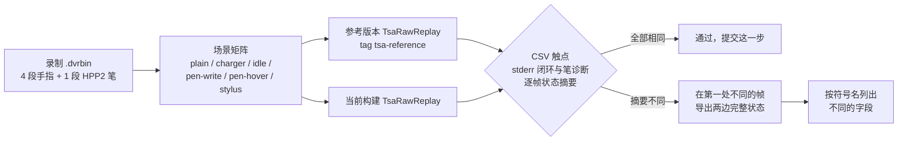
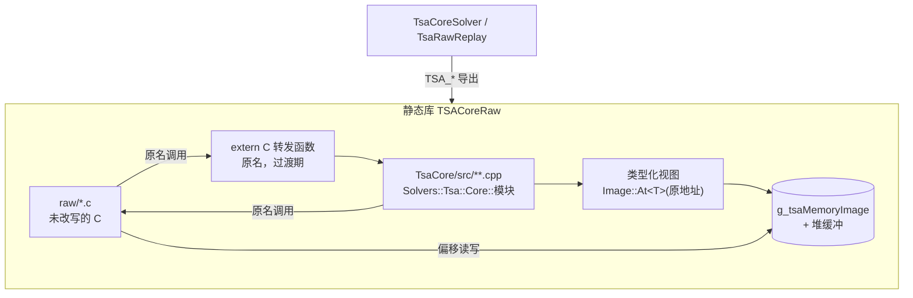

# TSACore 改写为 C++：比对方法与目标架构

## 概念

- **raw**：[raw](/EGoTouchService/Solvers/TouchSolver/raw) 下由 Ghidra 反编译得到的 TSACore C 代码（`param_N`、`local_xx`、按偏移读写内存），状态全部放在按原 DLL 地址排布的 `g_tsaMemoryImage` 里。
- **改写**：把 raw 逐模块改成标准 C++（类型化结构体、具名字段与变量、结构化控制流、命名空间），算法细节一律不动：判定条件、阈值、运算顺序、整数位宽与符号、截断与舍入点都与 raw 逐位一致。性能优化交给编译器。
- **参考版本**：git 标签 `tsa-reference` 指向的提交。比对时它在 `build/tsa-reference/<提交>` 下的 git worktree 里单独构建，作为金标准。
- **状态摘要**：每喂一帧之后，TSACore 全部算法状态（内存镜像 + `TSA_MallocAndInit` 分配的堆缓冲）规范化后的哈希。规范化保证同一算法在不同构建、不同堆地址下得到同一个值。
- **转发函数**：已改写的函数在过渡期保留一个原名的 `extern "C"` 版本，供还没改写的 raw 代码调用。
- **类型化视图**：过渡期状态仍在内存镜像里，改写后的代码按原地址取得带类型的引用（`Image::At<T>(va)`），与 raw 读写的是同一块内存。

## 架构

比对链路：任何一步改写都要让当前构建与参考版本在全部录制、全部场景下三样输出逐字节相同。

代码布局：改写后的模块放在 [TsaCore/src](/EGoTouchService/Solvers/TouchSolver/TsaCore/src)，目录沿用原厂源码树（断言字符串里的 `../../src/Alg/...` 等路径），与 raw 编进同一个静态库 `TSACoreRaw`，两边互相按原函数名调用。

全部模块改写完以后，状态从镜像移到库内的一个状态对象里（各模块的状态是它的成员），访问函数改为返回这些成员，转发函数和 `Image::At` 一起删除。

## 分点解释

### 1. 比对脚本 Compare-Reference.ps1

[Compare-Reference.ps1](/Tools/TsaRawReplay/Compare-Reference.ps1) 构建当前树（默认 preset `arm64-Debug-TsaCore`），按需在 worktree 里构建参考版本（只在第一次用到某个提交时构建），然后对每段录制跑场景矩阵：`plain`（原样回放并执行 AFE 闭环）、`charger`、`idle`（中途注入 IDLE 退出并保持静止）、`pen-write` / `pen-hover`（注入模拟笔，覆盖 StylusAft 等笔相关的手指侧逻辑）、`stylus`（经 StylusPipeline 的真实笔数据）。每次运行比较 [TsaRawReplay](/Tools/TsaRawReplay/main.cpp) 的三样输出：stdout 的逐帧触点 CSV、stderr 的闭环请求与笔诊断、`--state-digest` 的逐帧状态摘要。

摘要第一次出现不同时，脚本在那一帧让两边各自 `--state-dump`，再用 `--state-diff` 按 `_metadata/bss_symbols.txt` 和镜像头文件里的地址宏把差异落到符号名和偏移上，例如 `g_prevTouchesGrid+0x21d`。`-SelfCheck` 额外换一种堆布局重跑参考版本，确认摘要本身可复现；`-Only` 按名字子串筛选运行项；`-Recordings` 接受逗号分隔的文件或目录列表。

参考版本只在算法行为**有意**改变时挪动：修了真实缺陷的提交单独提交，确认其效果后把 `tsa-reference` 标签移到该提交上。纯改写的提交永远不挪标签。

### 2. 状态摘要的规范化与确定性

[StateTrace.cpp](/Tools/TsaRawReplay/StateTrace.cpp) 经 `TSACoreRaw_StateBlocks`（[TSAState.c](/EGoTouchService/Solvers/TouchSolver/raw/Common/TSAState.c)）取得镜像和全部堆缓冲，然后：

- 镜像按原 DLL 地址寻址；堆缓冲以「镜像里第一个指向它的槽位」命名，与分配地址无关。
- 指向镜像或堆的指针改写成规范地址；指向宿主程序代码与常量的指针只保留类别；确知存放栈地址的三个槽位（CMF 噪声数组的两个参数、`g_list` 表头）只保留类别。栈指针不按取值范围识别，因为两个相邻 32 位字段（标志字 0x80 加一个计数）拼起来正好落在主线程栈的地址区间里。

算法库的编译选项是确定性的前提，改写后的 C++ 沿用同一组：

| 选项 | 原因 |
|------|------|
| `-fno-strict-aliasing` `-fwrapv` | raw 依赖类型双关与有符号回绕；改写过渡期 C++ 与 C 同时访问同一块内存 |
| `-ffp-contract=off` | 原 DLL 是 x64，没有乘加融合；ARM64 默认融合会让浮点中间量差出末位，改写也可能因此改变结果 |
| `-ftrivial-auto-var-init=zero` | 原代码会把未赋值的局部量（结构体尾部填充）拷进状态，不清零时状态随栈上残留变化 |

在这组选项下，同一提交的 `-O0` 与 `-O2` 构建、不同堆布局下的运行，状态摘要逐帧相同。

### 3. 覆盖率与差分对拍

回放只能验证被执行到的代码。`Compare-Reference.ps1 -Coverage` 用插桩构建跑同一套录制与场景，在 `build/tsa-coverage` 下给出按文件和按函数的覆盖率：当前约 61% 的函数、54% 的行被执行到；`Tracking/MtLsm.c`、`Detection/Image.c`、`Tracking/HotZoneAdjust.c`、`Signal/BadChannel.c` 等几乎完全没有执行。

没有被执行到的代码靠两样东西保证：一是改写规则本身（第 5 节）只做与输入无关的等价变换；二是差分对拍——把参考提交里的旧 C 函数用 `-D名字=Old_名字` 改名编译，与当前库链进同一个程序，用大量随机输入加边界值同时调用新旧两个版本比较返回值和状态。纯函数（数学、滤波、距离换算）改写后都过一遍对拍。读写全局状态的函数用有状态对拍：驱动经 `TsaHostShim::Initialize` 做真实初始化（缓冲、参数表、表指针都就位），每轮把触点表、峰表、`TSAStatic`、`TSA_Prpt`、动态参数和网格缓冲随机化，然后对每个函数恢复本轮状态、先跑旧版本、记下整块内存镜像与网格缓冲，再恢复、跑新版本，比较返回值、镜像和缓冲。随机化要按字节偏向 0 与小值、坐标集中在一簇附近，否则多字节字段几乎总是落在阈值的同一侧，分支覆盖不到；对拍的灵敏度用人为改一个边界（如 `dim2Span < 4` 改成 `< 5`）确认能被抓到。

### 4. 目录、命名与过渡期接口

- 目录：[TsaCore/src](/EGoTouchService/Solvers/TouchSolver/TsaCore/src) 下按原厂源码树组织：`Alg/`（算法模块，如 `Alg/Filter`、`Alg/Touch`、`Alg/IDTracking`）、`App/`（主流程、Static、Buffer）、`Common/`、`Extension/`（GripFilter、HardwareAnalyzer、AFE 等）、`Prmt/`、`Tool/`、`WorkAround/`。原厂文件名未知的按函数前缀归入对应模块。
- 命名空间：根是 `Solvers::Tsa::Core`，原函数名前缀变成子命名空间（`IIR_Process` → `Iir::Process`，`TSAMath_ATan2` → `Math::ATan2`），函数名保持原厂语义，便于和反编译对照；每个函数定义上方一行注释记原名和地址（`// IDT_Process @ 0x6ba6...`）。
- 风格与仓库其余 C++ 一致：类型与函数 PascalCase，变量与字段 camelCase，常量 `kName`，注释中文。头文件只放声明与类型，不包含 raw 的头文件（raw 头里有上千个地址宏）。改写后的代码调用尚未改写的 raw 函数时，统一经 [Legacy/RawApi.h](/EGoTouchService/Solvers/TouchSolver/TsaCore/src/Legacy/RawApi.h) 里按原签名的 `extern "C"` 声明，按 raw 源文件分组；某个模块改写完成后从中删掉它的条目。raw 把返回值截断成 `char` 或 `int` 再判断的，调用处同样截断。
- 一个原厂源文件可以按职责拆成几个文件，例如 `TouchData.c` 拆成触点表维护 [Touch.cpp](/EGoTouchService/Solvers/TouchSolver/TsaCore/src/Alg/Touch/Touch.cpp) 与不涉及状态的距离 / 时间换算 [TouchGeometry.cpp](/EGoTouchService/Solvers/TouchSolver/TsaCore/src/Alg/Touch/TouchGeometry.cpp)；只在本文件内调用的原函数放进匿名命名空间，不再导出。
- 转发函数：放在 .cpp 末尾的「过渡期」段，签名与 raw 的 `TSAFuncDecls.h` 声明逐字一致（含返回类型的 `char` 等），只做参数转换后调用新函数。原 raw 文件在改写完成的同一提交里删除。

### 5. 改写规则（不动算法细节的边界）

可以改的：

- 偏移访问换成结构体字段；`param_N` / `local_xx` / `uVarN` 换成有意义的名字；Ghidra 的 `do { ... } while (true)` + `return`、`goto` 改成结构化循环与分支；冗余的中间变量去掉。
- `memset_s` / `memcpy_s` 换成 `ZeroFill` / `std::memcpy`（它们在合法参数下恒返回 0，`rc == EOK` 断言分支是死代码）。整对象清零必须用 `ZeroFill`：填充字节也是状态，`obj = {}` 不保证清零填充。
- 断言块（`StrPrintf_Process` 加 `HardwareAnalyzer_SetSoftException`）换成 `TsaAssert(条件)`。日志输出在本移植里已裁掉。
- 裁掉的模块（`TSAPrunedStubs.h` 里返回常量的桩）可以做常量传播并删除因此不可达的分支，在原调用处留一行注释说明裁掉了什么。因此不再有调用者的原函数（如只在裁掉的分支里用到的 `Peak_SortInSigDescending`、`Peak_GetMaxPeak`），以及整个程序里本来就没有调用者的函数（如 `Peak_IsOnLine`）不改写。
- 原代码里 `undefined4` 返回值的 `CONCAT31(高位, 比较结果)` 是 Ghidra 对 `setcc` 只写低字节的建模，新接口返回 `bool`；仍有 raw 调用者的，转发函数按原样拼出高 24 位。
- 整数表达式在模 2^32（或对应位宽）意义下的代数等价改写，例如把插值写成更直观的形式，只要所有中间量仍是同一位宽的无符号运算。

不能改的：

- 每个读写的位宽与符号：raw 用 `short` 读一个 `uint16_t` 字段，改写后也要 `static_cast<int16_t>`；`(char)` 截断、`& 0xffff` 掩码、`>> 0x1f` 取符号这类操作保留语义。
- 除法与移位的取整方向（Ghidra 把有符号除法展开成「负数先加偏置再右移」，改写成 `/` 时要确认是向零取整）。
- 有副作用的表达式的求值顺序、函数调用的次数与顺序（同一个查询在 raw 里调用两次就调用两次）。C++ 不规定 `a < b` 两侧的求值顺序，两个调用出现在同一表达式里时拆成语句。
- raw 不检查的下标照样不检查：例如新按下的触点历史下标为 `kNoTouch`，raw 仍按这个下标读写历史表第 20 个单元，落在表尾之后的内存上，改写后同样访问（触点表都是所在结构的末尾数组，编译器按柔性数组对待）。
- 浮点运算的顺序与精度（`float` / `double` 不互换，不合并常量）。
- 阈值、循环边界、提前返回、对超界索引的钳位。

### 6. 状态的迁移路径

- 过渡期：每个状态块定义成带显式保留字节的结构体，`static_assert` 校验每个具名字段的偏移和总大小；拥有它的模块提供一个访问函数（如 `PrmtRam()`、`Touches()`），按原地址绑定到镜像。改写后的代码只经访问函数取状态。字段只在使用它的模块改写时命名；没人用到的字节保持 `reserved`，语义不明的字段先以用途或偏移命名，改写到相关模块时再改名。
- 多个模块共享的块（触点表、峰表、`TSAStatic`、各类参数表、`g_tsaBuf*` 缓冲指针）的类型放在拥有它的模块目录下，其它模块包含其头文件使用。
- 全部模块改写完以后：状态改为库内状态对象的成员，堆缓冲改为成员数组；`TSACoreRaw_StateBlocks` 改为按原地址报告这些对象，状态摘要因此仍可与参考版本比较；之后才删除 `Image::At` 与内存镜像。TSACore 仍是进程内单例（一块面板只有一套算法状态），模块函数不额外传上下文参数。

### 7. 推进顺序

先改写被录制覆盖得好、又被大量模块依赖的数据模块（触点表、峰表、参数表），再按管线顺序改写跟踪、检测、基线与信号处理；纯笔相关的抑制模块（`Rejection/StylusAft.c` 等）只有模拟笔场景覆盖，放到有真实落笔录制之后。每个模块一个提交，提交前跑完整的 Compare-Reference，对纯函数另做差分对拍；回放覆盖不到的分支在提交说明里注明。
