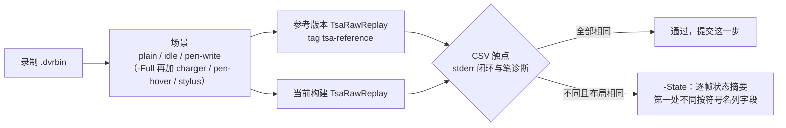
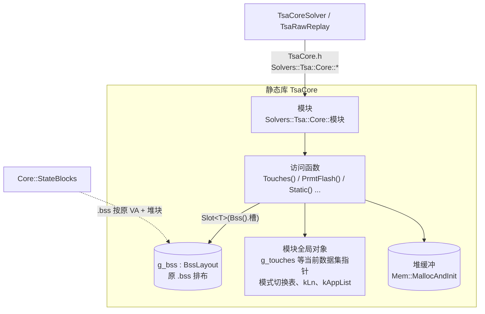
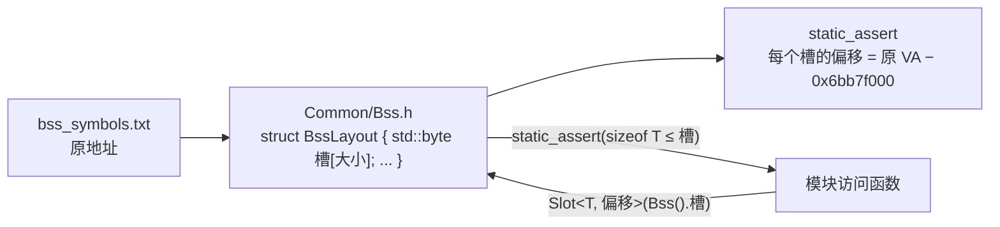
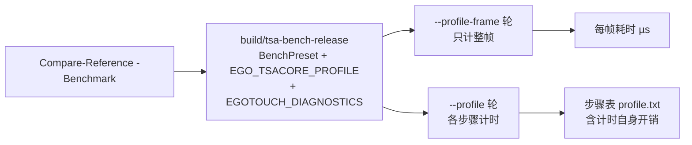

# TSACore 的 C++ 实现：状态布局、比对方法与改写规则

## 概念

- **TsaCore**：原厂 `TSACore.dll` 的 C++ 复刻，源码在 [TsaCore/src](/EGoTouchService/Solvers/TouchSolver/TsaCore/src)，编成静态库 `TsaCore`。算法细节（判定条件、阈值、运算顺序、整数位宽与符号、截断与舍入点）与原 DLL 逐位一致；热点循环按第 5 节的写法改成编译器能向量化的形式，输出不变。
- **原 DLL / Ghidra**：语义的最终依据是 Ghidra 里的 `TSACore.dll` 反汇编。代码里每个函数定义上方一行注释记原名和地址（`// IDT_Process @ 0x6ba6...`），对照时直接跳过去。
- **参考版本**：git 标签 `tsa-reference` 指向的提交，比对时在 `build/tsa-reference/<提交>` 下的 git worktree 里单独构建，作为金标准。
- **.bss 布局**：原 DLL 的 .bss（VA `0x6bb7f000..0x6bcad000`）在 C++ 里是一个结构 `BssLayout`，各模块的全局状态是其中按原地址排列的槽。
- **状态摘要**：每喂一帧之后，TSACore 全部算法状态（.bss + `TSA_MallocAndInit` 分配的堆缓冲）规范化后的哈希，定位差异时用。

## 架构

比对链路：每一步改动都要让当前构建与参考版本在全部录制、全部场景下的输出逐字节相同。

库内的状态分三类：.bss 里的模块状态、带初值的模块全局对象（原 .data / .rdata）、初始化时分配的堆缓冲。模块只经自己的访问函数取状态。

## 分点解释

### 1. 比对脚本 Compare-Reference.ps1

[Compare-Reference.ps1](/Tools/TsaRawReplay/Compare-Reference.ps1) 构建当前树（默认 preset `arm64-Debug`），参考版本只在第一次用到某个提交时构建，其回放结果按录制与场景缓存。每段录制默认跑三个场景：`plain`（原样回放并执行 AFE 闭环）、`idle`（中途注入 IDLE 退出并保持静止）、`pen-write`（注入模拟笔，覆盖笔相关的手指侧逻辑）；`-Full` 再加 `charger`、`pen-hover` 和经 StylusPipeline 的真实笔 `stylus`。比较 [TsaRawReplay](/Tools/TsaRawReplay/main.cpp) 的两样输出：stdout 的逐帧触点 CSV、stderr 的闭环请求与笔诊断。

只比输出、不比内部状态，所以状态布局可以随重构改变。`-State` 另外比较逐帧状态摘要：第一次不同的那一帧让两边各自 `--state-dump`，再用 `--state-diff` 按 [bss_symbols.txt](/EGoTouchService/Solvers/TouchSolver/raw/_metadata/bss_symbols.txt) 与 [image_macros.txt](/EGoTouchService/Solvers/TouchSolver/raw/_metadata/image_macros.txt) 把差异落到符号名和偏移上（如 `g_prevTouchesGrid+0x21d`），只在两边布局相同时有意义。`-Only` 按名字子串筛选运行项，`-Recordings` 接受多个文件或目录，`-Coverage` 改为统计覆盖率（写到 `build/tsa-coverage`）。

`-Benchmark` 改为测耗时，见第 5 节。

参考版本只在算法行为**有意**改变时挪动：对齐原 DLL 的修正单独提交，确认效果后把 `tsa-reference` 挪到该提交；纯重构的提交不挪标签。

### 2. 状态布局

- **为什么 .bss 整体保持原排布**：原代码有依赖相邻对象的越界读写，落点取决于对象之间的相对位置。例如新按下的触点历史下标为 `kNoTouch`（20），代码照样按它读写历史表第 20 个单元，落在 `g_prevTouchesGrid` 之后的 `g_prevTouchInvalidID` 与 `g_touchesGrid` 上（Debounce、EdgeRecovery、HotZoneAdjust、TouchAction、HandGesture、AntiTouch、GripFilter、FiException 等都有这种访问）；子区域下标超过 `kMaxUnitNum` 时 `SubTouchZone::UnitAt` 读到 `g_subTZ` 之后的 `g_pkAccessedFlagSubTZ`、`g_tzAccess`。所以 [Bss.h](/EGoTouchService/Solvers/TouchSolver/TsaCore/src/Common/Bss.h) 把 .bss 定义成一个结构，槽按原地址排列，没有模块用到的区间是 `reserved`；`g_bss` 在 [Bss.cpp](/EGoTouchService/Solvers/TouchSolver/TsaCore/src/Common/Bss.cpp) 里定义，静态零初始化。
- **槽与类型**：槽是 `std::byte` 数组，模块用 `Slot<T>(Bss().槽)`（或带偏移的 `Slot<T, 0x98>`，用于落在某个大对象内部的成员，如 `g_tsaBufTz` 在缓冲表 `bufferTable` 的 `+0x98`）取得类型化引用；`Slot` 用 `static_assert` 检查 `T` 放得进槽。状态类型是平凡结构体，字节数组隐式创建其中的对象。每个结构体用 `static_assert` 校验具名字段的偏移和总大小，没人用到的字节保持 `reserved`。
- **槽的大小**：槽的位置来自符号表，大小取「访问它的类型的 sizeof」与「到下一个符号的距离」的较大者；跨多个符号的模块状态结构体（`HardwareAnalyzer::Counters`、`PressureDrift`/`RfNoise`/`ToeSynaBl` 的 `State`、Afe 的 `Slots`、`HandBuffers`）占住整个结构体的范围。新增状态时从相邻的 `reserved` 区间里切出一个槽，放在它的原地址上。
- **原 .data / .rdata**：带初值的对象改成所在模块的全局对象，初值写成 C++ 初始化器：当前数据集指针 `g_touches` / `g_prevTouches` / `g_peaks` / `g_prevPeaks`（[DataSwitch.cpp](/EGoTouchService/Solvers/TouchSolver/TsaCore/src/App/DataSwitch.cpp)，初值指向 Grid 套，`ToHand` / `ToGrid` 切换）、模式切换防抖表与优先级表（[TouchMode.cpp](/EGoTouchService/Solvers/TouchSolver/TsaCore/src/Alg/TouchMode/TouchMode.cpp)）、`g_thenarExternal`、Sys 的两个一次性标志；只读表改成 `constexpr`（CTD 的 `kLn`、HotZoneAdjust 的 `kAppList`）。它们与 .bss 的相对位置没有任何代码依赖。`Static()` 恒指向 `staticGrid`，原 DLL 里那个指针从不切换。
- **机型参数表**：四个面板机型的 FlashPrmt、CMF PCA、ASA 表是 [ProjectTableData.inc](/EGoTouchService/Solvers/TouchSolver/TsaCore/src/Prmt/ProjectTableData.inc) 里的常量数组，`Prmt::LoadProject` 经 [LoadProjectTables](/EGoTouchService/Solvers/TouchSolver/TsaCore/src/Prmt/ProjectTables.cpp#L38) 按机型名拷进各自的 .bss 槽（原 DLL 同样是运行期装入 .bss）。机型怎么选见 [tsacore-raw-integration.md](tsacore-raw-integration.md) 第 6 节。
- **单例与初始化**：整个进程只有一套状态，模块函数不传上下文参数。没有显式的状态初始化入口：.bss 零初始化、全局对象带初值，与原 DLL 加载时一致；宿主直接调用 `Core::Init`（原 `TSA_InitAFEProject_UI`）。
- **整对象清零**：用 `ZeroFill`（对应原代码的 `memset_s(&obj, sizeof obj, 0, sizeof obj)`），填充字节也是状态，`obj = {}` 不保证清零填充。
- **字段命名**：结构体字段按读写它的代码定名；没有读者的字段删掉，字节并入相邻的 `reservedXXX`。触点表（[TouchData.h](/EGoTouchService/Solvers/TouchSolver/TsaCore/src/Alg/Touch/TouchData.h)）例外：历史下标为 `kNoTouch` 时，第 20 个历史单元落在 `g_touchesGrid` 上，当前表的表头与前几个单元会被当成历史单元的字段读写，所以只写的字段也保留写入；表头里只在两张表之间来回拷贝的 `field004` / `field00E` / `field00F` / `field138` 保留偏移名。

### 3. 状态摘要的规范化

[StateTrace.cpp](/Tools/TsaRawReplay/StateTrace.cpp) 经 `Core::StateBlocks`（[Memory.cpp](/EGoTouchService/Solvers/TouchSolver/TsaCore/src/Common/Memory.cpp)）取得 .bss（`va` 为 `0x6bb7f000`）与全部存活的堆缓冲，然后：

- .bss 按原 VA 寻址；堆缓冲以「.bss 里第一个指向它的槽位」命名，与分配地址无关。
- 指向 .bss 或堆的指针改写成规范地址；指向宿主模块代码与常量（包括原 .data / .rdata 对象）的指针只保留类别；确知存放栈地址的三个槽位（CMF 噪声数组的两个参数、`g_list` 表头）只保留类别。栈指针不按取值范围识别，因为两个相邻 32 位字段（标志字 0x80 加一个计数）拼起来正好落在主线程栈的地址区间里。

### 4. 编译选项

| 选项 | 原因 |
|------|------|
| `-fno-strict-aliasing` `-fwrapv` | 原代码依赖类型双关（同一块状态按不同类型读写）与有符号回绕 |
| `-ffp-contract=off` | 原 DLL 是 x64，没有乘加融合；ARM64 默认融合会让浮点中间量差出末位 |
| `-ftrivial-auto-var-init=zero` | 原代码会把未赋值的局部量（结构体尾部填充）拷进状态，不清零时状态随栈上残留变化 |

这组选项是不同优化级别、不同堆布局下输出逐帧相同的前提。`-fno-strict-aliasing` 保留为全局选项，它的代价在热点循环里手工规避（见第 5 节）。

### 5. 性能与计时

服务安装的是 `arm64-Release`（-O3、ThinLTO）。在这个配置下纯回放每帧 TSACore 本体约 30 µs，连同 AFE 适配层与宿主的 `TsaCoreSolver::Process` 约 35 µs（4 段录制、1920 帧、钉在大核上取 5 轮最快）。适配层的死区与增益循环写成可向量化的形式（增益前先找第一个越界格，把跨格的「已越界」标志拆成前后两段；死区留在 uint16 域里比较），约 4 µs。

- **计时**：[Profile.h](/EGoTouchService/Solvers/TouchSolver/TsaCore/src/Common/Profile.h) 只在 `EGO_TSACORE_PROFILE=ON`（定义 `TSACORE_PROFILE`）时编入。`TSA_PROFILE_SCOPE` 计整帧；主流程的每个 `TSA_STEP(调用)` 以调用表达式为名累计耗时，宿主经 `Core::ProfileEntries` 取走。每段计时自身约 30 ns，一帧约 70 段，合计会把整帧抬高约 5 µs，所以 `Core::ProfileSteps(false)`（回放的 `--profile-frame`）可以关掉分步、只留整帧。默认构建里 `TSA_STEP` 就是原样调用。
- **Benchmark**：[Compare-Reference.ps1](/Tools/TsaRawReplay/Compare-Reference.ps1) `-Benchmark` 用 `-BenchPreset`（默认 `arm64-Release`）构建到 `build/tsa-bench-release`，逐个串行回放。先跑 `-Rounds` 轮 `--profile-frame`，取最快一轮作为每帧耗时；再跑几轮 `--profile`，输出步骤表，前 `-Top` 项打到屏幕，全表写入 `profile.txt`，表里的数字含分步计时的开销。回放进程钉在 `-Affinity`（默认 0xF0，即 8cx Gen 3 的四个大核）上并以高优先级运行；即便如此仍有 5–10% 的噪声。bench 构建全局定义 `EGOTOUCH_DIAGNOSTICS`，因为发布配置的录制读取器不保留原始 SPI 帧，没有它 `--afe` 回放就没有输入；TsaCore 源码不读这个宏。
- **热点循环的写法**：
  - 逐格循环里不写 `c ? a[i] : x` 这种条件读：clang 会把条件加载向量化成逐 lane 的标量加载，比不向量化还慢。要先无条件读进局部变量，再做选择。条件写同理，改成无条件写回选择后的值。
  - 在 `-fno-strict-aliasing` 下，循环里每次调用 `PrmtFlash()` 之类的访问函数、每次读结构体里的上界，都会重新访存，循环也因此无法向量化。所以参数和循环上界要先取到局部变量里。
  - 稀疏命中的扫描先粗筛再逐格：峰检测先按行取最大值，坏点检测按 16 格一块，查表前按 64 格一块（`AnyNonZero`）。
  - 每帧重复的计算做备忘，前提是运算次序不变。例如轮廓插值按点、按行缓存（`HighResCache`），以 NaN 位型 0x7fc00001 作为未计算的哨兵；备忘表按最大阵列定长静态分配，每次只清用到的前缀，帧处理里没有堆分配（全部堆缓冲都在 `Buffer::InitProject` 里一次分好）。
  - 只计算有读者的统计量。Property 的极值与计数用 int16、和用 int32，分两遍累计；CMF 的平坦格判定写成无分支掩码，聚类按连续段一次累加。
- **剩余分布**（带分步计时）：TrackAndReport 约 14 µs，TouchZone 约 5.7，CMF 约 4.8，Property 约 3.9，Self 约 2.0，其余步骤都在 1.7 以下。

### 6. 目录与命名

- 目录按原厂源码树组织（断言字符串里的 `../../src/Alg/...` 等路径）：`Alg/`（算法模块）、`App/`（主流程、Static、Buffer、DataSwitch）、`Common/`（Bss、Memory、Assert）、`Extension/`、`Prmt/`、`Rejection/`、`Tool/`、`WorkAround/`。原厂文件名未知的按函数前缀归入对应模块；一个原厂源文件可以按职责拆成几个文件。
- 命名空间根是 `Solvers::Tsa::Core`，原函数名前缀变成子命名空间（`IIR_Process` → `Iir::Process`）；只在本文件内调用的函数放进匿名命名空间。类型与函数 PascalCase，变量与字段 camelCase，常量 `kName`，注释中文。
- 宿主接口只有 [TsaCore.h](/EGoTouchService/Solvers/TouchSolver/TsaCore/TsaCore.h)：与原 `TSA_*` 导出一一对应、但按 C++ 类型化的函数（结构体只留读取的字段，多次查询合成一次），加回放用的 `Core::StateBlocks` 与 `Core::Profile*`。各个实现放在对应模块的源文件末尾。

### 7. 改写规则（不动算法细节的边界）

可以改的：

- 偏移访问换成结构体字段；无意义的临时名换成有意义的名字；`goto` 与无限循环加 `return` 改成结构化控制流；冗余的中间变量去掉。
- 断言换成 `TsaAssert(条件)`；日志输出已裁掉。
- 本机型参数下恒为常量的分支做常量传播并删除不可达部分；没有调用者的函数、只写不读的状态直接删除（触点表除外，见第 2 节）。
- 为性能改变循环结构：无条件读写、参数外提、分块粗筛、按段累加、备忘（见第 5 节）。前提是每个参与比较或输出的值逐位不变，浮点运算的次序也不变。
- 返回 `bool` 的判定：原代码 `setcc` 只写低字节，调用方只看低字节的直接用 `bool`。
- 整数表达式在对应位宽的模运算意义下的代数等价改写；逐项赋值的大表改成描述表加循环（前提是各项写入位置互不重叠）。

不能改的：

- 每个读写的位宽与符号：原代码用有符号 16 位读一个 `uint16_t` 字段，改写后也要 `static_cast<int16_t>`；截断、掩码、取符号操作保留语义。
- 除法与移位的取整方向；浮点运算的顺序与精度（`float` / `double` 不互换，不合并常量）。
- 有副作用的表达式的求值顺序、函数调用的次数与顺序；两个调用出现在同一表达式里时拆成语句（C++ 不规定 `a < b` 两侧的求值顺序）。
- 原代码不检查的下标照样不检查（见第 2 节的越界落点）；阈值、循环边界、提前返回、对超界索引的钳位。

发现与原 DLL 不一致的地方（例如类型推断错误导致的指针步长或符号错误），以 Ghidra 反汇编为准单独提交修正，提交说明里列出汇编证据与对回放的影响，再把 `tsa-reference` 挪到该提交。
