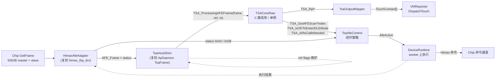
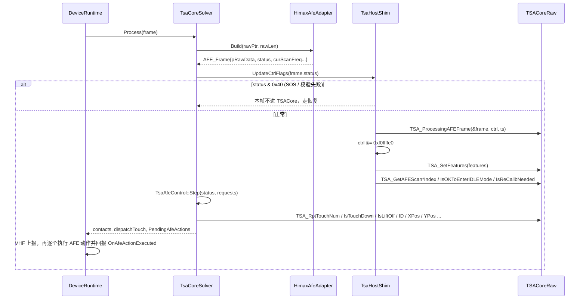
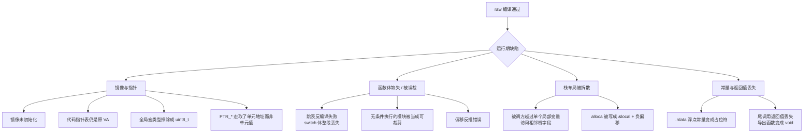
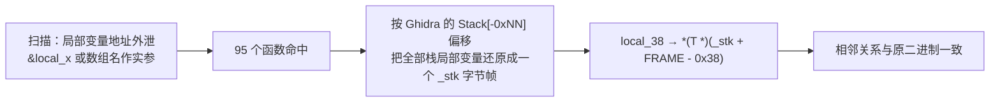
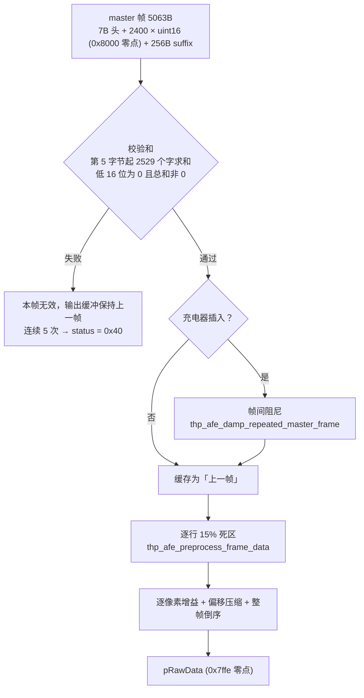
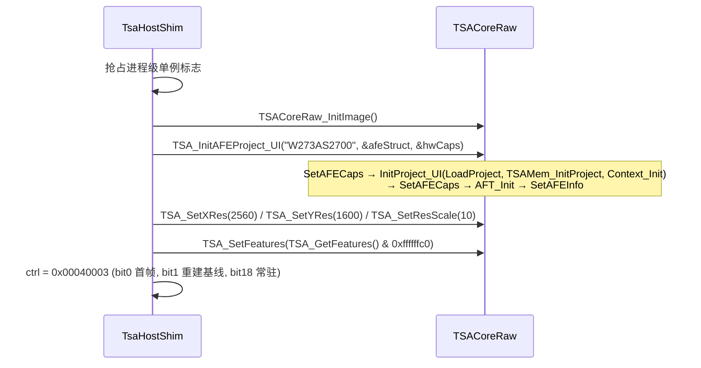
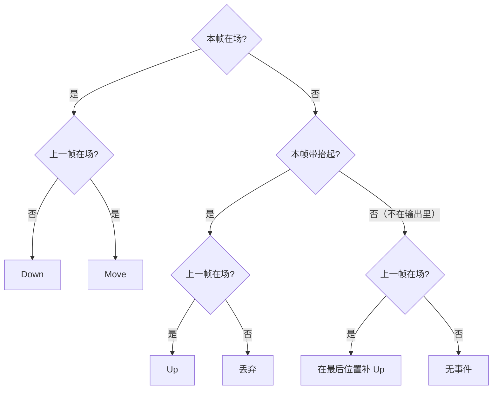
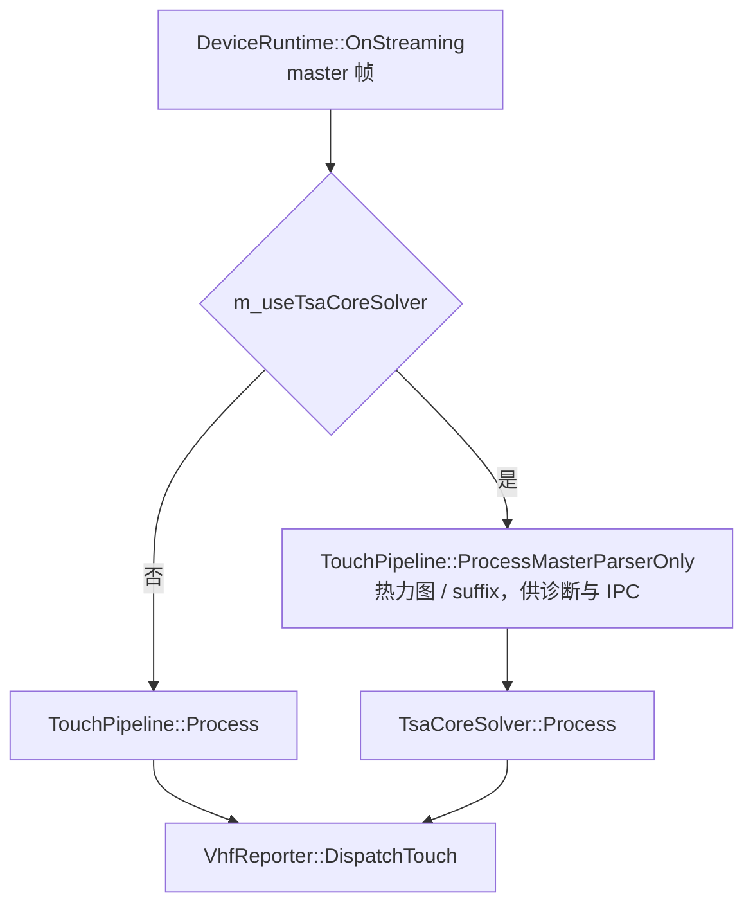
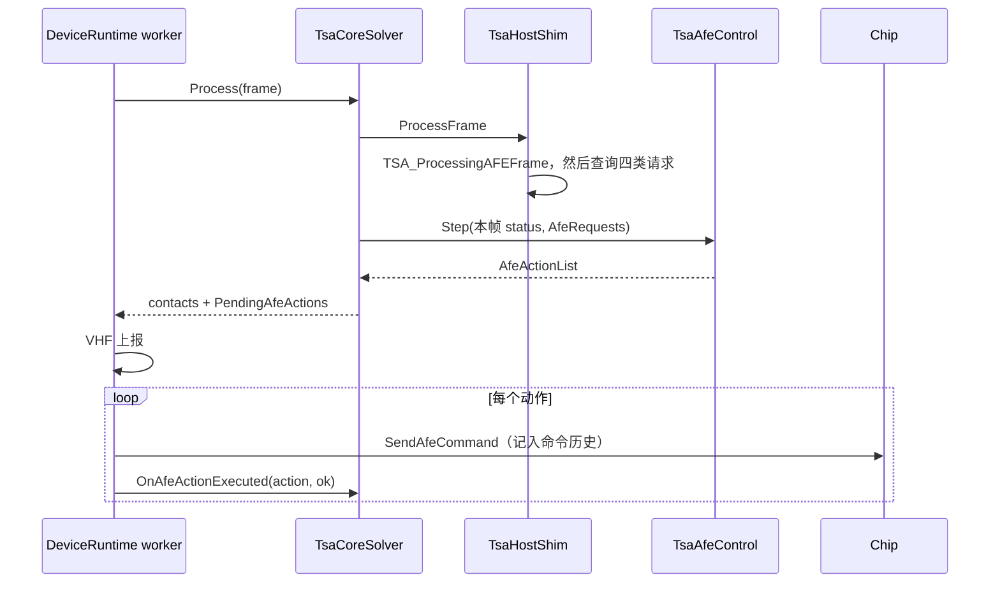
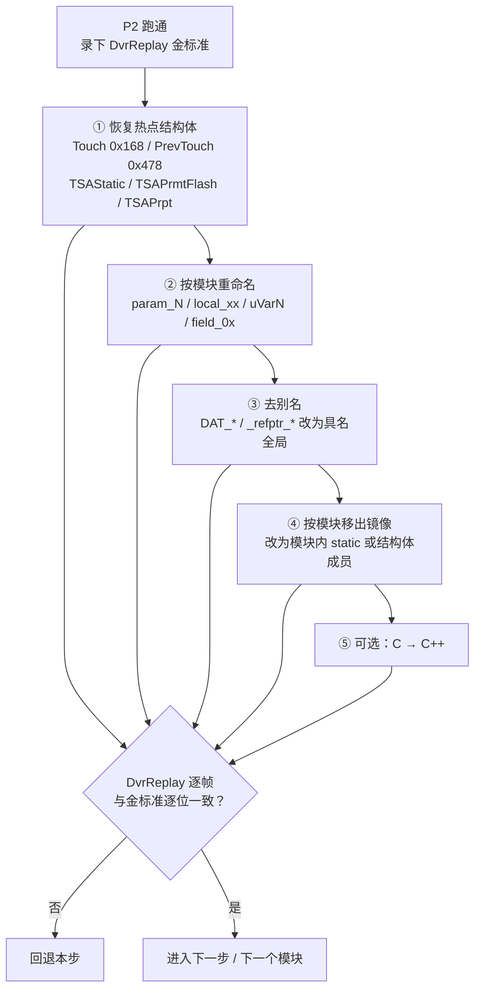

# TSACore raw 管线接入业务层：接口设计

结论基于 commit `6f69f21` 之上完成 P0 修复的 [raw](/EGoTouchService/Solvers/TouchSolver/raw) 源码，并用 Ghidra 对 `TSACore.dll` / `himax_thp_drv.dll` / `ApDaemon.dll` 交叉核对过。

## 概念

| 术语 | 含义 |
|------|------|
| raw 管线 | [raw](/EGoTouchService/Solvers/TouchSolver/raw) 下 9 个活跃目录里 76 个从 `TSACore.dll` 反编译重建的 C 文件（`_unused` 是裁掉的模块）。它是**手指 MS 管线**加 StylusAft 防误触；主动笔坐标解算 `TSA_ASAProcess` 已裁剪成空桩（[TSAPrunedStubs.h](/EGoTouchService/Solvers/TouchSolver/raw/include/TSAPrunedStubs.h#L421)），笔仍由现有 `StylusPipeline` 负责 |
| 内存镜像 | `g_tsaMemoryImage`，覆盖原 DLL VA `0x6bb4e000..0x6bcad000` 的 1.44 MB 数组。所有全局变量都经 `TSA_MEM_AT(va)` 映射到这里，所以整个 TSACore 是**进程级单例** |
| AFE 帧 | `AFE_Frame`（[TSAPrmtStaticTables.h](/EGoTouchService/Solvers/TouchSolver/raw/include/TSAPrmtStaticTables.h#L969)），即 `himax_thp_drv` 交给 TSACore 的每帧结构：`pRawData` 指向 2400 个以 `0x7ffe` 为零点的 `uint16` |
| AFE HAL spec | `g_afeHalSpec`，决定 `AFE_SetFrameTrans` / `AFE_SetCapsTrans` 按哪一版布局拷贝帧与 caps。DLL `.data` 初值为 `0x011a00`（1.26.0），ApDaemon 从不调用 `TSA_SetAFESpecVersion` |
| ctrl flags | `TSA_ProcessingAFEFrame` 的第二参数，宿主每帧维护的 32 位控制字（首帧、基线重置、IDLE、跳频完成等） |
| AFE 适配层 | 本文提议的新模块，复刻 `himax_thp_drv` 对 SPI 原始帧做的预处理，产出 TSACore 期望的输入域 |

## 架构

替换后的形态：手指解算由一个薄 C++ 外观类 `TsaCoreSolver` 承担，对 [DeviceRuntime.cpp](/EGoTouchService/Device/runtime/DeviceRuntime.cpp#L1358-L1367) 保持与 `TouchPipeline` 同样的调用面（`Process(HeatmapFrame&) -> bool dispatchTouch`），内部按「宿主三件套」拆开：AFE 适配层顶替 `himax_thp_drv`，Host Shim 顶替 `ApDaemon` 的 `TsaFrame`，输出映射器把 `TSA_Rpt*` 翻成现有 `TouchContact`，闭环策略把 TSACore 的请求翻成交给宿主执行的 AFE 动作。

单帧时序：

工作量分五块，P0 → P1 → P2 是接入主线，P3 闭环与 P4 源码整理都在 P2 跑通之后进行：

| 阶段 | 内容 | 验收 |
|------|------|------|
| P0（已完成） | raw 修到可运行：镜像初始化、函数指针表、镜像宏补真实类型、缺失函数体、栈帧还原、CMake 目标 | 链接通过；回放一段录制不崩，输出确定 |
| P1（已完成） | `HimaxAfeAdapter`，按 `himax_thp_drv` 真实逻辑复刻预处理 | 以 P2 真机触摸正确为准，不与原驱动缓冲逐字节比对 |
| P2（已完成） | `TsaHostShim` + `TsaOutputMapper` + `TsaCoreSolver` 外观，经开关替换 `TouchPipeline` | `arm64-Debug-TsaCore` 真机触摸正常 |
| P3（代码完成，待真机验证） | 闭环控制（跳频、扫描率、IDLE、校准），连同宿主电源状态机升级（[device-runtime-power-state-machine.md](/docs/artifacts/device-runtime-power-state-machine.md)） | 长时运行无基线漂移、跳频请求能落到 IC、灭屏 / 合盖 / 休眠后触摸可恢复 |
| P4 | 渐进整理成可读源码：结构体恢复、重命名、去镜像 | 每一步的 DvrReplay 逐帧输出与整理前逐位一致 |

## 分点解释

### 1. 输入文档里需要先纠正的地方

接口文档《ApDaemon_Himax_TSACore_Interface》的总体时序可以用，但以下几处与 raw 源码和 Ghidra 不符，按它实现会出错：

| 文档说法 | 实际情况 | 依据 |
|---------|---------|------|
| `TSA_InitAFEProject_UI(name, "1.3.0", pHwCap)` | 第二参是 **AFE 宿主结构指针**（布局见第 4 节），最终进 `TSA_SetAFEInfo`；ApDaemon 传的是 `vtbl+0x1a8()` 与 `vtbl+0x1a0()` 两个对象 | [TSA.c](/EGoTouchService/Solvers/TouchSolver/raw/Core/TSA.c#L6193-L6231)；ApDaemon `FUN_1800e4550` |
| spec 为 1.3.0，帧结构 `0x48` 字节 | ApDaemon 不调用 `TSA_SetAFESpecVersion`，生效的是 `.data` 初值 `0x011a00`，走 `AFE_SetFrameNormal` / `AFE_SetCapsNormal`：帧拷贝到 `+0x5c`（含 `+0x40 pStylusData`、`+0x58` 双字），caps 拷贝到 `+0x5d` | [AFE.c](/EGoTouchService/Solvers/TouchSolver/raw/Core/AFE.c#L3053-L3074)、[AFE.c](/EGoTouchService/Solvers/TouchSolver/raw/Core/AFE.c#L3186-L3206)；`TSACore!0x6bb4fa40 = 00 1a 01 00` |
| `+0x38` 是 `pSideTouchData` 指针 | `+0x38` 是 4 字节 `dwGesture` | `AFE_SetFrameNormal` 只拷 4 字节 |
| `AFE_SetCaps*` / `AFE_SetFrame*` 做行列转置 | raw 里两条路径都只是逐字段拷贝，没有转置 | [AFE.c](/EGoTouchService/Solvers/TouchSolver/raw/Core/AFE.c#L3309-L3350) |
| 输出函数为 `TSA_RptTouchDown/Up/X/Y`、`TSA_GetStylusX`、`TSA_RequestEnterIDLEMode`、`TSA_SetScreenResolution` 等，并给了地址 | 这些名字不存在，地址也对不上（如 `0x6baa2462` 实为 `TSAStatic_IsChargerPlugged`）。ApDaemon 实际按名字绑定的是 `TSA_RptTouchNum`、`TSA_RptIsTouchDown`、`TSA_RptIsLiftOff`、`TSA_RptTouchID`、`TSA_RptTouchXPos/YPos`、`TSA_SetXRes/YRes/ResScale`、`TSA_GetAFEScanFreqIndex/RateIndex`、`TSA_IsOKToEnterIDLEMode`、`TSA_IsReCalibNeeded`、`TSA_RptASA*` 等，raw 里除 ASA 系列外都有实现 | ApDaemon 字符串表 `0x18011ea48..0x180120100` |
| himax 增益与非线性压缩公式（`(raw*gain+50)/100`，`-20/80` 分段），增益表为 int16 | 真实逻辑不同，增益表是 `INT32[2400]`，见第 3 节 | `himax_thp_drv!thp_afe_get_frame` 反编译 |
| 闭环命令 ID：跳频 `0x0C`、扫描率 `0x04`、进 IDLE `0x08`、校准 `0x0A`、重置 IDLE 基线 `0x07` | 真实 ID：`0x01` start_calibration、`0x02` / `0x0d` 关 / 开自动跳频、`0x06` clear_status（参数是状态位）、`0x0a` enter_idle、`0x0b` force_exit_idle、`0x0c` force_to_freq_point、`0x0e` force_to_scan_rate；`set_idle_touch_threshold`、`set_baseline_update_interval` 只写驱动全局变量，不发命令；ApDaemon 没有绑定 `TSA_IsOKToResetIDLEBaseline` | `himax_thp_drv` 各 `thp_afe_*` 反编译；ApDaemon `tsa_func_table` 槽位 `+0x1f8/+0x200/+0x320/+0x328` |
| 没有提到状态位的清除 | 固件的校准完成（suffix `word[3]` = `0xbb`）与跳频完成标志会一直保持，直到宿主发 `clear_status`；ApDaemon 每帧看到就清 | `TsaFrame::Process` 反编译 |

`dwCtrlFlags` 位表、`TsaFrame_CallProcessingAFEFrame` 的帧后动作（`& 0xf0ffffe0`、`TSA_SetFeatures`）与 Ghidra 一致，可以照用。

### 2. P0：raw 能编译 ≠ 能跑

P0 的产物是 C 静态库 `TSACoreRaw`。现状：76 个源文件 0 个编译失败、0 个未定义符号；480 帧录制完整跑完，两次运行输出逐字节一致，`-O0` 与 `-O3` 输出逐字节一致。

反编译产物从「能编译」到「能跑对」之间隔着下面几类缺陷，每一类都不会被编译器报出来：

**镜像与指针。**

1. 镜像初始化：`TSA_MemoryImage_Init`（[TSABssMemoryImage.h](/EGoTouchService/Solvers/TouchSolver/raw/include/TSABssMemoryImage.h#L1557-L1573)）拷 `.data` / `.rdata`、打 606 条内部重定位、装 W273AS2700 参数表。它是 `static inline`，对宿主的入口是 `TSACoreRaw_InitImage()`（[TSABssMemoryImage.c](/EGoTouchService/Solvers/TouchSolver/raw/Common/TSABssMemoryImage.c#L8)），必须是 Init 序列的第一步，否则 `g_afeHalSpec` 为 0，帧按 V0113 布局拷贝。
2. 代码指针：`kTsaInternalRelocs` 只处理「镜像内指向镜像内」的指针，镜像里有 39 条重定位指向 `.text`。活跃代码真正经它们做间接调用的只有 `g_tmHandlerTable`，已改成 C 里的真实函数指针数组（[TouchMode.c](/EGoTouchService/Solvers/TouchSolver/raw/Filter/TouchMode.c#L3-L10)）；`pSensorDataCallback` 直接取 `&TSA_GetSensorData`。其余（校准表、`g_prmtCallBack`）没有调用点。
3. 全局宏类型：1360 个镜像地址宏里凡是存堆指针或时间戳的，都按真实宽度声明（`undefined8` / 具体指针类型），不再有「`uint8_t` 传给 `void *`」的诊断。
4. `PTR_*` 宏：Ghidra 的 `PTR_xxx` 表示「该地址处存放的指针」，宏要定义成单元的值（[TSACoreInternal.h](/EGoTouchService/Solvers/TouchSolver/raw/include/TSACoreInternal.h#L58)），定义成单元地址会让 `strcmp` 读到指针本身的字节。

**函数体缺失 / 被误裁。**

1. 跳表失败：`BLSM_ProcessStage`、`BLSM_UpdateStage`（[BLSM.c](/EGoTouchService/Solvers/TouchSolver/raw/Baseline/BLSM.c#L166)）、`BLReset_BaselineStateMachine`（[BLReset.c](/EGoTouchService/Solvers/TouchSolver/raw/Baseline/BLReset.c#L1050)）三个函数的 `switch` 体在导出时整段丢失，已按 Ghidra 修好跳表后的结果补回。全量比对过 2029 个函数体，只有这三处。
2. 误裁模块：`Thenar`（[Thenar.c](/EGoTouchService/Solvers/TouchSolver/raw/Rejection/Thenar.c)）和 `Self`（[Self.c](/EGoTouchService/Solvers/TouchSolver/raw/Signal/Self.c)）无条件执行且结果被活跃代码读取，已从 `_unused` 移回。`ASAStaticInit`、`CMFRemap_Init`、`SideTouch_Malloc` 是初始化路径上有副作用的函数，前者补回实现（[ASA.c](/EGoTouchService/Solvers/TouchSolver/raw/Rejection/ASA.c#L4)），后两者放在 [TSAPrunedImpl.c](/EGoTouchService/Solvers/TouchSolver/raw/Core/TSAPrunedImpl.c)。
3. 偏移反推错误：`TouchThold_GetTouchDownThold`（[TouchThold.c](/EGoTouchService/Solvers/TouchSolver/raw/Tracking/TouchThold.c#L392)）Ghidra 无法反编译，按汇编重建。

其余保持为空桩的模块（[TSAPrunedStubs.h](/EGoTouchService/Solvers/TouchSolver/raw/include/TSAPrunedStubs.h)）之所以与真实行为等价，依赖 W273AS2700 参数表的这几个取值，换机型参数表时要重新核对：

| 参数 | 取值 | 让哪些桩成立 |
|------|------|-------------|
| `dwFeatureFlagsBase1_or`（flash+0x54） | `0x01090020` | SafeBaseline、SideTouch、Proximity、AFT、SignalDisparity 后处理均未启用 |
| `dwPeakProcessingMode`（flash+0x34） | 3 | 走 FIException，HIException 不会被调用 |
| 自容使能（flash+0x608） | 0 | 所有 `SS_*` 桩；SignalDisparity 只在自容有效时计算 |
| flash+0x6cd、+0x80e | 0 | `CMFRemap_IsNeedRemap()` 恒为 0 |
| notch 数（flash+0x9e4）、UDFP（flash+0x1740） | 0 | NotchCorrect、UDFP |
| 折叠屏支持（flash+0x17cc） | 1（需 > 1 才启用） | `TSAFold_*ZoomOutRemap` 原样返回入参指针，`TSAFold_Dim*PosOutRemap` 原样返回坐标 |

**栈布局被拆散。** 原函数里相邻的栈变量经常是一个结构体或数组，被调方拿到其中一个的地址后会按下标访问邻居（如 `TouchMode_NewModeProcess` 把入参当 `{mode, data, result}` 三元组，`TZ_GetDFSPrpt` 往 50 字节的「局部变量」里写 801 字节）。Ghidra 把它们拆成独立局部变量，C 编译器不保证相邻，结果是栈被写坏、返回地址变成垃圾。

凡是有局部变量地址外泄的函数（95 个）都按这个方式还原，函数开头有一行 `_Alignas(16) uint8_t _stk[N]` 及说明（示例见 [TZ.c](/EGoTouchService/Solvers/TouchSolver/raw/Detection/TZ.c#L5641)）。`TouchMode_Process` 是手工改成 `prevUnit[3]` / `nextUnit[4]` 的例外。P4 恢复结构体时，`_stk` 帧就是待命名的栈结构体。另有两处变长栈数组（`CMF_FilterOnTxOfRx`、`CMF_Ransac`，[CMF.c](/EGoTouchService/Solvers/TouchSolver/raw/Signal/CMF.c#L1461)）被写成 `&local + 负偏移`，已改为 `__builtin_alloca`。

**常量与返回值丢失。**

1. `SensorPitchSizeMap`（[MISC.c](/EGoTouchService/Solvers/TouchSolver/raw/Common/MISC.c#L63)）用 `100.0` 作「该维度没有 pitch 映射表」的哨兵，导出时变成了值为 `0.0` 的占位宏，导致 Dim2 坐标恒为 0。这类占位符全仓只有这一处。
2. 尾调用返回值：Ghidra 把「只做一次尾调用」的函数判成 `void`，共 70 余个 `TSA_Get*` / `TSA_Is*` / `TSA_Rpt*` 导出受影响。内部调用点不受影响（没有任何 `extraout_*` 引用），只影响宿主要读返回值的导出。已修正 `TSA_RptDiffPtr`、`TSA_RptBaselinePtr`、`TSA_RptCMNPtr`、`TSA_RptPreFilteredDifPtr` 及其下游 `TSAMS_Get*Ptr`；P2 / P3 用到哪个导出，先对照 Ghidra 签名核对返回类型。

**构建。** `TSACoreRaw` 只收 9 个活跃目录（[CMakeLists.txt](/CMakeLists.txt#L274-L296)），C17，必须带 `-fno-strict-aliasing -fwrapv`（反编译代码到处做类型双关和有符号回绕）。`raw/include` 不对外暴露，宿主只用 `extern "C"` 声明所需导出，避免 `TSACoreInternal.h` 的上千个宏污染其他翻译单元。

P0 只做「不改就跑不对」的那部分整理。raw 共约 5.6 万行，`param_N` / `local_xx` / `uVarN` 合计 3 万余处，`field_0x..` 与裸偏移 6 千余处，`_refptr_*` 8 千余处。地址映射要先保留：反编译代码大量按偏移访问，有些还会越过一个全局读到相邻的全局，在结构体恢复之前拆成独立变量会悄悄改变行为。命名、结构体恢复、去镜像统一放到 P4。

### 3. P1：HimaxAfeAdapter —— TSACore 的输入域

现有 [MasterFrameParser.hpp](/EGoTouchService/Solvers/TouchSolver/MasterFrameParser.hpp#L38-L40) 只做 `wire ^ 0x8000`。TSACore 的参数表是在 `himax_thp_drv` 处理后的数据上整定的，喂 SPI 原始字会让阈值、基线、峰值全部失配。[HimaxAfeAdapter](/EGoTouchService/Solvers/TouchSolver/TsaCore/HimaxAfeAdapter.cpp) 按 `thp_afe_get_frame` 对 master 矩阵的处理顺序逐步复刻：

**校验。** 从第 5 字节起到帧尾共 2529 个小端字求和，低 16 位为 0 且总和不为 0（排除全零帧）才算有效。测试录制的 480 帧全部通过。

**帧间阻尼。** 只在充电器插入时启用（`thp_afe_set_charger` 置位 `g_MasterFrameDampingEnable`，初值为假）。相对上一帧变化落在 `[-300, 200]` 之外的格子连同邻域被打上标记（值 10）；标记当帧原样放行并降为 9，其余格子一律向上一帧回拉一半，标记值逐帧递减到 0。邻域下标不对称——上一行取 `c..c+2`，同行取 `c±1`，下一行取 `c-2..c`——这是按汇编核对过的原样行为。「上一帧」缓存的是阻尼之后、死区之前的数据，不论是否启用阻尼都会更新。

**逐行死区。** 每条 TX 取 `v = sample - 0x7ffe`，`thr = rowMax*15/100`；`v ≥ thr → v-thr`，`v < -thr → v+thr`，其余置 0，写回 `v + 0x7ffe`。

**增益与压缩。** 这一步的零点取 `0x8000`，比死区阶段高 2，所以被死区归零的格子在这里是 `-2`，最终仍输出 `0x7ffe`。设 `v = word - 0x8000`，`slot = suffix.word[10] != 0`，`gain = (slot ? PixelGainTable2 : PixelGainTable1)[2399-i]`，充电器未插入时 `T = 300, scale = 100`，插入时 `T = 400, scale = 110`：

1. 若 `word ∉ [0x7149, 0x7149+10999)`，置**饱和标志**；从这个格子起本帧余下的格子都跳过增益，只做第 3 步。
2. 未饱和且 `v > 0`：若 `v < T`，把增益削弱为 `gain/4`（`v < T/2`）、`2·gain/4`（`v < 3T/4`）、`3·gain/4`（其余）；然后 `v = (gain·v/100)·scale/100`。
3. 偏移：`v ≥ 1 → v - (v < 51 ? 20 : 80)`；`v < 0 → (v + 50 < 0 ? v + 80 : 0)`。
4. 写 `out[2399 - i] = v + 0x7ffe`（整帧倒序）。

两张增益表各 2400 项、单位为百分比（表 1：76–156，表 2：52–171），下标是倒序之后的格子；W273AS2700 与 W273AS2710 共用，W273AS13x0（BOE）用另一组。表数据在 [HimaxPixelGainTables.inc](/EGoTouchService/Solvers/TouchSolver/TsaCore/HimaxPixelGainTables.inc)，由 DLL 数据段导出。

**status 与扫描参数。** 校验通过时基值为 `0x02`，再按 suffix 叠加：`word[0]==1 → |0x01`、跳频在途且当前频率等于目标且 `word[2]!=0 → |0x04`、`word[3]==0x00bb → |0x08`、`word[14]` 或 `word[16] > 1499 → |0x20`、`word[6]!=0 → |0x40`。`curScanFreq = {75,113}[word[10]]`，`curScanRate = 120`。测试录制里出现过的位是 `0x02 | 0x08 | 0x20`。

`AFE_Frame` 按 spec 0x011a00 的布局填：`+0x10 pRawData`，`+0x18 pLineData = NULL`，`+0x30 curScanFreq`，`+0x32 curScanRate`，`+0x34 status`，`+0x38 dwGesture = 0`，`+0x40 pStylusData`（ASA 已裁剪，传 NULL），其余置 0。缓冲区由适配层持有；`AFE_SetFrame` 会把 `pRawData` 深拷进 `g_afeGridData`，所以不需要跨帧保活。

**方向。** 驱动把整帧倒序（等价于旋转 180°），TSACore 的 pitch 映射表、增益表、边缘参数都以倒序后的方向为准，所以输入必须倒序；现有 `TouchPipeline` 不倒序，两条管线的输出坐标因此互为 `x' = 2560 - x`。显示方向在输出侧还原，见第 5 节。

与原驱动 `g_RealTimeFrameBuffer` 的逐格比对需要在真机上抓缓冲，尚未做；目前的依据是反编译与汇编逐句对照，以及回放中触点中心与 diff 局部极大值重合。

### 4. P2：TsaHostShim —— 初始化与 ctrl flags

[TsaHostShim](/EGoTouchService/Solvers/TouchSolver/TsaCore/TsaHostShim.cpp) 顶替 ApDaemon 的 `TsaFrame`。初始化序列（对应 `ThpBase::InitTsaPrmt` / `InitTsa` / `TsaFrame::Init`）在第一帧到来时惰性执行：

`afeStruct` 是宿主长期持有的结构（[TsaCoreApi.h](/EGoTouchService/Solvers/TouchSolver/TsaCore/TsaCoreApi.h)），TSACore 保存它的指针（`g_thpAFEStruct`）并在运行期反复读取：`+0x00` info 指针，`+0x08` caps 指针，`+0x10` **当前帧指针**，`+0x40` 驱动名字符串。TSACore 从 `afeStruct->frame` 的 `+0x34 / +0x30 / +0x32` 读 status、扫描频率、扫描率，从 `afeStruct->caps` 读行列数，所以 `+0x10` 必须指向宿主每帧更新的那个 `AFE_Frame`，它与 `TSA_ProcessingAFEFrame` 的第一参是同一个对象。三个结构体因此放在静态存储里。

`hwCaps` 按 spec 0x011a00 的 `AFE_SetCapsNormal` 布局是 `0x60` 字节，目前只填了 TSACore 实际读取的字段：`numCol=60, numRow=40, numScanFreq=2, pScanFreqList={75,113}, numScanRate=1, pScanRateList={120}`。原机 caps 的其余字节（`rxChannel`、`pitch`、`sensorArch` 等）在活跃代码里没有读取点。

分辨率：参数表里 Dim1 / Dim2 分辨率已经是 2560 / 1600（flash+0x5a6 / +0x5a8），但 `ResScale`（flash+0x5a0）初值为 0，不调用 `TSA_SetResScale` 时 `TSA_RptTouchXPos/YPos` 恒为 0。`ResScale` 只作用在输出换算上，这里取 10，使输出量程等于业务侧 HID 的逻辑量程 25600 × 16000（[VhfReporterTouchPacketHelper.h](/EGoTouchService/Device/vhf/VhfReporterTouchPacketHelper.h#L20-L21)），保留十分之一像素的精度。

ctrl flags 由 shim 每帧根据适配层 `status` 维护（TSACore 的消费点是 `TSAStatic_UpdateCtrlFlags`，[TSAStatic.c](/EGoTouchService/Solvers/TouchSolver/raw/Core/TSAStatic.c#L119)）：

| 位 | 置位来源 | 生命周期 |
|----|---------|---------|
| 0, 1 | 初始化；AFE 重新启动（`TsaCoreSolver::OnAfeStarted`，宿主状态机进入取帧时调用，[DeviceRuntime.cpp](/EGoTouchService/Device/runtime/DeviceRuntime.cpp#L1265-L1283)） | 一次性 |
| 2 | IDLE 退出：`status&1` 由 1 变 0，或回放工具注入的退出（`OnAfeIdleExit`） | 一次性 |
| 3 | `status & 0x08` 的**上升沿**，清除握手见第 7 节 | 一次性 |
| 4 | `status & 0x04` 跳频完成 | 一次性 |
| 5 | `status & 0x01` IDLE | 跟随电平 |
| 8 | 灭屏。不维护：业务侧灭屏即停止取帧，TSACore 收不到帧 | — |
| 17 | `status & 0x20` 充电噪声 | 跟随电平 |
| 18 | 常驻 | 持续 |

每帧调用 `TSA_ProcessingAFEFrame(&frame, ctrl, ts)` 后执行 `ctrl &= 0xf0ffffe0` 与 `TSA_SetFeatures(features)`，再查询闭环请求（[TsaHostShim.cpp](/EGoTouchService/Solvers/TouchSolver/TsaCore/TsaHostShim.cpp#L115-L124)）。校验失败或 `status & 0x40` 的帧不进 TSACore，也不产生闭环动作。

bit 3 与 ApDaemon 的做法不同：ApDaemon 的 `TsaFrame::UpdateStatusCalibration` 是「status 带 0x08 就置位」并立刻 `ClearStatus(8)`，固件下一帧就把标志清掉。TSACore 把 ctrl 低 4 位任一非零都视为硬件复位态（`TSAStatic_IsHWReset`），期间不出点。业务侧原先从不发 `ClearStatus`（命令是空桩），suffix `word[3]` 因此恒为 `0xbb`；现在清除握手由第 7 节的闭环完成，shim 仍只在上升沿置位一次（[TsaHostShim.cpp](/EGoTouchService/Solvers/TouchSolver/TsaCore/TsaHostShim.cpp#L91-L96)），因为重发间隔内标志还会多留几帧，按电平置位会把复位态拉长。ctrl 的 bit 28–29（屏幕旋转）在活跃代码里没有读取点，不维护。

第三参数 `ts` 是毫秒：TSACore 把它存进 `TSAStatic`，各处的防抖窗口（如 `TSAStatic_IsChargerPlugged` 的 `+2000`）都按毫秒比较。运行时取单调时钟，回放时由调用方显式给定（录制里有逐帧系统时间就用它，否则按 120 Hz 合成），保证回放结果只取决于输入。`AFE_Frame` 的 `+0x00 / +0x04 / +0x08`（秒、微秒、帧序号）由同一个时间戳派生。

### 5. P2：TsaOutputMapper —— 输出接到 VHF

[TsaOutputMapper](/EGoTouchService/Solvers/TouchSolver/TsaCore/TsaOutputMapper.h) 逐点读取 TSACore 输出，填进 `frame.touch.output.contacts`。在场 / 抬起的判定照搬 ApDaemon 的 `TsaFrame::ObInput`（逐点打包函数 `FUN_18008c120`）：

| TouchContact 字段 | 来源 |
|-------------------|------|
| 点数 | `TSA_RptTouchNum()`，截到 10（ApDaemon 同样截到 10） |
| `id` | `TSA_RptTouchID(i) + 1`：VHF 只上报 `id > 0` 的点（[VhfReporterTouchPacketHelper.h](/EGoTouchService/Device/vhf/VhfReporterTouchPacketHelper.h#L63)），而 TSACore 的 ID 从 0 开始 |
| 在场 | `TSA_RptIsTouchDown(i) != 0` |
| 抬起 | 不在场且 `TSA_RptIsLiftOff(i) != 0`；两者都为零的点不上报 |
| `x`, `y` | `(分辨率 × 10 − 1 − TSA_RptTouchXPos/YPos(i)) / 10`，单位是显示像素 |
| `signalSum` | `TSA_RptTouchPressure(i)` |
| `isReported` | `true`（TSACore 内部已做上报网闸） |

两个导出读的都是触点的事件码（触点结构 `+0x21c`），掩码取决于 feature bit 24，本机型该位为 1：

| 事件码 | 含义 | `IsTouchDown`（掩码 `0x1e`） | `IsLiftOff`（掩码 `0x40`） |
|--------|------|------|------|
| `0x01` | 按下防抖中，尚未上报 | 0 | 0 |
| `0x02` | 按下 | 非零 | 0 |
| `0x04` | 移动 | 非零 | 0 |
| `0x08` | 抬起防抖中，沿用上一帧位置 | 非零 | 0 |
| `0x10` | 上一帧还在按下防抖的点离开（测试录制中未出现） | 非零 | 0 |
| `0x20` | 抬起，不走防抖的路径（测试录制中未出现） | 0 | 0 |
| `0x40` | 抬起（防抖结束） | 0 | 非零 |

TSACore 的输出不保证每个 ID 的事件成对，映射器按 ID 记账把它补成 Down → Move… → Up：

1. **按下与移动不区分**：`TSACore` 可能在某个点已经处于移动（`0x04`）时才第一次把它放进输出（按下那一帧被整帧屏蔽），所以 Down / Move 由「上一帧是否在场」决定，不看事件码。
2. **没按下过的抬起**：按下防抖期间就离开的点也会带 `0x40` 出现一帧，HID 侧不需要，丢弃。
3. **不带抬起的消失**：`TSAOut_PostProcess`（[TSAOut.c](/EGoTouchService/Solvers/TouchSolver/raw/Core/TSAOut.c#L8)）会逐点移除不可上报的点，或者在出现「屏蔽整帧」类触点时（[TouchReport.c](/EGoTouchService/Solvers/TouchSolver/raw/Rejection/TouchReport.c#L300-L308)）把点数直接清零，内部跟踪照常继续。ApDaemon 在点数变为 0 的那一帧发一次全部释放；映射器对每个消失的 ID 在最后位置补一个 Up，整帧清空时效果相同，部分消失时也不会给 HID 留下悬空的触点。

坐标要翻转两个轴：驱动把整帧倒序后才交给 TSACore（第 3 节），TSACore 报的坐标相对面板原始行列旋转了 180°；业务侧的 VHF 上报与诊断界面沿用原始行列方向（VHF 自己再对 X 取反），映射器在这里把 180° 撤销，输出口径与 `TouchPipeline` 一致。

外观类的返回值是「本帧写出了触点（含抬起），或上一帧有点在场」，保证抬起帧一定走到 VHF。

诊断接口目前只有 `TsaCoreSolver::DiffGrid()`（`TSA_RptDiffPtr`，方向是倒序后的）；`GetPeaks`、`GetTouchZones` 等仍由 `TouchPipeline` 的解析器阶段提供空结果，IPC 协议不变。

### 6. P2：TsaCoreSolver 外观与替换方式

[TsaCoreSolver](/EGoTouchService/Solvers/TouchSolver/TsaCore/TsaCoreSolver.h) 把适配层、shim、映射器串起来，`Process(HeatmapFrame&)` 的调用面与 `TouchPipeline::Process` 相同。

1. **开关**：CMake 选项 `EGO_TOUCH_SOLVER_TSACORE`（默认 OFF）决定 `DeviceRuntime` 的默认解算器，运行时用 `DeviceRuntime::SetTsaCoreSolverEnabled` 切换，切换时先让 HID 侧全部抬起。`TouchPipeline` 整体保留，它的类型仍被配置、DVR 导出、EGoTouchApp 使用。
2. **单例**：TSACore 全部状态在 `g_tsaMemoryImage` 里，一个进程只有第一个完成初始化的 `TsaHostShim` 可用，其余实例的 `Process` 直接返回 false。新旧管线 A/B 对比要分进程跑。实例析构后可以重新初始化，但 TSACore 在初始化时申请的堆缓冲没有释放路径。
3. **线程**：只在 worker 线程、`m_pipelineMu` 内调用。宿主状态机的进入 / 离开动作通过 `OnAfeStarted`（芯片 Init 成功：适配层、闭环、输出记账归零，TSACore 按首帧重建基线）和 `OnAfeStopped`（停止取帧：输出记账归零，HID 侧由宿主统一抬起）通知解算器。
4. **配置**：`registerBindings` / `applyConfig` 的旧参数对 TSACore 不生效。TSACore 参数来自内置 `kW273AS2700_FlashPrmt`（[TSAPrmt.c](/EGoTouchService/Solvers/TouchSolver/raw/Prmt/TSAPrmt.c#L108-L116)）。
5. **与笔的关系**：TSACore 内部的 ASA（主动笔解算）已裁剪，StylusAft 拿不到笔的状态，落笔时的手掌抑制目前不起作用；`TouchPipeline` 里的 `StylusTouchSuppressor` 也不在这条路径上。
6. **充电器**：`TsaCoreSolver::SetChargerPlugged` 对应 `thp_afe_set_charger`，业务侧还没有充电状态事件接进来，默认按未插入处理。

验证链路：[TsaRawReplay](/Tools/TsaRawReplay/main.cpp) 默认驱动 `TsaCoreSolver`，加 `--legacy` 驱动 `TouchPipeline`，两次运行输出同一格式的触点 CSV（帧号、点数、ID、事件、像素坐标），可以直接对比点数、ID 连续性与坐标；最终以原机 ApDaemon 上报为准。工具依赖 DVR 读取器回填原始帧，只在 Debug 配置下可用。测试录制（480 帧多指点按）上 `TsaCoreSolver` 两次运行逐字节一致，92 次 Down 对应 87 次 Up 加录制结束时仍在场的 5 个点，没有不成对的事件。与 `TouchPipeline` 对比：两条管线都报出的触点坐标一致（配对点的坐标差中位数约 1 px，说明两轴翻转正确），但点数差别很大——`TsaCoreSolver` 在 409 帧里有点，`TouchPipeline` 只在 69 帧里有点，后者的 351 个触点里只有 180 个在 80 px 内能找到对应点。哪一边更接近原机，要用原机 ApDaemon 的上报来判定。

### 7. P3：闭环控制

TSACore 每帧处理完会给出四类请求，ApDaemon 在 `TsaFrame::Process` 的帧后段把它们连同本帧状态位一起翻成 `himax_thp_drv` 命令。业务侧拆成两层：[TsaAfeControl](/EGoTouchService/Solvers/TouchSolver/TsaCore/TsaAfeControl.h) 只做决策，不碰硬件，回放工具可以直接打印；[DeviceRuntime](/EGoTouchService/Device/runtime/DeviceRuntime.cpp#L1411-L1447) 在 worker 线程上同步执行这些动作，再把结果回报给解算器。

**请求的语义**（raw 里这四个导出的返回值都是完整的）：

| 查询 | 返回 | 什么时候算有请求 |
|------|------|------------------|
| `TSA_GetAFEScanFreqIndex(&idx)`（[TSA.c](/EGoTouchService/Solvers/TouchSolver/raw/Core/TSA.c#L2793-L2811)） | 1 = 无请求；0 = 请求切到 `idx` | 目标频点与当前频点不同、目标在 caps 的频点数之内，且 `AFE_IsFreqHopSupported()`（[AFE.c](/EGoTouchService/Solvers/TouchSolver/raw/Core/AFE.c#L2492-L2524)）；笔模式下恒为 1 |
| `TSA_GetAFEScanRateIndex(&idx)` | 同上 | 可以进 IDLE 时恒为 1；本机 caps 只有一个扫描率 |
| `TSA_IsOKToEnterIDLEMode()`（[TSA.c](/EGoTouchService/Solvers/TouchSolver/raw/Core/TSA.c#L925)） | 非零 = 可以进 IDLE | 无触摸持续足够久；笔模式下为 0 |
| `TSA_IsReCalibNeeded()`（[TSA.c](/EGoTouchService/Solvers/TouchSolver/raw/Core/TSA.c#L9145)） | 非零 = 需要硬件校准 | 启动后首帧的一次性请求，以及运行中检测到需要重校准 |

**策略**以 ApDaemon 反编译为准，业务侧只在重发频率上有意偏离：

| 条件 | ApDaemon | Himax 命令 | 业务侧 |
|------|----------|-----------|--------|
| `status & 0x08` 校准完成 | ctrl bit 3，`ClearStatus(8)` | `0x06, 8` | 发 `ClearStatus(8)`；标志还在就每 12 帧重发 |
| `status & 0x04` 跳频完成 | ctrl bit 4，`ClearStatus(4)` | `0x06, 4` | 同上；清除成功即结束跳频握手 |
| 频点请求 | 请求期间每帧 `ForceToFreqPoint(idx)` | `0x0c, idx`（idx < 2） | 请求变化立即发，持续期间每 12 帧重发 |
| 扫描率请求 | 请求期间每帧 `ForceToScanRate(idx)` | `0x0e, idx` | 同上 |
| 重校准请求 | `StartCalibration()`，并跳过本帧其余输出处理 | `0x01` | 发一次后 240 帧内不再发；芯片 Init 自带一次校准，所以重启后首帧的请求视为已满足；本帧输出照常处理 |
| 可进 IDLE 且 AFE 不在 IDLE | 每 5 帧一次 `ChangeToIdlemode`（设 IDLE 阈值、基线更新间隔 1000、`EnterIdle`） | `0x0a` | 每 5 帧一次 `EnterIdle`；阈值与间隔在原驱动里只写驱动全局变量，不下发 |

1. **重发间隔**：业务侧的命令是同步的寄存器写（16 字节命令包写进 5 个槽位之一），每帧重发会挤占取帧时间，所以条件持续时按 12 帧（约 100 ms）重发。ApDaemon 用 `event_mgr` 的几个开关（2、5、7、9 号）门控 IDLE 与扫描模式，取值未知，业务侧默认全开，每个环节可以用 `SetAfeLoopEnabled(AfeLoop::k*)` 单独关掉。
2. **跳频握手**：`ForceToFreqPoint` 执行成功后，`OnAfeActionExecuted` 让适配层进入「跳频进行中」并记下目标频率（对应驱动里的 `freqShiftStatus = 1` 与 `g_AfeCurrentFreqCommand`）；帧里的扫描频率等于目标时，适配层给出 `status & 0x04`，闭环随即发 `ClearStatus(4)`，成功后握手结束。
3. **IDLE 的归属**：IDLE 是 IC 报告的状态，不是宿主的模式（[afe-frame-read-and-idle.md](/docs/artifacts/afe-frame-read-and-idle.md) 第 4 节）。进入只由宿主请求：TSACore 判定可进 IDLE 后闭环每 5 帧发一次 `EnterIdle`，直到帧尾 `word0` 报告 IDLE（解算时宿主关掉芯片层「600 帧无输入」的自动请求，`SetAutoIdleEnabled(false)`）。IC 在 IDLE 里照样出帧，只是慢（master 约 3 s 一帧），这些帧与普通帧一样喂给解算器，适配层给出 `AfeStatus::kIdle`，宿主层据此持续带 ctrl bit 5，与 ApDaemon 相同。退出由 IC 自己完成，宿主不发命令：手指落下后帧尾变回 0，宿主层在这个 1 → 0 的帧上带一次 ctrl bit 2。`OnAfeIdleExit` 只剩回放工具用来注入退出。
4. **命令实现**：`ClearStatus`（[HimaxAfe.cpp](/EGoTouchService/Device/himax/HimaxAfe.cpp#L98-L104)）和新增的 `ForceToFreqPoint`（[HimaxAfe.cpp](/EGoTouchService/Device/himax/HimaxAfe.cpp#L106-L115)）按 `himax_thp_drv` 的真实 ID 发送。

**回放实验**（[TsaRawReplay](/Tools/TsaRawReplay/main.cpp) 的 `--afe`、`--hold N K`、`--idle-exit N`，回放里命令一律按成功回报）：

| 实验 | 结果 |
|------|------|
| 测试录制原样回放 | 只有首帧的一次性校准请求（被 240 帧的抑制期吸收）和每 12 帧一次的 `ClearStatus(8)`（录制时业务侧还不发清除，`word[3]` 一直是 `0xbb`）；没有跳频和扫描率请求；触点输出与 P2 逐字节一致 |
| 无触摸帧重复 6000 次 | 静止 906 帧（120 Hz 下约 7.5 s）后 `TSA_IsOKToEnterIDLEMode` 变真，此后每 5 帧一个 `EnterIdle`（回放里 AFE 不会真的进 IDLE） |
| 在第 208 帧（第一根手指落下）注入 IDLE 退出 | 该点的上报推迟到第 214 帧 |
| 在第 255 帧（4 根手指在场）注入 IDLE 退出 | 4 个点同一帧全部抬起，第 264 帧以新 ID 重新按下；Down / Up 仍然成对 |

IDLE 退出会让 TSACore 重新建立基线，期间不出点。真实流程里退出总是由第一根手指触发，代价是首次触摸约 6 帧（50 ms）的延迟，与 ApDaemon 一致。真机上要确认的是：命令历史里出现 `TSACore->ForceToFreqPoint` 且帧里的扫描频率随之改变，`ClearStatus(8)` 之后 `word[3]` 不再是 `0xbb`，长时间运行没有基线漂移。

### 8. P4：渐进整理成可读源码

P2 跑通后，raw 的 DvrReplay 输出就是金标准，整理的每一步都和它对比。比对内容是逐帧的触点（点数、ID、坐标、事件），加上 `TSA_RptDiffPtr`、`TSA_RptBaselinePtr` 两块中间缓冲的哈希；某一步只要出现一帧不一致，就回退这一步。缺少这条比对链路之前不要动结构和命名，否则改坏了也看不出来。

1. **结构体优先于命名**：可读性最大的来源是把 `*(uint *)(i * 0x168 + touches + 0x21c)` 变成 `touches[i].flags`。先恢复被访问最多的几个结构体，局部变量的名字在结构体字段定下来以后才好起。`touches`、`prevTouches` 这类数组按定长元素访问，恢复起来最稳；`TSAPrmtFlash` 已经有部分字段名，可以接着补。
2. **重命名按模块推进**：以文件为单位（如 `Tracking/TE.c`）一次改完，函数头的 `// Function: X @ 地址` 注释保留，用来和反编译对齐。改名同时通过 ghidra-mcp 回写到 Ghidra 工程，让 DLL 侧的反编译和源码用同一套名字。
3. **移出镜像要逐模块判定**：一个模块只有在不再出现越过本全局的偏移访问时，它的全局才能从 `g_tsaMemoryImage` 移成普通 `static` 变量。被多个模块共享、还按原 VA 布局互相越界读写的块（`g_tsaStaticPtr` 所指区域、各 `g_tsaBuf*`），保持在镜像里直到最后。镜像全部移空以后，单例限制才有可能解除（改为上下文结构体传参）。
4. **C → C++ 放最后，也可以不做**：业务侧只通过第 6 节的 C++ 外观调用，raw 保持 C 并不影响接入。真要转，等 ①–④ 完成、代码已经是具名结构体加具名函数之后再转，届时基本是机械改写。
5. **和现有 C++ 复刻的关系**：[TouchSolver](/EGoTouchService/Solvers/TouchSolver) 下的 `*.hpp` 是手写复刻，也是要被替换的对象。整理后的 raw 会直接成为主线代码；复刻里已经做过的字段命名和结构分析（以及 [finger_algorithms](/docs/finger_algorithms) 系列文档）可以作为 ①② 的命名来源，不必从零起名。
