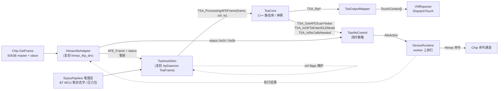
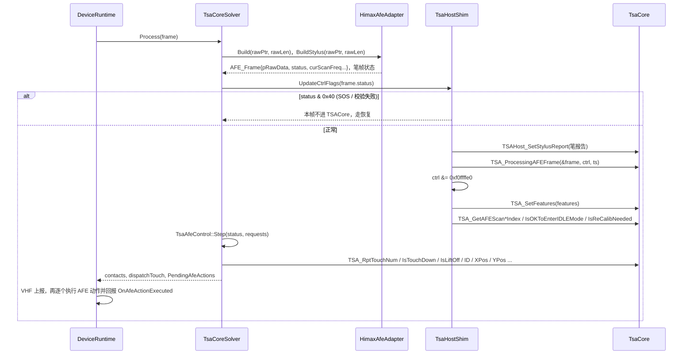
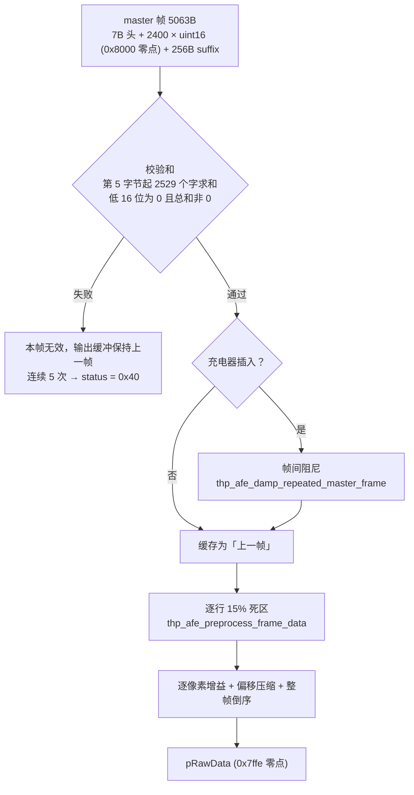
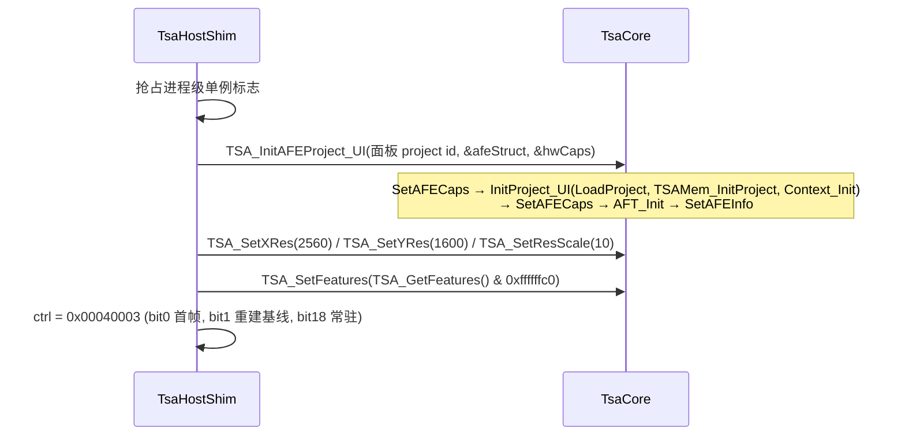
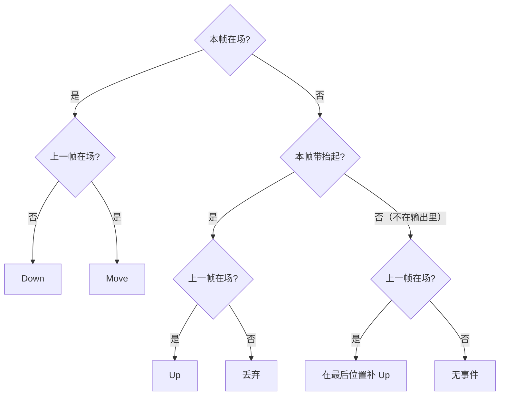
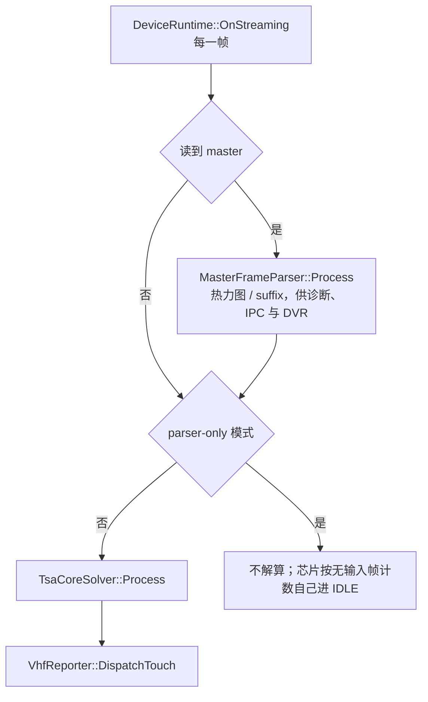
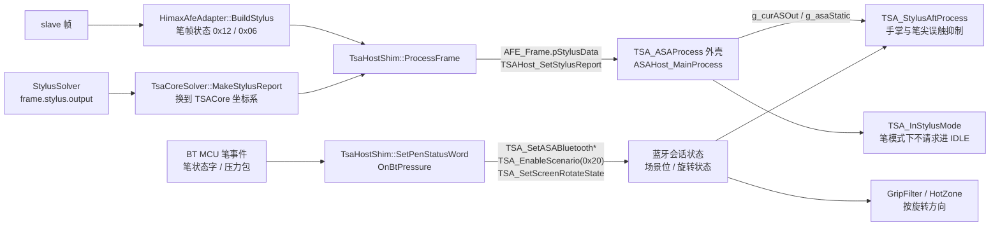
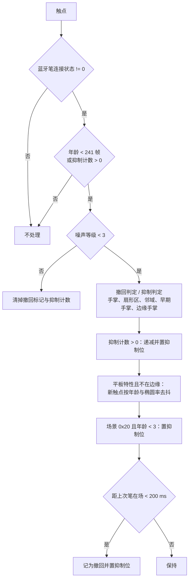
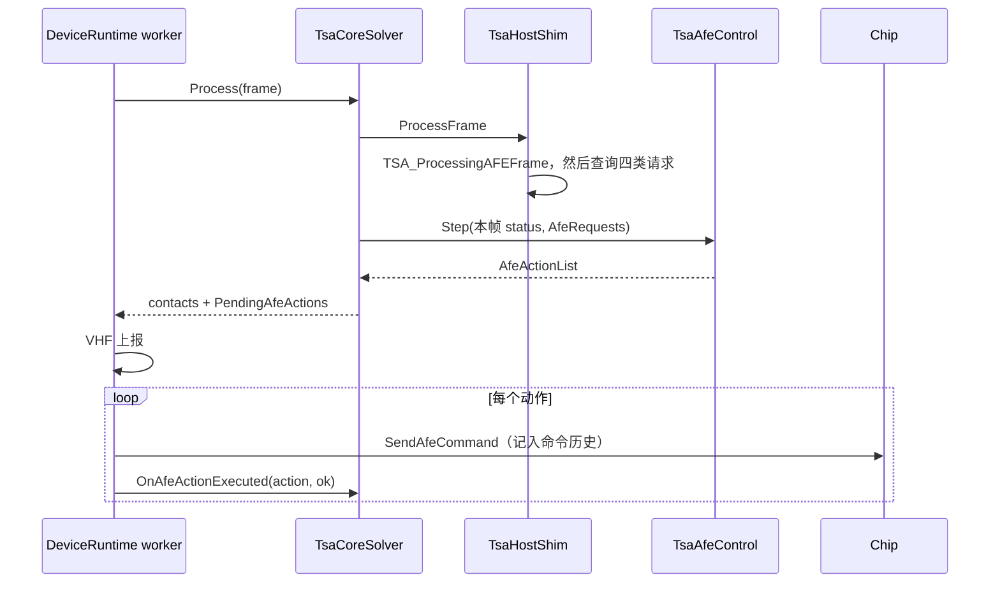

# TSACore 接入业务层：接口设计

结论用 Ghidra 对 `TSACore.dll` / `himax_thp_drv.dll` / `ApDaemon.dll` 交叉核对过。

## 概念

| 术语 | 含义 |
|------|------|
| TsaCore | [TsaCore/src](/EGoTouchService/Solvers/TouchSolver/TsaCore/src) 下 `TSACore.dll` 的 C++ 复刻，静态库 `TsaCore`。它是**手指 MS 管线**加 StylusAft 防误触；主动笔坐标解算（`ASA_MainProcess` 及其闭包）没有还原，`TSA_ASAProcess` 只保留外壳，笔的报告由现有 `StylusPipeline` 解出后经宿主桥送入，见第 7 节 |
| 单例 | TSACore 的状态是进程级全局对象（原 .bss 排布的 `g_bss` 加各模块的全局量），所以整个 TSACore 是**进程级单例** |
| AFE 帧 | `AFE_Frame`（宿主侧为 [TsaCoreApi.h](/EGoTouchService/Solvers/TouchSolver/TsaCore/TsaCoreApi.h) 的 `AfeFrame`），即 `himax_thp_drv` 交给 TSACore 的每帧结构：`pRawData` 指向 2400 个以 `0x7ffe` 为零点的 `uint16` |
| AFE HAL spec | `g_afeHalSpec`，决定 `AFE_SetFrameTrans` / `AFE_SetCapsTrans` 按哪一版布局拷贝帧与 caps。DLL `.data` 初值为 `0x011a00`（1.26.0），ApDaemon 从不调用 `TSA_SetAFESpecVersion` |
| ctrl flags | `TSA_ProcessingAFEFrame` 的第二参数，宿主每帧维护的 32 位控制字（首帧、基线重置、IDLE、跳频完成等） |
| AFE 适配层 | 本文提议的新模块，复刻 `himax_thp_drv` 对 SPI 原始帧做的预处理，产出 TSACore 期望的输入域 |
| 笔帧 | `AFE_Frame +0x40` 指向的 `stylusFrame`（驱动的 `g_StylusOut`）：两张 TX 整屏矩阵指针加 `status`，`0x12` 表示本帧有笔信号，`0x06` 表示没有 |
| 笔状态字 | THP_Service 汇总的 16 位笔状态（连接、吸附 / 休眠、旋转角、防误触模式），业务侧是 `RuntimePenState::factoryStatusFlags` |

## 架构

手指解算由一个薄 C++ 外观类 `TsaCoreSolver` 承担，[DeviceRuntime.cpp](/EGoTouchService/Device/runtime/DeviceRuntime.cpp) 每帧调用它的 `Process(HeatmapFrame&) -> bool dispatchTouch`，内部按「宿主三件套」拆开：AFE 适配层顶替 `himax_thp_drv`，Host Shim 顶替 `ApDaemon` 的 `TsaFrame`，输出映射器把 `TSA_Rpt*` 翻成现有 `TouchContact`，闭环策略把 TSACore 的请求翻成交给宿主执行的 AFE 动作。



单帧时序：



工作量分五块，P0 → P1 → P2 是接入主线，P3 闭环与 P4 改写都在 P2 跑通之后进行：

| 阶段 | 内容 | 验收 |
|------|------|------|
| P0（已完成） | 反编译产物修到可运行 | 回放录制不崩，输出确定 |
| P1（已完成） | `HimaxAfeAdapter`，按 `himax_thp_drv` 真实逻辑复刻预处理 | 以 P2 真机触摸正确为准，不与原驱动缓冲逐字节比对 |
| P2（已完成） | `TsaHostShim` + `TsaOutputMapper` + `TsaCoreSolver` 外观，接入 `DeviceRuntime` 作为唯一的手指解算器 | 真机触摸正常 |
| P3（代码完成，待真机验证） | 闭环控制（跳频、扫描率、IDLE、校准），连同宿主电源状态机升级（[device-runtime-power-state-machine.md](/docs/artifacts/device-runtime-power-state-machine.md)） | 长时运行无基线漂移、跳频请求能落到 IC、灭屏 / 合盖 / 休眠后触摸可恢复 |
| 笔接缝（代码完成，待真机验证） | 笔帧状态、笔报告、笔状态字接进 TSACore，StylusAft 按原版运行 | 纯手指回放逐帧不变；真机上写字时掌根不出点、笔尖附近没有误触 |
| P4（已完成） | 改写为标准 C++：类型化结构体、具名代码、模块化，状态改为 C++ 对象 | 每一步与参考版本的逐帧触点与闭环诊断逐字节相同 |

## 分点解释

### 1. 输入文档里需要先纠正的地方

接口文档《ApDaemon_Himax_TSACore_Interface》的总体时序可以用，但以下几处与 Ghidra 不符，按它实现会出错：

| 文档说法 | 实际情况 | 依据 |
|---------|---------|------|
| `TSA_InitAFEProject_UI(name, "1.3.0", pHwCap)` | 第二参是 **AFE 宿主结构指针**（布局见第 4 节），最终进 `TSA_SetAFEInfo`；ApDaemon 传的是 `vtbl+0x1a8()` 与 `vtbl+0x1a0()` 两个对象 | `TSA_InitAFEProject_UI`（[Tsa.cpp](/EGoTouchService/Solvers/TouchSolver/TsaCore/src/App/Tsa.cpp)）；ApDaemon `FUN_1800e4550` |
| spec 为 1.3.0，帧结构 `0x48` 字节 | ApDaemon 不调用 `TSA_SetAFESpecVersion`，生效的是 `.data` 初值 `0x011a00`，走 `AFE_SetFrameNormal` / `AFE_SetCapsNormal`：帧拷贝到 `+0x5c`（含 `+0x40 pStylusData`、`+0x58` 双字），caps 拷贝到 `+0x5d` | `AFE_SetFrameNormal` / `AFE_SetCapsNormal`（[Afe.cpp](/EGoTouchService/Solvers/TouchSolver/TsaCore/src/App/Afe.cpp)）；`TSACore!0x6bb4fa40 = 00 1a 01 00` |
| `+0x38` 是 `pSideTouchData` 指针 | `+0x38` 是 4 字节 `dwGesture` | `AFE_SetFrameNormal` 只拷 4 字节 |
| `AFE_SetCaps*` / `AFE_SetFrame*` 做行列转置 | 两条路径都只是逐字段拷贝，没有转置 | `AFE_SetCaps*` / `AFE_SetFrame*` 反编译 |
| 输出函数为 `TSA_RptTouchDown/Up/X/Y`、`TSA_GetStylusX`、`TSA_RequestEnterIDLEMode`、`TSA_SetScreenResolution` 等，并给了地址 | 这些名字不存在，地址也对不上（如 `0x6baa2462` 实为 `TSAStatic_IsChargerPlugged`）。ApDaemon 实际按名字绑定的是 `TSA_RptTouchNum`、`TSA_RptIsTouchDown`、`TSA_RptIsLiftOff`、`TSA_RptTouchID`、`TSA_RptTouchXPos/YPos`、`TSA_SetXRes/YRes/ResScale`、`TSA_GetAFEScanFreqIndex/RateIndex`、`TSA_IsOKToEnterIDLEMode`、`TSA_IsReCalibNeeded`、`TSA_RptASA*` 等，TsaCore 里除 ASA 系列外都有实现 | ApDaemon 字符串表 `0x18011ea48..0x180120100` |
| himax 增益与非线性压缩公式（`(raw*gain+50)/100`，`-20/80` 分段），增益表为 int16 | 真实逻辑不同，增益表是 `INT32[2400]`，见第 3 节 | `himax_thp_drv!thp_afe_get_frame` 反编译 |
| 闭环命令 ID：跳频 `0x0C`、扫描率 `0x04`、进 IDLE `0x08`、校准 `0x0A`、重置 IDLE 基线 `0x07` | 真实 ID：`0x01` start_calibration、`0x02` / `0x0d` 关 / 开自动跳频、`0x06` clear_status（参数是状态位）、`0x0a` enter_idle、`0x0b` force_exit_idle、`0x0c` force_to_freq_point、`0x0e` force_to_scan_rate；`set_idle_touch_threshold`、`set_baseline_update_interval` 只写驱动全局变量，不发命令；ApDaemon 没有绑定 `TSA_IsOKToResetIDLEBaseline` | `himax_thp_drv` 各 `thp_afe_*` 反编译；ApDaemon `tsa_func_table` 槽位 `+0x1f8/+0x200/+0x320/+0x328` |
| 没有提到状态位的清除 | 固件的校准完成（suffix `word[3]` = `0xbb`）与跳频完成标志会一直保持，直到宿主发 `clear_status`；ApDaemon 每帧看到就清 | `TsaFrame::Process` 反编译 |

`dwCtrlFlags` 位表、`TsaFrame_CallProcessingAFEFrame` 的帧后动作（`& 0xf0ffffe0`、`TSA_SetFeatures`）与 Ghidra 一致，可以照用。

### 2. TsaCore 库

[TsaCore/src](/EGoTouchService/Solvers/TouchSolver/TsaCore/src) 编成 C++ 静态库 `TsaCore`，宿主只经 [TsaCoreApi.h](/EGoTouchService/Solvers/TouchSolver/TsaCore/TsaCoreApi.h) 里按原导出签名声明的 `TSA_*` 调用。状态布局、编译选项、与参考版本的比对方法见 [tsacore-cpp-rewrite.md](tsacore-cpp-rewrite.md)。

原 DLL 里本机型不会执行的模块已裁掉，相应分支按常量传播删除。裁剪与真实行为等价，依赖内置的四张参数表（第 6 节）在这几个参数上的取值；四张表除 DFLT000000 的 flash+0x54 为 0 之外完全一致，特性位是运行期判断的，置位更少的 0 不会打开被裁掉的模块。新增参数表时要重新核对：

| 参数 | 取值 | 让哪些裁剪成立 |
|------|------|-------------|
| `dwFeatureFlagsBase1_or`（flash+0x54） | `0x01090020`（DFLT：0） | SafeBaseline、SideTouch、Proximity、AFT、SignalDisparity 后处理均未启用 |
| `dwPeakProcessingMode`（flash+0x34） | 3 | 走 FIException，HIException 不会被调用 |
| 自容使能（flash+0x608） | 0 | 所有 `SS_*`；SignalDisparity 只在自容有效时计算 |
| flash+0x6cd、+0x80e | 0 | `CMFRemap_IsNeedRemap()` 恒为 0 |
| notch 数（flash+0x9e4）、UDFP（flash+0x1740） | 0 | NotchCorrect、UDFP |
| 折叠屏支持（flash+0x17cc） | 1（需 > 1 才启用） | `TSAFold_*ZoomOutRemap` 原样返回入参指针，`TSAFold_Dim*PosOutRemap` 原样返回坐标 |

### 3. P1：HimaxAfeAdapter —— TSACore 的输入域

现有 [MasterFrameParser.hpp](/EGoTouchService/Solvers/TouchSolver/MasterFrameParser.hpp#L38-L40) 只做 `wire ^ 0x8000`。TSACore 的参数表是在 `himax_thp_drv` 处理后的数据上整定的，喂 SPI 原始字会让阈值、基线、峰值全部失配。[HimaxAfeAdapter](/EGoTouchService/Solvers/TouchSolver/TsaCore/HimaxAfeAdapter.cpp) 按 `thp_afe_get_frame` 对 master 矩阵的处理顺序逐步复刻：



**校验。** 从第 5 字节起到帧尾共 2529 个小端字求和，低 16 位为 0 且总和不为 0（排除全零帧）才算有效。测试录制的 480 帧全部通过。

**帧间阻尼。** 只在充电器插入时启用（`thp_afe_set_charger` 置位 `g_MasterFrameDampingEnable`，初值为假）。相对上一帧变化落在 `[-300, 200]` 之外的格子连同邻域被打上标记（值 10）；标记当帧原样放行并降为 9，其余格子一律向上一帧回拉一半，标记值逐帧递减到 0。邻域下标不对称——上一行取 `c..c+2`，同行取 `c±1`，下一行取 `c-2..c`——这是按汇编核对过的原样行为。「上一帧」缓存的是阻尼之后、死区之前的数据，不论是否启用阻尼都会更新。

**逐行死区。** 每条 TX 取 `v = sample - 0x7ffe`，`thr = rowMax*15/100`；`v ≥ thr → v-thr`，`v < -thr → v+thr`，其余置 0，写回 `v + 0x7ffe`。

**增益与压缩。** 这一步的零点取 `0x8000`，比死区阶段高 2，所以被死区归零的格子在这里是 `-2`，最终仍输出 `0x7ffe`。设 `v = word - 0x8000`，`slot = suffix.word[10] != 0`，`gain = (slot ? PixelGainTable2 : PixelGainTable1)[2399-i]`，充电器未插入时 `T = 300, scale = 100`，插入时 `T = 400, scale = 110`：

1. 若 `word ∉ [0x7149, 0x7149+10999)`，置**饱和标志**；从这个格子起本帧余下的格子都跳过增益，只做第 3 步。
2. 未饱和且 `v > 0`：若 `v < T`，把增益削弱为 `gain/4`（`v < T/2`）、`2·gain/4`（`v < 3T/4`）、`3·gain/4`（其余）；然后 `v = (gain·v/100)·scale/100`。
3. 偏移：`v ≥ 1 → v - (v < 51 ? 20 : 80)`；`v < 0 → (v + 50 < 0 ? v + 80 : 0)`。
4. 写 `out[2399 - i] = v + 0x7ffe`（整帧倒序）。

两张增益表各 2400 项、单位为百分比，下标是倒序之后的格子。`thp_afe_open_project` 按面板选表：CSOT 面板（W273AS2700 / 2710）用 PixelGainTable1 / 2（表 1：76–156，表 2：52–171），BOE 面板（W273AS1300 / 1310）用另一组，BOE 的两张表内容相同、最大到 350，所以按 uint16 存。表数据在 [HimaxPixelGainTables.inc](/EGoTouchService/Solvers/TouchSolver/TsaCore/HimaxPixelGainTables.inc)，由 DLL 数据段导出；适配层的选表入口是 `HimaxAfeAdapter::SetPanelGain`（[HimaxAfeAdapter.cpp](/EGoTouchService/Solvers/TouchSolver/TsaCore/HimaxAfeAdapter.cpp#L41-L45)），默认 CSOT。阈值 `T` 与 `scale` 各面板相同。

**status 与扫描参数。** 校验通过时基值为 `0x02`，再按 suffix 叠加：`word[0]==1 → |0x01`、跳频在途且当前频率等于目标且 `word[2]!=0 → |0x04`、`word[3]==0x00bb → |0x08`、`word[14]` 或 `word[16] > 1499 → |0x20`、`word[6]!=0 → |0x40`。`curScanFreq = {75,113}[word[10]]`，`curScanRate = 120`。测试录制里出现过的位是 `0x02 | 0x08 | 0x20`。

`AFE_Frame` 按 spec 0x011a00 的布局填：`+0x10 pRawData`，`+0x18 pLineData = NULL`，`+0x30 curScanFreq`，`+0x32 curScanRate`，`+0x34 status`，`+0x38 dwGesture = 0`，`+0x40 pStylusData`（笔帧，见第 7 节），其余置 0。缓冲区由适配层持有；`AFE_SetFrame` 会把 `pRawData` 深拷进 `g_afeGridData`，所以不需要跨帧保活。

**方向。** 驱动把整帧倒序（等价于旋转 180°），TSACore 的 pitch 映射表、增益表、边缘参数都以倒序后的方向为准，所以输入必须倒序。显示方向在输出侧还原，见第 5 节。

与原驱动 `g_RealTimeFrameBuffer` 的逐格比对需要在真机上抓缓冲，尚未做；目前的依据是反编译与汇编逐句对照，以及回放中触点中心与 diff 局部极大值重合。

### 4. P2：TsaHostShim —— 初始化与 ctrl flags

[TsaHostShim](/EGoTouchService/Solvers/TouchSolver/TsaCore/TsaHostShim.cpp) 顶替 ApDaemon 的 `TsaFrame`。初始化序列（对应 `ThpBase::InitTsaPrmt` / `InitTsa` / `TsaFrame::Init`）在第一帧到来时惰性执行：



`afeStruct` 是宿主长期持有的结构（[TsaCoreApi.h](/EGoTouchService/Solvers/TouchSolver/TsaCore/TsaCoreApi.h)），TSACore 保存它的指针（`g_thpAFEStruct`）并在运行期反复读取：`+0x00` info 指针，`+0x08` caps 指针，`+0x10` **当前帧指针**，`+0x40` 驱动名字符串。TSACore 从 `afeStruct->frame` 的 `+0x34 / +0x30 / +0x32` 读 status、扫描频率、扫描率，从 `afeStruct->caps` 读行列数，所以 `+0x10` 必须指向宿主每帧更新的那个 `AFE_Frame`，它与 `TSA_ProcessingAFEFrame` 的第一参是同一个对象。三个结构体因此放在静态存储里。

`hwCaps` 按 spec 0x011a00 的 `AFE_SetCapsNormal` 布局是 `0x60` 字节，目前只填了 TSACore 实际读取的字段：`numCol=60, numRow=40, numScanFreq=2, pScanFreqList={75,113}, numScanRate=1, pScanRateList={120}`。原机 caps 的其余字节（`rxChannel`、`pitch`、`sensorArch` 等）在活跃代码里没有读取点。

分辨率：参数表里 Dim1 / Dim2 分辨率已经是 2560 / 1600（flash+0x5a6 / +0x5a8），但 `ResScale`（flash+0x5a0）初值为 0，不调用 `TSA_SetResScale` 时 `TSA_RptTouchXPos/YPos` 恒为 0。`ResScale` 只作用在输出换算上，这里取 10，使输出量程等于业务侧 HID 的逻辑量程 25600 × 16000（[VhfReporterTouchPacketHelper.h](/EGoTouchService/Device/vhf/VhfReporterTouchPacketHelper.h#L20-L21)），保留十分之一像素的精度。

ctrl flags 由 shim 每帧根据适配层 `status` 维护（TSACore 的消费点是 `TSAStatic_UpdateCtrlFlags`，[Sys.cpp](/EGoTouchService/Solvers/TouchSolver/TsaCore/src/App/Sys.cpp)）：

| 位 | 置位来源 | 生命周期 |
|----|---------|---------|
| 0, 1 | 初始化；AFE 重新启动（`TsaCoreSolver::OnAfeStarted`，宿主状态机进入取帧时调用，[DeviceRuntime.cpp](/EGoTouchService/Device/runtime/DeviceRuntime.cpp#L1265-L1295)） | 一次性 |
| 2 | IDLE 退出：`status&1` 由 1 变 0，或回放工具注入的退出（`OnAfeIdleExit`） | 一次性 |
| 3 | `status & 0x08` 的**上升沿**，清除握手见第 8 节 | 一次性 |
| 4 | `status & 0x04` 跳频完成 | 一次性 |
| 5 | `status & 0x01` IDLE | 跟随电平 |
| 8 | 灭屏。不维护：业务侧灭屏即停止取帧，TSACore 收不到帧 | — |
| 17 | `status & 0x20` 充电噪声 | 跟随电平 |
| 18 | 常驻 | 持续 |

每帧调用 `TSA_ProcessingAFEFrame(&frame, ctrl, ts)` 后执行 `ctrl &= 0xf0ffffe0` 与 `TSA_SetFeatures(features)`，再查询闭环请求（[TsaHostShim.cpp](/EGoTouchService/Solvers/TouchSolver/TsaCore/TsaHostShim.cpp#L153-L168)）。校验失败或 `status & 0x40` 的帧不进 TSACore，也不产生闭环动作。

bit 3 与 ApDaemon 的做法不同：ApDaemon 的 `TsaFrame::UpdateStatusCalibration` 是「status 带 0x08 就置位」并立刻 `ClearStatus(8)`，固件下一帧就把标志清掉。TSACore 把 ctrl 低 4 位任一非零都视为硬件复位态（`TSAStatic_IsHWReset`），期间不出点。业务侧原先从不发 `ClearStatus`（命令是空桩），suffix `word[3]` 因此恒为 `0xbb`；现在清除握手由第 8 节的闭环完成，shim 仍只在上升沿置位一次（[TsaHostShim.cpp](/EGoTouchService/Solvers/TouchSolver/TsaCore/TsaHostShim.cpp#L126-L131)），因为重发间隔内标志还会多留几帧，按电平置位会把复位态拉长。ctrl 的 bit 28–29（屏幕旋转）在活跃代码里没有读取点，不维护。

第三参数 `ts` 是毫秒：TSACore 把它存进 `TSAStatic`，各处的防抖窗口（如 `TSAStatic_IsChargerPlugged` 的 `+2000`）都按毫秒比较。运行时取单调时钟，回放时由调用方显式给定（录制里有逐帧系统时间就用它，否则按 120 Hz 合成），保证回放结果只取决于输入。`AFE_Frame` 的 `+0x00 / +0x04 / +0x08`（秒、微秒、帧序号）由同一个时间戳派生。

### 5. P2：TsaOutputMapper —— 输出接到 VHF

[TsaOutputMapper](/EGoTouchService/Solvers/TouchSolver/TsaCore/TsaOutputMapper.h) 逐点读取 TSACore 输出，填进 `frame.touch.output.contacts`。在场 / 抬起的判定照搬 ApDaemon 的 `TsaFrame::ObInput`（逐点打包函数 `FUN_18008c120`）：

| TouchContact 字段 | 来源 |
|-------------------|------|
| 点数 | `TSA_RptTouchNum()`，截到 10（ApDaemon 同样截到 10） |
| `id` | `TSA_RptTouchID(i) + 1`：VHF 只上报 `id > 0` 的点（[VhfReporterTouchPacketHelper.h](/EGoTouchService/Device/vhf/VhfReporterTouchPacketHelper.h#L63)），而 TSACore 的 ID 从 0 开始 |
| 在场 | `TSA_RptIsTouchDown(i) != 0` |
| 抬起 | 不在场且 `TSA_RptIsLiftOff(i) != 0`；两者都为零的点不上报 |
| `x`, `y` | `(分辨率 × 10 − 1 − TSA_RptTouchXPos/YPos(i)) / 10`，单位是显示像素 |
| `signalSum` | `TSA_RptTouchPressure(i)` |
| `isReported` | `true`（TSACore 内部已做上报网闸） |

两个导出读的都是触点的事件码（触点结构 `+0x21c`），掩码取决于 feature bit 24，本机型该位为 1：

| 事件码 | 含义 | `IsTouchDown`（掩码 `0x1e`） | `IsLiftOff`（掩码 `0x40`） |
|--------|------|------|------|
| `0x01` | 按下防抖中，尚未上报 | 0 | 0 |
| `0x02` | 按下 | 非零 | 0 |
| `0x04` | 移动 | 非零 | 0 |
| `0x08` | 抬起防抖中，沿用上一帧位置 | 非零 | 0 |
| `0x10` | 上一帧还在按下防抖的点离开（测试录制中未出现） | 非零 | 0 |
| `0x20` | 抬起，不走防抖的路径（测试录制中未出现） | 0 | 0 |
| `0x40` | 抬起（防抖结束） | 0 | 非零 |

TSACore 的输出不保证每个 ID 的事件成对，映射器按 ID 记账把它补成 Down → Move… → Up：



1. **按下与移动不区分**：`TSACore` 可能在某个点已经处于移动（`0x04`）时才第一次把它放进输出（按下那一帧被整帧屏蔽），所以 Down / Move 由「上一帧是否在场」决定，不看事件码。
2. **没按下过的抬起**：按下防抖期间就离开的点也会带 `0x40` 出现一帧，HID 侧不需要，丢弃。
3. **不带抬起的消失**：`TSAOut_PostProcess`（[TsaOut.cpp](/EGoTouchService/Solvers/TouchSolver/TsaCore/src/App/TsaOut.cpp)）会逐点移除不可上报的点，或者在出现「屏蔽整帧」类触点时（[TouchReport.cpp](/EGoTouchService/Solvers/TouchSolver/TsaCore/src/Rejection/TouchReport/TouchReport.cpp)）把点数直接清零，内部跟踪照常继续。ApDaemon 在点数变为 0 的那一帧发一次全部释放；映射器对每个消失的 ID 在最后位置补一个 Up，整帧清空时效果相同，部分消失时也不会给 HID 留下悬空的触点。

坐标要翻转两个轴：驱动把整帧倒序后才交给 TSACore（第 3 节），TSACore 报的坐标相对面板原始行列旋转了 180°；业务侧的 VHF 上报与诊断界面沿用原始行列方向（VHF 自己再对 X 取反），映射器在这里把 180° 撤销。

外观类的返回值是「本帧写出了触点（含抬起），或上一帧有点在场」，保证抬起帧一定走到 VHF。

诊断接口目前只有 `TsaCoreSolver::DiffGrid()`（`TSA_RptDiffPtr`，方向是倒序后的）。帧里的热力图与两段 suffix 由 [MasterFrameParser.h](/EGoTouchService/Solvers/MasterFrameParser.h) 解析，供 IPC、DVR 与 VHF 使用；`frame.touch.debug` 的峰、区域与框不再填写，IPC 与 DVR 的格式不变。

### 6. P2：TsaCoreSolver 外观与运行时接入

[TsaCoreSolver](/EGoTouchService/Solvers/TouchSolver/TsaCore/TsaCoreSolver.h) 把适配层、shim、映射器串起来，`Process(HeatmapFrame&)` 返回本帧是否需要走 VHF 上报。



1. **唯一的手指解算器**：`TsaCoreSolver` 是服务里唯一的手指解算器，没有构建开关。IPC 的 parser-only 模式只解析帧、不调用 TSACore，这时由芯片自己按无输入帧计数进 IDLE。
2. **单例**：TSACore 全部状态是进程级全局对象，一个进程只有第一个完成初始化的 `TsaHostShim` 可用，其余实例的 `Process` 直接返回 false。A/B 对比要分进程跑。实例析构后可以重新初始化，但 TSACore 在初始化时申请的堆缓冲没有释放路径。
3. **线程**：只在 worker 线程、`m_pipelineMu` 内调用。宿主状态机的进入 / 离开动作通过 `OnAfeStarted`（芯片 Init 成功：适配层、闭环、输出记账归零，TSACore 按首帧重建基线）和 `OnAfeStopped`（停止取帧：输出记账归零，HID 侧由宿主统一抬起）通知解算器。
4. **面板配置**：手指侧没有运行时配置项，按面板机型自动选配置。机型是显示驱动 OTP 里烧的 project id，`Himax::Chip` 在第一次建链时按 `getProjectID_OTP` 的序列读出（之后缓存，面板不会变）。原厂拿它做两件事：`himax_thp_drv` 的 `thp_afe_open_project` 选增益表（第 3 节），ApDaemon 的 `ThpBase::InitTsaPrmt` 把它原样交给 `TSA_InitAFEProject_UI`，TSACore 经 TSAPrmt 的 `TSAFlashPrmt_LoadProject` 按名字装参数表（ApDaemon `BasicInit` 里写死的 "W273AS2700" 只是 afename / project 日志字段，不参与选表）。这里的接法：

    ```mermaid
    flowchart TD
        OTP["Himax::Chip::GetPanelIdentity<br/>OTP project id"] --> R{"ResolvePanelProjectId<br/>是四个已知 id 之一?"}
        R -- 否 / 没读出 --> DF["按 W273AS2700，记一条警告"]
        R -- 是 --> S
        DF --> S["TsaCoreSolver::SetPanelProjectId<br/>EnterStreaming 里、OnAfeStarted 之前"]
        S --> G["HimaxAfeAdapter::SetPanelGain<br/>CSOT / BOE 增益表"]
        S --> I["首帧 TsaHostShim::Initialize(id)<br/>TSA_InitAFEProject_UI → LoadProjectTables(id)"]
    ```

    | OTP id | 面板 | 增益表 | TSAPrmt 参数表 |
    |--------|------|--------|---------------|
    | W273AS2700 | CSOT | CSOT | GaokunHimaxCSOT |
    | W273AS2710 | CSOT | CSOT | DFLT000000（TSAPrmt 没有专表，原厂同样落到缺省表；阵列尺寸由 `Prmt::LoadProject` 取自 AFE） |
    | W273AS1300 | BOE | BOE | GaokunHimaxBOE |
    | W273AS1310 | BOE | BOE | GaokunHimaxBOE_NewMapping（与 BOE 表只差表头的名字） |

    四张参数表（FlashPrmt、CMF PCA、ASA）由 TSAPrmt.dll 实际调用 `TSAFlashPrmt_LoadProject` 导出，生成在 [ProjectTableData.inc](/EGoTouchService/Solvers/TouchSolver/TsaCore/src/Prmt/ProjectTableData.inc)；CMF PCA 四张相同，ASA 两张 BOE 表共用。[LoadProjectTables](/EGoTouchService/Solvers/TouchSolver/TsaCore/src/Prmt/ProjectTables.cpp#L38) 按表头名字逐一比较，找不到就用 DFLT000000，与 TSAPrmt 一致。TSACore 只在第一帧初始化一次，之后 `SetPanelProjectId` 只接受同一个 id。原厂在 OTP 读不出或读到未知 id 时打不开 AFE，这里改为按 W273AS2700 继续工作。

    录制器把 OTP id 写进 DVR 的 runtime config（`Device.panel_project_id`，`RuntimeConfigSnapshot::WithPanelProjectId`），[TsaRawReplay](/Tools/TsaRawReplay/main.cpp) 默认按录制里的 id 选配置，`--panel ID` 可以覆盖；旧录制没有这一项，按 W273AS2700。现有录制都来自 CSOT 面板，换成 DFLT000000 回放时几乎不出点（缺省表的门限与特性位都不是为这块面板整定的），2710 / BOE 的真实行为还要在对应设备上录制核对。
5. **与笔的关系**：笔的坐标仍由 `StylusPipeline` 解算，调用 `Process` 之前 `frame.stylus` 必须已经处理过；解算器把笔报告、笔帧状态和笔会话状态送进 TSACore，手指侧的笔相关逻辑按原版运行，见第 7 节。
6. **充电器**：`TsaCoreSolver::SetChargerPlugged` 对应 `thp_afe_set_charger`，业务侧还没有充电状态事件接进来，默认按未插入处理。

验证链路：[TsaRawReplay](/Tools/TsaRawReplay/main.cpp) 把录制灌进 `TsaCoreSolver`，输出逐帧触点 CSV（帧号、点数、ID、事件、像素坐标）；[Compare-Reference.ps1](/Tools/TsaRawReplay/Compare-Reference.ps1) 用它与参考版本逐帧比对（见 [tsacore-cpp-rewrite.md](tsacore-cpp-rewrite.md)），最终以原机 ApDaemon 的上报为准。工具依赖 DVR 读取器回填原始帧，需要定义 `EGOTOUCH_DIAGNOSTICS`（Debug 配置默认有）。

### 7. 笔状态接缝：StylusSolver 出笔，TSACore 管手指侧

**取舍。** 笔的坐标、压力、倾角继续由 `StylusPipeline`（`StylusSolver`）解算并上报，TSACore 的 ASA 本体不还原；TSACore 只需要知道「笔在不在、落在哪、朝哪倾、蓝牙会话是什么状态」，手指侧依赖这些量的原版逻辑就能原样运行。理由有三条：

1. `TSA_ASAProcess` 的调用闭包是 369 个函数，TsaCore 里缺 329 个（约 118 KB 机器码、1.18 万行反编译）。手头的录制里没有一份同时带手指矩阵和落笔数据，还原出来无从验证，还要顶掉已经可用的笔。
2. 手指侧读笔状态的入口很窄：`TSA_StylusAftProcess`（[StylusAft.cpp](/EGoTouchService/Solvers/TouchSolver/TsaCore/src/Rejection/StylusAft/StylusAft.cpp)）只经 `TSA_ASAAFEStatus`、`ASA_GetRptInRange`、`TSA_RptASA*` 读 `g_curASOut`，其余是 `g_asaStatic` 的状态位和蓝牙会话的三个全局。把这几处按原版的写入时机填对，就不需要 ASA 的解算本体。
3. 原版对 HPP3 笔的「落笔时手掌抑制」和「笔尖附近误触抑制」是同一个模块 StylusAft（[StylusAft.cpp](/EGoTouchService/Solvers/TouchSolver/TsaCore/src/Rejection/StylusAft/StylusAft.cpp)，完整复刻），外加按屏幕旋转方向工作的 GripFilter。旧管线的 `StylusTouchSuppressor` 与 `TouchTracker` 里的近似实现是另起的规则和阈值，不搬到这条路径。



1. **笔帧**（[HimaxAfeAdapter.cpp](/EGoTouchService/Solvers/TouchSolver/TsaCore/HimaxAfeAdapter.cpp#L245)）。驱动每帧都交出 `g_StylusOut`。`status = 0x12` 的条件是：slave 校验通过（`slave + 5` 起 167 个小端字求和，低 16 位为 0 且和不为 0）、第一个 9×9 块的两个头字不是 `(0xff, 0xff)`、笔已连接（`thp_afe_set_stylus_connect`）、master suffix 缓存的 `word[24] < 3000`；否则 `status = 0x06`，两个矩阵指针为空。两个块在 `slave + 7` 与 `slave + 173`，按 `thp_unpack_9x9_block_to_matrix` 展开：中心行列取两个头字的低字节（有符号），格子 `(r, c)` 的下标是 `(row - 4 + r) * 60 + (col - 4 + c)`，越界丢弃，写到 `matrix[2399 - index]`。驱动在 status 上叠加的跳频请求位 `0x40` 没有复刻，笔的跳频握手在业务侧。
2. **没有 master 的帧。** 笔已连接且 slave 有信号时，驱动在奇数帧跳过 master，`pRawData` 为空；ApDaemon 的 `TsaFrame::Process` 不看有没有手指数据，照样调用 `TSA_ProcessingAFEFrame`，这时 `TSA_MSProcess` 只做收尾，ASA、StylusAft 与输出后处理仍然运行，StylusAft 的抑制计数因此按调用次数递减。`TsaCoreSolver::Process`（[TsaCoreSolver.cpp](/EGoTouchService/Solvers/TouchSolver/TsaCore/TsaCoreSolver.cpp#L16-L54)）对 `masterWasRead == false` 的帧，在笔帧状态为 `0x12` 时用 `BuildWithoutMaster` 组出 `status = 0x02 | 缓存的 suffix 位` 并以空的 `pRawData` 调用；[DeviceRuntime.cpp](/EGoTouchService/Device/runtime/DeviceRuntime.cpp) 每一帧都调用解算器，帧解析（`MasterFrameParser`）只在有 master 的帧上跑。
3. **ASA 外壳与宿主桥**（[Asa.cpp](/EGoTouchService/Solvers/TouchSolver/TsaCore/src/Rejection/Asa/Asa.cpp)）。`TSA_ASAProcess` 按反编译还原：`ValidJudgment`、进出笔模式、`g_asaStatic` 状态位的帧前帧后处理、计数器清理、`HardwareAnalyzer_ASA_Process`，以及蓝牙会话的三个设置函数和 `HPP3_BtStatusProcess`。只有解算本体 `ASA_MainProcess` 换成 `ASAHost_MainProcess`：控制流与返回值不变，报告坐标、倾角、压力和状态位改从 `TSAHost_SetStylusReport` 送进来的宿主报告填入 `g_curASOut`；抬笔时书写先退成一帧不带压力的悬停，再清空。ASA 本体还原以后，把这一个函数换回去即可。与原函数有两处差别：`ASA_MainProcess` 之后的 StylusRecheck（`dwFeatureFlags2 & 0x100`，本机型开启，用笔的峰值与上一帧触点的重叠来否决假笔并 `ASA_Reset`）没有实现，宿主报告视为已经复核过；`HPP3_FreqShiftProcess` 只保留开头的 `HPP3_BtStatusProcess`。
4. **坐标与倾角**（[TsaCoreSolver.cpp](/EGoTouchService/Solvers/TouchSolver/TsaCore/TsaCoreSolver.cpp#L93-L111)）。`StylusSolver` 的坐标是面板原始行列方向、每个节点 1024 单位；TSACore 用驱动倒序后的方向，ASA 的报告量程是显示像素（`GetClipReport`：`round(分辨率 × 坐标 / 节点数 / 1024)`，夹在 `[0, 分辨率 − 1]`）。所以 `X = round(2560 × (61440 − x) / 61440)`、`Y = round(1600 × (40960 − y) / 40960)`，两个轴都倒过来。倾角原样传递：ASA 的 `TiltProcess` 在倒序坐标系里用 TX2 − TX1 的坐标差算倾角，`StylusSolver` 在原始坐标系里用 TX1 − TX2，翻转与相减次序正好抵消。状态位：悬停在场 bit0，书写 bit1；悬停时压力填 0。坐标的方向与半格约定用真实笔数据核对过（见本节的验证）；倾角的符号只由两边的相减次序对出，没有实测。
5. **笔会话状态**（[TsaHostShim.cpp](/EGoTouchService/Solvers/TouchSolver/TsaCore/TsaHostShim.cpp#L86-L115)）。ApDaemon 的 `DriverThp::GetStatus` 与 `stylus3`、`stylusaft` 两个监听把笔状态字翻成 TSACore 调用，这里照做；业务侧在 `DeviceRuntime::IngestPenEvent`（[DeviceRuntime.cpp](/EGoTouchService/Device/runtime/DeviceRuntime.cpp#L1515)）与压力包入口（[DeviceRuntime.cpp](/EGoTouchService/Device/runtime/DeviceRuntime.cpp#L555-L568)）把最新值交给解算器。事件线程只写原子量，真正写入 TSACore 发生在下一次 `Process` 开头（`ApplyPenSession`），TSACore 的全局状态始终只在取帧线程上改动。

| 状态字 | 来源事件 | 下发 | 作用 |
|--------|----------|------|------|
| bit 1 | `PEN_CONN_STATUS` | 上升沿调 `TSA_SetASABluetoothConnectStatus(1)`；断开时原版不通知 | `g_bt_pen_status = 1`，StylusAft 的总开关 |
| bit 2–3 | `PEN_CUR_STATUS` | 每次连调两次 `TSA_SetASABluetoothPenStatus`，参数依次是 `(w >> 2) & 1`、`(w >> 2) & 2`，后一次覆盖前一次 | `g_btPenStatus` 最终只剩吸附位，影响手掌阈值 |
| bit 6–7 | `PEN_ROATE_ANGLE` | `TSA_SetScreenRotateState(w >> 6)` | `TSAStatic_IsScreenRotated`，GripFilter 与热区按方向调整 |
| bit 8 | `PEN_TOUCH_MODE` | 变化时 `TSA_EnableScenario(0x20)` / `TSA_DisableScenario(0x20)` | StylusAft 的严格模式 |
| 压力包 | BT MCU 压力上报 | `TSA_SetASABluetoothPressure(p0..p3)` | 刷新 `g_lastBtCmdTime`，`g_bt_pen_status = 1`；60 s 没有包则降为 2 |

原厂日志（`Service_LogFile`）与这张表吻合：一个月里 33 次启动，每次注册监听时打一条 `StylusAftExecute THP_DisableScenario, THP#32`，没有出现过 Enable，即场景 `0x20` 在日常使用中一直关闭；`DriverThp::GetStatus` 的 `pen status PenHibernate / PenAttach` 行有 1.5 万条。

6. **接通后 StylusAft 的行为。** 以下都是反编译里的原逻辑，接缝只负责让它的输入有值。`StylusAft_PostProcessUnit`（[StylusAft.cpp](/EGoTouchService/Solvers/TouchSolver/TsaCore/src/Rejection/StylusAft/StylusAft.cpp)）对每个触点依次判断：



- 笔在场后 200 ms 内，所有被处理的触点都置抑制位并记为撤回；撤回过的触点每帧把抑制计数重置为 40，直到抬起。写字时压在屏上的掌根因此一直不出点，笔尖附近新冒出的触点也在这个窗口里被吃掉。
- 手掌等级（`StylusAft_GetPalmLevel`）：平板特性（`dwFeatureFlags & 0x1000000`，本机型开启）下，笔活跃（`g_bt_pen_status == 1` 且未吸附）时长轴 > 20 即判手掌，否则 > 30；场景 `0x20` 关闭时还有长轴 ≥ 39 一档，打开时按长轴与椭圆率的组合分 0–3 级。判为手掌的触点抑制计数置 100。
- 新触点去抖（`StylusAft_SuppressBaseContext`）：笔活跃时年龄 < 2 的触点直接抑制，年龄 2–5 按椭圆率 ≥ 7 / 9 / 11 / 13 逐级抑制；笔不活跃时没有首帧抑制，阈值是 12 / 14 / 16 / 18。蓝牙笔连接过之后，新触点的头几帧可能不出点，这是原版行为。
- 扇形区（`StylusAft_InFanArea`）：笔在场后 800 ms 内，触点到笔尖的距离 < `max(7 × |6 × tilt|, 800)`、到「笔尖 + 30 × tilt」的距离 < `max(5 × |6 × tilt|, 566)`（像素），且手掌等级不为 0。倾角指向握笔的手，所以倾角符号决定扇形朝哪边。
- `TSA_InStylusMode`在笔帧有效期间为真，`TSA_IsOKToEnterIDLEMode` 返回 0。

7. **两个同名的「上次笔在场时间」。** 原 DLL 里有两个同名的文件内静态量 `g_lastStylusTimeStamp`：`0x6bb819e0` 只给 `TSA_DelayToIdleModeHPPx` 用（[Tsa.cpp](/EGoTouchService/Solvers/TouchSolver/TsaCore/src/App/Tsa.cpp) 的 `g_lastStylusTime`），`0x6bbaa150` 是 StylusAft 的「上次笔在场时间」（StylusAft 状态里的 `lastStylusTime`），两者互不相干，混成一个会让笔离开后的 IDLE 延迟与扇形区计时互相干扰。

**验证。** 手指录制 4 份（带原始帧，没有笔），笔录制 1 份（没有保存原始帧和矩阵，只有 suffix 与 slave 数据），所以分三步。纯手指回放：[TsaRawReplay](/Tools/TsaRawReplay/main.cpp) 带 `--afe` 跑 4 份手指录制，触点 CSV 与闭环请求 / 动作序列和接入前逐字节一致；这时每帧都经过 ASA 外壳（笔帧状态 `0x06`），手指输出不受影响。真实笔数据：`--stylus-solver` 像 `DeviceRuntime` 一样先跑 `StylusPipeline` 再喂 TSACore，缺原始帧的录制由工具用 suffix 拼回一帧（矩阵填驱动的零点，等于没有手指）。那份笔录制里有 53 帧带笔信号，其中 25 帧没有 master：笔帧状态全部是 `0x12`，`TSA_InStylusMode` 与 `TSA_RptASAInRange` 在这些帧上为真；送进 TSACore 的笔报告与「按驱动方式展开的 TX1 整屏矩阵」的峰值重心（格子中心记在半格处）相比，平均偏差 x −4.9 px、y −2.0 px，平均绝对偏差 8.3 / 6.4 px，最大 26 / 17 px，而半格是 21 / 20 px、方向反了会差出上千像素。两者一个来自业务侧解算、一个来自驱动的展开方式，互相独立，所以坐标翻转和半格约定可以认为是对的。这份录制全程悬停，没有落笔，也没有手指。手指侧的笔相关逻辑：用 `--pen` 系列选项往手指录制里注入一支模拟笔，改写 slave 段让笔帧有效、填 `stylus.output`、下发笔状态字，可选让奇数帧不带 master。在 7 指录制（480 帧）上每 60 帧统计在场触点数：

| 条件 | 0 | 60 | 120 | 180 | 240 | 300 | 360 | 420 |
|------|---|----|-----|-----|-----|-----|-----|-----|
| 基线（没有笔会话） | 210 | 136 | 252 | 158 | 254 | 218 | 252 | 267 |
| 笔已连接，笔不在场 | 179 | 114 | 97 | 127 | 107 | 53 | 140 | 84 |
| 再加第 120–300 帧落笔 | 179 | 114 | 58 | 62 | 30 | 1 | 109 | 26 |
| 改成第 120–300 帧悬停 | 179 | 114 | 90 | 118 | 88 | 2 | 126 | 84 |

落笔期间在场触点数大幅下降，抬笔后被撤回的触点保持抑制直到抬起，`TSA_InStylusMode` 与 `TSA_RptASAInRange` 在第 120 帧变真、抬笔后一两帧变假；单指录制在「笔已连接」下只少 1–4 帧（新触点去抖）。回放里没有压力包，蓝牙状态立刻降为 2，对应的是「笔连着但不活跃」的阈值。防误触模式位（状态字 `0x0102`）打开后，录制里的滑动手指几乎全部被抑制：这是严格模式按椭圆率分级的结果，原厂日志里这个场景从未打开过，TsaCore 算出的椭圆率量级（滑动时 20–60，静止时约 11）也没有原版数据可比。注入的结果只能说明链路通了、方向与反编译一致；抑制效果本身要有同时带手掌和落笔的录制或真机才能对照。

**待真机确认。** 写字时掌根是否不出点、笔尖附近是否还有误触；倾角符号与扇形区朝向（符号是按两边坐标差的相减次序推出来的）；笔在场时不进 IDLE 的表现；吸附 / 休眠状态（`PEN_CUR_STATUS` 2 / 3）以及原版连调两次的写法在本机上的实际取值；BT MCU 是否真的会发 `PEN_ROATE_ANGLE` 与 `PEN_TOUCH_MODE`；`TSA_SetScreenRotateState` 接通后横竖屏下 GripFilter 的变化；蓝牙笔连接后新触点头几帧的延迟是否可接受。芯片层在 slave 有信号时就跳过 master，原驱动还要求笔已连接，这一点没有改动。

### 8. P3：闭环控制

TSACore 每帧处理完会给出四类请求，ApDaemon 在 `TsaFrame::Process` 的帧后段把它们连同本帧状态位一起翻成 `himax_thp_drv` 命令。业务侧拆成两层：[TsaAfeControl](/EGoTouchService/Solvers/TouchSolver/TsaCore/TsaAfeControl.h) 只做决策，不碰硬件，回放工具可以直接打印；[DeviceRuntime](/EGoTouchService/Device/runtime/DeviceRuntime.cpp#L1419-L1455) 在 worker 线程上同步执行这些动作，再把结果回报给解算器。



**请求的语义**：

| 查询 | 返回 | 什么时候算有请求 |
|------|------|------------------|
| `TSA_GetAFEScanFreqIndex(&idx)`（[Tsa.cpp](/EGoTouchService/Solvers/TouchSolver/TsaCore/src/App/Tsa.cpp)） | 1 = 无请求；0 = 请求切到 `idx` | 目标频点与当前频点不同、目标在 caps 的频点数之内，且 `AFE_IsFreqHopSupported()`；笔模式下恒为 1 |
| `TSA_GetAFEScanRateIndex(&idx)` | 同上 | 可以进 IDLE 时恒为 1；本机 caps 只有一个扫描率 |
| `TSA_IsOKToEnterIDLEMode()` | 非零 = 可以进 IDLE | 无触摸持续足够久；笔模式下为 0 |
| `TSA_IsReCalibNeeded()` | 非零 = 需要硬件校准 | 启动后首帧的一次性请求，以及运行中检测到需要重校准 |

**策略**以 ApDaemon 反编译为准，业务侧只在重发频率上有意偏离：

| 条件 | ApDaemon | Himax 命令 | 业务侧 |
|------|----------|-----------|--------|
| `status & 0x08` 校准完成 | ctrl bit 3，`ClearStatus(8)` | `0x06, 8` | 发 `ClearStatus(8)`；标志还在就每 12 帧重发 |
| `status & 0x04` 跳频完成 | ctrl bit 4，`ClearStatus(4)` | `0x06, 4` | 同上；清除成功即结束跳频握手 |
| 频点请求 | 请求期间每帧 `ForceToFreqPoint(idx)` | `0x0c, idx`（idx < 2） | 请求变化立即发，持续期间每 12 帧重发 |
| 扫描率请求 | 请求期间每帧 `ForceToScanRate(idx)` | `0x0e, idx` | 同上 |
| 重校准请求 | `StartCalibration()`，并跳过本帧其余输出处理 | `0x01` | 发一次后 240 帧内不再发；芯片 Init 自带一次校准，所以重启后首帧的请求视为已满足；本帧输出照常处理 |
| 可进 IDLE 且 AFE 不在 IDLE | 每 5 帧一次 `ChangeToIdlemode`（设 IDLE 阈值、基线更新间隔 1000、`EnterIdle`） | `0x0a` | 每 5 帧一次 `EnterIdle`；阈值与间隔在原驱动里只写驱动全局变量，不下发 |

1. **重发间隔**：业务侧的命令是同步的寄存器写（16 字节命令包写进 5 个槽位之一），每帧重发会挤占取帧时间，所以条件持续时按 12 帧（约 100 ms）重发。ApDaemon 用 `event_mgr` 的几个开关（2、5、7、9 号）门控 IDLE 与扫描模式，取值未知，业务侧默认全开，每个环节可以用 `SetAfeLoopEnabled(AfeLoop::k*)` 单独关掉。
2. **跳频握手**：`ForceToFreqPoint` 执行成功后，`OnAfeActionExecuted` 让适配层进入「跳频进行中」并记下目标频率（对应驱动里的 `freqShiftStatus = 1` 与 `g_AfeCurrentFreqCommand`）；帧里的扫描频率等于目标时，适配层给出 `status & 0x04`，闭环随即发 `ClearStatus(4)`，成功后握手结束。
3. **IDLE 的归属**：IDLE 是 IC 报告的状态，不是宿主的模式（[afe-frame-read-and-idle.md](/docs/artifacts/afe-frame-read-and-idle.md) 第 4 节）。进入只由宿主请求：TSACore 判定可进 IDLE 后闭环每 5 帧发一次 `EnterIdle`，直到帧尾 `word0` 报告 IDLE（解算时宿主关掉芯片层「600 帧无输入」的自动请求，`SetAutoIdleEnabled(false)`）。IC 在 IDLE 里照样出帧，只是慢（master 约 3 s 一帧），这些帧与普通帧一样喂给解算器，适配层给出 `AfeStatus::kIdle`，宿主层据此持续带 ctrl bit 5，与 ApDaemon 相同。退出由 IC 自己完成，宿主不发命令：手指落下后帧尾变回 0，宿主层在这个 1 → 0 的帧上带一次 ctrl bit 2。`OnAfeIdleExit` 只剩回放工具用来注入退出。
4. **命令实现**：`ClearStatus`（[HimaxAfe.cpp](/EGoTouchService/Device/himax/HimaxAfe.cpp#L98-L104)）和新增的 `ForceToFreqPoint`（[HimaxAfe.cpp](/EGoTouchService/Device/himax/HimaxAfe.cpp#L106-L115)）按 `himax_thp_drv` 的真实 ID 发送。

**回放实验**（[TsaRawReplay](/Tools/TsaRawReplay/main.cpp) 的 `--afe`、`--hold N K`、`--idle-exit N`，回放里命令一律按成功回报）：

| 实验 | 结果 |
|------|------|
| 测试录制原样回放 | 只有首帧的一次性校准请求（被 240 帧的抑制期吸收）和每 12 帧一次的 `ClearStatus(8)`（录制时业务侧还不发清除，`word[3]` 一直是 `0xbb`）；没有跳频和扫描率请求；触点输出与 P2 逐字节一致 |
| 无触摸帧重复 6000 次 | 静止 906 帧（120 Hz 下约 7.5 s）后 `TSA_IsOKToEnterIDLEMode` 变真，此后每 5 帧一个 `EnterIdle`（回放里 AFE 不会真的进 IDLE） |
| 在第 208 帧（第一根手指落下）注入 IDLE 退出 | 该点的上报推迟到第 214 帧 |
| 在第 255 帧（4 根手指在场）注入 IDLE 退出 | 4 个点同一帧全部抬起，第 264 帧以新 ID 重新按下；Down / Up 仍然成对 |

IDLE 退出会让 TSACore 重新建立基线，期间不出点。真实流程里退出总是由第一根手指触发，代价是首次触摸约 6 帧（50 ms）的延迟，与 ApDaemon 一致。真机上要确认的是：命令历史里出现 `TSACore->ForceToFreqPoint` 且帧里的扫描频率随之改变，`ClearStatus(8)` 之后 `word[3]` 不再是 `0xbb`，长时间运行没有基线漂移。

### 9. P4：改写为标准 C++

TsaCore 已全部是标准 C++（[TsaCore/src](/EGoTouchService/Solvers/TouchSolver/TsaCore/src)）。每一步都和参考版本（标签 `tsa-reference`）在全部录制与场景下逐帧比较触点输出与闭环诊断，逐字节相同才提交。状态布局、比对方法、改写规则、目录与命名见 [tsacore-cpp-rewrite.md](tsacore-cpp-rewrite.md)。

[TouchSolver](/EGoTouchService/Solvers/TouchSolver) 下的 `*.hpp` 是手写复刻，改写完成后由 TSACore 的 C++ 版本替换；复刻里做过的字段命名和结构分析（以及 [finger_algorithms](/docs/finger_algorithms) 系列文档）是改写时的命名来源之一。
